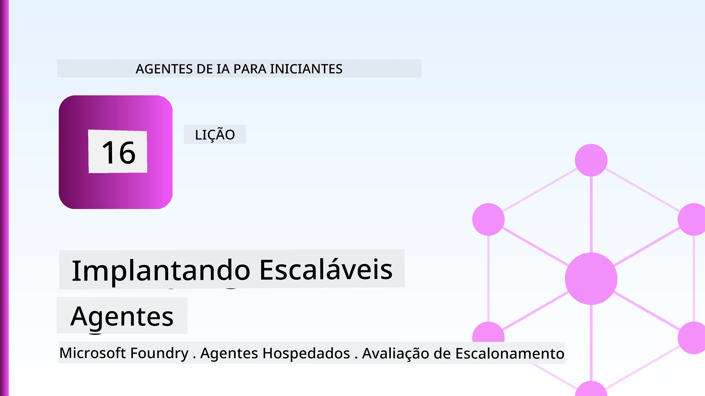
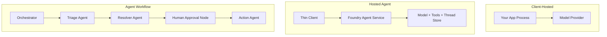
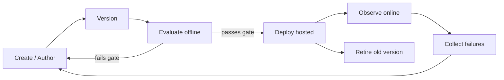
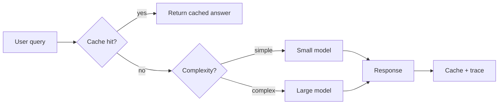
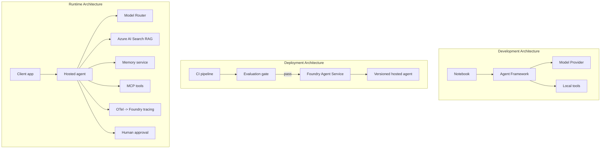

# Implantando Agentes Escaláveis com Microsoft Foundry



Até este ponto do curso, você construiu agentes que rodam no seu laptop, dentro de um notebook, conduzidos por `az login` e algumas variáveis de ambiente. Essa é exatamente a maneira certa de aprender. Não é a maneira correta de executar um agente do qual milhares de clientes dependem às 3 da manhã.

Esta lição trata da lacuna entre "funciona na minha máquina" e "funciona, de forma confiável e acessível, em produção." Fechamos essa lacuna usando o **Microsoft Foundry** e o **Microsoft Foundry Agent Service**, e fazemos isso construindo um agente real de suporte ao cliente que possui ferramentas, recuperação, memória, avaliação e monitoramento.

## Introdução

Esta lição cobrirá:

- A diferença entre um **agente protótipo** e um **agente implantado**, e por que a transição é principalmente sobre tudo que está *ao redor* do modelo.
- **Padrões de implantação** para agentes: hospedado no cliente, hospedado como serviço (Hosted Agents) e orquestrado por fluxo de trabalho.
- O **ciclo de vida do agente** no Microsoft Foundry — criar, versionar, implantar, avaliar, observar, aposentar.
- **Estratégias de escalabilidade**: roteamento de modelo, cache, concorrência e design stateless.
- **Observabilidade** com OpenTelemetry e rastreamento Foundry.
- **Otimização de custos** por meio de seleção de modelo, roteamento e portões de avaliação.
- **Considerações empresariais**: governança, aprovação humana e execução segura de servidores MCP em produção.

## Objetivos de Aprendizagem

Após concluir esta lição, você saberá como:

- Escolher o padrão de implantação certo para uma carga de trabalho de agente específica.
- Implantar um agente no Microsoft Foundry Agent Service para que seja versionado, governado e observável.
- Instrumentar um agente para rastreamento e conectar um pipeline de avaliação que roda antes de cada versão.
- Aplicar roteamento de modelos e caching para manter a latência e custo sob controle em escala.
- Adicionar um portão de aprovação humana para ações de alto risco e integrar um servidor MCP de maneira segura para produção.

## Pré-requisitos

Esta lição pressupõe que você completou as lições anteriores e está confortável com:

- Construção de agentes com o [Microsoft Agent Framework](../14-microsoft-agent-framework/README.md) (Lição 14).
- [Uso de ferramentas](../04-tool-use/README.md) (Lição 4) e [Agentic RAG](../05-agentic-rag/README.md) (Lição 5).
- [Memória do Agente](../13-agent-memory/README.md) (Lição 13) e [Protocolos Agentes / MCP](../11-agentic-protocols/README.md) (Lição 11).
- [Observabilidade e Avaliação](../10-ai-agents-production/README.md) (Lição 10) — esta lição se baseia diretamente nela.

Você também precisará de:

- Uma **assinatura Azure** e um **projeto Microsoft Foundry** com pelo menos um modelo de chat implantado.
- O **Azure CLI** autenticado (`az login`).
- Python 3.12+ e os pacotes do repositório [`requirements.txt`](../../../requirements.txt).

## Do Protótipo à Produção: O Que Realmente Muda

Um agente protótipo e um agente de produção compartilham o mesmo ciclo principal — raciocinar, chamar ferramentas, responder. O que muda é tudo que envolve esse ciclo. O modelo é talvez 20% de um agente de produção; os outros 80% são o esqueleto operacional.

| Preocupação | Protótipo | Produção |
| --- | --- | --- |
| **Hospedagem** | Roda no seu notebook | Roda como serviço hospedado, versionado e distribuído |
| **Identidade** | Seu token `az login` | Identidade gerenciada com RBAC com escopo |
| **Estado** | Em memória, perdido na reinicialização | Externalizado (armazenamento de threads, serviço de memória) |
| **Falha** | Você vê o rastreamento de erro | Tentativas, fallback, fila de mensagens mortas, alertas |
| **Custo** | "São só alguns centavos" | Monitorado por solicitação, roteado, em cache, orçado |
| **Qualidade** | Você avalia visualmente a saída | Avaliado automaticamente antes de cada lançamento |
| **Confiança** | Você aprova cada ação | Política + humano no loop para ações arriscadas |

Tenha esta tabela em mente. Cada seção abaixo corresponde a uma destas linhas.

## Padrões de Implantação de Agentes

Existem três padrões que você usará, muitas vezes em combinação.

### 1. Agentes Hospedados no Cliente

O objeto agente vive dentro do *seu* processo de aplicação. Seu código chama diretamente o provedor do modelo; o ciclo de raciocínio roda em seu serviço. Isso é o que todas as lições anteriores fizeram.

- **Use quando** você precisar de controle total sobre o ciclo, middleware personalizado ou estiver incorporando o agente dentro de um backend existente.
- **Compromisso**: você é responsável pela escalabilidade, estado e resiliência.

### 2. Agentes Hospedados (Foundry Agent Service)

O agente é *registrado como um recurso* no Microsoft Foundry. Foundry hospeda o ciclo de raciocínio, armazena threads, aplica segurança de conteúdo e RBAC, e torna o agente visível no portal Foundry. Seu app se torna um cliente leve que cria threads e lê respostas.

- **Use quando** quiser durabilidade, observabilidade embutida, governança e menor superfície operacional.
- **Compromisso**: menos controle de baixo nível em troca de um ambiente gerenciado.

### 3. Fluxos de Trabalho de Agentes

Vários agentes (e ferramentas) são compostos em um grafo com fluxo de controle explícito — etapas sequenciais, ramificações, nós de aprovação humana e pontos de verificação duráveis que podem pausar e retomar. Esta é a capacidade **Workflows** do Microsoft Agent Framework aplicada em escala de implantação.

- **Use quando** uma tarefa única envolve vários agentes especializados ou requer uma etapa de aprovação no meio.
- **Compromisso**: mais partes móveis; necessidade de observabilidade no nível de orquestração.



## O Ciclo de Vida do Agente no Microsoft Foundry

Implantar um agente não é uma operação única `push`. É um ciclo, e se parece muito com um ciclo de liberação de software porque é exatamente isso.



A ideia chave, trazida da [Lição 10](../10-ai-agents-production/README.md): **a avaliação offline é um portão, não um pensamento tardio.** Uma nova versão do agente não é lançada a menos que ultrapasse seus limites de avaliação. A observabilidade online então alimenta falhas reais no conjunto de testes offline. Esse é todo o ciclo.

## Estratégias de Escalabilidade

Escalar um agente é diferente de escalar uma API web stateless, porque cada solicitação pode desencadear várias chamadas caras de modelo e ferramentas. Quatro técnicas carregam a maior parte da carga.

**Manipulação stateless de solicitações.** Não armazene estado por usuário na memória do processo. Persista os threads de conversa no armazenamento de threads do Foundry ou em um serviço de memória para que qualquer instância possa lidar com qualquer solicitação. Isso é o que permite escalar horizontalmente — adicione instâncias, sem sessões fixas.

**Roteamento de modelo.** Nem toda solicitação precisa do seu modelo mais capaz (e mais caro). Direcione solicitações simples — classificação de intenção, respostas factuais curtas — para um modelo pequeno e rápido, e reserve o modelo grande para raciocínios genuínos. O **Model Router** do Foundry pode fazer isso para você, ou você pode implementar um classificador leve você mesmo. Você construirá a versão DIY no laboratório.

**Cache de resposta.** Muitas consultas de suporte são quase duplicatas ("como redefinir minha senha?"). Armazene em cache respostas para perguntas comuns e as sirva sem precisar chamar o modelo. Mesmo uma taxa modesta de acerto no cache reduz significativamente custo e latência.

**Concorrência e controle de pressão.** Provedores de modelo têm limites de taxa. Controle sua concorrência, use tentativas com backoff exponencial e falhe de forma graciosa (uma resposta em fila "estamos cuidando disso" é melhor que um erro 500).



## Observabilidade em Produção

Você não pode operar o que não pode ver. Conforme coberto na Lição 10, o Microsoft Agent Framework emite traços **OpenTelemetry** nativamente — cada chamada de modelo, invocação de ferramenta e etapa de orquestração vira um span. Em produção, você exporta esses spans para o Microsoft Foundry (ou qualquer backend compatível com OTel) para que possa:

- Rastrear uma única reclamação do cliente de ponta a ponta em todas as chamadas de modelo e ferramenta.
- Observar a latência p50/p95 e custo por solicitação ao longo do tempo.
- Alertar sobre picos de taxa de erro e anomalias de custo antes que seus usuários (ou a equipe financeira) percebam.

```python
from agent_framework.observability import get_tracer

tracer = get_tracer()

with tracer.start_as_current_span("support_request") as span:
    span.set_attribute("customer.tier", "enterprise")
    span.set_attribute("routed.model", "gpt-5-nano")
    # agent execution is traced automatically inside this span
```

Atributos como `customer.tier` e `routed.model` são o que transformam um muro de traços em perguntas respondíveis ("os clientes empresariais estão sendo roteados para o modelo pequeno com muita frequência?").

## Otimização de Custos

O custo em agentes de produção é dominado por tokens. Três alavancas, em ordem de impacto:

1. **Ajustar o tamanho do modelo.** Um modelo pequeno que passa no seu portão de avaliação quase sempre é mais barato que um grande que também passa. Use a avaliação para *provar* que o modelo pequeno é bom o suficiente em vez de escolher o maior por precaução.
2. **Roteie por complexidade.** Como acima — pague preços de modelo grande somente para solicitações que precisam de raciocínio de modelo grande.
3. **Cache agressivamente.** A chamada de modelo mais barata é aquela que você nunca faz.

Portões de avaliação e controle de custos são a mesma disciplina vista de dois ângulos: avaliação mostra o *piso de qualidade*, roteamento e caching mantêm você perto do *custo* desse piso.

## Considerações Empresariais para Implantação

**Governança.** Agentes hospedados herdam o RBAC, segurança de conteúdo e registro de auditoria do Foundry. Dê a cada agente uma identidade gerenciada com o menor privilégio necessário — acesso somente leitura à base de conhecimento, acesso com escopo à API de tickets, nada mais.

**Humano no loop.** Algumas ações são muito críticas para automatizar totalmente — emitir um reembolso, excluir uma conta, escalar para um time jurídico. O Microsoft Agent Framework suporta ferramentas **que requerem aprovação**: o agente propõe a ação, a execução pausa, um humano aprova ou rejeita, e o fluxo de trabalho retoma. Você viu o primitivo na [Lição 6](../06-building-trustworthy-agents/README.md); aqui você o implanta.

**MCP em produção.** [MCP](../11-agentic-protocols/README.md) permite que seu agente consuma ferramentas externas por meio de uma interface padrão. Em produção, trate cada servidor MCP como um limite não confiável: fixe a versão do servidor, execute-o com uma identidade com escopo, valide suas saídas, e nunca exponha segredos a ele. Um servidor MCP é uma dependência, e dependências são atualizadas, auditadas e têm limites de taxa.



Esses três diagramas — desenvolvimento, implantação, tempo de execução — são o mesmo agente em três estágios da vida. O laboratório a seguir guia você na construção dele.

## Laboratório Prático: Um Agente de Suporte ao Cliente Pronto para Produção

Abra [`code_samples/16-python-agent-framework.ipynb`](./code_samples/16-python-agent-framework.ipynb) e execute-o do início ao fim. Você montará um **agente de suporte ao cliente Contoso** com todas as preocupações de produção integradas:

1. **Chamada de ferramentas** — consultar status de pedido e abrir tickets de suporte.
2. **RAG** — responder perguntas de políticas de uma base de conhecimento (Azure AI Search, com fallback em memória para o notebook funcionar sem recurso Search).
3. **Memória** — lembrar o cliente entre as interações da conversa.
4. **Roteamento de modelos** — um classificador de complexidade direciona cada solicitação para um modelo pequeno ou grande.
5. **Cache de resposta** — perguntas repetidas são servidas do cache.
6. **Aprovação humana** — reembolsos acima de um limite pausam para assinatura humana.
7. **Pipeline de avaliação** — um pequeno conjunto de testes offline pontua o agente e atua como portão de liberação.
8. **Observabilidade** — rastreamento OpenTelemetry em cada requisição.

### Passo a passo

O notebook está organizado de modo que cada preocupação de produção é uma seção auto-contida e executável. O coração dele é o manipulador de requisições com roteamento e caching:

```python
async def handle_support_request(query: str, customer_id: str) -> str:
    # 1. Serve from cache when we can.
    cached = response_cache.get(normalize(query))
    if cached:
        return cached

    # 2. Route by complexity to control cost.
    model = "gpt-5-nano" if is_simple(query) else "gpt-5-mini"

    # 3. Run the agent inside a trace span for observability.
    with tracer.start_as_current_span("support_request") as span:
        span.set_attribute("routed.model", model)
        span.set_attribute("customer.id", customer_id)
        response = await support_agent.run(query, model=model)

    # 4. Cache and return.
    response_cache.set(normalize(query), response.text)
    return response.text
```

O portão de avaliação que protege uma liberação é assim:

```python
async def evaluation_gate(agent, test_cases, threshold: float = 0.8) -> bool:
    passed = 0
    for case in test_cases:
        result = await agent.run(case["input"])
        if score_response(result.text, case["expected"]) >= 0.8:
            passed += 1
    pass_rate = passed / len(test_cases)
    print(f"Evaluation pass rate: {pass_rate:.0%} (gate: {threshold:.0%})")
    return pass_rate >= threshold  # only deploy if the gate passes
```

Leia cada linha — o notebook mantém os primitivos deliberadamente pequenos para que nada fique oculto por uma chamada de framework.

## Validando um Agente Implantado com Testes Smoke

O portão de avaliação acima roda *offline* contra seu objeto agente. Uma vez que o agente é implantado como Hosted Agent, você precisa de mais uma checagem, ainda mais barata: **o endpoint implantado está realmente respondendo?**

Implantar "com sucesso" só prova que o plano de controle aceitou a definição — não prova que o agente responde. Uma dependência ausente, um roteamento ruim de modelo ou uma conexão expirada pode deixar uma implantação verde que não retorna nada. Um **teste smoke** captura isso em segundos, a cada implantação, sem o custo de uma avaliação completa.

Este repositório fornece um pipeline de teste smoke pronto para uso, construído sobre a GitHub Action [AI Smoke Test](https://github.com/marketplace/actions/ai-smoke-test):

- **Catálogo** — [`tests/lesson-16-smoke-tests.json`](../../../tests/lesson-16-smoke-tests.json) contém prompts e afirmações para o agente de suporte Contoso (respostas baseadas em políticas, consulta de pedidos, manter-se no tema, e continuidade de thread em múltiplas interações). Catálogos para agentes de outras lições ficam ao lado — veja [`tests/README.md`](../tests/README.md).
- **Workflow** — [`.github/workflows/smoke-test.yml`](../../../.github/workflows/smoke-test.yml) faz login com Azure OIDC e POSTA cada prompt no endpoint Responses do agente, falhando a tarefa em qualquer afirmação não satisfeita.

```yaml
- name: Smoke-test hosted agent
  uses: JFolberth/ai-smoketest@v1
  with:
    project_endpoint: ${{ inputs.project_endpoint }}
    agent_name: ContosoSupportAgent
    tests_file: tests/lesson-16-smoke-tests.json
```

Execute-o na aba **Actions** depois que seu agente estiver implantado, fornecendo o endpoint do seu projeto Foundry e o nome do agente. A identidade federada precisa da função **Azure AI User** no escopo do projeto Foundry. Pense nas camadas como uma pirâmide: testes rápidos (alcance e resposta?) são executados em toda implantação, avaliação offline (bom o suficiente para lançar?) é executada antes da promoção, e avaliação online (como está no ambiente real?) é executada continuamente.

## Verificação de Conhecimento

Teste seu entendimento antes de avançar para a tarefa.

**1. Aproximadamente quanto de um agente de produção é "o modelo" e o que é o restante?**

<details>
<summary>Resposta</summary>

O modelo é uma minoria do sistema — frequentemente citado como cerca de 20%. O resto é o esqueleto operacional: hospedagem e versionamento, identidade e RBAC, estado externalizado, tratamento de falhas, monitoramento de custos, avaliação e controles humanos no loop. Passar para produção é principalmente sobre construir tudo *ao redor* do ciclo de raciocínio.
</details>

**2. Quando você escolheria um Hosted Agent em vez de um agente hospedado no cliente?**

<details>
<summary>Resposta</summary>

Quando você quer um runtime gerenciado com durabilidade embutida (threads que persistem e podem retomar), observabilidade, segurança de conteúdo e RBAC, e está disposto a trocar algum controle de baixo nível do ciclo de raciocínio por uma menor área operacional. O hospedado no cliente é preferível quando você precisa de controle total sobre o ciclo ou está incorporando o agente em um backend existente.
</details>

**3. Por que um agente escalável deve ser sem estado na própria memória do processo?**

<details>
<summary>Resposta</summary>

Para que qualquer instância possa atender qualquer solicitação, o que permite escalonamento horizontal sem sessões fixas. O estado da conversa por usuário é externalizado para uma loja de threads ou serviço de memória. Se o estado vivesse na memória do processo, você o perderia na reinicialização e não poderia distribuir a carga livremente.
</details>

**4. Que problema o roteamento de modelo resolve e como ele se relaciona com a avaliação?**

<details>
<summary>Resposta</summary>

O roteamento envia solicitações simples para um modelo pequeno, barato e rápido e reserva o modelo grande para raciocínio genuíno, controlando tanto a latência quanto o custo. Relaciona-se com a avaliação porque a avaliação é o que *prova* que o modelo pequeno é bom o suficiente para uma classe de solicitações — roteamento sem avaliação é um palpite.
</details>

**5. O que é um "portão de avaliação" e onde ele se situa no ciclo de vida?**

<details>
<summary>Resposta</summary>

Um portão de avaliação executa um conjunto de testes offline contra uma nova versão do agente e bloqueia a implantação a menos que a taxa de aprovação ultrapasse um limite. Ele fica entre "versão" e "implantação" no ciclo de vida, tornando a qualidade uma pré-condição para o lançamento em vez de algo que se verifica após o envio.
</details>

**6. Por que um servidor MCP deve ser tratado como um limite não confiável em produção?**

<details>
<summary>Resposta</summary>

Porque é uma dependência externa que seu agente chama. Você deve fixar sua versão, executar com uma identidade de escopo, validar suas saídas, limitar a taxa e nunca expor segredos a ele — a mesma disciplina aplicada a qualquer dependência de terceiros. Suas saídas fluem para o raciocínio do seu agente, então confiança não validada é um risco de segurança.
</details>

**7. Qual mudança única geralmente tem o maior impacto no custo de um agente em produção, e por quê?**

<details>
<summary>Resposta</summary>

Dimensionar corretamente o modelo — usar o menor modelo que ainda passa no seu portão de avaliação. O custo é dominado por tokens, e um modelo menor que atenda à qualidade quase sempre é mais barato do que um maior. Cache e roteamento reduzem ainda mais o custo, mas escolher o modelo base certo tem o maior efeito de primeira ordem.
</details>

**8. Que papel atributos de span como `customer.tier` e `routed.model` desempenham na observabilidade?**

<details>
<summary>Resposta</summary>

Eles transformam rastreamentos brutos em perguntas comerciais respondíveis. Sem atributos, você tem uma parede de spans; com eles, você pode perguntar "os clientes corporativos estão sendo roteados para o modelo pequeno com muita frequência?" ou "qual modelo lida com as consultas mais lentas?" Atributos são como você fatia a telemetria pelas dimensões que importam para sua operação.
</details>

## Tarefa

Pegue o agente de suporte ao cliente do laboratório e o fortaleça para um cenário específico: **um agente de suporte de cobrança de assinaturas para uma empresa SaaS.**

Sua submissão deve:

1. **Substituir as ferramentas** por outras relevantes para cobrança: `get_subscription_status`, `get_invoice` e `issue_credit` (créditos acima de $50 requerem aprovação humana).
2. **Adicionar três documentos RAG** cobrindo a política de reembolso da empresa, ciclo de cobrança e política de cancelamento.
3. **Estender o conjunto de avaliação** para pelo menos oito casos, incluindo pelo menos dois que *devem* acionar o caminho de aprovação humana, e confirmar que seu portão de avaliação aprova ou reprova corretamente.
4. **Adicionar um relatório de custo**: após executar dez consultas mistas pelo agente, imprimir quantas foram para o modelo pequeno, quantas para o modelo grande e quantas foram atendidas do cache.

Escreva um parágrafo curto (em uma célula markdown) explicando qual regra de roteamento de modelo você escolheu e como a validaria com tráfego real. Não há uma resposta única correta — você será avaliado sobre se as preocupações de produção estão conectadas de maneira coerente.

## Resumo

Nesta lição, você levou um agente de protótipo a produção com Microsoft Foundry:

- A transição para produção é principalmente sobre o **esqueleto operacional** em torno do modelo — hospedagem, identidade, estado, tratamento de falhas, custo, qualidade e confiança.
- Você aprendeu os três **padrões de implantação** — hospedado no cliente, Hosted Agents e Agent Workflows — e quando cada um é adequado.
- Você percorreu o **ciclo de vida do agente**, onde a avaliação offline **atua como um portão de liberação** e a observabilidade online alimenta falhas de volta ao conjunto de testes.
- Aplicou **estratégias de escalonamento** — design sem estado, roteamento de modelo, cache e concorrência limitada — e as conectou à **otimização de custos**.
- Integrado **controles empresariais**: RBAC, aprovação humana no loop, e integração MCP segura para produção.
- Você construiu um **agente de suporte ao cliente pronto para produção** que conecta todas essas preocupações em código executável.

A próxima lição faz a jornada oposta: em vez de escalar agentes para a nuvem, você os trará *para baixo* a uma única máquina de desenvolvedor e os executará inteiramente localmente.

## Recursos Adicionais

- <a href="https://learn.microsoft.com/azure/ai-foundry/what-is-azure-ai-foundry" target="_blank">Documentação Microsoft Foundry</a>
- <a href="https://learn.microsoft.com/azure/ai-foundry/agents/overview" target="_blank">Visão geral do Serviço de Agentes Microsoft Foundry</a>
- <a href="https://learn.microsoft.com/en-us/agent-framework/overview/?wt.mc_id=youtube_26688_organicsocial_reactor&pivots=programming-language-python" target="_blank">Microsoft Agent Framework</a>
- <a href="https://learn.microsoft.com/en-us/azure/ai-foundry/openai/concepts/model-router" target="_blank">Model Router no Microsoft Foundry</a>
- <a href="https://learn.microsoft.com/azure/search/search-what-is-azure-search" target="_blank">Azure AI Search</a>
- <a href="https://opentelemetry.io/" target="_blank">OpenTelemetry</a>
- <a href="https://github.com/marketplace/actions/ai-smoke-test" target="_blank">AI Smoke Test GitHub Action</a>
- <a href="https://modelcontextprotocol.io/" target="_blank">Protocolo de Contexto de Modelo (MCP)</a>

## Lição Anterior

[Construindo Agentes de Uso Computacional (CUA)](../15-browser-use/README.md)

## Próxima Lição

[Criando Agentes de IA Locais](../17-creating-local-ai-agents/README.md)

---

<!-- CO-OP TRANSLATOR DISCLAIMER START -->
**Aviso Legal**:
Este documento foi traduzido usando o serviço de tradução por IA [Co-op Translator](https://github.com/Azure/co-op-translator). Embora nos esforcemos pela precisão, por favor, esteja ciente de que traduções automatizadas podem conter erros ou imprecisões. O documento original em seu idioma nativo deve ser considerado a fonte autorizada. Para informações críticas, recomenda-se tradução profissional humana. Não nos responsabilizamos por quaisquer mal-entendidos ou interpretações incorretas decorrentes do uso desta tradução.
<!-- CO-OP TRANSLATOR DISCLAIMER END -->