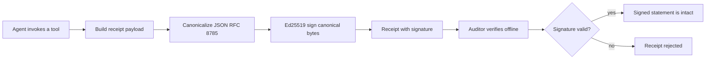
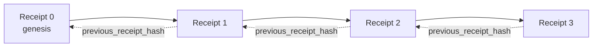

[Assista ao vídeo da lição: Protegendo Agentes de IA com Recibos Criptográficos](https://youtu.be/PLACEHOLDER_VIDEO_ID)

> _(Vídeo da lição e miniatura a serem adicionados pela equipe de conteúdo Microsoft após a fusão, seguindo o padrão das lições 14 / 15.)_

# Protegendo Agentes de IA com Recibos Criptográficos

## Introdução

Esta lição abordará:

- Por que trilhas de auditoria para agentes de IA são importantes para conformidade, depuração e confiança.
- O que é um recibo criptográfico e como ele difere de uma linha de log não assinada.
- Como produzir um recibo assinado para a chamada de uma ferramenta do agente em Python puro.
- Como verificar um recibo offline e detectar adulteração.
- Como encadear recibos para que a remoção ou mudança de ordem de um deles quebre a cadeia.
- O que os recibos provam e o que eles explicitamente não provam.

## Objetivos de Aprendizagem

Após completar esta lição, você saberá como:

- Identificar os modos de falha que motivam a proveniência criptográfica para as ações do agente.
- Produzir um recibo assinado com Ed25519 sobre uma carga JSON canônica.
- Verificar um recibo independentemente usando apenas a chave pública do signatário.
- Detectar adulteração ao refazer a verificação em um recibo modificado.
- Construir uma sequência de recibos encadeados por hash e explicar por que a cadeia importa.
- Reconhecer o limite entre o que os recibos provam (atribuição, integridade, ordenação) e o que eles não provam (correção da ação, validade da política).

## O Problema: A Trilha de Auditoria do Seu Agente

Imagine que você implantou um agente de IA para a Contoso Travel. O agente lê solicitações dos clientes, chama uma API de voos para procurar opções e reserva assentos em nome do cliente. No último trimestre, o agente processou 50.000 reservas.

Hoje, um auditor chega. Ele faz uma pergunta simples: "Mostre-me o que seu agente fez."

Você entrega seus arquivos de log. O auditor os examina e faz uma pergunta mais difícil: "Como posso saber que esses logs não foram editados?"

Este é o problema da trilha de auditoria. A maioria das implantações de agentes hoje depende de:

- **Logs de aplicação**: escritos pelo próprio agente, editáveis por qualquer pessoa com acesso ao sistema de arquivos.
- **Serviços de logging em nuvem**: evidência de adulteração ao nível da plataforma, mas somente se o auditor confiar no operador da plataforma.
- **Logs de transação de banco de dados**: adequados para mudanças no banco, mas não para chamadas arbitrárias de ferramentas.

Nenhum destes pode responder à pergunta do auditor sem exigir que ele confie em alguém (você, seu provedor de nuvem, seu fornecedor de banco de dados). Para uso interno, essa confiança é muitas vezes aceitável. Para cargas reguladas (finanças, saúde, qualquer coisa sujeita à Lei de IA da UE), não é.

Recibos criptográficos reduzem esse problema ao tornar uma declaração assinada independentemente
verificável. O auditor ainda precisa de uma razão fora da banda para confiar na chave de assinatura e
no componente que produziu a declaração. Uma chave embutida prova autoconsistência,
não identidade do emissor ou ponto de aplicação.

## O que é um Recibo Criptográfico?

Um recibo é um objeto JSON que registra o que um agente fez, assinado com uma assinatura digital.



Um recibo mínimo se parece com isto:

```json
{
  "type": "agent.tool_call.v1",
  "agent_id": "contoso-travel-bot",
  "tool_name": "lookup_flights",
  "tool_args_hash": "sha256:a3f9c1...",
  "result_hash": "sha256:7b2e1d...",
  "policy_id": "contoso-travel-policy-v3",
  "timestamp": "2026-04-25T14:30:00Z",
  "sequence": 47,
  "previous_receipt_hash": "sha256:9d4e6a...",
  "signature": {
    "alg": "EdDSA",
    "sig": "c5af83...",
    "public_key": "8f3b2c..."
  }
}
```

Três propriedades realizam o trabalho:

1. **A assinatura**. O recibo é assinado pela gateway do agente usando uma chave privada Ed25519. Qualquer pessoa com a chave pública correspondente pode verificar a assinatura offline. Uma parte confiável deve fixar essa chave ou resolvê-la a partir de um registro confiável fora do recibo. Qualquer adulteração em um campo assinado invalida a assinatura.

2. **Codificação canônica**. Antes da assinatura, o recibo é serializado usando o Esquema de Canonicalização JSON (JCS, RFC 8785). Isso garante que duas implementações produzindo o mesmo recibo lógico gerem uma saída idêntica byte a byte. Sem a canonicalização, diferentes serializadores JSON produziriam assinaturas diferentes para o mesmo conteúdo.

3. **Encadeamento de hash**. O campo `previous_receipt_hash` liga cada recibo ao anterior. Remover ou reordenar um recibo quebra a sequência apresentada. Detectar truncamento ou reescrita controlada pelo signatário também requer uma cabeça de cadeia atual fixada, checkpoint testemunhado de forma independente ou comprometimento autenticado de população fechada.

Juntas, essas propriedades fornecem três garantias:

- **Atribuição a uma chave**: esta chave assinou este conteúdo. Identidade organizacional ou humana requer uma vinculação confiável da chave.
- **Integridade**: o conteúdo não mudou desde a assinatura.
- **Ordenação dentro da sequência verificada**: este recibo está ligado a esse predecessor.

## Produzindo um Recibo em Python

Você não precisa de uma biblioteca especial para produzir um recibo. Os primitivos criptográficos são amplamente disponíveis e a lógica é algumas dezenas de linhas em Python.

Os exercícios práticos em `code_samples/18-signed-receipts.ipynb` percorrem o fluxo completo. O `code_samples/18-signed-receipts.execution-receipt.json`, versionado no controle-fonte, registra o hash exato do notebook, o ambiente Python, a contagem de células e as verificações da última execução limpa sem alterar as saídas salvas da lição. A versão resumida:

```python
import json
import hashlib
import base64
from nacl import signing
from jcs import canonicalize  # RFC 8785 canonical JSON

def b64url_nopad(data: bytes) -> str:
    return base64.urlsafe_b64encode(data).decode("ascii").rstrip("=")

def sha256_canonical(obj) -> str:
    """SHA-256 of a Python object's JCS-canonical JSON form."""
    return f"sha256:{hashlib.sha256(canonicalize(obj)).hexdigest()}"

# Generate or load a signing key (in production, store in a key vault)
signing_key = signing.SigningKey.generate()
verify_key = signing_key.verify_key
TRUSTED_PUBLIC_KEYS = {b64url_nopad(bytes(verify_key))}  # pinned out of band by the verifier

# Build the receipt payload (no signature yet)
tool_args = {"origin": "SYD", "destination": "LAX"}
tool_result = [{"flight": "QF11", "price": 1850, "stops": 0}]

payload = {
    "type": "agent.tool_call.v1",
    "agent_id": "contoso-travel-bot",
    "tool_name": "lookup_flights",
    "tool_args_hash": sha256_canonical(tool_args),
    "result_hash": sha256_canonical(tool_result),
    "policy_id": "contoso-travel-policy-v3",
    "timestamp": "2026-04-25T14:30:00Z",
    "sequence": 0,
    "previous_receipt_hash": None,
}

# Canonicalize and sign the JCS bytes directly. PureEdDSA hashes internally.
canonical_bytes = canonicalize(payload)
signature_bytes = signing_key.sign(canonical_bytes).signature

# Attach a structured signature object.
receipt = {
    **payload,
    "signature": {
        "alg": "EdDSA",
        "sig": b64url_nopad(signature_bytes),
        "public_key": b64url_nopad(bytes(verify_key)),
    },
}
```

Este é todo o pipeline de assinatura. Os exercícios no notebook detalham cada passo.

## Verificando um Recibo e Detectando Adulteração

A verificação é a operação inversa:

```python
import base64
import hashlib
from nacl import signing
from nacl.exceptions import CryptoError
from jcs import canonicalize

def b64url_decode(s: str) -> bytes:
    # Strict: Python's decoder skips characters outside the alphabet and also
    # accepts padding, the standard +/ alphabet and non-zero spare bits.
    # Re-encoding and comparing accepts only the one unpadded base64url form.
    padding = "=" * ((4 - len(s) % 4) % 4)
    data = base64.urlsafe_b64decode(s + padding)
    if base64.urlsafe_b64encode(data).decode("ascii").rstrip("=") != s:
        raise ValueError("not canonical unpadded base64url")
    return data

def verify_receipt(receipt: dict, trusted_public_key: str) -> bool:
    # trusted_public_key is the issuer's key, obtained from somewhere other
    # than this receipt. Never use receipt["signature"]["public_key"] here:
    # see "What Receipts Prove (and What They Do Not)" below.
    # Fails closed: anything malformed returns False instead of raising.
    if not isinstance(receipt, dict) or not isinstance(trusted_public_key, str):
        return False
    sig_obj = receipt.get("signature")
    if not isinstance(sig_obj, dict) or sig_obj.get("alg") != "EdDSA":
        return False
    sig_b64 = sig_obj.get("sig")
    if not isinstance(sig_b64, str):
        return False

    try:
        # Reconstruct the payload that was actually signed (everything except signature).
        payload = {k: v for k, v in receipt.items() if k != "signature"}
        canonical_bytes = canonicalize(payload)
        verify_key = signing.VerifyKey(b64url_decode(trusted_public_key))
        verify_key.verify(canonical_bytes, b64url_decode(sig_b64))
        return True
    except (CryptoError, TypeError, ValueError, KeyError, OverflowError):
        return False
    except Exception:
        # An undecodable key or signature, or a payload that cannot be
        # canonicalized: fail closed rather than raise.
        return False
```

Esta função recebe um recibo e a chave pública do emissor, e retorna `True` se a assinatura for válida e `False` caso contrário, inclusive quando a entrada está malformada. Sem chamada de rede e sem serviço de verificação: uma vez que você tem a chave do emissor, a verificação é totalmente local e offline. O que ela ainda exige é essa chave, obtida de algum lugar fora do próprio recibo.

Para ver a detecção de adulteração em ação, o notebook percorre:

1. Produzir um recibo válido e confirmar que ele verifica.
2. Modificar um byte do campo `tool_args_hash`.
3. Refazer a verificação e ver que falha.
4. Adulterar novamente, mas desta vez remontar a assinatura com uma chave gerada pelo atacante e embutir essa chave no recibo.

O passo 4 é o que vale a pena refletir. Esse recibo é internamente consistente: sua assinatura é genuína para seu conteúdo e para a chave que carrega, então verifica com a chave dentro dele. Falha somente quando verificado contra a chave real do emissor. Passos 2 e 3 capturam um atacante que não se deu ao trabalho de remontar a assinatura; o passo 4 captura o que o fez.

Esta é a demonstração prática de que recibos são evidentes contra adulteração: qualquer alteração em um campo assinado quebra a assinatura, desde que você verifique contra uma chave que o atacante não forneceu. O objeto `signature` está fora dos bytes assinados, por isso a chave contra a qual você verifica precisa vir de algum lugar fora do recibo.

## Encadeando Recibos para Agentes Multi-etapas

Um único recibo assinado protege uma ação. Uma cadeia de recibos protege uma sequência.



Cada recibo registra o hash do recibo anterior. Para remover silenciosamente o recibo 2, um atacante precisaria:

- Modificar o campo `previous_receipt_hash` no recibo 3 (quebraria a assinatura do recibo 3), OU
- Forjar uma nova assinatura no recibo 3 modificado (exige a chave privada do agente).

Se a chave privada estiver em um cofre de hardware e os verificadores checarem cada recibo contra a chave pública do emissor, obtida independentemente (um conjunto JWK publicado ou um valor de configuração fixado), nenhum desses ataques é factível sem detecção. Publicar a chave dentro de cada recibo não é suficiente: um atacante pode re-assinar com sua própria chave e embutir essa, que é a armadilha `04_resigned_receipt.json`.

O notebook percorre:

1. Construir uma cadeia de três recibos.
2. Verificar que o campo `previous_receipt_hash` de cada recibo coincide com o hash real do recibo anterior.
3. Adulterar um recibo no meio e ver a cadeia quebrar exatamente nesse ponto.

É assim que se produz uma trilha de auditoria que um auditor externo pode verificar usando suas próprias
chaves fixadas do emissor e checkpoints da cadeia, sem confiar no seu armazenamento mutável de logs.

## O que os Recibos Provam (e o que Não Provam)

Esta é a seção mais importante desta lição. Recibos são poderosos, mas seu poder é limitado.

**Recibos provam três coisas:**

1. **Atribuição**: uma chave específica assinou uma carga específica.
2. **Integridade**: a carga não mudou desde a assinatura.
3. **Ordenação dentro de uma sequência apresentada e verificada**: este recibo está ligado a esse predecessor.

**Recibos NÃO provam:**

1. **Correção**: que a ação do agente foi a ação correta. Um recibo pode ser assinado para uma resposta errada com a mesma facilidade que para uma resposta correta.
2. **Conformidade com a política**: que a política referida em `policy_id` foi realmente avaliada, ou que teria permitido essa ação se checada. O recibo registra o que foi alegado, não o que foi aplicado.
3. **Identidade além da chave**: o recibo diz "esta chave assinou este conteúdo." Não diz "este humano autorizou isso." Ligar uma chave a uma pessoa ou organização requer infraestrutura de identidade separada (um diretório, um registro público de chaves etc.).
4. **Verdade dos dados de entrada**: se o agente recebe um prompt manipulado e age sobre ele, o recibo registra a ação fielmente. Recibos são pós-validação de entrada, não substituto.
5. **Execução ou efeito no mundo real**: um recibo pós-chamada registra o que seu emissor afirma ter acontecido. Provar admissão ou reconciliar um efeito externo requer evidência do executor ou limite do provedor real.
6. **Completude**: ausência de recibo pode significar bloqueio, omissão, perda ou não instrumentação. Ausência vira evidência somente dentro de uma população fechada autenticada.
7. **Tempo confiável**: um timestamp assinado prova que o signatário carregou aquele valor, não que o valor estava correto. Tempo confiável precisa de autoridade de tempo separada ou checkpoint testemunhado.

**A chave no recibo não é a chave com a qual você verifica.** Isso decorre do ponto 3, e é o único lugar onde a distinção tem que mudar seu código, não seu entendimento. O `public_key` no exemplo acima está lá para que o exemplo seja autocontido. Um verificador nunca deve confiar nele. Qualquer um pode pegar um recibo, alterá-lo, assiná-lo com uma chave que gerou e embutir essa chave; o resultado verifica perfeitamente contra ele mesmo. Isso é a armadilha `04_resigned_receipt.json` em `sample_receipts/`, e é por isso que `verify_receipt` acima recebe a chave como argumento em vez de lê-la do recibo. Obtenha a chave do emissor independentemente, do conjunto JWK na Lista de Verificação de Produção abaixo ou outro âncora fixada antecipadamente, e verifique contra essa chave. Uma assinatura checada com uma chave que chegou no mesmo envelope prova apenas que o envelope é autoconsistente.

Este limite importa por duas razões:

- Ele diz para que os recibos são úteis: tornar o comportamento do agente auditável e evidente para adulteração, mesmo além de limites organizacionais.
- Ele diz quais camadas adicionais você ainda precisa: validação de entrada (Lição 6), aplicação de política (brevemente coberta abaixo), e infraestrutura de identidade (fora do escopo desta lição).

Um erro comum é presumir que "temos recibos" significa "estamos governados." Não significa. Recibos são a base. Governança é o sistema que você constrói por cima.

## Vinculando a Assinatura de um Aprovador à Ação Exata

O item 3 acima merece sua própria seção: um recibo de ação diz "esta chave assinou este conteúdo," jamais "um humano autorizou isso." Para ações de alto risco (reembolsos, deleções, transferências bancárias), uma assinatura separada do aprovador pode vincular a ação exata. Ligar essa chave a um humano e verificar a presença humana continuam responsabilidades separadas.

O notebook subsequente `code_samples/human-authorization-receipts.ipynb` adiciona um segundo tipo de recibo, `human.approval.v1`, no mesmo formato do envelope dos recibos da lição (uma carga tipada assinada por Ed25519 sobre seus bytes canônicos JCS, com o objeto `signature` fora dos bytes assinados). Uma chave aprovadora assina a **ação canônica completa e seu digest**; uma chave do agente assina uma alegação contendo o **mesmo digest de ação** e um `parent_approval_ref`, o `receipt_hash` da aprovação, mesma convenção que `previous_receipt_hash` na cadeia que você construiu acima. Um `verify_chain` percorre ambos artefatos sob **registros de chaves fixadas separados** (chaves aprovadoras vs chaves de agentes), assim o caminho de código é compartilhado, mas as autoridades nunca.

A propriedade que isso compra, dita cuidadosamente: *a chave aprovadora fixada assinou esta ação exata,
e a chave do agente depois assinou uma declaração carregando o mesmo digest da ação.*
Isso é evidência útil, mas não é por si só prova de que a ação foi executada. Para
controlar a execução, a aprovação exata também deve ser reservada e consumida uma vez no
limite real do executor; resultados desconhecidos do provedor devem permanecer desconhecidos em vez de
ser tentados cegamente novamente. Os fixtures de recusa no notebook testam a camada da cadeia de recibos:

- adulteração, confusão de procurador, chaves forjadas em qualquer lado e entrada malformada;
- **autoridade expirada**: uma assinatura que ainda verifica, recusada de qualquer forma porque a versão da política mudou, a chave do aprovador foi removida do registro fixado, ou a aprovação expirou antes do tempo de verificação fornecido;
- **substituição de digest**: um recibo de ação validamente assinado apontando para uma *aprovação real* que vincula uma *ação canônica diferente*.

Cada falha recusa com um motivo distinto, então um auditor lendo uma recusa pode saber se a autoridade expirou ou a ação alegada mudou. A verificação é somente leitura e repetível: não consome a aprovação nem invoca um provedor. Um executor separado precisa de proteção atômica durável de reprodução e resultados explícitos de sucesso, falha e indeterminado. O recibo de aprovação humana é uma composição educacional definida por esta lição, não um tipo de recibo definido por `draft-farley-acta-signed-receipts`.

## Referências de Produção

O código Python nesta lição é intencionalmente minimalista para que você possa ler cada linha e entender exatamente o que está acontecendo. Em produção, você tem duas opções:

1. **Construir diretamente nas primitivas criptográficas.** As 50 linhas que você viu acima são suficientes para muitos casos de uso. PyNaCl (Ed25519) e o pacote `jcs` (JSON canônico) são bibliotecas bem mantidas e auditadas.

2. **Usar uma biblioteca de recibos para produção.** Vários projetos de código aberto implementam o mesmo padrão com recursos adicionais (rotação de chaves, verificação em lote, distribuição JWK Set, integração com mecanismos de política):
   - A cadeia de assinatura usa as convenções JCS e de escopo da assinatura em um Internet-Draft independente do IETF ([`draft-farley-acta-signed-receipts`](https://datatracker.ietf.org/doc/draft-farley-acta-signed-receipts/), revisão 02). O recibo educacional plano desta lição difere da envelope `{payload, signature}` do draft e não é apresentado como uma implementação conforme. O draft publica um conjunto compartilhado de conformidade ([agent-governance-testvectors](https://github.com/ScopeBlind/agent-governance-testvectors)) para implementações direcionadas ao seu formato de transmissão.
   - O Microsoft Agent Governance Toolkit compõe recibos com decisões de política baseadas em Cedar; veja o Tutorial 33 nesse repositório para um exemplo completo.
   - Os pacotes `protect-mcp` (npm) e `@veritasacta/verify` (npm) fornecem uma implementação baseada em Node para assinatura de recibos e verificação offline, destinada a envolver qualquer servidor MCP com uma trilha de auditoria à prova de adulteração, incluindo um fluxo retido para coassinatura no qual uma ação pausada emite um recibo de aprovação vinculado ao resumo da ação (com respaldo WebAuthn no fluxo desktop), o mesmo padrão de recibo de aprovação do notebook de autorização humana acima.
   - O **[nobulex](https://github.com/arian-gogani/nobulex)** SDK Python (`pip install nobulex`) fornece o mesmo padrão de assinatura Ed25519 + JCS em Python com integrações LangChain e CrewAI, incluindo vetores de teste de validação cruzada publicados e um mapeamento de conformidade contribuído via [OWASP PR #2210](https://github.com/OWASP/CheatSheetSeries/pull/2210).
   - **[Protocolo EMILIA](https://github.com/emiliaprotocol/emilia-protocol)** oferece uma camada complementar de aplicação de ações exatas: recibos de aprovação verificáveis offline, WebAuthn fixado ou autoridade de quórum, consumo único na fronteira do executor e um caminho explícito de resultado indeterminado. Seus adaptadores de framework tratam um recibo como evidência necessária em vez de prova de que um efeito externo ocorreu.

A decisão entre criar seu próprio código e usar uma biblioteca reflete a decisão entre escrever sua própria biblioteca JWT e usar uma testada: ambos são razoáveis; a biblioteca economiza tempo e reduz a superfície de auditoria; a abordagem do zero força você a entender cada primitiva. Esta lição ensina o caminho do zero para que você tenha a base para qualquer escolha.

## Verificação de Conhecimento

Teste seu entendimento antes de avançar para o exercício prático.

**1. Um recibo é assinado com a chave privada Ed25519 do agente. O auditor possui apenas a chave pública. O auditor pode verificar o recibo offline?**

<details>
<summary>Resposta</summary>

Sim, a verificação criptográfica requer apenas a chave pública e os bytes assinados. O
auditor ainda deve obter e fixar a chave pública aceita independentemente do recibo.
Não é necessária chamada de rede após essa configuração de confiança estar estabelecida.
</details>

**2. Um invasor altera o campo `policy_id` de um recibo para alegar que ele foi regido por uma política mais permissiva. A assinatura foi feita sobre o payload original. O que acontece durante a verificação?**

<details>
<summary>Resposta</summary>

A verificação falha. A assinatura foi calculada sobre os bytes canônicos do payload original; modificar qualquer campo do payload altera esses bytes, o que torna a assinatura inválida. O invasor precisaria da chave privada para produzir uma assinatura válida nova, a qual ele não possui.
</details>

**3. Por que o recibo inclui um `tool_args_hash` e `result_hash` em vez dos argumentos e resultados brutos?**

<details>
<summary>Resposta</summary>

Dois motivos. Primeiro, o recibo pode precisar ser arquivado ou transmitido em ambientes onde o vazamento do conteúdo bruto (PII, dados de negócios) é um problema. A hash mantém o recibo pequeno e o conteúdo privado; o auditor verifica se a hash corresponde a uma cópia armazenada separadamente do conteúdo real. Segundo, hashes têm tamanho fixo; um recibo com hashes tem tamanho limitado independentemente do tamanho das entradas e saídas.
</details>

**4. O campo `previous_receipt_hash` vincula cada recibo ao seu predecessor. Se um invasor excluir silenciosamente um recibo do meio de uma cadeia, o que se torna inválido?**

<details>
<summary>Resposta</summary>

Cada recibo que veio após o excluído. Seus campos `previous_receipt_hash` não correspondem mais à cadeia real (porque o recibo que referenciavam não existe mais, ou a cadeia agora aponta para um predecessor diferente). Para ocultar a exclusão, o invasor teria que reassinar cada recibo posterior, o que requer a chave privada do emissor. Uma reinscrição com qualquer outra chave falha quando verificada contra a chave do emissor.
</details>

**5. Um recibo é verificado com sucesso. Isso prova que a ação do agente foi correta, adequada ou conforme a política?**

<details>
<summary>Resposta</summary>

Não. Sob uma chave fixada e contexto de cadeia, um recibo válido prova a atribuição da assinatura,
integridade do conteúdo e um vínculo com o predecessor apresentado. Ele NÃO prova que a
ação foi correta ou executada, que a política foi avaliada, que o carimbo de data/hora é
confiável, ou que o conjunto de registros está completo. Esta é a fronteira mais importante na lição.
</details>

## Exercício Prático

Abra `code_samples/18-signed-receipts.ipynb` e complete todas as quatro seções:

1. **Seção 1**: Assine seu primeiro recibo e verifique-o.
2. **Seção 2**: Manipule o recibo e observe a falha na verificação.
3. **Seção 3**: Construa uma cadeia de três recibos e verifique a integridade da cadeia.
4. **Seção 4**: Aplique o padrão a um agente construído com o Microsoft Agent Framework: envolva uma chamada de ferramenta com assinatura de recibo, depois verifique o recibo independentemente.

**Desafio estendido 1:** estenda o esquema do recibo com um campo adicional à sua escolha (por exemplo, um ID de solicitação para rastreamento), atualize a lógica canônica de assinatura para incluí-lo e confirme que o recibo ainda passa pela verificação com sucesso. Depois, modifique o campo após a assinatura e confirme que a verificação falha. Isso força você a entender como cada byte da codificação canônica contribui para a assinatura.

**Desafio estendido 2:** faça hash SHA-256 de dois dos seus recibos juntos (concatene seus bytes canônicos em uma ordem determinística) e incorpore o digest resultante como um novo campo em um terceiro recibo antes de assiná-lo. Verifique que os três recibos ainda conseguem passar pela verificação. Você acabou de criar uma prova de inclusão de um passo: qualquer pessoa com o terceiro recibo pode provar que os dois primeiros existiam no momento em que foi assinado, sem precisar revelar seus conteúdos. Este é o padrão que recibos de divulgação seletiva usam em larga escala (compromissos Merkle, RFC 6962).

## Conclusão

Recibos criptográficos fornecem aos agentes de IA uma trilha de auditoria que é:

- **Verificável independentemente sob confiança fixada**: uma parte com chaves públicas aceitas e bytes assinados pode verificar sem dependência de serviço.
- **À prova de adulteração**: qualquer modificação invalida a assinatura.
- **Portátil**: um recibo é um pequeno arquivo JSON; pode ser arquivado, transmitido e verificado em qualquer lugar.
- **Alinhado a padrões**: baseado em Ed25519 (RFC 8032), JCS (RFC 8785) e SHA-256, todas primitivas amplamente implantadas.

Eles não substituem validação de entrada, aplicação de políticas, admissão do executor,
evidências de resultado, controles de completude ou infraestrutura de identidade. São uma base
para essas camadas. Em fluxos de trabalho regulados ou multi-organizacionais, os recibos tornam declarações específicas
do emissor verificáveis independentemente sob a configuração de confiança do auditor.

A lição mais importante: recibos provam que uma chave particular assinou um conteúdo
particular. Um carimbo de data/hora transportado é uma afirmação do signatário, salvo se atestado à parte. Um
recibo não prova que seu conteúdo era verdadeiro, que uma ação foi executada, ou que o
conjunto de registros está completo. Mantenha essas distinções de forma rigorosa.

## Lista de Verificação para Produção

Quando estiver pronto para avançar desta lição para implantar agentes com recibo assinado em um ambiente real:

- [ ] **Remova a chave de assinatura do laptop do desenvolvedor.** Use Azure Key Vault, AWS KMS, ou um módulo de segurança de hardware. A chave privada que assina seus recibos nunca deve estar no controle de versão ou em texto simples nas máquinas de aplicação.
- [ ] **Estabeleça confiança na chave do verificador.** Publique as chaves por meio de um conjunto JWK ou registro, depois faça as partes confiantes fixarem a identidade do emissor aceita, o conjunto de chaves e a política de rotação fora dos recibos individuais. Uma chave em linha sozinha não é uma âncora de confiança.
- [ ] **Ancore a cadeia externamente.** Periodicamente escreva o hash da cabeça da cadeia mais recente em um log de transparência (Sigstore Rekor, autoridade de carimbo de data/hora RFC 3161, ou um segundo sistema interno) para que uma parte externa possa confirmar "esta cadeia existia neste momento".
- [ ] **Armazene recibos de forma imutável.** Armazenamento append-only (Azure Storage com políticas de imutabilidade, AWS S3 Object Lock) impede que um usuário interno reescreva o histórico na camada de armazenamento.
- [ ] **Decida sobre a retenção.** Muitos regimes de conformidade exigem retenção por vários anos. Planeje o crescimento dos recibos (cada recibo tem ~500 bytes; um agente que faz 10K chamadas por dia gera ~1,8 GB por ano).
- [ ] **Documente o que os recibos não cobrem.** Recibos provam atribuição, integridade e ordenação. Seu manual operacional deve listar explicitamente quais controles adicionais (validação de entrada, aplicação de política, limitação de taxa, infraestrutura de identidade) coexistem com os recibos em sua postura de governança.

### Tem Mais Perguntas sobre Segurança de Agentes de IA?

Junte-se ao [Discord Microsoft Foundry](https://aka.ms/ai-agents/discord) para encontrar outros aprendizes, participar de horários de atendimento e obter respostas para suas dúvidas sobre Agentes de IA.

## Além Desta Lição

Esta lição cobre assinatura de recibo único e sequências encadeadas por hash. As mesmas primitivas compõem vários padrões mais avançados que você pode encontrar conforme sua postura de governança amadurece:

- **Divulgação seletiva.** Quando os campos de um recibo são comprometidos independentemente (árvore Merkle estilo RFC 6962), você pode revelar campos específicos a auditores específicos e provar que os demais estão inalterados sem expô-los. Útil quando o mesmo recibo deve satisfazer tanto uma auditoria abrangente (que exige completude) quanto regulamentos de minimização de dados como GDPR (que exigem que o auditor veja o mínimo necessário).
- **Revogação de recibo.** Se uma chave de assinatura for comprometida, você precisa de uma forma de marcar todos os recibos assinados por essa chave como não confiáveis a partir de um ponto no tempo. Padrões comuns: chaves de assinatura de curta duração mais uma lista de revogação publicada, ou um log de transparência com entradas de revogação.
- **Recibos com assinatura bilateral / dividida.** Algumas implementações dividem o payload assinado em metades pré-execução (`authorization_*`) e pós-execução (`result_*`) com assinaturas independentes, útil quando a decisão de autorização e o resultado observado são produzidos por atores diferentes ou em momentos diferentes. Isso compõe aditivamente o formato de recibo ensinado nesta lição.
- **Composição de payloads.** Um recibo sela quaisquer bytes que você colocar em `result_hash`. Payloads do mundo real são muitas vezes mais ricos que o resultado de uma única chamada de ferramenta: raciocínio pré-decisão (predição de modelo, opções consideradas, evidências e sua completude, postura de risco, cadeia de responsabilidade, resultado do gate) podem todos residir no payload, selados por um único recibo. Isso mantém o formato do recibo minimalista enquanto permite que esquemas de payload evoluam domínio a domínio.
- **Conformidade entre implementações.** Múltiplas implementações independentes do mesmo formato de recibo (Python, TypeScript, Rust, Go) se verificam mutuamente contra vetores de teste compartilhados. Se você construir sua própria implementação, validar contra vetores publicados confirma compatibilidade no protocolo.
- **Migração pós-quântica.** Ed25519 é amplamente usado hoje, mas não resiste a ataques quânticos. Apenas um rótulo `alg` não é migração: um perfil deve definir codificação da chave ML-DSA, bytes assinados canônicos, verificação, política para a parte confiável, resistência a rebaixamentos e semântica de transição. Planeje e teste uma transição com assinatura dupla contra vetores compartilhados antes de fazer reivindicações de compatibilidade.

## Recursos Adicionais

- <a href="https://datatracker.ietf.org/doc/draft-farley-acta-signed-receipts/" target="_blank">IETF Internet-Draft: Recibos de Decisão Assinados para Controle de Acesso Máquina a Máquina</a>
- <a href="https://learn.microsoft.com/azure/ai-studio/responsible-use-of-ai-overview" target="_blank">Visão geral de IA Responsável (Azure AI)</a>
- <a href="https://datatracker.ietf.org/doc/html/rfc8032" target="_blank">RFC 8032: Algoritmo de Assinatura Digital de Curva Edwards (EdDSA)</a>
- <a href="https://datatracker.ietf.org/doc/html/rfc8785" target="_blank">RFC 8785: Esquema de Canonicalização JSON (JCS)</a>
- <a href="https://datatracker.ietf.org/doc/html/rfc6962" target="_blank">RFC 6962: Transparência de Certificado</a> (construção de árvore Merkle usada por recibos de divulgação seletiva)
- <a href="https://github.com/microsoft/agent-governance-toolkit/blob/main/docs/tutorials/33-offline-verifiable-receipts.md" target="_blank">Microsoft Agent Governance Toolkit, Tutorial 33: Recibos de Decisão Verificáveis Offline</a>
- <a href="https://github.com/ScopeBlind/agent-governance-testvectors" target="_blank">Vetores de teste de conformidade entre implementações</a> para o formato de recibo usado nesta lição (Apache-2.0)
- <a href="https://pynacl.readthedocs.io/" target="_blank">Documentação PyNaCl</a> (Ed25519 em Python)

## Lição Anterior

[Criando Agentes de IA Locais](../17-creating-local-ai-agents/README.md)

---

<!-- CO-OP TRANSLATOR DISCLAIMER START -->
**Aviso Legal**:
Este documento foi traduzido usando o serviço de tradução por IA [Co-op Translator](https://github.com/Azure/co-op-translator). Embora nos esforcemos pela precisão, por favor, esteja ciente de que traduções automatizadas podem conter erros ou imprecisões. O documento original em seu idioma nativo deve ser considerado a fonte autorizada. Para informações críticas, recomenda-se tradução profissional humana. Não nos responsabilizamos por quaisquer mal-entendidos ou interpretações incorretas decorrentes do uso desta tradução.
<!-- CO-OP TRANSLATOR DISCLAIMER END -->