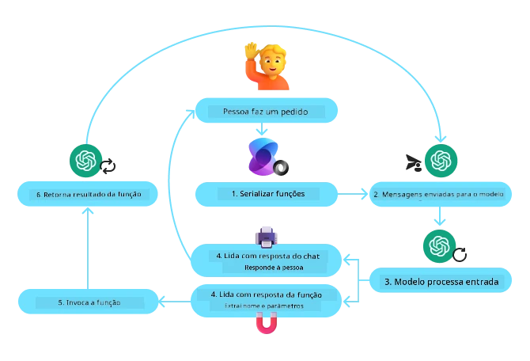
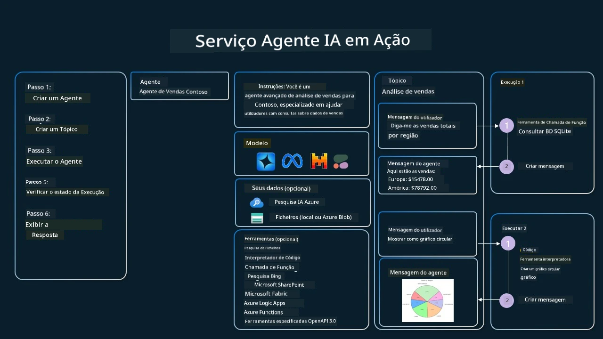

[](https://youtu.be/vieRiPRx-gI?si=cEZ8ApnT6Sus9rhn)

> _(Clique na imagem acima para ver o vídeo desta lição)_

# Padrão de Design de Uso de Ferramentas

As ferramentas são interessantes porque permitem que agentes de IA tenham uma gama mais ampla de capacidades. Em vez de o agente ter um conjunto limitado de ações que pode executar, ao adicionar uma ferramenta, o agente pode agora realizar uma grande variedade de ações. Neste capítulo, vamos analisar o Padrão de Design de Uso de Ferramentas, que descreve como agentes de IA podem usar ferramentas específicas para atingir os seus objetivos.

## Introdução

Nesta lição, procuramos responder às seguintes perguntas:

- O que é o padrão de design de uso de ferramentas?
- Quais são os casos de uso em que pode ser aplicado?
- Quais são os elementos/blocos construtivos necessários para implementar o padrão de design?
- Quais são as considerações especiais para usar o Padrão de Design de Uso de Ferramentas para construir agentes de IA confiáveis?

## Objetivos de Aprendizagem

Após completar esta lição, será capaz de:

- Definir o Padrão de Design de Uso de Ferramentas e o seu propósito.
- Identificar casos de uso onde o Padrão de Design de Uso de Ferramentas é aplicável.
- Compreender os elementos chave necessários para implementar o padrão de design.
- Reconhecer considerações para garantir a confiabilidade em agentes de IA que usam este padrão de design.

## O que é o Padrão de Design de Uso de Ferramentas?

O **Padrão de Design de Uso de Ferramentas** foca-se em dar aos LLMs a capacidade de interagir com ferramentas externas para alcançar objetivos específicos. Ferramentas são códigos que podem ser executados por um agente para realizar ações. Uma ferramenta pode ser uma função simples, como uma calculadora, ou uma chamada API a um serviço externo, como consulta de preços de ações ou previsão do tempo. No contexto dos agentes de IA, as ferramentas são projetadas para serem executadas pelos agentes em resposta a **chamadas de função geradas pelo modelo**.

## Quais são os casos de uso em que pode ser aplicado?

Os Agentes de IA podem aproveitar ferramentas para completar tarefas complexas, recuperar informação ou tomar decisões. O padrão de design de uso de ferramentas é frequentemente usado em cenários que exigem interação dinâmica com sistemas externos, como bases de dados, serviços web ou intérpretes de código. Esta capacidade é útil para vários casos de uso, incluindo:

- **Recuperação Dinâmica de Informação:** Os agentes podem consultar APIs externas ou bases de dados para obter dados atualizados (ex: consultar uma base de dados SQLite para análise de dados, obter preços de ações ou informações meteorológicas).
- **Execução e Interpretação de Código:** Os agentes podem executar código ou scripts para resolver problemas matemáticos, gerar relatórios ou realizar simulações.
- **Automação de Fluxo de Trabalho:** Automatizar fluxos de trabalho repetitivos ou em múltiplas etapas integrando ferramentas como agendadores de tarefas, serviços de email ou pipelines de dados.
- **Suporte ao Cliente:** Os agentes podem interagir com sistemas CRM, plataformas de gestão de tickets ou bases de conhecimento para resolver dúvidas dos utilizadores.
- **Geração e Edição de Conteúdo:** Os agentes podem aproveitar ferramentas como verificadores gramaticais, resumidores de texto ou avaliadores de segurança de conteúdo para ajudar nas tarefas de criação.

## Quais são os elementos/blocos construtivos necessários para implementar o padrão de design de uso de ferramentas?

Estes blocos construtivos permitem que o agente de IA execute uma grande variedade de tarefas. Vamos ver os elementos chave para implementar o Padrão de Design de Uso de Ferramentas:

- **Esquemas de Função/Ferramenta**: Definições detalhadas das ferramentas disponíveis, incluindo nome da função, propósito, parâmetros necessários e saídas esperadas. Estes esquemas permitem que o LLM compreenda quais ferramentas estão disponíveis e como construir pedidos válidos.

- **Lógica de Execução de Função**: Regula quando e como as ferramentas são invocadas com base na intenção do utilizador e no contexto da conversa. Pode incluir módulos de planeamento, mecanismos de roteamento ou fluxos condicionais que determinam dinamicamente o uso das ferramentas.

- **Sistema de Gestão de Mensagens**: Componentes que gerem o fluxo conversacional entre as entradas do utilizador, respostas do LLM, chamadas às ferramentas e resultados das ferramentas.

- **Estrutura de Integração de Ferramentas**: Infraestrutura que conecta o agente a várias ferramentas, quer sejam funções simples ou serviços externos complexos.

- **Tratamento e Validação de Erros**: Mecanismos para lidar com falhas na execução das ferramentas, validar parâmetros e gerir respostas inesperadas.

- **Gestão de Estado**: Rastreia o contexto da conversa, interações anteriores com as ferramentas e dados persistentes para garantir consistência em interações com múltiplas trocas.

Em seguida, vamos analisar com mais detalhe as Chamadas de Função/Ferramenta.
 
### Chamadas de Função/Ferramenta

A chamada de função é a principal forma de permitir que os Modelos de Linguagem Grande (LLMs) interajam com ferramentas. Frequentemente verá os termos 'Função' e 'Ferramenta' usados de forma intercambiável porque 'funções' (blocos de código reutilizáveis) são as 'ferramentas' que os agentes usam para realizar tarefas. Para que o código de uma função seja invocado, um LLM deve comparar o pedido do utilizador com a descrição das funções. Para isso, um esquema contendo as descrições de todas as funções disponíveis é enviado ao LLM. O LLM então seleciona a função mais apropriada para a tarefa e retorna o seu nome e argumentos. A função selecionada é invocada, a sua resposta é enviada de volta ao LLM, que usa essa informação para responder ao pedido do utilizador.

Para os programadores implementarem a chamada de função para agentes, vai precisar de:

1. Um modelo LLM que suporte chamadas de função
2. Um esquema contendo descrições das funções
3. O código para cada função descrita

Vamos usar o exemplo de obter a hora atual numa cidade para ilustrar:

1. **Inicializar um LLM que suporte chamadas de função:**

    Nem todos os modelos suportam chamadas de função, por isso é importante confirmar se o LLM que está a usar o faz.     <a href="https://learn.microsoft.com/azure/ai-services/openai/how-to/function-calling" target="_blank">Azure OpenAI</a> suporta chamadas de função. Podemos começar por iniciar o cliente OpenAI contra a **API de Respostas** do Azure OpenAI (o ponto de extremidade estável `/openai/v1/` — sem necessidade de `api_version`). 

    ```python
    # Initialize the OpenAI client for Azure OpenAI (Responses API, v1 endpoint)
    client = OpenAI(
        base_url=f"{os.environ['AZURE_OPENAI_ENDPOINT'].rstrip('/')}/openai/v1/",
        api_key=os.environ["AZURE_OPENAI_API_KEY"],
    )
    deployment_name = os.environ["AZURE_OPENAI_DEPLOYMENT"]
    ```

1. **Criar um Esquema de Função**:

    A seguir, definiremos um esquema JSON que contém o nome da função, a descrição do que a função faz, e os nomes e descrições dos parâmetros da função.
    Depois passaremos este esquema para o cliente criado anteriormente, junto com o pedido do utilizador para encontrar a hora em São Francisco. É importante notar que o que é retornado é uma **chamada de ferramenta**, **não** a resposta final à pergunta. Como mencionado anteriormente, o LLM retorna o nome da função que selecionou para a tarefa e os argumentos que lhe serão passados.

    ```python
    # Function description for the model to read (Responses API flat tool format)
    tools = [
        {
            "type": "function",
            "name": "get_current_time",
            "description": "Get the current time in a given location",
            "parameters": {
                "type": "object",
                "properties": {
                    "location": {
                        "type": "string",
                        "description": "The city name, e.g. San Francisco",
                    },
                },
                "required": ["location"],
            },
        }
    ]
    ```
   
    ```python
  
    # Initial user message
    messages = [{"role": "user", "content": "What's the current time in San Francisco"}]

    # First API call: Ask the model to use the function
    response = client.responses.create(
        model=deployment_name,
        input=messages,
        tools=tools,
        tool_choice="auto",
        store=False,
    )

    # The Responses API returns tool calls as function_call items in response.output.
    # Append them to the conversation so the model has full context on the next turn.
    messages += response.output

    print("Model's response:")
    print(response.output)
  
    ```

    ```bash
    Model's response:
    [ResponseFunctionToolCall(arguments='{"location":"San Francisco"}', call_id='call_pOsKdUlqvdyttYB67MOj434b', name='get_current_time', type='function_call')]
    ```
  
1. **O código da função necessário para realizar a tarefa:**

    Agora que o LLM escolheu qual função precisa ser executada, o código que realiza a tarefa precisa ser implementado e executado.
    Podemos implementar o código para obter a hora atual em Python. Também precisaremos escrever o código para extrair o nome e os argumentos da response_message para obter o resultado final.

    ```python
      def get_current_time(location):
        """Get the current time for a given location"""
        print(f"get_current_time called with location: {location}")  
        location_lower = location.lower()
        
        for key, timezone in TIMEZONE_DATA.items():
            if key in location_lower:
                print(f"Timezone found for {key}")  
                current_time = datetime.now(ZoneInfo(timezone)).strftime("%I:%M %p")
                return json.dumps({
                    "location": location,
                    "current_time": current_time
                })
      
        print(f"No timezone data found for {location_lower}")  
        return json.dumps({"location": location, "current_time": "unknown"})
    ```

     ```python
    # Handle function calls
    tool_calls = [item for item in response.output if item.type == "function_call"]
    if tool_calls:
        for tool_call in tool_calls:
            if tool_call.name == "get_current_time":

                function_args = json.loads(tool_call.arguments)

                time_response = get_current_time(
                    location=function_args.get("location")
                )

                # Return the tool result as a function_call_output item
                messages.append({
                    "type": "function_call_output",
                    "call_id": tool_call.call_id,
                    "output": time_response,
                })
    else:
        print("No tool calls were made by the model.")

    # Second API call: Get the final response from the model
    final_response = client.responses.create(
        model=deployment_name,
        input=messages,
        tools=tools,
        store=False,
    )

    return final_response.output_text
     ```

     ```bash
      get_current_time called with location: San Francisco
      Timezone found for san francisco
      The current time in San Francisco is 09:24 AM.
     ```

A chamada de função está no coração da maioria, se não de todo, o design de uso de ferramentas para agentes, contudo implementá-la do zero pode ser por vezes desafiante.
Como aprendemos em [Lição 2](../../../02-explore-agentic-frameworks), os frameworks agênticos fornecem blocos construtivos pré-construídos para implementar o uso de ferramentas.
 
## Exemplos de Uso de Ferramentas com Frameworks Agênticos

Aqui estão alguns exemplos de como pode implementar o Padrão de Design de Uso de Ferramentas usando diferentes frameworks agênticos:

### Microsoft Agent Framework

<a href="https://learn.microsoft.com/azure/ai-services/agents/overview" target="_blank">Microsoft Agent Framework</a> é um framework de IA open-source para construir agentes de IA. Simplifica o processo de uso de chamadas de função permitindo definir ferramentas como funções Python com o decorador `@tool`. O framework gere a comunicação entre o modelo e o seu código. Também fornece acesso a ferramentas pré-construídas como Pesquisa de Ficheiros e Intérprete de Código através do `FoundryChatClient`.

O diagrama seguinte ilustra o processo de chamada de função com o Microsoft Agent Framework:



No Microsoft Agent Framework, as ferramentas são definidas como funções decoradas. Podemos converter a função `get_current_time` que vimos anteriormente numa ferramenta usando o decorador `@tool`. O framework serializa automaticamente a função e os seus parâmetros, criando o esquema para enviar ao LLM.

```python
import os
from agent_framework import tool
from agent_framework.foundry import FoundryChatClient
from azure.identity import AzureCliCredential

@tool(approval_mode="never_require")
def get_current_time(location: str) -> str:
    """Get the current time for a given location"""
    ...

# Create the client
provider = FoundryChatClient(
    project_endpoint=os.environ["AZURE_AI_PROJECT_ENDPOINT"],
    model=os.environ["AZURE_AI_MODEL_DEPLOYMENT_NAME"],
    credential=AzureCliCredential(),
)

# Create an agent and run with the tool
agent = provider.as_agent(name="TimeAgent", instructions="Use available tools to answer questions.", tools=get_current_time)
response = await agent.run("What time is it?")
```

#### Ferramentas a partir de um servidor MCP

As ferramentas não precisam de ser funções no seu próprio código. Um servidor que suporte o Protocolo de Contexto de Modelo (MCP, coberto na [Lição 11](../11-agentic-protocols/README.md)) publica as suas ferramentas junto com os seus esquemas, e o framework pode carregá-las da mesma forma que serializa uma função decorada. `MCPStreamableHTTPTool` conecta-se a tal servidor via HTTP, lê os esquemas das ferramentas e oferece-as ao modelo juntamente com quaisquer ferramentas locais.

O exemplo abaixo usa o servidor de pesquisa web hospedado por <a href="https://keenable.ai" target="_blank">Keenable</a>. É gratuito para uso sem conta ou chave API (requisições são limitadas por IP), por isso as únicas credenciais que precisa são as do seu modelo. Como com qualquer ferramenta remota, as consultas que o modelo escreve são enviadas para esse servidor.

```python
from agent_framework import MCPStreamableHTTPTool

web_search = MCPStreamableHTTPTool(
    name="Keenable web search",
    url="https://api.keenable.ai/mcp",
)

# Connecting loads the server's tool schemas; the agent decides when to call them
async with web_search:
    agent = provider.as_agent(
        name="ResearchAgent",
        instructions="Use available tools to answer questions.",
        tools=[web_search],
    )
    response = await agent.run("What is new in the latest Python release?")
    print(response.text)
```

O servidor publica duas ferramentas, `search_web_pages` e `fetch_page_content`. Quando uma pergunta necessita de informação atual, o modelo chama `search_web_pages`, recebe títulos, URLs e excertos de texto, e escreve a sua resposta a partir deles, no mesmo ciclo que no exemplo `get_current_time` acima.
  
### Microsoft Foundry Agent Service

<a href="https://learn.microsoft.com/azure/ai-services/agents/overview" target="_blank">Microsoft Foundry Agent Service</a> é um framework agêntico mais recente projetado para capacitar programadores a construir, implementar e escalar agentes de IA de alta qualidade e extensíveis com segurança, sem necessidade de gerir os recursos subjacentes de computação e armazenamento. É particularmente útil para aplicações empresariais, pois é um serviço totalmente gerido com segurança de nível empresarial.

Em comparação com o desenvolvimento direto com a API LLM, o Microsoft Foundry Agent Service oferece algumas vantagens, incluindo:

- Chamada automática de ferramentas – não precisa de analisar a chamada de ferramenta, invocar a ferramenta e tratar a resposta; tudo isso é feito no lado do servidor
- Dados geridos seguramente – em vez de gerir o seu próprio estado da conversa, pode confiar em threads para armazenar toda a informação necessária
- Ferramentas prontas a usar – Ferramentas para interagir com suas fontes de dados, como Bing, Azure AI Search e Azure Functions.

As ferramentas disponíveis no Microsoft Foundry Agent Service podem ser divididas em duas categorias:

1. Ferramentas de Conhecimento:
    - <a href="https://learn.microsoft.com/azure/ai-services/agents/how-to/tools/bing-grounding?tabs=python&pivots=overview" target="_blank">Grounding com Pesquisa Bing</a>
    - <a href="https://learn.microsoft.com/azure/ai-services/agents/how-to/tools/file-search?tabs=python&pivots=overview" target="_blank">Pesquisa de Ficheiros</a>
    - <a href="https://learn.microsoft.com/azure/ai-services/agents/how-to/tools/azure-ai-search?tabs=azurecli%2Cpython&pivots=overview-azure-ai-search" target="_blank">Azure AI Search</a>

2. Ferramentas de Ação:
    - <a href="https://learn.microsoft.com/azure/ai-services/agents/how-to/tools/function-calling?tabs=python&pivots=overview" target="_blank">Chamada de Função</a>
    - <a href="https://learn.microsoft.com/azure/ai-services/agents/how-to/tools/code-interpreter?tabs=python&pivots=overview" target="_blank">Intérprete de Código</a>
    - <a href="https://learn.microsoft.com/azure/ai-services/agents/how-to/tools/openapi-spec?tabs=python&pivots=overview" target="_blank">Ferramentas definidas por OpenAPI</a>
    - <a href="https://learn.microsoft.com/azure/ai-services/agents/how-to/tools/azure-functions?pivots=overview" target="_blank">Azure Functions</a>

O Agent Service permite-nos usar estas ferramentas em conjunto como um `toolset`. Também utiliza `threads` que mantém o registo do histórico de mensagens de uma conversa particular.

Imagine que é um agente de vendas numa empresa chamada Contoso. Quer desenvolver um agente conversacional que possa responder a perguntas sobre os seus dados de vendas.

A imagem seguinte ilustra como poderia usar o Microsoft Foundry Agent Service para analisar os seus dados de vendas:



Para usar qualquer uma destas ferramentas com o serviço, podemos criar um cliente e definir uma ferramenta ou conjunto de ferramentas. Para implementar isto na prática, podemos usar o seguinte código Python. O LLM poderá analisar o conjunto de ferramentas e decidir se usa a função criada pelo utilizador, `fetch_sales_data_using_sqlite_query`, ou o Intérprete de Código pré-construído, dependendo do pedido do utilizador.

```python 
import os
from azure.ai.projects import AIProjectClient
from azure.identity import DefaultAzureCredential
from fetch_sales_data_functions import fetch_sales_data_using_sqlite_query # fetch_sales_data_using_sqlite_query function which can be found in a fetch_sales_data_functions.py file.
from azure.ai.projects.models import ToolSet, FunctionTool, CodeInterpreterTool

project_client = AIProjectClient.from_connection_string(
    credential=DefaultAzureCredential(),
    conn_str=os.environ["PROJECT_CONNECTION_STRING"],
)

# Initialize toolset
toolset = ToolSet()

# Initialize function calling agent with the fetch_sales_data_using_sqlite_query function and adding it to the toolset
fetch_data_function = FunctionTool(fetch_sales_data_using_sqlite_query)
toolset.add(fetch_data_function)

# Initialize Code Interpreter tool and adding it to the toolset. 
code_interpreter = CodeInterpreterTool()toolset.add(code_interpreter)

agent = project_client.agents.create_agent(
    model="gpt-5-mini", name="my-agent", instructions="You are helpful agent", 
    toolset=toolset
)
```

## Quais são as considerações especiais para usar o Padrão de Design de Uso de Ferramentas para construir agentes de IA confiáveis?

Uma preocupação comum com SQL gerado dinamicamente por LLMs é a segurança, particularmente o risco de injeção SQL ou ações maliciosas, como eliminar ou adulterar a base de dados. Embora estas preocupações sejam válidas, podem ser efetivamente mitigadas configurando corretamente as permissões de acesso à base de dados. Para a maioria das bases de dados, isto envolve configurá-la como somente leitura. Para serviços de bases de dados como PostgreSQL ou Azure SQL, a aplicação deve ser atribuída um papel somente leitura (SELECT).

Executar a aplicação num ambiente seguro reforça ainda mais a proteção. Em cenários empresariais, os dados são normalmente extraídos e transformados de sistemas operacionais para uma base de dados ou armazém de dados somente leitura com um esquema amigável para utilizadores. Esta abordagem garante que os dados estão seguros, otimizados para desempenho e acessibilidade, e que a aplicação tem acesso restrito e somente leitura.

## Códigos de Exemplo

- Python: [Agent Framework](./code_samples/04-python-agent-framework.ipynb)
- .NET: [Agent Framework](./code_samples/04-dotnet-agent-framework.md)

## Tem Mais Perguntas sobre os Padrões de Design de Uso de Ferramentas?

Junte-se ao [Microsoft Foundry Discord](https://discord.com/invite/ATgtXmAS5D) para encontrar outros aprendizes, participar em horas de atendimento e obter respostas às suas perguntas sobre Agentes de IA.

## Recursos Adicionais

- <a href="https://microsoft.github.io/build-your-first-agent-with-azure-ai-agent-service-workshop/" target="_blank">Workshop do Azure AI Agents Service</a>
- <a href="https://github.com/Azure-Samples/contoso-creative-writer/tree/main/docs/workshop" target="_blank">Workshop Multi-Agente Contoso Creative Writer</a>
- <a href="https://learn.microsoft.com/azure/ai-services/agents/overview" target="_blank">Visão Geral do Microsoft Agent Framework</a>

## Teste Rápido Deste Agente (Opcional)

Depois de aprender a implantar agentes em [Lição 16](../16-deploying-scalable-agents/README.md), pode fazer um teste rápido ao `TravelToolAgent` desta lição (ele ainda chama as suas ferramentas e responde?) com [`tests/lesson-04-smoke-tests.json`](../../../tests/lesson-04-smoke-tests.json). Veja [`tests/README.md`](../tests/README.md) para saber como executá-lo.

## Lição Anterior

[Compreender Padrões de Design Agentes](../03-agentic-design-patterns/README.md)

## Próxima Lição

[RAG Agente](../05-agentic-rag/README.md)

---

<!-- CO-OP TRANSLATOR DISCLAIMER START -->
**Aviso Legal**:
Este documento foi traduzido utilizando o serviço de tradução automática [Co-op Translator](https://github.com/Azure/co-op-translator). Embora nos esforcemos pela precisão, esteja ciente de que traduções automáticas podem conter erros ou imprecisões. O documento original na sua língua nativa deve ser considerado a fonte autorizada. Para informações críticas, recomenda-se tradução profissional humana. Não nos responsabilizamos por quaisquer mal-entendidos ou interpretações incorretas resultantes da utilização desta tradução.
<!-- CO-OP TRANSLATOR DISCLAIMER END -->