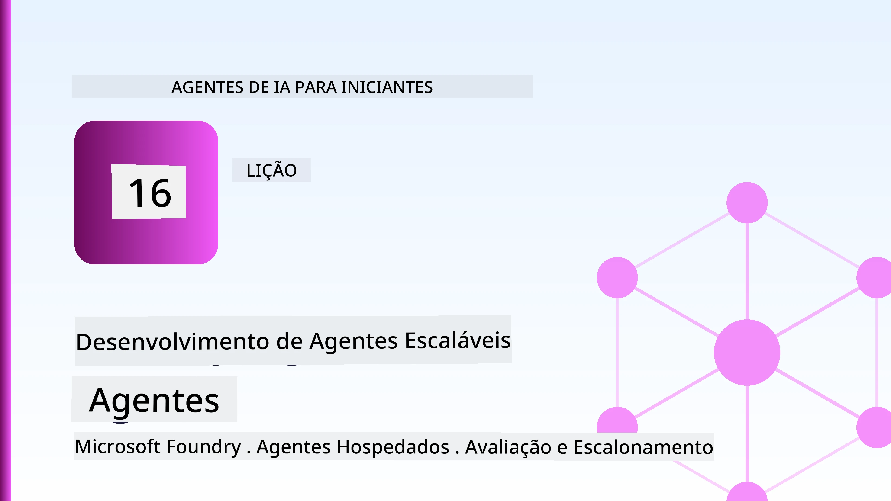
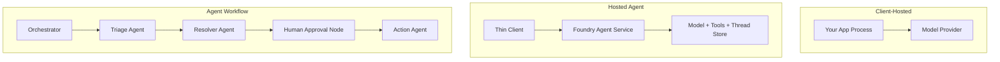
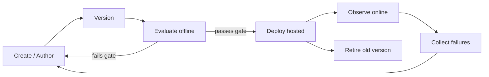
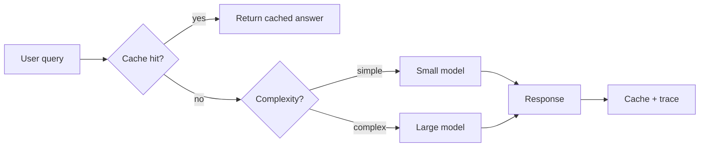
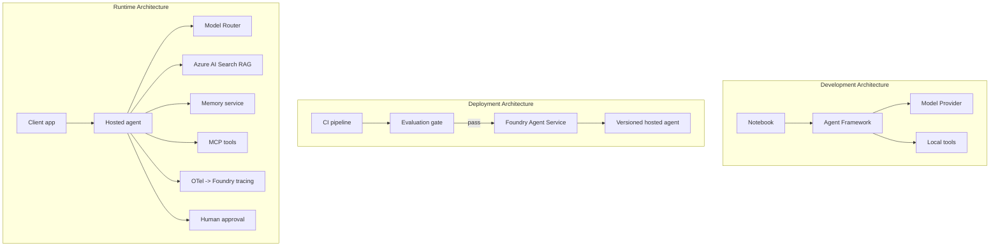

# Implementar Agentes Escaláveis com Microsoft Foundry



Até este ponto do curso, construíu agentes que funcionam no seu portátil, dentro de um notebook, impulsionados por `az login` e um conjunto de variáveis de ambiente. Essa é exatamente a maneira certa de aprender. Não é a maneira certa de executar um agente do qual milhares de clientes dependem às 3 da manhã.

Esta lição trata da lacuna entre "funciona na minha máquina" e "funciona, de forma fiável e acessível, em produção." Fechamos essa lacuna usando o **Microsoft Foundry** e o **Microsoft Foundry Agent Service**, construindo um agente real de suporte ao cliente que dispõe de ferramentas, recuperação, memória, avaliação e monitorização.

## Introdução

Esta lição abordará:

- A diferença entre um **agente protótipo** e um **agente implementado**, e por que a transição envolve principalmente tudo *à volta* do modelo.
- **Padrões de implementação** para agentes: hospedagem no cliente, hospedagem em serviço (Hosted Agents), e orquestração por workflows.
- O **ciclo de vida do agente** no Microsoft Foundry — criar, versionar, implementar, avaliar, observar, retirar.
- **Estratégias de escalamento:** roteamento do modelo, cache, concorrência e design sem estado.
- **Observabilidade** com OpenTelemetry e rastreio do Foundry.
- **Otimização de custos** através da seleção do modelo, roteamento e portões de avaliação.
- **Considerações empresariais**: governança, aprovação humana e execução segura de servidores MCP em produção.

## Objetivos de Aprendizagem

Após concluir esta lição, saberá como:

- Escolher o padrão de implementação adequado para uma carga de trabalho de agente dada.
- Implementar um agente no Microsoft Foundry Agent Service para que seja versionado, governado e observável.
- Instrumentar um agente para rastreio e configurar uma pipeline de avaliação que é executada antes de cada lançamento.
- Aplicar roteamento de modelo e caching para manter a latência e o custo sob controlo em escala.
- Adicionar um portão de aprovação humana para ações de alto risco e integrar um servidor MCP de forma segura em produção.

## Pré-requisitos

Esta lição assume que completou as lições anteriores e está confortável com:

- Construção de agentes com o [Microsoft Agent Framework](../14-microsoft-agent-framework/README.md) (Lição 14).
- [Uso de Ferramentas](../04-tool-use/README.md) (Lição 4) e [Agentic RAG](../05-agentic-rag/README.md) (Lição 5).
- [Memória do Agente](../13-agent-memory/README.md) (Lição 13) e [Protocolos Agentic / MCP](../11-agentic-protocols/README.md) (Lição 11).
- [Observabilidade e Avaliação](../10-ai-agents-production/README.md) (Lição 10) — esta lição baseia-se diretamente nela.

Também precisará:

- Uma **subscrição Azure** e um **projeto Microsoft Foundry** com pelo menos um modelo de chat implementado.
- A **CLI Azure** autenticada (`az login`).
- Python 3.12+ e os pacotes no repositório [`requirements.txt`](../../../requirements.txt).

## De Protótipo a Produção: O Que Realmente Muda

Um agente protótipo e um agente em produção partilham o mesmo ciclo principal — raciocinar, chamar ferramentas, responder. O que muda é tudo o que está à volta desse ciclo. O modelo é talvez 20% de um agente em produção; os outros 80% são o esqueleto operacional.

| Preocupação | Protótipo | Produção |
| --- | --- | --- |
| **Hospedagem** | Executa no seu notebook | Executa como serviço hospedado, versionado e implementado gradualmente |
| **Identidade** | Seu token `az login` | Identidade gerida com RBAC com escopo |
| **Estado** | Na memória, perdido ao reiniciar | Externalizado (armazenamento de threads, serviço de memória) |
| **Falhas** | Vê o traceback | Retentativas, alternativas, dead-letter, alertas |
| **Custo** | "São uns cêntimos" | Monitorizado por pedido, roteado, cacheado, orçamentado |
| **Qualidade** | Avalia visualmente a saída | Avaliado automaticamente antes de cada lançamento |
| **Confiança** | Aprova cada ação | Política + interação humana para ações arriscadas |

Tenha esta tabela em mente. Cada secção abaixo corresponde a uma destas linhas.

## Padrões de Implementação de Agentes

Existem três padrões que usará, frequentemente em combinação.

### 1. Agentes Hospedados no Cliente

O objeto agente vive dentro do processo da *sua* aplicação. O seu código chama diretamente o fornecedor do modelo; o ciclo de raciocínio corre no seu serviço. Isto é o que todas as lições anteriores fizeram.

- **Use-o quando** precisar de controlo total sobre o ciclo, middleware personalizado, ou estiver a embutir o agente dentro de um backend existente.
- **Contras**: você assume a responsabilidade do escalamento, estado e resiliência.

### 2. Agentes Hospedados (Foundry Agent Service)

O agente é *registado como um recurso* no Microsoft Foundry. O Foundry hospeda o ciclo de raciocínio, armazena threads, aplica segurança de conteúdo e RBAC, e torna o agente visível no portal Foundry. A sua app torna-se um cliente leve que cria threads e lê respostas.

- **Use-o quando** desejar durabilidade, observabilidade embutida, governança, e menos área operacional.
- **Contras:** menos controlo a baixo nível em troca de um runtime gerido.

### 3. Workflows de Agentes

Vários agentes (e ferramentas) são compostos num grafo com fluxo de controlo explícito — passos sequenciais, ramificações, nós de aprovação humana, e checkpoints duráveis que podem pausar e retomar. Esta é a capacidade de **Workflows** do Microsoft Agent Framework aplicada à escala de implementação.

- **Use-o quando** uma tarefa única abranja vários agentes especializados ou requeira uma aprovação a meio.
- **Contras:** mais componentes em movimento; necessita de observabilidade a nível de orquestração.



## O Ciclo de Vida do Agente no Microsoft Foundry

Implementar um agente não é um ato único de `push`. É um ciclo, e parece muito com um ciclo de lançamento de software porque é exatamente isso.



A ideia chave, trazida da [Lição 10](../10-ai-agents-production/README.md): **a avaliação offline é um portão, não um pensamento posterior.** Uma nova versão do agente não é lançada a menos que ultrapasse os seus limites de avaliação. A observabilidade online alimenta então falhas reais no seu conjunto de testes offline. Esse é todo o ciclo.

## Estratégias de Escalamento

Escalar um agente é diferente de escalar uma API web sem estado, porque cada pedido pode desencadear várias chamadas dispendiosas a modelos e ferramentas. Quatro técnicas suportam a maior parte da carga.

**Tratamento sem estado por pedido.** Não mantenha estado por utilizador na memória do seu processo. Persista os threads da conversação no armazenamento Foundry ou num serviço de memória para que qualquer instância possa tratar qualquer pedido. Isto permite escalar horizontalmente — adiciona instâncias, sem sessões coladas.

**Roteamento do modelo.** Nem todo pedido precisa do seu modelo mais capaz (e mais caro). Direcione pedidos simples — classificação de intenção, respostas factuais curtas — para um modelo pequeno e rápido, e reserve o modelo grande para raciocínio genuíno. O **Model Router** do Foundry pode fazer isso por si, ou pode implementar um classificador leve. Construirá a versão DIY no laboratório.

**Cache de respostas.** Muitas consultas de suporte são quase duplicadas ("como resetar a minha password?"). Cache respostas para perguntas comuns e sirva-as sem chamar o modelo. Mesmo uma taxa de acerto modesta no cache reduz significativamente o custo e latência.

**Concorrência e retropressão.** Fornecedores de modelo têm limites de taxa. Limite a sua concorrência, use retentativas com retrocesso exponencial, e falhe graciosamente (uma resposta enfileirada "estamos a tratar" é melhor do que um erro 500).



## Observabilidade em Produção

Não pode operar o que não pode ver. Conforme abordado na Lição 10, o Microsoft Agent Framework emite rastreios **OpenTelemetry** nativamente — cada chamada de modelo, invocação de ferramenta e passo de orquestração torna-se um span. Em produção exporta esses spans para o Microsoft Foundry (ou qualquer backend compatível com OTel) para que possa:

- Rastrear uma única reclamação de cliente de ponta a ponta em todas as chamadas de modelo e ferramenta.
- Monitorizar latência p50/p95 e custo por pedido ao longo do tempo.
- Alertar sobre picos de taxa de erro e anomalias de custo antes que os seus utilizadores (ou equipa financeira) reparem.

```python
from agent_framework.observability import get_tracer

tracer = get_tracer()

with tracer.start_as_current_span("support_request") as span:
    span.set_attribute("customer.tier", "enterprise")
    span.set_attribute("routed.model", "gpt-5-nano")
    # agent execution is traced automatically inside this span
```

Atributos como `customer.tier` e `routed.model` transformam uma parede de rastreios em perguntas com respostas ("os clientes empresariais estão a ser roteados para o modelo pequeno com muita frequência?").

## Otimização de Custos

O custo nos agentes de produção é dominado pelos tokens. Três alavancas, por ordem de impacto:

1. **Modelar adequadamente.** Um modelo pequeno que passa o seu portão de avaliação é quase sempre mais barato que um grande que também passa. Use avaliação para *provar* que o modelo pequeno é suficiente em vez de optar pelo maior por precaução.
2. **Roteie por complexidade.** Como acima — pague preços de modelo grande apenas para pedidos que necessitem de raciocínio do modelo grande.
3. **Cache agressivamente.** A chamada de modelo mais barata é aquela que nunca faz.

Portões de avaliação e controlo de custos são a mesma disciplina vista de dois ângulos: a avaliação indica o *piso de qualidade*, o roteamento e o cache mantêm o custo o mais próximo possível desse piso.

## Considerações Empresariais para Implementação

**Governança.** Agentes Hospedados herdam RBAC, segurança de conteúdo e auditoria do Foundry. Dê a cada agente uma identidade gerida com o mínimo privilégio necessário — acesso de leitura à base de conhecimento, acesso com escopo à API de tickets, nada mais.

**Humano no ciclo.** Algumas ações são demasiado importantes para automatizar completamente — emitir reembolso, eliminar uma conta, escalar para equipa legal. O Microsoft Agent Framework suporta ferramentas **que requerem aprovação**: o agente propõe a ação, a execução pausa, um humano aprova ou rejeita, e o workflow retoma. Viu o primitivo na [Lição 6](../06-building-trustworthy-agents/README.md); aqui implementa-o.

**MCP em produção.** [MCP](../11-agentic-protocols/README.md) permite que o seu agente consuma ferramentas externas através de uma interface padrão. Em produção, trate cada servidor MCP como uma fronteira não confiável: fixe a versão do servidor, execute com uma identidade com escopo, valide as suas saídas, e nunca exponha segredos a ele. Um servidor MCP é uma dependência, e dependências são patchadas, auditadas e limitadas em termos de taxa.



Esses três diagramas — desenvolvimento, implementação, runtime — são o mesmo agente em três fases da sua vida. O laboratório que se segue guia-o na sua construção.

## Laboratório Prático: Um Agente de Suporte ao Cliente Pronto para Produção

Abra [`code_samples/16-python-agent-framework.ipynb`](./code_samples/16-python-agent-framework.ipynb) e trabalhe nele de ponta a ponta. Vai montar um **agente de suporte ao cliente Contoso** com todas as preocupações de produção integradas:

1. **Chamada de ferramentas** — consultar estado de encomenda e abrir tickets de suporte.
2. **RAG** — responder a perguntas de políticas a partir de uma base de conhecimento (Azure AI Search, com fallback em memória para correr o notebook sem recurso Search).
3. **Memória** — lembrar o cliente ao longo das voltas da conversa.
4. **Roteamento do modelo** — um classificador de complexidade roteia cada pedido para um modelo pequeno ou grande.
5. **Cache de respostas** — perguntas repetidas são servidas do cache.
6. **Aprovação humana** — reembolsos acima de um limiar pausam para aprovação humana.
7. **Pipeline de avaliação** — um pequeno conjunto de testes offline avalia o agente e atua como portão de lançamento.
8. **Observabilidade** — rastreio OpenTelemetry em cada pedido.

### Passo a Passo

O notebook está organizado para que cada preocupação de produção seja uma secção autónoma e executável. O núcleo é o manipulador de pedidos com roteamento mais caching:

```python
async def handle_support_request(query: str, customer_id: str) -> str:
    # 1. Serve from cache when we can.
    cached = response_cache.get(normalize(query))
    if cached:
        return cached

    # 2. Route by complexity to control cost.
    model = "gpt-5-nano" if is_simple(query) else "gpt-5-mini"

    # 3. Run the agent inside a trace span for observability.
    with tracer.start_as_current_span("support_request") as span:
        span.set_attribute("routed.model", model)
        span.set_attribute("customer.id", customer_id)
        response = await support_agent.run(query, model=model)

    # 4. Cache and return.
    response_cache.set(normalize(query), response.text)
    return response.text
```

O portão de avaliação que protege um lançamento é assim:

```python
async def evaluation_gate(agent, test_cases, threshold: float = 0.8) -> bool:
    passed = 0
    for case in test_cases:
        result = await agent.run(case["input"])
        if score_response(result.text, case["expected"]) >= 0.8:
            passed += 1
    pass_rate = passed / len(test_cases)
    print(f"Evaluation pass rate: {pass_rate:.0%} (gate: {threshold:.0%})")
    return pass_rate >= threshold  # only deploy if the gate passes
```

Leia cada linha — o notebook mantém os primitivos deliberadamente pequenos para que nada fique escondido atrás de uma chamada a framework.

## Validar um Agente Implementado com Testes Smoke

O portão de avaliação acima é executado *offline* contra o seu objeto agente. Depois de o agente ser implementado como Hosted Agent, há mais uma verificação, ainda mais barata: **o endpoint implementado está realmente a responder?**

Implementar "com sucesso" só prova que o plano de controlo aceitou a definição — não prova que o agente responde. Uma dependência em falta, um roteamento de modelo incorreto, ou uma ligação expirada podem deixar uma implementação verde que não retorna nada. Um **teste smoke** detecta isso em segundos, em cada implementação, sem o custo de uma avaliação completa.

Este repositório traz uma pipeline de teste smoke pronta a usar, baseada na Action GitHub [AI Smoke Test](https://github.com/marketplace/actions/ai-smoke-test):

- **Catálogo** — [`tests/lesson-16-smoke-tests.json`](../../../tests/lesson-16-smoke-tests.json) contém prompts e asserções para o agente de suporte Contoso (respostas a políticas fundamentadas, consulta de encomendas, manter o tema, e continuidade em múltiplas voltas). Catálogos para agentes de outras lições vivem ao seu lado — veja [`tests/README.md`](../tests/README.md).
- **Workflow** — [`.github/workflows/smoke-test.yml`](../../../.github/workflows/smoke-test.yml) autentica com Azure OIDC e envia cada prompt ao endpoint Responses do agente, falhando o trabalho em qualquer falha de asserção.

```yaml
- name: Smoke-test hosted agent
  uses: JFolberth/ai-smoketest@v1
  with:
    project_endpoint: ${{ inputs.project_endpoint }}
    agent_name: ContosoSupportAgent
    tests_file: tests/lesson-16-smoke-tests.json
```

Execute-a a partir do separador **Actions** assim que o seu agente estiver lançado, fornecendo o endpoint do seu projeto Foundry e o nome do agente. A identidade federada necessita da função **Azure AI User** no âmbito do projeto Foundry. Pense nas camadas como uma pirâmide: os testes rápidos (acessível e a responder?) correm a cada implantação, a avaliação offline (boa o suficiente para ser lançada?) corre antes da promoção, e a avaliação online (como está a correr no contexto real?) corre continuamente.

## Verificação de Conhecimento

Teste a sua compreensão antes de passar para a tarefa.

**1. Aproximadamente quanto de um agente em produção é "o modelo" e o que é o restante?**

<details>
<summary>Resposta</summary>

O modelo é uma minoria do sistema — frequentemente considerado cerca de 20%. O resto é o esqueleto operacional: alojamento e controlo de versões, identidade e RBAC, estado externalizado, gestão de falhas, monitorização de custos, avaliação e controlos humanos no ciclo. O salto para produção é principalmente sobre construir tudo *à volta* do ciclo de raciocínio.
</details>

**2. Quando escolheria um Agente Hospedado em vez de um agente hospedado no cliente?**

<details>
<summary>Resposta</summary>

Quando quiser um runtime gerido com durabilidade incorporada (threads que persistem e podem ser retomadas), observabilidade, segurança do conteúdo e RBAC, e estiver disposto a trocar algum controlo ao nível baixo do ciclo de raciocínio por menos superfície operacional. Hospedado no cliente é preferível quando necessita de controlo total sobre o ciclo ou está a embutir o agente numa backend já existente.
</details>

**3. Porque deve um agente escalável ser sem estado na sua própria memória do processo?**

<details>
<summary>Resposta</summary>

Para que qualquer instância possa tratar qualquer pedido, o que permite a escalabilidade horizontal sem sessões aderentes. O estado da conversação por utilizador é externalizado para um armazenamento de threads ou serviço de memória. Se o estado residisse na memória do processo, perderia ao reiniciar e não poderia distribuir a carga livremente.
</details>

**4. Que problema resolve o encaminhamento do modelo e como se relaciona com a avaliação?**

<details>
<summary>Resposta</summary>

O encaminhamento envia pedidos simples para um modelo pequeno, barato e rápido e reserva o modelo grande para verdadeiro raciocínio, controlando tanto a latência como o custo. Relaciona-se com a avaliação porque esta é o que *prova* que o modelo pequeno é suficientemente bom para uma classe de pedidos — encaminhar sem avaliação é um palpite.
</details>

**5. O que é um "portão de avaliação" e onde ele se situa no ciclo de vida?**

<details>
<summary>Resposta</summary>

Um portão de avaliação executa um conjunto de testes offline numa nova versão do agente e bloqueia a implantação a menos que a taxa de aprovação ultrapasse um limiar. Ele situa-se entre a "versão" e a "implantação" no ciclo de vida, tornando a qualidade uma pré-condição para a publicação em vez de algo que verifica depois do lançamento.
</details>

**6. Porque deve um servidor MCP ser tratado como um limite não confiável em produção?**

<details>
<summary>Resposta</summary>

Porque é uma dependência externa para a qual o seu agente faz chamadas. Deve fixar a sua versão, executá-lo com uma identidade restrita, validar as suas saídas, limitar a taxa, e nunca expor segredos a ele — a mesma disciplina que aplica a qualquer dependência de terceiros. As suas saídas fluem para o raciocínio do seu agente, portanto confiar sem validação é um risco de segurança.
</details>

**7. Qual mudança única normalmente tem o maior impacto no custo de um agente em produção, e porquê?**

<details>
<summary>Resposta</summary>

Ajustar o tamanho do modelo — usar o modelo mais pequeno que ainda passa o seu portão de avaliação. O custo é dominado por tokens, e um modelo menor que cumpra o padrão de qualidade é quase sempre mais barato que um maior. Cache e encaminhamento reduzem ainda mais o custo, mas escolher o modelo base certo tem o maior efeito de primeira ordem.
</details>

**8. Que papel desempenham atributos de span como `customer.tier` e `routed.model` na observabilidade?**

<details>
<summary>Resposta</summary>

Transformam rastreamentos brutos em questões empresariais que podem ser respondidas. Sem atributos tem-se um muro de spans; com eles pode perguntar "os clientes empresariais estão a ser encaminhados para o modelo pequeno com muita frequência?" ou "qual modelo trata os nossos pedidos mais lentos?" Os atributos são como fatia a telemetria pelas dimensões que são importantes para a sua operação.
</details>

## Tarefa

Pegue no agente de suporte ao cliente do laboratório e fortaleça-o para um cenário específico: **um agente de suporte de faturação de subscrições para uma empresa SaaS.**

A sua submissão deve:

1. **Substituir as ferramentas** por outras relevantes para faturação: `get_subscription_status`, `get_invoice`, e `issue_credit` (créditos acima de $50 requerem aprovação humana).
2. **Adicionar três documentos RAG** que cubram a política de reembolso da empresa, o ciclo de faturação, e a política de cancelamento.
3. **Estender o conjunto de avaliação** para pelo menos oito casos, incluindo pelo menos dois que *devem* activar o caminho de aprovação humana, e confirmar que o seu portão de avaliação aprova ou reprova corretamente.
4. **Adicionar um relatório de custos**: depois de correr dez consultas mistas através do agente, imprimir quantas foram para o modelo pequeno, quantas para o modelo grande, e quantas foram servidas a partir do cache.

Escreva um parágrafo curto (numa célula markdown) explicando qual regra de encaminhamento de modelo escolheu e como a validaria com tráfego real. Não há uma resposta correta única — será avaliado se as preocupações de produção estão integradas de forma coerente.

## Resumo

Nesta lição, passou um agente de protótipo para produção com o Microsoft Foundry:

- O salto para a produção é principalmente sobre o **esqueleto operacional** em torno do modelo — alojamento, identidade, estado, gestão de falhas, custo, qualidade e confiança.
- Aprendeu os três **padrões de implantação** — cliente-hospedado, Agentes Hospedados e Fluxos de Trabalho de Agente — e quando cada um se adequa.
- Percorreu o **ciclo de vida do agente**, onde a avaliação offline **atua como portão de lançamento** e a observabilidade online alimenta as falhas de volta para o conjunto de testes.
- Aplicou **estratégias de escalabilidade** — design sem estado, encaminhamento de modelo, cache e concorrência limitada — e ligou-os à **otimização de custos**.
- Incorporou **controlos empresariais**: RBAC, aprovação humana no ciclo e integração MCP segura para produção.
- Construiu um **agente de suporte ao cliente pronto para produção** que une todas estas preocupações num código executável.

A próxima lição faz a viagem inversa: em vez de escalar agentes para a cloud, vai trazê-los *para baixo* para uma única máquina de desenvolvimento e executar tudo localmente.

## Recursos Adicionais

- <a href="https://learn.microsoft.com/azure/ai-foundry/what-is-azure-ai-foundry" target="_blank">Documentação Microsoft Foundry</a>
- <a href="https://learn.microsoft.com/azure/ai-foundry/agents/overview" target="_blank">Visão geral do Serviço de Agentes Microsoft Foundry</a>
- <a href="https://learn.microsoft.com/en-us/agent-framework/overview/?wt.mc_id=youtube_26688_organicsocial_reactor&pivots=programming-language-python" target="_blank">Microsoft Agent Framework</a>
- <a href="https://learn.microsoft.com/en-us/azure/ai-foundry/openai/concepts/model-router" target="_blank">Model Router no Microsoft Foundry</a>
- <a href="https://learn.microsoft.com/azure/search/search-what-is-azure-search" target="_blank">Azure AI Search</a>
- <a href="https://opentelemetry.io/" target="_blank">OpenTelemetry</a>
- <a href="https://github.com/marketplace/actions/ai-smoke-test" target="_blank">AI Smoke Test GitHub Action</a>
- <a href="https://modelcontextprotocol.io/" target="_blank">Protocolo de Contexto de Modelo (MCP)</a>

## Lição Anterior

[Construção de Agentes de Utilização de Computador (CUA)](../15-browser-use/README.md)

## Próxima Lição

[Criação de Agentes de IA Locais](../17-creating-local-ai-agents/README.md)

---

<!-- CO-OP TRANSLATOR DISCLAIMER START -->
**Aviso Legal**:
Este documento foi traduzido utilizando o serviço de tradução automática [Co-op Translator](https://github.com/Azure/co-op-translator). Embora nos esforcemos pela precisão, esteja ciente de que traduções automáticas podem conter erros ou imprecisões. O documento original na sua língua nativa deve ser considerado a fonte autorizada. Para informações críticas, recomenda-se tradução profissional humana. Não nos responsabilizamos por quaisquer mal-entendidos ou interpretações incorretas resultantes da utilização desta tradução.
<!-- CO-OP TRANSLATOR DISCLAIMER END -->