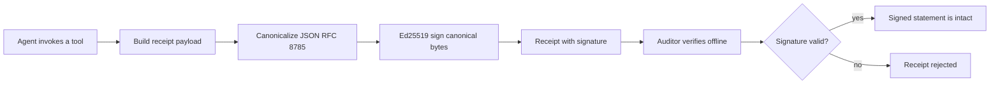
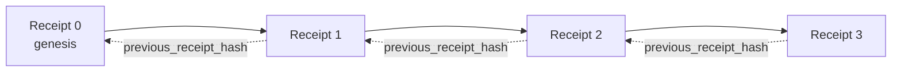

[Veja o vídeo da aula: Segurança de Agentes de IA com Recibos Criptográficos](https://youtu.be/PLACEHOLDER_VIDEO_ID)

> _(Vídeo da aula e miniatura a serem adicionados pela equipa de conteúdos da Microsoft após a fusão, correspondendo ao padrão da aula 14 / 15.)_

# Segurança de Agentes de IA com Recibos Criptográficos

## Introdução

Esta aula abordará:

- Porque os trilhos de auditoria para agentes de IA são importantes para conformidade, depuração e confiança.
- O que é um recibo criptográfico e como difere de uma linha de registo não assinada.
- Como produzir um recibo assinado para uma chamada de ferramenta de um agente em Python simples.
- Como verificar um recibo offline e detetar adulterações.
- Como encadear recibos de modo a que remover ou reordenar um quebrar a cadeia.
- O que os recibos provam e o que explicitamente não provam.

## Objetivos de Aprendizagem

Após completar esta aula, saberá como:

- Identificar os modos de falha que motivam a proveniência criptográfica para ações do agente.
- Produzir um recibo assinado Ed25519 sobre uma carga útil JSON canónica.
- Verificar um recibo de forma independente usando apenas a chave pública do signatário.
- Detetar adulterações ao reexecutar a verificação num recibo modificado.
- Construir uma sequência encadeada por hash de recibos e explicar porque a cadeia é importante.
- Reconhecer o limite entre o que os recibos provam (atribuição, integridade, ordenação) e o que não provam (correção da ação, validade da política).

## O Problema: O Trilho de Auditoria do Seu Agente

Imagine que implementou um agente de IA para a Contoso Travel. O agente lê pedidos de clientes, chama uma API de voos para procurar opções e reserva lugares em nome do cliente. No último trimestre, o agente processou 50.000 reservas.

Hoje chega um auditor. Ele faz uma pergunta simples: "Mostre-me o que o seu agente fez."

Você entrega os seus ficheiros de registos. O auditor olha para eles e faz a pergunta mais complicada: "Como sei que estes registos não foram editados?"

Este é o problema do trilho de auditoria. A maioria das implementações de agentes hoje em dia depende de:

- **Registos da aplicação**: escritos pelo próprio agente, editáveis por qualquer pessoa com acesso ao sistema de ficheiros.
- **Serviços de registo na cloud**: evidência de adulteração a nível da plataforma, mas só se o auditor confiar no operador da plataforma.
- **Registos de transações da base de dados**: adequados para alterações em bases de dados mas não para chamadas variadas de ferramentas.

Nenhum destes pode responder à pergunta do auditor sem que este tenha de confiar em alguém (você, o seu fornecedor cloud, o seu fornecedor de base de dados). Para uso interno, essa confiança é normalmente aceitável. Para cargas de trabalho reguladas (finanças, saúde, qualquer coisa sujeita ao Regulamento da IA da UE), não é.

Os recibos criptográficos restringem este problema ao tornar uma declaração assinada independentemente
verificável. O auditor ainda precisa de uma razão fora da banda para confiar na chave de assinatura e
no componente que produziu a declaração. Uma chave embutida prova a auto-consistência,
não a identidade do emissor ou o local de aplicação.

## O que é um Recibo Criptográfico?

Um recibo é um objeto JSON que regista o que um agente fez, assinado com uma assinatura digital.



Um recibo mínimo parece isto:

```json
{
  "type": "agent.tool_call.v1",
  "agent_id": "contoso-travel-bot",
  "tool_name": "lookup_flights",
  "tool_args_hash": "sha256:a3f9c1...",
  "result_hash": "sha256:7b2e1d...",
  "policy_id": "contoso-travel-policy-v3",
  "timestamp": "2026-04-25T14:30:00Z",
  "sequence": 47,
  "previous_receipt_hash": "sha256:9d4e6a...",
  "signature": {
    "alg": "EdDSA",
    "sig": "c5af83...",
    "public_key": "8f3b2c..."
  }
}
```

Três propriedades fazem o trabalho:

1. **A assinatura**. O recibo é assinado pelo gateway do agente usando uma chave privada Ed25519. Qualquer pessoa com a chave pública correspondente pode verificar a assinatura offline. Um utilizador confiável deve fixar essa chave ou resolvê-la a partir de um registo confiável fora do recibo. Adulterar qualquer campo assinado invalida a assinatura.

2. **Codificação canónica**. Antes de assinar, o recibo é serializado usando o Esquema de Canonicalização JSON (JCS, RFC 8785). Isto garante que duas implementações produzindo o mesmo recibo lógico produzem saída byte-idêntica. Sem canonização, diferentes serializadores JSON produziríam assinaturas diferentes para o mesmo conteúdo.

3. **Encadeamento por hash**. O campo `previous_receipt_hash` liga cada recibo ao anterior. Remover ou reordenar um recibo quebra a sequência apresentada. Detetar truncamento ou reescrita controlada pelo signatário requer também uma cabeça da cadeia atual fixada, um checkpoint testemunhado independentemente ou um compromisso autenticado de população fechada.

Juntas, estas propriedades fornecem três garantias:

- **Atribuição a uma chave**: esta chave assinou este conteúdo. Identidade organizacional ou humana requer uma associação de chave confiável.
- **Integridade**: o conteúdo não mudou desde a assinatura.
- **Ordenação dentro da sequência verificada**: este recibo liga-se a esse predecessor.

## Produzindo um Recibo em Python

Não necessita de uma biblioteca especial para produzir um recibo. As primitivas criptográficas estão amplamente disponíveis e a lógica são poucas dezenas de linhas de Python.

Os exercícios práticos em `code_samples/18-signed-receipts.ipynb` percorrem todo o fluxo. O código controlado `code_samples/18-signed-receipts.execution-receipt.json` regista o hash exato do notebook, ambiente Python, número de células e verificações da última execução limpa sem alterar as saídas guardadas da aula. A versão resumo:

```python
import json
import hashlib
import base64
from nacl import signing
from jcs import canonicalize  # RFC 8785 canonical JSON

def b64url_nopad(data: bytes) -> str:
    return base64.urlsafe_b64encode(data).decode("ascii").rstrip("=")

def sha256_canonical(obj) -> str:
    """SHA-256 of a Python object's JCS-canonical JSON form."""
    return f"sha256:{hashlib.sha256(canonicalize(obj)).hexdigest()}"

# Generate or load a signing key (in production, store in a key vault)
signing_key = signing.SigningKey.generate()
verify_key = signing_key.verify_key
TRUSTED_PUBLIC_KEYS = {b64url_nopad(bytes(verify_key))}  # pinned out of band by the verifier

# Build the receipt payload (no signature yet)
tool_args = {"origin": "SYD", "destination": "LAX"}
tool_result = [{"flight": "QF11", "price": 1850, "stops": 0}]

payload = {
    "type": "agent.tool_call.v1",
    "agent_id": "contoso-travel-bot",
    "tool_name": "lookup_flights",
    "tool_args_hash": sha256_canonical(tool_args),
    "result_hash": sha256_canonical(tool_result),
    "policy_id": "contoso-travel-policy-v3",
    "timestamp": "2026-04-25T14:30:00Z",
    "sequence": 0,
    "previous_receipt_hash": None,
}

# Canonicalize and sign the JCS bytes directly. PureEdDSA hashes internally.
canonical_bytes = canonicalize(payload)
signature_bytes = signing_key.sign(canonical_bytes).signature

# Attach a structured signature object.
receipt = {
    **payload,
    "signature": {
        "alg": "EdDSA",
        "sig": b64url_nopad(signature_bytes),
        "public_key": b64url_nopad(bytes(verify_key)),
    },
}
```

Esse é todo o pipeline de assinatura. Os exercícios no notebook percorrem cada passo.

## Verificando um Recibo e Detetando Adulterações

A verificação é a operação inversa:

```python
import base64
import hashlib
from nacl import signing
from nacl.exceptions import CryptoError
from jcs import canonicalize

def b64url_decode(s: str) -> bytes:
    # Strict: Python's decoder skips characters outside the alphabet and also
    # accepts padding, the standard +/ alphabet and non-zero spare bits.
    # Re-encoding and comparing accepts only the one unpadded base64url form.
    padding = "=" * ((4 - len(s) % 4) % 4)
    data = base64.urlsafe_b64decode(s + padding)
    if base64.urlsafe_b64encode(data).decode("ascii").rstrip("=") != s:
        raise ValueError("not canonical unpadded base64url")
    return data

def verify_receipt(receipt: dict, trusted_public_key: str) -> bool:
    # trusted_public_key is the issuer's key, obtained from somewhere other
    # than this receipt. Never use receipt["signature"]["public_key"] here:
    # see "What Receipts Prove (and What They Do Not)" below.
    # Fails closed: anything malformed returns False instead of raising.
    if not isinstance(receipt, dict) or not isinstance(trusted_public_key, str):
        return False
    sig_obj = receipt.get("signature")
    if not isinstance(sig_obj, dict) or sig_obj.get("alg") != "EdDSA":
        return False
    sig_b64 = sig_obj.get("sig")
    if not isinstance(sig_b64, str):
        return False

    try:
        # Reconstruct the payload that was actually signed (everything except signature).
        payload = {k: v for k, v in receipt.items() if k != "signature"}
        canonical_bytes = canonicalize(payload)
        verify_key = signing.VerifyKey(b64url_decode(trusted_public_key))
        verify_key.verify(canonical_bytes, b64url_decode(sig_b64))
        return True
    except (CryptoError, TypeError, ValueError, KeyError, OverflowError):
        return False
    except Exception:
        # An undecodable key or signature, or a payload that cannot be
        # canonicalized: fail closed rather than raise.
        return False
```

Esta função recebe um recibo e a chave pública do emissor, e retorna `True` se a assinatura for válida e `False` caso contrário, incluindo quando a entrada está malformada. Sem chamadas de rede e sem serviço de verificação: uma vez que tem a chave do emissor, a verificação é totalmente local e offline. O que ainda requer é essa chave, obtida de algum ponto fora do próprio recibo.

Para ver a deteção de adulteração em ação, o notebook percorre:

1. Produzir um recibo válido e confirmar que é verificado.
2. Modificar um byte do campo `tool_args_hash`.
3. Reexecutar a verificação e ver que falha.
4. Adulterar novamente, mas desta vez re-assinar com uma chave gerada pelo atacante e inserir essa chave no recibo.

O passo 4 é o que merece reflexão. Esse recibo é internamente consistente: a sua assinatura é genuína para o seu conteúdo e para a chave que transporta, pelo que a assinatura verifica-se contra a chave dentro dele. Só falha quando verificado contra a chave real do emissor. Os passos 2 e 3 apanhariam um atacante que não se tenha dado ao trabalho de re-assinar; o passo 4 apanha o que o fez.

Esta é a demonstração prática que os recibos são evidência de adulteração: qualquer mudança num campo assinado quebra a assinatura, desde que verifique contra uma chave que o atacante não forneceu. O objeto `signature` está fora dos bytes assinados, por isso a chave contra a qual verifica tem de vir de outro lugar que não o recibo.

## Encadeando Recibos para Agentes Multi-Passo

Um único recibo assinado protege uma ação. Uma cadeia de recibos protege uma sequência.



Cada recibo regista o hash do recibo anterior. Para remover silenciosamente o recibo 2, um atacante precisaria:

- Modificar o campo `previous_receipt_hash` do recibo 3 (quebra a assinatura do recibo 3), OU
- Forjar uma nova assinatura no recibo 3 modificado (requer a chave privada do agente).

Se a chave privada estiver num cofre de chaves de hardware e os verificadores verificarem cada recibo contra a chave pública do emissor, obtida independentemente (um Conjunto JWK publicado ou um valor de configuração fixado), nenhum destes ataques é viável sem deteção. Publicar a chave dentro de cada recibo não é suficiente: um atacante pode re-assinar com a sua própria chave e inseri-la em vez disso, que é a fixture `04_resigned_receipt.json`.

O notebook percorre:

1. Construir uma cadeia de três recibos.
2. Verificar que o `previous_receipt_hash` de cada recibo corresponde ao hash real do recibo anterior.
3. Adulterar um recibo no meio e ver a cadeia partir exatamente nesse ponto.

É assim que produz um trilho de auditoria que um auditor externo pode verificar sob as suas próprias
chaves fixadas do emissor e checkpoints da cadeia, sem confiar na sua loja de registos mutável.

## O que os Recibos Provam (e o que Não Provam)

Esta é a secção mais importante desta aula. Os recibos são poderosos mas o seu poder é limitado.

**Os recibos provam três coisas:**

1. **Atribuição**: uma chave específica assinou uma carga útil específica.
2. **Integridade**: a carga útil não mudou desde a assinatura.
3. **Ordenação dentro de uma sequência apresentada e verificada**: este recibo liga-se a esse predecessor.

**Os recibos NÃO provam:**

1. **Correcção**: que a ação do agente foi a ação correta. Um recibo pode ser assinado por uma resposta errada com a mesma facilidade que por uma resposta correcta.
2. **Conformidade da política**: que a política referenciada em `policy_id` foi realmente avaliada, ou que teria permitido esta ação se tivesse sido verificada. O recibo regista o que foi alegado, não o que foi aplicado.
3. **Identidade além da chave**: o recibo diz "esta chave assinou este conteúdo". Não diz "este humano autorizou isto". Ligar uma chave a uma pessoa ou organização requer infraestrutura de identidade separada (um diretório, um registo de chaves públicas, etc.).
4. **Verdade dos inputs**: se o agente recebe um prompt manipulado e age em conformidade, o recibo regista a ação fielmente. Os recibos estão a jusante da validação de input, não a substituem.
5. **Execução ou efeito no mundo real**: um recibo pós-chamada regista o que o seu emissor afirma que aconteceu. Provar admissão ou reconciliar um efeito externo requer evidência do executor real ou do limite do fornecedor.
6. **Completude**: a ausência de um recibo pode significar bloqueado, omitido, perdido ou não instrumentado. A ausência só é evidência dentro de uma população fechada autenticada.
7. **Tempo confiável**: um carimbo de tempo assinado prova que o signatário tinha esse valor, não que o valor fosse correto. Tempo confiável necessita de uma autoridade de tempo separada ou checkpoint testemunhado.

**A chave no recibo não é a chave com que verifica.** Isto decorre do ponto 3, e é o único lugar onde a distinção tem de alterar o seu código em vez da sua compreensão. O `public_key` no exemplo acima existe para que o exemplo seja autónomo. Um verificador nunca deve confiar nele. Qualquer pessoa pode pegar num recibo, alterá-lo, assiná-lo com uma chave que gerou e embutir essa chave; o resultado verifica-se perfeitamente contra ele próprio. Essa é a fixture `04_resigned_receipt.json` em `sample_receipts/`, e é por isso que `verify_receipt` acima recebe a chave como argumento em vez de a ler do recibo. Obtenha a chave do emissor independentemente, a partir do Conjunto JWK na Lista de Verificação de Produção abaixo ou outro ponto de ancoragem fixado previamente, e verifique contra essa. Uma assinatura verificada com uma chave que chegou na mesma envelope prova apenas que o envelope é autoconsistente.

Este limite importa por duas razões:

- Diz-lhe para que os recibos são úteis: tornar o comportamento do agente auditável e evidente para adulteração, mesmo através de fronteiras organizacionais.
- Diz-lhe que camadas adicionais ainda precisa: validação de inputs (Aula 6), aplicação de políticas (abordado brevemente abaixo) e infraestrutura de identidade (fora do âmbito desta aula).

Um erro comum é assumir que "temos recibos" significa "estamos governados". Não significa. Recibos são uma base. Governança é o sistema que constrói por cima.

## Ligando a Assinatura de um Aprovador à Ação Exacta

O ponto 3 acima merece a sua própria seção: um recibo de ação diz "esta chave assinou este conteúdo," nunca "um humano autorizou isto." Para ações de alto risco (reembolsos, eliminações, transferências bancárias), uma assinatura de aprovador separada pode ligar a ação exacta. Ligar essa chave a um humano e verificar a presença humana continuam a ser responsabilidades separadas.

O notebook seguinte `code_samples/human-authorization-receipts.ipynb` adiciona um segundo tipo de recibo, `human.approval.v1`, na mesma forma envelope dos recibos da aula (uma carga útil tipada assinada por Ed25519 sobre os seus bytes canónicos JCS, com o objeto `signature` fora dos bytes assinados). Uma chave de aprovador assina a **ação canónica completa e o seu resumo**; uma chave de agente assina uma reivindicação que transporta o **mesmo resumo da ação** e um `parent_approval_ref`, a `receipt_hash` da aprovação, a mesma convenção que `previous_receipt_hash` na cadeia que construiu acima. Um `verify_chain` percorre ambos os artefactos sob **registos de chave fixos separados** (chaves de aprovador vs chaves de agente), pelo que o caminho do código é partilhado mas as autoridades nunca o são.

A propriedade que isto compra, dita cuidadosamente: *a chave de aprovador fixada assinou esta
ação exacta, e a chave do agente mais tarde assinou uma declaração que transporta o mesmo resumo da ação.*
Essa é uma evidência útil, mas não é por si só prova que a ação foi executada. Para
controlar a execução, a aprovação exacta deve também ser reservada e consumida uma vez no
limite do executor real; os resultados desconhecidos do fornecedor devem permanecer desconhecidos em vez de ser
tentados cegamente novamente. Os testes de recusa do notebook testam a camada de cadeia de recibos:

- adulteração, representante confuso, chaves forjadas em qualquer dos lados e entrada malformada;
- **autoridade obsoleta**: uma assinatura que ainda verifica, recusada na mesma porque a versão da política mudou, a chave do aprovador foi removida do registo fixo, ou a aprovação expirou antes do tempo de verificação fornecido;
- **substituição do resumo**: um recibo de ação assinado validamente apontando para uma aprovação *real* que vincula uma ação canónica *diferente*.

Cada falha recusa com uma razão distinta, para que um auditor que leia uma recusa possa dizer se a autoridade ficou obsoleta ou a ação reclamada mudou. A verificação é apenas de leitura e repetível: não consome a aprovação nem invoca um fornecedor. Um executor separado necessita de proteção duradoura e atómica à repetição e resultados explícitos de sucesso, falha e indeterminados. O recibo de aprovação humana é uma composição educativa definida por esta lição, não um tipo de recibo definido por `draft-farley-acta-signed-receipts`.

## Referências em Produção

O código Python nesta lição é intencionalmente minimalista para que possa ler cada linha e entender exatamente o que está a acontecer. Em produção, tem duas opções:

1. **Construir diretamente sobre os primitivos criptográficos.** As 50 linhas que viu acima são suficientes para muitos casos de uso. PyNaCl (Ed25519) e o pacote `jcs` (JSON canónico) são bibliotecas bem mantidas e auditadas.

2. **Utilizar uma biblioteca de recibos para produção.** Vários projetos open-source implementam o mesmo padrão com funcionalidades adicionais (rotação de chaves, verificação em lote, distribuição de JWK Set, integração com motores de políticas):
   - A pipeline de assinatura utiliza as convenções JCS e signature-scope num IETF Internet-Draft independente ([`draft-farley-acta-signed-receipts`](https://datatracker.ietf.org/doc/draft-farley-acta-signed-receipts/), revisão 02). O recibo educativo simples desta lição difere do envelope `{payload, signature}` do draft e não é apresentado como uma implementação conforme. O draft publica um conjunto de testes de conformidade partilhado ([agent-governance-testvectors](https://github.com/ScopeBlind/agent-governance-testvectors)) para implementações que visam o seu formato de transmissão.
   - O Microsoft Agent Governance Toolkit compõe recibos com decisões políticas baseadas em Cedar; veja o Tutorial 33 nesse repositório para um exemplo de ponta a ponta.
   - Os pacotes `protect-mcp` (npm) e `@veritasacta/verify` (npm) fornecem uma implementação Node de assinatura de recibos e verificação offline, destinada a envolver qualquer servidor MCP com um registo de auditoria à prova de adulteração, incluindo um fluxo de espera para coassinatura em que uma ação pausada emite um recibo de aprovação ligado ao resumo da ação (suportado por WebAuthn no fluxo de desktop), o mesmo padrão de recibo de aprovação do notebook de autorização humana acima.
   - O **[nobulex](https://github.com/arian-gogani/nobulex)** SDK Python (`pip install nobulex`) fornece o mesmo padrão de assinatura Ed25519 + JCS em Python com integrações LangChain e CrewAI, incluindo vetores de teste de validação cruzada publicados e um mapeamento de conformidade contribuído via [OWASP PR #2210](https://github.com/OWASP/CheatSheetSeries/pull/2210).
   - O **[EMILIA Protocol](https://github.com/emiliaprotocol/emilia-protocol)** fornece uma camada complementar de aplicação de ações exatas: recibos de aprovação verificáveis offline, autoridade WebAuthn ou quórum fixada, consumo único na fronteira do executor e um caminho explícito de resultado indeterminado. Os adaptadores do seu framework tratam um recibo como evidência necessária em vez de prova de que um efeito externo ocorreu.

A decisão entre criar você mesmo e usar uma biblioteca espelha a decisão entre escrever a sua própria biblioteca JWT e usar uma testada: ambas são razoáveis; a biblioteca poupa tempo e reduz a superfície de auditoria; o método do zero obriga-o a entender cada primitiva. Esta lição ensina o caminho do zero para que tenha a base para qualquer escolha.

## Verificação de Conhecimento

Teste o seu entendimento antes de avançar para o exercício prático.

**1. Um recibo é assinado com a chave privada Ed25519 do agente. O auditor tem apenas a chave pública. Pode o auditor verificar o recibo offline?**

<details>
<summary>Resposta</summary>

Sim, a verificação criptográfica requer apenas a chave pública e os bytes assinados. O
auditor ainda deve obter e fixar a chave pública aceite independentemente do recibo.
Nenhuma chamada à rede é necessária depois que essa configuração de confiança é estabelecida.
</details>

**2. Um atacante modifica o campo `policy_id` de um recibo para alegar que estava governado por uma política mais permissiva. A assinatura foi feita sobre a carga original. O que acontece durante a verificação?**

<details>
<summary>Resposta</summary>

A verificação falha. A assinatura foi calculada sobre os bytes canónicos da carga original; modificar qualquer campo da carga altera esses bytes, o que torna a assinatura inválida. O atacante precisaria da chave privada para produzir uma assinatura válida e nova, o que não possui.
</details>

**3. Porque é que o recibo inclui um `tool_args_hash` e `result_hash` em vez dos argumentos e resultado brutos?**

<details>
<summary>Resposta</summary>

Por duas razões. Primeiro, o recibo pode precisar ser arquivado ou transmitido em ambientes onde vazar o conteúdo bruto (PII, dados empresariais) é um problema. O hash mantém o recibo pequeno e o conteúdo privado; o auditor verifica que o hash corresponde a uma cópia armazenada separadamente do conteúdo real. Segundo, os hashes têm um tamanho fixo; um recibo com hashes tem tamanho limitado independentemente do tamanho das entradas e saídas.
</details>

**4. O campo `previous_receipt_hash` liga cada recibo ao seu predecessor. Se um atacante apagar silenciosamente um recibo do meio da cadeia, o que se torna inválido?**

<details>
<summary>Resposta</summary>

Todos os recibos que vieram depois do apagado. Os seus campos `previous_receipt_hash` já não correspondem à cadeia real (porque o recibo a que faziam referência deixou de existir, ou a cadeia agora aponta para um predecessor diferente). Para esconder a eliminação, o atacante teria que assinar novamente todos os recibos posteriores, o que requer a chave privada do emissor. Uma nova assinatura com qualquer outra chave falha quando verificada contra a chave do emissor.
</details>

**5. Um recibo é verificado corretamente. Isso prova que a ação do agente foi correta, sólida ou conforme a política?**

<details>
<summary>Resposta</summary>

Não. Sob uma chave fixada e contexto da cadeia, um recibo válido prova atribuição da assinatura,
integridade do conteúdo e ligação ao predecessor apresentado. NÃO prova que a
ação foi correta ou executada, que a política foi avaliada, que o timestamp é
confiável, ou que o conjunto de registos está completo. Esta é a fronteira mais importante nesta lição.
</details>

## Exercício Prático

Abra `code_samples/18-signed-receipts.ipynb` e complete todas as quatro secções:

1. **Secção 1**: Assine o seu primeiro recibo e verifique-o.
2. **Secção 2**: Manipule o recibo e observe a falha na verificação.
3. **Secção 3**: Construa uma cadeia de três recibos e verifique a integridade da cadeia.
4. **Secção 4**: Aplique o padrão a um agente construído com o Microsoft Agent Framework: envolva uma chamada de ferramenta na assinatura do recibo e depois verifique o recibo independentemente.

**Desafio extra 1:** estenda o esquema do recibo com um campo adicional à sua escolha (por exemplo, um ID de pedido para rastreio), atualize a lógica de assinatura canónica para o incluir e confirme que o recibo ainda passa pela verificação. Depois modifique o campo após a assinatura e confirme que a verificação falha. Isto obriga a entender como cada byte da codificação canónica contribui para a assinatura.

**Desafio extra 2:** faça hash SHA-256 de dois dos seus recibos juntos (concatene os bytes canónicos numa ordem determinística) e insira o resumo resultante como um novo campo num terceiro recibo antes de assiná-lo. Verifique que os três recibos ainda passam pela verificação. Acabou de construir uma prova de inclusão em um passo: qualquer um que possua o terceiro recibo pode provar que os dois primeiros existiam no momento da assinatura, sem precisar revelar o conteúdo deles. Este é o padrão que os recibos de divulgação seletiva usam em larga escala (compromissos Merkle, RFC 6962).

## Conclusão

Recibos criptográficos dão aos agentes de IA uma trilha de auditoria que é:

- **Verificável independentemente sob confiança fixada**: uma parte com chaves públicas aceites e bytes assinados pode verificar sem dependência de serviço.
- **Evidente à manipulação**: qualquer modificação invalida a assinatura.
- **Portátil**: um recibo é um pequeno ficheiro JSON; pode ser arquivado, transmitido e verificado em qualquer lugar.
- **Alinhado com padrões**: construído em Ed25519 (RFC 8032), JCS (RFC 8785) e SHA-256, todas primitivas amplamente implementadas.

Não substituem validação de entrada, aplicação de política, admissão do executor,
evidência de resultado, controlos de completude ou infraestrutura de identidade. São uma fundação
para essas camadas. Em fluxos regulados ou multi-organização, recibos tornam específicas
declarações do emissor verificáveis independentemente sob a configuração de confiança do auditor.

A lição mais importante: recibos provam que uma chave específica assinou um conteúdo específico.
Um timestamp transportado é uma asserção do assinante a menos que atestado a tempo separadamente. Um
recibo não prova que o conteúdo fosse verdadeiro, que uma ação tenha sido executada ou que o
conjunto de registos está completo. Mantenha essas distinções firmemente.

## Lista de Verificação para Produção

Quando estiver pronto para passar desta lição para implementar agentes assinados com recibos num ambiente real:

- [ ] **Transfira a chave de assinatura para fora do portátil do desenvolvedor.** Use Azure Key Vault, AWS KMS ou um módulo de segurança de hardware. A chave privada que assina os seus recibos nunca deve estar em controlo de código fonte ou em texto simples nas máquinas da aplicação.
- [ ] **Estabeleça confiança na chave do verificador.** Publique as chaves através de um Conjunto JWK ou registo, depois peça às partes dependentes que fixem a identidade do emissor aceite, o conjunto de chaves e a política de rotação fora dos recibos individuais. Uma chave embutida sozinha não é um âncora de confiança.
- [ ] **Ancore a cadeia externamente.** Periodicamente escreva o hash da cabeça da cadeia num registo de transparência (Sigstore Rekor, autoridade de timestamp RFC 3161, ou um segundo sistema interno) para que uma parte externa possa confirmar "esta cadeia existia nesta altura."
- [ ] **Armazene os recibos de forma imutável.** O armazenamento apenas para acréscimos (Azure Storage com políticas de imutabilidade, AWS S3 Object Lock) impede que um insider reescreva a história no nível de armazenamento.
- [ ] **Decida sobre a retenção.** Muitos regimes de conformidade exigem retenção multi-anual. Planeie o crescimento dos recibos (cada recibo tem cerca de 500 bytes; um agente que faz 10K chamadas por dia produz cerca de 1,8 GB por ano).
- [ ] **Documente o que os recibos não cobrem.** Recibos provam atribuição, integridade e ordenação. O seu plano de ação deve listar explicitamente quais controlos adicionais (validação de entrada, aplicação de política, limitação de taxa, infraestrutura de identidade) coexistem com recibos na sua postura de governação.

### Tem Mais Perguntas sobre Segurança de Agentes IA?

Junte-se ao [Microsoft Foundry Discord](https://aka.ms/ai-agents/discord) para conhecer outros aprendizes, participar em horas de expediente e obter respostas às suas perguntas sobre Agentes de IA.

## Para Além Desta Lição

Esta lição cobre assinatura de recibo único e sequências com hash encadeado. As mesmas primitivas compõem vários padrões mais avançados que poderá encontrar à medida que a sua postura de governação amadurece:

- **Divulgação seletiva.** Quando os campos de um recibo são comprometidos independentemente (árvore Merkle ao estilo RFC 6962), pode revelar campos específicos a auditores específicos e provar que os restantes estão inalterados sem expô-los. Útil quando o mesmo recibo tem de satisfazer tanto uma auditoria abrangente (que quer completude) como regulamentos de minimização de dados como o RGPD (que querem que o auditor veja o mínimo necessário).
- **Revogação de recibos.** Se a chave de assinatura for comprometida, precisa de uma forma de marcar todos os recibos assinados por essa chave como não confiáveis desde um ponto no tempo em diante. Padrões comuns: chaves de assinatura de curta duração mais uma lista de revogação publicada, ou um registo de transparência com entradas de revogação.
- **Recibos bilaterais / assinatura dividida.** Algumas implementações dividem a carga assinada em metades pré-execução (`authorization_*`) e pós-execução (`result_*`) com assinaturas independentes, útil quando a decisão de autorização e o resultado observado são produzidos por atores diferentes ou em momentos diferentes. Isto compõe-se aditivamente sobre o formato de recibo ensinado nesta lição.
- **Composição da carga.** Um recibo sela quaisquer bytes que colocar em `result_hash`. Cargas do mundo real são frequentemente mais ricas do que o resultado de uma única chamada de ferramenta: raciocínio pré-decisão (previsão do modelo, opções consideradas, evidência e sua completude, postura de risco, cadeia de responsabilidade, resultado da barreira) pode viver dentro da carga, selada por um único recibo. Isto mantém o formato do recibo minimalista enquanto deixa os esquemas de carga evoluir domínio por domínio.
- **Conformidade entre implementações.** Múltiplas implementações independentes do mesmo formato de recibo (Python, TypeScript, Rust, Go) verificam cruzadamente contra vetores de teste partilhados. Se construir a sua própria implementação, validar contra vetores publicados confirma compatibilidade de comunicação.
- **Migração pós-quântica.** Ed25519 é amplamente utilizado hoje, mas não é resistente à computação quântica. Uma etiqueta `alg` sozinha não é migração: um perfil deve definir codificação de chave ML-DSA, bytes assinados canónicos, verificação, política da parte dependente, resistência a downgrades e semânticas de transição. Planeie e teste uma transição de assinatura dupla contra vetores partilhados antes de fazer reivindicações de compatibilidade.

## Recursos Adicionais

- <a href="https://datatracker.ietf.org/doc/draft-farley-acta-signed-receipts/" target="_blank">IETF Internet-Draft: Signed Decision Receipts for Machine-to-Machine Access Control</a>
- <a href="https://learn.microsoft.com/azure/ai-studio/responsible-use-of-ai-overview" target="_blank">Visão geral de IA Responsável (Azure AI)</a>
- <a href="https://datatracker.ietf.org/doc/html/rfc8032" target="_blank">RFC 8032: Algoritmo de Assinatura Digital de Curva Edwards (EdDSA)</a>
- <a href="https://datatracker.ietf.org/doc/html/rfc8785" target="_blank">RFC 8785: Esquema de Canonicalização JSON (JCS)</a>
- <a href="https://datatracker.ietf.org/doc/html/rfc6962" target="_blank">RFC 6962: Transparência de Certificados</a> (construção de árvore Merkle usada por recibos de divulgação seletiva)
- <a href="https://github.com/microsoft/agent-governance-toolkit/blob/main/docs/tutorials/33-offline-verifiable-receipts.md" target="_blank">Microsoft Agent Governance Toolkit, Tutorial 33: Recibos de Decisão Verificáveis Offline</a>
- <a href="https://github.com/ScopeBlind/agent-governance-testvectors" target="_blank">Vetores de teste de conformidade entre implementações</a> para o formato de recibo usado nesta lição (Apache-2.0)
- <a href="https://pynacl.readthedocs.io/" target="_blank">Documentação PyNaCl</a> (Ed25519 em Python)

## Lição Anterior

[Criar Agentes de IA Locais](../17-creating-local-ai-agents/README.md)

---

<!-- CO-OP TRANSLATOR DISCLAIMER START -->
**Aviso Legal**:
Este documento foi traduzido utilizando o serviço de tradução automática [Co-op Translator](https://github.com/Azure/co-op-translator). Embora nos esforcemos pela precisão, esteja ciente de que traduções automáticas podem conter erros ou imprecisões. O documento original na sua língua nativa deve ser considerado a fonte autorizada. Para informações críticas, recomenda-se tradução profissional humana. Não nos responsabilizamos por quaisquer mal-entendidos ou interpretações incorretas resultantes da utilização desta tradução.
<!-- CO-OP TRANSLATOR DISCLAIMER END -->