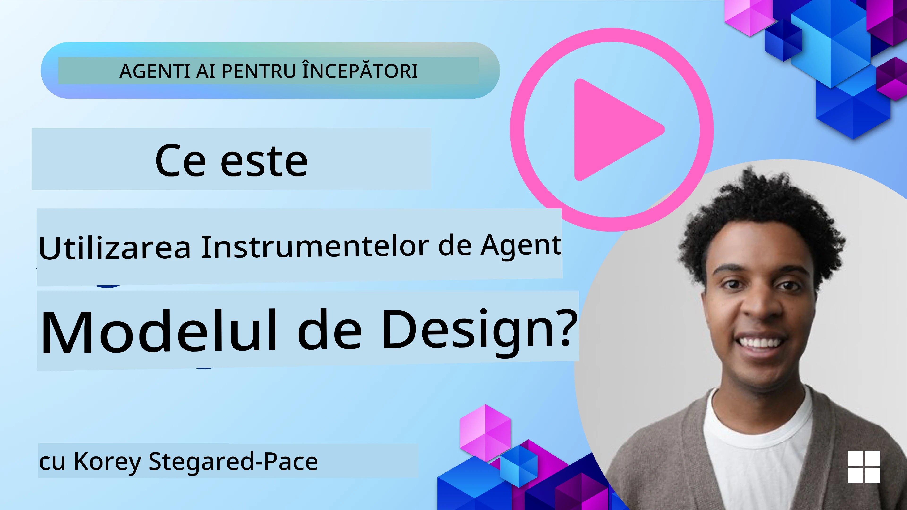
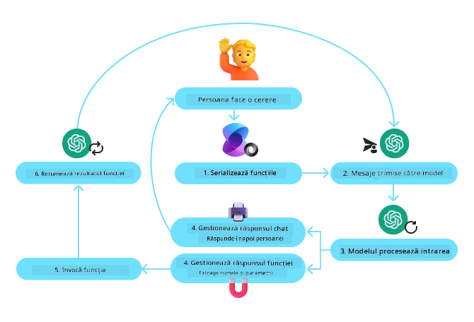
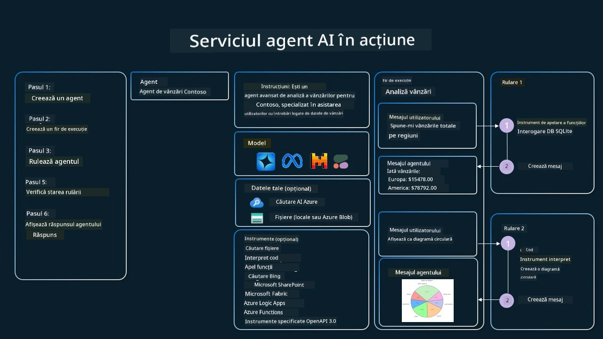

[](https://youtu.be/vieRiPRx-gI?si=cEZ8ApnT6Sus9rhn)

> _(Faceți clic pe imaginea de mai sus pentru a viziona videoclipul acestei lecții)_

# Pattern-ul de design pentru utilizarea uneltelor

Uneltele sunt interesante deoarece permit agenților AI să aibă o gamă mai largă de capabilități. În loc ca agentul să aibă un set limitat de acțiuni pe care le poate efectua, prin adăugarea unei unelte, agentul poate acum să realizeze o gamă largă de acțiuni. În acest capitol, vom analiza Pattern-ul de Design pentru utilizarea uneltelor, care descrie cum pot agenții AI să folosească unelte specifice pentru a-și atinge obiectivele.

## Introducere

În această lecție, căutăm să răspundem următoarelor întrebări:

- Ce este pattern-ul de design pentru utilizarea uneltelor?
- În ce cazuri de utilizare poate fi aplicat?
- Care sunt elementele/blocurile de construcție necesare pentru implementarea pattern-ului de design?
- Care sunt considerațiile speciale pentru folosirea pattern-ului de design pentru utilizarea uneltelor în construcția agenților AI de încredere?

## Obiective de învățare

După finalizarea acestei lecții, veți putea:

- Defini pattern-ul de design pentru utilizarea uneltelor și scopul său.
- Identifica cazurile de utilizare în care pattern-ul de design pentru utilizarea uneltelor este aplicabil.
- Înțelege elementele cheie necesare pentru implementarea pattern-ului de design.
- Recunoaște considerațiile pentru asigurarea încrederii în agenții AI ce folosesc acest pattern de design.

## Ce este pattern-ul de design pentru utilizarea uneltelor?

**Pattern-ul de Design pentru Utilizarea Uneltelor** se concentrează pe oferirea LLM-urilor abilitatea de a interacționa cu unelte externe pentru a atinge scopuri specifice. Uneltele sunt cod care poate fi executat de un agent pentru a efectua acțiuni. O unealtă poate fi o funcție simplă, cum ar fi un calculator, sau un apel API la un serviciu terț, cum ar fi căutarea prețurilor de pe stocuri sau prognoza meteo. În contextul agenților AI, uneltele sunt proiectate să fie executate de agenți ca răspuns la **apeluri de funcție generate de model**.

## În ce cazuri de utilizare poate fi aplicat?

Agenții AI pot folosi unelte pentru a finaliza sarcini complexe, a recupera informații sau a lua decizii. Pattern-ul de design pentru utilizarea uneltelor este adesea folosit în scenarii care necesită interacțiune dinamică cu sisteme externe, cum ar fi baze de date, servicii web sau interpretoare de cod. Această capacitate este utilă pentru o serie de cazuri de utilizare diferite, inclusiv:

- **Recuperare Dinamică a Informațiilor:** Agenții pot interoga API-uri externe sau baze de date pentru a obține date actualizate (de exemplu, interogarea unei baze SQLite pentru analiză de date, colectarea prețurilor acțiunilor sau a informațiilor meteo).
- **Executarea și Interpretarea Codului:** Agenții pot executa cod sau scripturi pentru a rezolva probleme matematice, a genera rapoarte sau a efectua simulări.
- **Automatizarea Fluxurilor de Lucru:** Automatizarea fluxurilor repetitive sau cu mai mulți pași prin integrarea uneltelor precum programatoare de sarcini, servicii de email sau conducte de date.
- **Suport pentru Clienți:** Agenții pot interacționa cu sisteme CRM, platforme de ticketing sau baze de cunoștințe pentru a rezolva întrebările utilizatorilor.
- **Generare și Editare de Conținut:** Agenții pot folosi unelte precum verificatoare gramaticale, rezumatoare de text sau evaluatoare de siguranță a conținutului pentru a asista în crearea de conținut.

## Care sunt elementele/blocurile de construcție necesare pentru a implementa pattern-ul de design pentru utilizarea uneltelor?

Aceste blocuri de construcție permit agentului AI să realizeze o gamă largă de sarcini. Haideți să privim elementele cheie necesare pentru a implementa Pattern-ul de Design pentru Utilizarea Uneltelor:

- **Scheme Funcții/Unelte**: Definiții detaliate ale uneltelor disponibile, inclusiv numele funcției, scopul, parametrii necesari și rezultatele așteptate. Aceste scheme permit LLM să înțeleagă ce unelte sunt disponibile și cum să construiască cereri valide.

- **Logica Execuției Funcțiilor**: Guvernează cum și când sunt invocate uneltele pe baza intenției utilizatorului și contextului conversației. Aceasta poate include module de planificare, mecanisme de rutare sau fluxuri condiționale care determină utilizarea dinamică a uneltelor.

- **Sistem de Gestionare a Mesajelor**: Componente care gestionează fluxul conversațional între intrările utilizatorului, răspunsurile LLM, apelurile către unelte și output-urile uneltelor.

- **Cadru de Integrare a Uneltelor**: Infrastructură care conectează agentul la diverse unelte, fie că sunt funcții simple sau servicii externe complexe.

- **Gestionarea Erorilor și Validarea**: Mecanisme pentru a gestiona eșecurile în execuția uneltelor, validate parametrii și a gestiona răspunsurile neașteptate.

- **Gestionarea Stării**: Urmărește contextul conversației, interacțiunile anterioare cu uneltele și datele persistente pentru a asigura consistența pe durata interacțiunilor multiple.

Următorul pas este să analizăm apelarea de funcții/unelte în detaliu.
 
### Apelarea Funcțiilor/Uneltelor

Apelarea funcțiilor este modul principal prin care permit LLM-urilor să interacționeze cu uneltele. Veți vedea adesea 'Funcție' și 'Unealtă' folosite interschimbabil deoarece 'funcțiile' (blocuri de cod reutilizabil) sunt 'uneltele' pe care agenții le folosesc pentru a îndeplini sarcini. Pentru ca codul unei funcții să fie invocat, un LLM trebuie să compare cererea utilizatorului cu descrierea funcțiilor. Pentru asta, o schemă care conține descrierile tuturor funcțiilor disponibile este trimisă la LLM. LLM selectează apoi funcția cea mai potrivită pentru sarcină și returnează numele și argumentele acesteia. Funcția selectată este invocată, răspunsul său este trimis înapoi la LLM, care folosește informația pentru a răspunde cererii utilizatorului.

Pentru dezvoltatori, implementarea apelării funcțiilor pentru agenți necesită:

1. Un model LLM care suportă apelarea funcțiilor
2. O schemă care conține descrieri ale funcțiilor
3. Codul pentru fiecare funcție descrisă

Haideți să folosim exemplul obținerii orei curente într-un oraș pentru a ilustra:

1. **Inițializați un LLM care suportă apelarea funcțiilor:**

    Nu toate modelele suportă apelarea funcțiilor, așa că este important să verificați dacă LLM-ul pe care îl folosiți o face. <a href="https://learn.microsoft.com/azure/ai-services/openai/how-to/function-calling" target="_blank">Azure OpenAI</a> suportă apelarea funcțiilor. Putem începe prin a iniția clientul OpenAI împotriva Azure OpenAI **Responses API** (endpoint-ul stabil `/openai/v1/` – nu este nevoie de `api_version`). 

    ```python
    # Initialize the OpenAI client for Azure OpenAI (Responses API, v1 endpoint)
    client = OpenAI(
        base_url=f"{os.environ['AZURE_OPENAI_ENDPOINT'].rstrip('/')}/openai/v1/",
        api_key=os.environ["AZURE_OPENAI_API_KEY"],
    )
    deployment_name = os.environ["AZURE_OPENAI_DEPLOYMENT"]
    ```

1. **Creați o Schematizare Funcție:**

    Următorul pas este să definim o schemă JSON care conține numele funcției, descrierea a ceea ce face funcția și numele plus descrierea parametrilor funcției.
    Apoi vom transmite această schemă clientului creat anterior, împreună cu cererea utilizatorului pentru a afla ora în San Francisco. Ceea ce este important de menționat este că este returnat **un apel de unealtă**, **nu** răspunsul final la întrebare. Așa cum am menționat anterior, LLM returnează numele funcției pe care a selectat-o pentru sarcină și argumentele care vor fi transmise acesteia.

    ```python
    # Function description for the model to read (Responses API flat tool format)
    tools = [
        {
            "type": "function",
            "name": "get_current_time",
            "description": "Get the current time in a given location",
            "parameters": {
                "type": "object",
                "properties": {
                    "location": {
                        "type": "string",
                        "description": "The city name, e.g. San Francisco",
                    },
                },
                "required": ["location"],
            },
        }
    ]
    ```
   
    ```python
  
    # Initial user message
    messages = [{"role": "user", "content": "What's the current time in San Francisco"}]

    # First API call: Ask the model to use the function
    response = client.responses.create(
        model=deployment_name,
        input=messages,
        tools=tools,
        tool_choice="auto",
        store=False,
    )

    # The Responses API returns tool calls as function_call items in response.output.
    # Append them to the conversation so the model has full context on the next turn.
    messages += response.output

    print("Model's response:")
    print(response.output)
  
    ```

    ```bash
    Model's response:
    [ResponseFunctionToolCall(arguments='{"location":"San Francisco"}', call_id='call_pOsKdUlqvdyttYB67MOj434b', name='get_current_time', type='function_call')]
    ```
  
1. **Codul funcției necesar pentru a îndeplini sarcina:**

    Acum că LLM a ales care funcție trebuie rulată, codul care execută sarcina trebuie implementat și executat.
    Putem implementa codul pentru a obține ora curentă în Python. De asemenea, trebuie să scriem codul pentru a extrage numele și argumentele din response_message pentru a obține rezultatul final.

    ```python
      def get_current_time(location):
        """Get the current time for a given location"""
        print(f"get_current_time called with location: {location}")  
        location_lower = location.lower()
        
        for key, timezone in TIMEZONE_DATA.items():
            if key in location_lower:
                print(f"Timezone found for {key}")  
                current_time = datetime.now(ZoneInfo(timezone)).strftime("%I:%M %p")
                return json.dumps({
                    "location": location,
                    "current_time": current_time
                })
      
        print(f"No timezone data found for {location_lower}")  
        return json.dumps({"location": location, "current_time": "unknown"})
    ```

     ```python
    # Handle function calls
    tool_calls = [item for item in response.output if item.type == "function_call"]
    if tool_calls:
        for tool_call in tool_calls:
            if tool_call.name == "get_current_time":

                function_args = json.loads(tool_call.arguments)

                time_response = get_current_time(
                    location=function_args.get("location")
                )

                # Return the tool result as a function_call_output item
                messages.append({
                    "type": "function_call_output",
                    "call_id": tool_call.call_id,
                    "output": time_response,
                })
    else:
        print("No tool calls were made by the model.")

    # Second API call: Get the final response from the model
    final_response = client.responses.create(
        model=deployment_name,
        input=messages,
        tools=tools,
        store=False,
    )

    return final_response.output_text
     ```

     ```bash
      get_current_time called with location: San Francisco
      Timezone found for san francisco
      The current time in San Francisco is 09:24 AM.
     ```

Apelarea Funcțiilor este în centrul majorității, dacă nu tuturor, design-urilor de utilizare a uneltelor pentru agenți, însă implementarea de la zero poate fi uneori provocatoare.
După cum am învățat în [Lecția 2](../../../02-explore-agentic-frameworks), cadrele agentice ne oferă blocuri preconstruite pentru a implementa utilizarea uneltelor.
 
## Exemple de utilizare a uneltelor cu cadre agentice

Iată câteva exemple de cum puteți implementa Pattern-ul de Design pentru Utilizarea Uneltelor folosind cadre agentice diferite:

### Microsoft Agent Framework

<a href="https://learn.microsoft.com/azure/ai-services/agents/overview" target="_blank">Microsoft Agent Framework</a> este un cadru AI open-source pentru construirea agenților AI. Simplifică procesul de utilizare a apelării funcțiilor permițându-vă să definiți uneltele ca funcții Python cu decoratoarele `@tool`. Cadrul gestionează comunicarea între model și codul dvs. De asemenea, oferă acces la unelte preconstruite, cum ar fi Căutarea în Fișiere și Interpretorul de Cod prin `FoundryChatClient`.

Diagrama următoare ilustrează procesul de apelare a funcțiilor cu Microsoft Agent Framework:



În Microsoft Agent Framework, uneltele sunt definite ca funcții decorate. Putem converti funcția `get_current_time` pe care am văzut-o anterior într-o unealtă folosind decoratorul `@tool`. Cadrul va serializa automat funcția și parametrii săi, creând schema care va fi trimisă la LLM.

```python
import os
from agent_framework import tool
from agent_framework.foundry import FoundryChatClient
from azure.identity import AzureCliCredential

@tool(approval_mode="never_require")
def get_current_time(location: str) -> str:
    """Get the current time for a given location"""
    ...

# Create the client
provider = FoundryChatClient(
    project_endpoint=os.environ["AZURE_AI_PROJECT_ENDPOINT"],
    model=os.environ["AZURE_AI_MODEL_DEPLOYMENT_NAME"],
    credential=AzureCliCredential(),
)

# Create an agent and run with the tool
agent = provider.as_agent(name="TimeAgent", instructions="Use available tools to answer questions.", tools=get_current_time)
response = await agent.run("What time is it?")
```

#### Unelte de la un server MCP

Uneltele nu trebuie să fie funcții din codul propriu. Un server care vorbește Model Context Protocol (MCP, discutat în [Lecția 11](../11-agentic-protocols/README.md)) publică uneltele împreună cu schemele acestora, iar cadrul le poate încărca la fel cum serializa o funcție decorată. `MCPStreamableHTTPTool` se conectează la un astfel de server prin HTTP, citește schemele uneltelor și le oferă modelului alături de orice unelte locale.

Exemplul de mai jos folosește serverul de căutare web găzduit de <a href="https://keenable.ai" target="_blank">Keenable</a>. Este gratuit fără cont sau cheie API (cererile sunt limitate pe IP), deci singurele acreditări necesare sunt cele ale modelului dvs. Ca orice unealtă la distanță, interogările pe care le scrie modelul sunt trimise la acel server.

```python
from agent_framework import MCPStreamableHTTPTool

web_search = MCPStreamableHTTPTool(
    name="Keenable web search",
    url="https://api.keenable.ai/mcp",
)

# Connecting loads the server's tool schemas; the agent decides when to call them
async with web_search:
    agent = provider.as_agent(
        name="ResearchAgent",
        instructions="Use available tools to answer questions.",
        tools=[web_search],
    )
    response = await agent.run("What is new in the latest Python release?")
    print(response.text)
```

Serverul publică două unelte, `search_web_pages` și `fetch_page_content`. Când o întrebare necesită informații actuale, modelul apelează `search_web_pages`, primește titluri, URL-uri și fragmente de text și scrie răspunsul pornind de la ele, același ciclu ca în exemplul `get_current_time` de mai sus.
  
### Microsoft Foundry Agent Service

<a href="https://learn.microsoft.com/azure/ai-services/agents/overview" target="_blank">Microsoft Foundry Agent Service</a> este un cadru agentic mai nou, proiectat să permită dezvoltatorilor să construiască, implementeze și să scaleze în siguranță agenți AI de înaltă calitate și extensibili fără a gestiona resursele de calcul și stocare subiacente. Este util mai ales în aplicații enterprise deoarece este un serviciu complet gestionat cu securitate de nivel enterprise.

Comparativ cu dezvoltarea directă cu API-ul LLM, Microsoft Foundry Agent Service oferă câteva avantaje, inclusiv:

- Apelare automată a uneltelor – nu este nevoie să analizați un apel de unealtă, să o invocați și să gestionați răspunsul; toate acestea se fac acum pe server
- Date gestionate în siguranță – în loc să gestionați proprie starea conversațională, puteți folosi fire pentru a stoca toate informațiile necesare
- Unelte gata de utilizat – unelte pe care le puteți folosi pentru a interacționa cu sursele dvs. de date, precum Bing, Azure AI Search și Azure Functions.

Uneltele disponibile în Microsoft Foundry Agent Service pot fi împărțite în două categorii:

1. Unelte de cunoaștere:
    - <a href="https://learn.microsoft.com/azure/ai-services/agents/how-to/tools/bing-grounding?tabs=python&pivots=overview" target="_blank">Sprijin cu Bing Search</a>
    - <a href="https://learn.microsoft.com/azure/ai-services/agents/how-to/tools/file-search?tabs=python&pivots=overview" target="_blank">Căutare în fișiere</a>
    - <a href="https://learn.microsoft.com/azure/ai-services/agents/how-to/tools/azure-ai-search?tabs=azurecli%2Cpython&pivots=overview-azure-ai-search" target="_blank">Azure AI Search</a>

2. Unelte de acțiune:
    - <a href="https://learn.microsoft.com/azure/ai-services/agents/how-to/tools/function-calling?tabs=python&pivots=overview" target="_blank">Apelare Funcție</a>
    - <a href="https://learn.microsoft.com/azure/ai-services/agents/how-to/tools/code-interpreter?tabs=python&pivots=overview" target="_blank">Interpret de Cod</a>
    - <a href="https://learn.microsoft.com/azure/ai-services/agents/how-to/tools/openapi-spec?tabs=python&pivots=overview" target="_blank">Unelte definite OpenAPI</a>
    - <a href="https://learn.microsoft.com/azure/ai-services/agents/how-to/tools/azure-functions?pivots=overview" target="_blank">Azure Functions</a>

Agent Service ne permite să folosim aceste unelte împreună ca un `toolset`. De asemenea, utilizează `threads` care urmăresc istoria mesajelor dintr-o conversație anume.

Imaginați-vă că sunteți un agent de vânzări la o companie numită Contoso. Doriți să dezvoltați un agent conversațional care să poată răspunde la întrebări despre datele dvs. de vânzări.

Imaginea de mai jos ilustrează cum ați putea folosi Microsoft Foundry Agent Service pentru a analiza datele dvs. de vânzări:



Pentru a folosi oricare dintre aceste unelte cu serviciul, putem crea un client și defini o unealtă sau un set de unelte. Pentru a implementa acest lucru practic, putem folosi următorul cod Python. LLM va putea să analizeze setul de unelte și să decidă dacă folosește funcția creată de utilizator, `fetch_sales_data_using_sqlite_query`, sau interpretorul de cod predefinit, în funcție de cererea utilizatorului.

```python 
import os
from azure.ai.projects import AIProjectClient
from azure.identity import DefaultAzureCredential
from fetch_sales_data_functions import fetch_sales_data_using_sqlite_query # fetch_sales_data_using_sqlite_query function which can be found in a fetch_sales_data_functions.py file.
from azure.ai.projects.models import ToolSet, FunctionTool, CodeInterpreterTool

project_client = AIProjectClient.from_connection_string(
    credential=DefaultAzureCredential(),
    conn_str=os.environ["PROJECT_CONNECTION_STRING"],
)

# Initialize toolset
toolset = ToolSet()

# Initialize function calling agent with the fetch_sales_data_using_sqlite_query function and adding it to the toolset
fetch_data_function = FunctionTool(fetch_sales_data_using_sqlite_query)
toolset.add(fetch_data_function)

# Initialize Code Interpreter tool and adding it to the toolset. 
code_interpreter = CodeInterpreterTool()toolset.add(code_interpreter)

agent = project_client.agents.create_agent(
    model="gpt-5-mini", name="my-agent", instructions="You are helpful agent", 
    toolset=toolset
)
```

## Care sunt considerațiile speciale pentru folosirea Pattern-ului de Design pentru Utilizarea Uneltelor în construcția agenților AI de încredere?

O preocupare frecventă privind SQL-ul generat dinamic de LLM-uri este securitatea, în special riscul de injecție SQL sau acțiuni malițioase, cum ar fi ștergerea sau manipularea bazei de date. Deși aceste preocupări sunt valide, ele pot fi efectiv atenuate prin configurarea corectă a permisiunilor de acces la baza de date. Pentru majoritatea bazelor de date, aceasta presupune configurarea bazei ca read-only. Pentru servicii de baze de date precum PostgreSQL sau Azure SQL, aplicația ar trebui să fie atribuită unui rol read-only (SELECT).

Rularea aplicației într-un mediu securizat sporește și mai mult protecția. În scenarii enterprise, datele sunt de obicei extrase și transformate din sistemele operaționale într-o bază de date read-only sau un depozit de date cu o schemă prietenoasă cu utilizatorul. Această abordare asigură că datele sunt sigure, optimizate pentru performanță și accesibilitate, iar aplicația are acces restricționat, doar în citire.

## Coduri Exemplu

- Python: [Agent Framework](./code_samples/04-python-agent-framework.ipynb)
- .NET: [Agent Framework](./code_samples/04-dotnet-agent-framework.md)

## Aveți mai multe întrebări despre Pattern-urile de Design pentru Utilizarea Uneltelor?

Alăturați-vă [Microsoft Foundry Discord](https://discord.com/invite/ATgtXmAS5D) pentru a întâlni alți cursanți, a participa la ore de program și a primi răspunsuri la întrebările despre Agenții AI.

## Resurse suplimentare

- <a href="https://microsoft.github.io/build-your-first-agent-with-azure-ai-agent-service-workshop/" target="_blank">Atelier Azure AI Agents Service</a>
- <a href="https://github.com/Azure-Samples/contoso-creative-writer/tree/main/docs/workshop" target="_blank">Atelier Multi-Agent Contoso Creative Writer</a>
- <a href="https://learn.microsoft.com/azure/ai-services/agents/overview" target="_blank">Prezentare Generală a Microsoft Agent Framework</a>

## Testare Rapidă a Acestui Agent (Opțional)

După ce înveți cum să implementezi agenți în [Lecția 16](../16-deploying-scalable-agents/README.md), poți testa rapid `TravelToolAgent` din această lecție (apelează încă uneltele și răspunde?) cu [`tests/lesson-04-smoke-tests.json`](../../../tests/lesson-04-smoke-tests.json). Vezi [`tests/README.md`](../tests/README.md) pentru modul de rulare.

## Lecția Anterioară

[Înțelegerea Modelelor de Design Agentic](../03-agentic-design-patterns/README.md)

## Lecția Următoare

[Agentic RAG](../05-agentic-rag/README.md)

---

<!-- CO-OP TRANSLATOR DISCLAIMER START -->
**Declinare a responsabilității**:
Acest document a fost tradus folosind serviciul de traducere AI [Co-op Translator](https://github.com/Azure/co-op-translator). În timp ce ne străduim pentru acuratețe, vă rugăm să rețineți că traducerile automate pot conține erori sau inexactități. Documentul original în limba sa nativă trebuie considerat sursa autorizată. Pentru informații critice, se recomandă traducerea profesională realizată de un om. Nu ne asumăm responsabilitatea pentru eventualele neînțelegeri sau interpretări greșite care decurg din utilizarea acestei traduceri.
<!-- CO-OP TRANSLATOR DISCLAIMER END -->