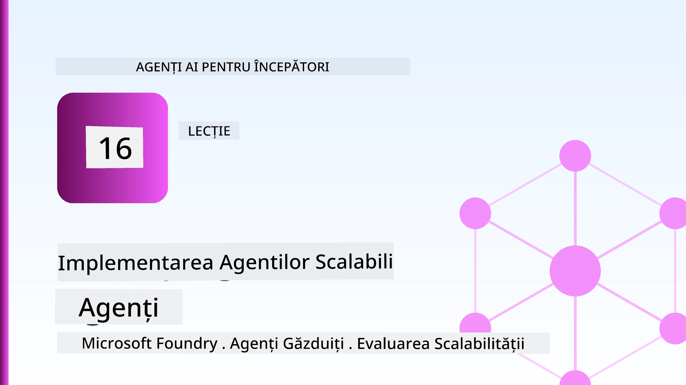
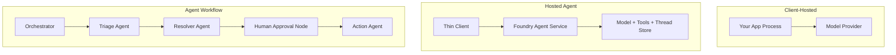
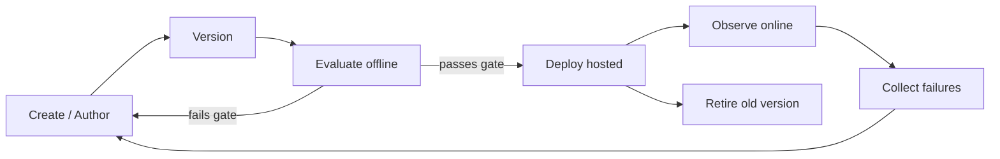
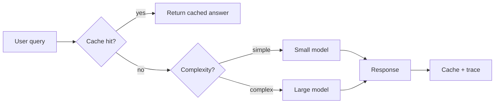
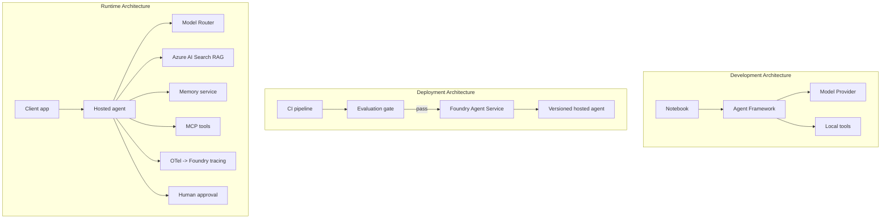

# Implementarea agenților scalabili cu Microsoft Foundry



Până în acest punct al cursului ați construit agenți care rulează pe laptopul vostru, într-un notebook, conduși de `az login` și câteva variabile de mediu. Aceasta este exact metoda corectă de a învăța. Nu este metoda corectă de a rula un agent de care mii de clienți depind la 3 dimineața.

Această lecție este despre golul dintre „funcționează pe mașina mea” și „funcționează fiabil și accesibil în producție.” Închidem acest gol folosind **Microsoft Foundry** și **Microsoft Foundry Agent Service**, construind un agent real de asistență pentru clienți care include unelte, regăsire, memorie, evaluare și monitorizare.

## Introducere

Această lecție va acoperi:

- Diferența dintre un **agent prototip** și un **agent implementat**, și de ce tranziția este în mare parte despre tot ce este *în jurul* modelului.
- **Modele de implementare** pentru agenți: găzduit la client, găzduit ca serviciu (Hosted Agents), și orchestrate prin fluxuri de lucru.
- **Ciclul de viață al agentului** pe Microsoft Foundry — creare, versiune, implementare, evaluare, observare, retragere.
- **Strategii de scalare**: rutarea modelului, caching, concurență și design fără stare.
- **Observabilitate** cu OpenTelemetry și trasare în Foundry.
- **Optimizarea costurilor** prin selecția modelului, rutare și porți de evaluare.
- **Considerații enterprise**: guvernanță, aprobare umană și rularea sigură a serverelor MCP în producție.

## Obiective de învățare

După finalizarea acestei lecții, veți ști cum să:

- Alegeți modelul potrivit de implementare pentru o anumită sarcină a agentului.
- Implementați un agent în Microsoft Foundry Agent Service astfel încât să fie versionat, guvernat și observabil.
- Instrumentați un agent pentru trasare și conectați un pipeline de evaluare care rulează înainte de fiecare lansare.
- Aplicați rutarea modelului și caching pentru a menține latența și costul sub control la scară.
- Adăugați o poartă de aprobare umană pentru acțiuni cu risc ridicat și integrați un server MCP într-un mod sigur pentru producție.

## Cerințe prealabile

Această lecție presupune că ați finalizat lecțiile anterioare și sunteți confortabil cu:

- Construirea agenților cu [Microsoft Agent Framework](../14-microsoft-agent-framework/README.md) (Lecția 14).
- [Utilizarea uneltelor](../04-tool-use/README.md) (Lecția 4) și [Agentic RAG](../05-agentic-rag/README.md) (Lecția 5).
- [Memoria agentului](../13-agent-memory/README.md) (Lecția 13) și [Protocoalele agentice / MCP](../11-agentic-protocols/README.md) (Lecția 11).
- [Observabilitate și evaluare](../10-ai-agents-production/README.md) (Lecția 10) — această lecție se bazează direct pe ea.

De asemenea, veți avea nevoie de:

- Un **abonament Azure** și un **proiect Microsoft Foundry** cu cel puțin un model de chat implementat.
- CLI Azure autentificat (`az login`).
- Python 3.12+ și pachetele din depozitul [`requirements.txt`](../../../requirements.txt).

## De la Prototip la Producție: Ce se schimbă de fapt

Un agent prototip și un agent de producție împart aceeași buclă de bază — raționament, apelare unelte, răspuns. Ce se schimbă este tot ce este în jurul acelei bucle. Modelul reprezintă probabil 20% dintr-un agent de producție; restul de 80% este scheletul operațional.

| Aspect | Prototip | Producție |
| --- | --- | --- |
| **Găzduire** | Rulează în notebook-ul tău | Rulează ca serviciu găzduit, versionat și distribuit |
| **Identitate** | Tokenul tău `az login` | Identitate gestionată cu RBAC restricționat |
| **Stare** | În memorie, pierdută la restart | Externalizată (magazin fire, serviciu de memorie) |
| **Eșec** | Vezi traceback-ul | Reîncercări, fallback-uri, coadă de mesaje nedesfăcute, alerte |
| **Cost** | „E câțiva cenți” | Urmărit per cerere, rutat, cached, bugetat |
| **Calitate** | Verifici manual ieșirea | Evaluat automat înainte de fiecare lansare |
| **Încredere** | Aprobi fiecare acțiune | Politică + om în buclă pentru acțiuni riscante |

Țineți minte acest tabel. Fiecare secțiune de mai jos corespunde unuia dintre aceste rânduri.

## Modele de Implementare ale Agenților

Există trei modele pe care le veți folosi, adesea în combinație.

### 1. Agenți găzduiți la client

Obiectul agent trăiește în interiorul procesului *aplicației tale*. Codul tău apelează direct furnizorul de model; bucla de raționament rulează în serviciul tău. Aceasta este ceea ce a făcut fiecare lecție anterioară.

- **Folosește-l când** ai nevoie de control total asupra buclei, middleware personalizat sau încorporezi agentul într-un backend existent.
- **Compromis**: ești responsabil personal pentru scalare, stare și reziliență.

### 2. Agenți găzduiți (Foundry Agent Service)

Agentul este *înregistrat ca resursă* în Microsoft Foundry. Foundry găzduiește bucla de raționament, stochează firele conversației, aplică siguranța conținutului și RBAC, și face agentul vizibil în portalul Foundry. Aplicația ta devine un client subțire care creează fire și citește răspunsuri.

- **Folosește-l când** vrei durabilitate, observabilitate încorporată, guvernanță și o suprafață operațională redusă.
- **Compromis**: mai puțin control la nivel scăzut în schimbul unui runtime gestionat.

### 3. Fluxuri de lucru pentru agenți

Mai mulți agenți (și unelte) sunt compuși într-un graf cu flux de control explicit — pași secvențiali, ramificare, noduri de aprobare umană și puncte de control durabile care pot pune pauză și apoi relua execuția. Aceasta este capacitatea **Workflows** din Microsoft Agent Framework aplicată la scară de implementare.

- **Folosește-l când** o singură sarcină implică mai mulți agenți specializați sau necesită o etapă de aprobare în mijloc.
- **Compromis**: mai multe piese în mișcare; necesită observabilitate la nivel de orchestrare.



## Ciclul de viață al agentului pe Microsoft Foundry

Implementarea unui agent nu este o operațiune unică `push`. Este o buclă, și seamănă foarte mult cu un ciclu de lansare software deoarece exact asta este.



Ideea cheie, preluată din [Lecția 10](../10-ai-agents-production/README.md): **evaluarea offline este o poartă, nu o reflecție ulterioară.** O nouă versiune a agentului nu se lansează dacă nu trece pragurile tale de evaluare. Observabilitatea online apoi alimentează înapoi în setul tău de teste offline informații despre eșecurile din lumea reală. Aceasta este întreaga buclă.

## Strategii de scalare

Scalarea unui agent este diferită de scalarea unei API web fără stare, deoarece fiecare cerere poate declanșa multiple apeluri costisitoare la model și unelte. Patru tehnici suportă majoritatea încărcăturii.

**Gestionarea cererilor fără stare.** Nu păstra starea per utilizator în memoria procesului tău. Persistă firele conversației în magazinul de fire Foundry sau un serviciu de memorie astfel încât orice instanță să poată gestiona orice cerere. Aceasta permite scalarea orizontală — adăugarea de instanțe, fără sesiuni sticky.

**Rutarea modelului.** Nu fiecare cerere necesită cel mai capabil (și mai scump) model. Routează cererile simple — clasificarea intenției, răspunsuri scurte factuale — către un model mic și rapid, și rezervă modelul mare pentru raționamentul autentic. **Model Router** din Foundry poate face asta pentru tine, sau poți implementa un clasificator ușor pe cont propriu. Vei construi versiunea DIY în laborator.

**Caching-ul răspunsurilor.** Multe întrebări de suport sunt aproape duplicate („cum resetez parola?”). Cachează răspunsurile la întrebările frecvente și servește-le fără a apela modelul deloc. Chiar și o rată modestă de hit în cache reduce semnificativ costul și latența.

**Concurență și backpressure.** Furnizorii de modele au limite de rată. Limitează concurența, folosește reîncercări cu backoff exponential și eșuează cu grație (un răspuns „suntem pe fază” în coadă este mai bun decât un 500).



## Observabilitate în producție

Nu poți opera ce nu poți vedea. După cum s-a acoperit în Lecția 10, Microsoft Agent Framework emite nativ trace-uri **OpenTelemetry** — fiecare apel de model, invocare de unealtă și pas de orchestrare devine un span. În producție exporți acele span-uri către Microsoft Foundry (sau orice backend compatibil OTel) pentru a putea:

- Urmări o singură reclamație a clientului de la început până la sfârșit prin fiecare apel de model și unealtă.
- Monitoriza latența p50/p95 și costul per cerere în timp.
- Alerta asupra vârfurilor de rată de eroare și anomaliilor de cost înainte ca utilizatorii tăi (sau echipa ta financiară) să observe.

```python
from agent_framework.observability import get_tracer

tracer = get_tracer()

with tracer.start_as_current_span("support_request") as span:
    span.set_attribute("customer.tier", "enterprise")
    span.set_attribute("routed.model", "gpt-5-nano")
    # agent execution is traced automatically inside this span
```

Atribute precum `customer.tier` și `routed.model` transformă un perete de trace-uri în întrebări la care se poate răspunde ("clienții enterprise sunt direcționați prea des către modelul mic?").

## Optimizarea costurilor

Costul în agenții de producție este dominat de token-uri. Trei pârghii, în ordinea impactului:

1. **Potrivește dimensiunea modelului.** Un model mic care trece poarta ta de evaluare este aproape întotdeauna mai ieftin decât unul mare care de asemenea trece. Folosește evaluarea pentru a *dovedi* că modelul mic este suficient, în loc să presupui din precauție modelul cel mai mare.
2. **Rutează după complexitate.** Ca mai sus — plătește prețul modelului mare doar pentru cererile care necesită raționament cu model mare.
3. **Cachează agresiv.** Cel mai ieftin apel de model este cel pe care nu îl faci niciodată.

Porțile de evaluare și controlul costurilor sunt aceeași disciplină văzută din două unghiuri: evaluarea îți spune *nivelul minim de calitate*, rutarea și caching-ul te mențin cât mai aproape de *costul* acestui nivel.

## Considerații pentru implementarea enterprise

**Guvernanță.** Hosted Agents moștenesc RBAC-ul, siguranța conținutului și jurnalizarea de audit a Foundry. Oferă fiecărui agent o identitate gestionată cu cel mai mic privilegiu necesar — acces numai în citire la baza de cunoștințe, acces restricționat la API-ul de ticketing, nimic mai mult.

**Om în buclă.** Anumite acțiuni sunt prea importante pentru a fi automatizate complet — emiterea unei rambursări, ștergerea unui cont, escaladarea către o echipă juridică. Microsoft Agent Framework suportă unelte care **necesită aprobare**: agentul propune acțiunea, execuția se oprește, un om aprobă sau respinge, și fluxul de lucru reia. Ai văzut primitiva în [Lecția 6](../06-building-trustworthy-agents/README.md); aici o implementezi.

**MCP în producție.** [MCP](../11-agentic-protocols/README.md) permite agentului să consume unelte externe printr-o interfață standard. În producție, tratează fiecare server MCP ca o frontieră neîncrezătoare: fixează versiunea serverului, ruleaz-o cu o identitate restricționată, validează rezultatele, și niciodată nu expune secrete către ea. Un server MCP este o dependență, iar dependențele sunt patch-uite, auditate și limitate la rată.



Acele trei diagrame — dezvoltare, implementare, rulare — arată același agent în trei etape ale vieții sale. Laboratorul care urmează te ghidează să-l construiești.

## Laborator Practic: Un agent de asistență clienți pregătit pentru producție

Deschide [`code_samples/16-python-agent-framework.ipynb`](./code_samples/16-python-agent-framework.ipynb) și parcurge-l integral. Vei asambla un **agent de asistență clienți Contoso** cu toate preocupările de producție integrate:

1. **Apelare unelte** — verifică statusul comenzilor și deschide tichete de suport.
2. **RAG** — răspunde la întrebări de politică dintr-o bază de cunoștințe (Azure AI Search, cu un fallback în memorie pentru ca notebook-ul să ruleze fără o resursă Search).
3. **Memorie** — amintește clientul de-a lungul conversației.
4. **Rutarea modelului** — un clasificator de complexitate direcționează fiecare cerere către model mic sau mare.
5. **Caching-ul răspunsurilor** — întrebările repetate sunt servite din cache.
6. **Aprobare umană** — rambursările peste un prag sunt oprite pentru semnătura umană.
7. **Pipeline de evaluare** — un set mic de teste offline evaluează agentul și acționează ca poartă de lansare.
8. **Observabilitate** — trasare OpenTelemetry pentru fiecare cerere.

### Parcurgere

Notebook-ul este organizat astfel încât fiecare preocupare de producție să fie o secțiune autonomă și executabilă. Inima lui este handler-ul de cereri cu rutare și caching:

```python
async def handle_support_request(query: str, customer_id: str) -> str:
    # 1. Serve from cache when we can.
    cached = response_cache.get(normalize(query))
    if cached:
        return cached

    # 2. Route by complexity to control cost.
    model = "gpt-5-nano" if is_simple(query) else "gpt-5-mini"

    # 3. Run the agent inside a trace span for observability.
    with tracer.start_as_current_span("support_request") as span:
        span.set_attribute("routed.model", model)
        span.set_attribute("customer.id", customer_id)
        response = await support_agent.run(query, model=model)

    # 4. Cache and return.
    response_cache.set(normalize(query), response.text)
    return response.text
```

Poarta de evaluare care protejează o lansare arată astfel:

```python
async def evaluation_gate(agent, test_cases, threshold: float = 0.8) -> bool:
    passed = 0
    for case in test_cases:
        result = await agent.run(case["input"])
        if score_response(result.text, case["expected"]) >= 0.8:
            passed += 1
    pass_rate = passed / len(test_cases)
    print(f"Evaluation pass rate: {pass_rate:.0%} (gate: {threshold:.0%})")
    return pass_rate >= threshold  # only deploy if the gate passes
```

Citește fiecare linie — notebook-ul menține primitivele deliberat mici pentru ca nimic să nu fie ascuns în spatele unui apel de framework.

## Validarea unui agent implementat cu teste rapide

Poarta de evaluare de mai sus rulează *offline* pe obiectul agentului tău. Odată ce agentul este implementat ca Hosted Agent, ai nevoie de o verificare în plus, chiar mai ieftină: **răspunde cu adevărat endpointul implementat?**

Implementarea „cu succes” dovedește doar că planul de control a acceptat definiția — nu dovedește că agentul răspunde. O dependență lipsă, o rutare greșită a modelului sau o conexiune expirată pot lăsa o implementare cu status verde care nu returnează nimic. Un **test rapid (smoke test)** prinde asta în secunde, la fiecare implementare, fără costul unei evaluări complete.

Acest depozit oferă un pipeline gata de folosit pentru teste rapide bazat pe [AI Smoke Test](https://github.com/marketplace/actions/ai-smoke-test) GitHub Action:

- **Catalog** — [`tests/lesson-16-smoke-tests.json`](../../../tests/lesson-16-smoke-tests.json) conține prompturi și aserțiuni pentru agentul de suport Contoso (răspunsuri fundamentate pe politică, căutare de comenzi, menținerea subiectului și continuitatea firelor multi-turn). Cataloage pentru alți agenți din lecții trăiesc alături — vezi [`tests/README.md`](../tests/README.md).
- **Flux de lucru** — [`.github/workflows/smoke-test.yml`](../../../.github/workflows/smoke-test.yml) se autentifică cu Azure OIDC și trimite POST fiecărui prompt către endpoint-ul Responses al agentului, eșuând jobul la orice aserțiune nerespectată.

```yaml
- name: Smoke-test hosted agent
  uses: JFolberth/ai-smoketest@v1
  with:
    project_endpoint: ${{ inputs.project_endpoint }}
    agent_name: ContosoSupportAgent
    tests_file: tests/lesson-16-smoke-tests.json
```

Rulați-l din fila **Acțiuni** odată ce agentul dvs. este implementat, furnizând endpoint-ul proiectului Foundry și numele agentului. Identitatea federată are nevoie de rolul **Azure AI User** la nivelul proiectului Foundry. Gândiți-vă la straturi ca la o piramidă: testele de fum (accesibil și răspunde?) rulează la fiecare implementare, evaluarea offline (suficient de bun pentru a fi lansat?) rulează înainte de promovare, iar evaluarea online (cum se comportă în mediul real?) rulează continuu.

## Verificare a Cunoștințelor

Testați-vă înțelegerea înainte de a trece la sarcină.

**1. Aproximativ cât de mult dintr-un agent de producție este „modelul” și ce reprezintă restul?**

<details>
<summary>Răspuns</summary>

Modelul este o minoritate a sistemului — adesea estimat la aproximativ 20%. Restul este scheletul operațional: găzduire și versionare, identitate și RBAC, stare externalizată, gestionarea eșecurilor, urmărirea costurilor, evaluare și controale cu intervenție umană. Trecerea în producție înseamnă în principal construirea a tot ceea ce este *în jurul* ciclului de raționament.
</details>

**2. Când ați alege un Agent Găzduit în loc de un agent găzduit pe client?**

<details>
<summary>Răspuns</summary>

Când doriți un runtime gestionat cu durabilitate integrată (fire care persistă și pot relua), observabilitate, siguranță a conținutului și RBAC, și sunteți dispus să renunțați la un control de nivel jos asupra ciclului de raționament pentru o suprafață operațională mai redusă. Găzduirea pe client este preferabilă când aveți nevoie de control complet asupra ciclului sau când încorporați agentul într-un backend existent.
</details>

**3. De ce trebuie ca un agent scalabil să fie fără stare în propria memorie de proces?**

<details>
<summary>Răspuns</summary>

Pentru ca orice instanță să poată prelua orice cerere, ceea ce permite scalare orizontală fără sesiuni sticky. Starea conversației per utilizator este externalizată într-un magazin de fire sau serviciu de memorie. Dacă starea ar fi în memoria procesului, s-ar pierde la repornire și nu s-ar putea distribui încărcarea liber.
</details>

**4. Ce problemă rezolvă rutarea modelului și cum se leagă de evaluare?**

<details>
<summary>Răspuns</summary>

Rutarea trimite cererile simple către un model mic, ieftin și rapid și rezervă modelul mare pentru raționamentul real, controlând atât latența, cât și costul. Se leagă de evaluare pentru că evaluarea *demonstrează* că modelul mic este suficient de bun pentru o clasă de cereri — rutarea fără evaluare este o presupunere.
</details>

**5. Ce este un „poartă de evaluare” și unde se situează în ciclul de viață?**

<details>
<summary>Răspuns</summary>

O poartă de evaluare rulează un set de teste offline pe o versiune nouă a agentului și blochează implementarea dacă rata de trecere nu depășește un prag. Se situează între „versiune” și „implementare” în ciclul de viață, făcând din calitate o condiție prealabilă pentru lansare, nu ceva verificat după livrare.
</details>

**6. De ce ar trebui un server MCP să fie tratat ca o limită neîncredere în producție?**

<details>
<summary>Răspuns</summary>

Pentru că este o dependență externă la care agentul dvs. apelează. Trebuie să fixați versiunea acestuia, să-l rulați cu o identitate scopă, să validați ieșirile, să limitați ratele și să nu-i expuneți niciodată secrete — aceeași disciplină pe care o aplicați oricărei dependențe terțe. Ieșirile lui intră în raționamentul agentului, astfel că încrederea nevalidată reprezintă un risc de securitate.
</details>

**7. Care schimbare de obicei are cel mai mare impact asupra costului agentului de producție și de ce?**

<details>
<summary>Răspuns</summary>

Dimensionarea corectă a modelului — folosirea celui mai mic model care încă trece poarta de evaluare. Costurile sunt dominate de tokeni, iar un model mai mic care îndeplinește pragul de calitate este aproape întotdeauna mai ieftin decât unul mai mare. Caching-ul și rutarea reduc apoi costul și mai mult, dar alegerea modelului de bază are cel mai mare efect de prim ordin.
</details>

**8. Ce rol au atributele span precum `customer.tier` și `routed.model` în observabilitate?**

<details>
<summary>Răspuns</summary>

Ele transformă urmele brute în întrebări de business la care se poate răspunde. Fără atribute aveți un zid de spanuri; cu ele puteți întreba „clienții enterprise sunt adesea rutați către modelul mic?” sau „care model gestionează cele mai lente cereri ale noastre?” Atributele sunt modul prin care segmentați telemetria după dimensiunile importante pentru operațiunea dvs.
</details>

## Sarcină

Luați agentul de asistență clienți din laborator și consolidați-l pentru un scenariu specific: **un agent de suport pentru facturarea abonamentelor al unei companii SaaS.**

Trimiterea dvs. ar trebui să:

1. **Înlocuiască instrumentele** cu unele relevante pentru facturare: `get_subscription_status`, `get_invoice` și `issue_credit` (credite peste 50$ necesită aprobare umană).
2. **Adauge trei documente RAG** acoperind politica de rambursare, ciclul de facturare și politica de anulare ale companiei.
3. **Extindă setul de evaluare** la cel puțin opt cazuri, inclusiv cel puțin două care *ar trebui* să declanșeze calea de aprobare umană, și să confirme că poarta de evaluare trece sau eșuează corect.
4. **Adauge un raport de cost**: după rularea a zece interogări mixte prin agent, afișați câte au fost procesate de modelul mic, câte de modelul mare și câte din cache.

Scrieți un paragraf scurt (într-o celulă markdown) explicând ce regulă de rutare a modelului ați ales și cum ați valida cu trafic real. Nu există un răspuns corect unic — veți fi evaluați pe cât de coerente sunt integrate preocupările de producție.

## Rezumat

În această lecție ați mutat un agent de la prototip la producție cu Microsoft Foundry:

- Saltul în producție este în principal despre **scheletul operațional** din jurul modelului — găzduire, identitate, stare, gestionarea eșecurilor, cost, calitate și încredere.
- Ați învățat cele trei **modele de implementare** — client-hosted, Agenti Găzduiți și Fluxuri de Lucru cu Agent — și când se potrivește fiecare.
- Ați parcurs **ciclul de viață al agentului**, unde evaluarea offline **acționează ca o poartă de lansare** și observabilitatea online reintroduce eșecurile în setul de teste.
- Ați aplicat **strategii de scalare** — design fără stare, rutarea modelului, caching și concurență limitată — și le-ați legat de **optimizarea costurilor**.
- Ați conectat **controale enterprise**: RBAC, aprobare cu intervenție umană și integrare MCP sigură pentru producție.
- Ați construit un **agent de suport clienți pregătit pentru producție** care leagă toate aceste preocupări în cod funcțional.

Lecția următoare urmează o călătorie opusă: în loc să scalați agenți în cloud, îi veți coborî pe o singură mașină de dezvoltator și îi veți rula complet local.

## Resurse Suplimentare

- <a href="https://learn.microsoft.com/azure/ai-foundry/what-is-azure-ai-foundry" target="_blank">Documentația Microsoft Foundry</a>
- <a href="https://learn.microsoft.com/azure/ai-foundry/agents/overview" target="_blank">Prezentare generală Microsoft Foundry Agent Service</a>
- <a href="https://learn.microsoft.com/en-us/agent-framework/overview/?wt.mc_id=youtube_26688_organicsocial_reactor&pivots=programming-language-python" target="_blank">Microsoft Agent Framework</a>
- <a href="https://learn.microsoft.com/en-us/azure/ai-foundry/openai/concepts/model-router" target="_blank">Model Router în Microsoft Foundry</a>
- <a href="https://learn.microsoft.com/azure/search/search-what-is-azure-search" target="_blank">Azure AI Search</a>
- <a href="https://opentelemetry.io/" target="_blank">OpenTelemetry</a>
- <a href="https://github.com/marketplace/actions/ai-smoke-test" target="_blank">AI Smoke Test GitHub Action</a>
- <a href="https://modelcontextprotocol.io/" target="_blank">Model Context Protocol (MCP)</a>

## Lecția Anterioară

[Construirea Agentiilor pentru Utilizarea Calculatorului (CUA)](../15-browser-use/README.md)

## Lecția Următoare

[Crearea Agenților AI Locali](../17-creating-local-ai-agents/README.md)

---

<!-- CO-OP TRANSLATOR DISCLAIMER START -->
**Declinare a responsabilității**:
Acest document a fost tradus folosind serviciul de traducere AI [Co-op Translator](https://github.com/Azure/co-op-translator). În timp ce ne străduim pentru acuratețe, vă rugăm să rețineți că traducerile automate pot conține erori sau inexactități. Documentul original în limba sa nativă trebuie considerat sursa autorizată. Pentru informații critice, se recomandă traducerea profesională realizată de un om. Nu ne asumăm responsabilitatea pentru eventualele neînțelegeri sau interpretări greșite care decurg din utilizarea acestei traduceri.
<!-- CO-OP TRANSLATOR DISCLAIMER END -->