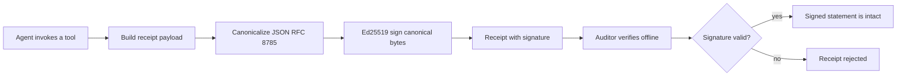
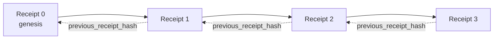

[Vizionați videoclipul lecției: Securizarea Agenților AI cu Chitanțe Criptografice](https://youtu.be/PLACEHOLDER_VIDEO_ID)

> _(Videoclipul lecției și miniatura vor fi adăugate de echipa de conținut Microsoft după îmbinare, respectând modelul lecției 14 / 15.)_

# Securizarea Agenților AI cu Chitanțe Criptografice

## Introducere

Această lecție va acoperi:

- De ce sunt importante jurnalele de audit pentru agenții AI în conformitate, depanare și încredere.
- Ce este o chitanță criptografică și cum diferă de o linie de jurnal nesemnată.
- Cum să produci o chitanță semnată pentru apelul unui instrument al agentului în Python simplu.
- Cum să verifici o chitanță offline și să detectezi modificările neautorizate.
- Cum să le legi în lanț pe chitanțe astfel încât eliminarea sau reordonarea uneia să rupă lanțul.
- Ce demonstrează chitanțele și ce nu demonstrează în mod explicit.

## Obiective de Învățare

După ce vei parcurge această lecție, vei ști cum să:

- Identifici modurile de eșec care motivează proveniența criptografică pentru acțiunile agentului.
- Produci o chitanță semnată Ed25519 peste o încărcătură JSON canonică.
- Verifici o chitanță independent folosind doar cheia publică a semnatarului.
- Detectezi modificări neautorizate prin reluarea verificării pe o chitanță modificată.
- Construiești o secvență de chitanțe legate prin hash și explici de ce lanțul contează.
- Recunoști limita dintre ceea ce demonstrează chitanțele (atributul, integritatea, ordinea) și ce nu demonstrează (corectitudinea acțiunii, soliditatea politicii).

## Problema: Jurnalul de Audit al Agentului tău

Imaginează-ți că ai implementat un agent AI pentru Contoso Travel. Agentul citește cererile clienților, apelează o API de zboruri pentru a căuta opțiuni și rezervă locuri în numele clientului. În trimestrul trecut, agentul a procesat 50.000 de rezervări.

Astăzi sosește un auditor. Ei pun o întrebare simplă: „Arată-mi ce a făcut agentul tău.”

Le dai fișierele tale de jurnal. Auditorul se uită la ele și pune o întrebare mai dificilă: „Cum știu că aceste jurnale nu au fost modificate?”

Aceasta este problema jurnalului de audit. Majoritatea implementărilor de agenți de astăzi se bazează pe:

- **Jurnalele de aplicație**: scrise de agentul însuși, editabile de oricine are acces la sistemul de fișiere.
- **Servicii de jurnalizare în cloud**: evidente la manipulare la nivel de platformă, dar doar dacă auditorul are încredere în operatorul platformei.
- **Jurnalele tranzacțiilor bazei de date**: potrivite pentru schimbările în baza de date, dar nu pentru apeluri arbitrare de instrumente.

Niciuna dintre acestea nu poate răspunde întrebării auditorului fără a-i cere să aibă încredere într-o persoană (în tine, în furnizorul tău de cloud, în vânzătorul bazei de date). Pentru utilizarea internă, această încredere este adesea acceptabilă. Pentru încărcături reglementate (finanțe, sănătate, orice supus Actului AI al UE), nu este.

Chitanțele criptografice restrâng această problemă prin realizarea unei declarații semnate verificabile în mod independent. Auditorul încă are nevoie de un motiv extern pentru a avea încredere în cheia de semnare și componenta care a produs declarația. O cheie încorporată dovedește auto-consistența, nu identitatea emițătorului sau locul de aplicare.


## Ce este o Chitanță Criptografică?

O chitanță este un obiect JSON care înregistrează ce a făcut un agent, semnat cu o semnătură digitală.



O chitanță minimală arată așa:

```json
{
  "type": "agent.tool_call.v1",
  "agent_id": "contoso-travel-bot",
  "tool_name": "lookup_flights",
  "tool_args_hash": "sha256:a3f9c1...",
  "result_hash": "sha256:7b2e1d...",
  "policy_id": "contoso-travel-policy-v3",
  "timestamp": "2026-04-25T14:30:00Z",
  "sequence": 47,
  "previous_receipt_hash": "sha256:9d4e6a...",
  "signature": {
    "alg": "EdDSA",
    "sig": "c5af83...",
    "public_key": "8f3b2c..."
  }
}
```

Trei proprietăți efectuează munca:

1. **Semnătura**. Chitanța este semnată de gateway-ul agentului folosind o cheie privată Ed25519. Oricine are cheia publică corespunzătoare poate verifica semnătura offline. Un terț reliant trebuie să fixeze acea cheie sau să o rezolve dintr-un registru de încredere în afara chitanței. Modificarea oricărui câmp semnat invalidează semnătura.

2. **Codificare canonică**. Înainte de semnare, chitanța este serializată folosind Schema de Canonicizare JSON (JCS, RFC 8785). Aceasta asigură că două implementări care produc aceeași chitanță logică produc o ieșire identică la nivel de octeți. Fără canonicizare, diferiți serializatori JSON ar produce semnături diferite pentru același conținut.

3. **Legare prin hash**. Câmpul `previous_receipt_hash` leagă fiecare chitanță de cea anterioară. Eliminarea sau reordonarea unei chitanțe rupe secvența prezentată. Detectarea truncării sau o rescriere controlată de semnatar necesită și o fixare a capului actual al lanțului, un punct de control martor independent sau un angajament autenticat al populației închise.

Împreună, aceste proprietăți oferă trei garanții:

- **Atribuirea unei chei**: această cheie a semnat acest conținut. Identitatea organizațională sau umană necesită o legătură de încredere cu cheia.
- **Integritate**: conținutul nu s-a schimbat de la semnare.
- **Ordinea în cadrul secvenței verificate**: această chitanță este legată de predecesorul său.

## Producerea unei Chitanțe în Python

Nu ai nevoie de o bibliotecă specială pentru a produce o chitanță. Primitivele criptografice sunt larg disponibile, iar logica constă în câteva zeci de linii de Python.

Exercițiile practice din `code_samples/18-signed-receipts.ipynb` parcurg fluxul complet. Notebook-ul controlat sursă `code_samples/18-signed-receipts.execution-receipt.json` înregistrează hash-ul exact al notebook-ului, mediul Python, numărul de celule și verificările din ultima execuție curată fără a schimba rezultatele salvate ale lecției. Versiunea rezumată:

```python
import json
import hashlib
import base64
from nacl import signing
from jcs import canonicalize  # RFC 8785 canonical JSON

def b64url_nopad(data: bytes) -> str:
    return base64.urlsafe_b64encode(data).decode("ascii").rstrip("=")

def sha256_canonical(obj) -> str:
    """SHA-256 of a Python object's JCS-canonical JSON form."""
    return f"sha256:{hashlib.sha256(canonicalize(obj)).hexdigest()}"

# Generate or load a signing key (in production, store in a key vault)
signing_key = signing.SigningKey.generate()
verify_key = signing_key.verify_key
TRUSTED_PUBLIC_KEYS = {b64url_nopad(bytes(verify_key))}  # pinned out of band by the verifier

# Build the receipt payload (no signature yet)
tool_args = {"origin": "SYD", "destination": "LAX"}
tool_result = [{"flight": "QF11", "price": 1850, "stops": 0}]

payload = {
    "type": "agent.tool_call.v1",
    "agent_id": "contoso-travel-bot",
    "tool_name": "lookup_flights",
    "tool_args_hash": sha256_canonical(tool_args),
    "result_hash": sha256_canonical(tool_result),
    "policy_id": "contoso-travel-policy-v3",
    "timestamp": "2026-04-25T14:30:00Z",
    "sequence": 0,
    "previous_receipt_hash": None,
}

# Canonicalize and sign the JCS bytes directly. PureEdDSA hashes internally.
canonical_bytes = canonicalize(payload)
signature_bytes = signing_key.sign(canonical_bytes).signature

# Attach a structured signature object.
receipt = {
    **payload,
    "signature": {
        "alg": "EdDSA",
        "sig": b64url_nopad(signature_bytes),
        "public_key": b64url_nopad(bytes(verify_key)),
    },
}
```

Aceasta este întreaga procedură de semnare. Exercițiile din notebook parcurg fiecare pas.

## Verificarea unei Chitanțe și Detectarea Manipulării

Verificarea este operația inversă:

```python
import base64
import hashlib
from nacl import signing
from nacl.exceptions import CryptoError
from jcs import canonicalize

def b64url_decode(s: str) -> bytes:
    # Strict: Python's decoder skips characters outside the alphabet and also
    # accepts padding, the standard +/ alphabet and non-zero spare bits.
    # Re-encoding and comparing accepts only the one unpadded base64url form.
    padding = "=" * ((4 - len(s) % 4) % 4)
    data = base64.urlsafe_b64decode(s + padding)
    if base64.urlsafe_b64encode(data).decode("ascii").rstrip("=") != s:
        raise ValueError("not canonical unpadded base64url")
    return data

def verify_receipt(receipt: dict, trusted_public_key: str) -> bool:
    # trusted_public_key is the issuer's key, obtained from somewhere other
    # than this receipt. Never use receipt["signature"]["public_key"] here:
    # see "What Receipts Prove (and What They Do Not)" below.
    # Fails closed: anything malformed returns False instead of raising.
    if not isinstance(receipt, dict) or not isinstance(trusted_public_key, str):
        return False
    sig_obj = receipt.get("signature")
    if not isinstance(sig_obj, dict) or sig_obj.get("alg") != "EdDSA":
        return False
    sig_b64 = sig_obj.get("sig")
    if not isinstance(sig_b64, str):
        return False

    try:
        # Reconstruct the payload that was actually signed (everything except signature).
        payload = {k: v for k, v in receipt.items() if k != "signature"}
        canonical_bytes = canonicalize(payload)
        verify_key = signing.VerifyKey(b64url_decode(trusted_public_key))
        verify_key.verify(canonical_bytes, b64url_decode(sig_b64))
        return True
    except (CryptoError, TypeError, ValueError, KeyError, OverflowError):
        return False
    except Exception:
        # An undecodable key or signature, or a payload that cannot be
        # canonicalized: fail closed rather than raise.
        return False
```

Această funcție ia o chitanță și cheia publică a emitentului și întoarce `True` dacă semnătura este validă și `False` altfel, inclusiv când intrarea este neformatată corect. Fără apel de rețea și fără serviciu de verificare: odată ce ai cheia emitentului, verificarea este complet locală și offline. Ce cere în continuare este acea cheie, obținută din altă sursă decât chitanța însăși.

Pentru a vedea detectarea manipulării în acțiune, notebook-ul parcurge:

1. Producerea unei chitanțe valide și confirmarea verificării sale.
2. Modificarea unui octet din câmpul `tool_args_hash`.
3. Reluarea verificării și observarea eșecului.
4. Manipularea din nou, dar de data aceasta re-semnează cu o cheie generată de atacator și încorporarea acelei chei în chitanță.

Pasul 4 este cel ce merită atenția. Acea chitanță este intern consistentă: semnătura sa este autentică pentru conținutul său și pentru cheia pe care o poartă, deci verifică față de cheia din interior. Eșuează doar când este verificată față de cheia reală a emitentului. Pașii 2 și 3 prind un atacator care nu a re-semnat; pasul 4 prinde pe cel care a făcut-o.

Aceasta este demonstrația practică că chitanțele sunt evidente la manipulare: orice modificare a unui câmp semnat rupe semnătura, cu condiția să verifici față de o cheie pe care atacatorul nu a furnizat-o. Obiectul `signature` în sine este în afara octeților semnați, motiv pentru care cheia cu care verifici trebuie să vină din altă sursă decât chitanța.

## Legarea Chitanțelor pentru Agenți cu Mai Multe Etape

O singură chitanță semnată protejează o acțiune. Un lanț de chitanțe protejează o secvență.



Fiecare chitanță înregistrează hash-ul chitanței precedente. Pentru a elimina chitanța 2 în mod silențios, un atacator ar trebui fie să:

- Modifice câmpul `previous_receipt_hash` al chitanței 3 (ruptură a semnăturii chitanței 3), SAU
- Forgheze o semnătură nouă pe o chitanță 3 modificată (necesită cheia privată a agentului).

Dacă cheia privată se află într-un seif hardware și verificatorii verifică fiecare chitanță împotriva cheii publice a emitentului, obținută independent (un set JWK publicat sau o valoare fixată în configurare), niciun atac nu este fezabil fără a fi detectat. Publicarea cheii în fiecare chitanță nu este suficientă: un atacator poate re-semna cu propria cheie și o poate încorpora în schimb, ceea ce este o slăbiciune fixtures `04_resigned_receipt.json`.

Notebook-ul parcurge:

1. Construirea unui lanț de trei chitanțe.
2. Verificarea că `previous_receipt_hash` fiecărei chitanțe corespunde hash-ului real al chitanței anterioare.
3. Manipularea unei chitanțe din mijloc și observarea rupturii lanțului exact în acel punct.

Așa creezi un jurnal de audit pe care un auditor extern îl poate verifica cu
proprii săi chei emitenți fixate și puncte de control ale lanțului, fără a avea încredere în jurnalul tău mutabil.

## Ce Demonstrează Chitanțele (și Ce NU Demonstrează)

Aceasta este cea mai importantă secțiune a acestei lecții. Chitanțele sunt puternice, dar puterea lor are limite.

**Chitanțele demonstrează trei lucruri:**

1. **Atribuirea**: o cheie specifică a semnat o încărcătură specifică.
2. **Integritatea**: încărcătura nu s-a schimbat de la semnare.
3. **Ordinea într-o secvență prezentată, verificată**: această chitanță este legată de predecesorul său.

**Chitanțele NU demonstrează:**

1. **Corectitudinea**: că acțiunea agentului a fost acțiunea corectă. O chitanță poate fi semnată pentru un răspuns greșit la fel de clar cum pentru unul corect.
2. **Conformitatea cu politica**: că politica menționată în `policy_id` a fost evaluată cu adevărat sau că ar fi permis această acțiune dacă ar fi fost verificată. Chitanța înregistrează ce s-a afirmat, nu ce s-a impus.
3. **Identitatea dincolo de cheie**: chitanța spune „această cheie a semnat acest conținut.” Nu spune „această persoană a autorizat asta.” Conectarea unei chei la o persoană sau organizație necesită o infrastructură de identitate separată (un director, un registru de chei publice etc.).
4. **Adevărul intrărilor**: dacă agentul primește un prompt manipulat și acționează pe baza lui, chitanța înregistrează acțiunea cu fidelitate. Chitanțele sunt în aval față de validarea intrării, nu un substitut pentru aceasta.
5. **Executarea sau efectul în lumea reală**: o chitanță post-apel înregistrează ceea ce pretinde emitentul că s-a întâmplat. Proba admisiei sau reconcilierea unui efect extern necesită dovezi de la executorul efectiv sau de la limita furnizorului.
6. **Completitudinea**: absența unei chitanțe poate însemna blocat, omis, pierdut sau neinstrumentat. Absența devine dovadă doar în cadrul unei populații închise autentificate.
7. **Timpul de încredere**: un timestamp semnat dovedește că semnatarul a avut acea valoare, nu că valoarea a fost corectă. Timpul de încredere necesită o autoritate temporală separată sau un punct de control martor.

**Cheia din chitanță nu este cheia cu care verifici.** Acest lucru rezultă din punctul 3 și este singurul loc în care distincția trebuie să schimbe codul tău, nu doar înțelegerea ta. `public_key` din exemplul de mai sus este acolo pentru ca exemplul să fie autonom. Un verificator nu trebuie niciodată să aibă încredere în ea. Oricine poate lua o chitanță, să o modifice, să o semneze cu o cheie pe care a generat-o și să încorporeze acea cheie; rezultatul verifică perfect față de sine însuși. Aceasta este o slăbiciune fixtures `04_resigned_receipt.json` în `sample_receipts/`, și este motivul pentru care `verify_receipt` de mai sus primește cheia ca argument în loc să o extragă din chitanță. Obține cheia emitentului independent, din Setul JWK din Lista de verificare pentru Producție de mai jos sau dintr-un alt ancoraj pe care l-ai fixat în avans, și verifică față de aceea. O semnătură verificată cu o cheie venită în același plic dovedește doar că plicul este auto-consistent.

Această limită este importantă din două motive:

- Îți spune la ce sunt utile chitanțele: pentru a face comportamentul agentului auditat și evident la manipulare, chiar și peste granițe organizaționale.
- Îți spune ce straturi adiționale mai ai nevoie: validarea intrărilor (Lecția 6), aplicarea politicii (acoperită sumar mai jos) și infrastructura de identitate (în afara scopului acestei lecții).

O greșeală comună este să presupui că „avem chitanțe” înseamnă „suntem conduși.” Nu este așa. Chitanțele sunt o fundație. Guvernanța este sistemul pe care îl construiești deasupra.

## Legarea Semnăturii unui Aprobator la Acțiunea Exactă

Punctul 3 de mai sus merită o secțiune separată: o chitanță de acțiune spune „această cheie a semnat acest conținut”, niciodată „un om a autorizat asta.” Pentru acțiuni cu risc înalt (returnări, ștergeri, transferuri bancare), o semnătură de aprobator separată poate lega acțiunea exactă. Conectarea acelei chei la o persoană și verificarea prezenței umane rămân responsabilități separate.

Notebook-ul următor `code_samples/human-authorization-receipts.ipynb` adaugă un al doilea tip de chitanță, `human.approval.v1`, în aceeași formă de plic ca chitanțele lecției (o încărcătură tipizată semnată prin Ed25519 peste octeții săi canonici JCS, cu obiectul `signature` în afara octeților semnați). O cheie de aprobator semnează **acțiunea canonică completă și digestul său**; o cheie de agent semnează o afirmație care poartă **același digest al acțiunii** și un `parent_approval_ref`, `receipt_hash` al aprobării, aceeași convenție ca `previous_receipt_hash` în lanțul construit mai sus. Un `verify_chain` parcurge ambele artefacte sub **registre de chei fixate separate** (chei de aprobator vs chei de agent), astfel că calea codului este comună, dar autoritățile nu.

Proprietatea pe care o câștigi, exprimată cu atenție: *cheia aprobatorului fixat a semnat această
acțiune exactă, iar cheia agentului a semnat ulterior o declarație care conține același digest al acțiunii.*
Aceasta este o dovadă utilă, dar nu este în sine o probă că acțiunea s-a executat. Pentru
a controla execuția, aprobarea exactă trebuie de asemenea rezervată și consumată o singură dată la
limita executorului actual; rezultatele necunoscute ale furnizorului trebuie să rămână necunoscute și nu să fie
retrimise în orb. Testele de refuz din notebook verifică stratul de lanț de chitanțe:

- manipulare, deputat confuz, chei forjate de oricare parte și intrare neformatată corect;
- **autoritate depășită**: o semnătură care încă verifică, refuzată oricum deoarece versiunea politicii a avansat, cheia aprobatorului a fost rotită în afara registrului fixat sau aprobarea a expirat înainte de timpul furnizat pentru verificare;
- **substituirea digestului**: o chitanță de acțiune semnată valid îndreptată către o aprobare *reală* care leagă o acțiune canonică *diferită*.

Fiecare eșec refuză cu un motiv distinct, astfel încât un auditor care citește un refuz poate spune dacă autoritatea a expirat sau acțiunea revendicată s-a schimbat. Verificarea este doar citire și repetabilă: nu consumă aprobarea sau nu invocă un furnizor. Un executor separat are nevoie de protecție durabilă, atomică împotriva reluării și de rezultate explicite de succes, eșec și nedeterminare. Chitanța pentru aprobare umană este o compoziție educațională definită de această lecție, nu un tip de chitanță definit de `draft-farley-acta-signed-receipts`.

## Referințe pentru Producție

Codul Python din această lecție este intenționat redus la minim, astfel încât să poți citi fiecare linie și să înțelegi exact ce se întâmplă. În producție, ai două opțiuni:

1. **Construiește direct pe primitivele criptografice.** Cele 50 de linii pe care le-ai văzut mai sus sunt suficiente pentru multe cazuri de utilizare. PyNaCl (Ed25519) și pachetul `jcs` (JSON canonic) sunt biblioteci bine întreținute și auditate.

2. **Folosește o bibliotecă de chitanțe de producție.** Mai multe proiecte open-source implementează același model cu caracteristici suplimentare (rotație de chei, verificare în lot, distribuție JWK Set, integrare cu motoare de politici):
   - Pipeline-ul de semnare folosește convențiile JCS și scope-ului semnăturii dintr-un Internet-Draft independent IETF ([`draft-farley-acta-signed-receipts`](https://datatracker.ietf.org/doc/draft-farley-acta-signed-receipts/), revizia 02). Chitanța educațională simplă din această lecție diferă de plicul `{payload, signature}` din draft și nu este prezentată ca o implementare conformă. Draftul publică un set comun de conformitate ([agent-governance-testvectors](https://github.com/ScopeBlind/agent-governance-testvectors)) pentru implementările care țintesc formatul său de transmisie.
   - Microsoft Agent Governance Toolkit compune chitanțe cu decizii de politică bazate pe Cedar; vezi Tutorialul 33 din acel depozit pentru un exemplu complet.
   - Pachetele `protect-mcp` (npm) și `@veritasacta/verify` (npm) oferă o implementare Node de semnare de chitanțe și verificare offline, destinată înfășurării oricărui server MCP cu o pistă de audit rezistentă la modificări, inclusiv un flux cu păstrare pentru co-semnat, în care o acțiune întreruptă emite o chitanță de aprobare legată de digest-ul acțiunii (susținută de WebAuthn în fluxul desktop), același model de chitanță de aprobare ca și notebook-ul de autorizare umană de mai sus.
   - **[nobulex](https://github.com/arian-gogani/nobulex)** Python SDK (`pip install nobulex`) oferă același tipar de semnătură Ed25519 + JCS în Python cu integrări LangChain și CrewAI, incluzând vectori de testare pentru validare încrucișată publicați și o mapare de conformitate contribuită prin [OWASP PR #2210](https://github.com/OWASP/CheatSheetSeries/pull/2210).
   - **[Protocolul EMILIA](https://github.com/emiliaprotocol/emilia-protocol)** oferă un strat complementară de aplicare a acțiunii exacte: chitanțe de aprobare verificabile offline, WebAuthn fixat sau autoritate de cvorum, consum o singură dată la limita executorului și o cale explicită cu rezultat indeterminat. Adaptatoarele framework-ului tratează o chitanță ca dovezi necesare mai degrabă decât dovadă că un efect extern a avut loc.

Decizia între a-ți crea propria soluție și a folosi o bibliotecă reflectă decizia între a scrie propria bibliotecă JWT și a folosi una testată: ambele sunt rezonabile; biblioteca economisește timp și reduce suprafața de auditare; abordarea de la zero te obligă să înțelegi fiecare primitiv. Această lecție învață calea de la zero astfel încât să ai fundamentul pentru oricare opțiune.

## Verificarea cunoștințelor

Testează-ți înțelegerea înainte de a trece la exercițiul practic.

**1. O chitanță este semnată cu cheia Ed25519 privată a agentului. Auditorul are doar cheia publică. Poate auditorul verifica chitanța offline?**

<details>
<summary>Răspuns</summary>

Da, verificarea criptografică necesită doar cheia publică și octeții semnați. 
Auditorul trebuie totuși să obțină și să fixeze cheia publică acceptată independent de chitanță.
Nu este necesar niciun apel de rețea după ce această configurație de încredere este stabilită.
</details>

**2. Un atacator modifică câmpul `policy_id` al unui chitanță pentru a pretinde că a fost guvernată de o politică mai permisivă. Semnătura a fost făcută pe încărcătura originală. Ce se întâmplă în timpul verificării?**

<details>
<summary>Răspuns</summary>

Verificarea eșuează. Semnătura a fost calculată peste octeții canonici ai încărcăturii originale; modificarea oricărui câmp al încărcăturii schimbă acei octeți, ceea ce face semnătura invalidă. Atacatorul ar avea nevoie de cheia privată pentru a produce o semnătură nouă și valabilă, pe care nu o posedă.
</details>

**3. De ce include chitanța un `tool_args_hash` și un `result_hash` în loc de argumentele brute și rezultatul brut?**

<details>
<summary>Răspuns</summary>

Două motive. În primul rând, chitanța poate trebui arhivată sau transmisă în medii unde scurgerea conținutului brut (informații personale, date de afaceri) este o problemă. Hash-urile păstrează chitanța mică și conținutul privat; auditorul verifică dacă hash-ul corespunde unei copii stocate separat a conținutului efectiv. În al doilea rând, hash-urile au o dimensiune fixă; o chitanță cu hash-uri are o dimensiune limitată indiferent cât de mari au fost intrările și ieșirile.
</details>

**4. Câmpul `previous_receipt_hash` leagă fiecare chitanță de predecesorul său. Dacă un atacator șterge în mod silențios o chitanță din mijlocul unui lanț, ce devine invalid?**

<details>
<summary>Răspuns</summary>

Fiecare chitanță care a venit după cea ștearsă. Câmpurile lor `previous_receipt_hash` nu mai corespund lanțului real (pentru că chitanța la care făceau referire nu mai există sau lanțul acum indică către un predecesor diferit). Pentru a ascunde ștergerea, atacatorul ar trebui să resemneze fiecare chitanță ulterioară, ceea ce necesită cheia privată a emițătorului. O resiginare cu orice altă cheie eșuează la verificarea față de cheia emițătorului.
</details>

**5. Un chitanță se verifică corect. Dovedește asta că acțiunea agentului a fost corectă, solidă sau conformă cu politica?**

<details>
<summary>Răspuns</summary>

Nu. În contextul unei chei fixate și a unui lanț, o chitanță validă dovedește atribuirea semnăturii,
integritatea conținutului și o legătură către predecesorul prezentat. NU dovedește că
acțiunea a fost corectă sau executată, că politica a fost evaluată, că timestamp-ul este
de încredere sau că setul de înregistrări este complet. Acesta este cel mai important punct delimitator din lecție.
</details>

## Exercițiu practic

Deschide `code_samples/18-signed-receipts.ipynb` și completează toate cele patru secțiuni:

1. **Secțiunea 1**: Semnează prima ta chitanță și verific-o.
2. **Secțiunea 2**: Modifică chitanța și observă eșecul verificării.
3. **Secțiunea 3**: Construiește un lanț de trei chitanțe și verifică integritatea lanțului.
4. **Secțiunea 4**: Aplică modelul unui agent construit cu Microsoft Agent Framework: înfășoară un apel de instrument în semnarea chitanței, apoi verifică chitanța independent.

**Provocarea suplimentară 1:** extinde schema chitanței cu un câmp suplimentar ales de tine (de exemplu, un ID de cerere pentru urmărire), actualizează logica canonică de semnare pentru a-l include și confirmă că chitanța trece în continuare verificarea. Apoi modifică câmpul după semnare și confirmă că verificarea eșuează. Acest lucru te obligă să înțelegi cum contribuie fiecare octet din codificarea canonică la semnătură.

**Provocarea suplimentară 2:** combină hash-ul SHA-256 a două dintre chitanțele tale (concatenează octeții lor canonici într-o ordine deterministă) și încorporează digestul rezultat ca un câmp nou pe a treia chitanță înainte de semnare. Verifică că toate cele trei chitanțe trec în continuare verificarea. Ai construit astfel o dovadă de includere într-un singur pas: oricine deține a treia chitanță poate demonstra că primele două existau la momentul semnării sale, fără a dezvălui conținutul lor. Aceasta este metoda folosită la scară largă de chitanțele cu dezvăluire selectivă (angajamente Merkle, RFC 6962).

## Concluzie

Chitanțele criptografice oferă agenților AI o pistă de audit care este:

- **Verificabilă independent sub încredere fixată**: o parte cu chei publice acceptate și octeți semnați poate verifica fără o dependență de serviciu.
- **Evidentă la manipulare**: orice modificare invalidează semnătura.
- **Portabilă**: o chitanță este un fișier JSON mic; poate fi arhivată, transmisă și verificată oriunde.
- **Aliniată la standarde**: construită pe Ed25519 (RFC 8032), JCS (RFC 8785) și SHA-256, toate primitive larg utilizate.

Ele nu înlocuiesc validarea intrărilor, aplicarea politicii, admiterea executorilor,
dovezile de rezultate, controalele de completitudine sau infrastructura de identitate. Sunt o bază
pentru aceste straturi. În fluxuri de lucru reglementate sau multi-organizaționale, chitanțele
fac ca declarațiile specifice ale emițătorului să fie verificabile independent sub propria configurație de încredere a auditorului.

Cel mai important aspect: chitanțele dovedesc că o anumită cheie a semnat un conținut anume.
Un timestamp transmis este o aserțiune a semnatarului, cu excepția cazului în care este atestat temporal separat. O
chitanță nu dovedește că conținutul său era adevărat, că o acțiune s-a executat sau că
setul de înregistrări este complet. Păstrează aceste distincții foarte clar.

## Lista de verificare pentru producție

Când ești gata să treci de la această lecție la implementarea agenților cu semnare de chitanțe într-un mediu real:

- [ ] **Mută cheia de semnare de pe laptopul dezvoltatorului.** Folosește Azure Key Vault, AWS KMS sau un modul hardware de securitate. Cheia privată care semnează chitanțele tale nu trebuie să existe niciodată în controlul sursei sau în text clar pe mașinile aplicației.
- [ ] **Stabilește încrederea în cheia verificatorului.** Publică cheile printr-un JWK Set sau registru, apoi lasă părțile care se bazează pe acestea să fixeze în afara fiecărei chitanțe identitatea emitentului acceptat, setul de chei și politica de rotație. O cheie inline singură nu este un ancoraj de încredere.
- [ ] **Ancorează lanțul extern.** Scrie periodic cel mai recent hash al capului lanțului într-un jurnal de transparență (Sigstore Rekor, autoritatea de marcaj temporal RFC 3161 sau un al doilea sistem intern) astfel încât o parte externă să poată confirma „acest lanț a existat la acest moment.”
- [ ] **Stochează chitanțele în mod imuabil.** Un depozit blob cu adăugare doar (Azure Storage cu politici de imuabilitate, AWS S3 Object Lock) împiedică un insider să rescrie istoricul la nivelul stocării.
- [ ] **Decide asupra păstrării.** Multe regimuri de conformitate cer păstrare pe mai mulți ani. Planifică pentru creșterea chitanțelor (fiecare chitanță are ~500 bytes; un agent care face 10K apeluri pe zi produce ~1.8 GB pe an).
- [ ] **Documentează ce nu acoperă chitanțele.** Chitanțele dovedesc atribuirea, integritatea și ordonarea. Manualul tău de proceduri ar trebui să listeze în mod explicit ce controale suplimentare (validarea intrărilor, aplicarea politicilor, limitarea ratei, infrastructura de identitate) există alături de chitanțe în postura ta de guvernanță.

### Ai Mai Multe Întrebări despre Securizarea Agenților AI?

Alătură-te [Microsoft Foundry Discord](https://aka.ms/ai-agents/discord) pentru a cunoaște alți cursanți, a participa la sesiuni de asistență și a-ți clarifica întrebările despre Agenții AI.

## Dincolo de această Lecție

Această lecție acoperă semnarea cu o singură chitanță și secvențe înlănțuite prin hash. Același set de primitive se compune în mai multe tipare mai avansate pe care le poți întâlni pe măsură ce postura ta de guvernanță se maturizează:

- **Divulgare selectivă.** Când câmpurile chitanței sunt angajate independent (arbore Merkle în stil RFC 6962), poți dezvălui anumite câmpuri unor auditori specifici și dovedi că restul nu s-au schimbat fără a le expune. Util când aceeași chitanță trebuie să satisfacă atât un audit complet (care cere exhaustivitate), cât și reglementări privind minimizarea datelor precum GDPR (care cer ca auditorul să vadă cât mai puțin posibil).
- **Revocarea chitanțelor.** Dacă o cheie de semnare este compromisă, ai nevoie de o metodă de a marca toate chitanțele semnate cu acea cheie ca neîncredere începând dintr-un anumit punct în timp. Modele standard: chei de semnare cu viață scurtă plus o listă publică de revocare, sau un jurnal de transparență cu intrări de revocare.
- **Chitanțe bilaterale / cu semnături împărțite.** Unele implementări împart sarcina semnată în jumătăți pre-execuție (`authorization_*`) și post-execuție (`result_*`) cu semnături independente, utile când decizia de autorizare și rezultatul observat sunt produse de actori diferiți sau în momente diferite. Aceasta se adaugă compozit pe formatul de chitanță predat în această lecție.
- **Compoziția sarcinii utile.** O chitanță sigilează oricâți bytes pui în `result_hash`. Sarcinile utile din lumea reală sunt adesea mai bogate decât un simplu rezultat al unui apel de unealtă: raționamentul predecizional (predicția modelului, opțiunile considerate, probele și completitudinea lor, postura de risc, lanțul de responsabilitate, rezultatul verificării) pot trăi toate în interiorul sarcinii utile, sigilate de o singură chitanță. Aceasta păstrează formatul chitanței minimal și în același timp permite evoluția schemelor sarcinii utile domeniu cu domeniu.
- **Conformitate între implementări.** Mai multe implementări independente ale aceluiași format de chitanță (Python, TypeScript, Rust, Go) verifică reciproc vectorii de testare partajați. Dacă dezvoltați propria implementare, validarea față de vectorii publicați confirmă compatibilitatea la nivel de protocol.
- **Migrarea post-cuantică.** Ed25519 este larg utilizat astăzi, dar nu este rezistent la computația cuantică. Un simplu label `alg` nu reprezintă migrare: un profil trebuie să definească codificarea cheii ML-DSA, octeții canonic semnați, verificarea, politica părții care se bazează pe semnătură, rezistența la downgrade și semantica tranziției. Planificați și testați o tranziție cu semnătură duală împotriva vectorilor partajați înainte de a face afirmații privind compatibilitatea.

## Resurse Suplimentare

- <a href="https://datatracker.ietf.org/doc/draft-farley-acta-signed-receipts/" target="_blank">IETF Internet-Draft: Chitanțe de Decizie Semnate pentru Controlul Accesului Mașină-la-Mașină</a>
- <a href="https://learn.microsoft.com/azure/ai-studio/responsible-use-of-ai-overview" target="_blank">Prezentare generală AI responsabilă (Azure AI)</a>
- <a href="https://datatracker.ietf.org/doc/html/rfc8032" target="_blank">RFC 8032: Algoritmul de Semnătură Digitală pe Curba Edwards (EdDSA)</a>
- <a href="https://datatracker.ietf.org/doc/html/rfc8785" target="_blank">RFC 8785: Schema de Canonicalizare JSON (JCS)</a>
- <a href="https://datatracker.ietf.org/doc/html/rfc6962" target="_blank">RFC 6962: Transparența Certificatelor</a> (construcție arbore Merkle utilizată de chitanțele cu dezvăluire selectivă)
- <a href="https://github.com/microsoft/agent-governance-toolkit/blob/main/docs/tutorials/33-offline-verifiable-receipts.md" target="_blank">Microsoft Agent Governance Toolkit, Tutorial 33: Chitanțe de Decizie Verificabile Offline</a>
- <a href="https://github.com/ScopeBlind/agent-governance-testvectors" target="_blank">Vectori de testare pentru conformitatea între implementări</a> pentru formatul de chitanță utilizat în această lecție (Apache-2.0)
- <a href="https://pynacl.readthedocs.io/" target="_blank">Documentația PyNaCl</a> (Ed25519 în Python)

## Lecția Anterioară

[Crearea agenților AI locali](../17-creating-local-ai-agents/README.md)

---

<!-- CO-OP TRANSLATOR DISCLAIMER START -->
**Declinare a responsabilității**:
Acest document a fost tradus folosind serviciul de traducere AI [Co-op Translator](https://github.com/Azure/co-op-translator). În timp ce ne străduim pentru acuratețe, vă rugăm să rețineți că traducerile automate pot conține erori sau inexactități. Documentul original în limba sa nativă trebuie considerat sursa autorizată. Pentru informații critice, se recomandă traducerea profesională realizată de un om. Nu ne asumăm responsabilitatea pentru eventualele neînțelegeri sau interpretări greșite care decurg din utilizarea acestei traduceri.
<!-- CO-OP TRANSLATOR DISCLAIMER END -->