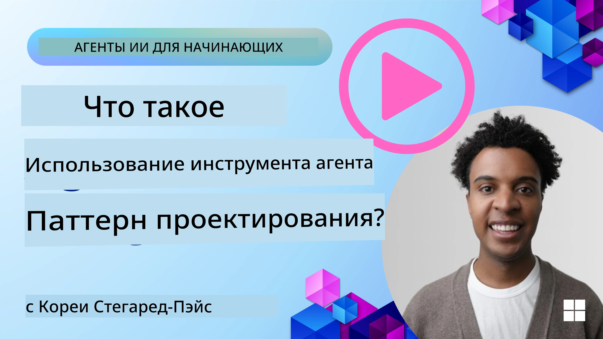
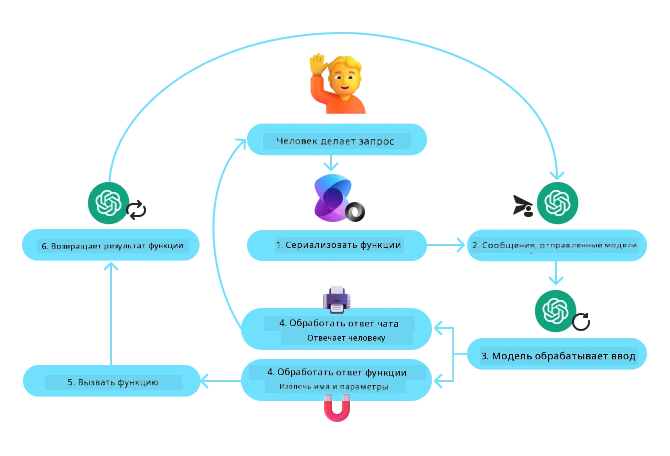
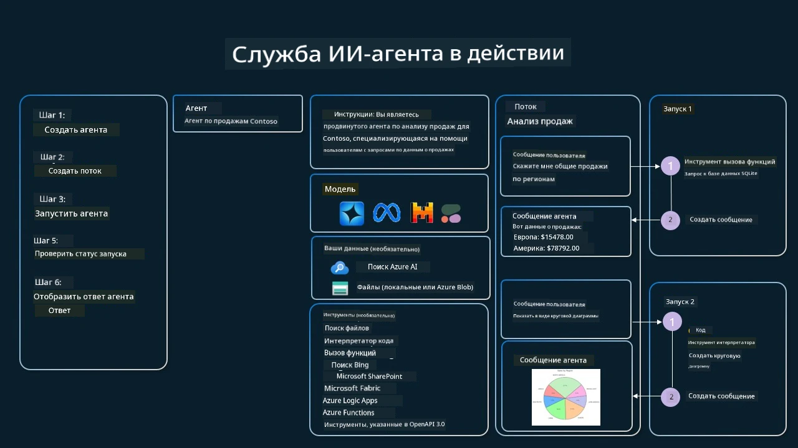

[](https://youtu.be/vieRiPRx-gI?si=cEZ8ApnT6Sus9rhn)

> _(Нажмите на изображение выше, чтобы посмотреть видео этого урока)_

# Паттерн дизайна использования инструментов

Инструменты интересны тем, что они позволяют AI-агентам иметь более широкий спектр возможностей. Вместо того чтобы агент имел ограниченный набор действий, добавляя инструмент, агент теперь может выполнять широкий спектр действий. В этой главе мы рассмотрим паттерн дизайна использования инструментов, который описывает, как AI-агенты могут использовать конкретные инструменты для достижения своих целей.

## Введение

В этом уроке мы хотим ответить на следующие вопросы:

- Что такое паттерн дизайна использования инструментов?
- К каким случаям применения он подходит?
- Какие элементы/строительные блоки необходимы для реализации паттерна дизайна?
- Какие особые соображения при использовании паттерна дизайна использования инструментов для создания надежных AI-агентов?

## Цели обучения

После прохождения этого урока вы сможете:

- Определить паттерн дизайна использования инструментов и его назначение.
- Выявить случаи применения, где паттерн дизайна использования инструментов уместен.
- Понять ключевые элементы, необходимые для реализации паттерна.
- Осознать соображения для обеспечения надежности AI-агентов, использующих этот паттерн дизайна.

## Что такое паттерн дизайна использования инструментов?

**Паттерн дизайна использования инструментов** сосредоточен на предоставлении LLM возможностей взаимодействовать с внешними инструментами для достижения конкретных целей. Инструменты — это код, который агент может выполнять для выполнения действий. Инструментом может быть простая функция, например калькулятор, или вызов API стороннего сервиса, такого как поиск цен акций или прогноз погоды. В контексте AI-агентов инструменты разработаны для выполнения агентами в ответ на **вызовы функций, сгенерированные моделью**.

## К каким случаям его можно применять?

AI-агенты могут использовать инструменты для выполнения сложных задач, получения информации или принятия решений. Паттерн дизайна использования инструментов часто применяется в сценариях, требующих динамического взаимодействия с внешними системами, такими как базы данных, веб-сервисы или интерпретаторы кода. Эта возможность полезна для различных случаев использования, включая:

- **Динамическое получение информации:** агенты могут запрашивать внешние API или базы данных для получения актуальных данных (например, запросы к базе данных SQLite для анализа данных, получение цен на акции или информации о погоде).
- **Выполнение и интерпретация кода:** агенты могут запускать код или скрипты для решения математических задач, генерации отчетов или проведения симуляций.
- **Автоматизация рабочих процессов:** автоматизация повторяющихся или многошаговых рабочих процессов с помощью интеграции инструментов, таких как планировщики задач, почтовые сервисы или конвейеры данных.
- **Поддержка клиентов:** агенты могут взаимодействовать с CRM-системами, платформами тикетов или базами знаний для решения запросов пользователей.
- **Генерация и редактирование контента:** агенты могут использовать инструменты, такие как проверка грамматики, резюмирование текста или оценка безопасности контента для помощи в создании контента.

## Какие элементы/строительные блоки необходимы для реализации паттерна использования инструментов?

Эти строительные блоки позволяют AI-агенту выполнять широкий спектр задач. Рассмотрим ключевые элементы, необходимые для реализации паттерна дизайна использования инструментов:

- **Схемы функций/инструментов**: подробные определения доступных инструментов, включая название функции, назначение, необходимые параметры и ожидаемые выходные данные. Эти схемы дают LLM понимание, какие инструменты доступны и как формировать корректные запросы.

- **Логика выполнения функций**: управляет тем, как и когда вызываются инструменты на основе намерений пользователя и контекста беседы. Это может включать модули планировщика, механизмы маршрутизации или условные потоки, определяющие динамическое использование инструментов.

- **Система обработки сообщений**: компоненты, управляющие потоком беседы между вводом пользователя, ответами LLM, вызовами инструментов и их результатами.

- **Фреймворк интеграции инструментов**: инфраструктура, которая связывает агента с различными инструментами, будь то простые функции или сложные внешние сервисы.

- **Обработка ошибок и валидация**: механизмы для обработки сбоев при выполнении инструментов, проверки параметров и управления непредвиденными ответами.

- **Управление состоянием**: отслеживает контекст разговора, предыдущие взаимодействия с инструментами и постоянные данные для обеспечения согласованности в многоходовых взаимодействиях.

Далее рассмотрим вызовы функций/инструментов подробнее.
 
### Вызов функций/инструментов

Вызов функций — основной способ, позволяющий большим языковым моделям (LLM) взаимодействовать с инструментами. Вы часто увидите, что «функция» и «инструмент» используются взаимозаменяемо, поскольку «функции» (блоки переиспользуемого кода) — это «инструменты», которые агенты используют для выполнения задач. Чтобы код функции был вызван, LLM должен сопоставить запрос пользователя с описанием функции. Для этого схема с описаниями всех доступных функций отправляется LLM. Затем LLM выбирает наиболее подходящую функцию для задачи и возвращает её имя и аргументы. Выбранная функция вызывается, её ответ отправляется обратно LLM, который использует эту информацию для ответа на запрос пользователя.

Чтобы разработчики могли реализовать вызовы функций для агентов, вам понадобятся:

1. Модель LLM, поддерживающая вызов функций
2. Схема, содержащая описания функций
3. Код для каждой описанной функции

Приведем пример получения текущего времени в городе:

1. **Инициализировать LLM, поддерживающий вызов функций:**

    Не все модели поддерживают вызов функций, поэтому важно проверить, что выбранная вами LLM это делает.     <a href="https://learn.microsoft.com/azure/ai-services/openai/how-to/function-calling" target="_blank">Azure OpenAI</a> поддерживает вызов функций. Мы можем начать с инициализации OpenAI клиента через Azure OpenAI **Responses API** (стабильная конечная точка `/openai/v1/` — без необходимости `api_version`). 

    ```python
    # Initialize the OpenAI client for Azure OpenAI (Responses API, v1 endpoint)
    client = OpenAI(
        base_url=f"{os.environ['AZURE_OPENAI_ENDPOINT'].rstrip('/')}/openai/v1/",
        api_key=os.environ["AZURE_OPENAI_API_KEY"],
    )
    deployment_name = os.environ["AZURE_OPENAI_DEPLOYMENT"]
    ```

1. **Создать схему функции**:

    Далее мы определим JSON-схему, содержащую имя функции, описание того, что она делает, и имена с описаниями параметров функции.
    Затем мы передадим эту схему клиенту, созданному ранее, вместе с запросом пользователя на получение времени в Сан-Франциско. Важно отметить, что результатом является **вызов инструмента**, **а не** окончательный ответ на вопрос. Как упоминалось ранее, LLM возвращает имя выбранной функции и аргументы, которые будут переданы ей.

    ```python
    # Function description for the model to read (Responses API flat tool format)
    tools = [
        {
            "type": "function",
            "name": "get_current_time",
            "description": "Get the current time in a given location",
            "parameters": {
                "type": "object",
                "properties": {
                    "location": {
                        "type": "string",
                        "description": "The city name, e.g. San Francisco",
                    },
                },
                "required": ["location"],
            },
        }
    ]
    ```
   
    ```python
  
    # Initial user message
    messages = [{"role": "user", "content": "What's the current time in San Francisco"}]

    # First API call: Ask the model to use the function
    response = client.responses.create(
        model=deployment_name,
        input=messages,
        tools=tools,
        tool_choice="auto",
        store=False,
    )

    # The Responses API returns tool calls as function_call items in response.output.
    # Append them to the conversation so the model has full context on the next turn.
    messages += response.output

    print("Model's response:")
    print(response.output)
  
    ```

    ```bash
    Model's response:
    [ResponseFunctionToolCall(arguments='{"location":"San Francisco"}', call_id='call_pOsKdUlqvdyttYB67MOj434b', name='get_current_time', type='function_call')]
    ```
  
1. **Код функции, необходимый для выполнения задачи:**

    Теперь, когда LLM выбрала, какую функцию нужно выполнить, необходимо реализовать и запустить код, выполняющий задачу.
    Мы можем реализовать код для получения текущего времени на Python. Также потребуется написать код для извлечения имени функции и аргументов из response_message, чтобы получить конечный результат.

    ```python
      def get_current_time(location):
        """Get the current time for a given location"""
        print(f"get_current_time called with location: {location}")  
        location_lower = location.lower()
        
        for key, timezone in TIMEZONE_DATA.items():
            if key in location_lower:
                print(f"Timezone found for {key}")  
                current_time = datetime.now(ZoneInfo(timezone)).strftime("%I:%M %p")
                return json.dumps({
                    "location": location,
                    "current_time": current_time
                })
      
        print(f"No timezone data found for {location_lower}")  
        return json.dumps({"location": location, "current_time": "unknown"})
    ```

     ```python
    # Handle function calls
    tool_calls = [item for item in response.output if item.type == "function_call"]
    if tool_calls:
        for tool_call in tool_calls:
            if tool_call.name == "get_current_time":

                function_args = json.loads(tool_call.arguments)

                time_response = get_current_time(
                    location=function_args.get("location")
                )

                # Return the tool result as a function_call_output item
                messages.append({
                    "type": "function_call_output",
                    "call_id": tool_call.call_id,
                    "output": time_response,
                })
    else:
        print("No tool calls were made by the model.")

    # Second API call: Get the final response from the model
    final_response = client.responses.create(
        model=deployment_name,
        input=messages,
        tools=tools,
        store=False,
    )

    return final_response.output_text
     ```

     ```bash
      get_current_time called with location: San Francisco
      Timezone found for san francisco
      The current time in San Francisco is 09:24 AM.
     ```

Вызов функций лежит в основе большинства, если не всех, паттернов использования инструментов в дизайне агентов, однако реализовать его с нуля иногда бывает непросто.
Как мы узнали в [Уроке 2](../../../02-explore-agentic-frameworks), агентские фреймворки предоставляют готовые строительные блоки для реализации использования инструментов.
 
## Примеры использования инструментов с агентскими фреймворками

Вот несколько примеров того, как можно реализовать паттерн дизайна использования инструментов с помощью различных агентских фреймворков:

### Microsoft Agent Framework

<a href="https://learn.microsoft.com/azure/ai-services/agents/overview" target="_blank">Microsoft Agent Framework</a> — это открытый фреймворк для создания AI-агентов. Он упрощает процесс использования вызова функций, позволяя определять инструменты как Python-функции с декоратором `@tool`. Фреймворк обрабатывает двустороннее взаимодействие между моделью и вашим кодом. Он также предоставляет доступ к готовым инструментам, таким как поиск файлов и интерпретатор кода через `FoundryChatClient`.

Следующая диаграмма иллюстрирует процесс вызова функций с Microsoft Agent Framework:



В Microsoft Agent Framework инструменты определяются как декорированные функции. Мы можем преобразовать функцию `get_current_time`, виденную ранее, в инструмент, используя декоратор `@tool`. Фреймворк автоматически сериализует функцию и её параметры, создавая схему для отправки LLM.

```python
import os
from agent_framework import tool
from agent_framework.foundry import FoundryChatClient
from azure.identity import AzureCliCredential

@tool(approval_mode="never_require")
def get_current_time(location: str) -> str:
    """Get the current time for a given location"""
    ...

# Create the client
provider = FoundryChatClient(
    project_endpoint=os.environ["AZURE_AI_PROJECT_ENDPOINT"],
    model=os.environ["AZURE_AI_MODEL_DEPLOYMENT_NAME"],
    credential=AzureCliCredential(),
)

# Create an agent and run with the tool
agent = provider.as_agent(name="TimeAgent", instructions="Use available tools to answer questions.", tools=get_current_time)
response = await agent.run("What time is it?")
```

#### Инструменты с MCP сервера

Инструменты не обязательно должны быть функциями в вашем собственном коде. Сервер, поддерживающий протокол Model Context Protocol (MCP, рассмотренный в [Уроке 11](../11-agentic-protocols/README.md)), публикует свои инструменты вместе с их схемами, и фреймворк может загружать их так же, как сериализует декорированную функцию. `MCPStreamableHTTPTool` подключается к такому серверу через HTTP, читает схемы инструментов и предлагает их модели вместе с любыми локальными инструментами.

Пример ниже использует сервер веб-поиска, размещённый <a href="https://keenable.ai" target="_blank">Keenable</a>. Он бесплатен и не требует аккаунта или ключа API (запросы ограничены по скорости на IP), поэтому единственные учетные данные — это данные вашей модели. Как и с любым удалённым инструментом, запросы, которые пишет модель, отправляются на этот сервер.

```python
from agent_framework import MCPStreamableHTTPTool

web_search = MCPStreamableHTTPTool(
    name="Keenable web search",
    url="https://api.keenable.ai/mcp",
)

# Connecting loads the server's tool schemas; the agent decides when to call them
async with web_search:
    agent = provider.as_agent(
        name="ResearchAgent",
        instructions="Use available tools to answer questions.",
        tools=[web_search],
    )
    response = await agent.run("What is new in the latest Python release?")
    print(response.text)
```

Сервер публикует два инструмента, `search_web_pages` и `fetch_page_content`. Когда требуется актуальная информация, модель вызывает `search_web_pages`, получает заголовки, URL и текстовые фрагменты, и формирует ответ из них, по тому же циклу, что и в примере `get_current_time` выше.
  
### Microsoft Foundry Agent Service

<a href="https://learn.microsoft.com/azure/ai-services/agents/overview" target="_blank">Microsoft Foundry Agent Service</a> — более новый агентский фреймворк, разработанный для того, чтобы позволить разработчикам безопасно создавать, развертывать и масштабировать высококачественных и расширяемых AI-агентов без необходимости управлять вычислительными и хранилищными ресурсами. Особенно полезен для корпоративных приложений, так как является полностью управляемым сервисом с корпоративным уровнем безопасности.

По сравнению с разработкой напрямую через LLM API Microsoft Foundry Agent Service предоставляет такие преимущества, как:

- Автоматический вызов инструментов — нет необходимости разбирать вызов инструмента, вызывать инструмент и обрабатывать ответ; всё это теперь делается на стороне сервера
- Безопасно управляемые данные — вместо управления собственным состоянием беседы можно использовать потоки, чтобы хранить всю необходимую информацию
- Инструменты «из коробки» — инструменты, которые позволяют взаимодействовать с вашими источниками данных, такими как Bing, Azure AI Search и Azure Functions.

Инструменты, доступные в Microsoft Foundry Agent Service, можно разделить на две категории:

1. Инструменты знаний:
    - <a href="https://learn.microsoft.com/azure/ai-services/agents/how-to/tools/bing-grounding?tabs=python&pivots=overview" target="_blank">Поддержка через Bing Search</a>
    - <a href="https://learn.microsoft.com/azure/ai-services/agents/how-to/tools/file-search?tabs=python&pivots=overview" target="_blank">Поиск файлов</a>
    - <a href="https://learn.microsoft.com/azure/ai-services/agents/how-to/tools/azure-ai-search?tabs=azurecli%2Cpython&pivots=overview-azure-ai-search" target="_blank">Azure AI Search</a>

2. Инструменты действий:
    - <a href="https://learn.microsoft.com/azure/ai-services/agents/how-to/tools/function-calling?tabs=python&pivots=overview" target="_blank">Вызов функций</a>
    - <a href="https://learn.microsoft.com/azure/ai-services/agents/how-to/tools/code-interpreter?tabs=python&pivots=overview" target="_blank">Интерпретатор кода</a>
    - <a href="https://learn.microsoft.com/azure/ai-services/agents/how-to/tools/openapi-spec?tabs=python&pivots=overview" target="_blank">Инструменты, определённые OpenAPI</a>
    - <a href="https://learn.microsoft.com/azure/ai-services/agents/how-to/tools/azure-functions?pivots=overview" target="_blank">Azure Functions</a>

Сервис агента позволяет нам использовать эти инструменты вместе как `toolset`. Он также использует `threads`, которые отслеживают историю сообщений конкретного разговора.

Представьте, что вы торговый агент в компании Contoso. Вы хотите разработать разговорного агента, который сможет отвечать на вопросы о ваших данных продаж.

Следующее изображение иллюстрирует, как можно использовать Microsoft Foundry Agent Service для анализа данных о продажах:



Чтобы использовать любой из этих инструментов с сервисом, мы можем создать клиент и определить инструмент или набор инструментов. Для практической реализации можно использовать следующий код на Python. LLM сможет просмотреть набор инструментов и решить, использовать ли пользовательскую функцию `fetch_sales_data_using_sqlite_query` или предустановленный Интерпретатор кода в зависимости от запроса пользователя.

```python 
import os
from azure.ai.projects import AIProjectClient
from azure.identity import DefaultAzureCredential
from fetch_sales_data_functions import fetch_sales_data_using_sqlite_query # fetch_sales_data_using_sqlite_query function which can be found in a fetch_sales_data_functions.py file.
from azure.ai.projects.models import ToolSet, FunctionTool, CodeInterpreterTool

project_client = AIProjectClient.from_connection_string(
    credential=DefaultAzureCredential(),
    conn_str=os.environ["PROJECT_CONNECTION_STRING"],
)

# Initialize toolset
toolset = ToolSet()

# Initialize function calling agent with the fetch_sales_data_using_sqlite_query function and adding it to the toolset
fetch_data_function = FunctionTool(fetch_sales_data_using_sqlite_query)
toolset.add(fetch_data_function)

# Initialize Code Interpreter tool and adding it to the toolset. 
code_interpreter = CodeInterpreterTool()toolset.add(code_interpreter)

agent = project_client.agents.create_agent(
    model="gpt-5-mini", name="my-agent", instructions="You are helpful agent", 
    toolset=toolset
)
```

## Какие особые соображения при использовании паттерна дизайна использования инструментов для создания надежных AI-агентов?

Частая проблема с динамически генерируемым LLM SQL — это безопасность, особенно риск SQL-инъекции или злонамеренных действий, таких как удаление или повреждение базы данных. Хотя эти опасения обоснованы, их можно эффективно минимизировать, правильно настроив права доступа к базе данных. Для большинства баз данных это означает конфигурацию базы как доступной только для чтения. Для сервисов баз данных, таких как PostgreSQL или Azure SQL, приложению следует назначить роль только для чтения (SELECT).

Запуск приложения в защищённой среде дополнительно повышает уровень защиты. В корпоративных сценариях данные обычно извлекаются и преобразуются из оперативных систем в базу данных или хранилище данных с режимом только для чтения и удобной схемой. Такой подход гарантирует безопасность данных, оптимизацию производительности и доступность, а также ограниченный доступ приложения с возможностью только чтения.

## Примеры кода

- Python: [Agent Framework](./code_samples/04-python-agent-framework.ipynb)
- .NET: [Agent Framework](./code_samples/04-dotnet-agent-framework.md)

## Есть вопросы о паттерне дизайна использования инструментов?

Присоединяйтесь к [Microsoft Foundry Discord](https://discord.com/invite/ATgtXmAS5D), чтобы встретиться с другими обучающимися, посетить офисные часы и получить ответы на вопросы по AI-агентам.

## Дополнительные ресурсы

- <a href="https://microsoft.github.io/build-your-first-agent-with-azure-ai-agent-service-workshop/" target="_blank">Мастерская по Azure AI Agents Service</a>
- <a href="https://github.com/Azure-Samples/contoso-creative-writer/tree/main/docs/workshop" target="_blank">Мастерская по созданию мультиагентных творческих систем Contoso</a>
- <a href="https://learn.microsoft.com/azure/ai-services/agents/overview" target="_blank">Обзор фреймворка Microsoft Agent</a>

## Тестирование агента (по желанию)

После того как вы научитесь развертывать агентов в [Уроке 16](../16-deploying-scalable-agents/README.md), вы можете провести дымовое тестирование `TravelToolAgent` этого урока (вызывает ли он ещё свои инструменты и отвечает?) с помощью [`tests/lesson-04-smoke-tests.json`](../../../tests/lesson-04-smoke-tests.json). См. [`tests/README.md`](../tests/README.md) для инструкций по запуску.

## Предыдущий урок

[Понимание агентных шаблонов проектирования](../03-agentic-design-patterns/README.md)

## Следующий урок

[Agentic RAG](../05-agentic-rag/README.md)

---

<!-- CO-OP TRANSLATOR DISCLAIMER START -->
**Отказ от ответственности**:
Этот документ был переведен с использованием сервиса машинного перевода [Co-op Translator](https://github.com/Azure/co-op-translator). Несмотря на наши усилия по обеспечению точности, имейте в виду, что автоматический перевод может содержать ошибки или неточности. Оригинальный документ на его исходном языке следует считать авторитетным источником. Для получения критически важной информации рекомендуется обратиться к профессиональному человеческому переводу. Мы не несем ответственности за любые недоразумения или неправильные толкования, возникшие в результате использования этого перевода.
<!-- CO-OP TRANSLATOR DISCLAIMER END -->