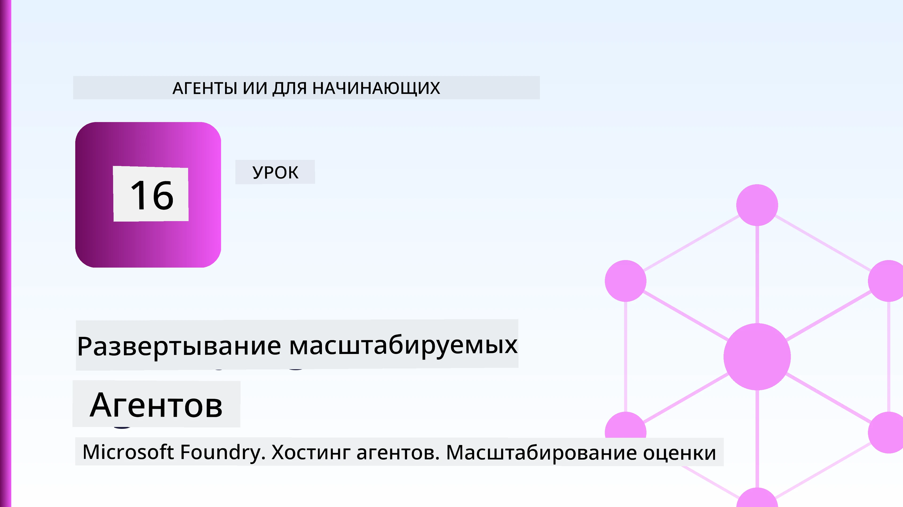
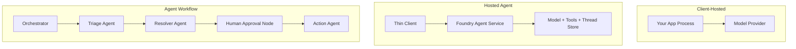
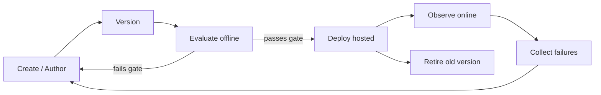
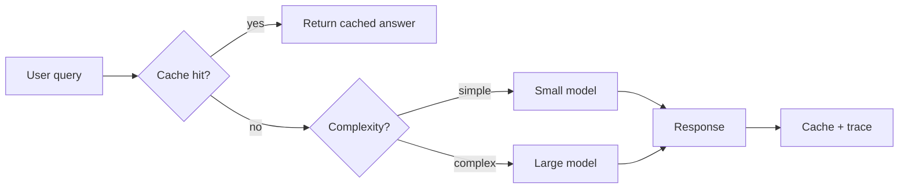
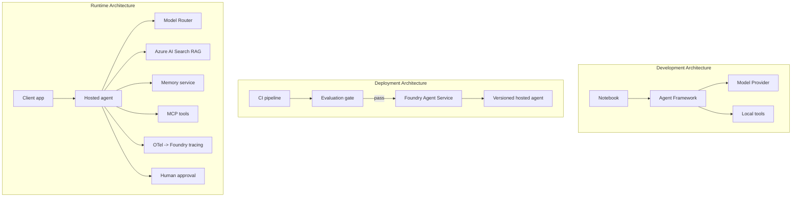

# Развертывание масштабируемых агентов с Microsoft Foundry



До этого момента в курсе вы создавали агентов, которые работают на вашем ноутбуке, внутри блокнота, управляемые `az login` и набором переменных окружения. Это именно тот правильный способ учиться. Но это не тот способ, чтобы запускать агента, от которого зависят тысячи клиентов в 3 часа ночи.

Этот урок посвящён разрыву между «у меня работает» и «работает надежно и экономично в продакшене». Мы закрываем этот разрыв с помощью **Microsoft Foundry** и **Microsoft Foundry Agent Service**, создавая реального агента поддержки клиентов с инструментами, поиском, памятью, оценкой и мониторингом.

## Введение

В этом уроке будет рассмотрено:

- Разница между **прототипом агента** и **развернутым агентом** и почему переход в основном касается всего *вокруг* модели.
- **Шаблоны развертывания** агентов: размещение на клиенте, размещение как сервис (Hosted Agents) и оркестрация рабочих процессов.
- **Жизненный цикл агента** в Microsoft Foundry — создание, версия, развертывание, оценка, наблюдение, вывод из эксплуатации.
- **Стратегии масштабирования**: маршрутизация моделей, кэширование, параллелизм, бессостояние.
- **Наблюдаемость** с OpenTelemetry и трассировкой Foundry.
- **Оптимизация затрат** через выбор модели, маршрутизацию и ворота оценки.
- **Корпоративные вопросы**: управление, одобрение человеком и безопасный запуск MCP-серверов в продакшене.

## Цели обучения

После прохождения этого урока вы будете уметь:

- Выбирать подходящий шаблон развертывания для конкретной нагрузки агента.
- Развертывать агента в Microsoft Foundry Agent Service так, чтобы он был версионирован, управлялся и наблюдался.
- Инструментировать агента для трассировки и создавать конвейер оценки, который запускается перед каждым релизом.
- Применять маршрутизацию и кэширование моделей, чтобы контролировать задержки и затраты при масштабировании.
- Добавлять ворота одобрения человеком для рисковых действий и интегрировать MCP-сервер безопасно для продакшена.

## Требования

Предполагается, что вы уже прошли предыдущие уроки и уверенно работаете с:

- Созданием агентов на базе [Microsoft Agent Framework](../14-microsoft-agent-framework/README.md) (Урок 14).
- [Использованием инструментов](../04-tool-use/README.md) (Урок 4) и [Agentic RAG](../05-agentic-rag/README.md) (Урок 5).
- [Памятью агента](../13-agent-memory/README.md) (Урок 13) и [Agentic Protocols / MCP](../11-agentic-protocols/README.md) (Урок 11).
- [Наблюдаемостью и оценкой](../10-ai-agents-production/README.md) (Урок 10) — этот урок основан на нем.

Также вам понадобятся:

- **Подписка Azure** и **проект Microsoft Foundry** с по крайней мере одной развернутой моделью чат-агента.
- Аутентифицированный **Azure CLI** (`az login`).
- Python 3.12+ и пакеты из репозитория [`requirements.txt`](../../../requirements.txt).

## От прототипа к продакшену: что меняется

Прототип агента и продакшен-агент имеют одинаковый основной цикл — размышлять, вызывать инструменты, отвечать. Меняется всё, что оборачивает этот цикл. Модель — это около 20% продакшен-агента; остальные 80% — это операционный каркас.

| Аспект | Прототип | Продакшен |
| --- | --- | --- |
| **Хостинг** | Работает в вашем блокноте | Работает как размещённый сервис, с версиями и деплоем |
| **Идентичность** | Ваш токен `az login` | Управляемая идентичность с ограниченным RBAC |
| **Состояние** | В памяти, теряется при перезапуске | Внешнее хранилище (хранилище потоков, сервис памяти) |
| **Сбои** | Вы видите трассировку ошибок | Повторы, резервные варианты, dead-letter, оповещения |
| **Стоимость** | "Несколько центов" | Отслеживается по запросу, маршрутизируется, кэшируется, бюджетируется |
| **Качество** | Вы оцениваете визуально | Автоматическая оценка перед каждым релизом |
| **Доверие** | Вы одобряете каждое действие | Политики + человек в цикле для рискованных действий |

Запомните эту таблицу. Каждый следующий раздел соответствует одной из этих строк.

## Шаблоны развертывания агентов

Существует три шаблона, которые вы будете использовать часто в комбинации.

### 1. Агенты, размещённые на клиенте

Объект агента живёт внутри *вашего* процесса приложения. Ваш код напрямую вызывает провайдера модели; цикл рассуждений запускается в вашем сервисе. Именно так делались агенты в предыдущих уроках.

- **Используйте, когда** нужен полный контроль над циклом, кастомные промежуточные слои или встроенный агент внутри существующего бэкенда.
- **Преимущество и недостаток**: вы сами отвечаете за масштабирование, состояние и устойчивость.

### 2. Hosted Agents (Foundry Agent Service)

Агент *регистрируется как ресурс* в Microsoft Foundry. Foundry хостит цикл рассуждений, хранит потоки, обеспечивает безопасность контента и RBAC, делает агента видимым в портале Foundry. Ваше приложение становится тонким клиентом, который создаёт потоки и читает ответы.

- **Используйте, когда** нужна надёжность, встроенная наблюдаемость, управление и меньшая операционная нагрузка.
- **Преимущество и недостаток**: меньше контроля низкого уровня в обмен на управляемую среду выполнения.

### 3. Рабочие процессы агента

Несколько агентов (и инструментов) объединяются в граф с явным контролем потока — последовательные шаги, ветвления, узлы одобрения человеком и надёжные чекпойнты, которые можно приостанавливать и возобновлять. Это функция **Workflows** Microsoft Agent Framework, применённая на масштабе развертывания.

- **Используйте, когда** одна задача охватывает нескольких специализированных агентов или требует одобрения посередине.
- **Преимущество и недостаток**: больше компонентов; требуется наблюдаемость уровня оркестрации.



## Жизненный цикл агента в Microsoft Foundry

Развертывание агента — это не разовое `push`. Это цикл, и он очень похож на цикл релиза ПО, потому что именно это и есть.



Ключевая идея, перенесённая из [Урока 10](../10-ai-agents-production/README.md): **оффлайн-оценка — это ворота, а не последняя мысль.** Новая версия агента не выпускается, если она не прошла ваши пороги оценки. Онлайн-наблюдаемость затем возвращает реальные сбои обратно в набор оффлайн-тестов. Вот весь цикл.

## Стратегии масштабирования

Масштабирование агента отличается от масштабирования бессостоящего веб-API, потому что каждый запрос может запускать несколько затратных вызовов моделей и инструментов. Четыре техники берут на себя большую часть нагрузки.

**Бессостоящая обработка запросов.** Не храните состояние пользователя в памяти процесса. Сохраняйте потоки разговоров в хранилище потоков Foundry или сервисе памяти, чтобы любой экземпляр мог обработать любой запрос. Это позволяет масштабировать горизонтально — добавляйте экземпляры, без "липких" сессий.

**Маршрутизация моделей.** Не каждый запрос требует самой мощной (и самой дорогой) модели. Направляйте простые запросы — классификацию намерений, короткие фактические ответы — на маленькую, быструю модель, а большую модель оставляйте для настоящих рассуждений. Foundry имеет **Model Router** для этого, или вы можете реализовать простой классификатор самостоятельно. В лаборатории вы создадите именно такую версию.

**Кэширование ответов.** Многие запросы поддержки почти дублируются ("как сбросить пароль?"). Кэшируйте ответы на частые вопросы и выдавайте их без вызова модели. Даже умеренный уровень попаданий в кэш существенно снижает затраты и задержки.

**Параллелизм и управление нагрузкой.** У провайдеров моделей есть лимиты на скорость. Ограничивайте параллелизм, используйте повторы с экспоненциальной задержкой и корректно обрабатывайте ошибки (очередной ответ "мы работаем над этим" лучше, чем ошибка 500).



## Наблюдаемость в продакшене

Вы не можете управлять тем, чего не видите. Как было рассмотрено в Уроке 10, Microsoft Agent Framework нативно эмитирует **OpenTelemetry** трейсы — каждый вызов модели, инструмент и шаг оркестрации становится спаном. В продакшене вы экспортируете эти спаны в Microsoft Foundry (или любой совместимый OTel-бэкенд), чтобы:

- Проследить одну жалобу клиента сквозь все вызовы моделей и инструментов.
- Отслеживать задержки p50/p95 и стоимость за запрос во времени.
- Оповещать о скачках ошибок и аномалиях затрат до того, как это заметят ваши пользователи (или финансовая команда).

```python
from agent_framework.observability import get_tracer

tracer = get_tracer()

with tracer.start_as_current_span("support_request") as span:
    span.set_attribute("customer.tier", "enterprise")
    span.set_attribute("routed.model", "gpt-5-nano")
    # agent execution is traced automatically inside this span
```

Атрибуты вроде `customer.tier` и `routed.model` превращают гору трейсов в отвечающие на вопросы данные ("часто ли крупных клиентов направляют на маленькую модель?").

## Оптимизация затрат

В продакшен-агентах стоимость в основном определяется токенами. Три рычага, в порядке влияния:

1. **Правильный размер модели.** Маленькая модель, проходящая ворота оценки, почти всегда дешевле большой, которая тоже проходит. Используйте оценку, чтобы *доказать*, что маленькая модель достаточно хороша, а не выбирайте самую большую из осторожности.
2. **Маршрутизация по сложности.** Как выше — платите за большую модель только по запросам, требующим сложных рассуждений.
3. **Агрессивное кэширование.** Самый дешёвый вызов модели — это тот, который вы не делаете.

Ворота оценки и контроль затрат — это один и тот же подход с двух сторон: оценка задаёт *нижний предел качества*, маршрутизация и кэширование удерживают затраты как можно ближе к этому пределу.

## Корпоративные требования к развертыванию

**Управление.** Hosted Agents наследуют RBAC, безопасность контента и ведение аудита Foundry. Дайте каждому агенту управляемую идентичность с минимально необходимыми правами — только чтение базы знаний, ограниченный доступ к API тикетов, ничего лишнего.

**Человек в цикле.** Некоторые действия слишком важны, чтобы полностью автоматизировать их — возврат денег, удаление аккаунта, эскалация в юридическую команду. Microsoft Agent Framework поддерживает инструменты с **требованием одобрения**: агент предлагает действие, выполнение приостанавливается, человек одобряет или отклоняет, и рабочий процесс продолжается. Примитив вы видели в [Уроке 6](../06-building-trustworthy-agents/README.md); здесь вы его развертываете.

**MCP в продакшене.** [MCP](../11-agentic-protocols/README.md) позволяет агенту использовать внешние инструменты через стандартный интерфейс. В продакшене рассматривайте каждый MCP-сервер как недоверенную границу: фиксируйте версию сервера, запускайте с ограниченной идентичностью, проверяйте его выводы и никогда не раскрывайте ему секреты. MCP-сервер — это зависимость, за которой нужно следить, её нужно патчить, аудировать и ограничивать по скорости.



Эти три диаграммы — разработка, развертывание, исполнение — показывают одного и того же агента на трёх этапах жизни. Следующая лабораторная работа проведёт вас через его создание.

## Практическая лабораторная работа: агент поддержки клиентов готовый к продакшену

Откройте [`code_samples/16-python-agent-framework.ipynb`](./code_samples/16-python-agent-framework.ipynb) и пройдите её полностью. Вы соберёте **агента поддержки клиентов Contoso** с учётом всех продакшен-требований:

1. **Вызов инструментов** — просмотр статуса заказа и открытие тикетов поддержки.
2. **RAG** — ответы на вопросы по политике из базы знаний (Azure AI Search с резервным вариантом в памяти, чтобы блокнот работал без Search-ресурса).
3. **Память** — запоминание клиента по ходам разговора.
4. **Маршрутизация моделей** — классификатор сложности направляет запрос к маленькой или большой модели.
5. **Кэширование ответов** — повторные вопросы обслуживаются из кэша.
6. **Одобрение человеком** — возвраты выше порога требуют ручного подтверждения.
7. **Конвейер оценки** — маленький оффлайн-набор тестов оценивает агента и служит воротами релиза.
8. **Наблюдаемость** — OpenTelemetry трассировка каждого запроса.

### Прохождение

Блокнот организован так, что каждая продакшен-задача представляет собой самостоятельный, запускаемый раздел. В его основе — обработчик запросов с маршрутизацией и кэшированием:

```python
async def handle_support_request(query: str, customer_id: str) -> str:
    # 1. Serve from cache when we can.
    cached = response_cache.get(normalize(query))
    if cached:
        return cached

    # 2. Route by complexity to control cost.
    model = "gpt-5-nano" if is_simple(query) else "gpt-5-mini"

    # 3. Run the agent inside a trace span for observability.
    with tracer.start_as_current_span("support_request") as span:
        span.set_attribute("routed.model", model)
        span.set_attribute("customer.id", customer_id)
        response = await support_agent.run(query, model=model)

    # 4. Cache and return.
    response_cache.set(normalize(query), response.text)
    return response.text
```

Ворота оценки, защищающие релиз, выглядят так:

```python
async def evaluation_gate(agent, test_cases, threshold: float = 0.8) -> bool:
    passed = 0
    for case in test_cases:
        result = await agent.run(case["input"])
        if score_response(result.text, case["expected"]) >= 0.8:
            passed += 1
    pass_rate = passed / len(test_cases)
    print(f"Evaluation pass rate: {pass_rate:.0%} (gate: {threshold:.0%})")
    return pass_rate >= threshold  # only deploy if the gate passes
```

Читайте каждую строку — блокнот специально сделан с небольшими примитивами, чтобы ничего не скрывалось за вызовом фреймворка.

## Валидация развернутого агента с помощью smoke-тестов

Ворота оценки выше запускаются *оффлайн* по объекту агента. После развертывания агента как Hosted Agent нужен ещё один, ещё более простой чек: **фактически отвечает ли развернутый эндпоинт?**

Развертывание «успешно» доказывает только, что контрольная плоскость приняла определение — оно не доказывает, что агент отвечает. Отсутствующая зависимость, неправильная маршрутизация модели или истёкшее соединение могут оставить зелёное развертывание, которое ничего не возвращает. **smoke-тест** ловит это за секунды, при каждом деплое, без затрат полной оценки.

В этом репозитории есть готовый конвейер smoke-тестов, построенный на GitHub Action [AI Smoke Test](https://github.com/marketplace/actions/ai-smoke-test):

- **Каталог** — [`tests/lesson-16-smoke-tests.json`](../../../tests/lesson-16-smoke-tests.json) содержит подсказки и ассершены для агента поддержки Contoso (основанные на политике ответы, поиск заказа, соблюдение темы и многопроходность диалога). Каталоги для агентов из других уроков находятся рядом — смотрите [`tests/README.md`](../tests/README.md).
- **Рабочий процесс** — [`.github/workflows/smoke-test.yml`](../../../.github/workflows/smoke-test.yml) логинится через Azure OIDC и POST запросы с подсказками к эндпоинту Responses агента, прерывая задачу при любой ошибке в проверках.

```yaml
- name: Smoke-test hosted agent
  uses: JFolberth/ai-smoketest@v1
  with:
    project_endpoint: ${{ inputs.project_endpoint }}
    agent_name: ContosoSupportAgent
    tests_file: tests/lesson-16-smoke-tests.json
```

Запустите это с вкладки **Actions**, когда ваш агент будет развернут, указав конечную точку проекта Foundry и имя агента. Федеративная идентичность должна иметь роль **Azure AI User** в области проекта Foundry. Представьте слои как пирамиду: дымовые тесты (доступен и отвечает?) запускаются при каждом развертывании, офлайн-оценка (достаточно ли хорош, чтобы отправить?) запускается перед продвижением, а онлайн-оценка (как он работает в реальных условиях?) выполняется непрерывно.

## Проверка знаний

Проверьте свои знания перед тем, как перейти к заданию.

**1. Примерно какая часть производственного агента — это "модель", и что остальное?**

<details>
<summary>Ответ</summary>

Модель — это меньшинство системы — часто говорят около 20%. Остальное — это операционный скелет: размещение и управление версиями, идентификация и RBAC, внешний стейт, обработка сбоев, отслеживание затрат, оценка и управление с участием человека. Переход в продакшн в основном связан с построением всего *вокруг* цикла рассуждения.
</details>

**2. Когда вы бы выбрали Hosted Agent вместо клиента, размещённого на стороне пользователя?**

<details>
<summary>Ответ</summary>

Когда вам нужен управляемый рантайм с встроенной надёжностью (потоки, которые сохраняются и могут продолжаться), наблюдаемостью, безопасностью контента и RBAC, и вы готовы пожертвовать частью низкоуровневого контроля цикла рассуждения ради меньшего операционного объёма. Клиентский хостинг предпочтителен, когда нужен полный контроль над циклом или если агент внедряется в существующий бэкенд.
</details>

**3. Почему масштабируемый агент должен быть без состояния в собственной памяти процесса?**

<details>
<summary>Ответ</summary>

Чтобы любой экземпляр мог обработать любой запрос, что позволяет горизонтально масштабироваться без прилипших сессий. Состояние диалога пользователя выносится во внешний хранилище потоков или сервис памяти. Если бы состояние хранилось в памяти процесса, оно терялось бы при перезапуске и нельзя было бы свободно распределять нагрузку.
</details>

**4. Какую проблему решает маршрутизация модели и как она связана с оценкой?**

<details>
<summary>Ответ</summary>

Маршрутизация отправляет простые запросы на небольшую, дешевую и быструю модель и оставляет большую модель для настоящих рассуждений, контролируя задержку и стоимость. Это связано с оценкой, потому что именно оценка *доказывает*, что маленькая модель достаточно хороша для класса запросов — маршрутизация без оценки — это угадывание.
</details>

**5. Что такое "оценочный шлюз" и где он находится в жизненном цикле?**

<details>
<summary>Ответ</summary>

Оценочный шлюз запускает офлайн тестовый набор для новой версии агента и блокирует развертывание, если проходимость ниже порога. Он находится между "версией" и "развёртыванием" в жизненном цикле, делая качество условием выпуска, а не тем, что проверяют после отправки.
</details>

**6. Почему MCP сервер должен рассматриваться как ненадёжная граница в продакшене?**

<details>
<summary>Ответ</summary>

Потому что это внешняя зависимость, к которой обращается ваш агент. Вы должны зафиксировать его версию, запустить с ограниченной идентичностью, проверять его вывод, ограничивать по частоте запросов и никогда не передавать ему секреты — ту же дисциплину, что применяете к любым сторонним зависимостям. Его выводы влияют на рассуждения агента, поэтому непроверенное доверие — это риск безопасности.
</details>

**7. Какое единственное изменение обычно оказывает наибольшее влияние на стоимость производственного агента, и почему?**

<details>
<summary>Ответ</summary>

Правильный размер модели — использование самой маленькой модели, которая всё ещё проходит ваш оценочный шлюз. Стоимость в основном определяется токенами, и меньшая модель с нужным качеством почти всегда дешевле большой. Кэширование и маршрутизация дополнительно снижают стоимость, но выбор правильной базовой модели оказывает наибольшее первичное влияние.
</details>

**8. Какую роль играют атрибуты спанов, такие как `customer.tier` и `routed.model`, в наблюдаемости?**

<details>
<summary>Ответ</summary>

Они превращают сырые трассы в отвечаемые бизнес-вопросы. Без атрибутов у вас стена спанов; с атрибутами можно спросить "часто ли корпоративных клиентов направляют на маленькую модель?" или "какая модель обрабатывает самые медленные запросы?" Атрибуты — это способ разрезать телеметрию по аспектам, важным для вашей эксплуатации.
</details>

## Задание

Возьмите агента поддержки клиентов из лаборатории и подготовьте его для конкретного сценария: **агента поддержки по подписной оплате для SaaS-компании.**

Ваше задание должно:

1. **Заменить инструменты** на соответствующие биллингу: `get_subscription_status`, `get_invoice` и `issue_credit` (кредиты свыше $50 требуют одобрения человека).
2. **Добавить три документа RAG**, охватывающих политику возвратов компании, цикл выставления счетов и политику отмены.
3. **Расширить набор оценочных случаев** минимум до восьми, включая как минимум два, которые *должны* инициировать путь с одобрением человеком, и подтвердить корректность работы оценочного шлюза.
4. **Добавить отчёт о стоимости**: после 10 смешанных запросов через агента выведите, сколько запросов было отправлено на маленькую модель, сколько на большую и сколько обслуживалось из кэша.

Напишите короткий абзац (в markdown-клетке), объясняющий, какое правило маршрутизации модели вы выбрали и как вы проверите его на реальном трафике. Единственно правильного ответа нет — вас оценивают по тому, насколько связно учтены производственные аспекты.

## Итог

На этом уроке вы перевели агента от прототипа к продакшену с Microsoft Foundry:

- Переход в продакшен — это в основном**операционный скелет** вокруг модели — хостинг, идентичность, состояние, обработка сбоев, расходы, качество и доверие.
- Вы изучили три **паттерна развертывания** — клиентский хостинг, Hosted Agents и Agent Workflows — и когда использовать каждый.
- Вы прошли **жизненный цикл агента**, где офлайн **оценка действует как шлюз релиза**, а онлайн-наблюдаемость возвращает ошибки в тесты.
- Вы применили **стратегии масштабирования** — дизайн без состояния, маршрутизация моделей, кэширование и ограниченная параллельность — и связали это с **оптимизацией затрат**.
- Вы внедрили **корпоративные контролы**: RBAC, одобрение с участием человека и безопасную интеграцию MCP в продакшен.
- Вы создали **агента поддержки клиентов, готового к продакшену**, который объединяет все эти аспекты в рабочем коде.

Следующий урок совершает обратное путешествие: вместо масштабирования агентов в облако вы перенесёте их *на одну машину разработчика* и запустите полностью локально.

## Дополнительные ресурсы

- <a href="https://learn.microsoft.com/azure/ai-foundry/what-is-azure-ai-foundry" target="_blank">Документация Microsoft Foundry</a>
- <a href="https://learn.microsoft.com/azure/ai-foundry/agents/overview" target="_blank">Обзор сервиса агентов Microsoft Foundry</a>
- <a href="https://learn.microsoft.com/en-us/agent-framework/overview/?wt.mc_id=youtube_26688_organicsocial_reactor&pivots=programming-language-python" target="_blank">Microsoft Agent Framework</a>
- <a href="https://learn.microsoft.com/en-us/azure/ai-foundry/openai/concepts/model-router" target="_blank">Маршрутизатор моделей в Microsoft Foundry</a>
- <a href="https://learn.microsoft.com/azure/search/search-what-is-azure-search" target="_blank">Azure AI Search</a>
- <a href="https://opentelemetry.io/" target="_blank">OpenTelemetry</a>
- <a href="https://github.com/marketplace/actions/ai-smoke-test" target="_blank">GitHub Action для AI Smoke Test</a>
- <a href="https://modelcontextprotocol.io/" target="_blank">Model Context Protocol (MCP)</a>

## Предыдущий урок

[Создание агентов для использования компьютера (CUA)](../15-browser-use/README.md)

## Следующий урок

[Создание локальных AI агентов](../17-creating-local-ai-agents/README.md)

---

<!-- CO-OP TRANSLATOR DISCLAIMER START -->
**Отказ от ответственности**:
Этот документ был переведен с использованием сервиса машинного перевода [Co-op Translator](https://github.com/Azure/co-op-translator). Несмотря на наши усилия по обеспечению точности, имейте в виду, что автоматический перевод может содержать ошибки или неточности. Оригинальный документ на его исходном языке следует считать авторитетным источником. Для получения критически важной информации рекомендуется обратиться к профессиональному человеческому переводу. Мы не несем ответственности за любые недоразумения или неправильные толкования, возникшие в результате использования этого перевода.
<!-- CO-OP TRANSLATOR DISCLAIMER END -->