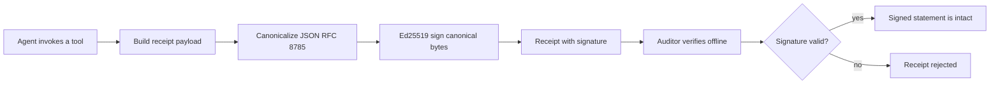
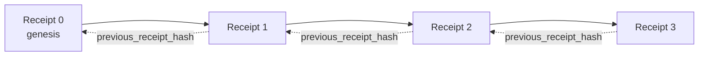

[Посмотреть видео урока: Защита AI-Агентов с помощью Криптографических Квитанций](https://youtu.be/PLACEHOLDER_VIDEO_ID)

> _(Видео урока и миниатюра будут добавлены командой Microsoft после слияния, в соответствии с шаблоном уроков 14 / 15.)_

# Защита AI-Агентов с помощью Криптографических Квитанций

## Введение

В этом уроке вы узнаете:

- Почему журналы аудита для AI-агентов важны для соответствия, отладки и доверия.
- Что такое криптографическая квитанция и чем она отличается от неподписанной строки журнала.
- Как создать подписанную квитанцию для вызова инструмента агента на чистом Python.
- Как проверить квитанцию офлайн и обнаружить подделку.
- Как связать квитанции в цепочку так, чтобы удаление или изменение порядка нарушало цепочку.
- Что доказывают квитанции и что они явно не доказывают.

## Цели обучения

После прохождения урока вы будете уметь:

- Определять способы отказа, которые мотивируют криптографическое происхождение действий агента.
- Создавать квитанцию с подписью Ed25519 поверх канонического JSON-пейлоада.
- Независимо проверять квитанцию, используя только публичный ключ подписавшего.
- Обнаруживать подделки, повторно выполняя проверку изменённой квитанции.
- Строить цепочку квитанций со связанными хешами и объяснять важность этой цепочки.
- Различать, что доказывают квитанции (принадлежность, целостность, порядок) и что они не доказывают (корректность действия, обоснованность политики).

## Проблема: Журнал аудита вашего агента

Представьте, что вы запустили AI-агента для Contoso Travel. Агент читает запросы клиентов, вызывает API авиакомпаний для поиска вариантов и бронирует места от имени клиента. За прошлый квартал агент обработал 50 000 бронирований.

Сегодня пришёл аудитор. Он задаёт простой вопрос: «Покажите, что сделал ваш агент».

Вы передаёте журналы. Аудитор изучает их и задаёт более сложный вопрос: «Как мне узнать, что эти журналы не были отредактированы?»

Это проблема журнала аудита. Большинство развертываний агентов сегодня опираются на:

- **Логи приложений**: создаются самим агентом, могут быть изменены любым, кто имеет доступ к файловой системе.
- **Облачные сервисы логирования**: защищены от подделок на уровне платформы, но только если аудитор доверяет оператору платформы.
- **Журналы транзакций базы данных**: хорошо подходят для изменений базы, но не для произвольных вызовов инструментов.

Никакой из этих вариантов не может ответить на вопрос аудитора без необходимости доверять кому-то (вам, вашему облачному провайдеру, вашему поставщику базы данных). Для внутреннего использования такое доверие зачастую приемлемо. Для регулируемых задач (финансы, здравоохранение, всё, что подпадает под EU AI Act) — нет.

Криптографические квитанции сужают эту проблему, представляя подписанное заявление, которое
можно проверить независимо. Аудитору всё равно нужна внешняя причина доверять ключу подписи и
компоненту, который создал заявление. Встроенный ключ доказывает внутреннюю согласованность,
а не личность эмитента или место применения.

## Что такое криптографическая квитанция?

Квитанция — это JSON-объект, который фиксирует, что сделал агент, подписанный цифровой подписью.



Минимальная квитанция выглядит так:

```json
{
  "type": "agent.tool_call.v1",
  "agent_id": "contoso-travel-bot",
  "tool_name": "lookup_flights",
  "tool_args_hash": "sha256:a3f9c1...",
  "result_hash": "sha256:7b2e1d...",
  "policy_id": "contoso-travel-policy-v3",
  "timestamp": "2026-04-25T14:30:00Z",
  "sequence": 47,
  "previous_receipt_hash": "sha256:9d4e6a...",
  "signature": {
    "alg": "EdDSA",
    "sig": "c5af83...",
    "public_key": "8f3b2c..."
  }
}
```

Три свойства выполняют всю работу:

1. **Подпись**. Квитанция подписывается шлюзом агента с помощью приватного ключа Ed25519. Любой, у кого есть соответствующий публичный ключ, может проверить подпись офлайн. Доверяющая сторона должна закрепить этот ключ или получить его из доверенного реестра вне квитанции. Подделка любого подписанного поля делает подпись недействительной.

2. **Каноническое кодирование**. Перед подписанием квитанция сериализуется с использованием схемы канонизации JSON (JCS, RFC 8785). Это гарантирует, что две реализации, создающие одну и ту же логическую квитанцию, производят идентичный по байтам вывод. Без канонизации разные сериализаторы JSON дали бы разные подписи для одного и того же содержимого.

3. **Хеш-цепочка**. Поле `previous_receipt_hash` связывает каждую квитанцию с предыдущей. Удаление или изменение порядка квитанций нарушает представленную последовательность. Для обнаружения усечения или переписывания под контролем подписывающего требуется закреплённый текущий заголовок цепочки, независимый зафиксированный контрольный пункт или аутентифицированное обязательство закрытой популяции.

Вместе эти свойства дают три гарантии:

- **Принадлежность ключу**: этот ключ подписал это содержимое. Организационная или человеческая идентичность требует доверенной привязки ключа.
- **Целостность**: содержимое не изменялось с момента подписи.
- **Порядок в проверенной последовательности**: эта квитанция связана с предыдущей.

## Создание квитанции на Python

Для создания квитанции не нужна специальная библиотека. Криптографические примитивы широко доступны, а логика занимает всего несколько десятков строк Python.

Практические упражнения в `code_samples/18-signed-receipts.ipynb` показывают полный процесс. Управляемый исходниками `code_samples/18-signed-receipts.execution-receipt.json` фиксирует точный хэш ноутбука, окружение Python, количество ячеек и проверки из последнего чистого запуска без изменения сохранённых результатов урока. Кратко:

```python
import json
import hashlib
import base64
from nacl import signing
from jcs import canonicalize  # RFC 8785 canonical JSON

def b64url_nopad(data: bytes) -> str:
    return base64.urlsafe_b64encode(data).decode("ascii").rstrip("=")

def sha256_canonical(obj) -> str:
    """SHA-256 of a Python object's JCS-canonical JSON form."""
    return f"sha256:{hashlib.sha256(canonicalize(obj)).hexdigest()}"

# Generate or load a signing key (in production, store in a key vault)
signing_key = signing.SigningKey.generate()
verify_key = signing_key.verify_key
TRUSTED_PUBLIC_KEYS = {b64url_nopad(bytes(verify_key))}  # pinned out of band by the verifier

# Build the receipt payload (no signature yet)
tool_args = {"origin": "SYD", "destination": "LAX"}
tool_result = [{"flight": "QF11", "price": 1850, "stops": 0}]

payload = {
    "type": "agent.tool_call.v1",
    "agent_id": "contoso-travel-bot",
    "tool_name": "lookup_flights",
    "tool_args_hash": sha256_canonical(tool_args),
    "result_hash": sha256_canonical(tool_result),
    "policy_id": "contoso-travel-policy-v3",
    "timestamp": "2026-04-25T14:30:00Z",
    "sequence": 0,
    "previous_receipt_hash": None,
}

# Canonicalize and sign the JCS bytes directly. PureEdDSA hashes internally.
canonical_bytes = canonicalize(payload)
signature_bytes = signing_key.sign(canonical_bytes).signature

# Attach a structured signature object.
receipt = {
    **payload,
    "signature": {
        "alg": "EdDSA",
        "sig": b64url_nopad(signature_bytes),
        "public_key": b64url_nopad(bytes(verify_key)),
    },
}
```

Это вся цепочка подписи. Упражнения в ноутбуке разбирают каждый шаг.

## Проверка квитанции и обнаружение подделок

Проверка — обратная операция:

```python
import base64
import hashlib
from nacl import signing
from nacl.exceptions import CryptoError
from jcs import canonicalize

def b64url_decode(s: str) -> bytes:
    # Strict: Python's decoder skips characters outside the alphabet and also
    # accepts padding, the standard +/ alphabet and non-zero spare bits.
    # Re-encoding and comparing accepts only the one unpadded base64url form.
    padding = "=" * ((4 - len(s) % 4) % 4)
    data = base64.urlsafe_b64decode(s + padding)
    if base64.urlsafe_b64encode(data).decode("ascii").rstrip("=") != s:
        raise ValueError("not canonical unpadded base64url")
    return data

def verify_receipt(receipt: dict, trusted_public_key: str) -> bool:
    # trusted_public_key is the issuer's key, obtained from somewhere other
    # than this receipt. Never use receipt["signature"]["public_key"] here:
    # see "What Receipts Prove (and What They Do Not)" below.
    # Fails closed: anything malformed returns False instead of raising.
    if not isinstance(receipt, dict) or not isinstance(trusted_public_key, str):
        return False
    sig_obj = receipt.get("signature")
    if not isinstance(sig_obj, dict) or sig_obj.get("alg") != "EdDSA":
        return False
    sig_b64 = sig_obj.get("sig")
    if not isinstance(sig_b64, str):
        return False

    try:
        # Reconstruct the payload that was actually signed (everything except signature).
        payload = {k: v for k, v in receipt.items() if k != "signature"}
        canonical_bytes = canonicalize(payload)
        verify_key = signing.VerifyKey(b64url_decode(trusted_public_key))
        verify_key.verify(canonical_bytes, b64url_decode(sig_b64))
        return True
    except (CryptoError, TypeError, ValueError, KeyError, OverflowError):
        return False
    except Exception:
        # An undecodable key or signature, or a payload that cannot be
        # canonicalized: fail closed rather than raise.
        return False
```

Эта функция принимает квитанцию и публичный ключ эмитента, возвращает `True` если подпись валидна, и `False` в противном случае, включая случаи с повреждённым вводом. Нет сетевых вызовов и сервисов проверки: имея ключ эмитента, проверка полностью локальна и офлайн. Что требуется — это сам ключ, полученный не из самой квитанции.

Чтобы увидеть работу обнаружения подделок, ноутбук проходит следующие шаги:

1. Создание валидной квитанции и подтверждение её проверки.
2. Изменение одного байта в поле `tool_args_hash`.
3. Повторная проверка и провал.
4. Повторная подделка, но теперь повторная подпись ключом, созданным атакующим, с встраиванием этого ключа в квитанцию.

Шаг 4 заслуживает особого внимания. Эта квитанция внутренне согласована: её подпись подлинна для содержимого и для ключа, который она содержит, поэтому она проверяется по ключу внутри неё. Она не проходит проверку только по реальному ключу эмитента. Шаги 2 и 3 ловят атакующего, не потрудившегося повторно подписать; шаг 4 — того, кто это сделал.

Это практическая демонстрация того, что квитанции защищены от подделки: любое изменение подписанного поля ломает подпись, при условии, что вы проверяете по ключу, который атакующий не предоставил. Сам объект `signature` находится вне подписанных байт, поэтому ключ, по которому идёт проверка, должен быть получен вне квитанции.

## Связывание квитанций в цепочку для многошаговых агентов

Одна подписанная квитанция защищает одно действие. Цепочка квитанций защищает последовательность.



Каждая квитанция фиксирует хеш предыдущей. Чтобы тихо удалить квитанцию 2, атакующему нужно:

- Изменить поле `previous_receipt_hash` в квитанции 3 (нарушит подпись квитанции 3), ИЛИ
- Подделать новую подпись на изменённой квитанции 3 (требуется приватный ключ агента).

Если приватный ключ хранится в аппаратном хранилище, а проверяющие сверяют каждую квитанцию с публичным ключом эмитента, полученным независимо (опубликованный JWK Set или закреплённое значение конфигурации), ни одна из атак невозможна без обнаружения. Публикация ключа внутри каждой квитанции недостаточна: атакующий может перезаключить с собственным ключом и встроить его — это фиксация `04_resigned_receipt.json`.

Ноутбук показывает:

1. Создание цепочки из трёх квитанций.
2. Проверку, что `previous_receipt_hash` каждой квитанции совпадает с настоящим хешем предыдущей.
3. Подделку одной квитанции в середине и разрыв цепочки в этой точке.

Так создаётся журнал аудита, который внешний аудитор может проверить по
закреплённым ключам эмитентов и контрольным точкам цепочки, не доверяя изменяемому хранилищу журналов.

## Что доказывают квитанции (и что не доказывают)

Это самый важный раздел урока. Квитанции мощные, но их возможности ограничены.

**Квитанции доказывают три вещи:**

1. **Принадлежность**: определённый ключ подписал определённый пейлоад.
2. **Целостность**: пейлоад не изменялся с момента подписи.
3. **Порядок в представленной, проверенной последовательности**: эта квитанция связана с предыдущей.

**Квитанции НЕ доказывают:**

1. **Корректность**: что действие агента было правильным. Квитанция может быть подписана и для неправильного ответа так же чисто, как для правильного.
2. **Соответствие политике**: что политика, указанная в `policy_id`, действительно была оценена или что она бы разрешила это действие, если бы проверялась. Квитанция фиксирует заявленное, а не применённое.
3. **Идентичность сверх ключа**: квитанция говорит «этот ключ подписал это содержимое», но не «этот человек авторизовал». Связывание ключа с человеком или организацией требует отдельной инфраструктуры идентификации (каталог, реестр публичных ключей и т.п.).
4. **Правдивость входных данных**: если агент получает манипулированный запрос и действует согласно ему, квитанция точно фиксирует действие. Квитанции — часть после валидации ввода, а не её замена.
5. **Выполнение или реальный эффект**: квитанция после вызова фиксирует, что заявил эмитент. Доказательство исполнения или сопоставление внешнего эффекта требует доказательств от фактического исполнителя или пограничного провайдера.
6. **Полноту**: отсутствие квитанции может означать блокирование, пропуск, потерю или отсутствие инструмента. Отсутствие — доказательство только в пределах аутентифицированной закрытой популяции.
7. **Доверенное время**: подписанное время подтверждает, что подписавший владел этим значением, но не что оно корректно. Доверенное время требует отдельного временного органа или подтверждённой контрольной точки.

**Ключ в квитанции — не тот ключ, по которому вы проверяете.** Это вытекает из пункта 3 и — единственное место, где это различие должно изменить ваш код, а не понимание. `public_key` в примере выше существует для самодостаточности примера. Проверяющий никогда не должен ему доверять. Любой может взять квитанцию, изменить её, подписать с ключом, который сам сгенерировал, и встроить этот ключ; результат будет идеально проверяться сам на себя. Это фиксация `04_resigned_receipt.json` в `sample_receipts/` и причина, почему `verify_receipt` выше принимает ключ как аргумент, а не читает из квитанции. Получите ключ эмитента независимо, из JWK Set в Нижеуказанном Производственном Контроле или другого заякоренного источника, и проверяйте по нему. Подпись, проверенная ключом, пришедшим в том же конверте, доказывает только внутреннюю согласованность конверта.

Эта граница важна по двум причинам:

- Она показывает, для чего полезны квитанции: делать поведение агента аудируемым и защищённым от подделок, даже через организационные границы.
- Она показывает, какие дополнительные слои вам всё ещё нужны: валидация входных данных (Урок 6), применение политики (кратко описано ниже) и инфраструктура идентичности (не рассматривается в этом уроке).

Распространённая ошибка — думать, что "у нас есть квитанции" значит "нас контролируют". Это не так. Квитанции — это основа. Контроль — это система, которую вы строите сверху.

## Привязка подписи одобряющего к точному действию

Пункт 3 выше заслуживает отдельного раздела: квитанция действия говорит «этот ключ подписал это содержимое», но никогда «этот человек разрешил». Для важных действий (возвраты, удаления, банковские переводы) отдельная подпись одобряющего может привязать точное действие. Связывание ключа с человеком и проверка его присутствия — отдельные задачи.

Следующий ноутбук `code_samples/human-authorization-receipts.ipynb` добавляет второй тип квитанций, `human.approval.v1`, в том же формате конверта, что и квитанции урока (типизированный пейлоад, подписанный Ed25519 по его каноническим байтам JCS, с объектом `signature` вне подписанных байт). Ключ одобряющего подписывает **полное каноническое действие и его дайджест**; ключ агента подписывает заявление с **тем же дайджестом действия** и `parent_approval_ref` — `receipt_hash` одобрения, по той же конвенции, что и `previous_receipt_hash` в цепочке выше. Один `verify_chain` обрабатывает оба компонента под **отдельными закреплёнными реестрами ключей** (ключи одобряющих против ключей агентов), так что код общий, но полномочия разделены.

Свойство, которое это обеспечивает, сформулировано так: *закреплённый ключ одобряющего подписал
именно это действие, а затем ключ агента подписал заявление с тем же дайджестом действия.*
Это полезное доказательство, но не доказывает само по себе исполнение действия. Чтобы
контролировать исполнение, точное одобрение должно быть зарезервировано и использовано один раз на
фактической границе исполнителя; неизвестные результаты провайдера должны оставаться неизвестными, а не
бездумно повторяться. Фикстуры отказов ноутбука проверяют слой цепочки квитанций:

- подделки, ошибочное делегирование, подделанные ключи по обе стороны, и повреждённый ввод;
- **устаревший полномочия**: подпись, которая всё ещё проверяется, но отклонена, потому что версия политики изменилась, ключ одобряющего удалён из закреплённого реестра или одобрение истекло до переданного времени проверки;
- **замена дайджеста**: валидно подписанная квитанция действия, указывающая на *реальное* одобрение, привязывающее *другое* каноническое действие.

Каждый отказ содержит отдельную причину, так что аудитор видит, устарели полномочия или изменилось заявленное действие. Проверка — только для чтения и повторяема: она не потребляет одобрение и не вызывает провайдера. Отдельному исполнителю нужна надёжная атомарная защита от повторного выполнения и явное обозначение успеха, ошибки или неопределённости. Квитанция с человеческим одобрением — учебный составной объект из этого урока, а не тип квитанции, определённый `draft-farley-acta-signed-receipts`.

## Референсы для продакшена

Код на Python в этом уроке намеренно минимален, чтобы вы могли прочитать каждую строку и точно понять, что происходит. В производственной среде у вас есть два варианта:

1. **Работать напрямую с криптографическими примитивами.** 50 строк кода, которые вы видели выше, достаточно для многих случаев использования. PyNaCl (Ed25519) и пакет `jcs` (канонический JSON) — это хорошо поддерживаемые и проверенные библиотеки.

2. **Использовать библиотеку для работы с receipts для производства.** Несколько проектов с открытым исходным кодом реализуют тот же паттерн с дополнительными функциями (вращение ключей, пакетная проверка, распространение набора JWK, интеграция с политическими движками):
   - Конвейер подписи использует соглашения JCS и области подписи в независимом Internet-Draft IETF ([`draft-farley-acta-signed-receipts`](https://datatracker.ietf.org/doc/draft-farley-acta-signed-receipts/), версия 02). Простой учебный receipt этого урока отличается от `{payload, signature}` конверта из черновика и не представлен как соответствующая реализация. Черновик публикует общий набор тестов соответствия ([agent-governance-testvectors](https://github.com/ScopeBlind/agent-governance-testvectors)) для реализаций, нацеленных на его формат передачи.
   - Набор инструментов Microsoft Agent Governance Toolkit композирует receipts с решениями на базе Cedar; см. учебник 33 в этом репозитории для примера от начала до конца.
   - Пакеты `protect-mcp` (npm) и `@veritasacta/verify` (npm) предоставляют реализацию подписи и офлайн-проверки receipt на Node, предназначенную для обёртывания любого серверного MCP с противодействием изменениям в аудите, включая поток «удержано для со-подписи», в котором приостановленное действие генерирует receipt одобрения, привязанный к дайджесту действия (WebAuthn-поддержка на десктопе), тот же паттерн receipt одобрения, что и в ноутбуке с авторизацией пользователя выше.
   - **[nobulex](https://github.com/arian-gogani/nobulex)** Python SDK (`pip install nobulex`) предоставляет тот же паттерн подписи Ed25519 + JCS на Python с интеграциями LangChain и CrewAI, включая опубликованные кросс-проверочные тестовые векторы и соответствующую карту, внесённую через [OWASP PR #2210](https://github.com/OWASP/CheatSheetSeries/pull/2210).
   - **[EMILIA Protocol](https://github.com/emiliaprotocol/emilia-protocol)** предоставляет дополнительный слой обеспечения точного действия: офлайн-проверяемые receipts одобрения, закреплённый WebAuthn или кворумный авторитет, однократное потребление на границе исполнителя и явный путь с неопределённым исходом. Его адаптеры фреймворка рассматривают receipt как необходимое доказательство, а не как доказательство того, что внешний эффект произошёл.

Решение между самостоятельной реализацией и использованием библиотеки похоже на выбор между написанием собственной библиотеки JWT и использованием проверенной: оба варианта разумны; библиотека экономит время и снижает поверхность аудита; подход с нуля заставляет вас понимать каждый примитив. Этот урок обучает пути с нуля, чтобы у вас была база для любого из вариантов.

## Проверка знаний

Проверьте своё понимание перед переходом к практическому упражнению.

**1. Receipt подписывается приватным ключом Ed25519 агента. Аудитор имеет только публичный ключ. Может ли аудитор проверить receipt офлайн?**

<details>
<summary>Ответ</summary>

Да, криптографическая проверка требует только публичного ключа и подписанных байт. 
Аудитору всё равно нужно самостоятельно получить и закрепить принятый публичный ключ независимо от receipt.
После установки этой конфигурации доверия сетевые вызовы не требуются.
</details>

**2. Злоумышленник изменяет поле `policy_id` квитанции, чтобы утверждать, что она была оформлена в соответствии с более разрешительной политикой. Подпись была сделана по исходной полезной нагрузке. Что происходит при проверке?**

<details>
<summary>Ответ</summary>

Проверка не проходит. Подпись была вычислена над каноническими байтами исходной полезной нагрузки; изменение любого поля полезной нагрузки изменяет эти байты, что делает подпись недействительной. Злоумышленнику потребовался бы приватный ключ для создания новой действительной подписи, которого у него нет.
</details>

**3. Почему квитанция включает `tool_args_hash` и `result_hash`, а не сырые аргументы и результат?**

<details>
<summary>Ответ</summary>

По двум причинам. Во-первых, квитанция может потребоваться для архивирования или передачи в средах, где утечка сырого содержимого (личных данных, бизнес-данных) является проблемой. Хеширование сохраняет квитанцию компактной и содержание приватным; аудитор проверяет, что хеш совпадает с отдельно хранящейся копией фактического содержимого. Во-вторых, хеши имеют фиксированный размер; квитанция с хешами ограничена в размере независимо от того, насколько велики были входные и выходные данные.
</details>

**4. Поле `previous_receipt_hash` связывает каждую квитанцию с ее предшественником. Если злоумышленник тихо удалит одну квитанцию из середины цепочки, что станет недействительным?**

<details>
<summary>Ответ</summary>

Каждая квитанция, идущая после удалённой. Их поля `previous_receipt_hash` больше не соответствуют фактической цепочке (потому что квитанция, на которую они ссылались, больше не существует, или цепочка теперь указывает на другого предшественника). Чтобы скрыть удаление, злоумышленнику пришлось бы повторно подписать каждую последующую квитанцию, для чего нужен приватный ключ издателя. Повторная подпись любым другим ключом не пройдет проверку с ключом издателя.
</details>

**5. Квитанция успешно проходит проверку. Доказывает ли это, что действие агента было правильным, обоснованным или соответствующим политике?**

<details>
<summary>Ответ</summary>

Нет. При закрепленном ключе и контексте цепочки действительная квитанция доказывает атрибуцию подписи,
целостность содержимого и связь с указанным предшественником. Она НЕ доказывает,
что действие было правильным или выполненным, что политика была применена, что отметка времени
надежна или что набор записей полон. Это самый важный вывод данного урока.
</details>

## Практическое задание

Откройте `code_samples/18-signed-receipts.ipynb` и выполните все четыре раздела:

1. **Раздел 1**: Подпишите вашу первую квитанцию и проверьте её.
2. **Раздел 2**: Повредите квитанцию и наблюдайте провал проверки.
3. **Раздел 3**: Постройте цепочку из трёх квитанций и проверьте целостность цепочки.
4. **Раздел 4**: Примените паттерн к агенту, построенному с использованием Microsoft Agent Framework: оберните вызов инструмента в подписание квитанции, затем проверьте квитанцию независимо.

**Расширенный вызов 1:** расширьте схему квитанции дополнительным полем на ваш выбор (например, идентификатор запроса для трассировки), обновите логику канонической подписи, чтобы включить его, и подтвердите, что квитанция по-прежнему проходит проверку. Затем измените поле после подписи и подтвердите провал проверки. Это заставит вас понять, как каждый байт канонического кодирования влияет на подпись.

**Расширенный вызов 2:** вычислите SHA-256-хеш двух ваших квитанций вместе (конкатенируя их канонические байты в детерминированном порядке) и вставьте полученный дайджест как новое поле в третью квитанцию перед подписанием. Проверьте, что все три квитанции проходят проверку. Вы только что построили доказательство включения в один шаг: любой, у кого есть третья квитанция, может доказать, что первые две существовали в момент подписания, не раскрывая их содержимое. Это паттерн, который используют квитанции с селективным раскрытием в масштабе (Merkle-коммиты, RFC 6962).

## Заключение

Криптографические квитанции дают AI-агентам аудит, который:

- **Независимо проверяемый при закрепленном доверии**: сторона с принятыми публичными ключами и подписанными байтами может проверить без зависимости от сервиса.
- **Обнаруживаемый при попытке изменения**: любое изменение делает подпись недействительной.
- **Портативный**: квитанция — небольшой JSON-файл; его можно архивировать, передавать и проверять где угодно.
- **Соответствующий стандартам**: построен на Ed25519 (RFC 8032), JCS (RFC 8785) и SHA-256, широко используемых примитивах.

Они не заменяют проверку входа, применение политики, допуск исполнителя,
доказательства результата, контроль полноты или инфраструктуру идентификации. Они служат основой
для этих уровней. В регулируемых или многокомандных рабочих процессах квитанции делают конкретные
заявления издателей независимо проверяемыми в рамках собственной конфигурации доверия аудитора.

Самое важное: квитанции доказывают, что конкретный ключ подписал конкретное
содержимое. Передаваемая отметка времени является утверждением подписанта, если отдельно не прошла временное подтверждение. Квитанция
не доказывает, что ее содержимое было истинным, что действие было выполнено, или что
набор записей полон. Строго держите эти различия в памяти.

## Контрольный список для производства

Когда вы будете готовы перейти от этого урока к развертыванию агентов с подписанными квитанциями в реальной среде:

- [ ] **Переместите ключ подписи с ноутбука разработчика.** Используйте Azure Key Vault, AWS KMS или аппаратный модуль безопасности. Приватный ключ, подписывающий ваши квитанции, никогда не должен храниться в системе контроля версий или в открытом виде на рабочих машинах.
- [ ] **Установите доверие к ключам проверяющего.** Публикуйте ключи через набор JWK или реестр, затем сторонние участники закрепляют принятую идентичность издателя, набор ключей и политику ротации вне отдельных квитанций. Встроенный ключ сам по себе не является якорем доверия.
- [ ] **Закрепите цепочку внешне.** Периодически записывайте хеш головы последней цепочки в журнал прозрачности (Sigstore Rekor, RFC 3161 timestamp authority или внутреннюю вторую систему), чтобы внешняя сторона могла подтвердить "эта цепочка существовала в это время".
- [ ] **Храните квитанции неизменяемо.** Хранение только с добавлением (Azure Storage с политиками неизменяемости, AWS S3 Object Lock) предотвращает изменение истории инсайдерами на уровне хранения.
- [ ] **Определитесь с политикой хранения.** Многие режимы соответствия требуют хранения нескольких лет. Планируйте рост квитанций (каждая квитанция ~500 байт; агент, делающий 10K вызовов в день, производит ~1.8 ГБ в год).
- [ ] **Документируйте, что квитанции не покрывают.** Квитанции доказывают атрибуцию, целостность и порядок. Ваш регламент должен явно перечислять дополнительные контроли (проверка входа, применение политики, ограничение скорости, инфраструктура идентификации), которые стоят рядом с квитанциями в вашей системе управления.

### Есть еще вопросы по защите AI-агентов?

Присоединяйтесь к [Microsoft Foundry Discord](https://aka.ms/ai-agents/discord), чтобы встретиться с другими обучающимися, посетить часы консультаций и получить ответы на вопросы по AI-агентам.

## За пределами этого урока

Этот урок охватывает одиночное подписание квитанции и цепочки с хешированием. Те же примитивы используются в нескольких более продвинутых паттернах, с которыми вы можете столкнуться по мере развития вашей системы управления:

- **Селективное раскрытие.** Когда поля квитанции независимо зафиксированы (Merkle-дерево по модели RFC 6962), вы можете раскрывать определённые поля конкретным аудиторам и доказывать неизменность остальных без раскрытия их содержания. Полезно, когда одна квитанция должна удовлетворять и комплексному аудиту (требующему полноту), и регуляциям минимизации данных, таким как GDPR (требующим увидеть как можно меньше).
- **Отзыв квитанций.** Если ключ подписи скомпрометирован, нужна возможность пометить все квитанции, подписанные этим ключом, как недоверенные с определённого момента. Стандартные паттерны: короткоживущие ключи подписи с опубликованным списком отзывов или журнал прозрачности с записями об отзыве.
- **Двусторонние / разделённые подписи квитанций.** Некоторые реализации разделяют подписанную полезную нагрузку на до-исполнительную (`authorization_*`) и после-исполнительную (`result_*`) части с независимыми подписями, полезно когда решение об авторизации и наблюдаемый результат создаются разными участниками или в разное время. Это добавляется к формату квитанции, изученному в этом уроке.
- **Композиция полезной нагрузки.** Квитанция опечатывает байты, которые вы поместили в `result_hash`. Реальные полезные нагрузки часто богаче одного результата вызова инструмента: предрешенческое рассуждение (предсказание модели, рассмотренные варианты, доказательства и их полнота, риск, цепочка ответственности, результат проверки) могут все находиться в полезной нагрузке, опечатанные одной квитанцией. Это сохраняет минимальный формат квитанции, позволяя схемам данных развиваться по доменам.
- **Соответствие разных реализаций.** Несколько независимых реализаций одного формата квитанции (Python, TypeScript, Rust, Go) перекрестно проверяют соответствие опубликованным тестовым векторам. Если вы создаёте собственную реализацию, проверка на опубликованных векторах подтверждает совместимость по протоколу.
- **Миграция в постквантовую эпоху.** Ed25519 широко используется сегодня, но не является устойчивым к квантовым атакам. Просто наличие метки `alg` не означает миграцию: профиль должен определять кодировку ключа ML-DSA, канонические подписанные байты, проверку, политику принимающей стороны, устойчивость к понижению уровня и семантику перехода. Планируйте и тестируйте переход с двойной подписью на общих векторах до утверждения совместимости.

## Дополнительные ресурсы

- <a href="https://datatracker.ietf.org/doc/draft-farley-acta-signed-receipts/" target="_blank">IETF Internet-Draft: Signed Decision Receipts for Machine-to-Machine Access Control</a>
- <a href="https://learn.microsoft.com/azure/ai-studio/responsible-use-of-ai-overview" target="_blank">Обзор ответственного ИИ (Azure AI)</a>
- <a href="https://datatracker.ietf.org/doc/html/rfc8032" target="_blank">RFC 8032: Алгоритм цифровой подписи на кривой Эдвардса (EdDSA)</a>
- <a href="https://datatracker.ietf.org/doc/html/rfc8785" target="_blank">RFC 8785: Схема канонизации JSON (JCS)</a>
- <a href="https://datatracker.ietf.org/doc/html/rfc6962" target="_blank">RFC 6962: Прозрачность сертификатов</a> (конструкция Merkle-дерева, используемая в квитанциях с селективным раскрытием)
- <a href="https://github.com/microsoft/agent-governance-toolkit/blob/main/docs/tutorials/33-offline-verifiable-receipts.md" target="_blank">Microsoft Agent Governance Toolkit, Учебник 33: Квитанции о решениях с офлайн-проверкой</a>
- <a href="https://github.com/ScopeBlind/agent-governance-testvectors" target="_blank">Тестовые векторы соответствия между реализациями</a> для формата квитанции, используемого в этом уроке (Apache-2.0)
- <a href="https://pynacl.readthedocs.io/" target="_blank">Документация PyNaCl</a> (Ed25519 на Python)

## Предыдущий урок

[Создание локальных ИИ-агентов](../17-creating-local-ai-agents/README.md)

---

<!-- CO-OP TRANSLATOR DISCLAIMER START -->
**Отказ от ответственности**:
Этот документ был переведен с использованием сервиса машинного перевода [Co-op Translator](https://github.com/Azure/co-op-translator). Несмотря на наши усилия по обеспечению точности, имейте в виду, что автоматический перевод может содержать ошибки или неточности. Оригинальный документ на его исходном языке следует считать авторитетным источником. Для получения критически важной информации рекомендуется обратиться к профессиональному человеческому переводу. Мы не несем ответственности за любые недоразумения или неправильные толкования, возникшие в результате использования этого перевода.
<!-- CO-OP TRANSLATOR DISCLAIMER END -->