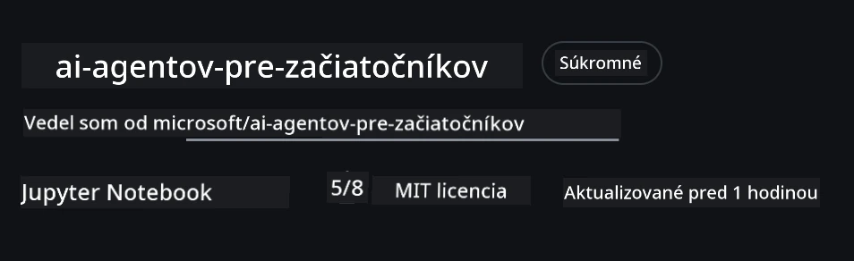
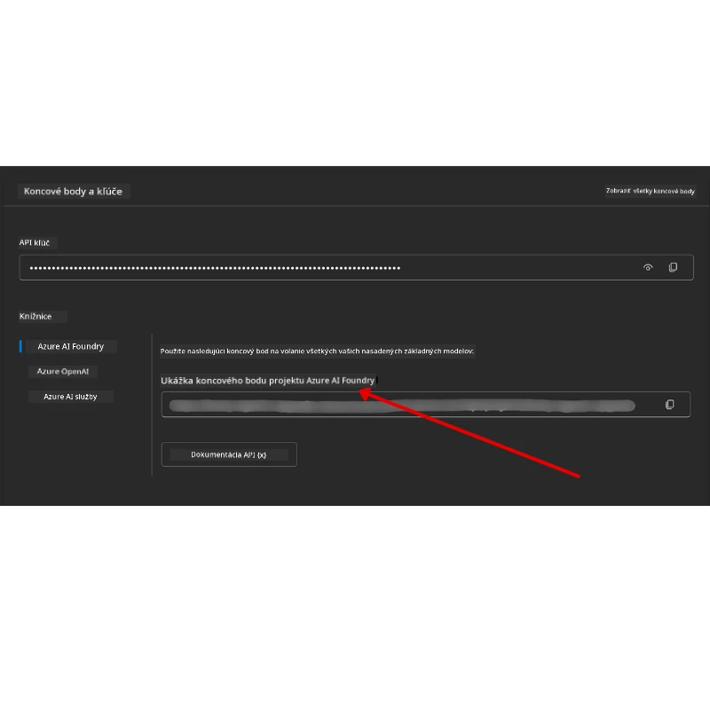

# Nastavenie kurzu

## Úvod

Táto lekcia pokrýva, ako spustiť ukážkové kódy tohto kurzu.

## Pridajte sa k ďalším študentom a získajte pomoc

Predtým, než začnete klonovať svoj repozitár, pripojte sa na [Discord kanál AI Agents For Beginners](https://aka.ms/ai-agents/discord), aby ste dostali akúkoľvek pomoc s nastavením, mohli klásť otázky k kurzu alebo sa spojili s ostatnými študentmi.

## Klonujte alebo Forknite tento repozitár

Na začiatok, prosím klonujte alebo forknete GitHub repozitár. Toto vytvorí vašu vlastnú verziu materiálu kurzu, aby ste mohli kód spustiť, testovať a upravovať!

Toto môžete urobiť kliknutím na <a href="https://github.com/microsoft/ai-agents-for-beginners/fork" target="_blank">forknutie repozitára</a>

Teraz by ste mali mať vlastnú forkverziu tohto kurzu na nasledovnom odkaze:



### Povrchové klonovanie (odporúčané pre workshop / Codespaces)

  >Celý repozitár môže byť veľký (~3 GB) keď stiahnete celú históriu a všetky súbory. Ak sa zúčastňujete iba workshopu alebo potrebujete len niekoľko lekčných priečinkov, povrchové (shallow) klonovanie (alebo sparse klonovanie) stiahne oveľa menej.

#### Rýchle povrchové klonovanie — minimálna história, všetky súbory

Nahraďte `<your-username>` v nasledovných príkazoch vašou URL fork repozitára (alebo upstream URL, ak preferujete).

Ak chcete klonovať len najnovšiu históriu commitov (malé sťahovanie):

```bash
git clone --depth 1 https://github.com/<your-username>/ai-agents-for-beginners.git
```

Ak chcete klonovať konkrétnu vetvu:

```bash
git clone --depth 1 --branch <branch-name> https://github.com/<your-username>/ai-agents-for-beginners.git
```

#### Čiastočné (sparse) klonovanie — minimálne bloby + len vybrané priečinky

Toto používa čiastočné klonovanie a sparse-checkout (vyžaduje Git 2.25+ a odporúča sa moderný Git s podporou partial clone):

```bash
git clone --depth 1 --filter=blob:none --sparse https://github.com/<your-username>/ai-agents-for-beginners.git
```

Prejdite do priečinka repozitára:

```bash
cd ai-agents-for-beginners
```

Potom zadajte, ktoré priečinky chcete (príklad nižšie ukazuje dva priečinky):

```bash
git sparse-checkout set 00-course-setup 01-intro-to-ai-agents
```

Po klonovaní a overení súborov, ak potrebujete len súbory a chcete uvoľniť miesto (žiadna git história), vymažte prosím metadáta repozitára (💀nezvratné — stratíte všetky funkcie Gitu):

```bash
# zsh/bash
rm -rf .git
```

```powershell
# PowerShell
Remove-Item -Recurse -Force .git
```

#### Používanie GitHub Codespaces (odporúčané na vyhnutie sa veľkým lokálnym sťahovaniam)

- Vytvorte nový Codespace pre tento repozitár cez [GitHub UI](https://github.com/codespaces).  

- V termináli novovytvoreného codespace spustite jeden z povrchových/sparse clone príkazov vyššie, aby ste do pracovného priestoru Codespace priniesli len potrebné lekčné priečinky.
- Voliteľné: po klonovaní v Codespaces odstráňte .git adresár na uvoľnenie miesta (pozrite odstránenie príkazov vyššie).
- Poznámka: Ak preferujete otvoriť repozitár priamo v Codespaces (bez ďalšieho klonovania), buďte si vedomí, že Codespaces vytvorí devcontainer prostredie a môže načítať viac, než potrebujete.

#### Tipy

- Vždy nahraďte URL klonovania svojím fork repozitárom, ak chcete upravovať alebo commitovať.
- Ak budete neskôr potrebovať viac histórie alebo súborov, môžete ich dofetchovať alebo upraviť sparse-checkout na zahrnutie ďalších priečinkov.

## Spustenie kódu

Tento kurz ponúka sériu Jupyter Notebookov, ktoré môžete spúšťať na získanie praktických skúseností s tvorbou AI agentov.

Ukážkové kódy používajú **Microsoft Agent Framework (MAF)** s `FoundryChatClient`, ktoré sa pripája k **Microsoft Foundry Agent Service V2** (Responses API) cez **Microsoft Foundry**.

Všetky Python notebooky majú označenie `*-python-agent-framework.ipynb`.

## Požiadavky

- Python 3.12+
  - **POZNÁMKA**: Ak nemáte nainštalovaný Python 3.12, uistite sa, že si ho nainštalujete. Potom vytvorte svoje venv pomocou python3.12, aby sa zaručilo, že budú nainštalované správne verzie z requirements.txt.
  
    >Príklad

    Vytvorte Python venv adresár:

    ```bash
    python -m venv venv
    ```

    Potom aktivujte venv prostredie pre:

    ```bash
    # zsh/bash
    source venv/bin/activate
    ```
  
    ```dos
    # Command Prompt for Windows
    venv\Scripts\activate
    ```

- .NET 10+: Pre ukážkové kódy používajúce .NET, uistite sa, že máte nainštalovaný [.NET 10 SDK](https://dotnet.microsoft.com/download/dotnet/10.0) alebo novší. Potom skontrolujte svoju verziu .NET SDK:

    ```bash
    dotnet --list-sdks
    ```

- **Azure CLI** — Vyžaduje sa na autentifikáciu. Nainštalujte z [aka.ms/installazurecli](https://aka.ms/installazurecli).
- **Azure Subscription** — Na prístup k Microsoft Foundry a Microsoft Foundry Agent Service.
- **Microsoft Foundry Projekt** — Projekt s nasadeným modelom (napr. `gpt-5-mini`). Pozri [Krok 1](#step-1-create-a-microsoft-foundry-project) nižšie.

V koreňovom adresári tohto repozitára sme zahrnuli súbor `requirements.txt`, ktorý obsahuje všetky požadované Python balíky na spustenie ukážkových kódov.

Môžete ich nainštalovať spustením nasledujúceho príkazu v termináli v koreňovom adresári repozitára:

```bash
pip install -r requirements.txt
```

Odporúčame vytvoriť si Python virtuálne prostredie, aby ste sa vyhli konfliktom a problémom.

## Nastavenie VSCode

Uistite sa, že v VSCode používate správnu verziu Pythonu.


## Nastavenie Microsoft Foundry a Microsoft Foundry Agent Service

### Krok 1: Vytvorte Microsoft Foundry projekt

Na spúšťanie notebookov potrebujete Microsoft Foundry **projekt** s nasadeným modelom. Projekt vytvorte priamo v aktuálnom Microsoft Foundry rozhraní; hub nie je potrebný.

1. Prejdite na [ai.azure.com](https://ai.azure.com) a prihláste sa so svojim Azure účtom.
2. Vyberte **Create project** a postupujte podľa pokynov na vytvorenie projektu.
3. V projekte nasadte model (napr. `gpt-5-mini`) v **Models + Endpoints** → **Deploy model**.

### Krok 2: Získajte endpoint a názov nasadenia modelu

Vo vašom projekte v portáli Microsoft Foundry:

- **Project Endpoint** — Prejdite na stránku **Overview** a skopírujte URL endpoinu.



- **Model Deployment Name** — Prejdite do **Models + Endpoints**, vyberte svoj nasadený model a zaznamenajte **Názov nasadenia** (napr. `gpt-5-mini`).

### Krok 3: Prihláste sa do Azure pomocou `az login`

Väčšina notebookov sa autentifikuje cez vaše **Azure CLI prihlásenie** — používajúc `AzureCliCredential` alebo `DefaultAzureCredential` (obe využívajú vašu `az login` reláciu) z balíka `azure-identity` — takže nepotrebujú API kľúče. Niekoľko lekcií a voliteľných integrácií používa API kľúče; pozrite si požiadavky každej lekcie na prípadné ďalšie premenné prostredia. Na to je potrebné byť prihlásený cez Azure CLI.

1. **Nainštalujte Azure CLI**, ak ešte nie je nainštalovaný: [aka.ms/installazurecli](https://aka.ms/installazurecli)

2. **Prihláste sa** spustením:

    ```bash
    az login
    ```

    Alebo ak ste v remote/Codespace prostredí bez prehliadača:

    ```bash
    az login --use-device-code
    ```

3. **Vyberte svoj subscription**, ak sa zobrazí výzva — vyberte ten, ktorý obsahuje váš Foundry projekt.

4. **Overte**, či ste prihlásený:

    ```bash
    az account show
    ```

> **Prečo `az login`?** Notebooky sa autentifikujú pomocou `AzureCliCredential` (alebo `DefaultAzureCredential`, ktorý tiež využíva vaše Azure CLI prihlásenie) z balíka `azure-identity`. To znamená, že vaša Azure CLI relácia poskytuje poverenia — žiadne API kľúče alebo tajomstvá v súbore `.env`. Toto je [najlepšia bezpečnostná prax](https://learn.microsoft.com/azure/developer/ai/keyless-connections).

### Krok 4: Vytvorte svoj súbor `.env`

Skopírujte si príkladový súbor:

```bash
# zsh/bash
cp .env.example .env
```

```powershell
# PowerShell
Copy-Item .env.example .env
```

Otvorte `.env` a vyplňte tieto dve hodnoty:

```env
AZURE_AI_PROJECT_ENDPOINT=https://<your-project>.services.ai.azure.com/api/projects/<your-project-id>
AZURE_AI_MODEL_DEPLOYMENT_NAME=gpt-5-mini
```

| Premenná | Kde ju nájsť |
|----------|-----------------|
| `AZURE_AI_PROJECT_ENDPOINT` | Foundry portál → váš projekt → **Prehľad** stránka |
| `AZURE_AI_MODEL_DEPLOYMENT_NAME` | Foundry portál → **Modely + Koncové body** → názov vášho nasadeného modelu |

To je všetko pre väčšinu lekcií! Notebooky sa automaticky autentifikujú cez vašu reláciu `az login`.

### Krok 5: Inštalácia závislostí Pythonu

```bash
pip install -r requirements.txt
```

Odporúčame spustiť to vo vnútri virtuálneho prostredia, ktoré ste si vytvorili skôr.

## Voliteľné nastavenie: Azure AI Search (lekcie 5 a 16)

Notebooky Lekcie 5 (Agentic RAG) a Lekcie 16 fungujú ihneď s **pamäťovou databázou znalostí** — nie sú potrebné ďalšie Azure zdroje. Ak ich chcete podporiť reálnym **Azure AI Search** indexom, vezmite na vedomie, že **notebook Lekcie 16 momentálne používa autentifikáciu pomocou kľúča**: prepína z vyhľadávania v pamäti na Azure AI Search len keď sú nastavené **obidve** `AZURE_SEARCH_SERVICE_ENDPOINT` **a** `AZURE_SEARCH_API_KEY`, inak zostáva pri vyhľadávaní v pamäti — takže na spustenie proti reálnemu indexu musíte nastaviť aj administrátorský kľúč. Autentifikácia bez kľúča pomocou Microsoft Entra ID (RBAC) je odporúčaný prístup pre váš vlastný produkčný kód, v súlade s tokom `az login` používaným všade inde v tomto kurze.

Kroky RBAC nižšie sa týkajú ukážok v príručke na nastavenie a vášho vlastného kódu. Neumožňujú autentifikáciu bez kľúča v noteboocích Lekcie 16; Lekcia 16 naďalej vyžaduje koncový bod aj administrátorský kľúč na použitie Azure AI Search.

1. **Povoľte prístup založený na rolách** na vašej vyhľadávacej službe:

    ```bash
    az search service update --name <service-name> --resource-group <resource-group> --auth-options aadOrApiKey
    ```

2. **Priraďte si požadované role** (vytváranie/nahrávanie indexov a dotazovanie):

    ```bash
    az role assignment create --assignee <your-user-or-principal-id> --role "Search Service Contributor" --scope $(az search service show -g <resource-group> -n <service-name> --query id -o tsv)
    az role assignment create --assignee <your-user-or-principal-id> --role "Search Index Data Contributor" --scope $(az search service show -g <resource-group> -n <service-name> --query id -o tsv)
    ```

3. **Pridajte endpoint** do vášho súboru `.env`:

| Premenná | Kde ju nájsť |
|----------|-----------------|
| `AZURE_SEARCH_SERVICE_ENDPOINT` | Azure portál → váš **Azure AI Search** zdroj → **Prehľad** → URL |
| `AZURE_SEARCH_API_KEY` | Vyžaduje sa (spolu s endpointom) na povolenie Azure AI Search v zošite Lekcia 16, ktorý používa autentifikáciu na základe kľúča. Azure portál → **Nastavenia** → **Kľúče** → primárny administrátorský kľúč |

> **Prečo bez kľúča?** Administrátorské kľúče poskytujú plný zápisový prístup k vašej vyhľadávacej službe a môžu uniknúť cez súbory `.env`. Pri RBAC sa namiesto toho používa vaša identita `az login` — rovnaký kľúčový bezplatný vzor Entra ID, ktorý používajú zošity kurzu (cez `AzureCliCredential` / `DefaultAzureCredential`). Viac nájdete v [Pripojenie k Azure AI Search pomocou rolí](https://learn.microsoft.com/azure/search/search-security-rbac).

Viac nájdete v [sprievodcovi nastavením Azure AI Search](./AzureSearch.md) pre úplné ukážky vytvárania indexov v Pythone a .NET.

## Dodatočné nastavenie pre lekcie, ktoré volajú Azure OpenAI priamo (lekcie 6 a 8)

Niektoré zošity v lekciách 6 a 8 volajú **Azure OpenAI** priamo (používajúc **Responses API**) namiesto priechodu cez projekt Microsoft Foundry. Tieto ukážky predtým používali GitHub Models, ktoré sú zastarané a nepodporujú Responses API. Pridajte tieto premenné do svojho súboru `.env`:

| Premenná | Kde ju nájsť |
|----------|-----------------|
| `AZURE_OPENAI_ENDPOINT` | Azure portál → váš **Azure OpenAI** zdroj → **Kľúče a koncový bod** → Koncový bod (napr. `https://<your-resource>.openai.azure.com`) |
| `AZURE_OPENAI_DEPLOYMENT` | Názov vášho nasadeného modelu (napr. `gpt-5-mini`), ktorý podporuje Responses API |
| `AZURE_OPENAI_API_KEY` | Voliteľné — iba ak používate autentifikáciu založenú na kľúči namiesto `az login` / Entra ID |

> Responses API používa stabilný `/openai/v1/` koncový bod, takže nie je potrebný `api-version`. Prihláste sa pomocou `az login`, aby ste mohli použiť autentifikáciu Entra ID bez kľúča.

## Alternatívny poskytovateľ: MiniMax (kompatibilný s OpenAI)

[MiniMax](https://platform.minimaxi.com/) poskytuje modely s veľkým kontextom (až do 204K tokenov) prostredníctvom API kompatibilného s OpenAI. Keďže `OpenAIChatClient` v Microsoft Agent Framework funguje s akýmkoľvek koncovým bodom kompatibilným s OpenAI, môžete použiť MiniMax ako náhradnú alternatívu pre lekcie, ktoré používajú `OpenAIChatClient`.

Pridajte tieto premenné do vášho súboru `.env`:

| Premenná | Kde ju nájsť |
|----------|--------------|
| `MINIMAX_API_KEY` | [Platforma MiniMax](https://platform.minimaxi.com/) → API kľúče |
| `MINIMAX_BASE_URL` | Použite `https://api.minimax.io/v1` (predvolená hodnota) |
| `MINIMAX_MODEL_ID` | Názov modelu na použitie (napr. `MiniMax-M3`) |

**Príklad modelov**: `MiniMax-M3` (odporúčané), `MiniMax-M2.7`, `MiniMax-M2.7-highspeed` (rýchlejšie odpovede). Názvy modelov a ich dostupnosť sa môžu časom meniť a prístup k danému modelu môže závisieť od vášho účtu.

Ukážky kódu, ktoré používajú `OpenAIChatClient` (napr. pracovný postup rezervácie hotela v lekcii 14), automaticky rozpoznajú a použijú vašu konfiguráciu MiniMax, keď je nastavené `MINIMAX_API_KEY`.

## Alternatívny poskytovateľ: Novita AI (kompatibilný s OpenAI)

[Novita AI](https://novita.ai/llm-api) poskytuje OpenAI-kompatibilné API pre open-source a pokročilé LLM (DeepSeek, Llama, Qwen a ďalšie). Keďže rámec Microsoft Agent Framework's `OpenAIChatClient` funguje s akýmkoľvek OpenAI-kompatibilným koncovým bodom, môžete použiť Novita AI ako priameho náhradníka za Azure OpenAI alebo OpenAI.

Pridajte tieto premenné do vášho súboru `.env`:

| Premenná | Kde ju nájsť |
|----------|--------------|
| `NOVITA_API_KEY` | [Novita AI Dashboard](https://novita.ai/settings/key-management) → API Keys |
| `NOVITA_BASE_URL` | Použite `https://api.novita.ai/openai/v1` (predvolená hodnota) |
| `NOVITA_MODEL_ID` | Názov modelu na použitie (napr. `moonshotai/kimi-k3`) |

**Príklad modelov**: `moonshotai/kimi-k3`, `zai-org/glm-5.2`, `deepseek/deepseek-v4-flash-0731`. Novita AI tiež hosťuje mnoho ďalších open-source modelových rodín (Llama, Qwen, GLM a ďalšie) — pozrite si [Novita AI model library](https://novita.ai/llm-api) pre aktuálny zoznam dostupných modelov a ich ID.

Aktuálne ukážky automaticky nespracovávajú premenné `NOVITA_*`. Ak chcete použiť Novita AI, explicitne zadajte tieto hodnoty pri konštrukcii `OpenAIChatClient` v ukážke, ktorú práve spúšťate.

## Alternatívny poskytovateľ: Foundry Local (spustenie modelov na zariadení)

[Foundry Local](https://foundrylocal.ai) je ľahký runtime, ktorý sťahuje, spravuje a poskytuje jazykové modely **úplne na vašom vlastnom zariadení** prostredníctvom OpenAI-kompatibilného API — bez nutnosti cloudu.

Pretože rámec Microsoft Agent Framework's `OpenAIChatClient` funguje s akýmkoľvek OpenAI-kompatibilným koncovým bodom, Foundry Local je priamou lokálnou náhradou za Azure OpenAI.

**1. Inštalujte Foundry Local**

```bash
# Windows
winget install Microsoft.FoundryLocal

# macOS
brew install foundrylocal
```

**2. Stiahnite a spustite model** (tým sa tiež spustí lokálna služba):

```bash
foundry model list          # see available models
foundry model run phi-4-mini
```

**3. Nainštalujte Python SDK** používané na objavenie lokálneho koncového bodu:

```bash
pip install foundry-local-sdk
```

**4. Nastavte Microsoft Agent Framework na váš lokálny model:**

```python
from foundry_local import FoundryLocalManager
from agent_framework.openai import OpenAIChatClient

# Downloads (if needed) and serves the model locally, then discovers the endpoint/port.
manager = FoundryLocalManager("phi-4-mini")

chat_client = OpenAIChatClient(
    base_url=manager.endpoint,      # e.g. http://localhost:<port>/v1
    api_key=manager.api_key,        # always "not-required" for Foundry Local
    model_id=manager.get_model_info("phi-4-mini").id,
)

agent = chat_client.as_agent(
    name="LocalAgent",
    instructions="You are a helpful assistant running fully on-device.",
)
```

> **Poznámka:** Foundry Local vystavuje OpenAI-kompatibilný koncový bod **Chat Completions**. Použite ho pre lokálny vývoj a offline scenáre. Pre kompletnú sadu funkcií **Responses API** (stavové konverzácie a pod.) použite Azure OpenAI alebo projekt Microsoft Foundry.

## Dodatočné nastavenie pre Lekciu 8 (Bing Grounding Workflow)

Podmienkový pracovný zošit v lekcii 8 používa **Bing grounding** cez Microsoft Foundry. Ak plánujete spustiť tento príklad, pridajte túto premennú do vášho súboru `.env`:

| Premenná | Kde ju nájsť |
|----------|--------------|
| `BING_CONNECTION_ID` | Microsoft Foundry portál → váš projekt → **Management** → **Connected resources** → vaše Bing pripojenie → skopírujte ID pripojenia |

## Riešenie problémov

### Chyby overovania SSL certifikátu na macOS

Ak používate macOS a narazíte na chybu ako:

```plaintext
ssl.SSLCertVerificationError: [SSL: CERTIFICATE_VERIFY_FAILED] certificate verify failed: self-signed certificate in certificate chain
```

Toto je známy problém s Pythonom na macOS, kde systémové SSL certifikáty nie sú automaticky dôveryhodné. Vyskúšajte nasledujúce riešenia v poradí:

**Možnosť 1: Spustite Python skript na inštaláciu certifikátov (odporúčané)**

```bash
# Replace 3.XX with your installed Python version (e.g., 3.12 or 3.13):
/Applications/Python\ 3.XX/Install\ Certificates.command
```

**Možnosť 2: Použite `connection_verify=False` v zošite (len pre GitHub Models zošity)**

V zošite Lekcie 6 (`06-building-trustworthy-agents/code_samples/06-system-message-framework.ipynb`) je už zahrnuté zakomentované riešenie. Odkomentujte `connection_verify=False`, keď narazíte na chyby s certifikátmi:

```python
client = ChatCompletionsClient(
    endpoint=endpoint,
    credential=AzureKeyCredential(token),
    connection_verify=False,  # Disable SSL verification if you encounter certificate errors
)
```

> **⚠️ Upozornenie:** Vypnutie overovania SSL (`connection_verify=False`) znižuje bezpečnosť preskočením validačného procesu certifikátov. Používajte to iba ako dočasné riešenie v prostredí vývoja. Nikdy nepoužívajte v produkcii.

**Možnosť 3: Nainštalujte a používajte `truststore`**

```bash
pip install truststore
```

Potom pridajte nasledujúci riadok na začiatok vášho notebooku alebo skriptu pred vykonaním akýchkoľvek sieťových volaní:

```python
import truststore
truststore.inject_into_ssl()
```

## Uviazli ste niekde?

Ak máte nejaké problémy so spustením tohto nastavenia, zapojte sa do nášho <a href="https://discord.gg/kzRShWzttr" target="_blank">Azure AI Community Discord</a> alebo <a href="https://github.com/microsoft/ai-agents-for-beginners/issues?WT.mc_id=academic-105485-koreyst" target="_blank">vytvorte issue</a>.

## Ďalšia lekcia

Ste teraz pripravení spustiť kód pre tento kurz. Prajeme vám veľa zábavy pri ďalšom spoznávaní sveta AI Agentov! 

[Introduction to AI Agents and Agent Use Cases](../01-intro-to-ai-agents/README.md)

---

<!-- CO-OP TRANSLATOR DISCLAIMER START -->
**Vyhlásenie o zodpovednosti**:
Tento dokument bol preložený pomocou AI prekladateľskej služby [Co-op Translator](https://github.com/Azure/co-op-translator). Hoci sa snažíme o presnosť, vezmite prosím na vedomie, že automatické preklady môžu obsahovať chyby alebo nepresnosti. Pôvodný dokument v jeho natívnom jazyku by mal byť považovaný za autoritatívny zdroj. Pre kritické informácie sa odporúča profesionálny ľudský preklad. Nie sme zodpovední za žiadne nedorozumenia alebo nesprávne interpretácie vyplývajúce z použitia tohto prekladu.
<!-- CO-OP TRANSLATOR DISCLAIMER END -->