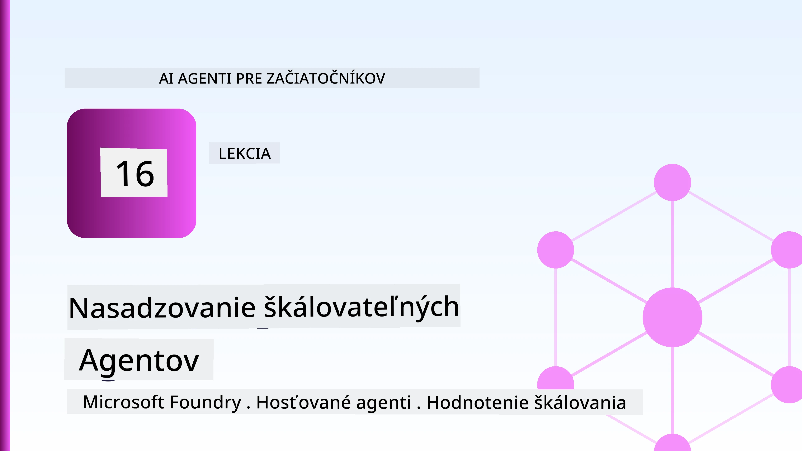
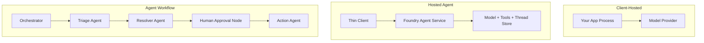
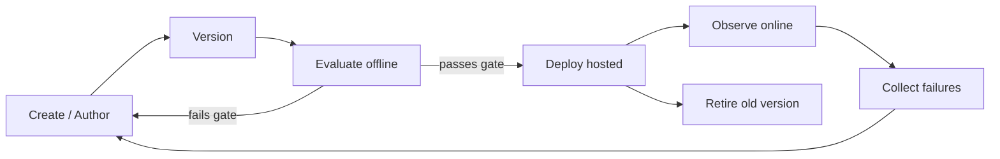
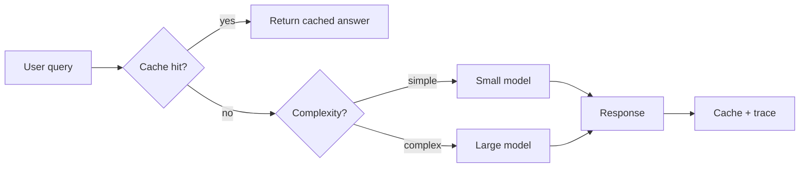
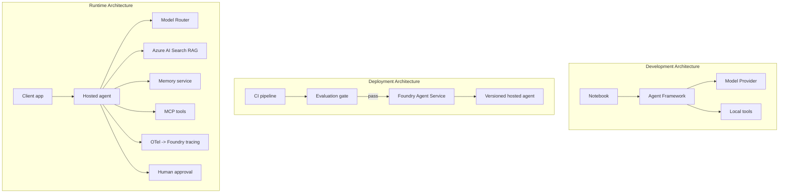

# Nasadzovanie škálovateľných agentov s Microsoft Foundry



Doteraz ste v kurze vytvorili agentov, ktorí bežia na vašom notebooku, v rámci poznámkového bloku, ovládaní `az login` a niekoľkými premennými prostredia. To je presne správny spôsob učenia. Nie je to však správny spôsob, ako prevádzkovať agenta, na ktorého spoľahne tisíce zákazníkov o 3 ráno.

Táto lekcia je o medzere medzi "funguje to na mojom stroji" a "funguje to spoľahlivo a cenovo dostupne v produkcii." Túto medzeru uzatvárame pomocou **Microsoft Foundry** a **Microsoft Foundry Agent Service**, pričom vytvárame skutočného zákazníckeho podporného agenta s nástrojmi, vyhľadávaním, pamäťou, hodnotením a monitorovaním.

## Úvod

Táto lekcia pokryje:

- Rozdiel medzi **prototypovým agentom** a **nasadeným agentom** a prečo je prechod prevažne o všetkom *okolo* modelu.
- **Vzory nasadzovania** agentov: hosťovanie na klientovi, hosťovanie služby (Hosted Agents) a orchestrácia pracovných tokov.
- **Životný cyklus agenta** na Microsoft Foundry — vytvorenie, verzovanie, nasadzovanie, hodnotenie, sledovanie, vyradenie.
- **Stratégie škálovania**: smerovanie modelu, ukladanie do cache, súbežnosť a bezstavový dizajn.
- **Pozorovateľnosť** s OpenTelemetry a sledovaním vo Foundry.
- **Optimalizácia nákladov** cez výber modelu, smerovanie a hodnotiace brány.
- **Podnikové úvahy**: správa, schvaľovanie človekom a bezpečný chod MCP serverov v produkcii.

## Ciele učenia sa

Po dokončení tejto lekcie budete vedieť:

- Vybrať správny vzor nasadzovania pre danú záťaž agenta.
- Nasadiť agenta do Microsoft Foundry Agent Service tak, aby bol verzovaný, spravovaný a pozorovateľný.
- Inštruovať agenta pre sledovanie a prepojiť hodnotiacu pipeline, ktorá beží pred každým vydaním.
- Použiť smerovanie modelov a cachovanie na udržanie latencie a nákladov pod kontrolou pri škálovaní.
- Pridať bránu ľudského schválenia pre vysoko rizikové akcie a integrovať MCP server bezpečne do produkcie.

## Predpoklady

Táto lekcia predpokladá, že ste dokončili predchádzajúce lekcie a ste oboznámení s:

- Vytváraním agentov pomocou [Microsoft Agent Framework](../14-microsoft-agent-framework/README.md) (lekcia 14).
- [Používaniu nástrojov](../04-tool-use/README.md) (lekcia 4) a [Agentic RAG](../05-agentic-rag/README.md) (lekcia 5).
- [Pamäť agenta](../13-agent-memory/README.md) (lekcia 13) a [Agentic protokoly / MCP](../11-agentic-protocols/README.md) (lekcia 11).
- [Pozorovateľnosť a hodnotenie](../10-ai-agents-production/README.md) (lekcia 10) — táto lekcia na to priamo nadväzuje.

Tiež budete potrebovať:

- **Azure predplatné** a **projekt Microsoft Foundry** s aspoň jedným nasadeným chat modelom.
- Autentifikované **Azure CLI** (`az login`).
- Python 3.12+ a balíky v repozitári [`requirements.txt`](../../../requirements.txt).

## Od prototypu k produkcii: Čo sa vlastne mení

Prototypový agent a produkčný agent zdieľajú rovnakú hlavnú slučku — zdôvodniť, volať nástroje, reagovať. Mení sa všetko okolo tejto slučky. Model tvorí možno 20 % produkčného agenta; zostávajúcich 80 % je operačný skelet.

| Oblasť | Prototyp | Produkcia |
| --- | --- | --- |
| **Hosťovanie** | Beží vo vašom poznámkovom bloku | Beží ako hosťovaná služba, verzovaná a uvádzaná do prevádzky |
| **Identita** | Váš `az login` token | Spravovaná identita s obmedzeným RBAC |
| **Stav** | V pamäti, stratí sa po reštarte | Externý (uložený priebeh v threade, pamäťová služba) |
| **Zlyhanie** | Vidíte trasovanie chyby | Opakovania, záložné plány, dead-letter, upozornenia |
| **Náklady** | „Je to pár centov“ | Sledované na požiadavku, smerované, cache-ované, rozpočtované |
| **Kvalita** | Očami hodnotíte výstup | Automaticky hodnotené pred každým vydaním |
| **Dôvera** | Schvaľujete každú akciu | Politika + človek v slučke pre rizikové akcie |

Majte túto tabuľku na pamäti. Každá nasledujúca časť sa vzťahuje k jednému z týchto riadkov.

## Vzory nasadzovania agentov

Existujú tri vzory, ktoré často použijete v kombinácii.

### 1. Agenti hosťovaní na klientovi

Agent žije v *vašom* aplikačnom procese. Váš kód volá poskytovateľa modelu priamo; slučka zdôvodňovania beží vo vašej službe. Takto to robila každá predchádzajúca lekcia.

- **Použite, keď** potrebujete plnú kontrolu nad slučkou, vlastný middleware, alebo vkladáte agenta do existujúceho backendu.
- **Kompenzácia**: ovládate škálovanie, stav a odolnosť sami.

### 2. Hosťovaní agenti (Foundry Agent Service)

Agent je *registrovaný ako zdroj* v Microsoft Foundry. Foundry hosťuje slučku zdôvodňovania, ukladá vlákna, vynucuje bezpečnosť obsahu a RBAC a robí agenta viditeľným v Foundry portáli. Vaša aplikácia sa stáva tenkým klientom, ktorý vytvára vlákna a číta odpovede.

- **Použite, keď** chcete trvácnosť, zabudovanú pozorovateľnosť, správu a menšiu prevádzkovú plochu.
- **Kompenzácia**: menej nízkoúrovňovej kontroly výmenou za spravované runtime.

### 3. Pracovné toky agentov

Viacerí agenti (a nástroje) sú zložené do grafu s explicitným riadením toku — sekvenčné kroky, vetvenie, uzly schvaľovania človekom a trvácne kontrolné body, ktoré môžu pozastaviť a pokračovať. Toto je schopnosť Microsoft Agent Framework **Workflows** aplikovaná v škálovateľnom nasadení.

- **Použite, keď** jedna úloha zahŕňa viacerých špecializovaných agentov alebo vyžaduje schvaľovací krok uprostred.
- **Kompenzácia**: viac pohyblivých častí; potrebuje pozorovateľnosť na úrovni orchestrácie.



## Životný cyklus agenta na Microsoft Foundry

Nasadenie agenta nie je jednorazová `push`. Je to slučka a veľmi pripomína cyklus vydávania softvéru, pretože to presne je.



Hlavný nápad, prevzatý z [Lekcie 10](../10-ai-agents-production/README.md): **offline hodnotenie je brána, nie dodatočná myšlienka.** Nová verzia agenta sa nepublikuje, pokiaľ neprejde vašimi hodnotiacimi prahmi. Online pozorovateľnosť potom privádza spätnú väzbu o chybách v reálnom svete do offline testovacieho súboru. To je celá slučka.

## Stratégie škálovania

Škálovanie agenta sa líši od škálovania bezstavového webového API, pretože každá požiadavka môže spustiť viacero náročných volaní modelov a nástrojov. Štyri techniky nesú väčšinu záťaže.

**Bezstavné spracovanie požiadaviek.** Neuchovávajte stav na používateľa v pamäti procesu. Ukladajte priebehy konverzácií v Foundry thread store alebo pamäťovej službe, takže akákoľvek inštancia môže spracovať akúkoľvek požiadavku. Toto vám umožňuje horizontálne škálovanie — pridajte inštancie, bez viazaných relácií.

**Smerovanie modelov.** Nie každá požiadavka potrebuje najvýkonnejší (a najdrahší) model. Jednoduché požiadavky — klasifikácia zámeru, krátke faktické odpovede — smerujte na malý, rýchly model a veľký model nechajte na skutočné zdôvodňovanie. Nájdete to v Foundry **Model Router**, alebo si implementujte jednoduchý klasifikátor sami. DIY verziu postavíte v labáku.

**Ukladanie odpovedí do cache.** Mnoho podporných otázok sú takmer duplikáty („ako si resetujem heslo?“). Ukladajte odpovede na bežné otázky a podávajte ich bez volania modelu. Aj mierna miera zásahu cache významne znižuje náklady a latenciu.

**Súbežnosť a spätný tlak.** Poskytovatelia modelov majú limity rýchlosti. Obmedzte svoju súbežnosť, použite opakovania s exponenciálnym spätným odpočtom a zlyhajte elegantne (očakávaná odpoveď „pracujeme na tom“ je lepšia než 500).



## Pozorovateľnosť v produkcii

Nemôžete prevádzkovať to, čo nevidíte. Ako bolo priblížené v lekcii 10, Microsoft Agent Framework emitované **OpenTelemetry** stopy nativne — každé volanie modelu, spustenie nástroja a orchestrácia kroku sa stáva rozsahom (span). V produkcii exportujete tieto rozsahy do Microsoft Foundry (alebo akéhokoľvek OTel-kompatibilného backendu), aby ste mohli:

- Sledovať jednu zákaznícku sťažnosť od začiatku po koniec naprieč každým volaním modelu a nástroja.
- Monitorovať p50/p95 latenciu a náklady na požiadavku v čase.
- Upozorniť na nárast chybovosti a anomálie nákladov skôr, než si to všimnú používatelia (alebo váš finančný tím).

```python
from agent_framework.observability import get_tracer

tracer = get_tracer()

with tracer.start_as_current_span("support_request") as span:
    span.set_attribute("customer.tier", "enterprise")
    span.set_attribute("routed.model", "gpt-5-nano")
    # agent execution is traced automatically inside this span
```

Atribúty ako `customer.tier` a `routed.model` premieňajú hromadu stôp na zodpovedateľné otázky („sú podnikový zákazníci príliš často smerovaní na malý model?“).

## Optimalizácia nákladov

Náklady v produkčných agentoch dominujú tokeny. Tri páky, podľa vplyvu:

1. **Pravá veľkosť modelu.** Malý model, ktorý prejde vašou hodnotiacou bránou, je takmer vždy lacnejší než veľký, ktorý tiež prejde. Použite hodnotenie na *dokázanie*, že malý model je dostatočný, namiesto predvolenia najväčšieho modelu zo zabezpečenia.
2. **Smerovanie podľa zložitosti.** Ako vyššie — platíte cenu veľkého modelu iba za požiadavky, ktoré vyžadujú jeho zdôvodnenie.
3. **Agresívne cachovanie.** Najlacnejšie volanie modelu je to, ktoré neurobíte.

Hodnotiace brány a kontrola nákladov sú tá istá disciplína pohľadaná z dvoch uhlov: hodnotenie vám hovorí *úroveň kvality*, smerovanie a cache vás držia čo najbližšie k *nákladom* tejto úrovne.

## Podnikové úvahy pri nasadzovaní

**Správa.** Hosťovaní agenti zdedia Foundry RBAC, bezpečnosť obsahu a auditovanie. Dajte každému agentovi spravovanú identitu s najnižšími oprávneniami, ktoré potrebuje – prístup len na čítanie ku znalostnej databáze, obmedzený prístup k ticketing API, nič viac.

**Človek v slučke (human-in-the-loop).** Niektoré akcie sú príliš závažné na úplnú automatizáciu – vystavenie refundácie, vymazanie účtu, eskalácia na právny tím. Microsoft Agent Framework podporuje nástroje vyžadujúce **schválenie**: agent navrhne akciu, vykonávanie sa pozastaví, človek schváli alebo zamietne a pracovný tok pokračuje. Primitív ste videli v [Lekcii 6](../06-building-trustworthy-agents/README.md); tu ho nasadíte.

**MCP v produkcii.** [MCP](../11-agentic-protocols/README.md) umožňuje vášmu agentovi používať externé nástroje cez štandardné rozhranie. V produkcii sa k MCP serverom správajte ako k nedôveryhodnej hranici: pripnite verziu servera, bežte ho so scoped identitou, validujte jeho výstupy a nikdy mu neodhalujte tajomstvá. MCP server je závislosť, a závislosti sa patchujú, auditujú a limitujú rýchlosť.



Tieto tri diagramy – vývoj, nasadenie, beh – sú ten istý agent v troch štádiách jeho života. Nasledujúci lab vás prevedie jeho stavbou.

## Praktický lab: Produkčne pripravený agent zákazníckej podpory

Otvorte [`code_samples/16-python-agent-framework.ipynb`](./code_samples/16-python-agent-framework.ipynb) a prejdite si ho od začiatku do konca. Zostavíte **Contoso agenta zákazníckej podpory** so všetkými produkčnými aspektmi:

1. **Volanie nástrojov** — vyhľadávanie stavu objednávky a otvorenie podporných tikiet.
2. **RAG** — odpovede na otázky o politike zo znalostnej databázy (Azure AI Search, s pamäťovým fallbackom, aby notebook bežal aj bez Search zdroja).
3. **Pamäť** — pamätať si zákazníka počas celého rozhovoru.
4. **Smerovanie modelov** — klasifikátor zložitosti smeruje každú požiadavku na malý alebo veľký model.
5. **Caching odpovedí** — opakované otázky sa podávajú z cache.
6. **Ľudské schválenie** — refundácie nad prahom vyžadujú ľudský súhlas.
7. **Hodnotiaca pipeline** — malý offline testovací súbor skóruje agenta a slúži ako brána vydania.
8. **Pozorovateľnosť** — OpenTelemetry sledovanie pre každú požiadavku.

### Prehľad

Notebook je usporiadaný tak, že každý produkčný aspekt je samostatná spustiteľná sekcia. Srdcom je request handler s routingom a cachovaním:

```python
async def handle_support_request(query: str, customer_id: str) -> str:
    # 1. Serve from cache when we can.
    cached = response_cache.get(normalize(query))
    if cached:
        return cached

    # 2. Route by complexity to control cost.
    model = "gpt-5-nano" if is_simple(query) else "gpt-5-mini"

    # 3. Run the agent inside a trace span for observability.
    with tracer.start_as_current_span("support_request") as span:
        span.set_attribute("routed.model", model)
        span.set_attribute("customer.id", customer_id)
        response = await support_agent.run(query, model=model)

    # 4. Cache and return.
    response_cache.set(normalize(query), response.text)
    return response.text
```

Hodnotiaca brána, ktorá chráni vydanie, vyzerá takto:

```python
async def evaluation_gate(agent, test_cases, threshold: float = 0.8) -> bool:
    passed = 0
    for case in test_cases:
        result = await agent.run(case["input"])
        if score_response(result.text, case["expected"]) >= 0.8:
            passed += 1
    pass_rate = passed / len(test_cases)
    print(f"Evaluation pass rate: {pass_rate:.0%} (gate: {threshold:.0%})")
    return pass_rate >= threshold  # only deploy if the gate passes
```

Čítajte každý riadok – notebook udržiava primitívy zámerne malé, aby nič nebolo skryté za volaním rámca.

## Validácia nasadeného agenta pomocou smoke testov

Vyššie uvedená hodnotiaca brána beží *offline* voči vášmu agentovi. Po nasadení ako Hosted Agent potrebujete ešte jednu, ešte lacnejšiu kontrolu: **naozaj endpoint reaguje?**

Úspešné nasadenie len dokazuje, že ovládacia rovina prijala definíciu – nedokazuje, že agent naozaj odpovedá. Chýbajúca závislosť, zlé smerovanie modelu alebo vypršané spojenie môžu zanechať zelené nasadenie, ktoré nevracia nič. **Smoke test** to zachytí za sekundy, pri každom deployi, bez nákladov na plné hodnotenie.

Tento repozitár obsahuje pripravený smoke-test pipeline postavený na [AI Smoke Test](https://github.com/marketplace/actions/ai-smoke-test) GitHub Action:

- **Katalóg** — [`tests/lesson-16-smoke-tests.json`](../../../tests/lesson-16-smoke-tests.json) obsahuje promptov a tvrdení pre agenta Contoso support (answery založené na politike, vyhľadávanie objednávky, zostávanie na téme, priebeh multi-turn konverzácie). Katalógy pre agentov iných lekcií sú vedľa neho – pozrite [`tests/README.md`](../tests/README.md).
- **Pracovný tok** — [`.github/workflows/smoke-test.yml`](../../../.github/workflows/smoke-test.yml) sa prihlasuje pomocou Azure OIDC a POSTne každý prompt na endpoint agentových odpovedí, zlyháva pri akomkoľvek nesplnení tvrdenia.

```yaml
- name: Smoke-test hosted agent
  uses: JFolberth/ai-smoketest@v1
  with:
    project_endpoint: ${{ inputs.project_endpoint }}
    agent_name: ContosoSupportAgent
    tests_file: tests/lesson-16-smoke-tests.json
```

Spustite to z karty **Actions** po nasadení agenta a zadajte koncový bod projektu Foundry a názov agenta. Federovaná identita potrebuje rolu **Azure AI User** v rámci projektu Foundry. Predstavte si vrstvy ako pyramídu: dymové testy (dosiahnuteľný a odpovedá?) sa spúšťajú pri každom nasadení, offline hodnotenie (je dostatočne dobrý na vydanie?) sa vykonáva pred povýšením a online hodnotenie (ako sa darí v praxi?) prebieha nepretržite.

## Kontrola vedomostí

Otestujte si svoje porozumenie pred prechodom k zadaniu.

**1. Približne koľko produkčného agenta tvorí "model" a čo je zvyšok?**

<details>
<summary>Odpoveď</summary>

Model je menšinou systému — často sa uvádza približne 20%. Zvyšok tvorí operačný skelet: hosťovanie a verzovanie, identita a RBAC, externalizovaný stav, riešenie chýb, sledovanie nákladov, hodnotenie a kontroly s človekom v slučke. Presun do produkcie je hlavne o vybudovaní všetkého *okolo* slučky uvažovania.
</details>

**2. Kedy by ste si vybrali Hosted Agenta namiesto klientsky hosťovaného agenta?**

<details>
<summary>Odpoveď</summary>

Keď chcete spravované prostredie s vstavanej odolnosťou (vlákna, ktoré pretrvávajú a môžu pokračovať), pozorovateľnosťou, bezpečnosťou obsahu a RBAC a ste ochotní vymeniť určitú nízkoúrovňovú kontrolu slučky uvažovania za menšiu prevádzkovú zložitosť. Klientsky hosťovaný je vhodnejší, keď potrebujete úplnú kontrolu nad slučkou alebo agent embedujete do existujúceho backendu.
</details>

**3. Prečo musí byť škálovateľný agent bezstavový v pamäti vlastného procesu?**

<details>
<summary>Odpoveď</summary>

Takže ktorákoľvek inštancia môže spracovať akúkoľvek požiadavku, čo umožňuje horizontálne škálovanie bez viazaných relácií. Stav konverzácie pre používateľa je externalizovaný do úložiska vlákien alebo pamäťovej služby. Ak by stav žil v pamäti procesu, stratili by ste ho pri reštarte a nemohli by ste voľne distribuovať zaťaženie.
</details>

**4. Aký problém rieši smerovanie modelu a ako súvisí s hodnotením?**

<details>
<summary>Odpoveď</summary>

Smerovanie posiela jednoduché požiadavky malému, lacnému a rýchlemu modelu a rezervuje veľký model pre skutočné uvažovanie, čím kontroluje latenciu aj náklady. Súvisí to s hodnotením, pretože hodnotenie je to, čo *dokazuje*, že malý model je dostatočný pre danú triedu požiadaviek — smerovanie bez hodnotenia je hádanie.
</details>

**5. Čo je „evaluačná brána“ a kde sa nachádza v životnom cykle?**

<details>
<summary>Odpoveď</summary>

Evaluačná brána spúšťa offline testovú sadu proti novej verzii agenta a blokuje nasadenie, pokiaľ miera úspechu neprekročí prah. Nachádza sa medzi „verziou“ a „nasadením“ v životnom cykle, čo robí kvalitu podmienkou uvoľnenia namiesto niečoho, čo kontrolujete až po vydaní.
</details>

**6. Prečo by sa mal MCP server v produkcii považovať za nedôveryhodnú hranicu?**

<details>
<summary>Odpoveď</summary>

Pretože je to externá závislosť, na ktorú agent volá. Mali by ste pripnúť jeho verziu, spúšťať ho s obmedzenou identitou, validovať jeho výstupy, obmedzovať jeho frekvenciu volaní a nikdy mu nezverejňovať tajomstvá — rovnaká disciplína ako pri akejkoľvek tretej strane. Jeho výstupy vstupujú do uvažovania agenta, takže neverená dôvera je bezpečnostné riziko.
</details>

**7. Ktorá jednotná zmena zvyčajne najviac ovplyvňuje náklady produkčného agenta a prečo?**

<details>
<summary>Odpoveď</summary>

Správne zvolenie veľkosti modelu — použitie najmenšieho modelu, ktorý stále prejde vašou hodnotiacou bránou. Náklady dominujú tokeny a menší model, ktorý splní kvalitatívny prah, je takmer vždy lacnejší ako väčší. Ukladanie do medzipamäte a smerovanie ďalšie náklady ešte znižujú, no výber správneho základného modelu má najväčší prvotný efekt.
</details>

**8. Akú úlohu zohrávajú atribúty rozsahu ako `customer.tier` a `routed.model` v pozorovateľnosti?**

<details>
<summary>Odpoveď</summary>

Premieňajú surové stopy na zodpovedateľné obchodné otázky. Bez atribútov máte múr rozsahov; s nimi sa môžete spýtať „sú firemní zákazníci príliš často smerovaní na malý model?“ alebo „ktorý model spracováva naše najpomalšie požiadavky?“ Atribúty umožňujú deliť telemetriu podľa dimenzií, ktoré sú pre vašu prevádzku kľúčové.
</details>

## Zadanie

Vezmite zákazníckeho podporného agenta z laboratória a tvrdo ho zabezpečte pre konkrétny scenár: **podporný agent pre fakturáciu predplatného pre SaaS spoločnosť.**

Vaša odovzdaná práca by mala:

1. **Nahradiť nástroje** nástrojmi relevantnými pre fakturáciu: `get_subscription_status`, `get_invoice` a `issue_credit` (kredity nad 50 vyžadujú schválenie človekom).
2. **Pridať tri RAG dokumenty** pokrývajúce firemnú politiku vrátenia peňazí, fakturačný cyklus a storno politiku.
3. **Rozšíriť hodnotiacu sadu** na aspoň osem prípadov, vrátane aspoň dvoch, ktoré *by mali* spustiť cestu schválenia človekom, a potvrdiť, že vaša evaluačná brána správne prejde alebo zlyhá.
4. **Pridať jednu správu o nákladoch**: po spustení desiatich zmiešaných dopytov cez agenta vytlačte, koľko bolo smerovaných do malého modelu, koľko do veľkého modelu a koľko bolo podaných z medzipamäte.

Napíšte krátky odsek (v markdown bunke) vysvetľujúci, ktoré pravidlo smerovania modelu ste zvolili a ako by ste ho validovali na reálnom zaťažení. Neexistuje jediná správna odpoveď — hodnotené je, či sú produkčné špecifiká zmysluplne prepojené.

## Zhrnutie

V tejto lekcii ste presunuli agenta z prototypu do produkcie pomocou Microsoft Foundry:

- Skok do produkcie je hlavne o **operačnom skelete** okolo modelu — hosťovaní, identite, stave, riešení chýb, nákladoch, kvalite a dôvere.
- Naučili ste sa tri **vzory nasadenia** — klientsky hosťovaný, Hosted Agenti a Agent Workflows — a kedy ktorý využiť.
- Prešli ste **životným cyklom agenta**, kde offline **hodnotenie funguje ako uvoľňovacia brána** a online pozorovateľnosť vracia zlyhania späť do testovacej sady.
- Aplikovali ste **stratégie škálovania** — bezstavový dizajn, smerovanie modelov, caching a obmedzenú súbežnosť — a prepojili ich s **optimalizáciou nákladov**.
- Zapojili ste **firemné kontroly**: RBAC, schválenie človekom v slučke a produkčne bezpečnú integráciu MCP.
- Vybudovali ste **produkčne pripraveného zákazníckeho podporného agenta**, ktorý spája všetky tieto aspekty v bežnom kóde.

Nasledujúca lekcia ide opačným smerom: namiesto škálovania agentov do cloudu ich *stiahnete* na jeden vývojársky počítač a spustíte lokálne.

## Dodatočné zdroje

- <a href="https://learn.microsoft.com/azure/ai-foundry/what-is-azure-ai-foundry" target="_blank">Dokumentácia Microsoft Foundry</a>
- <a href="https://learn.microsoft.com/azure/ai-foundry/agents/overview" target="_blank">Prehľad služby Microsoft Foundry Agent Service</a>
- <a href="https://learn.microsoft.com/en-us/agent-framework/overview/?wt.mc_id=youtube_26688_organicsocial_reactor&pivots=programming-language-python" target="_blank">Microsoft Agent Framework</a>
- <a href="https://learn.microsoft.com/en-us/azure/ai-foundry/openai/concepts/model-router" target="_blank">Model Router v Microsoft Foundry</a>
- <a href="https://learn.microsoft.com/azure/search/search-what-is-azure-search" target="_blank">Azure AI Search</a>
- <a href="https://opentelemetry.io/" target="_blank">OpenTelemetry</a>
- <a href="https://github.com/marketplace/actions/ai-smoke-test" target="_blank">AI Smoke Test GitHub Action</a>
- <a href="https://modelcontextprotocol.io/" target="_blank">Model Context Protocol (MCP)</a>

## Predchádzajúca lekcia

[Budovanie agentov na používanie počítača (CUA)](../15-browser-use/README.md)

## Nasledujúca lekcia

[Vytváranie lokálnych AI agentov](../17-creating-local-ai-agents/README.md)

---

<!-- CO-OP TRANSLATOR DISCLAIMER START -->
**Vyhlásenie o zodpovednosti**:
Tento dokument bol preložený pomocou AI prekladateľskej služby [Co-op Translator](https://github.com/Azure/co-op-translator). Hoci sa snažíme o presnosť, vezmite prosím na vedomie, že automatické preklady môžu obsahovať chyby alebo nepresnosti. Pôvodný dokument v jeho natívnom jazyku by mal byť považovaný za autoritatívny zdroj. Pre kritické informácie sa odporúča profesionálny ľudský preklad. Nie sme zodpovední za žiadne nedorozumenia alebo nesprávne interpretácie vyplývajúce z použitia tohto prekladu.
<!-- CO-OP TRANSLATOR DISCLAIMER END -->