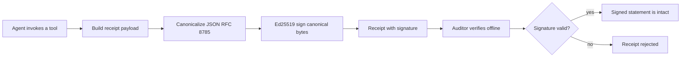
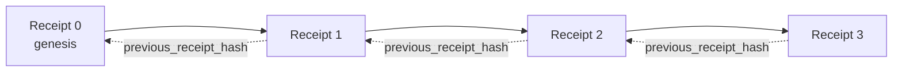

[Pozrite si video lekcie: Zabezpečenie AI agentov pomocou kryptografických potvrdení](https://youtu.be/PLACEHOLDER_VIDEO_ID)

> _(Video lekcie a miniatúra budú pridané tímom Microsoft na obsah po zlúčení, v súlade s vzorom lekcií 14 / 15.)_

# Zabezpečenie AI agentov pomocou kryptografických potvrdení

## Úvod

Táto lekcia pokryje:

- Prečo sú auditné stopy pre AI agentov dôležité pre súlad, ladenie a dôveru.
- Čo je to kryptografické potvrdenie a ako sa líši od nepodpísaného záznamu v protokole.
- Ako vytvoriť podpísané potvrdenie pre volanie nástroja agenta v bežnom Pythone.
- Ako overiť potvrdenie offline a zistiť manipuláciu.
- Ako reťaziť potvrdenia tak, aby odstránenie alebo preusporiadanie jedného prerušilo reťazec.
- Čo potvrdenia dokazujú a čo výslovne nepreukazujú.

## Ciele učenia

Po dokončení tejto lekcie budete vedieť:

- Identifikovať režimy zlyhania, ktoré motivujú kryptografický pôvod akcií agenta.
- Vytvoriť Ed25519-podpísané potvrdenie s kanonickým JSON obsahom.
- Nezávisle overiť potvrdenie iba pomocou verejného kľúča podpisovateľa.
- Zistiť manipuláciu opätovným overením modifikovaného potvrdenia.
- Vytvoriť hash-reťazený rad potvrdení a vysvetliť, prečo je reťazec dôležitý.
- Rozpoznať hranicu medzi tým, čo potvrdenia dokazujú (pripísanie, integrita, usporiadanie) a tým, čo nepreukazujú (správnosť akcie, správnosť politiky).

## Problém: Auditná stopa vášho agenta

Predstavte si, že ste nasadili AI agenta pre Contoso Travel. Agent číta požiadavky zákazníkov, volá API letov na vyhľadávanie možností a rezervuje miesta za zákazníka. Minulý štvrťrok agent vybavil 50 000 rezervácií.

Dnes prichádza audítor. Položí jednoduchú otázku: „Ukážte mi, čo váš agent urobil.“

Podáte mu svoje logy. Audítor ich prezerá a položí ťažšiu otázku: „Ako viem, že tieto logy neboli upravené?“

Toto je problém auditnej stopy. Väčšina nasadení agentov dnes spolieha na:

- **Aplikačné logy**: píše ich priamo agent, upravovať ich môže ktokoľvek s prístupom k súborovému systému.
- **Cloudové služby logovania**: odhalenie manipulácie na úrovni platformy, ale iba ak audítor dôveruje poskytovateľovi platformy.
- **Transakčné logy databázy**: vhodné pre zmeny v databáze, ale nie na ľubovoľné volania nástrojov.

Žiaden z týchto zdrojov nemôže odpovedať na otázku audítora bez toho, aby audítor niekomu dôveroval (vám, vášmu cloudovému poskytovateľovi, predajcovi databázy). Pre vnútorné použitie je taká dôvera často prijateľná. Pre regulované pracovné zaťaženia (financie, zdravotníctvo, čokoľvek podliehajúce zákonu o AI EÚ) nie je.

Kryptografické potvrdenia zužujú tento problém vytvorením podpísaného vyhlásenia, ktoré je nezávisle overiteľné. Audítor stále potrebuje dôvod mimo pásma na dôveru podpisovému kľúču a komponentu, ktorý vyhlásenie vytvoril. Zabudovaný kľúč dokazuje samokonzistenciu, nie totožnosť vydavateľa alebo umiestnenie presadzovania.


## Čo je kryptografické potvrdenie?

Potvrdenie je JSON objekt, ktorý zaznamenáva, čo agent vykonal, podpísaný digitálnym podpisom.



Minimálne potvrdenie vyzerá takto:

```json
{
  "type": "agent.tool_call.v1",
  "agent_id": "contoso-travel-bot",
  "tool_name": "lookup_flights",
  "tool_args_hash": "sha256:a3f9c1...",
  "result_hash": "sha256:7b2e1d...",
  "policy_id": "contoso-travel-policy-v3",
  "timestamp": "2026-04-25T14:30:00Z",
  "sequence": 47,
  "previous_receipt_hash": "sha256:9d4e6a...",
  "signature": {
    "alg": "EdDSA",
    "sig": "c5af83...",
    "public_key": "8f3b2c..."
  }
}
```

Tri vlastnosti vykonávajú prácu:

1. **Podpis**. Potvrdenie je podpísané bránou agenta pomocou súkromného kľúča Ed25519. Ktokoľvek s príslušným verejným kľúčom môže podpísaný text offline overiť. Dôverujúca strana musí tento kľúč pripevniť (pin) alebo získať z dôveryhodného registra mimo potvrdenia. Akákoľvek manipulácia s podpísaným poľom neplatí podpis.

2. **Kanónické kódovanie**. Pred podpisom je potvrdenie serializované pomocou JSON Canonicalization Scheme (JCS, RFC 8785). To zaručuje, že dve implementácie, ktoré produkujú rovnaký logický obsah potvrdenia, vytvoria identický bajtový výstup. Bez kanonizácie by rôzne JSON serializátory vygenerovali rôzne podpisy pre rovnaký obsah.

3. **Hashové reťazenie**. Pole `previous_receipt_hash` spája každé potvrdenie s predchádzajúcim. Odstránenie alebo preusporiadanie potvrdenia prerušuje prezentovanú sekvenciu. Na zistenie skracovania alebo prepísania kontrolovaného podpisovateľom je tiež potrebné pevné aktuálne hlavičky reťazca, nezávislo svedčené kontrolné body alebo autentifikovaný záväzok zatvorenej populácie.

Spoločne tieto vlastnosti poskytujú tri záruky:

- **Pripísanie kľúču**: tento kľúč podpísal tento obsah. Organizačná alebo ľudská identita vyžaduje dôveryhodné viazanie kľúča.
- **Integrita**: obsah sa od podpisu nezmenil.
- **Usporiadanie v rámci overenej sekvencie**: toto potvrdenie sa odvoláva na predchádzajúce.

## Vytváranie potvrdenia v Pythone

Na vytvorenie potvrdenia nepotrebujete špeciálnu knižnicu. Kryptografické primitíva sú široko dostupné a logika je len pár desiatok riadkov Pythonu.

Praktické cvičenia v `code_samples/18-signed-receipts.ipynb` prejdú celý postup. Zdrojovo riadený `code_samples/18-signed-receipts.execution-receipt.json` zaznamenáva presný hash poznámkového bloku, Python prostredie, počet buniek a kontroly z posledného čistého spustenia bez zmeny uložených výstupov lekcie. Súhrnná verzia:

```python
import json
import hashlib
import base64
from nacl import signing
from jcs import canonicalize  # RFC 8785 canonical JSON

def b64url_nopad(data: bytes) -> str:
    return base64.urlsafe_b64encode(data).decode("ascii").rstrip("=")

def sha256_canonical(obj) -> str:
    """SHA-256 of a Python object's JCS-canonical JSON form."""
    return f"sha256:{hashlib.sha256(canonicalize(obj)).hexdigest()}"

# Generate or load a signing key (in production, store in a key vault)
signing_key = signing.SigningKey.generate()
verify_key = signing_key.verify_key
TRUSTED_PUBLIC_KEYS = {b64url_nopad(bytes(verify_key))}  # pinned out of band by the verifier

# Build the receipt payload (no signature yet)
tool_args = {"origin": "SYD", "destination": "LAX"}
tool_result = [{"flight": "QF11", "price": 1850, "stops": 0}]

payload = {
    "type": "agent.tool_call.v1",
    "agent_id": "contoso-travel-bot",
    "tool_name": "lookup_flights",
    "tool_args_hash": sha256_canonical(tool_args),
    "result_hash": sha256_canonical(tool_result),
    "policy_id": "contoso-travel-policy-v3",
    "timestamp": "2026-04-25T14:30:00Z",
    "sequence": 0,
    "previous_receipt_hash": None,
}

# Canonicalize and sign the JCS bytes directly. PureEdDSA hashes internally.
canonical_bytes = canonicalize(payload)
signature_bytes = signing_key.sign(canonical_bytes).signature

# Attach a structured signature object.
receipt = {
    **payload,
    "signature": {
        "alg": "EdDSA",
        "sig": b64url_nopad(signature_bytes),
        "public_key": b64url_nopad(bytes(verify_key)),
    },
}
```

To je celý podpisovací proces. Cvičenia v poznámkovom bloku prechádzajú každý krok.

## Overovanie potvrdenia a detekcia manipulácie

Overovanie je opačný proces:

```python
import base64
import hashlib
from nacl import signing
from nacl.exceptions import CryptoError
from jcs import canonicalize

def b64url_decode(s: str) -> bytes:
    # Strict: Python's decoder skips characters outside the alphabet and also
    # accepts padding, the standard +/ alphabet and non-zero spare bits.
    # Re-encoding and comparing accepts only the one unpadded base64url form.
    padding = "=" * ((4 - len(s) % 4) % 4)
    data = base64.urlsafe_b64decode(s + padding)
    if base64.urlsafe_b64encode(data).decode("ascii").rstrip("=") != s:
        raise ValueError("not canonical unpadded base64url")
    return data

def verify_receipt(receipt: dict, trusted_public_key: str) -> bool:
    # trusted_public_key is the issuer's key, obtained from somewhere other
    # than this receipt. Never use receipt["signature"]["public_key"] here:
    # see "What Receipts Prove (and What They Do Not)" below.
    # Fails closed: anything malformed returns False instead of raising.
    if not isinstance(receipt, dict) or not isinstance(trusted_public_key, str):
        return False
    sig_obj = receipt.get("signature")
    if not isinstance(sig_obj, dict) or sig_obj.get("alg") != "EdDSA":
        return False
    sig_b64 = sig_obj.get("sig")
    if not isinstance(sig_b64, str):
        return False

    try:
        # Reconstruct the payload that was actually signed (everything except signature).
        payload = {k: v for k, v in receipt.items() if k != "signature"}
        canonical_bytes = canonicalize(payload)
        verify_key = signing.VerifyKey(b64url_decode(trusted_public_key))
        verify_key.verify(canonical_bytes, b64url_decode(sig_b64))
        return True
    except (CryptoError, TypeError, ValueError, KeyError, OverflowError):
        return False
    except Exception:
        # An undecodable key or signature, or a payload that cannot be
        # canonicalized: fail closed rather than raise.
        return False
```

Táto funkcia prijíma potvrdenie a verejný kľúč vydavateľa a vracia `True`, ak je podpis platný, a `False` inak, vrátane prípadu, keď je vstup neplatný. Žiadne sieťové volanie ani overovacia služba: ak máte kľúč vydavateľa, overovanie je úplne lokálne a offline. Stále však potrebujete tento kľúč, získaný z miesta mimo potvrdenia.

Na demo detekcie manipulácie poznámkový blok prechádza:

1. Vytvorenie platného potvrdenia a potvrdenie, že sa dá overiť.
2. Úprava jedného bajtu v poli `tool_args_hash`.
3. Opätovné overenie s neúspešným výsledkom.
4. Opätovná manipulácia, ale tentokrát opätovným podpisom kľúčom, ktorý za útočníka vytvoril a vložil do potvrdenia.

Krok 4 je dôležitý. Toto potvrdenie je interné konzistentné: jeho podpis je pravý pre jeho obsah a pre kľúč, ktorý nesie, a overuje sa podľa tohto kľúča. Nezlyhá, iba keď ho skontrolujete podľa skutočného kľúča vydavateľa. Kroky 2 a 3 odhalia útočníka, ktorý si nedal tú námahu opätovne podpísať; krok 4 odhalí toho, ktorý áno.

Toto je praktická demonštrácia, že potvrdenia sú odhaliteľné na manipuláciu: akákoľvek zmena podpísaného poľa zruší podpis, pokiaľ overujete podľa kľúča, ktorý útočník nedodal. Objekt `signature` sám je mimo podpísaných bajtov, preto musí byť kľúč na overenie niekde inde ako v potvrdení.

## Reťazenie potvrdení pre viacstupňových agentov

Jedno podpísané potvrdenie chráni jednu akciu. Reťaz potvrdení chráni sekvenciu.



Každé potvrdenie zaznamenáva hash predchádzajúceho potvrdenia. Na tiché odstránenie potvrdenia 2 by útočník musel buď:

- Zmeniť pole `previous_receipt_hash` v potvrdení 3 (čo zruší podpis na potvrdení 3), ALEBO
- Vyrobiť nový podpis na upravenom potvrdení 3 (čo vyžaduje súkromný kľúč agenta).

Ak je súkromný kľúč uložený v hardvérovej kľúčovej schránke a overovatelia kontrolujú každé potvrdenie proti verejnému kľúču vydavateľa, získanému nezávisle (napríklad z publikovaného JWK Setu alebo pevne nastavenou konfiguračnou hodnotou), ani jeden útok nie je bez odhalenia realizovateľný. Publikovanie kľúča v každom potvrdení nestačí: útočník môže pre-podpísať vlastným kľúčom a vložiť ho namiesto toho, čo je ukážka `04_resigned_receipt.json`.

Poznámkový blok prechádza:

1. Vytvorenie reťaze troch potvrdení.
2. Overenie, že pole `previous_receipt_hash` každého potvrdenia zodpovedá skutočnému hashu predchádzajúceho potvrdenia.
3. Manipuláciu jedného potvrdenia uprostred a zobrazenie prerušenia reťazca práve v tomto bode.

Takto vytvoríte auditnú stopu, ktorú môže externý audítor overiť pomocou svojich vlastných pripnutých vydavateľských kľúčov a kontrolných bodov reťazca, bez dôvery k vašej meniteľnej databáze protokolov.


## Čo potvrdenia dokazujú (a čo nie)

Toto je najdôležitejšia časť tejto lekcie. Potvrdenia sú silné, ale ich sila je obmedzená.

**Potvrdenia dokazujú tri veci:**

1. **Pripísanie**: konkrétny kľúč podpísal konkrétny obsah.
2. **Integrita**: obsah sa od podpisu nezmenil.
3. **Usporiadanie v prezentovanej, overenej sekvencii**: toto potvrdenie sa odvoláva na predchádzajúce.

**Potvrdenia NEdokazujú:**

1. **Správnosť**: že akcia agenta bola správna. Potvrdenie môže podpísať nesprávnu odpoveď rovnako ľahko ako správnu.
2. **Súlad s politikou**: že politika uvedená v `policy_id` bola naozaj vyhodnotená, alebo že by povolila túto akciu, ak by bola skontrolovaná. Potvrdenie zaznamenáva, čo bolo tvrdené, nie čo bolo vynútené.
3. **Identita nad rámec kľúča**: potvrdenie hovorí „tento kľúč podpísal tento obsah.“ Nehovorí „tento človek autorizoval toto.“ Spojenie kľúča s osobou alebo organizáciou vyžaduje samostatnú infraštruktúru identity (adresár, register verejných kľúčov atď.).
4. **Pravdivosť vstupov**: ak agent dostane zmanipulovaný prompt a vykoná akciu, potvrdenie verne zaznamenáva akciu. Potvrdenia sú podmienené validáciou vstupov, nie jej náhradou.
5. **Vykonanie alebo reálny svetový efekt**: potvrdenie po volaní zaznamenáva, čo jeho vydavateľ tvrdí, že sa stalo. Dokazovanie prijatia alebo zhodnotenie externého efektu vyžaduje dôkazy od skutočného vykonávateľa alebo hranice poskytovateľa.
6. **Kompletnosť**: chýbajúce potvrdenie môže znamenať zablokovanie, vynechanie, stratu alebo neinstrumentáciu. Absencia je dôkazom len vo vnútri autentifikovanej uzavretej populácie.
7. **Dôveryhodný čas**: podpísané časové pečiatky dokazujú, že podpisovateľ niesol tú hodnotu, nie že hodnota bola správna. Dôveryhodný čas vyžaduje samostatný časový autorit a svedčený kontrolný bod.

**Kľúč v potvrdení nie je ten, s ktorým sa overuje.** To vyplýva z bodu 3 a je to jediný prípad, kde musí táto odlišnosť zmeniť váš kód, nie vaše chápanie. `public_key` v príklade vyššie je tam kvôli tomu, aby bol príklad samostatný. Overovateľ ho nikdy nesmie dôverovať. Ktokoľvek môže potvrdenie zobrať, upraviť, opätovne podpísať kľúčom, ktorý vytvoril, a vložiť tento kľúč; výsledok sa overí perfektne sám proti sebe. To je ukážka fixture `04_resigned_receipt.json` v `sample_receipts/` a dôvod, prečo vyššie uvedená funkcia `verify_receipt` prijíma kľúč ako argument, namiesto čítania z potvrdenia. Kľúč vydavateľa získajte nezávisle, z JWK Setu v Produkčnom zozname kontrol nižšie alebo z iného vopred pripnutého kotevného bodu, a overujte podľa neho. Podpis overený podľa kľúča, ktorý prišiel v rovnakom obale, dokazuje len to, že obal je samosprávny.

Táto hranica je dôležitá z dvoch dôvodov:

- Povie vám, na čo sú potvrdenia užitočné: spravovať správanie agentov auditovateľným a odhaliteľným na manipuláciu, dokonca aj cez organizačné hranice.
- Povie vám, ktoré ďalšie vrstvy stále potrebujete: validáciu vstupov (lekcia 6), presadzovanie politík (stručne nižšie) a infraštruktúru identity (mimo rozsahu tejto lekcie).

Bežnou chybou je predpokladať, že „máme potvrdenia“ znamená „sme spravovaní.“ Nie je to tak. Potvrdenia sú základ. Správa je systém, ktorý na nich staviate.

## Viazanie podpisu schvaľovateľa na presnú akciu

Bod 3 vyššie stojí za samostatnú sekciu: potvrdenie akcie hovorí „tento kľúč podpísal tento obsah,“ nikdy „človek toto autorizoval.“ Pre akcie s vysokým rizikom (refundácie, mazanie, prevody peňazí) môže samostatný podpis schvaľovateľa zviazať presnú akciu. Spojenie tohto kľúča s človekom a kontrola prítomnosti človeka sú samostatné zodpovednosti.

Následný poznámkový blok `code_samples/human-authorization-receipts.ipynb` pridáva druhý druh potvrdenia, `human.approval.v1`, v rovnakom tvare obalu ako potvrdenia z lekcie (typovaný obsah podpísaný Ed25519 cez jeho kanonické JCS bajty s objektom `signature` mimo podpísaných bajtov). Kľúč schvaľovateľa podpisuje **plnú kanonickú akciu a jej digest**; kľúč agenta podpisuje tvrdenie nesúce **ten istý digest akcie** a `parent_approval_ref`, `receipt_hash` schválenia, rovnaký konvenciou ako `previous_receipt_hash` v reťazci, ktorý ste si vyššie vytvorili. Jeden `verify_chain` spracováva oba artefakty pod **samostatnými pripnutými registrami kľúčov** (kľúče schvaľovateľov vs kľúče agentov), takže kódová cesta je zdieľaná, ale právomoci nikdy nie.

Vlastnosť, ktorú to poskytuje, starostlivo uvedená: *pripnutý kľúč schvaľovateľa podpísal túto presnú
akciu a kľúč agenta neskôr podpísal vyhlásenie nesúce ten istý digest akcie.*
To je užitočný dôkaz, ale samo o sebe to nie je dôkaz, že akcia bola vykonaná. Na
kontrolu vykonania musí byť presné schválenie rezervované a spotrebované raz na
skutočnej hranici vykonávateľa; neznáme výsledky poskytovateľa musia zostať neznáme, nie
slepo opakované. Odporné testy v poznámkovom bloku skúšajú vrstvu reťazca potvrdení:

- manipuláciu, zmätenú službu, sfalšované kľúče na oboch stranách a neplatný vstup;
- **neaktuálnu právomoc**: podpis, ktorý stále prechádza overením, ale odmietnutý, pretože sa verzia politiky posunula, kľúč schvaľovateľa bol vymazaný z pripnutého registra alebo schválenie vypršalo pred zadaným časom overenia;
- **zámenu digestu**: platne podpísané potvrdenie akcie smerujúce na *skutočné* schválenie viažuce *inú* kanonickú akciu.

Každé zlyhanie odkladá s odlišným dôvodom, takže audítor čítajúci odmietnutie môže povedať, či právomoc vypršala alebo sa tvrdená akcia zmenila. Overenie je len na čítanie a opakovateľné: nekonzumuje schválenie ani nevolá poskytovateľa. Samostatný vykonávateľ potrebuje odolnú, atómovú ochranu proti opakovaniu a explicitné úspešné, neúspešné a neurčité výsledky. Potvrdenie schválenia človekom je edukačná kompozícia definovaná touto lekciou, nie typ potvrdenia definovaný `draft-farley-acta-signed-receipts`.

## Produkčné odkazy

Python kód v tejto lekcii je zámerne minimálny, aby ste mohli prečítať každý riadok a presne pochopiť, čo sa deje. V produkcii máte dve možnosti:

1. **Budujte priamo na kryptografických primitívach.** Tých 50 riadkov, ktoré ste videli vyššie, je postačujúcich pre mnoho prípadov použitia. PyNaCl (Ed25519) a balík `jcs` (kanonický JSON) sú dobre udržiavané a auditované knižnice.

2. **Použite produkčnú knižnicu pre potvrdenia.** Niekoľko open-source projektov implementuje rovnaký vzor s ďalšími funkciami (rotácia kľúčov, hromadná verifikácia, distribúcia JWK Set, integrácia s politikovými enginmi):
   - Rúrka podpisu používa konvencie JCS a rozsahu podpisu v nezávislom IETF Internet-Drafte ([`draft-farley-acta-signed-receipts`](https://datatracker.ietf.org/doc/draft-farley-acta-signed-receipts/), revízia 02). Ploché vzdelávacie potvrdenie z tejto lekcie sa líši od `{payload, signature}` obálky draftu a nie je prezentované ako konformná implementácia. Draft vydáva zdieľanú testovaciu sadu zhody ([agent-governance-testvectors](https://github.com/ScopeBlind/agent-governance-testvectors)) pre implementácie zamerané na jeho formát.
   - Microsoft Agent Governance Toolkit skladá potvrdenia s rozhodnutiami na báze Cedar; pozrite si Tutorial 33 v tom repozitári pre kompletný príklad.
   - Balíky `protect-mcp` (npm) a `@veritasacta/verify` (npm) poskytujú implementáciu podpisovania potvrdení a offline verifikácie v Node, určenú na zabalenie akéhokoľvek MCP servera do nezmeniteľného audítorského záznamu, vrátane režimu držania na podspísanie, kde pozastavená akcia vydáva schvaľovacie potvrdenie viazané na digest akcie (WebAuthn podporovaný v desktopovom režime), rovnaký vzor schvaľovacieho potvrdenia ako ľudský autorizačný zápisník vyššie.
   - **[nobulex](https://github.com/arian-gogani/nobulex)** Python SDK (`pip install nobulex`) poskytuje rovnaký vzor podpisu Ed25519 + JCS v Pythone s integráciami LangChain a CrewAI, vrátane zverejnených testovacích vektorov naprieč overovaním a mapovania zhody prispievaného cez [OWASP PR #2210](https://github.com/OWASP/CheatSheetSeries/pull/2210).
   - **[EMILIA Protocol](https://github.com/emiliaprotocol/emilia-protocol)** poskytuje doplnkovú vrstvu presného vynucovania akcií: offline-verifikovateľné schvaľovacie potvrdenia, ukotvená WebAuthn alebo kvórum autority, jednorazová spotreba na hranici vykonávateľa a explicitná cesta pre neurčitý výsledok. Jeho rámcové adaptéry považujú potvrdenie za nevyhnutný dôkaz namiesto dôkazu, že externý efekt nastal.

Rozhodnutie medzi vlastným riešením a knižnicou je podobné rozhodnutiu medzi písaním vlastnej JWT knižnice a použitím testovanej: oba prístupy sú rozumné; knižnica šetrí čas a znižuje povrch auditu; od začiatku núti porozumieť každej primitíve. Táto lekcia učí cestu od začiatku, takže máte základy pre obe možnosti.

## Overenie vedomostí

Otestujte svoje porozumenie pred prechodom na cvičenie.

**1. Potvrdenie je podpísané súkromným Ed25519 kľúčom agenta. Audítor má iba verejný kľúč. Môže audítor overiť potvrdenie offline?**

<details>
<summary>Odpoveď</summary>

Áno, kryptografická verifikácia vyžaduje iba verejný kľúč a podpísané bajty. 
Audítor musí stále nezávisle získať a ukotviť akceptovaný verejný kľúč mimo potvrdenia.
Po nastavení dôvery nie je potrebný žiadny sieťový hovor.
</details>

**2. Útočník modifikuje pole `policy_id` v potvrdení, aby tvrdil, že bolo riadené povolujúcejšou politikou. Podpis bol nad pôvodným obsahom. Čo sa stane počas verifikácie?**

<details>
<summary>Odpoveď</summary>

Verifikácia zlyhá. Podpis bol vypočítaný nad kanonickými bajtmi pôvodného obsahu; zmena akéhokoľvek poľa obsahu mení tieto bajty, čo robí podpis neplatným. Útočník by potreboval súkromný kľúč na vyprodukovanie nového platného podpisu, čo nemá.
</details>

**3. Prečo potvrdenie obsahuje `tool_args_hash` a `result_hash` namiesto surových argumentov a výsledku?**

<details>
<summary>Odpoveď</summary>

Dva dôvody. Prvým je, že potvrdenie možno archivovať alebo prenášať v prostrediach, kde je únik surového obsahu (osobné údaje, obchodné dáta) problém. Hašovanie zaisťuje, že potvrdenie je malé a obsah súkromný; audítor overuje, že haš zodpovedá samostatne uloženému kópii skutočného obsahu. Druhým, haše majú fixnú veľkosť; potvrdenie s hašmi má obmedzenú veľkosť nezávisle na veľkosti vstupov a výstupov.
</details>

**4. Pole `previous_receipt_hash` spája každé potvrdenie s jeho predchodcom. Ak útočník potichu vymaže jedno potvrdenie zo stredu reťazca, čo sa stane neplatným?**

<details>
<summary>Odpoveď</summary>

Každé potvrdenie, ktoré prišlo za vymazaným. Ich polia `previous_receipt_hash` už nezodpovedajú reálnemu reťazcu (pretože potvrdenie, na ktoré odkazovali, už neexistuje alebo reťaz teraz ukazuje na iného predchodcu). Aby skryl vymazanie, útočník by musel opäť podpísať každé neskoršie potvrdenie, čo vyžaduje súkromný kľúč vystaviteľa. Opäť-podpis akýmkoľvek iným kľúčom zlyhá, keď sa kontroluje proti kľúču vystaviteľa.
</details>

**5. Potvrdenie sa úspešne overí. Dokazuje to, že agentova akcia bola správna, platná alebo v súlade s politikou?**

<details>
<summary>Odpoveď</summary>

Nie. Pod ukotveným kľúčom a kontextom reťazca platné potvrdenie dokazuje atribúciu podpisu,
integritu obsahu a spojenie s predloženým predchodcom. NEPROVÁDZA, že
akcia bola správna alebo vykonaná, že politika bola vyhodnotená, že časová pečiatka je
dôveryhodná alebo že sada záznamov je kompletná. Toto je najdôležitejšia hranica lekcie.
</details>

## Praktické cvičenie

Otvorte `code_samples/18-signed-receipts.ipynb` a dokončite všetky štyri sekcie:

1. **Sekcia 1**: Podpíšte svoje prvé potvrdenie a overte ho.
2. **Sekcia 2**: Poškodzujte potvrdenie a pozorujte zlyhanie verifikácie.
3. **Sekcia 3**: Vytvorte trojité reťazové potvrdenie a overte integritu reťazca.
4. **Sekcia 4**: Aplikujte vzor na agenta postaveného s Microsoft Agent Framework: zabaľte volanie nástroja do podpisovania potvrdení, potom overte potvrdenie nezávisle.

**Rozšírená výzva 1:** rozšírte schému potvrdení o ďalšie pole podľa vlastného výberu (napríklad ID požiadavky pre sledovanie), aktualizujte logiku kanonického podpisovania tak, aby ho obsahovala, a potvrďte, že potvrdenie stále prejde verifikáciou. Potom po podpise pole zmeňte a potvrďte, že verifikácia zlyhá. Toto vás núti pochopiť, ako každý bajt kanonického kódovania prispieva k podpisu.

**Rozšírená výzva 2:** SHA-256 zahashujte spolu dve svoje potvrdenia (spojte ich kanonické bajty v deterministickom poradí) a vložte výsledný digest ako nové pole do tretieho potvrdenia pred jeho podpisom. Overte, že všetky tri potvrdenia stále prechádzajú. Práve ste vytvorili doklad o zahrnutí v jednom kroku: každý držiteľ tretieho potvrdenia môže dokázať, že prvé dve existovali v čase jeho podpisu, bez nutnosti prezradiť ich obsah. Toto je vzor, ktorý používajú potvrdenia selektívneho odhalenia vo veľkom meradle (Merkle záväzky, RFC 6962).

## Záver

Kryptografické potvrdenia poskytujú AI agentom audítorskú stopu, ktorá je:

- **Nezávisle overiteľná pod ukotvenou dôverou**: strana so akceptovanými verejnými kľúčmi a podpísanými bajtmi môže overovať bez závislosti na službe.
- **Zmenyviditeľná**: každá modifikácia robí podpis neplatným.
- **Prenositeľná**: potvrdenie je malý JSON súbor; môže sa archivovať, prenášať a overovať kdekoľvek.
- **V súlade so štandardmi**: postavené na Ed25519 (RFC 8032), JCS (RFC 8785) a SHA-256, všetky široko nasadené primitívy.

Nie sú náhradou za validáciu vstupov, vynucovanie politiky, prijímanie vykonávateľa,
dôkazy výsledkov, kontroly úplnosti alebo infraštruktúru identity. Sú základom
týchto vrstiev. V regulovaných alebo viac-organizačných pracovných tokoch robia potvrdenia špecifické
vyhlásenia vystaviteľa nezávisle overiteľnými pod dôverou audítora.

Najdôležitejšia poznámka: potvrdenia dokazujú, že konkrétny kľúč podpísal konkrétny
obsah. Nesie časovú pečiatku ako tvrdenie podpisujúceho, pokiaľ nie je časovo potvrdená samostatne.
Potvrdenie nedokazuje, že jeho obsah bol pravdivý, že akcia sa vykonala, alebo že
sada záznamov je kompletná. Tieto rozdiely si pevne udržiavajte.

## Produkčný kontrolný zoznam

Keď budete pripravení prejsť z tejto lekcie k nasadeniu agentov podpisujúcich potvrdenia v reálnom prostredí:

- [ ] **Presuňte podpisovací kľúč z vývojárskeho laptopu.** Použite Azure Key Vault, AWS KMS alebo hardvérový bezpečnostný modul. Súkromný kľúč podpisujúci vaše potvrdenia nikdy nesmie byť v systému správy zdrojov alebo v čitateľnej forme na aplikačných strojoch.
- [ ] **Zabezpečte dôveru vo verifikačný kľúč.** Publikujte kľúče cez JWK Set alebo register a nechajte strany spoliehajúce sa zakotviť akceptovanú identitu vystaviteľa, sadu kľúčov a politiku rotácie mimo jednotlivých potvrdení. Samotný vložený kľúč nie je kotviaci uzol.
- [ ] **Kotvite reťaz externe.** Pravidelne zapisujte najnovší hash hlavy reťazca do transparentného logu (Sigstore Rekor, RFC 3161 časová autorita alebo druhý interný systém), aby externá strana mohla potvrdiť „tento reťaz existoval v tomto čase“.
- [ ] **Ukladajte potvrdenia neprepisovateľne.** Append-only blob storage (Azure Storage s neprepisovateľnými politikami, AWS S3 Object Lock) zabráni insiderovi prepísať históriu na úložnej vrstve.
- [ ] **Rozhodnite o uchovávaní.** Mnohé regulačné režimy vyžadujú mnoho ročné uchovávanie. Plánujte rast potvrdení (každé potvrdenie je ~500 bajtov; agent s 10 tisíc volaniami denne vyprodukuje ~1,8 GB ročne).
- [ ] **Zdokumentujte, čo potvrdenia nepokrývajú.** Potvrdenia dokazujú atribúciu, integritu a poradie. Váš runbook by mal explicitne uviesť ďalšie kontroly (validácia vstupu, vynucovanie politiky, obmedzovanie rýchlosti, infraštruktúra identity), ktoré sú súčasťou vašej správy vedľa potvrdení.

### Máte viac otázok o zabezpečení AI agentov?

Pridajte sa do [Microsoft Foundry Discord](https://aka.ms/ai-agents/discord), kde sa stretnete s ďalšími študentmi, budete môcť navštíviť úradné hodiny a zodpovedať svoje otázky o AI Agento.

## Za touto lekciou

Táto lekcia pokrýva podpisovanie jedného potvrdenia a sekvencie spojené hashom. Rovnaké primitívy sa skladajú do viacerých pokročilých vzorov, na ktoré môžete natrafiť, keď sa vaša správa vyvíja:

- **Selektívne zverejňovanie.** Keď sú polia potvrdenia nezávisle záväzné (Merkle strom podľa RFC 6962), môžete odhaliť konkrétne polia vybraným audítorom a dokázať, že ostatné nie sú zmenené bez ich odhalenia. Užitočné, ak musí to isté potvrdenie vyhovieť komplexnému auditu (ktorý vyžaduje úplnosť) a reguláciám minimalizácie dát ako GDPR (ktoré chcú, aby audítor videl čo najmenej).
- **Zrušenie potvrdení.** Ak je podpisovací kľúč kompromitovaný, potrebujete spôsob, ako označiť všetky potvrdenia podpísané tým kľúčom ako nedôveryhodné od určitého času ďalej. Štandardné vzory: krátkodobé podpisovacie kľúče plus publikovaný zoznam zrušení, alebo transparentný log so zrušovacími záznamami.
- **Obojstranné / rozdelené podpisové potvrdenia.** Niektoré implementácie rozdeľujú podpisovaný obsah na polovice pred vykonaním (`authorization_*`) a po vykonaní (`result_*`) s nezávislými podpismi, užitočné, keď rozhodnutie o autorizácii a pozorovaný výsledok produkujú rôzni aktéri alebo v rôznom čase. Toto sa skladá aditívne na potvrdenie vyučované v tejto lekcii.
- **Kompózia obsahu.** Potvrdenie uzatvára akékoľvek bajty vložené do `result_hash`. Reálne obsahové dáta sú často bohatšie než jeden výsledok volania nástroja: predbežné dôvodovanie (predikcia modelu, zvažované možnosti, dôkazy a ich úplnosť, rizikové postavenie, reťaz zodpovednosti, výsledok brány) môžu byť všetky v obsahu, uzavreté jedným potvrdením. To udržuje formát potvrdenia minimálny a umožňuje vývoj schém obsahu podľa domény.
- **Kompatibilita medzi implementáciami.** Viaceré nezávislé implementácie toho istého formátu potvrdení (Python, TypeScript, Rust, Go) sa navzájom overujú pomocou spoločných testovacích vektorov. Ak si vytvoríte vlastnú implementáciu, validácia proti zverejneným vektorom potvrdzuje kompatibilitu formátu.
- **Post-kvantová migrácia.** Ed25519 je dnes široko nasadený, ale nie je kvantovo odolný. Samotný štítok `alg` nie je migrácia: profil musí definovať kódovanie ML-DSA kľúča, kanonické podpisované bajty, verifikáciu, politiku spolahlivej strany, odolnosť proti degradácii a prechodové sémantiky. Plánujte a testujte dvojitý podpisový prechod proti spoločným vektorom pred uplatnením tvrdení o kompatibilite.

## Ďalšie zdroje

- <a href="https://datatracker.ietf.org/doc/draft-farley-acta-signed-receipts/" target="_blank">IETF Internet-Draft: Podpísané rozhodovacie potvrdenia pre strojové riadenie prístupu</a>
- <a href="https://learn.microsoft.com/azure/ai-studio/responsible-use-of-ai-overview" target="_blank">Prehľad zodpovednej AI (Azure AI)</a>
- <a href="https://datatracker.ietf.org/doc/html/rfc8032" target="_blank">RFC 8032: Digitálny podpisový algoritmus krivky Edwards (EdDSA)</a>
- <a href="https://datatracker.ietf.org/doc/html/rfc8785" target="_blank">RFC 8785: Schéma kanonizácie JSON (JCS)</a>
- <a href="https://datatracker.ietf.org/doc/html/rfc6962" target="_blank">RFC 6962: Transparentnosť certifikátov</a> (Merkle stromová konštrukcia použitá v potvrdeniach selektívneho odhalenia)
- <a href="https://github.com/microsoft/agent-governance-toolkit/blob/main/docs/tutorials/33-offline-verifiable-receipts.md" target="_blank">Microsoft Agent Governance Toolkit, Tutorial 33: Offline overiteľné rozhodovacie potvrdenia</a>
- <a href="https://github.com/ScopeBlind/agent-governance-testvectors" target="_blank">Testovacie vektory zhody naprieč implementáciami</a> pre formát potvrdení použitý v tejto lekcii (Apache-2.0)
- <a href="https://pynacl.readthedocs.io/" target="_blank">Dokumentácia PyNaCl</a> (Ed25519 v Pythone)

## Predchádzajúca lekcia

[Vytváranie lokálnych AI agentov](../17-creating-local-ai-agents/README.md)

---

<!-- CO-OP TRANSLATOR DISCLAIMER START -->
**Vyhlásenie o zodpovednosti**:
Tento dokument bol preložený pomocou AI prekladateľskej služby [Co-op Translator](https://github.com/Azure/co-op-translator). Hoci sa snažíme o presnosť, vezmite prosím na vedomie, že automatické preklady môžu obsahovať chyby alebo nepresnosti. Pôvodný dokument v jeho natívnom jazyku by mal byť považovaný za autoritatívny zdroj. Pre kritické informácie sa odporúča profesionálny ľudský preklad. Nie sme zodpovední za žiadne nedorozumenia alebo nesprávne interpretácie vyplývajúce z použitia tohto prekladu.
<!-- CO-OP TRANSLATOR DISCLAIMER END -->