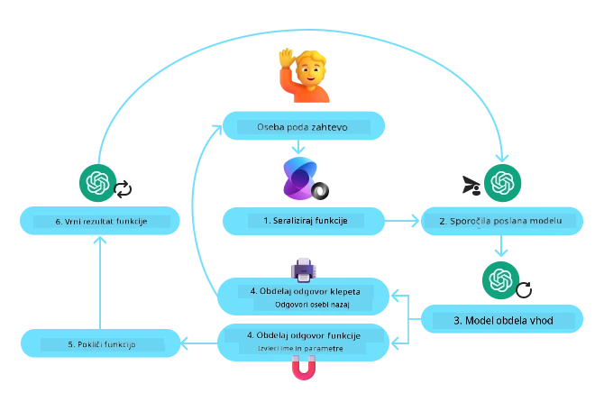
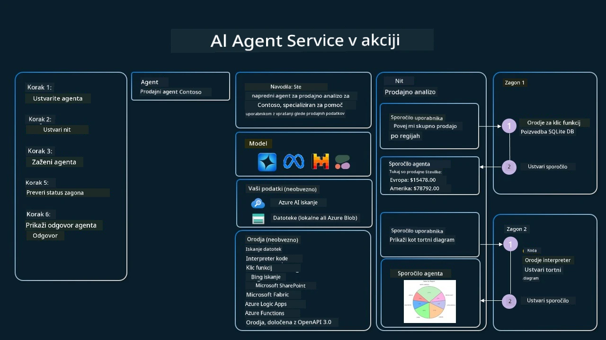

[](https://youtu.be/vieRiPRx-gI?si=cEZ8ApnT6Sus9rhn)

> _(Kliknite na zgornjo sliko za ogled videa te lekcije)_

# Vzorec zasnove uporabe orodij

Orodja so zanimiva, ker AI agentom omogočajo širši nabor zmogljivosti. Namesto da bi agent imel omejen nabor dejanj, ki jih lahko izvede, lahko z dodajanjem orodja agent zdaj izvede širok nabor dejanj. V tem poglavju si bomo ogledali vzorec zasnove uporabe orodij, ki opisuje, kako lahko AI agenti uporabljajo specifična orodja za dosego svojih ciljev.

## Uvod

V tej lekciji želimo odgovoriti na naslednja vprašanja:

- Kaj je vzorec zasnove uporabe orodij?
- Za katere primere uporabe je lahko uporabljen?
- Kateri so elementi/gradniki, potrebni za implementacijo vzorca zasnove?
- Kateri so posebni vidiki pri uporabi vzorca zasnove uporabe orodij za gradnjo zaupanja vrednih AI agentov?

## Cilji učenja

Po končani tej lekciji boste sposobni:

- Definirati vzorec zasnove uporabe orodij in njegov namen.
- Prepoznati primere uporabe, kjer je vzorec uporabe orodij uporaben.
- Razumeti ključne elemente, potrebne za implementacijo vzorca zasnove.
- Prepoznati vidike za zagotavljanje zaupanja vrednosti AI agentov pri uporabi tega vzorca zasnove.

## Kaj je vzorec zasnove uporabe orodij?

**Vzorec zasnove uporabe orodij** se osredotoča na omogočanje LLM-jem, da sodelujejo z zunanjimi orodji za doseganje specifičnih ciljev. Orodja so koda, ki jo agent lahko izvrši za izvedbo dejanj. Orodje je lahko preprosta funkcija, kot je kalkulator, ali klic API-ja tretje osebe, kot na primer iskanje podatkov o cenah delnic ali vremensko napoved. V kontekstu AI agentov so orodja zasnovana tako, da jih agenti izvajajo kot odgovor na **funkcijske klice, ki jih generira model**.

## Za katere primere uporabe je lahko uporabljen?

AI agenti lahko uporabljajo orodja za dokončanje kompleksnih nalog, pridobivanje informacij ali sprejemanje odločitev. Vzorec zasnove uporabe orodij se pogosto uporablja v scenarijih, ki zahtevajo dinamično interakcijo z zunanjimi sistemi, kot so baze podatkov, spletne storitve ali tolmači kode. Ta zmožnost je uporabna za številne različne primere, vključno z:

- **Dinamično pridobivanje informacij:** Agenti lahko dostopajo do zunanjih API-jev ali baz podatkov za pridobitev svežih podatkov (npr. poizvedovanje po SQLite bazi podatkov za analizo podatkov, pridobivanje cen delnic ali vremenskih informacij).
- **Izvajanje in interpretacija kode:** Agenti lahko izvajajo kodo ali skripte za reševanje matematičnih problemov, ustvarjanje poročil ali izvajanje simulacij.
- **Avtomatizacija delovnih procesov:** Avtomatizacija ponavljajočih se ali večstopenjskih delovnih tokov z integracijo orodij, kot so razporejevalci nalog, e-poštne storitve ali podatkovni cevovodi.
- **Podpora strankam:** Agenti lahko sodelujejo s CRM sistemi, platformami za upravljanje zahtevkov ali bazami znanja za reševanje uporabniških poizvedb.
- **Generiranje in urejanje vsebin:** Agenti lahko uporabljajo orodja, kot so preverjevalci slovnice, povzemači besedil ali ocenjevalci varnosti vsebin za pomoč pri ustvarjanju vsebin.

## Kateri so elementi/gradniki, potrebni za implementacijo vzorca zasnove uporabe orodij?

Ti gradniki agentu omogočajo izvedbo širokega nabora nalog. Oglejmo si ključne elemente, potrebne za implementacijo vzorca zasnove uporabe orodij:

- **Sheme funkcij/orodij**: Podrobne definicije razpoložljivih orodij, vključno z imenom funkcije, namenom, potrebnimi parametri in pričakovanimi izhodi. Te sheme omogočajo LLM-ju razumevanje, katera orodja so na voljo in kako sestaviti veljavne zahteve.

- **Logika izvajanja funkcij**: Določa, kako in kdaj se orodja kličejo glede na namen uporabnika in kontekst pogovora. Lahko vključuje module za načrtovanje, mehanizme usmerjanja ali pogojne tokove, ki dinamično določajo uporabo orodij.

- **Sistem za upravljanje sporočil**: Komponente, ki upravljajo tok pogovora med uporabniškimi vnosi, odgovori LLM-ja, klici orodij in izhodi orodij.

- **Okvir za integracijo orodij**: Infrastruktura, ki povezuje agenta z različnimi orodji, bodisi preprostimi funkcijami ali kompleksnimi zunanjimi storitvami.

- **Obravnava napak in preverjanje**: Mehanizmi za obvladovanje neuspešnih izvajanj orodij, preverjanje parametrov in upravljanje nepričakovanih odzivov.

- **Upravljanje stanja**: Sledi kontekstu pogovora, prejšnjim interakcijam z orodji in trajnim podatkom za zagotavljanje doslednosti skozi večkratne interakcije.

Nato si podrobneje oglejmo klic funkcij/orodij.
 
### Klic funkcije/orodja

Klic funkcij je glavni način, s katerim omogočimo modelom velikih jezikov (LLM), da sodelujejo z orodji. Pogosto boste videli izraza 'funkcija' in 'orodje' uporabljena izmenično, saj so 'funkcije' (bloki ponovno uporabne kode) 'orodja', ki jih agenti uporabljajo za izvedbo nalog. Da bi lahko klicali kodo funkcije, mora LLM primerjati uporabnikovo zahtevo z opisom funkcij. Za to se LLM-ju pošlje shema, ki vsebuje opise vseh razpoložljivih funkcij. LLM nato izbere najbolj ustrezno funkcijo za nalogo in vrne njeno ime in argumente. Izbrana funkcija se izvrši, njen odziv se pošlje nazaj LLM-ju, ki uporabi te informacije za odgovor na uporabnikovo zahtevo.

Za razvijalce, ki želijo implementirati klic funkcij za agente, boste potrebovali:

1. LLM model, ki podpira klic funkcij
2. Shemo z opisi funkcij
3. Kodo za vsako opisano funkcijo

Za ponazoritev uporabimo primer pridobivanja trenutnega časa v mestu:

1. **Inicializirajte LLM, ki podpira klic funkcij:**

    Ne vsi modeli podpirajo klic funkcij, zato je pomembno preveriti, ali vaš LLM to podpira. <a href="https://learn.microsoft.com/azure/ai-services/openai/how-to/function-calling" target="_blank">Azure OpenAI</a> podpira klic funkcij. Začnemo lahko z inicializacijo OpenAI klienta proti Azure OpenAI **Responses API-ju** (stabilna `/openai/v1/` končna točka — brez potrebe po `api_version`). 

    ```python
    # Initialize the OpenAI client for Azure OpenAI (Responses API, v1 endpoint)
    client = OpenAI(
        base_url=f"{os.environ['AZURE_OPENAI_ENDPOINT'].rstrip('/')}/openai/v1/",
        api_key=os.environ["AZURE_OPENAI_API_KEY"],
    )
    deployment_name = os.environ["AZURE_OPENAI_DEPLOYMENT"]
    ```

1. **Ustvarite shemo funkcije**:

    Nato bomo definirali JSON shemo, ki vsebuje ime funkcije, opis, kaj funkcija počne, ter imena in opise parametrov funkcije.
    To shemo bomo nato poslali ustvarjenemu klientu skupaj z uporabnikovo zahtevo po trenutnem času v San Franciscu. Pomembno je opozoriti, da je **poziv orodju** tisto, kar se vrne, **ne** končni odgovor na vprašanje. Kot smo že omenili, LLM vrne ime funkcije, ki jo je izbral za nalogo, in argumente, ki mu bodo podani.

    ```python
    # Function description for the model to read (Responses API flat tool format)
    tools = [
        {
            "type": "function",
            "name": "get_current_time",
            "description": "Get the current time in a given location",
            "parameters": {
                "type": "object",
                "properties": {
                    "location": {
                        "type": "string",
                        "description": "The city name, e.g. San Francisco",
                    },
                },
                "required": ["location"],
            },
        }
    ]
    ```
   
    ```python
  
    # Initial user message
    messages = [{"role": "user", "content": "What's the current time in San Francisco"}]

    # First API call: Ask the model to use the function
    response = client.responses.create(
        model=deployment_name,
        input=messages,
        tools=tools,
        tool_choice="auto",
        store=False,
    )

    # The Responses API returns tool calls as function_call items in response.output.
    # Append them to the conversation so the model has full context on the next turn.
    messages += response.output

    print("Model's response:")
    print(response.output)
  
    ```

    ```bash
    Model's response:
    [ResponseFunctionToolCall(arguments='{"location":"San Francisco"}', call_id='call_pOsKdUlqvdyttYB67MOj434b', name='get_current_time', type='function_call')]
    ```
  
1. **Koda funkcije, potrebna za izvedbo naloge:**

    Ko je LLM izbral, katero funkcijo je treba zagnati, je potrebno implementirati in izvršiti kodo, ki nalogo opravi.
    Kodo za pridobivanje trenutnega časa lahko implementiramo v Pythonu. Prav tako bomo morali napisati kodo za izvleček imena in argumentov iz response_message, da dobimo končni rezultat.

    ```python
      def get_current_time(location):
        """Get the current time for a given location"""
        print(f"get_current_time called with location: {location}")  
        location_lower = location.lower()
        
        for key, timezone in TIMEZONE_DATA.items():
            if key in location_lower:
                print(f"Timezone found for {key}")  
                current_time = datetime.now(ZoneInfo(timezone)).strftime("%I:%M %p")
                return json.dumps({
                    "location": location,
                    "current_time": current_time
                })
      
        print(f"No timezone data found for {location_lower}")  
        return json.dumps({"location": location, "current_time": "unknown"})
    ```

     ```python
    # Handle function calls
    tool_calls = [item for item in response.output if item.type == "function_call"]
    if tool_calls:
        for tool_call in tool_calls:
            if tool_call.name == "get_current_time":

                function_args = json.loads(tool_call.arguments)

                time_response = get_current_time(
                    location=function_args.get("location")
                )

                # Return the tool result as a function_call_output item
                messages.append({
                    "type": "function_call_output",
                    "call_id": tool_call.call_id,
                    "output": time_response,
                })
    else:
        print("No tool calls were made by the model.")

    # Second API call: Get the final response from the model
    final_response = client.responses.create(
        model=deployment_name,
        input=messages,
        tools=tools,
        store=False,
    )

    return final_response.output_text
     ```

     ```bash
      get_current_time called with location: San Francisco
      Timezone found for san francisco
      The current time in San Francisco is 09:24 AM.
     ```

Klic funkcij je v središču večine, če ne vseh zasnov uporabe orodij agentov, vendar je implementacija od začetka včasih zahtevna.
Kot smo se naučili v [Lekciji 2](../../../02-explore-agentic-frameworks), nam agentski okviri zagotavljajo vnaprej pripravljene gradnike za implementacijo uporabe orodij.
 
## Primeri uporabe orodij z agentskimi okviri

Tukaj je nekaj primerov, kako lahko implementirate vzorec zasnove uporabe orodij z uporabo različnih agentskih okvirov:

### Microsoft Agent Framework

<a href="https://learn.microsoft.com/azure/ai-services/agents/overview" target="_blank">Microsoft Agent Framework</a> je odprtokodni AI okvir za ustvarjanje AI agentov. Poenostavlja postopek uporabe klica funkcij tako, da omogoča definiranje orodij kot Python funkcij z dekoratorjem `@tool`. Okvir upravlja komunikacijo med modelom in vašo kodo. Prav tako nudi dostop do vnaprej pripravljenih orodij, kot sta Iskanje datotek in Tolmač kode preko `FoundryChatClient`.

Spodnja shema ponazarja postopek klica funkcij z Microsoft Agent Framework:



V Microsoft Agent Framework so orodja definirana kot dekorirane funkcije. Lahko pretvorimo funkcijo `get_current_time`, ki smo jo videli prej, v orodje z uporabo dekoratorja `@tool`. Okvir bo samodejno serializiral funkcijo in njene parametre ter ustvaril shemo za pošiljanje LLM-ju.

```python
import os
from agent_framework import tool
from agent_framework.foundry import FoundryChatClient
from azure.identity import AzureCliCredential

@tool(approval_mode="never_require")
def get_current_time(location: str) -> str:
    """Get the current time for a given location"""
    ...

# Create the client
provider = FoundryChatClient(
    project_endpoint=os.environ["AZURE_AI_PROJECT_ENDPOINT"],
    model=os.environ["AZURE_AI_MODEL_DEPLOYMENT_NAME"],
    credential=AzureCliCredential(),
)

# Create an agent and run with the tool
agent = provider.as_agent(name="TimeAgent", instructions="Use available tools to answer questions.", tools=get_current_time)
response = await agent.run("What time is it?")
```

#### Orodja iz MCP strežnika

Orodja ne morajo biti funkcije v vaši kodi. Strežnik, ki govori protokol Model Context Protocol (MCP, predstavljen v [Lekciji 11](../11-agentic-protocols/README.md)), objavlja svoja orodja skupaj z njihovimi shemami, okvir pa jih lahko naloži enako kot serializacijo dekorirane funkcije. `MCPStreamableHTTPTool` se poveže s takšnim strežnikom prek HTTP, prebere sheme orodij in jih ponudi modelu poleg lokalnih orodij.

Primer spodaj uporablja strežnik spletnega iskanja, gostovan pri <a href="https://keenable.ai" target="_blank">Keenable</a>. Brezplačen je za uporabo brez računa ali API ključa (zahteve so omejene po IP), zato so edine poverilnice tiste za vaš model. Kot pri vsakem oddaljenem orodju tudi poizvedbe, ki jih model napiše, pošljejo tem strežnikom.

```python
from agent_framework import MCPStreamableHTTPTool

web_search = MCPStreamableHTTPTool(
    name="Keenable web search",
    url="https://api.keenable.ai/mcp",
)

# Connecting loads the server's tool schemas; the agent decides when to call them
async with web_search:
    agent = provider.as_agent(
        name="ResearchAgent",
        instructions="Use available tools to answer questions.",
        tools=[web_search],
    )
    response = await agent.run("What is new in the latest Python release?")
    print(response.text)
```

Strežnik objavlja dve orodji, `search_web_pages` in `fetch_page_content`. Ko je za vprašanje potrebna aktualna informacija, model kliče `search_web_pages`, prejme nazaj naslove, URL-je in besedilne izvlečke ter iz njih napiše odgovor, enak zanki kot v `get_current_time` primeru zgoraj.
  
### Microsoft Foundry Agent Service

<a href="https://learn.microsoft.com/azure/ai-services/agents/overview" target="_blank">Microsoft Foundry Agent Service</a> je novejši agentski okvir, zasnovan za omogočanje razvijalcem varnega ustvarjanja, uvajanja in raztezanja visokokakovostnih ter razširljivih AI agentov brez upravljanja osnovnih virov za računanje in shranjevanje. Posebej uporaben je za podjetniške aplikacije kot popolnoma upravljana storitev z varnostjo na ravni podjetja.

V primerjavi z neposrednim razvojem prek LLM API-ja Microsoft Foundry Agent Service ponuja nekaj prednosti, vključno z:

- Samodejni klic orodij – ni potrebe po ročnem razčlenjevanju klica orodja, klicu orodja in obravnavi odziva; vse to se zdaj izvaja na strežniški strani
- Varno upravljani podatki – namesto upravljanja lastnega stanja pogovora lahko zanesete na teme, ki hranijo vse potrebne informacije
- Orodja, pripravljena za uporabo – orodja za interakcijo z vašimi podatkovnimi viri, kot so Bing, Azure AI Search in Azure Functions.

Orodja, na voljo v Microsoft Foundry Agent Service, lahko razvrstimo v dve kategoriji:

1. Orodja za znanje:
    - <a href="https://learn.microsoft.com/azure/ai-services/agents/how-to/tools/bing-grounding?tabs=python&pivots=overview" target="_blank">Grounding z Bing Search</a>
    - <a href="https://learn.microsoft.com/azure/ai-services/agents/how-to/tools/file-search?tabs=python&pivots=overview" target="_blank">Iskanje datotek</a>
    - <a href="https://learn.microsoft.com/azure/ai-services/agents/how-to/tools/azure-ai-search?tabs=azurecli%2Cpython&pivots=overview-azure-ai-search" target="_blank">Azure AI Search</a>

2. Orodja za dejanja:
    - <a href="https://learn.microsoft.com/azure/ai-services/agents/how-to/tools/function-calling?tabs=python&pivots=overview" target="_blank">Klic funkcij</a>
    - <a href="https://learn.microsoft.com/azure/ai-services/agents/how-to/tools/code-interpreter?tabs=python&pivots=overview" target="_blank">Tolmač kode</a>
    - <a href="https://learn.microsoft.com/azure/ai-services/agents/how-to/tools/openapi-spec?tabs=python&pivots=overview" target="_blank">Orodja definirana z OpenAPI</a>
    - <a href="https://learn.microsoft.com/azure/ai-services/agents/how-to/tools/azure-functions?pivots=overview" target="_blank">Azure Functions</a>

Agent Service nam omogoča, da ta orodja uporabljamo skupaj kot `toolset`. Prav tako uporablja `threads`, ki sledijo zgodovini sporočil posameznega pogovora.

Predstavljajte si, da ste prodajni agent v podjetju z imenom Contoso. Želite razviti pogovornega agenta, ki lahko odgovarja na vprašanja o vaših prodajnih podatkih.

Spodnja slika ponazarja, kako bi lahko uporabili Microsoft Foundry Agent Service za analizo vaših prodajnih podatkov:



Za uporabo katerega koli od teh orodij s storitvijo lahko ustvarimo klienta in definiramo orodje ali nabor orodij. Za praktično implementacijo lahko uporabimo naslednjo Python kodo. LLM bo lahko pogledal nabor orodij in odločil, ali bo uporabil funkcijo, ki jo je ustvaril uporabnik, `fetch_sales_data_using_sqlite_query`, ali vnaprej pripravljeni Tolmač kode, odvisno od uporabnikove zahteve.

```python 
import os
from azure.ai.projects import AIProjectClient
from azure.identity import DefaultAzureCredential
from fetch_sales_data_functions import fetch_sales_data_using_sqlite_query # fetch_sales_data_using_sqlite_query function which can be found in a fetch_sales_data_functions.py file.
from azure.ai.projects.models import ToolSet, FunctionTool, CodeInterpreterTool

project_client = AIProjectClient.from_connection_string(
    credential=DefaultAzureCredential(),
    conn_str=os.environ["PROJECT_CONNECTION_STRING"],
)

# Initialize toolset
toolset = ToolSet()

# Initialize function calling agent with the fetch_sales_data_using_sqlite_query function and adding it to the toolset
fetch_data_function = FunctionTool(fetch_sales_data_using_sqlite_query)
toolset.add(fetch_data_function)

# Initialize Code Interpreter tool and adding it to the toolset. 
code_interpreter = CodeInterpreterTool()toolset.add(code_interpreter)

agent = project_client.agents.create_agent(
    model="gpt-5-mini", name="my-agent", instructions="You are helpful agent", 
    toolset=toolset
)
```

## Katere so posebne podrobnosti pri uporabi vzorca zasnove uporabe orodij za gradnjo zaupanja vrednih AI agentov?

Pogosta skrb glede SQL, ki ga dinamično generirajo LLM-ji, je varnost, predvsem tveganje SQL injekcij ali zlonamernih dejanj, kot je brisanje ali spreminjanje baze podatkov. Čeprav so te skrbi upravičene, jih je mogoče učinkovito ublažiti z ustrezno konfiguracijo dovoljenj za dostop do baze podatkov. Za večino baz podatkov to pomeni konfiguracijo baze kot samo za branje. Za baze podatkov, kot so PostgreSQL ali Azure SQL, bi morali aplikaciji dodeliti vlogo samo za branje (SELECT).

Zagon aplikacije v varnem okolju še dodatno poveča zaščito. V podjetniških scenarijih se podatki običajno izločijo in preoblikujejo iz operativnih sistemov v bazo podatkov ali podatkovno skladišče samo za branje z uporabniku prijazno shemo. Ta pristop zagotavlja, da so podatki varni, optimizirani za zmogljivost in dostopnost ter da ima aplikacija omejen dostop samo za branje.

## Primeri kode

- Python: [Agent Framework](./code_samples/04-python-agent-framework.ipynb)
- .NET: [Agent Framework](./code_samples/04-dotnet-agent-framework.md)

## Imate več vprašanj o vzorcih zasnove uporabe orodij?

Pridružite se [Microsoft Foundry Discordu](https://discord.com/invite/ATgtXmAS5D), kjer se lahko srečate z drugimi učenci, udeležite ur uradnih ur in dobite odgovore na vaša vprašanja o AI agentih.

## Dodatni viri

- <a href="https://microsoft.github.io/build-your-first-agent-with-azure-ai-agent-service-workshop/" target="_blank">Delavnica za Azure AI Agent Service</a>
- <a href="https://github.com/Azure-Samples/contoso-creative-writer/tree/main/docs/workshop" target="_blank">Delavnica Contoso Creative Writer Multi-Agent</a>
- <a href="https://learn.microsoft.com/azure/ai-services/agents/overview" target="_blank">Pregled ogrodja Microsoft Agent</a>

## Preizkus delovanja tega agenta (izbirno)

Ko se boste naučili nameščati agente v [Lekcija 16](../16-deploying-scalable-agents/README.md), lahko z [`tests/lesson-04-smoke-tests.json`](../../../tests/lesson-04-smoke-tests.json) na hitro preizkusite delovanje `TravelToolAgent` iz te lekcije (ali še vedno kliče svoje orodje in odgovori?). Za navodila o zagonu glejte [`tests/README.md`](../tests/README.md).

## Prejšnja lekcija

[Razumevanje vzorcev oblikovanja agentov](../03-agentic-design-patterns/README.md)

## Naslednja lekcija

[Agentni RAG](../05-agentic-rag/README.md)

---

<!-- CO-OP TRANSLATOR DISCLAIMER START -->
**Omejitev odgovornosti**:
Ta dokument je bil preveden z uporabo AI prevajalske storitve [Co-op Translator](https://github.com/Azure/co-op-translator). Čeprav si prizadevamo za natančnost, vas prosimo, da upoštevate, da avtomatizirani prevodi lahko vsebujejo napake ali netočnosti. Izvirni dokument v njegovem izvirnem jeziku je treba obravnavati kot avtoritativni vir. Za kritične informacije je priporočljiv strokovni človeški prevod. Ne odgovarjamo za morebitna nesporazume ali napačne interpretacije, ki izhajajo iz uporabe tega prevoda.
<!-- CO-OP TRANSLATOR DISCLAIMER END -->