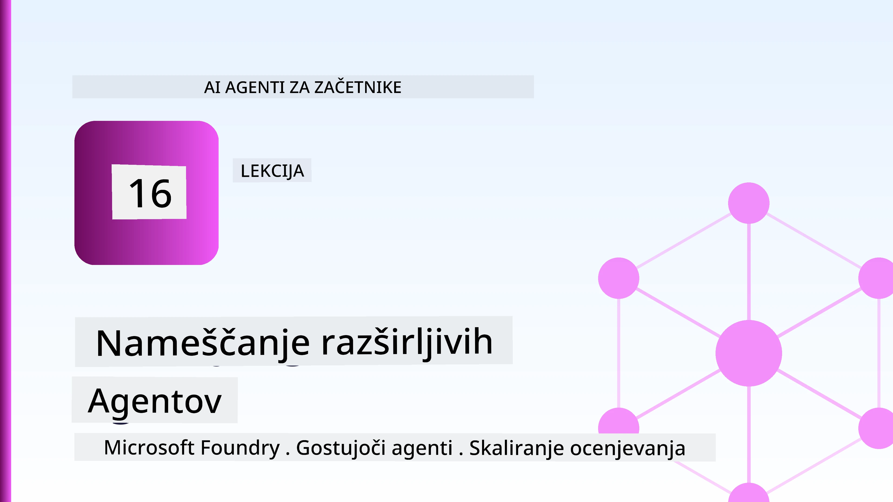
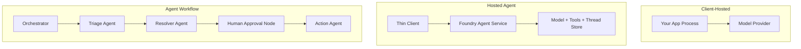
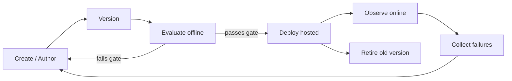
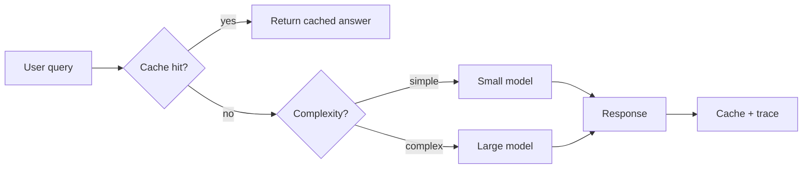
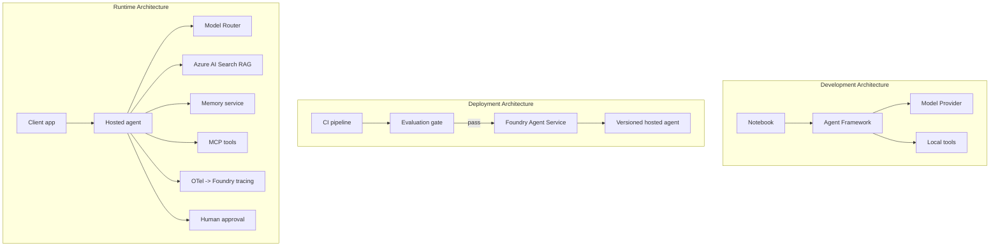

# Uvajanje razširljivih agentov z Microsoft Foundry



Do sedaj v tečaju ste zgradili agente, ki tečejo na vašem prenosniku, znotraj zvezka, ki jih poganjata `az login` in nekaj okoljskih spremenljivk. To je točno pravi način za učenje. Ni pa pravi način za poganjanje agenta, od katerega ob 3. uri zjutraj odvisijo tisoči strank.

Ta lekcija govori o vrzeli med "deluje na mojem računalniku" in "deluje zanesljivo in cenovno ugodno v produkciji." To vrzel zapremo s **Microsoft Foundry** in **Microsoft Foundry Agent Service**, in to storimo z gradnjo pravega agenta za podporo strankam z orodji, pridobivanjem informacij, pomnjenjem, evalvacijo in nadzorom.

## Uvod

Ta lekcija bo obravnavala:

- Razliko med **prototipnim agentom** in **uvajanjem agenta**, in zakaj je prehod večinoma vse okoli modela.
- **Vzorce uvajanja** za agente: gostovanje na odjemalcu, gostovanje kot storitev (Hostani agenti) in orkestrirani delovni tokovi.
- **Življenjski cikel agenta** na Microsoft Foundry — ustvarjanje, verzioniranje, uvajanje, evalvacija, opazovanje, upokojitev.
- **Strategije skaliranja**: usmerjanje modela, predpomnjenje, sočasnost in zasnova brez stanj.
- **Opazljivost** z OpenTelemetry in Foundry sledenjem.
- **Optimizacija stroškov** skozi izbiro modela, usmerjanje in evalvacijske pregrade.
- **Podjetniške razmisleke**: upravljanje, človeško odobritev in varno izvajanje MCP strežnikov v produkciji.

## Cilji učenja

Po opravljeni tej lekciji boste znali:

- Izbrati pravi vzorec uvajanja za dano obremenitev agenta.
- Uvajati agenta na Microsoft Foundry Agent Service, da bo verzioniran, upravljan in opazen.
- Inštrumentirati agenta za sledenje in povezati evalvacijski pipeline, ki teče pred vsako izdajo.
- Uporabiti usmerjanje in predpomnjenje modela za nadzor latence in stroškov pri skaliranju.
- Dodati vrata za človeško odobritev za tvegane akcije in integrirati MCP strežnik na produkcijsko varen način.

## Predpogoji

Ta lekcija predvideva, da ste opravili prejšnje lekcije in ste udobni z:

- Gradnjo agentov z [Microsoft Agent Framework](../14-microsoft-agent-framework/README.md) (Lekcija 14).
- [Uporabo orodij](../04-tool-use/README.md) (Lekcija 4) in [Agentic RAG](../05-agentic-rag/README.md) (Lekcija 5).
- [Spomin agenta](../13-agent-memory/README.md) (Lekcija 13) in [Agentik protokoli / MCP](../11-agentic-protocols/README.md) (Lekcija 11).
- [Opazljivost in evalvacija](../10-ai-agents-production/README.md) (Lekcija 10) — ta lekcija neposredno gradi na njej.

Prav tako boste potrebovali:

- **Azure naročnino** in **projekt Microsoft Foundry** z vsaj enim uvajenim klepetalnim modelom.
- **Azure CLI** prijavljenega (`az login`).
- Python 3.12+ in pakete v repozitoriju [`requirements.txt`](../../../requirements.txt).

## Od prototipa do produkcije: kaj se pravzaprav spremeni

Prototipni agent in produkcijski agent delita isti osnovni cikel — sklepanje, klic orodij, odzivanje. Kar se spremeni, je vse okrog tega cikla. Model je morda 20 % produkcijskega agenta; preostalih 80 % je operativni okvir.

| Skrb | Prototip | Produkcija |
| --- | --- | --- |
| **Gostovanje** | Teče v vašem zvezku | Teče kot gostujoča storitev, verzionirana in distribuirana |
| **Identiteta** | Vaš `az login` žeton | Upravljana identiteta z omejenim RBAC |
| **Stanje** | V pomnilniku, izgubljeno po ponovnem zagonu | Externalizirano (shramba niti, pomnilniška storitev) |
| **Napaka** | Vidite sled napake | Ponovitve, izpadi, dead-letter, opozorila |
| **Stroški** | "Je nekaj centov" | Spremljani na zahtevo, usmerjani, predpomnjeni, z budžetom |
| **Kakovost** | Vizualno pregledate izhod | Samodejno ocenjevano pred vsako izdajo |
| **Zaupanje** | Odobritev vsake akcije | Politika + človek v zanki za tvegane akcije |

Zapomnite si to tabelo. Vsak razdelek spodaj se navezuje na enega od teh vrst.

## Vzorce uvajanja agentov

Obstajajo trije vzorci, ki jih boste pogosto uporabljali v kombinaciji.

### 1. Agent gostovan na odjemalcu

Agent objekt živi znotraj *vašega* procesnega programa. Vaša koda neposredno kliče ponudnika modela; sklepni cikel teče v vaši storitvi. To je bilo narejeno v vseh prejšnjih lekcijah.

- **Uporabite, ko** potrebujete popoln nadzor nad ciklom, prilagojena vmesna programska oprema ali vključevanje agenta znotraj obstoječe backend storitve.
- **Kompetenca**: sami upravljate skaliranje, stanje in odpornost.

### 2. Hosting agenti (Foundry Agent Service)

Agent je *registriran kot vir* v Microsoft Foundry. Foundry gosti sklepni cikel, hrani niti, zagotavlja varnost vsebine in RBAC ter naredi agenta vidnega v Foundry portalu. Vaša aplikacija postane tanek odjemalec, ki ustvarja niti in bere odzive.

- **Uporabite, ko** želite trajnost, vgrajeno opazljivost, upravljanje in manj operativnega področja.
- **Kompetenca**: manj nizkonivojskega nadzora v zameno za upravljano okolje.

### 3. Delovni tokovi agentov

Več agentov (in orodij) je sestavljenih v graf s eksplicitnim nadzorom toka — zaporedni koraki, vejitev, vozlišča za človeško odobritev in trajne točke zaustavitve, ki se lahko zaustavijo in nadaljujejo. To je zmogljivost Microsoft Agent Framework **Workflows**, uporabljena pri uvajanju v praksi.

- **Uporabite, ko** en sam opravek vključuje več specializiranih agentov ali zahteva odobritev vmes.
- **Kompetenca**: več premikajočih se delov; zahteva opazljivost na ravni orkestracije.



## Življenjski cikel agenta na Microsoft Foundry

Uvajanje agenta ni enkratna `push`. Je zanka, ki je zelo podobna ciklu izdaje programske opreme, ker pravzaprav to tudi je.



Ključna ideja, prenesena iz [Lekcije 10](../10-ai-agents-production/README.md): **offline evalvacija je pregrada, ne pomislitev po dejstvu.** Nova verzija agenta ne gre v produkcijo, dokler ne doseže pragov ocenjevanja. Online opazovanje nato povratno vrača prave napake v offline testni niz. To je celoten cikel.

## Strategije skaliranja

Skaliranje agenta je drugačno od skaliranja brezstanja spletnega API-ja, ker vsak zahtevek sproži več dragih klicev modelov in orodij. Štiri tehnike držijo največjo obremenitev.

**Obdelava zahtev brez stanja.** Ne shranjujte stanja na uporabnika v pomnilnik procesa. Pogovorne niti trajno shranjujte v Foundry shrambi niti ali pomnilniški storitvi, da lahko katera koli instanca obravnava katerikoli zahtevek. To omogoča horizontalno skaliranje — dodajte instance, ni lepljivih sej.

**Usmerjanje modela.** Ne zahteva vsak zahtevek vaš najmočnejši (in najdražji) model. Usmerite preproste zahtevke — klasifikacija namena, kratki dejanski odgovori — na majhen, hiter model, in rezervirajte velik model za resno sklepanje. Foundryjev **Model Router** to lahko naredi za vas, ali pa lahko sami implementirate lahkoten klasifikator. DIY verzijo boste zgradili v laboratoriju.

**Predpomnjenje odgovorov.** Veliko podpornih vprašanj je skoraj podvojenih ("kako ponastavim geslo?"). Predpomnite odgovore na pogosta vprašanja in jih ponudite brez klica modela. Tudi skromna stopnja zadetkov v predpomnilniku bistveno zniža stroške in latenco.

**Sočasnost in povratni tlak.** Ponudniki modelov imajo omejitve hitrosti. Omejite svojo sočasnost, uporabite ponovitve z eksponentno zakasnitvijo in zatajite elegantno (vrstničen odziv "delamo na tem" je boljši od 500).



## Opazljivost v produkciji

Ne morete upravljati tistega, česar ne vidite. Kot je opisano v Lekciji 10, Microsoft Agent Framework nativno oddaja **OpenTelemetry** sledove — vsak klic modela, sprožitev orodja in korak orkestracije postane obseg. V produkciji te obsege izvozite v Microsoft Foundry (ali katerikoli OTel-kompatibilni zaledni sistem), da lahko:

- Sledite eni sami pritožbi stranke od začetka do konca skozi vsak klic modela in orodja.
- Spremljate p50/p95 latenco in stroške na zahtevo skozi čas.
- Opozarjate na skoke napak in stroškovne anomalije, preden jih opazijo uporabniki (ali vaša finančna ekipa).

```python
from agent_framework.observability import get_tracer

tracer = get_tracer()

with tracer.start_as_current_span("support_request") as span:
    span.set_attribute("customer.tier", "enterprise")
    span.set_attribute("routed.model", "gpt-5-nano")
    # agent execution is traced automatically inside this span
```

Atributi kot `customer.tier` in `routed.model` so tisti, ki iz zid sledi naredijo odgovarjajoča vprašanja ("ali se podjetniške stranke preveč pogosto usmerjajo na majhen model?").

## Optimizacija stroškov

Stroški v produkcijskih agentih so prevladujoče zaradi žetonov. Trije vzvodi, po redu vpliva:

1. **Pravilna velikost modela.** Majhen model, ki prestane vaš evalvacijski prag, je skoraj vedno cenejši od velikega, ki prav tako prestane. Uporabite evalvacijo, da *dokažete*, da je majhen model dovolj dober, namesto da bi zaradi previdnosti privzeto izbrali največji model.
2. **Usmerjanje po kompleksnosti.** Kot zgoraj — plačajte za velik model le za zahtevke, ki res potrebujejo sklepanje velikega modela.
3. **Agresivno predpomnjenje.** Najcenejši klic modela je tisti, ki ga nikoli ne izvedete.

Evalvacijske pregrade in nadzor stroškov sta ista disciplina, gledana z dveh zornih kotov: evalvacija pove *kakovostno dno*, usmerjanje in predpomnjenje pa ohranjata stroške čim bližje temu dnu.

## Podjetniški razmisleki pri uvajanju

**Upravljanje.** Gostovani agenti dedujejo Foundryjev RBAC, varnost vsebine in revizijsko beleženje. Vsakemu agentu dodelite upravljano identiteto z najmanjšimi potrebnimi privilegiji — dostop samo za branje do baze znanja, omejen dostop do API-ja za podporne vozovnice, nič več.

**Človek v zanki.** Nekatera dejanja so preveč pomembna, da bi jih avtomatizirali brezpogojno — izdaja vračila, brisanje računa, eskalacija na pravno ekipo. Microsoft Agent Framework podpira orodja, ki zahtevajo **odobritev**: agent predlaga dejanje, izvedba se zaustavi, človek odobri ali zavrne, nato delovni tok nadaljuje. Sledili ste primitivnemu v [Lekciji 6](../06-building-trustworthy-agents/README.md); tukaj ga uvajate.

**MCP v produkciji.** [MCP](../11-agentic-protocols/README.md) omogoča agentu, da uporablja zunanja orodja preko standardnega vmesnika. V produkciji obravnavajte vsak MCP strežnik kot nezaupanja vredno mejo: fiksirajte različico strežnika, poganjajte ga z omejeno identiteto, preverjajte njegove izhode in mu nikoli ne izpostavljajte skrivnosti. MCP strežnik je odvisnost, in odvisnosti je treba popravljati, revizijsko spremljati in omejevati uporabnost.



Ti trije diagrami — razvoj, uvajanje, izvajanje — prikazujejo istega agenta v treh življenjskih fazah. Naslednji laboratorij vas vodi skozi njegovo gradnjo.

## Praktičen laboratorij: agent za podporo strankam pripravljen za produkcijo

Odprite [`code_samples/16-python-agent-framework.ipynb`](./code_samples/16-python-agent-framework.ipynb) in delajte skozi celoto. Sestavili boste **Contoso agenta za podporo strankam** z vsemi produkcijskimi skrbmi:

1. **Klic orodij** — poizvedba stanja naročila in odpiranje podpornih vozovnic.
2. **RAG** — odgovarjanje na vprašanja o politiki iz baze znanja (Azure AI Search, z rezervnim pomnilnikom v pomnilniku, da zvezek teče brez vira za Search).
3. **Spomin** — zapomni si stranko skozi pogovorne korake.
4. **Usmerjanje modela** — klasifikator kompleksnosti usmerja vsak zahtevek na majhen ali velik model.
5. **Predpomnjenje odgovorov** — ponovljena vprašanja se postrežejo iz predpomnilnika.
6. **Človeška odobritev** — vračila nad pragom čakajo na človeško potrditev.
7. **Evalvacijski pipeline** — majhen offline testni niz oceni agenta in deluje kot pregrada izdaje.
8. **Opazljivost** — OpenTelemetry sledenje za vsak zahtevek.

### Vodič skozi primere

Zvezek je organiziran tako, da je vsaka produkcijska skrb samostojen, izvedljiv del. Srce zadeve je upravljalec zahtevkov, ki združuje usmerjanje in predpomnjenje:

```python
async def handle_support_request(query: str, customer_id: str) -> str:
    # 1. Serve from cache when we can.
    cached = response_cache.get(normalize(query))
    if cached:
        return cached

    # 2. Route by complexity to control cost.
    model = "gpt-5-nano" if is_simple(query) else "gpt-5-mini"

    # 3. Run the agent inside a trace span for observability.
    with tracer.start_as_current_span("support_request") as span:
        span.set_attribute("routed.model", model)
        span.set_attribute("customer.id", customer_id)
        response = await support_agent.run(query, model=model)

    # 4. Cache and return.
    response_cache.set(normalize(query), response.text)
    return response.text
```

Evalvacijska pregrada, ki varuje izdajo, izgleda takole:

```python
async def evaluation_gate(agent, test_cases, threshold: float = 0.8) -> bool:
    passed = 0
    for case in test_cases:
        result = await agent.run(case["input"])
        if score_response(result.text, case["expected"]) >= 0.8:
            passed += 1
    pass_rate = passed / len(test_cases)
    print(f"Evaluation pass rate: {pass_rate:.0%} (gate: {threshold:.0%})")
    return pass_rate >= threshold  # only deploy if the gate passes
```

Preberite vsak vrstico — zvezek drži primitive namensko majhne, da ni nič skrito za klicem ogrodja.

## Validacija uvajanega agenta s preverjanjem osnovne funkcionalnosti (smoke tests)

Evalvacijska pregrada zgoraj teče *offline* proti vašemu agentu. Ko je agent uveden kot gostovani agent, potrebujete še eno, še cenejšo preverbo: **ali uvajani končni točki dejansko odgovarjata?**

Uspešno uvajanje dokazuje samo, da je kontrolna plošča sprejela definicijo — ne dokazuje, da agent odgovori. Manjkajoča odvisnost, napačno usmerjanje modela ali potekla povezava lahko pustijo zeleno uvajanje, ki ne vrne ničesar. **Smoke test** to ujame v nekaj sekundah, ob vsakem uvajanju, brez stroškov polne evalvacije.

Ta repozitorij ponuja pripravljeno cevovod za smoke test na podlagi [AI Smoke Test](https://github.com/marketplace/actions/ai-smoke-test) GitHub akcije:

- **Katalog** — [`tests/lesson-16-smoke-tests.json`](../../../tests/lesson-16-smoke-tests.json) vsebuje sprožilce in preverjanja za Contoso podpornega agenta (utemeljeni odgovori na politiko, poizvedba naročila, ostati na temo in večkratna kontinuiteta niti). Katalogi za agentne iz drugih lekcij živijo zraven — glej [`tests/README.md`](../tests/README.md).
- **Delovni tok** — [`.github/workflows/smoke-test.yml`](../../../.github/workflows/smoke-test.yml) se prijavi z Azure OIDC in pošlje vsak sprožilec na končno točko odzivov agenta, pri vsaki napačni trditvi neuspešno zaključi nalogo.

```yaml
- name: Smoke-test hosted agent
  uses: JFolberth/ai-smoketest@v1
  with:
    project_endpoint: ${{ inputs.project_endpoint }}
    agent_name: ContosoSupportAgent
    tests_file: tests/lesson-16-smoke-tests.json
```

Zaženite ga z zavihkom **Dejanja** (Actions), ko je vaš agent nameščen, in vnesite vaš naslov končne točke projekta Foundry ter ime agenta. Federirana identiteta potrebuje vlogo **Azure AI User** z obsegom projekta Foundry. Premislite o plasteh kot o piramidi: dimni testi (dostopni in odzivni?) se izvajajo ob vsakem uvedbi, ocena brez povezave (dovolj dobra za izdajo?) se izvaja pred promocijo, stalna ocena (kako se vede v naravi?) pa teče neprekinjeno.

## Preverjanje znanja

Preizkusite svoje razumevanje, preden nadaljujete z nalogo.

**1. Kolikšen približen delež produktnega agenta je "model" in kaj je preostanek?**

<details>
<summary>Odgovor</summary>

Model predstavlja manjšino sistema — pogosto se navaja okoli 20 %. Preostanek je operativni skelet: gostovanje in različica, identiteta in RBAC, zunanja stanja, upravljanje neuspehov, sledenje stroškom, ocenjevanje ter nadzor s človeškim vmesnikom. Prehod v produkcijo pomeni predvsem zgraditi vse *okoli* zanke razmišljanja.
</details>

**2. Kdaj bi izbrali gostovanega agenta namesto agenta, ki teče na odjemalcu?**

<details>
<summary>Odgovor</summary>

Ko želite upravljan čas izvajanja z vgrajeno vzdržljivostjo (nitmi, ki trajajo in se lahko nadaljujejo), opazovanje, varnost vsebine in RBAC ter ste pripravljeni zamenjati nekaj nizkonivojskega nadzora z manj operativne površine. Agent na odjemalcu je primernejši, kadar potrebujete popoln nadzor nad zanko ali vdelujete agenta v obstoječi zaledni sistem.
</details>

**3. Zakaj mora biti skalabilen agent brez stanja v svojem procesu?**

<details>
<summary>Odgovor</summary>

Da lahko katera koli instanca obdela katerikoli zahtevek, kar omogoča horizontalno skaliranje brez vezanih sej. Stanje pogovora na uporabnika se hrani zunaj v skladišču niti ali servis za pomnilnik. Če bi bilo stanje v pomnilniku procesa, bi ga ob ponovnem zagonu izgubili in ne bi mogli prosto razporejati bremena.
</details>

**4. Kakšen problem rešuje usmerjanje modela in kako je povezano z ocenjevanjem?**

<details>
<summary>Odgovor</summary>

Usmerjanje pošilja enostavne zahteve majhnemu, poceni, hitremu modelu in rezervira velik model za resnično razmišljanje, s čimer nadzoruje latenco in stroške. Povezano je z ocenjevanjem, ker ocenjevanje *dokazuje*, da je majhen model dovolj dober za določeno skupino zahtev — usmerjanje brez ocenjevanja je ugibanje.
</details>

**5. Kaj je "ocenjevalni prehod" in kje se nahaja v življenjskem ciklu?**

<details>
<summary>Odgovor</summary>

Ocenjevalni prehod izvaja niz testov brez povezave na novi različici agenta in blokira uvedbo, razen če stopnja uspešnosti preseže določen prag. Nahaja se med "različico" in "uvozom" v življenjskem ciklu, kar postavlja kakovost kot pogoj za izdajo in ne kot nekaj, kar preverite po izdaji.
</details>

**6. Zakaj je MCP strežnik treba obravnavati kot nezanašano mejo v produkciji?**

<details>
<summary>Odgovor</summary>

Ker gre za zunanjo odvisnost, v katero vaš agent kliče. Njegovo različico morate zakleniti, ga zagnati z omejeno identiteto, preveriti njegove izhode, omejevati število klicev in mu nikoli ne izpostavljati skrivnosti – enaka disciplina kot pri vsaki zunanji odvisnosti. Njegovi izhodi vplivajo na agentovo razmišljanje, zato je nepreverjeno zaupanje varnostno tveganje.
</details>

**7. Katera sprememba običajno najbolj vpliva na stroške produkcijskega agenta in zakaj?**

<details>
<summary>Odgovor</summary>

Pravilna izbira velikosti modela — uporaba najmanjšega modela, ki še uspešno prestane ocenjevalni prehod. Stroški so najbolj odvisni od števila tokenov, in manjši model, ki zadosti zahtevam kakovosti, je skoraj vedno cenejši od večjega. Predpomnjenje in usmerjanje nato še dodatno znižata stroške, a izbira ustreznega osnovnega modela ima največji prvi redni vpliv.
</details>

**8. Kakšno vlogo imajo atribute sledi, kot sta `customer.tier` in `routed.model`, pri opazovanju?**

<details>
<summary>Odgovor</summary>

Spremenijo neobdelane sledi v odgovore poslovnih vprašanj. Brez atributov imate samo zid sledi; z njimi lahko vprašate: "Ali so poslovni uporabniki predolgo usmerjeni na majhen model?" ali "Kateri model obdeluje naše najpočasnejše zahteve?" Atributi so način razčlenjevanja telemetrije po dimenzijah, ki so pomembne za vaš način delovanja.
</details>

## Naloga

Vzemite agenta za podporo strankam iz laboratorija in ga okrepite za določen scenarij: **agent za podporo pri obračunu naročnin za SaaS podjetje.**

Vaša oddaja naj bo:

1. **Zamenjajte orodja** z orodji, relevantnimi za obračun: `get_subscription_status`, `get_invoice` in `issue_credit` (krediti nad 50 $ zahtevajo odobritev človeka).
2. **Dodajte tri RAG dokumente** o politiki vračil, obračunskem ciklu in politiki preklica podjetja.
3. **Razširite ocenjevalni nabor** na najmanj osem primerov, vključno z vsaj dvema, ki *morata* sprožiti pot odobritve človeka, in potrdite, da vaš ocenjevalni prehod pravilno prehaja ali spodleti.
4. **Dodajte en stroškovni poročilo**: po izvedbi desetih mešanih poizvedb skozi agenta izpišite, koliko je šlo v mali model, koliko v veliki model in koliko je bilo postreženih iz predpomnilnika.

Napišite kratek odstavek (v markdown celici), ki pojasni, katero pravilo usmerjanja modela ste izbrali in kako bi ga preverili s pravim prometom. Ni enega pravilnega odgovora — ocenjuje se skladnost, s katero so proizvodne zadeve povezane skupaj.

## Povzetek

V tej lekciji ste premaknili agenta iz prototipa v produkcijo z Microsoft Foundry:

- Prehod v produkcijo je predvsem o **operativnem ogrodju** okoli modela — gostovanju, identiteti, stanju, upravljanju neuspehov, stroških, kakovosti in zaupanju.
- Spoznali ste tri **vzorce uvajanja** — gostovanje na odjemalcu, gostovani agenti in agentni delovni tokovi ter kdaj kateri ustreza.
- Sprehodili ste se skozi **življenjski cikel agenta**, kjer ocena brez povezave deluje kot prehod za izdajo, opozorilni podatki v živo pa napajajo napake nazaj v testni nabor.
- Uporabili ste **strategije skaliranja** — brezstanje, usmerjanje modela, predpomnjenje in omejena vzporednost — in jih povezali s **stroškovno optimizacijo**.
- Uvedli ste **podjetniške kontrole**: RBAC, odobritev človeka v zanki in varno integracijo MCP v produkcijo.
- Zgradili ste **produkcijsko pripravljenega agenta za podporo kupcem**, ki povezuje vse te vidike v zagonljivo kodo.

Naslednja lekcija pojde v nasprotno smer: namesto da bi agenta razširili v oblak, ga boste prenesli *dol* na en razvojni računalnik in ga popolnoma zagnali lokalno.

## Dodatni viri

- <a href="https://learn.microsoft.com/azure/ai-foundry/what-is-azure-ai-foundry" target="_blank">Dokumentacija Microsoft Foundry</a>
- <a href="https://learn.microsoft.com/azure/ai-foundry/agents/overview" target="_blank">Pregled Microsoft Foundry Agent Service</a>
- <a href="https://learn.microsoft.com/en-us/agent-framework/overview/?wt.mc_id=youtube_26688_organicsocial_reactor&pivots=programming-language-python" target="_blank">Microsoft Agent Framework</a>
- <a href="https://learn.microsoft.com/en-us/azure/ai-foundry/openai/concepts/model-router" target="_blank">Model Router v Microsoft Foundry</a>
- <a href="https://learn.microsoft.com/azure/search/search-what-is-azure-search" target="_blank">Azure AI Search</a>
- <a href="https://opentelemetry.io/" target="_blank">OpenTelemetry</a>
- <a href="https://github.com/marketplace/actions/ai-smoke-test" target="_blank">AI Smoke Test GitHub Dejanje</a>
- <a href="https://modelcontextprotocol.io/" target="_blank">Model Context Protocol (MCP)</a>

## Prejšnja lekcija

[Gradnja agentov za uporabo računalnika (CUA)](../15-browser-use/README.md)

## Naslednja lekcija

[Ustvarjanje lokalnih AI agentov](../17-creating-local-ai-agents/README.md)

---

<!-- CO-OP TRANSLATOR DISCLAIMER START -->
**Omejitev odgovornosti**:
Ta dokument je bil preveden z uporabo AI prevajalske storitve [Co-op Translator](https://github.com/Azure/co-op-translator). Čeprav si prizadevamo za natančnost, vas prosimo, da upoštevate, da avtomatizirani prevodi lahko vsebujejo napake ali netočnosti. Izvirni dokument v njegovem izvirnem jeziku je treba obravnavati kot avtoritativni vir. Za kritične informacije je priporočljiv strokovni človeški prevod. Ne odgovarjamo za morebitna nesporazume ali napačne interpretacije, ki izhajajo iz uporabe tega prevoda.
<!-- CO-OP TRANSLATOR DISCLAIMER END -->