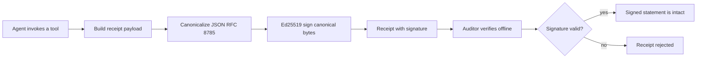
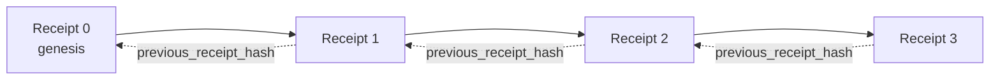

[Oglejte si videoposnetek lekcije: Zagotavljanje varnosti AI agentov s kriptografskimi potrdili](https://youtu.be/PLACEHOLDER_VIDEO_ID)

> _(Videoposnetek lekcije in sličica bosta dodana s strani Microsoftove vsebinske ekipe po združitvi, v skladu s shemo lekcije 14 / 15.)_

# Zagotavljanje varnosti AI agentov s kriptografskimi potrdili

## Uvod

Ta lekcija bo obravnavala:

- Zakaj so revizijske sledi za AI agente pomembne za skladnost, odpravljanje napak in zaupanje.
- Kaj je kriptografsko potrdilo in kako se razlikuje od nepodpisane zapisniške vrstice.
- Kako izdelati podpisano potrdilo za klic orodja agenta v navadnem Pythonu.
- Kako offline preveriti potrdilo in zaznati manipulacije.
- Kako povezati potrdila, da odstranitev ali prerazporeditev enega prekine verigo.
- Kaj potrdila dokazujejo in kaj izrecno ne dokazujejo.

## Cilji učenja

Po zaključku te lekcije boste znali:

- Prepoznati vrste napak, ki motivirajo kriptografski izvor dejanj agenta.
- Izdelati Ed25519-podpisano potrdilo nad kanonično JSON vsebino.
- Neodvisno preveriti potrdilo z uporabo samo javnega ključa podpisnika.
- Zaznati manipulacije z ponovnim izvajanjem preverjanja spremenjenega potrdila.
- Zgraditi zaporedje potrdil z verigo zgoščenk (hash-chained) in razložiti, zakaj veriga šteje.
- Prepoznati mejo med tistim, kar potrdila dokazujejo (pripis, celovitost, ureditev), in tistim, česar ne dokazujejo (pravilnost dejanja, veljavnost politike).

## Problem: revizijska sled vašega agenta

Predstavljajte si, da ste uvedli AI agenta za Contoso Travel. Agent bere zahteve strank, kliče API za lete za iskanje možnosti in na strani stranke rezervira sedeže. V zadnjem četrtletju je agent obdelal 50.000 rezervacij.

Danes pride revizor. Postavi preprosto vprašanje: "Pokažite mi, kaj je vaš agent storil."

Predložite mu svoje zapisniške datoteke. Revizor jih pregleda in postavi težje vprašanje: "Kako vem, da ti zapisi niso bili urejeni?"

To je problem revizijske sledi. Večina uvedb agentov danes se zanaša na:

- **Zapisnike aplikacije**: zapisuje jih sam agent, urejati jih lahko kdorkoli z dostopom do datotečnega sistema.
- **Storitve oblačnega zapisovanja**: platformno zaznavne manipulacije, vendar le če revizor zaupa operaterju platforme.
- **Zapisnike transakcij v podatkovni bazi**: primerni za spremembe v podatkovni bazi, ne pa za poljubne klice orodij.

Nobeden od teh ne more odgovoriti na vprašanje revizorja, ne da bi revizor moral zaupati nekomu (vam, vašemu ponudniku oblaka, dobavitelju baze). Za notranjo uporabo je takšno zaupanje pogosto sprejemljivo. Za regulirane obremenitve (finance, zdravstvo, karkoli pod EU AI zakonodajo) pa ni.

Kriptografska potrdila zožijo ta problem z neodvisno preverljivo podpisano izjavo. Revizor še vedno potrebuje dodaten razlog izven povezave, da zaupa podpisnemu ključu in komponenti, ki je izjavo proizvedla. Vdelani ključ dokazuje samo samo-skladnost, ne identiteto izdajatelja ali mesto izvršitve.


## Kaj je kriptografsko potrdilo?

Potrdilo je JSON objekt, ki zabeleži, kaj je agent storil, in je podpisan z digitalnim podpisom.



Minimalno potrdilo izgleda tako:

```json
{
  "type": "agent.tool_call.v1",
  "agent_id": "contoso-travel-bot",
  "tool_name": "lookup_flights",
  "tool_args_hash": "sha256:a3f9c1...",
  "result_hash": "sha256:7b2e1d...",
  "policy_id": "contoso-travel-policy-v3",
  "timestamp": "2026-04-25T14:30:00Z",
  "sequence": 47,
  "previous_receipt_hash": "sha256:9d4e6a...",
  "signature": {
    "alg": "EdDSA",
    "sig": "c5af83...",
    "public_key": "8f3b2c..."
  }
}
```

Tri lastnosti opravijo delo:

1. **Podpis**. Potrdilo podpiše gateway agenta z Ed25519 zasebnim ključem. Kdor ima ustrezen javni ključ, lahko offline preveri podpis. Stranka mora ta ključ pripeti ali pridobiti iz zaupanja vrednega registra zunaj potrdila. Vsaka manipulacija s podpisanim poljem razveljavi podpis.

2. **Kanonično kodiranje**. Pred podpisom se potrdilo serializira z uporabo JSON canonicalization scheme (JCS, RFC 8785). To zagotavlja, da dve implementaciji, ki proizvedeta iste logične podatke, proizvedeta enako binarno vsebino. Brez kanonizacije bi različno JSON serializatorji dali različne podpise za isto vsebino.

3. **Verižna zgoščena povezava**. Polje `previous_receipt_hash` povezuje vsako potrdilo s prejšnjim. Odstranitev ali prerazporeditev potrdila prekine prikazano zaporedje. Zaznavanje okrajšav ali ponovnih zapisov pod nadzorom podpisnika zahteva pritrjen trenutni vodilni element verige, neodvisno potrjeno kontrolno točko ali overjeno zavezništvo zaprte populacije.

Skupaj te lastnosti zagotavljajo tri zagotovila:

- **Pripis ključa**: ta ključ je podpisal to vsebino. Organizacijska ali človeška identiteta zahteva zanesljivo vezavo ključa.
- **Celovitost**: vsebina se ni spremenila od podpisa.
- **Ureditev v preverjenem zaporedju**: to potrdilo povezuje na svojega predhodnika.

## Izdelava potrdila v Pythonu

Za izdelavo potrdila ne potrebujete posebne knjižnice. Kriptografske primitive so splošno dostopne, logika je le nekaj deset vrstic Pythona.

Praktične vaje v `code_samples/18-signed-receipts.ipynb` skozi celoten postopek. Izvirno vodeno z verzijami `code_samples/18-signed-receipts.execution-receipt.json` beleži točen hash zvezka, Python okolje, število celic in preverjanja najnovejše čiste izvedbe brez spremembe izhodov lekcije. Povzetek:

```python
import json
import hashlib
import base64
from nacl import signing
from jcs import canonicalize  # RFC 8785 canonical JSON

def b64url_nopad(data: bytes) -> str:
    return base64.urlsafe_b64encode(data).decode("ascii").rstrip("=")

def sha256_canonical(obj) -> str:
    """SHA-256 of a Python object's JCS-canonical JSON form."""
    return f"sha256:{hashlib.sha256(canonicalize(obj)).hexdigest()}"

# Generate or load a signing key (in production, store in a key vault)
signing_key = signing.SigningKey.generate()
verify_key = signing_key.verify_key
TRUSTED_PUBLIC_KEYS = {b64url_nopad(bytes(verify_key))}  # pinned out of band by the verifier

# Build the receipt payload (no signature yet)
tool_args = {"origin": "SYD", "destination": "LAX"}
tool_result = [{"flight": "QF11", "price": 1850, "stops": 0}]

payload = {
    "type": "agent.tool_call.v1",
    "agent_id": "contoso-travel-bot",
    "tool_name": "lookup_flights",
    "tool_args_hash": sha256_canonical(tool_args),
    "result_hash": sha256_canonical(tool_result),
    "policy_id": "contoso-travel-policy-v3",
    "timestamp": "2026-04-25T14:30:00Z",
    "sequence": 0,
    "previous_receipt_hash": None,
}

# Canonicalize and sign the JCS bytes directly. PureEdDSA hashes internally.
canonical_bytes = canonicalize(payload)
signature_bytes = signing_key.sign(canonical_bytes).signature

# Attach a structured signature object.
receipt = {
    **payload,
    "signature": {
        "alg": "EdDSA",
        "sig": b64url_nopad(signature_bytes),
        "public_key": b64url_nopad(bytes(verify_key)),
    },
}
```

To je celoten podpisni postopek. Vaje v zvezku vas vodijo skozi vsak korak.

## Preverjanje potrdila in zaznavanje manipulacij

Preverjanje je obratna operacija:

```python
import base64
import hashlib
from nacl import signing
from nacl.exceptions import CryptoError
from jcs import canonicalize

def b64url_decode(s: str) -> bytes:
    # Strict: Python's decoder skips characters outside the alphabet and also
    # accepts padding, the standard +/ alphabet and non-zero spare bits.
    # Re-encoding and comparing accepts only the one unpadded base64url form.
    padding = "=" * ((4 - len(s) % 4) % 4)
    data = base64.urlsafe_b64decode(s + padding)
    if base64.urlsafe_b64encode(data).decode("ascii").rstrip("=") != s:
        raise ValueError("not canonical unpadded base64url")
    return data

def verify_receipt(receipt: dict, trusted_public_key: str) -> bool:
    # trusted_public_key is the issuer's key, obtained from somewhere other
    # than this receipt. Never use receipt["signature"]["public_key"] here:
    # see "What Receipts Prove (and What They Do Not)" below.
    # Fails closed: anything malformed returns False instead of raising.
    if not isinstance(receipt, dict) or not isinstance(trusted_public_key, str):
        return False
    sig_obj = receipt.get("signature")
    if not isinstance(sig_obj, dict) or sig_obj.get("alg") != "EdDSA":
        return False
    sig_b64 = sig_obj.get("sig")
    if not isinstance(sig_b64, str):
        return False

    try:
        # Reconstruct the payload that was actually signed (everything except signature).
        payload = {k: v for k, v in receipt.items() if k != "signature"}
        canonical_bytes = canonicalize(payload)
        verify_key = signing.VerifyKey(b64url_decode(trusted_public_key))
        verify_key.verify(canonical_bytes, b64url_decode(sig_b64))
        return True
    except (CryptoError, TypeError, ValueError, KeyError, OverflowError):
        return False
    except Exception:
        # An undecodable key or signature, or a payload that cannot be
        # canonicalized: fail closed rather than raise.
        return False
```

Funkcija sprejme potrdilo in javni ključ izdajatelja ter vrne `True`, če je podpis veljaven, in `False` sicer, vključno s primeri nepravilen vhod. Brez omrežnega klica in preverjevalne storitve: ko imate ključ izdajatelja, je preverjanje popolnoma lokalno in offline. Kar še potrebuje, je ta ključ, pridobljen od drugod kot iz potrdila samega.

Da bi videli zaznavanje manipulacij v akciji, vas zvezek vodi skozi:

1. Izdelavo veljavnega potrdila in potrditev njegovega preverjanja.
2. Spremembo enega bajta v polju `tool_args_hash`.
3. Ponovno izvajanje preverjanja in videti, da spodleti.
4. Ponovno manipulacijo, tokrat z ponovnim podpisom s ključem, ki ga je napadalec generiral, in vdelavo tega ključa v potrdilo.

Korak 4 je tisti, na katerega se velja osredotočiti. To potrdilo je notranje skladno: njegov podpis je pristen za njegovo vsebino in ključ, ki ga nosi, zato se preverja znotraj ključa. Spodleti le, ko ga preverjamo z dejanskim ključem izdajatelja. Koraki 2 in 3 ujamejo napadalca, ki se ni potrudil ponovno podpisati; korak 4 ujame tistega, ki je.

To je praktična demonstracija, da so potrdila zaznavna za manipulacije: vsaka sprememba podpisanega polja prekine podpis, če preverjate z ključem, ki ga napadalec ni dobavil. Objekt `signature` je zunaj podpisanih bajtov, zato mora biti ključ za preverjanje izven potrdila.

## Povezovanje potrdil za večstopenjske agente

En sam podpisan potrdilo ščiti eno dejanje. Veriga potrdil zaščiti zaporedje.



Vsako potrdilo zabeleži zgoščeno vrednost (hash) prejšnjega potrdila. Za tiho odstranitev potrdila 2 bi napadalec moral:

- Spremeniti polje `previous_receipt_hash` v potrdilu 3 (s tem se prekine podpis potrdila 3), ALI
- Ponarediti nov podpis na spremenjenem potrdilu 3 (zahteva zasebni ključ agenta).

Če je zasebni ključ v strojni varnostni shrambi in preverjevalci preverijo vsako potrdilo na javni ključ izdajatelja, pridobljen neodvisno (objavljena JWK zbirka ali pripeta konfiguracijska vrednost), noben napad ni izvedljiv brez odkritja. Objavljanje ključa znotraj potrdila ni dovolj: napadalec lahko ponovno podpiše s svojim ključem in ga namesti namesto tega, kar je značilnost fixture `04_resigned_receipt.json`.

Zvezek vas vodi skozi:

1. Izgradnjo verige treh potrdil.
2. Preverjanje, da polje `previous_receipt_hash` v vsakem potrdilu ustreza dejanskemu hashu prejšnjega potrdila.
3. Manipulacijo enega potrdila v sredini in videti, da veriga na ravno tisti točki poči.

Tako izdelate revizijsko sled, ki jo lahko zunanji revizor preveri pod svojimi pritrjenimi izdajalskimi ključi in kontrolnimi točkami verige, brez zaupanja v vašo spremenljivo zapisno bazo.


## Kaj potrdila dokazujejo (in kaj ne)

To je najpomembnejši del te lekcije. Potrdila so močna, a njihova moč ima meje.

**Potrdila dokazujejo tri stvari:**

1. **Pripis**: določen ključ je podpisal določen vsebnik.
2. **Celovitost**: vsebnik se od podpisa ni spremenil.
3. **Ureditev v predstavljenem, preverjenem zaporedju**: to potrdilo povezuje na svojega predhodnika.

**Potrdila ne dokazujejo:**

1. **Pravilnost**: da je bilo dejanje agenta prav. Potrdilo je mogoče prav tako podpisati za napačen odgovor kot za pravilen.
2. **Skladnost s politiko**: da je bila politika, navedena v `policy_id`, dejansko ocenjena ali da bi to dejanje dovolila, če bi preverili. Potrdilo beleži, kaj je bilo trdjeno, ne kaj je bilo izvršeno.
3. **Identiteta onkraj ključa**: potrdilo pravi "ta ključ je podpisal to vsebino." Ne pravi "ta človek je odobril." Povezovanje ključa s človekom ali organizacijo zahteva ločeno identitetno infrastrukturo (imenik, register javnih ključev itd.).
4. **Resničnost vhodnih podatkov**: če agent prejme spremenjeno spodbudo in deluje na podlagi nje, potrdilo zvesto beleži dejanje. Potrdila so pod vhodno validacijo, ne njen nadomestek.
5. **Izvedbo ali učinke v resničnem svetu**: potrdilo po klicu beleži, kaj izdajatelj trdi, da se je zgodilo. Dokazovanje sprejema ali usklajevanja zunanjega učinka zahteva dokaze z dejanske izvršne ali ponudnikove meje.
6. **Popolnost**: odsotnost potrdila lahko pomeni blokado, izpuščanje, izgubo ali neinstrumentiranost. Odsotnost ima veljavo samo znotraj overjene zaprte populacije.
7. **Zaupanja vreden čas**: podpisan časovni žig dokazuje, da je podpisnik imel to vrednost, ne da je bila vrednost pravilna. Zaupanja vreden čas zahteva ločeno časovno avtoriteto ali potrjeno kontrolno točko.

**Ključ v potrdilu ni ključ, s katerim preverjate.** To sledi iz točke 3 in je edino mesto, kjer mora ta razlika spremeniti vašo kodo in ne le vaše razumevanje. `public_key` v primeru zgoraj je tam, da je primer samostojen. Preverjevalec mu nikoli ne sme zaupati. Kdor koli lahko vzame potrdilo, ga spremeni, podpiše z lastnim ključem, ki ga je generiral, in ta ključ vključi; rezultat se popolnoma preveri proti sebi. To je fixture `04_resigned_receipt.json` v `sample_receipts/` in je razlog, zakaj `verify_receipt` zgoraj prejme ključ kot argument namesto da ga prebere iz potrdila. Pridobite ključ izdajatelja neodvisno, iz JWK zbirke v spodnjem Produkcijskem kontrolnem seznamu ali druge pritrjene zakladnice in preverite z njim. Podpis preverjen s ključem iz iste ovojnice dokazuje samo samo-skladnost ovojnice.

Ta meja je pomembna iz dveh razlogov:

- Pove vam, za kaj so potrdila uporabna: da je vedenje agenta revizijsko sledljivo in zaznavno za manipulacije, celo čez organizacijske meje.
- Pove vam, katere dodatne plasti še potrebujete: validacijo vhodnih podatkov (Lekcija 6), izvrševanje politike (tukaj na kratko opisano) in identitetno infrastrukturo (izven obsega te lekcije).

Pogosta zmota je predpostaviti, da "imamo potrdila" pomeni "smo upravljani." Ni tako. Potrdila so temelj. Upravljanje je sistem, ki ga zgradite nad tem.

## Povezovanje podpisa odobritve z natančnim dejanjem

Tretja točka zgoraj je vredna svoje sekcije: potrdilo o dejanju pravi "ta ključ je podpisal to vsebino", nikoli "človek je odobril." Za visokorizična dejanja (vračila denarja, brisanja, bančna nakazila) lahko ločen podpis odobritelja veže natančno dejanje. Povezava tega ključa s človekom in preverjanje prisotnosti človeka ostaneta ločeni odgovornosti.

Nadaljnji zvezek `code_samples/human-authorization-receipts.ipynb` doda drugo vrsto potrdila, `human.approval.v1`, v isti obliko ovojnice kot potrdila lekcije (tipiziran vsebnik podpisan z Ed25519 prek kanoničnih JCS bajtov, z objektom `signature` zunaj podpisanih bajtov). Ključ odobritelja podpiše **celotno kanonično dejanje in njegov zgošček**; ključ agenta podpiše trditev, ki nosi **isti zgošček dejanja** in `parent_approval_ref`, `receipt_hash` odobritve, ista konvencija kot `previous_receipt_hash` v verigi, ki ste jo sestavili zgoraj. `verify_chain` hodi skozi obe artefakta pod **ločeno pritrjenimi registri ključev** (ključi odobritelja vs. ključi agenta), tako da je koda skupna, oblasti pa nikoli.

Lastnost, ki jo to prinaša, natančno izražena: *pritjeni ključ odobritelja je podpisal točno to
dejanje, ključ agenta pa je kasneje podpisal trditev, ki nosi isti zgošček dejanja.*
To je koristni dokaz, a sam po sebi ni dokaz, da je bilo dejanje izvršeno. Za
kontrolirano izvršitev mora biti natančna odobritev tudi rezervirana in porabljena enkrat na
dejanski izvršni meji; neznani izidi ponudnika morajo ostati neznani in se ne smejo
slepo ponavljati. Pisni zavrnitveni testi v zvezku preizkušajo plast verige potrdil:

- manipulacije, zmedenega zastopnika, ponarejene ključe na obeh straneh in nepravilne vhode;
- **zastarelo oblast**: podpis, ki se še vedno preverja, a je bil zavrnjen, ker se je verzija politike premaknila, ključ odobritelja je bil odstranjen iz pritrjenega registra, ali pa je odobritev potekla pred časom preverjanja;
- **zamenjava zgoščka**: veljavno podpisano potrdilo o dejanju, ki kaže na *resnično* odobritev, ki veže *drugo* kanonično dejanje.

Vsak neuspeh zavrne z različnim razlogom, tako da lahko revizor ob branju zavrnitve presodi, ali je oblast zastarala ali se je trditev o dejanju spremenila. Preverjanje je samo za branje in ponovljivo: ne porabi odobritve in ne kliče ponudnika. Ločen izvršitelj potrebuje trajno, atomsko zaščito ponovnega odrisa ter izrecne rezultate uspeha, neuspeha in nedoločenosti. Potrdilo o človekovi odobritvi je izobraževalna sestava, definirana v tej lekciji, ne vrsta potrdila, definirana v `draft-farley-acta-signed-receipts`.

## Produkcijske reference

Python koda v tej lekciji je namerno minimalna, da lahko preberete vsak vrstico in natančno razumete, kaj se dogaja. V produkciji imate dve možnosti:

1. **Gradite neposredno na kriptografskih primitivih.** 50 vrstic, ki ste jih videli zgoraj, zadostuje za mnoge primere uporabe. PyNaCl (Ed25519) in paket `jcs` (kanonični JSON) sta dobro vzdrževani in revidirani knjižnici.

2. **Uporabite knjižnico za produkcijske prejeme.** Več odprtokodnih projektov implementira isti vzorec z dodatnimi funkcijami (rotacija ključev, preverjanje v seriji, distribucija JWK Set, integracija s politiko pogoni):
   - Pot podpisovanja uporablja konvencije JCS in obsega podpisa v neodvisnem IETF Internet-draftu ([`draft-farley-acta-signed-receipts`](https://datatracker.ietf.org/doc/draft-farley-acta-signed-receipts/), revizija 02). Izobraževalni prejem iz te lekcije se razlikuje od okvirja ovojnice `{payload, signature}` iz drafta in ni predstavljen kot uskladljiva implementacija. Draft objavlja skupni nabor za usklajevanje ([agent-governance-testvectors](https://github.com/ScopeBlind/agent-governance-testvectors)) za implementacije, usmerjene v njegov žični format.
   - Microsoft Agent Governance Toolkit sestavlja prejemke s politiko odločanja, temelječo na Cedarju; glejte vodič 33 v tem repozitoriju za primer od začetka do konca.
   - Paketa `protect-mcp` (npm) in `@veritasacta/verify` (npm) nudita izvajanje podpisovanja in offline preverjanja prejemkov za Node, namenjeno za ovijanje kateregakoli strežnika MCP z revizijsko sledjo, ki je odporna na manipulacije, vključno s tokom, kjer se dejanje zadrži za so-podpis, pri čemer začasno vstavljeno dejanje izda prejem za odobritev vezan na povzetek dejanja (na podlagi WebAuthn v namiznem toku), isti vzorec odobritvenega prejemka kot zgornji zvezek o avtorizaciji človeka.
   - **[nobulex](https://github.com/arian-gogani/nobulex)** Python SDK (`pip install nobulex`) zagotavlja isti vzorec podpisovanja Ed25519 + JCS v Pythonu z integracijami LangChain in CrewAI, vključno z objavljenimi testnimi vektorji za križno validacijo in preslikavo skladnosti, prispevano prek [OWASP PR #2210](https://github.com/OWASP/CheatSheetSeries/pull/2210).
   - **[EMILIA Protocol](https://github.com/emiliaprotocol/emilia-protocol)** ponuja dopolnilno plast za izvrševanje natančnih dejanj: offline preverljive odobritvene prejemke, pritrjen WebAuthn ali kvorum avtoriteto, enkratno porabo na robu izvajalca in eksplicitno pot za nedoločene izide. Njegovi okvirji prilagoditev obravnavajo prejem kot potrebno dokazilo in ne kot dokaz, da je zunanji učinek nastopil.

Odločitev med lastno izvedbo in uporabo knjižnice je podobna odločitvi med pisanjem lastne JWT knjižnice ali uporabo preizkušene: obe sta razumni; knjižnica prihrani čas in zmanjša površino revizije; pristop od začetka vas prisili, da razumete vsak primitiv. Ta lekcija uči pot od začetka, da imate temelje za obe izbiri.

## Preverjanje znanja

Preizkusite svoje razumevanje, preden nadaljujete na praktično vajo.

**1. Prejemek je podpisan z zasebnim Ed25519 ključem agenta. Revizor ima le javni ključ. Ali lahko revizor prejemek preveri offline?**

<details>
<summary>Odgovor</summary>

Da, kriptografsko preverjanje zahteva le javni ključ in podpisane bajte.  
Revizor mora vseeno sam pridobiti in pritrditi sprejeti javni ključ neodvisno od prejemka.  
Po vzpostavitvi te konfiguracije zaupanja ni potreben noben klic v omrežje.  
</details>

**2. Napadalec spremeni polje `policy_id` v prejemku, da trdi, da je bil upravljan z bolj permisivno politiko. Podpis je bil izveden nad originalno vsebino. Kaj se zgodi med preverjanjem?**

<details>
<summary>Odgovor</summary>

Preverjanje ne uspe. Podpis je bil izračunan nad kanoničnimi bajti originalne vsebine; sprememba katerega koli polja spremeni bajte, zaradi česar je podpis neveljaven. Napadalec bi potreboval zasebni ključ za izdelavo novega veljavnega podpisa, česar nima.
</details>

**3. Zakaj prejemek vključuje `tool_args_hash` in `result_hash` namesto surovih argumentov in rezultata?**

<details>
<summary>Odgovor</summary>

Dva razloga. Prvič, prejemek je morda treba arhivirati ali prenašati v okoljih, kjer je razkritje surove vsebine (osebni podatki, poslovni podatki) problem. Hashiranje ohranja prejemek majhen in vsebino zasebno; revizor preveri, da hash ustreza ločeno shranjeni kopiji dejanske vsebine. Drugič, hashi imajo fiksno velikost; prejemek z hashi je omejen v velikosti ne glede na to, kako veliki so bili vhodni in izhodni podatki.
</details>

**4. Polje `previous_receipt_hash` povezuje vsak prejemek s predhodnikom. Če napadalec tiho izbriše en prejemek s središča verige, kaj postane neveljavno?**

<details>
<summary>Odgovor</summary>

Vsak prejemek, ki je sledil izbrisanemu. Njihova polja `previous_receipt_hash` ne ustrezajo več dejanski verigi (ker prejemek, na katerega so se nanašali, ne obstaja več ali veriga zdaj kaže na drugega predhodnika). Da bi prikril izbris, bi moral napadalec ponovno podpisati vsak kasnejši prejemek, kar zahteva zasebni ključ izdajatelja. Ponovni podpis z katerim koli drugim ključem ne uspe pri preverjanju proti ključu izdajatelja.
</details>

**5. Prejemek se uspešno preveri. Ali to dokazuje, da je bilo dejanje agenta pravilno, smiselno ali skladno s politiko?**

<details>
<summary>Odgovor</summary>

Ne. Ob pritrjenem ključu in kontekstu verige veljaven prejemek dokazuje pripis podpisa,  
integriteto vsebine in povezavo na prikazanega predhodnika. NE dokazuje, da je bilo  
dejanje pravilno ali izvedeno, da je bila politika ovrednotena, da je časovni žig  
zaupanja vreden ali da je nabor zapisov popoln. To je najpomembnejša meja v lekciji.  
</details>

## Praktična vaja

Odprite `code_samples/18-signed-receipts.ipynb` in izpolnite vseh štiri razdelke:

1. **Razdelek 1**: Podpišite svoj prvi prejemek in ga preverite.
2. **Razdelek 2**: Spremenite prejemek in opazujte, kako preverjanje ne uspe.
3. **Razdelek 3**: Zgradite verigo treh prejemkov in preverite integriteto verige.
4. **Razdelek 4**: Uporabite vzorec na agentu, zgrajenem z Microsoft Agent Framework: ovijte klic orodja s podpisovanjem prejemka, nato prejemek preverite neodvisno.

**Izziv za širitev 1:** razširite shemo prejemka z dodatnim poljem po lastni izbiri (na primer ID zahteve za sledenje), posodobite logiko kanoničnega podpisovanja, da ga vključuje, in potrdite, da prejemek še vedno uspešno gre skozi preverjanje. Nato spremenite polje po podpisu in potrdite, da preverjanje ne uspe. To vas prisili, da razumete, kako vsak bajt kanoničnega kodiranja prispeva k podpisu.

**Izziv za širitev 2:** S SHA-256 združite (konkatenirajte njihove kanonične bajte v določenem vrstnem redu) dva svoja prejemka in rezultat vstavite kot novo polje v tretji prejemek pred podpisovanjem. Preverite, da vsi trije prejemki še vedno uspešno prehajajo preverjanje. Pravkar ste zgradili dokaj inkluzijski dokaz enega koraka: vsakdo, ki ima tretji prejemek, lahko dokaže, da sta prva dva obstajala v času podpisa, brez razkrivanja vsebine. To je vzorec, ki ga uporabljajo prejemki z izbirnim razkritjem v velikem obsegu (Merkle zaveze, RFC 6962).

## Zaključek

Kriptografski prejemki dajo AI agentom revizijsko sled, ki je:

- **Neodvisno preverljiva pod pritrjenim zaupanjem**: stranka s sprejetimi javnimi ključi in podpisanimi bajti lahko preveri brez odvisnosti od storitve.
- **Odpornost na manipulacije**: vsaka sprememba naredi podpis neveljaven.
- **Prenosljiva**: prejemek je majhna JSON datoteka; lahko se arhivira, prenaša in preverja kjerkoli.
- **V skladu s standardi**: temelji na Ed25519 (RFC 8032), JCS (RFC 8785) in SHA-256, vseh široko uporabljenih primitivih.

Niso nadomestilo za validacijo vhodnih podatkov, izvrševanje politik, sprejem izvajalca,  
dokazovanje izida, kontrole popolnosti ali infrastrukturo identitete. So temelj  
za te plasti. V reguliranih ali večorganizacijskih delovnih tokovih prejemki naredijo posebne  
izjave izdajatelja neodvisno preverljive pod revizorjevo lastno konfiguracijo zaupanja.

Najpomembnejše sporočilo: prejemki dokazujejo, da je določen ključ podpisal določeno  
vsebino. Vnešen časovni žig je trditev podpisnika, razen če ni posebej časovno potrjen.  
Prejemek ne dokazuje, da je bila njegova vsebina resnična, da je bilo dejanje izvedeno ali da je  
nabor zapisov popoln. Te razlike strogo ločite.

## Kontrolni seznam za produkcijo

Ko ste pripravljeni, da preidete iz te lekcije na uvajanje agentov s podpisi prejemkov v resničnem okolju:

- [ ] **Premaknite podpisni ključ z razvijalskega prenosnika.** Uporabite Azure Key Vault, AWS KMS ali strojno varnostni modul. Zasebni ključ, ki podpisuje vaše prejemke, nikoli ne sme biti v nadzoru izvorne kode ali v nešifrirani obliki na aplikacijskih strojih.
- [ ] **Vzpostavite zaupanje v preverjevalni ključ.** Objavite ključe prek JWK seta ali registra, nato pa naj zanašajoče se stranke pritrdijo identiteto izdajatelja, nabor ključev in politiko rotacije zunaj posameznih prejemkov. Sam ključ znotraj prejemka ni sidro zaupanja.
- [ ] **Sidrite verigo zunaj.** Občasno zapišite najsodobnejši glavni hash verige v dnevnik preglednosti (Sigstore Rekor, RFC 3161 timestamp authority ali drugi notranji sistem), da lahko zunanja stranka potrdi "ta veriga je obstajala ob tem času."
- [ ] **Shranjujte prejemke nepremično.** Dodajna shramba blobov (Azure Storage z politiko nemodificiranja, AWS S3 Object Lock) preprečuje notranjim osebam prepisovanje zgodovine na plasti shrambe.
- [ ] **Odločite se o zadrževanju.** Mnogi predpisi zahtevajo večletno hranjenje. Načrtujte rast prejemkov (vsak prejemek je ~500 bajtov; agent, ki naredi 10K klicev na dan, proizvede ~1,8 GB na leto).
- [ ] **Dokumentirajte, kaj prejemki ne pokrivajo.** Prejemki dokazujejo pripis, integriteto in vrsto. Vaš izvedbeni načrt naj eksplicitno navede, katere dodatne kontrole (validacija vhodov, izvrševanje politik, omejevanje hitrosti, infrastruktura identitete) so poleg prejemkov v vaši upravljalski ureditvi.

### Imate več vprašanj o varovanju AI agentov?

Pridružite se [Microsoft Foundry Discord](https://aka.ms/ai-agents/discord), da spoznate druge učence, obiskujete uradne ure in dobite odgovore na vprašanja o AI agentih.

## Onkraj te lekcije

Ta lekcija pokriva podpisovanje z enim prejemkom in sekvence z zanko hash. Isti primitivci sestavljajo več naprednih vzorcev, s katerimi se lahko srečate, ko vaša upravljalska ureditev dozori:

- **Izbirno razkritje.** Ko so polja prejemka neodvisno zavezana (Merkle drevo po RFC 6962), lahko razkrijete določena polja določenim revizorjem in dokažete, da ostala niso spremenjena brez njihove izpostavitve. Uporabno, kadar isti prejemek zadovoljuje tako obsežno revizijo (ki želi popolnost) kot predpise o omejitvi podatkov, kot je GDPR (ki želi, da revizor vidi le toliko, kolikor je potrebno).
- **Razveljavitev prejemka.** Če je podpisni ključ ogrožen, potrebujete način za označitev vseh prejemkov, podpisanih s tem ključem, kot nezaupanja vredne od določenega trenutka naprej. Standardni vzorci: kratkotrajni podpisni ključi plus objavljeni seznam razveljavitev ali dnevnik preglednosti z vnosi razveljavitev.
- **Dvostranski / razdeljeni podpisi prejemkov.** Nekatere izvedbe razdelijo podpisano vsebino na polovice pred izvršitvijo (`authorization_*`) in po izvršitvi (`result_*`) z neodvisnimi podpisi, kar je uporabno, kadar avtorsko odločitev in opaženi rezultat ustvarjajo različni akterji ali v različnih časih. To se aditivno sestavi na vrh formata prejemka, ki ga poučuje ta lekcija.
- **Sestava vsebine.** Prejemek zapečati katerikoli bajt, ki ga vstavite v `result_hash`. Resnični podatkovni paketi so pogosto bogatejši od rezultata enega klica orodja: predhodna obrazložitev odločitve (napovedovanje modela, preučene možnosti, dokazi in njihova popolnost, položaj tveganja, veriga odgovornosti, izhod skozi vrata) lahko vse živijo znotraj vsebine, zapečatene z enim prejemkom. To ohranja format prejemka minimalen, hkrati pa omogoča evolucijo shem vsebine po domenah.
- **Preverjanje skladnosti med implementacijami.** Več neodvisnih izvedb istega formata prejemkov (Python, TypeScript, Rust, Go) medsebojno preverja z uporabo skupnih testnih vektorjev. Če zgradite lastno izvedbo, validacija z objavljenimi vektorji potrjuje združljivost žičnega formata.
- **Migracija po kvantni dobi.** Ed25519 je danes široko razširjen, ni pa kvantno odporen. Samo oznaka `alg` ni migracija: profil mora definirati kodiranje ključev ML-DSA, kanonične podpisane bajte, preverjanje, politiko zanašajoče se stranke, odpornost proti nižanju različice in prehodne semantike. Načrtujte in testirajte prehod na dvojni podpis na skupnih vektorjih pred trditvami o združljivosti.

## Dodatni viri

- <a href="https://datatracker.ietf.org/doc/draft-farley-acta-signed-receipts/" target="_blank">IETF Internet-Draft: Podpisani prejemki odločitev za nadzor dostopa med stroji</a>
- <a href="https://learn.microsoft.com/azure/ai-studio/responsible-use-of-ai-overview" target="_blank">Pregled odgovorne umetne inteligence (Azure AI)</a>
- <a href="https://datatracker.ietf.org/doc/html/rfc8032" target="_blank">RFC 8032: Algoritem digitalnega podpisa na Edwardsovi krivulji (EdDSA)</a>
- <a href="https://datatracker.ietf.org/doc/html/rfc8785" target="_blank">RFC 8785: Shema kanoničnega JSON (JCS)</a>
- <a href="https://datatracker.ietf.org/doc/html/rfc6962" target="_blank">RFC 6962: Transparentnost certifikatov</a> (gradnja Merklejevega drevesa, uporabljena pri prejemkih z izbirnim razkritjem)
- <a href="https://github.com/microsoft/agent-governance-toolkit/blob/main/docs/tutorials/33-offline-verifiable-receipts.md" target="_blank">Microsoft Agent Governance Toolkit, vodič 33: Offline-preverljivi prejemki odločitev</a>
- <a href="https://github.com/ScopeBlind/agent-governance-testvectors" target="_blank">Testni vektorji za preverjanje skladnosti med implementacijami</a> za format prejemka, uporabljen v tej lekciji (Apache-2.0)
- <a href="https://pynacl.readthedocs.io/" target="_blank">Dokumentacija PyNaCl</a> (Ed25519 v Pythonu)

## Prejšnja lekcija

[Ustvarjanje lokalnih AI agentov](../17-creating-local-ai-agents/README.md)

---

<!-- CO-OP TRANSLATOR DISCLAIMER START -->
**Omejitev odgovornosti**:
Ta dokument je bil preveden z uporabo AI prevajalske storitve [Co-op Translator](https://github.com/Azure/co-op-translator). Čeprav si prizadevamo za natančnost, vas prosimo, da upoštevate, da avtomatizirani prevodi lahko vsebujejo napake ali netočnosti. Izvirni dokument v njegovem izvirnem jeziku je treba obravnavati kot avtoritativni vir. Za kritične informacije je priporočljiv strokovni človeški prevod. Ne odgovarjamo za morebitna nesporazume ali napačne interpretacije, ki izhajajo iz uporabe tega prevoda.
<!-- CO-OP TRANSLATOR DISCLAIMER END -->