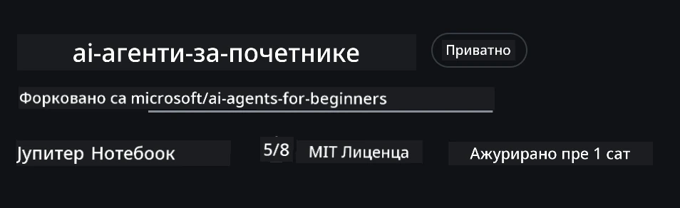
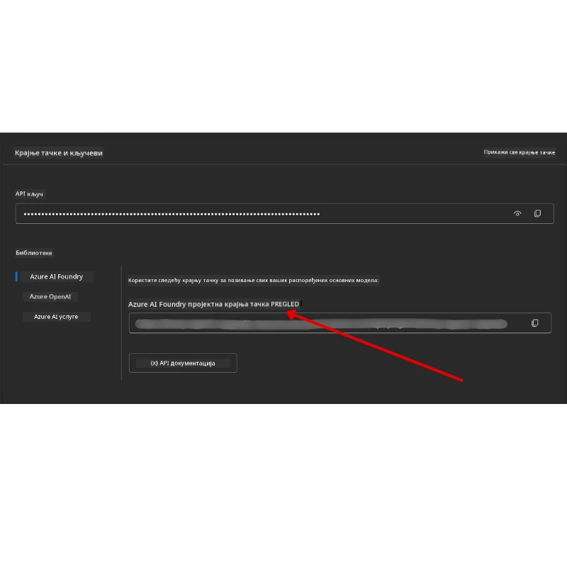

# Подешавање курса

## Увод

Ова лекција ће обухватити како покренути примере кода из овог курса.

## Придружите се другим полазницима и добијте помоћ

Пре него што почнете са клонирањем свог репозиторијума, придружите се [AI Agents For Beginners Discord каналу](https://aka.ms/ai-agents/discord) да бисте добили помоћ са подешавањем, одговоре на питања о курсу или да се повежете са другим полазницима.

## Клонирајте или форкујте овај репозиторијум

За почетак, молимо вас да клонирате или форкујете GitHub репозиторијум. Ово ће вам омогућити да имате своју верзију материјала курса како бисте могли да покрећете, тестирате и подешавате код!

Ово можете урадити кликом на <a href="https://github.com/microsoft/ai-agents-for-beginners/fork" target="_blank">форкуј репо</a>

Сада бисте требали имати своју форковану верзију овог курса на следећем линку:



### Плитко клонирање (препоручено за радионице / Codespaces)

  > Цео репозиторијум може бити велики (~3 ГБ) када преузмете целу историју и све фајлове. Ако учествујете само на радионици или вам требају само одређене фасцикле са лекцијама, плитко клонирање (или делимично клонирање) преузима много мање.

#### Брзо плитко клонирање — минимална историја, сви фајлови

Замените `<your-username>` у командама испод са URL-ом вашег форка (или upstream URL ако више волите).

За клонирање само најновије историје комита (мање преузимање):

```bash
git clone --depth 1 https://github.com/<your-username>/ai-agents-for-beginners.git
```

За клонирање специфичне гране:

```bash
git clone --depth 1 --branch <branch-name> https://github.com/<your-username>/ai-agents-for-beginners.git
```

#### Делимично (sparse) клонирање — минимални blob-ови + само одабране фасцикле

Ово користи делимично клонирање и sparse-checkout (захтева Git 2.25+ и препоручује се модерни Git са подршком за делимично клонирање):

```bash
git clone --depth 1 --filter=blob:none --sparse https://github.com/<your-username>/ai-agents-for-beginners.git
```

Пребаците се у фасциклу репозиторијума:

```bash
cd ai-agents-for-beginners
```

Затим одредите које фасцикле желите (пример испод показује две фасцикле):

```bash
git sparse-checkout set 00-course-setup 01-intro-to-ai-agents
```

Након клонирања и провере фајлова, ако вам требају само фајлови и желите да ослободите простор (без Git историје), избришите метаподатке репозиторијума (💀неповратно — изгубићете сву Git функционалност):

```bash
# zsh/bash
rm -rf .git
```

```powershell
# PowerShell
Remove-Item -Recurse -Force .git
```

#### Коришћење GitHub Codespaces (препоручује се да избегнете локално преузимање великих фајлова)

- Креирајте нови Codespace за овај репо преко [GitHub UI](https://github.com/codespaces).  

- У терминалу ново креираног codespace-а покрените једну од горе наведених shallow/sparse команди да бисте довели у workspace само потребне фасцикле са лекцијама.
- Опционо: након клонирања унутар Codespaces, уклоните .git да бисте ослободили додатни простор (погледајте наредбе за уклањање изнад).
- Напомена: Ако више волите да отворите репозиторијум директно у Codespaces (без додатног клонирања), имајте у виду да ће Codespaces конструисати devcontainer окружење и можда ће и даље обезбедити више од онога што вам треба.

#### Савети

- Увек замените URL за клонирање са URL-ом вашег форка ако желите да радите измене/комите.
- Ако вам касније затреба више историје или фајлова, можете их повући или подесити sparse-checkout тако да укључи додатне фасцикле.

## Покретање кода

Овај курс нуди серију Jupyter свески које можете покретати да стекнете практично искуство у изради AI агената.

Примери кода користе **Microsoft Agent Framework (MAF)** са `FoundryChatClient`, који се повезује на **Microsoft Foundry Agent Service V2** (Responses API) преко **Microsoft Foundry**.

Све Python свеске су означене као `*-python-agent-framework.ipynb`.

## Захтеви

- Python 3.12+
  - **НАПОМЕНА**: Ако немате инсталиран Python3.12, обавезно га инсталирајте. Затим направите ваш venv коришћењем python3.12 да бисте осигурали исправне верзије из requirements.txt фајла.
  
    >Пример

    Креирајте директоријум за Python venv:

    ```bash
    python -m venv venv
    ```

    Затим активирајте venv окружење за:

    ```bash
    # zsh/bash
    source venv/bin/activate
    ```
  
    ```dos
    # Command Prompt for Windows
    venv\Scripts\activate
    ```

- .NET 10+: За пример кодова који користе .NET, уверите се да имате инсталиран [.NET 10 SDK](https://dotnet.microsoft.com/download/dotnet/10.0) или новији. Затим проверите верзију .NET SDK коју имате инсталирану:

    ```bash
    dotnet --list-sdks
    ```

- **Azure CLI** — Неопходан за аутентификацију. Инсталирајте са [aka.ms/installazurecli](https://aka.ms/installazurecli).
- **Azure претплата** — За приступ Microsoft Foundry и Microsoft Foundry Agent Service.
- **Microsoft Foundry пројекат** — Пројекат са раније објављеним моделом (нпр. `gpt-5-mini`). Погледајте [Корак 1](#step-1-create-a-microsoft-foundry-project) у наставку.

У корену овог репозиторијума налази се `requirements.txt` фајл који садржи све неопходне Python пакете за покретање примера кода.

Можете их инсталирати тако што ћете у терминалу у корену репозиторијума покренути следећу команду:

```bash
pip install -r requirements.txt
```

Препоручујемо креирање виртуелног Python окружења како бисте избегли конфликте и проблеме.

## Подешавање VSCode-а

Уверите се да користите исправну верзију Python-а у VSCode-у.


## Подешавање Microsoft Foundry и Microsoft Foundry Agent Service

### Корак 1: Креирање Microsoft Foundry пројекта

Потребан вам је Microsoft Foundry **пројекат** са објављеним моделом да бисте покренули свеске. Креирајте пројекат директно у тренутном Microsoft Foundry окружењу; hub није потребан.

1. Идите на [ai.azure.com](https://ai.azure.com) и пријавите се са својим Azure налогом.
2. Изаберите **Create project** (Креирај пројекат) и следите упутства за креирање пројекта.
3. У пројекту објавите модел (нпр. `gpt-5-mini`) преко **Models + Endpoints** → **Deploy model**.

### Корак 2: Преузимање URL-а ендпоинта и имена распоређеног модела

Из вашег пројекта у Microsoft Foundry порталу:

- **Project Endpoint** — Идите на страницу **Overview** и копирајте URL ендпоинта.



- **Model Deployment Name** — Идите на **Models + Endpoints**, изаберите свој распоређени модел и забележите **Deployment name** (на пример, `gpt-5-mini`).

### Корак 3: Пријавите се на Azure помоћу `az login`

Већина свески се аутентификује преко ваше **Azure CLI пријаве** — користећи `AzureCliCredential` или `DefaultAzureCredential` (обе користе ваш `az login` session) из пакета `azure-identity` — па не захтевају API кључеве. Неколико лекција и опционих интеграција користи API кључеве; проверите предуслове сваке лекције за додатне вредности окружења. Ово захтева да будете пријављени преко Azure CLI.

1. **Инсталирајте Azure CLI** ако већ нисте: [aka.ms/installazurecli](https://aka.ms/installazurecli)

2. **Пријавите се** покретањем:

    ```bash
    az login
    ```

    Или ако сте у remote/Codespace окружењу без прегледача:

    ```bash
    az login --use-device-code
    ```

3. **Изаберите вашу претплату** ако вам буде тражено — одаберите ону која садржи ваш Foundry пројекат.

4. **Проверите** да ли сте пријављени:

    ```bash
    az account show
    ```

> **Зашто `az login`?** Свеске се аутентификују користећи `AzureCliCredential` (или `DefaultAzureCredential`, који такође користи вашу Azure CLI пријаву) из пакета `azure-identity`. То значи да ваша Azure CLI сесија обезбеђује креденцијале — нема API кључева или тајни у вашем `.env` фајлу. Ово је [безбедносна најбоља пракса](https://learn.microsoft.com/azure/developer/ai/keyless-connections).

### Корак 4: Направите свој `.env` фајл

Копирајте пример фајла:

```bash
# zsh/bash
cp .env.example .env
```

```powershell
# PowerShell
Copy-Item .env.example .env
```

Отворите `.env` и попуните ове две вредности:

```env
AZURE_AI_PROJECT_ENDPOINT=https://<your-project>.services.ai.azure.com/api/projects/<your-project-id>
AZURE_AI_MODEL_DEPLOYMENT_NAME=gpt-5-mini
```

| Променљива | Где је пронаћи |
|----------|-----------------|
| `AZURE_AI_PROJECT_ENDPOINT` | Foundry портал → ваш пројекат → **Преглед** страница |
| `AZURE_AI_MODEL_DEPLOYMENT_NAME` | Foundry портал → **Модели + Крајње тачке** → име вашег распореденог модела |

То је то за већину лекција! Бележнице ће се аутоматски аутентификовати преко ваше `az login` сесије.

### Корак 5: Инсталирајте Python зависности

```bash
pip install -r requirements.txt
```

Препоручујемо да ово покренете унутар виртуелног окружења које сте раније креирали.

## Опционална подешавања: Azure AI претрага (Лекције 5 и 16)

Лабораторије 5 (Agentic RAG) и 16 раде одмах са **ин-мемори базом знања** — није потребно додатно Azure ресурсa. Ако их желите подржати правим **Azure AI Search** индексом, имајте на уму да **Лабораторија 16 тренутно користи аутентификацију засновану на кључу**: прелази са претраге у меморији на Azure AI Search само када су подешени **и** `AZURE_SEARCH_SERVICE_ENDPOINT` **и** `AZURE_SEARCH_API_KEY`, у супротном остаје на претрази у меморији — тако да за рад са стварним индексом морате поставити и администраторски кључ. Аутентификација без кључа са Microsoft Entra ID (RBAC) је препоручени приступ за ваш властити продукциони код, у складу са током `az login` који се користи свуда у овом курсу.

Следећи кораци за RBAC односе се на узорке из водича за подешавање и ваш властити код. Они не омогућавају аутентификацију без кључа у Лабораторији 16; Лабораторија 16 и даље захтева оба — крајњу тачку и администраторски кључ — за коришћење Azure AI Search.

1. **Омогућите приступ заснован на улогама** на вашем претраживачком сервису:

    ```bash
    az search service update --name <service-name> --resource-group <resource-group> --auth-options aadOrApiKey
    ```

2. **Доделите себи потребне улоге** (креирање/учитавање индекса и упити):

    ```bash
    az role assignment create --assignee <your-user-or-principal-id> --role "Search Service Contributor" --scope $(az search service show -g <resource-group> -n <service-name> --query id -o tsv)
    az role assignment create --assignee <your-user-or-principal-id> --role "Search Index Data Contributor" --scope $(az search service show -g <resource-group> -n <service-name> --query id -o tsv)
    ```

3. **Додајте крајњу тачку** у ваш `.env` фајл:

| Променљива | Где је пронаћи |
|----------|-----------------|
| `AZURE_SEARCH_SERVICE_ENDPOINT` | Azure портал → ваш **Azure AI Search** ресурс → **Преглед** → URL |
| `AZURE_SEARCH_API_KEY` | Потребно (са крајњом тачком) за омогућавање Azure AI Search у свесци Лекција 16 која користи аутентификацију на бази кључа. Azure портал → **Подешавања** → **Кључеви** → примарни админ кључ |

> **Зашто без кључа?** Административни кључеви пружају пун приступ за писање вашој услузи претраге и могу бити процурели путем `.env` фајлова. Са RBAC-ом, користи се ваша `az login` идентификација уместо тога — исти модел безкључног Entra ID који курс свеске користе (преко `AzureCliCredential` / `DefaultAzureCredential`). Погледајте [Повежите се на Azure AI Search користећи улоге](https://learn.microsoft.com/azure/search/search-security-rbac).

Погледајте [Azure AI Search упутство за подешавање](./AzureSearch.md) за потпуне примере креирања индекса у Python и .NET.

## Додатна подешавања за лекције које директно позивају Azure OpenAI (Лекције 6 и 8)

Неке свеске у лекцијама 6 и 8 позивају **Azure OpenAI** директно (користећи **Responses API**) уместо да иду преко Microsoft Foundry пројекта. Ови примери су раније користили GitHub Models, који је застарео и не подржава Responses API. Додајте ове променљиве у ваш `.env` фајл:

| Променљива | Где се налази |
|----------|-----------------|
| `AZURE_OPENAI_ENDPOINT` | Azure портал → ваш **Azure OpenAI** ресурс → **Кључеви и крајња тачка** → Крајња тачка (нпр. `https://<your-resource>.openai.azure.com`) |
| `AZURE_OPENAI_DEPLOYMENT` | Назив вашег распоређеног модела (нпр. `gpt-5-mini`) који подржава Responses API |
| `AZURE_OPENAI_API_KEY` | Опционо — само ако користите аутентификацију засновану на кључу уместо `az login` / Entra ID |

> Responses API користи стабилну `/openai/v1/` крајњу тачку, па није потребан `api-version`. Пријавите се са `az login` да бисте користили безкључну Entra ID аутентификацију.

## Алтернативни провајдер: MiniMax (компатибилан са OpenAI)

[MiniMax](https://platform.minimaxi.com/) пружа моделе са великим контекстом (до 204K токена) путем OpenAI-компатибилног API-ја. Пошто Microsoft Agent Framework-ов `OpenAIChatClient` ради са било којом OpenAI-компатибилном крајњом тачком, можете користити MiniMax као замену за лекције које користе `OpenAIChatClient`.

Додајте ове променљиве у ваш `.env` фајл:

| Променљива | Где је пронаћи |
|----------|-----------------|
| `MINIMAX_API_KEY` | [MiniMax платформа](https://platform.minimaxi.com/) → API кључеви |
| `MINIMAX_BASE_URL` | Користите `https://api.minimax.io/v1` (подразумевана вредност) |
| `MINIMAX_MODEL_ID` | Назив модела за коришћење (нпр. `MiniMax-M3`) |

**Пример модела**: `MiniMax-M3` (препоручено), `MiniMax-M2.7`, `MiniMax-M2.7-highspeed` (бржи одговори). Називи и доступност модела могу се временом мењати, а приступ одређеном моделу може зависити од вашег налога.

Примерци кода који користе `OpenAIChatClient` (нпр. радни ток за резервацију хотела у лекцији 14) аутоматски ће препознати и користити вашу MiniMax конфигурацију када је `MINIMAX_API_KEY` постављен.

## Алтернативни провајдер: Novita AI (компатибилан са OpenAI)

[Novita AI](https://novita.ai/llm-api) пружа OpenAI-компатибилан API за open-source и најсавременије LLM-ове (DeepSeek, Llama, Qwen и друге). Пошто Microsoft Agent Framework-ов `OpenAIChatClient` ради са било којим OpenAI-компатибилним крајњим тачкама, можете користити Novita AI као замену за Azure OpenAI или OpenAI.

Додајте ове променљиве у ваш `.env` фајл:

| Променљива | Где је наћи |
|----------|-----------------|
| `NOVITA_API_KEY` | [Novita AI Контролна Табла](https://novita.ai/settings/key-management) → API кључеви |
| `NOVITA_BASE_URL` | Користите `https://api.novita.ai/openai/v1` (подразумевана вредност) |
| `NOVITA_MODEL_ID` | Назив модела који ће се користити (нпр. `moonshotai/kimi-k3`) |

**Примери модела**: `moonshotai/kimi-k3`, `zai-org/glm-5.2`, `deepseek/deepseek-v4-flash-0731`. Novita AI такође хостује многе друге породице open-source модела (Llama, Qwen, GLM и друге) — проверите [Novita AI библиотеку модела](https://novita.ai/llm-api) за актуелну листу доступних модела и њихове ID-ове.

Тренутни примери аутоматски не користе `NOVITA_*` променљиве. Да бисте користили Novita AI, проследите ове вредности експлицитно приликом креирања `OpenAIChatClient` у примеру који покрећете.

## Алтернативни провајдер: Foundry Local (Покретање модела на уређају)

[Foundry Local](https://foundrylocal.ai) је лагано окружење које преузима, управља и покреће језичке моделе **сасвим на вашем рачунару** кроз OpenAI-компатибилан API — без потребе за облаком.

Пошто Microsoft Agent Framework-ов `OpenAIChatClient` ради са било којим OpenAI-компатибилним крајњим тачкама, Foundry Local је локална замена за Azure OpenAI.

**1. Инсталирајте Foundry Local**

```bash
# Windows
winget install Microsoft.FoundryLocal

# macOS
brew install foundrylocal
```

**2. Преузмите и покрените модел** (ово такође покреће локални сервис):

```bash
foundry model list          # see available models
foundry model run phi-4-mini
```

**3. Инсталирајте Python SDK** који се користи за откривање локалне крајње тачке:

```bash
pip install foundry-local-sdk
```

**4. Усмерите Microsoft Agent Framework на ваш локални модел:**

```python
from foundry_local import FoundryLocalManager
from agent_framework.openai import OpenAIChatClient

# Downloads (if needed) and serves the model locally, then discovers the endpoint/port.
manager = FoundryLocalManager("phi-4-mini")

chat_client = OpenAIChatClient(
    base_url=manager.endpoint,      # e.g. http://localhost:<port>/v1
    api_key=manager.api_key,        # always "not-required" for Foundry Local
    model_id=manager.get_model_info("phi-4-mini").id,
)

agent = chat_client.as_agent(
    name="LocalAgent",
    instructions="You are a helpful assistant running fully on-device.",
)
```

> **Напомена:** Foundry Local излаже OpenAI-компатибилну крајњу тачку за **Chat Completions**. Користите је за локални развој и рад у оффлајн режиму. За пуну функционалност **Responses API** (државне конверзације, итд.), користите Azure OpenAI или Microsoft Foundry пројекат.

## Додатна подешавања за Лекцију 8 (Bing Grounding Workflow)

Условни workflow notebook у лекцији 8 користи **Bing grounding** преко Microsoft Foundry. Ако планирате да покренете тај пример, додајте ову променљиву у ваш `.env` фајл:

| Променљива | Где је наћи |
|----------|-----------------|
| `BING_CONNECTION_ID` | Microsoft Foundry портал → ваш пројекат → **Управљање** → **Повезани ресурси** → ваша Bing конекција → копирајте ID конекције |

## Решавање проблема

### Грешке приликом верификације SSL сертификата на macOS

Ако сте на macOS и наиђете на грешку као:

```plaintext
ssl.SSLCertVerificationError: [SSL: CERTIFICATE_VERIFY_FAILED] certificate verify failed: self-signed certificate in certificate chain
```

Ово је познат проблем са Python-ом на macOS-у где системски SSL сертификати нису аутоматски прихваћени. Покушајте следећа решења по реду:

**Опција 1: Покрените Python Install Certificates скрипту (препоручено)**

```bash
# Replace 3.XX with your installed Python version (e.g., 3.12 or 3.13):
/Applications/Python\ 3.XX/Install\ Certificates.command
```

**Опција 2: Користите `connection_verify=False` у вашем notebook-у (само за GitHub Models notebook-е)**

У Lesson 6 notebook-у (`06-building-trustworthy-agents/code_samples/06-system-message-framework.ipynb`), већ је укључено коментарисано решење. Одвратите коментар са `connection_verify=False` када наиђете на грешке са сертификатом:

```python
client = ChatCompletionsClient(
    endpoint=endpoint,
    credential=AzureKeyCredential(token),
    connection_verify=False,  # Disable SSL verification if you encounter certificate errors
)
```

> **⚠️ Упозорење:** Искључивање SSL провере (`connection_verify=False`) смањује безбедност јер прескаче валидацију сертификата. Користите ову опцију само као привремено решење у развојним окружењима. Нико је не користите у продукцији.

**Опција 3: Инсталирајте и користите `truststore`**

```bash
pip install truststore
```

Затим додајте следеће на врх вашег notebook-а или скрипте пре него што направите било какав мрежни позив:

```python
import truststore
truststore.inject_into_ssl()
```

## Запели сте негде?

Ако имате било каквих проблема са овим подешавањем, придружите се нашем <a href="https://discord.gg/kzRShWzttr" target="_blank">Azure AI Community Discord-у</a> или <a href="https://github.com/microsoft/ai-agents-for-beginners/issues?WT.mc_id=academic-105485-koreyst" target="_blank">отворите тикет</a>.

## Следећа лекција

Сада сте спремни да покренете код за овај курс. Срећно у учењу о свету AI Агената!

[Увод у AI Агенте и њихове примере употребе](../01-intro-to-ai-agents/README.md)

---

<!-- CO-OP TRANSLATOR DISCLAIMER START -->
**Изјава о одрицању одговорности**:
Овај документ је преведен коришћењем услуге за аутоматски превод [Co-op Translator](https://github.com/Azure/co-op-translator). Иако тежимо тачности, имајте у виду да аутоматски преводи могу садржати грешке или нетачности. Оригинални документ на његовом изворном језику треба сматрати ауторитативним извором. За критичне информације препоручује се професионални људски превод. Нисмо одговорни за било каква неспоразума или погрешна тумачења која произилазе из коришћења овог превода.
<!-- CO-OP TRANSLATOR DISCLAIMER END -->