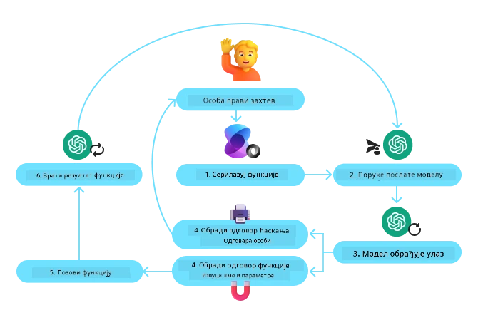
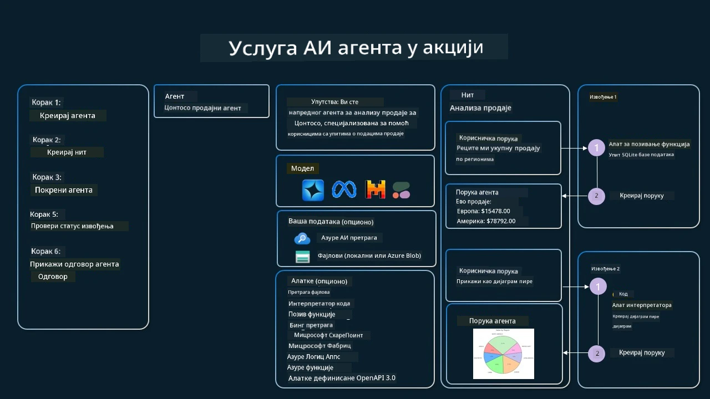

[](https://youtu.be/vieRiPRx-gI?si=cEZ8ApnT6Sus9rhn)

> _(Кликните на слику изнад да бисте погледали видео о овом лекцији)_

# Образац дизајна коришћења алата

Алати су занимљиви јер омогућавају АИ агентима да имају ширии спектар способности. Уместо да агент има ограничен скуп акција које може извршити, додавањем алата, агент може сада извршити широк спектар акција. У овом поглављу ћемо погледати Образац дизајна коришћења алата, који описује како АИ агенти могу користити специфичне алате да би постигли своје циљеве.

## Увод

У овој лекцији, покушавамо да одговоримо на следећа питања:

- Шта је образац дизајна коришћења алата?
- За које случајеве употребе се може применити?
- Који су елементи/компоненте потребни за имплементацију тог обрасца дизајна?
- Који су посебни аспекти приликом коришћења обрасца дизајна коришћења алата за израду поузданих АИ агената?

## Циљеви учења

Након завршетка ове лекције, моћи ћете да:

- Дефинишете образац дизајна коришћења алата и његову сврху.
- Препознате случајеве употребе где је образац дизајна коришћења алата примењив.
- Разумете кључне елементе потребне за имплементацију обрасца дизајна.
- Препознате аспекте за обезбеђивање поузданости АИ агената који користе овај образац дизајна.

## Шта је образац дизајна коришћења алата?

**Образац дизајна коришћења алата** фокусира се на давање могућности LLM моделима да интерагују са спољним алатима како би постигли одређене циљеве. Алати су код који агент може извршити да би обавио акције. Алат може бити једноставна функција као што је калкулатор, или позив API-ја треће стране, попут претраге цена акција или прогноза времена. У контексту АИ агената, алати су дизајнирани да се извршавају од стране агената као одговор на **позиве функција генерисаних од стране модела**.

## За које случајеве употребе се може применити?

АИ агенти могу користити алате за завршетак сложених задатака, проналажење информација или доношење одлука. Образац дизајна коришћења алата често се користи у сценаријима који захтевају динамичку интеракцију са спољним системима, као што су базе података, веб сервиси или интерпретатори кода. Ова способност је корисна за низ различитих случајева употребе као што су:

- **Динамично проналажење информација:** Агенти могу упитати спољне API-је или базе података како би повукли ажуриране податке (нпр. упит за SQLite базу ради анализе података, повлачење цена акција или информација о времену).
- **Извршавање и тумачење кода:** Агенти могу извршавати код или скрипте за решавање математичких проблема, генерисање извештаја или извођење симулација.
- **Аутоматизација радног тока:** Аутоматизација понављајућих или вишестепених радних токова интеграцијом алата као што су планери задатака, сервисе за е-пошту или цевоводе за податке.
- **Корисничка подршка:** Агенти могу комуницирати са CRM системима, платформама за улазнице или базама знања како би решили корисничке упите.
- **Генерисање и уређивање садржаја:** Агенти могу користити алате као што су провера граматике, резимирање текста или процена безбедности садржаја да помогну у задацима креирања садржаја.

## Који су елементи/компоненте потребни за имплементацију обрасца дизајна коришћења алата?

Ове компоненте омогућавају АИ агенту да обави широк спектар задатака. Погледајмо кључне елементе потребне за имплементацију Обрасца дизајна коришћења алата:

- **Схеме функција/алата**: Детаљни описи доступних алата, укључујући назив функције, сврху, потребне параметре и очекиване излазе. Ове шеме омогућавају LLM моделу да разуме које су алате доступне и како да конструише валидне захтеве.

- **Логика извршавања функција**: Управља како и када се алати позивају на основу намере корисника и контекста разговора. Ово може укључивати модуле планера, механизме усмеравања или условне токове који динамички одређују коришћење алата.

- **Систем за руковање порукама**: Компоненте које управљају течењем разговора између уноса корисника, одговора LLM, позива алата и излаза алата.

- **Интеграциони оквир за алате**: Инфраструктура која повезује агента са разним алатима, без обзира да ли су то једноставне функције или сложене спољне услуге.

- **Руцијавање грешака и валидација**: Механизми за управљање неуспесима у извршавању алата, проверу параметара и управљање неочекиваним одговорима.

- **Управљање стањем**: Праћење контекста разговора, претходних интеракција са алатима и постојаних података како би се обезбедила конзистентност у вишекратним интеракцијама.

Следеће, погледајмо позивање функција/алата детаљније.
 
### Позивање функције/алата

Позивање функције је основни начин на који омогућавамо Великим језичким моделима (LLM) да интерагују са алатима. Често ћете видети да се „функција“ и „алат“ користе наизменично јер су „функције“ (блокови поновно употребљивог кода) „алати“ које агенти користе за обављање задатака. Да би се извршио код функције, LLM мора упоредити захтев корисника са описом функције. За ово се шаље шема која садржи описе свих доступних функција LLM-у. Онда LLM одабере најприкладнију функцију за задатак и враћа њен назив и аргументе. Одабрана функција се позива, њен одговор се шаље назад LLM-у, који користи те информације да одговори на захтев корисника.

Да би програмери имплементирали позивање функције за агенте, биће вам потребно:

1. LLM модел који подржава позивање функција
2. Шема која садржи описе функција
3. Код за сваку описану функцију

Узмимо пример добијања тренутног времена у граду као илустрацију:

1. **Иницијализујте LLM који подржава позивање функција:**

    Ни сви модели не подржавају позивање функција, па је важно проверити да ли модел који користите то чини. <a href="https://learn.microsoft.com/azure/ai-services/openai/how-to/function-calling" target="_blank">Azure OpenAI</a> подржава позивање функција. Можемо почети иницијализацијом OpenAI клијента преко Azure OpenAI **Responses API** (стабилна `/openai/v1/` тачка — није потребан `api_version`). 

    ```python
    # Initialize the OpenAI client for Azure OpenAI (Responses API, v1 endpoint)
    client = OpenAI(
        base_url=f"{os.environ['AZURE_OPENAI_ENDPOINT'].rstrip('/')}/openai/v1/",
        api_key=os.environ["AZURE_OPENAI_API_KEY"],
    )
    deployment_name = os.environ["AZURE_OPENAI_DEPLOYMENT"]
    ```

1. **Креирајте шему функције**:

    Следеће ћемо дефинисати JSON шему која садржи назив функције, опис шта функција ради, као и имена и опсеге параметара функције.
    Потом ћемо ову шему проследити клијенту који смо претходно креирали, заједно са корисничким захтевом за добијање времена у Сан Франциску. Важно је напоменути да је резултат **позив алата**, а **не** коначни одговор на питање. Као што је раније поменуто, LLM враћа назив функције коју је изабрао за задатак и аргументе које ће јој проследити.

    ```python
    # Function description for the model to read (Responses API flat tool format)
    tools = [
        {
            "type": "function",
            "name": "get_current_time",
            "description": "Get the current time in a given location",
            "parameters": {
                "type": "object",
                "properties": {
                    "location": {
                        "type": "string",
                        "description": "The city name, e.g. San Francisco",
                    },
                },
                "required": ["location"],
            },
        }
    ]
    ```
   
    ```python
  
    # Initial user message
    messages = [{"role": "user", "content": "What's the current time in San Francisco"}]

    # First API call: Ask the model to use the function
    response = client.responses.create(
        model=deployment_name,
        input=messages,
        tools=tools,
        tool_choice="auto",
        store=False,
    )

    # The Responses API returns tool calls as function_call items in response.output.
    # Append them to the conversation so the model has full context on the next turn.
    messages += response.output

    print("Model's response:")
    print(response.output)
  
    ```

    ```bash
    Model's response:
    [ResponseFunctionToolCall(arguments='{"location":"San Francisco"}', call_id='call_pOsKdUlqvdyttYB67MOj434b', name='get_current_time', type='function_call')]
    ```
  
1. **Код функције потребан за обављање задатка:**

    Сада када је LLM изабрао коју функцију треба извршити, потребно је имплементирати и извршити код који обавља задатак.
    Можемо имплементирати код за добијање тренутног времена у Питону. Такође ћемо писати код за издвајање имена и аргумената из response_message ради добијања коначног резултата.

    ```python
      def get_current_time(location):
        """Get the current time for a given location"""
        print(f"get_current_time called with location: {location}")  
        location_lower = location.lower()
        
        for key, timezone in TIMEZONE_DATA.items():
            if key in location_lower:
                print(f"Timezone found for {key}")  
                current_time = datetime.now(ZoneInfo(timezone)).strftime("%I:%M %p")
                return json.dumps({
                    "location": location,
                    "current_time": current_time
                })
      
        print(f"No timezone data found for {location_lower}")  
        return json.dumps({"location": location, "current_time": "unknown"})
    ```

     ```python
    # Handle function calls
    tool_calls = [item for item in response.output if item.type == "function_call"]
    if tool_calls:
        for tool_call in tool_calls:
            if tool_call.name == "get_current_time":

                function_args = json.loads(tool_call.arguments)

                time_response = get_current_time(
                    location=function_args.get("location")
                )

                # Return the tool result as a function_call_output item
                messages.append({
                    "type": "function_call_output",
                    "call_id": tool_call.call_id,
                    "output": time_response,
                })
    else:
        print("No tool calls were made by the model.")

    # Second API call: Get the final response from the model
    final_response = client.responses.create(
        model=deployment_name,
        input=messages,
        tools=tools,
        store=False,
    )

    return final_response.output_text
     ```

     ```bash
      get_current_time called with location: San Francisco
      Timezone found for san francisco
      The current time in San Francisco is 09:24 AM.
     ```

Позивање функција је у сржи већине, ако не и свих, образаца дизајна коришћења алата агената, али његова имплементација од почетка понекад може бити изазов.
Као што смо научили у [Лекцији 2](../../../02-explore-agentic-frameworks), агентски оквири нам пружају унапред изграђене блокове за имплементацију коришћења алата.
 
## Примери коришћења алата са агентским оквирима

Ево неколико примера како можете имплементирати образац дизајна коришћења алата користећи различите агентске оквире:

### Microsoft Agent Framework

<a href="https://learn.microsoft.com/azure/ai-services/agents/overview" target="_blank">Microsoft Agent Framework</a> је отворени АИ оквир за изградњу АИ агената. Поједностављује процес коришћења позивања функција омогућавајући вам да дефинишете алате као Питон функције са `@tool` декоратором. Оквир управља двосмерном комуникацијом између модела и вашег кода. Такође пружа приступ унапред изграђеним алатима као што су Претрага фајлова и Интерпретатор кода путем `FoundryChatClient`.

Следећа дијаграм илуструје процес позивања функција са Microsoft Agent Framework:



У Microsoft Agent Framework, алати су дефинисани као декорисане функције. Можемо претворити `get_current_time` функцију коју смо видели раније у алат коришћењем `@tool` декоратора. Оквир ће аутоматски серијализовати функцију и њене параметре, креирајући шему коју шаље LLM-у.

```python
import os
from agent_framework import tool
from agent_framework.foundry import FoundryChatClient
from azure.identity import AzureCliCredential

@tool(approval_mode="never_require")
def get_current_time(location: str) -> str:
    """Get the current time for a given location"""
    ...

# Create the client
provider = FoundryChatClient(
    project_endpoint=os.environ["AZURE_AI_PROJECT_ENDPOINT"],
    model=os.environ["AZURE_AI_MODEL_DEPLOYMENT_NAME"],
    credential=AzureCliCredential(),
)

# Create an agent and run with the tool
agent = provider.as_agent(name="TimeAgent", instructions="Use available tools to answer questions.", tools=get_current_time)
response = await agent.run("What time is it?")
```

#### Алати са MCP сервера

Алати не морају бити функције у вашем коду. Сервер који говори Протокол Контекста Модела (MCP, обрађен у [Лекцији 11](../11-agentic-protocols/README.md)) објављује своје алате заједно са њиховим шемама, а оквир их може учитати на исти начин на који серијализује декорисану функцију. `MCPStreamableHTTPTool` се повезује на такав сервер преко HTTP-а, чита шеме алата и нуди их моделу заједно са локалним алатима.

Испод је пример који користи веб претраживачки сервер који је хостовао <a href="https://keenable.ai" target="_blank">Keenable</a>. Бесплатан је за коришћење без налога или API кључа (захтеви су ограничени по IP-ју), тако да су једини креденцијали који су вам потребни они за ваш модел. Као и са било којим удаљеним алатом, упити које модел пише се шаљу том серверу.

```python
from agent_framework import MCPStreamableHTTPTool

web_search = MCPStreamableHTTPTool(
    name="Keenable web search",
    url="https://api.keenable.ai/mcp",
)

# Connecting loads the server's tool schemas; the agent decides when to call them
async with web_search:
    agent = provider.as_agent(
        name="ResearchAgent",
        instructions="Use available tools to answer questions.",
        tools=[web_search],
    )
    response = await agent.run("What is new in the latest Python release?")
    print(response.text)
```

Сервер објављује два алата, `search_web_pages` и `fetch_page_content`. Када је потребна актуелна информација, модел позива `search_web_pages`, добија наслове, URL-ове и одломке текста, и пише свој одговор из њих, исти процес као у `get_current_time` примеру горе.
  
### Microsoft Foundry Agent Service

<a href="https://learn.microsoft.com/azure/ai-services/agents/overview" target="_blank">Microsoft Foundry Agent Service</a> је новији агентски оквир који је дизајниран да омогући програмерима безбедно изградњу, постављање и скалирање висококвалитетних и проширивих АИ агената без потребе управљања основним ресурсима за рачунарство и складиштење. Посебно је користан за пословне апликације, јер је потпуно управљана услуга са sigurnošћу корпоративног нивоа.

У поређењу са развојем директно преко LLM API-ја, Microsoft Foundry Agent Service пружа неке предности, укључујући:

- Аутоматско позивање алата – није потребно ручно анализирати позив алата, позивати алат и управљати одговором; све је то сада на серверској страни
- Безбедно управљани подаци – уместо да управљате сопственим стањем разговора, можете се ослонити на нити које чувају све потребне информације
- Алати који су спремни за употребу – алати које можете користити за интеракцију са вашим изворима података, као што су Bing, Azure AI Search и Azure Functions.

Алати доступни у Microsoft Foundry Agent Service могу се поделити у две категорије:

1. Алати за знање:
    - <a href="https://learn.microsoft.com/azure/ai-services/agents/how-to/tools/bing-grounding?tabs=python&pivots=overview" target="_blank">Покретање претраге са Bing</a>
    - <a href="https://learn.microsoft.com/azure/ai-services/agents/how-to/tools/file-search?tabs=python&pivots=overview" target="_blank">Претрага фајлова</a>
    - <a href="https://learn.microsoft.com/azure/ai-services/agents/how-to/tools/azure-ai-search?tabs=azurecli%2Cpython&pivots=overview-azure-ai-search" target="_blank">Azure AI Search</a>

2. Алати за акцију:
    - <a href="https://learn.microsoft.com/azure/ai-services/agents/how-to/tools/function-calling?tabs=python&pivots=overview" target="_blank">Позивање функција</a>
    - <a href="https://learn.microsoft.com/azure/ai-services/agents/how-to/tools/code-interpreter?tabs=python&pivots=overview" target="_blank">Интерпретатор кода</a>
    - <a href="https://learn.microsoft.com/azure/ai-services/agents/how-to/tools/openapi-spec?tabs=python&pivots=overview" target="_blank">Алатке дефинисане OpenAPI-јем</a>
    - <a href="https://learn.microsoft.com/azure/ai-services/agents/how-to/tools/azure-functions?pivots=overview" target="_blank">Azure Functions</a>

Agent Service нам омогућава да користимо ове алате заједно као `toolset`. Такође користи `threads` који прате историју порука из одређеног разговора.

Замислите да сте продајни агент у компанији Contoso. Желите да развијете разговорног агента који може одговарати на питања о вашим продајним подацима.

Следећа слика илуструје како бисте могли користити Microsoft Foundry Agent Service за анализу ваших продајних података:



Да бисмо користили било који од ових алата у сервису, можемо креирати клијента и дефинисати алат или скуп алата. Да бисмо то практично имплементирали, можемо користити следећи Python код. LLM ће моћи да погледа скуп алата и одлучи да ли да користи кориснички креирану функцију, `fetch_sales_data_using_sqlite_query`, или унапред изграђени Интерпретатор кода, у зависности од корисничког захтева.

```python 
import os
from azure.ai.projects import AIProjectClient
from azure.identity import DefaultAzureCredential
from fetch_sales_data_functions import fetch_sales_data_using_sqlite_query # fetch_sales_data_using_sqlite_query function which can be found in a fetch_sales_data_functions.py file.
from azure.ai.projects.models import ToolSet, FunctionTool, CodeInterpreterTool

project_client = AIProjectClient.from_connection_string(
    credential=DefaultAzureCredential(),
    conn_str=os.environ["PROJECT_CONNECTION_STRING"],
)

# Initialize toolset
toolset = ToolSet()

# Initialize function calling agent with the fetch_sales_data_using_sqlite_query function and adding it to the toolset
fetch_data_function = FunctionTool(fetch_sales_data_using_sqlite_query)
toolset.add(fetch_data_function)

# Initialize Code Interpreter tool and adding it to the toolset. 
code_interpreter = CodeInterpreterTool()toolset.add(code_interpreter)

agent = project_client.agents.create_agent(
    model="gpt-5-mini", name="my-agent", instructions="You are helpful agent", 
    toolset=toolset
)
```

## Који су посебни аспекти приликом коришћења обрасца дизајна коришћења алата за израду поузданих АИ агената?

Честа брига у вези са динамички генерисаним SQL од стране LLM-а је сигурност, посебно ризик од SQL инјекције или злонамерних акција, као што је брисање или измена базе података. Иако су ове бриге валидне, могу се ефикасно ублажити правилном конфигурацијом дозвола за приступ бази података. За већину база то укључује конфигурисање базе као само за читање. За сервисе база као што су PostgreSQL или Azure SQL, апликацији треба доделити улогу само за читање (SELECT).

Покретање апликације у безбедном окружењу додатно повећава заштиту. У пословним сценаријима, подаци се обично извлаче и трансформишу из оперативних система у базу података или складиште података са приступом само за читање и кориснички прилагођеном шемом. Овај приступ осигурава да су подаци безбедни, оптимизовани за перформансе и приступачност, и да апликација има ограничен приступ само за читање.

## Пример кода

- Python: [Agent Framework](./code_samples/04-python-agent-framework.ipynb)
- .NET: [Agent Framework](./code_samples/04-dotnet-agent-framework.md)

## Имате ли још питања о Обрасцима дизајна коришћења алата?

Придружите се [Microsoft Foundry Discord](https://discord.com/invite/ATgtXmAS5D) да се упознате са другим полазницима, присуствујете офис сате и добијете одговоре на ваша питања о АИ агентима.

## Додатни ресурси

- <a href="https://microsoft.github.io/build-your-first-agent-with-azure-ai-agent-service-workshop/" target="_blank">Azure AI Agents Service Workshop</a>
- <a href="https://github.com/Azure-Samples/contoso-creative-writer/tree/main/docs/workshop" target="_blank">Радионца са више агената у Contoso Creative Writer-у</a>
- <a href="https://learn.microsoft.com/azure/ai-services/agents/overview" target="_blank">Преглед Microsoft Agent Framework-а</a>

## Тестирање овог агента (опционо)

Након што научите како да разврстате агенте у [Lesson 16](../16-deploying-scalable-agents/README.md), можете да тестирате да ли овај `TravelToolAgent` из овог часа и даље позива своје алате и одговара помоћу [`tests/lesson-04-smoke-tests.json`](../../../tests/lesson-04-smoke-tests.json). Погледајте [`tests/README.md`](../tests/README.md) за упутства како то да покренете.

## Претходни час

[Разумевање агенцијских дизајн шаблона](../03-agentic-design-patterns/README.md)

## Следећи час

[Агенцијски RAG](../05-agentic-rag/README.md)

---

<!-- CO-OP TRANSLATOR DISCLAIMER START -->
**Изјава о одрицању одговорности**:
Овај документ је преведен коришћењем услуге за аутоматски превод [Co-op Translator](https://github.com/Azure/co-op-translator). Иако тежимо тачности, имајте у виду да аутоматски преводи могу садржати грешке или нетачности. Оригинални документ на његовом изворном језику треба сматрати ауторитативним извором. За критичне информације препоручује се професионални људски превод. Нисмо одговорни за било каква неспоразума или погрешна тумачења која произилазе из коришћења овог превода.
<!-- CO-OP TRANSLATOR DISCLAIMER END -->