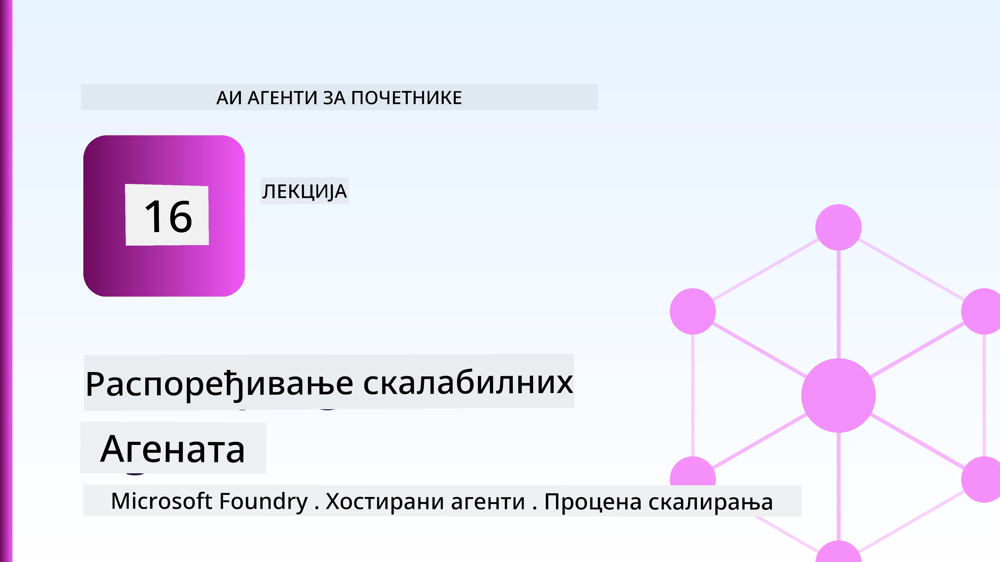
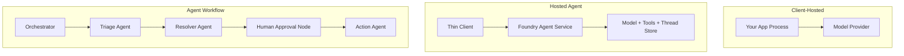
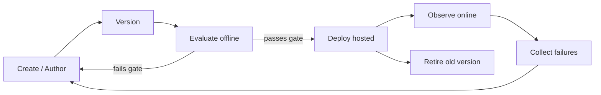
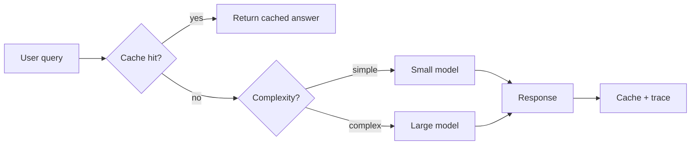
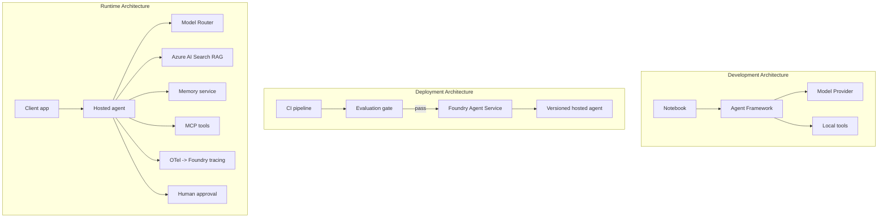

# Распоређивање скаларних агената помоћу Microsoft Foundry



До сада сте у току курса правили агенте који раде на вашем лаптопу, унутар нотебоок-а, покретани `az login` и неколико променљивих окружења. То је управо прави начин учења. Међутим, то није исправан начин да покренете агента на којем хиљаде корисника зависи у 3 ујутру.

Ова лекција говори о јазу између "ради на мом рачунару" и "ради поуздано и економично у продукцији." Тај јаз покривају **Microsoft Foundry** и **Microsoft Foundry Agent Service**, при чему градимо правог агента за корисничку подршку који има алате, ретривал, меморију, евалуацију и мониторинг.

## Увод

Ова лекција ће обухватити:

- Разлику између **прототип агента** и **распоређеног агента**, и зашто је прелазак углавном око свега *око* модела.
- **Обрасце распореда** агената: на клијенту, као услуга (Hosted Agents), и оркестриране радне токове.
- **Животни циклус агента** на Microsoft Foundry — креирање, верзионисање, распореда, евалуација, праћење, пензионисање.
- **Стратегије скалисања**: рутирање модела, кеширање, конкурентност и дизајн без стања.
- **Посматрање** уз OpenTelemetry и Foundry трасирање.
- **Оптимизација трошкова** кроз избор модела, рутирање и евалуационе капије.
- **Корпоративни аспекти**: управљање, људско одобрење и безбедно покретање MCP сервера у продукцији.

## Циљеви учења

Након ове лекције, знаћете како да:

- Изаберете правилан образац распореда за одређени радни оптерећење агента.
- Распоредите агента на Microsoft Foundry Agent Service тако да буде верзионисан, управљан и надгледан.
- Инструментирате агента за трасирање и повежете евалуациони ток који ради пре сваког издања.
- Примените рутирање модела и кеширање да бисте контролисали латенцију и трошкове у великом обиму.
- Додате људску капију одобрења за акције високог ризика и интегришете MCP сервер на безбедан начин у продукцији.

## Претпоставка

Ова лекција претпоставља да сте завршили претходне и да сте упознати са:

- Израдом агената са [Microsoft Agent Framework](../14-microsoft-agent-framework/README.md) (Лекција 14).
- [Коришћење алата](../04-tool-use/README.md) (Лекција 4) и [Agentic RAG](../05-agentic-rag/README.md) (Лекција 5).
- [Меморија агента](../13-agent-memory/README.md) (Лекција 13) и [Agentic Protocols / MCP](../11-agentic-protocols/README.md) (Лекција 11).
- [Надгледање и евалуација](../10-ai-agents-production/README.md) (Лекција 10) — ова лекција наставља директно на ову.

Такође ћете морати да имате:

- **Azure претплату** и **Microsoft Foundry пројекат** са најмање једним распореденим моделом за ћаскање.
- Аутентификовани **Azure CLI** (`az login`).
- Python 3.12+ и пакете у репозиторијуму [`requirements.txt`](../../../requirements.txt).

## Од прототипа до продукције: шта се заиста мења

Прототип агента и продукциони агент деле исти основни циклус — размишљање, позив алата, одговор. Све остало око тог циклуса је оно што се мења. Модел чини можда 20% продукционог агента; осталих 80% је оперативни скелет.

| Област | Прототип | Продукција |
| --- | --- | --- |
| **Хостинг** | Ради у вашем нотебоок-у | Ради као хостована услуга, са верзионисањем и објављивањем |
| **Идентитет** | Ваш `az login` токен | Управљани идентитет са ограниченим RBAC-ом |
| **Состојба** | У меморији, губи се приликом рестарта | Спољашња (складиште нитова, сервис меморије) |
| **Грешке** | Видите трацебацк | Понављања, резервне опције, dead-letter, упозорења |
| **Трошкови** | "То је неколико центи" | Прати се по захтеву, рутира, кешира, буџетира |
| **Квалитет** | Процјењујете погледом | Аутоматски се оцењује пре сваког издања |
| **Поверење** | Одобравате сваку акцију | Политика + људско присуство за ризичне радње |

Имајте на уму ову табелу. Сваки следећи одељак се односи на један од ових редова.

## Обрасци распореда агената

Постоје три обрасца које ћете користити, често у комбинацији.

### 1. Клијентски хостовани агенти

Објекат агента живи унутар *вашег* апликационог процеса. Ваш код директно позива провајдера модела; логика циклуса размишљања ради у вашој услузи. То је начин рада свих претходних лекција.

- **Користите када** вам је потребна пуна контрола над циклусом, прилагођені посреднички слој, или уграђујете агента у постојећи бекенд.
- **Компромис**: ви сами бринете о скалирању, стању и отпорности.

### 2. Хостовани агенти (Foundry Agent Service)

Агент је *регистрован као ресурс* у Microsoft Foundry. Foundry хостује циклус размишљања, чува нити, обезбеђује безбедност садржаја и RBAC, и чини агента видљивим у Foundry порталу. Ваша апликација постаје танак клијент који креира нити и чита одговоре.

- **Користите када** желите трајност, уграђену посматрачност, управљање и мању оперативну површину.
- **Компромис**: мање ниско-ниво контроле у замену за управљани рачунски оквир.

### 3. Радни токови агената

Више агената (и алата) се саставља у граф са експлицитним током управљања — секвенцијални кораци, разгранућа, људска одобрења, и трајне контролне тачке које могу да паузирају и наставе. Ово је могућност Microsoft Agent Framework **Workflows** примењена на скалу распореда.

- **Користите када** један задатак заузима неколико специјализованих агената или захтева корак одобрења у једном делу.
- **Компромис**: више покретних делова; потребна је оркестрациона посматрачност.



## Животни циклус агента на Microsoft Foundry

Распоређивање агента није једнократни `push`. То је циклус који подсећа на циклус издавања софтвера јер то и јесте.



Кључна идеја, преузета из [Лекције 10](../10-ai-agents-production/README.md): **офлајн евалуација је капија, не после-мисао.** Нова верзија агента није пуштена у рад док не прође ваше евалуационе прагове. Онлајн посматрачност онда уноси стварне грешке назад у ваш офлајн скуп тестова. То је цео циклус.

## Стратегије скалисања

Скалисање агента разликује се од скалисања бездржавног веб API-ја, јер сваки захтев може покренути више скупих позива модела и алата. Четири технике носе већину терета.

**Обрада захтева без стања.** Не чувати појединачно стање корисника у меморији процеса. Сачувајте нитове разговора у Foundry складиште нити или меморијски сервис тако да сваки примерак може обрадити било који захтев. Ово вам омогућава хоризонталну скалабилност — додајте примерке, без лепљивих сесија.

**Рутирање модела.** Ни сваки захтев не мора да користи најспособнији (и најскупљи) модел. Усмерите једноставне захтеве — класификација намера, кратки чињенични одговори — ка малом, брзом моделу, а велики модел резервишите за право размишљање. Foundry-јев **Model Router** може то за вас урадити, или можете имплементирати лагани класификатор сами. Ви ћете направити сопствену верзију у лабораторији.

**Кеширање одговора.** Многи захтеви корисника су готово дупликати ("како да ресетујем лозинку?"). Кеширајте одговоре на честе питања и послужите их без позивања модела. Чак и умерену стопу погодака кеша значајно смањује трошкове и латенцију.

**Конкурентност и притисак са назад.** Провајдери модела имају ограничења протока. Ограничите вашу конкурентност, користите покушаје са експоненцијалним одлагањем и нека падови буду грациозни (одговор "радимо на томе" у реду је бољи од 500).



## Посматрачност у продукцији

Не можете управљати тиме што не видите. Као што је обрађено у Лекцији 10, Microsoft Agent Framework нативно емитује **OpenTelemetry** трагове — сваки позив модела, покретање алата, и корак оркестрације постаје део трага. У продукцији извозите те делове у Microsoft Foundry (или било који OTel компатибилан бекенд) како бисте могли:

- Пратити једну жалбу корисника од почетка до краја кроз сваки позив модела и алата.
- Пратити латенцију п50/п95 и трошкове по захтеву током времена.
- Упозоравати на скокове у стопи грешака и аномалије трошкова пре него што то уоче ваши корисници (или ваш финансијски тим).

```python
from agent_framework.observability import get_tracer

tracer = get_tracer()

with tracer.start_as_current_span("support_request") as span:
    span.set_attribute("customer.tier", "enterprise")
    span.set_attribute("routed.model", "gpt-5-nano")
    # agent execution is traced automatically inside this span
```

Атрибути као што су `customer.tier` и `routed.model` претварају зид трагова у одговорна питања ("да ли корпоративни корисници пречесто добијају упућене одговоре на мали модел?").

## Оптимизација трошкова

Трошкови у продукционим агентима доминирају око броја токена. Три полуге, по утицају:

1. **Одредите праву величину модела.** Мали модел који пролази вашу капију евалуације је веома често јефтинији од великог који такође пролази. Користите евалуацију да *докажете* да је мали модел довољно добар уместо да по дифолту бирају највећи.
2. **Рутирајте по сложености.** Као што је речено — платите цену великог модела само за захтеве који то заиста захтевају.
3. **Агресивно кеширајте.** Најјефтинији позив модела је онај који никада не направите.

Капије евалуације и контролa трошкова су иста дисциплина посматрана из два угла: евалуација вам говори *ниво квалитета*, рутирање и кеширање вас држе што ближе *трошку* тог нивоа.

## Корпоративни аспекти распореда

**Управљање.** Hosted Agents наслеђују Foundry-јев RBAC, безбедност садржаја и аудит логове. Дајте сваком агенту управљани идентитет са најмањим потребним привилегијама — приступ за читање базе знања, ограничен приступ API-ју за тикете, ништа више.

**Људски фактор.** Неки поступци су превише важни да би се аутоматски радили — повраћај новца, брисање налога, ескалација правном тиму. Microsoft Agent Framework подржава **алате које захтевају одобрење**: агент предложи акцију, извршење се паузира, човек одобри или одбије, радни ток наставља. Примитивни пример сте видели у [Лекцији 6](../06-building-trustworthy-agents/README.md); овде га распоредите.

**MCP у продукцији.** [MCP](../11-agentic-protocols/README.md) омогућава вашем агенту да користи спољне алате преко стандардног интерфејса. У продукцији, третирајте сваки MCP сервер као непоуздану границу: закључајте верзију сервера, покрените га са ограниченим идентитетом, валидирајте излазне податке, и никад не излажите тајне. MCP сервер је зависност, а зависности се патчују, ревидирају и имају ограничења.



Та три дијаграма — развој, распореда, време извршавања — представљају истог агента у три фазе живота. Лабораторија у наставку вас води кроз његову изградњу.

## Практична лабораторија: Агенат за корисничку подршку спреман за продукцију

Отворите [`code_samples/16-python-agent-framework.ipynb`](./code_samples/16-python-agent-framework.ipynb) и радите кроз њега од почетка до краја. Саставићете **Contoso агента за корисничку подршку** са свим аспектима продукције:

1. **Позив алата** — преглед статуса поруџбине и отварање тикета за подршку.
2. **RAG** — одговори на питања о политици из базе знања (Azure AI Search, са меморијским бекупом да нотебоок ради без Search ресурса).
3. **Меморија** — памти купца кроз ток разговора.
4. **Рутирање модела** — класификатор сложености рутира сваки захтев ка малом или великом моделу.
5. **Кеширање одговора** — поновљена питања служе се из кеша.
6. **Људско одобрење** — повраћаји преко прага се паузирају ради људског потписа.
7. **Евалуациони ток** — мали офлајн скуп тестова оцењује агента и служи као капија за издање.
8. **Посматрачност** — OpenTelemetry праћење сваког захтева.

### Прођите кроз пример

Нотебоок је организован тако да је сваки аспект продукције самосталан, извршни део. Срж је руковање захтевима са рутирањем и кеширањем:

```python
async def handle_support_request(query: str, customer_id: str) -> str:
    # 1. Serve from cache when we can.
    cached = response_cache.get(normalize(query))
    if cached:
        return cached

    # 2. Route by complexity to control cost.
    model = "gpt-5-nano" if is_simple(query) else "gpt-5-mini"

    # 3. Run the agent inside a trace span for observability.
    with tracer.start_as_current_span("support_request") as span:
        span.set_attribute("routed.model", model)
        span.set_attribute("customer.id", customer_id)
        response = await support_agent.run(query, model=model)

    # 4. Cache and return.
    response_cache.set(normalize(query), response.text)
    return response.text
```

Капија евалуације која штити издање изгледа овако:

```python
async def evaluation_gate(agent, test_cases, threshold: float = 0.8) -> bool:
    passed = 0
    for case in test_cases:
        result = await agent.run(case["input"])
        if score_response(result.text, case["expected"]) >= 0.8:
            passed += 1
    pass_rate = passed / len(test_cases)
    print(f"Evaluation pass rate: {pass_rate:.0%} (gate: {threshold:.0%})")
    return pass_rate >= threshold  # only deploy if the gate passes
```

Прочитајте сваки ред — нотебоок одржава примитиве намерно малим да ништа није скривено иза позива оквира.

## Валидација распореденог агента помоћу Smoke тестова

Горе наведена капија евалуације ради *офлајн* против вашег агента. Кад је агент распореден као Hosted Agent, потребна вам је још једна, још јефтинија провера: **да ли распоређена тачка заправо одговара?**

РАспоређивање са "успехом" доказује само да је контролна равнина прихватила дефиницију — не доказује да агент одговара. Недостајућа зависност, погрешно рутирање модела или истекла конекција могу оставити зелено распоредење које ништа не враћа. **Smoke тест** хвата то у секунди, на сваком распоређивању, без трошкова потпуне евалуације.

Овај репозиторијум испоручује спремну за употребу smoke-тест цевовод базиран на [AI Smoke Test](https://github.com/marketplace/actions/ai-smoke-test) GitHub акцији:

- **Каталог** — [`tests/lesson-16-smoke-tests.json`](../../../tests/lesson-16-smoke-tests.json) садржи промптове и тврдње за Contoso агента подршке (одговоре из базе знanja, претрагу поруџбина, остајање на теми и континуитет више корака разговора). Каталози за агенте других лекција су поред њега — видите [`tests/README.md`](../tests/README.md).
- **Радни ток** — [`.github/workflows/smoke-test.yml`](../../../.github/workflows/smoke-test.yml) се пријављује са Azure OIDC и шаље сваки промпт на Responses крајњу тачку агента, и неуспех посла ако било која тврдња није испуњена.

```yaml
- name: Smoke-test hosted agent
  uses: JFolberth/ai-smoketest@v1
  with:
    project_endpoint: ${{ inputs.project_endpoint }}
    agent_name: ContosoSupportAgent
    tests_file: tests/lesson-16-smoke-tests.json
```

Покрените га са картице **Actions** након што ваш агент буде распоређен, достављајући крајњу тачку вашег Foundry пројекта и име агента. Федеративни идентитет треба да има улогу **Azure AI User** у опсегу Foundry пројекта. Замислите слојеве као пирамиду: тестови пушења (доступан и одговара?) се извршавају при сваком распоређивању, офлајн процена (довољно добра за пуштање у производњу?) се извршава пре промоције, а онлајн процена (како делује у реалном окружењу?) се непрекидно изводи.

## Провера знања

Тестирајте своје разумевање пре него што пређете на задатак.

**1. Око колико је процента производног агента „модел“, а шта је остало?**

<details>
<summary>Одговор</summary>

Модел је мањина система — често се наводи око 20%. Остатак је оперативни скелет: хостинг и верзионисање, идентитет и RBAC, екстерни статус, руковање кваровима, праћење трошкова, процена и контрола са људском интервенцијом. Прелазак у производњу је углавном око прављења свега *око* петље резоновања.
</details>

**2. Када бисте изабрали Hosted агент уместо агента који се покреће на клијенту?**

<details>
<summary>Одговор</summary>

Када желите управљано окружење са уграђеном издржљивошћу (теме које остају активне и могу да наставе), посматрањем, безбедношћу садржаја и RBAC, и спремни сте да жртвујете део ниског нивоа контроле петље резоновања за мање оперативно оптерећење. Клијентски агент је пожељнији када вам је потребна пуна контрола петље или када убацујете агента у постојећи бекенд.
</details>

**3. Зашто скалирајући агент мора бити без стања у својој меморији процеса?**

<details>
<summary>Одговор</summary>

Да свака инстанца може да обради било који захтев, што омогућава хоризонтално скалирање без лепљивих сесија. Конверзацијско стање по кориснику је екстерно смештено у складиште тема или меморијску услугу. Ако би стање живело у меморији процеса, изгубили бисте га при поновном покретању и не бисте могли слободно распоређивати оптерећење.
</details>

**4. Који проблем решава усмеравање модела и како је то повезано са проценом?**

<details>
<summary>Одговор</summary>

Усмеравање шаље једноставне захтеве малом, јефтином и брзом моделу и резервацију велики модел за стварно резоновање, контролишући и латенцију и трошкове. Повезано је са проценом јер процена *потврђује* да је мали модел довољно добар за одређену класу захтева — усмеравање без процене је погађање.
</details>

**5. Шта је „охранска капија“ процене и где се налази у животном циклусу?**

<details>
<summary>Одговор</summary>

Охранска капија процене извршава офлајн скуп тестова нове верзије агента и блокира распоређивање осим ако стопа пролаза не пређе праг. Налази се између „верзије“ и „распоређивања“ у животном циклусу, чинећи квалитет предусловом за објаву, а не нечем што се проверава после пуштања у рад.
</details>

**6. Зашто MCP сервер треба посматрати као непоуздану границу у производњи?**

<details>
<summary>Одговор</summary>

Јер је спољна зависност ка којој се агенат обраћа. Треба да закључате његову верзију, покрећете га са ограниченим идентитетом, валидацијујете његове излазе, ограничавајте му брзину позива и никада не откривајте доверљиве податке — исту дисциплину коју примењујете на било коју трећу страну. Његови излази улазе у резоновање вашег агента, тако да невалидирана поверења представљају безбедносни ризик.
</details>

**7. Која једна промена обично највише утиче на трошкове производног агента и зашто?**

<details>
<summary>Одговор</summary>

Правилно величинавање модела — коришћење најмањег модела који и даље пролази вашу оцену. Трошкови су углавном доминирани токенима, а мањи модел који испуњава ниво квалитета скоро увек је јефтинији од већег. Кеширање и усмеравање додатно смањују трошкове, али избор исправног основног модела има највећи примарни ефекат.
</details>

**8. Коју улогу атрибути преко опсега као што су `customer.tier` и `routed.model` играју у посматрању?**

<details>
<summary>Одговор</summary>

Претварају сирове трагове у могућност постављања пословних питања. Без атрибута имате зид опсега; са њима можете питати „да ли корпоративни корисници превише често добијају усмеравање ка малом моделу?“ или „који модел обрађује најспорије захтеве?“ Атрибути су начин да телеметрију раздвојите по димензијама које су важне за вашу операцију.
</details>

## Задатак

Узмите агента за корисничку подршку из лабораторије и ојачајте га за конкретан сценарио: **агент за подршку о наплати претплате у SaaS компанији.**

Ваш предлог треба да садржи:

1. **Замените алате** са оним релевантним за наплату: `get_subscription_status`, `get_invoice` и `issue_credit` (кредити преко 50 долара захтевају одобрење од људи).
2. **Додајте три RAG документа** који покривају политику повраћаја новца, циклус наплате и политику отказивања компаније.
3. **Проширите скуп за процену** на најмање осам случајева, укључујући најмање два која *требају* покренути пут одобрења од људи, и потврдите да ваша охранска капија правилно пролази или не пролази.
4. **Додајте једно извештавање о трошковима**: након покретања десет мешовитих упита кроз агента, испишите колико је ишло ка малом моделу, колико ка великом моделу и колико је обслужено из кеша.

Напишите кратак одломак (у markdown ћелији) објашњавајући које правило усмеравања модела сте изабрали и како бисте га валидирали са правим саобраћајем. Не постоји један тачан одговор — бићете оцењени по томе да ли су производни аспекти повезани у складу.

## Резиме

У овој лекцији сте пренели агента од прототипа до производње уз Microsoft Foundry:

- Прелазак у производњу је углавном око **оперативног скелета** око модела — хостинг, идентитет, стање, руковање кваровима, трошкови, квалитет и поверење.
- Научили сте три **образца распоређивања** — агент на клијенту, Hosted агенти и Agent Workflows — и када се који користи.
- Прошли сте кроз **животни циклус агента**, где офлајн **процена делује као капија за објаву**, а онлајн посматрање враћа кварове у скуп тестова.
- Применио сте **стратегије скалирања** — дизајн без стања, усмеравање модела, кеширање и ограничена конкурентност — и повезали их са **оптимизацијом трошкова**.
- Укључили сте **корпоративне контроле**: RBAC, одобрење човека у петљи, и производњски сигурну интеграцију MCP-а.
- Изградили сте **агента за корисничку подршку спремног за производњу** који повезује све ове аспекте у извршном коду.

Следећа лекција иде у супротном смеру: уместо скалирања агената у облак, спустићете их *на доњи ниво* на једну развојну машину и покренути их потпуно локално.

## Додатни ресурси

- <a href="https://learn.microsoft.com/azure/ai-foundry/what-is-azure-ai-foundry" target="_blank">Документација Microsoft Foundry</a>
- <a href="https://learn.microsoft.com/azure/ai-foundry/agents/overview" target="_blank">Преглед услуге Microsoft Foundry Agent</a>
- <a href="https://learn.microsoft.com/en-us/agent-framework/overview/?wt.mc_id=youtube_26688_organicsocial_reactor&pivots=programming-language-python" target="_blank">Microsoft Agent Framework</a>
- <a href="https://learn.microsoft.com/en-us/azure/ai-foundry/openai/concepts/model-router" target="_blank">Model Router у Microsoft Foundry</a>
- <a href="https://learn.microsoft.com/azure/search/search-what-is-azure-search" target="_blank">Azure AI Search</a>
- <a href="https://opentelemetry.io/" target="_blank">OpenTelemetry</a>
- <a href="https://github.com/marketplace/actions/ai-smoke-test" target="_blank">AI Smoke Test GitHub акција</a>
- <a href="https://modelcontextprotocol.io/" target="_blank">Model Context Protocol (MCP)</a>

## Претходна лекција

[Building Computer Use Agents (CUA)](../15-browser-use/README.md)

## Следећа лекција

[Прављење локалних AI агената](../17-creating-local-ai-agents/README.md)

---

<!-- CO-OP TRANSLATOR DISCLAIMER START -->
**Изјава о одрицању одговорности**:
Овај документ је преведен коришћењем услуге за аутоматски превод [Co-op Translator](https://github.com/Azure/co-op-translator). Иако тежимо тачности, имајте у виду да аутоматски преводи могу садржати грешке или нетачности. Оригинални документ на његовом изворном језику треба сматрати ауторитативним извором. За критичне информације препоручује се професионални људски превод. Нисмо одговорни за било каква неспоразума или погрешна тумачења која произилазе из коришћења овог превода.
<!-- CO-OP TRANSLATOR DISCLAIMER END -->