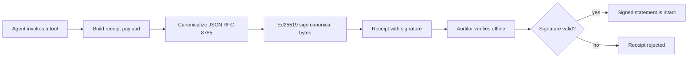
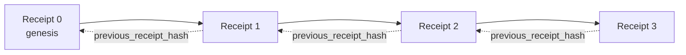

[Погледајте видео лекцију: Осигуравање AI агената криптографским потврдама](https://youtu.be/PLACEHOLDER_VIDEO_ID)

> _(Видео лекције и сличица ће бити додати од стране Microsoft тима за садржај након спајања, у складу са обрасцем лекција 14 / 15.)_

# Осигуравање AI агената криптографским потврдама

## Увод

У овој лекцији ће бити обрађено:

- Зашто су ревизијски трагови за AI агенте важни за усаглашеност, отклањање грешака и поверење.
- Шта је криптографска потврда и како се разликује од непотписане линије дневника.
- Како се произведе потписана потврда за позив алата агента у обичном Python-у.
- Како проверити потврду офлајн и детектовати измјену.
- Како повезати потврде тако да уклањање или преуређивање једне ремети ланац.
- Шта потврде доказују, а шта изричито не доказују.

## Циљеви учења

Након завршене ове лекције, знаћете како да:

- Препознате начине неуспеха који мотивишу криптографски исправност током активности агента.
- Произведете потврду потписану Ed25519 преко канонског JSON пуњивача.
- Проверите потврду независно користећи само јавни кључ потписивача.
- Детектујете измјену поновним покретањем провере на измењеној потврди.
- Изградите ланац повезаних потврда и објасните зашто је ланац важан.
- Препознате границу између онога што потврде доказују (атрибуција, интегритет, редослед) и онога што не доказују (тачност радње, исправност политике).

## Проблем: Ревизијски траг вашег агента

Замислите да сте поставили AI агента за Contoso Travel. Агент чита захтеве корисника, позива API за летове да нађе опције и резервише седишта у име корисника. Прошлог квартала, агент је обрадио 50.000 резервација.

Данас стиже ревидент. Поставља једноставно питање: "Покажи ми шта је твој агент радио."

Предајете датотеке дневника. Ревидент их погледа и поставља тежје питање: "Како знам да ови записи нису били уређивани?"

Ово је проблем ревизијског трага. Већина данашњих агената се ослања на:

- **Апликационе записе**: које пише сам агент, које може уређивати било ко са приступом фајл-систему.
- **Услуге облачног логовања**: доказиво непромењиве на нивоу платформе али само ако ревидент верује оператеру платформе.
- **Записи трансакција у бази података**: добри за промене у бази али не и за произвољне позиве алата.

Ниједна од ових опција не може одговорити ревиденту без даље вере у неко лице (вас, вашег провајдера облака, добављача базе података). За интерну употребу то је често прихватљиво. За регулисане радне оптерећења (финансије, здравство, све подложно EU AI акту) то није.

Криптографске потврде сужавају овај проблем тако што праве потписану изјаву која је независно
проверљива. Ревиденту је ипак потребан спољни разлог да верује потписном кључу и
компоненту која је произвела изјаву. Уграђени кључ доказује само унутрашњу конзистентност,
не идентитет издаваоца или место примене.

## Шта је Криптографска Потврда?

Потврда је JSON објекат који бележи шта је агент урадио, потписан дигиталним потписом.



Минимална потврда изгледа овако:

```json
{
  "type": "agent.tool_call.v1",
  "agent_id": "contoso-travel-bot",
  "tool_name": "lookup_flights",
  "tool_args_hash": "sha256:a3f9c1...",
  "result_hash": "sha256:7b2e1d...",
  "policy_id": "contoso-travel-policy-v3",
  "timestamp": "2026-04-25T14:30:00Z",
  "sequence": 47,
  "previous_receipt_hash": "sha256:9d4e6a...",
  "signature": {
    "alg": "EdDSA",
    "sig": "c5af83...",
    "public_key": "8f3b2c..."
  }
}
```

Три својства обављају посао:

1. **Потпис**. Потврда је потписана на улазној тачки агента користећи Ed25519 приватни кључ. Сваки ко има одговарајући јавни кључ може да верификује потпис офлајн. Корисник који се ослања мора да закључа тај кључ или да га добије из поузданог регистра ван потврде. Измена било ког потписаног поља поништава потпис.

2. **Канонско кодирање**. Пре потписивања, потврда се серијализује коришћењем JSON канонизационе шеме (JCS, RFC 8785). Ово осигурава да две имплементације које производе исти логички садржај дају потпуно идентичан бајт излаз. Без канонизације, различити JSON серијализатори дали би различите потписе за исти садржај.

3. **Повезивање хешем**. Поље `previous_receipt_hash` повезује сваку потврду са претходном. Уклањање или преуређивање потврде разбија представљени низ. Детекција прескакања или преписивања које контролише потписивач такође захтева закључану тренутну главу ланца, независно сведочени контролни скуп или аутентификовану обавезу за затворену популацију.

Заједно ова својства пружају три гаранције:

- **Атрибуција кључу**: овај кључ је потписао овај садржај. Организациони или људски идентитет захтева поуздану везу са кључем.
- **Интегритет**: садржај није промењен од времена потписивања.
- **Редослед у верификованом низу**: ова потврда је повезана са претходном.

## Прављење Потврде у Питону

Не треба вам посебна библиотека да направите потврду. Криптографски примитиви су широко доступни, а логика је само неколико десетина линија Python кода.

Практични задаци у `code_samples/18-signed-receipts.ipynb` воде вас кроз цео процес. Изворно контролисани `code_samples/18-signed-receipts.execution-receipt.json` бележи тачан хеш бележнице, Python окружење, број ћелија и провере из последњег чистог извршења без промене сачуваних резултата лекције. Сажетак:

```python
import json
import hashlib
import base64
from nacl import signing
from jcs import canonicalize  # RFC 8785 canonical JSON

def b64url_nopad(data: bytes) -> str:
    return base64.urlsafe_b64encode(data).decode("ascii").rstrip("=")

def sha256_canonical(obj) -> str:
    """SHA-256 of a Python object's JCS-canonical JSON form."""
    return f"sha256:{hashlib.sha256(canonicalize(obj)).hexdigest()}"

# Generate or load a signing key (in production, store in a key vault)
signing_key = signing.SigningKey.generate()
verify_key = signing_key.verify_key
TRUSTED_PUBLIC_KEYS = {b64url_nopad(bytes(verify_key))}  # pinned out of band by the verifier

# Build the receipt payload (no signature yet)
tool_args = {"origin": "SYD", "destination": "LAX"}
tool_result = [{"flight": "QF11", "price": 1850, "stops": 0}]

payload = {
    "type": "agent.tool_call.v1",
    "agent_id": "contoso-travel-bot",
    "tool_name": "lookup_flights",
    "tool_args_hash": sha256_canonical(tool_args),
    "result_hash": sha256_canonical(tool_result),
    "policy_id": "contoso-travel-policy-v3",
    "timestamp": "2026-04-25T14:30:00Z",
    "sequence": 0,
    "previous_receipt_hash": None,
}

# Canonicalize and sign the JCS bytes directly. PureEdDSA hashes internally.
canonical_bytes = canonicalize(payload)
signature_bytes = signing_key.sign(canonical_bytes).signature

# Attach a structured signature object.
receipt = {
    **payload,
    "signature": {
        "alg": "EdDSA",
        "sig": b64url_nopad(signature_bytes),
        "public_key": b64url_nopad(bytes(verify_key)),
    },
}
```

То је целокупни ток потписивања. Вежбе у бележници објашњавају сваки корак.

## Провера Потврде и Детекција Измене

Провера је обрнута операција:

```python
import base64
import hashlib
from nacl import signing
from nacl.exceptions import CryptoError
from jcs import canonicalize

def b64url_decode(s: str) -> bytes:
    padding = "=" * ((4 - len(s) % 4) % 4)
    return base64.b64decode(s + padding, altchars=b"-_", validate=True)

def verify_receipt(receipt: dict, trusted_public_keys: set[str]) -> bool:
    # The signature is a structured object: {"alg", "sig", "public_key"}.
    if not isinstance(receipt, dict):
        return False
    sig_obj = receipt.get("signature")
    if not isinstance(sig_obj, dict) or sig_obj.get("alg") != "EdDSA":
        return False
    try:
        # An inline key proves only self-consistency. Trust is configured out of band.
        public_key = sig_obj.get("public_key")
        signature = sig_obj.get("sig")
        if not isinstance(public_key, str) or not isinstance(signature, str):
            return False
        if public_key not in trusted_public_keys:
            return False
        payload = {k: v for k, v in receipt.items() if k != "signature"}
        canonical_bytes = canonicalize(payload)
        verify_key = signing.VerifyKey(b64url_decode(public_key))
        verify_key.verify(canonical_bytes, b64url_decode(signature))
        return True
    except (CryptoError, TypeError, ValueError, KeyError, OverflowError):
        return False
```

Овај метод прихвата потврду и скуп закључаних кључева корисника који се ослања и враћа
`True` само ако је потпис важећи под прихваћеним кључем. Проверa не захтева
позив мрежи, али поверење у кључ је и даље спољна конфигурациона одлука.

Да бисте видели детекцију измене у акцији, бележница вас води кроз:

1. Производњу ваљане потврде и потврду да се верификује.
2. Измену једног бајта у пољу `tool_args_hash`.
3. Поновно извођење провере и уочавање да не успева.

Ово је практична демонстрација да су потврде доказиво непромењиве: свака измена, ма колико мала била, разбија потпис.

## Повезивање Потврда за Више-Корачне Агенте

Једна потписана потврда штити једну радњу. Ланац потврда штити низ радњи.



Свaka потврда бележи хеш претходне. Да би нападач тихо уклонио потврду 2, морао би да:

- Измени поље `previous_receipt_hash` потврде 3 (што разбија потпис потврде 3), ИЛИ
- Креира нови потпис на измењеној потврди 3 (што захтева приватни кључ агента).

Ако је приватни кључ заштићен и верификатор закључава независно сведочену главу ланца,
ови напади су откривљиви. Објављивање кључа унутар сваке потврде није
довољно: потписивач или нападач може представити други кључ, преписати наставак или
прескочити ланац ако корисник није обезбедио спољни ослонац поверења и потпуности.

Бележница води корисника кроз:

1. Изградњу ланца од три потврде.
2. Верификацију да `previous_receipt_hash` сваке потврде одговара стварном хешу претходне.
3. Менјање једне потврде у средини и уочавање прекида ланца управо на том месту.

Овако правите ревизијски траг који спољни ревидент може проверити својим
закључаним издавачким кључевима и контролним тачкама ланца, без поверења у вашу изменљиву продавницу дневника.

## Шта Потврде Доказују (а шта Не Доказују)

Ово је најважнији део ове лекције. Потврде су моћне али њихова моћ је ограничена.

**Потврде доказују три ствари:**

1. **Атрибуцију**: одређени кључ је потписао одређени садржај.
2. **Интегритет**: садржај није промењен од времена потписивања.
3. **Редослед у представљеном, верификованом низу**: ова потврда повезује претходну.

**Потврде НЕ доказују:**

1. **Тачност**: да је радња агента била исправна. Потврда може бити потписана за погрешан одговор подједнако добро као за исправан.
2. **Усаглашеност са политиком**: да је политика наведена у `policy_id` заиста процењена, или да би дозволила ову радњу ако би била проверена. Потврда бележи шта је тврђено, а не шта је спроводљено.
3. **Идентитет изван кључа**: потврда каже "овaj кључ је потписао овај садржај." Не каже "овај човек је одобрио ово." Повезивање кључа са особом или организацијом захтева посебну инфраструктуру идентитета (књижицу, регистар јавних кључева, итд.).
4. **Истинитост уноса**: ако агент добије измењен упит и делова на основу њега, потврда верно бележи радњу. Потврде зависе од валидности улаза, нису њена замена.
5. **Извршење или стварни светски ефекат**: потврда након позива бележи шта издаваоц тврди да се десило. Доказивање пријема или усаглашавање са спољним ефектом захтева доказе са стварног извршиоца или границе пружаоца.
6. **Потпуност**: одсутна потврда може значити блокиране, изостављене, изгубљене или непроцењене радње. Одсуство постаје доказ само унутар аутентификоване затворене популације.
7. **Поверење у време**: потписани временски жиг доказује да је потписивач имао ту вредност, не да је вредност била тачна. Поверење у време захтева посебног временског ауторитетa или сведочену контролу.

Ова граница је важна из два разлога:

- Казује вам за шта су потврде корисне: да понашање агента буде ревизионо и непромењиво, чак и преко организационих граница.
- Описује које додатне слојеве још требате: валидaцију уноса (лекција 6), примену политике (краће описану испод) и инфраструктуру идентитета (ван опсега ове лекције).

Честа грешка је претпоставка да "имамо потврде" значи "имамо управљање." Не значи. Потврде су основа. Управљање је систем који се на њој гради.

## Повезивање Потписа Одобраваоца Са Тачном Радњом

Према ставци 3 горе, потврда радње каже "овaj кључ је потписао овај садржај," а никада "човек је одобрио ово." За радње високог ризика (повраћаји новца, брисања, електронски трансфери) посебан потпис одобраваоца може повезати тачну радњу. Повезивање тог кључа са човеком и провера људског присуства остају посебне одговорности.

Наставна бележница `code_samples/human-authorization-receipts.ipynb` додаје други тип потврде, `human.approval.v1`, у истом формату коверте као потврде из лекције (типизовани објекат потписан Ed25519 преко његових JCS бајтова, са `signature` објектом изван потписаних бајтова). Кључ одобраваоца потписује **целу канонску радњу и њен дигест**; кључ агента потписује тврдњу која носи **иста дигест радње** и `parent_approval_ref`, `receipt_hash` одобрења, исти конвенцијски приступ као `previous_receipt_hash` у ланцу који сте направили горе. Један `verify_chain` обрађује оба артефакта под **одвојеним закључаним регистрима кључева** (кључеви одобраваоца насупрот кључевима агента), тако да је код подељен али власти никад нису.

Својство које ово даје, пажљиво формулисано: *закључани кључ одобраваоца потписао је ову тачну
радњу, а агентски кључ касније је потписао изјаву са истим дигестом радње.*
То је корисан доказ, али није доказ да је радња извршена. Да контролишете извршење,
тачно одобрење мора бити резервисано и искоришћено једном на стварној граници извршиоца;
непознати исходи пружаоца морају остати непознати уместо да се
слепо поново покушавају. Ревидентске функције бележнице тестирају слој ланца потврда:

- измјене, забуну посредника, лажне кључеве са било које стране и неисправан улаз;
- **застарела овлашћења**: потпис који још верификује али је одбијен јер је верзија политике померена, кључ одобраваоца ротиран из закључаног регистра, или је одобрење истекло пре времена провере;
- **замена дигеста**: важеће потписана потврда радње усмерена на *стварно* одобрење које повезује *другу* канонску радњу.

Сваки неуспех одбија са јасним разлогом, тако да ревидент може разликовати да ли је овлашћење застарело или је тврђена радња промењена. Провера је само за читање и понављање: не троши одобрење нити позива пружаоца услуге. Потребан је одвојен извршилац са трајном, атомском заштитом од репродукције и експлицитним статусима успеха, неуспеха и неодређености. Потврда о људском одобрењу је образовна композиција дефинисана овом лекцијом, није тип потврде дефинисан од стране `draft-farley-acta-signed-receipts`.

## Референце за Производњу

Python код у овој лекцији је намерно минималан да бисте могли прочитати сваку линију и тачно разумети шта се догађа. У продукцији имате две опције:

1. **Градите директно на криптографским примитивима.** Тих 50 линија које сте видели горе су довољне за многе случајеве употребе. PyNaCl (Ed25519) и `jcs` пакет (канонски JSON) су добро одржаване и ревидиране библиотеке.

2. **Користите продукциону библиотеку за потврде.** Неколико open-source пројеката имплементира исти образац са додатним функцијама (ротација кључева, групна верификација, дистрибуција JWK сета, интеграција са политикама):
   - Поступак потписивања користи JCS и конвенцију опсега потписа из независног IETF Internet-Draft-а ([`draft-farley-acta-signed-receipts`](https://datatracker.ietf.org/doc/draft-farley-acta-signed-receipts/), ревизија 02). Образовна равна потврда ове лекције разликује се од коверте из `{payload, signature}` нацрта и није приказана као пример усклађености. Нацрт објављује заједнички скуп тестова ([agent-governance-testvectors](https://github.com/ScopeBlind/agent-governance-testvectors)) за имплементације које циљају тај формат.
   - Microsoft Agent Governance Toolkit комбинује потврде са одлукама политике заснованим на Cedar-у; видите Туторијал 33 у том репозиторијуму за пример од почетка до краја.
   - `protect-mcp` (npm) и `@veritasacta/verify` (npm) пакети обезбеђују Node-ову имплементацију потписивања потврда и офлајн провере, намењену за обавијање било ког MCP сервера са доказиво непромењивим ревизијским трагом, укључујући процес задржавања за заједничко потписивање у којем паузирана радња емитује потврду одобрења везану за дигест радње (WebAuthn подржано у desktop процесу), исти образац одобрења као у горе поменутој бележници за људску ауторизацију.
   - **[nobulex](https://github.com/arian-gogani/nobulex)** Python SDK (`pip install nobulex`) пружа исти Ed25519 + JCS образац потписивања у Python-у са LangChain и CrewAI интеграцијама, укључујући објављене тест векторе за крос-верификацију и мапирање усаглашености допринето преко [OWASP PR #2210](https://github.com/OWASP/CheatSheetSeries/pull/2210).
   - **[EMILIA Protocol](https://github.com/emiliaprotocol/emilia-protocol)** пружа комплементарни слој за спровођење тачне акције: одобрења која се могу верификовати офлајн, закључана WebAuthn или кврум ауторитет, једнократна потрошња на ивицама извршиоца и експлицитан пут неодређеног исхода. Њени адаптери оквира третирају признаницу као неопходан доказ уместо као доказ да је спољни ефекат заиста настао.

Одлука између писања сопствене имплементације и коришћења библиотеке слична је одлуци између писања сопствене JWT библиотеке и коришћења тестиране: обоје је разуман избор; библиотека штеди време и смањује површину ревизије; приступ од нуле приморава вас да разумете сваки примитив. Овај лекција учи пут од нуле тако да имате темеље за било који избор.

## Провера знања

Тестирајте своје разумевање пре него што пређете на вежбу.

**1. Признаница је потписана приватним Ed25519 кључем агента. Ревизор има само јавни кључ. Може ли ревизор проверити признаницу офлајн?**

<details>
<summary>Одговор</summary>

Да, криптографска верификација захтева само јавни кључ и потписане бајтове. Ревизор
ипак мора независно добити и закључати прихваћени јавни кључ без обзира на признаницу.
Након постављања тог поверења, није потребан мрежни позив.
</details>

**2. Нападач мења поље `policy_id` признања како би тврдио да је било под управом либералније политике. Потпис је направљен преко оригиналног садржаја. Шта се дешава током верификације?**

<details>
<summary>Одговор</summary>

Верификација не успева. Потпис је израчунат преко канонских бајтова оригиналног садржаја; промена било ког поља мења те бајтове, што чини потпис неважећим. Нападачу је потребан приватни кључ да би произвео нови важећи потпис, којег нема.
</details>

**3. Зашто признаница садржи `tool_args_hash` и `result_hash` уместо сирових аргумената и резултата?**

<details>
<summary>Одговор</summary>

Два разлога. Прво, признаница можда треба да буде архивирана или послата у окружењима где цурење сировог садржаја (ПИИ, пословни подаци) представља проблем. Хешање држи признаницу компактном и садржај приватним; ревизор проверaва да хеш одговара копији стварног садржаја сачуваној посебно. Друго, хешеви имају фиксну величину; признаница са хешевима има ограничену величину без обзира колико су улази и излази били велики.
</details>

**4. Поље `previous_receipt_hash` повезује сваку признаницу са претходником. Ако нападач тихо избрише једну признаницу из средине ланца, шта постаје неважеће?**

<details>
<summary>Одговор</summary>

Следећа представљена признаница више није повезана са очекиваним претходником, тако да верификација
те претстављене секвенце не успева од те празнине надаље. Ако потписник контролише приватни
кључ, може преписати или скратити суфикс. Детекција тога захтева закључану тренутну главу,
спољашњу проверу тачке или аутентификовану обавезу популације.
</details>

**5. Признаница се чисто верификује. Да ли то доказује да је акција агента исправна, робусна или у складу са политиком?**

<details>
<summary>Одговор</summary>

Не. Под закључаним кључем и контекстом ланца, важећа признаница доказује атрибуцију потписа,
интегритет садржаја и везу са представљеним претходником. НЕ доказује да је
акција исправна или извршена, да је политика процењена, да је временска ознака
поуздана или да је скуп записа комплетан. Ово је најважнија граница у лекцији.
</details>

## Вежба

Отворите `code_samples/18-signed-receipts.ipynb` и завршите сва четири одељка:

1. **Одељак 1**: Потпишите прву признаницу и проверите је.
2. **Одељак 2**: Измамените признаницу и посматрајте пад верификације.
3. **Одељак 3**: Направите ланац од три признанице и проверите интегритет ланца.
4. **Одељак 4**: Примените образац на агента изграђеног са Microsoft Agent Framework: упакујте позив алата у потписивање признанице, а затим проверите признаницу независно.

**Изазов 1:** проширите шему признања додатним пољем по свом избору (на пример, ID захтева за праћење), ажурирајте логику канонског потписивања да га укључи и потврдите да признаница и даље успешно пролази верификацију. Затим промените то поље након потписивања и потврдите да верификација пада. Ово вас приморава да разумете како сваки бајт канонског кодирања доприноси потпису.

**Изазов 2:** SHA-256 рашчланите две своје признанице заједно (конкатенацијом њихових канонских бајтова у детерминистичком редоследу) и уградите добијени сажећ на трећој признаници пре потписивања. Проверите да ли све три признанице и даље пролазе круг верификације. Управо сте направили доказ укључивања у једном кораку: било ко има трећу признаницу може доказати да су прве две постојале у тренутку потписа, без потребе да открива њихов садржај. Ово је образац који користе признанице селективног откривања на скали (Merkle обавезе, RFC 6962).

## Закључак

Криптографске признанице дају AI агентима преглед за ревизију који је:

- **Независно проверљив под флексибилним поверењем**: страна са прихваћеним јавним кључевима и потписаним бајтовима може верификовати без зависности од сервиса.
- **Отпоран на измјене**: свака измена ограничава валидност потписа.
- **Преносив**: признаница је мали JSON фајл; може бити архивирана, послата и проверена било где.
- **Усклађен са стандардима**: изграђен на Ed25519 (RFC 8032), JCS (RFC 8785) и SHA-256, сви широко распрострањени примитиви.

Нису замена за валидацију уноса, спровођење политика, пријем извршиоца,
доказе исхода, контролу комплетности или инфраструктуру идентитета. Они су темељ
за те слојеве. У регулисаним или мулти-организационим радним токовима, признанице чине одређене
изјаве издавача независно проверљивим у оквиру поверења ревизора.

Најважнија поука: признанице доказују да је одређени кључ потписао одређени
садржај. Пренета временска ознака је изјава потписника, осим ако није посебно оверена временски. Признаница
не доказује да је њен садржај био истинит, да је акција извршена или да је
скуп записа комплетан. Чувајте те разлике јасно.

## Контрола за продукцију

Када будете спремни да завршите ову лекцију и имплементирате агенте који потписују признанице у правом окружењу:

- [ ] **Преместите потписни кључ ван лаптопа програмера.** Користите Azure Key Vault, AWS KMS или хардверски безбедносни модул. Приватни кључ који потписује признанице никада не сме бити у систему контроле верзија или у текстуалном облику на апликационим машинама.
- [ ] **Успоставите поверење у кључеве проверивача.** Објављујте кључеве преко JWK сета или регистра, затим имајте странама које се ослањају на њих да закључају прихваћени идентитет издавача, скуп кључева и политику ротирања ван појединачних признања. Сам убацљиви кључ није поверењски темељ.
- [ ] **Везујте ланац споља.** Повремено запишите хеш најновије главе ланца у транспарентни дневник (Sigstore Rekor, RFC 3161 власт временске ознаке или други интерни систем) тако да спољна страна може потврдити "овaj ланац је постојао у овом тренутку."
- [ ] **Чувајте признанице неизмјењиво.** Складиште само са додаванием (Azure Storage са политикама неизмјењивости, AWS S3 Object Lock) спречава интерног радника да препише историју у слоју складишта.
- [ ] **Одлучите о чувању.** Многи регулативни режими захтевају чување неколико година. Планирајте раст признања (свака признаница је око 500 бајтова; агент који прави 10К позива дневно произведе око 1,8 ГБ годишње).
- [ ] **Документујте шта признанице не покривају.** Признанице доказују атрибуцију, интегритет и наручивање. Ваш рукопис треба јасно набројати које додатне контроле (валидација уноса, спровођење политика, ограничење учесталости, инфраструктура идентитета) прате признанице у вашем управљачком оквиру.

### Имате још питања о обезбеђивању AI агената?

Придружите се [Microsoft Foundry Discord](https://aka.ms/ai-agents/discord) да се сретнете са другим ученицима, посетите радне сате и добијете одговоре на питања о AI агентима.

## Више од ове лекције

Ова лекција покрива потписивање једне признанице и низове ланаца са хешевима. Исти примитиви се састављају у неколико напреднијих образаца на које можете наићи како ваш управљачки оквир сазрева:

- **Селективно откривање.** Када се поља признанице независно обавезују (Merkle стабло по RFC 6962), можете открити одређена поља одређеним ревизорима и доказати да су остала непромењена без откривања. Корисно када иста признаница мора да задовољи свеобухватну ревизију (која тражи комплетност) и регулативе о минимизацији података као GDPR (која тражи да ревизор види што мање могуће).
- **Ревокација признаница.** Ако је потписни кључ компромитован, потребан је начин да се све признанице потписане тим кључем означе као непоуздане од одређеног тренутка. Стандардни обрасци: краткотрајни потписни кључеви плус објављена листа ревокација, или транспарентни дневник са уносима ревокације.
- **Двостране / признанице са подељеним потписом.** Неки имплементације деле потписани садржај на пре-извршне (`authorization_*`) и после-извршне (`result_*`) делове са независним потписима, корисно када одлуку о овлашћењу и посматрани резултат доносе различити актери или у различитим временима. Ово се надовезује на формат признанице из ове лекције.
- **Састав садржаја.** Признаница запечаћује све бајтове које ставите у `result_hash`. Стварни садржаји често су богатији од резултата једног позива алата: претходно образложење одлуке (прогнозa модела, разматране опције, доказ и његова комплетност, ризични статус, ланац одговорности, исход капије) све може бити унутар садржаја, запечаћено једном признаницом. Ово држи формат признанице минималним док омогућава еволуцију шема по домену.
- **Усклађеност између имплементација.** Више независних имплементација истог формата признанице (Python, TypeScript, Rust, Go) крос-верификује против заједничких тест вектора. Ако направите своју имплементацију, валидација против објављених вектора потврђује компатибилност.
- **Миграција после-квантна.** Ed25519 је широко распрострањен данас али није квантно-отпоран. Само `alg` ознака није миграција: профил мора дефинисати ML-DSA кодирање кључа, канонске потписане бајтове, верификацију, политику стране која се ослања, отпорност на смањење и семантику транзиције. Планирајте и тестирате двоструки потпис у транзицији према заједничким векторима пре тврдњи о компатибилности.

## Додатни ресурси

- <a href="https://datatracker.ietf.org/doc/draft-farley-acta-signed-receipts/" target="_blank">IETF Internet-Draft: Потписане признанице одлука за контролу приступа машина-машина</a>
- <a href="https://learn.microsoft.com/azure/ai-studio/responsible-use-of-ai-overview" target="_blank">Преглед одговорног AI (Azure AI)</a>
- <a href="https://datatracker.ietf.org/doc/html/rfc8032" target="_blank">RFC 8032: Edwards-Curve алгоритам дигиталног потписа (EdDSA)</a>
- <a href="https://datatracker.ietf.org/doc/html/rfc8785" target="_blank">RFC 8785: JSON Канонски Шематизам (JCS)</a>
- <a href="https://datatracker.ietf.org/doc/html/rfc6962" target="_blank">RFC 6962: Транспарентност сертификата</a> (Merkle стабло конструкција коју користе признанице селективног откривања)
- <a href="https://github.com/microsoft/agent-governance-toolkit/blob/main/docs/tutorials/33-offline-verifiable-receipts.md" target="_blank">Microsoft Agent Governance Toolkit, Упутство 33: Офлајн-верификоване признанице одлука</a>
- <a href="https://github.com/ScopeBlind/agent-governance-testvectors" target="_blank">Тест вектори усклађености између имплементација</a> за формат признанице коришћен у овој лекцији (Apache-2.0)
- <a href="https://pynacl.readthedocs.io/" target="_blank">PyNaCl документација</a> (Ed25519 у Python-у)

## Претходна лекција

[Креирање локалних AI агената](../17-creating-local-ai-agents/README.md)

---

<!-- CO-OP TRANSLATOR DISCLAIMER START -->
**Изјава о одрицању одговорности**:
Овај документ је преведен коришћењем услуге за аутоматски превод [Co-op Translator](https://github.com/Azure/co-op-translator). Иако тежимо тачности, имајте у виду да аутоматски преводи могу садржати грешке или нетачности. Оригинални документ на његовом изворном језику треба сматрати ауторитативним извором. За критичне информације препоручује се професионални људски превод. Нисмо одговорни за било каква неспоразума или погрешна тумачења која произилазе из коришћења овог превода.
<!-- CO-OP TRANSLATOR DISCLAIMER END -->