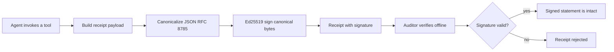
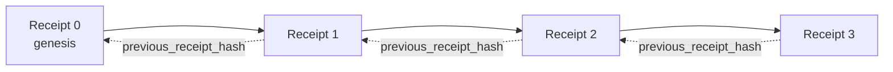

[Погледајте видео лекцију: Осигурање AI агената криптографским рачунима](https://youtu.be/PLACEHOLDER_VIDEO_ID)

> _(Видео лекција и сличица ће бити додати од стране Microsoft тима за садржај након спајања, у складу са шаблоном лекција 14 / 15.)_

# Осигурање AI агената криптографским рачунима

## Увод

Ова лекција ће покрити:

- Зашто су евиденције рада (audit trails) AI агената важне за усаглашеност, дебаговање и поверење.
- Шта је криптографски рачун и како се разликује од непотписане лог линије.
- Како произвести потписани рачун за позив алата агента у обичном Python-у.
- Како верификовати рачун офлајн и открити измене.
- Како ланцима повезати рачуне тако да уклањање или мењање редоследа рачуна разбија ланац.
- Шта рачуни доказују, а шта изричито не доказују.

## Циљеви учења

Након завршетка ове лекције, знаћете како да:

- Идентификујете начине пропуста који мотивишу криптографски порекло за акције агента.
- Произведете Ed25519 потписани рачун преко канонског JSON садржаја.
- Независно верификујете рачун користећи само јавни кључ потписника.
- Откријете измену поновним покретањем верификације на измењеном рачуну.
- Конструишете ланац рачуна повезан хешом и објасните зашто је ланац важан.
- Препознате границу између онога што рачуни доказују (атрибуција, интегритет, редослед) и онога што не доказују (тачност акције, исправност политике).

## Проблем: Евиденција рада вашег агента

Замислите да сте распоредили AI агента за Contoso Travel. Агент чита захтеве корисника, позива API за летове да погледа опције и резервише седишта уместо корисника. Прошлог квартала, агент је обрадио 50.000 резервација.

Данас долази ревизор. Поставља једноставно питање: „Покажи ми шта је твој агент урадио.“

Предајете своје лог датотеке. Ревизор их прегледа и поставља тежје питање: „Како знам да ти логови нису измењени?“

Ово је проблем евиденције рада (audit-trail). Већина агената данас се ослања на:

- **Апликацијске логове**: које пише сам агент, могу их едитовати сви који имају приступ фајл систему.
- **Облачно логирање**: показује крађе на платформи само ако ревизор верује оператору платформе.
- **Логове трансакција у бази**: добри за промене у бази, али не и за било који позив алату.

Ниједан од ових не може одговорити на питање ревизора без да ревизор не мора да верује некоме (вама, вашем провајдеру облака, добављачу базе). За интерну употребу, то је често прихватљиво. За регулисане области (финансије, здравство, све по EU AI закону) није.

Криптографски рачуни умањују овај проблем чинећи потписану изјаву независно
верификованом. Ревизор и даље треба разлог ван ланца да верује кључу за потпис и
компоненту која је изјаву произвела. Уграђени кључ доказује унутрашњу конзистентност,
не идентитет издаваоца или место примене правила.

## Шта је криптографски рачун?

Рачун је JSON објекат који бележи шта је агент урадио, потписан дигиталним потписом.



Минимални рачун изгледа овако:

```json
{
  "type": "agent.tool_call.v1",
  "agent_id": "contoso-travel-bot",
  "tool_name": "lookup_flights",
  "tool_args_hash": "sha256:a3f9c1...",
  "result_hash": "sha256:7b2e1d...",
  "policy_id": "contoso-travel-policy-v3",
  "timestamp": "2026-04-25T14:30:00Z",
  "sequence": 47,
  "previous_receipt_hash": "sha256:9d4e6a...",
  "signature": {
    "alg": "EdDSA",
    "sig": "c5af83...",
    "public_key": "8f3b2c..."
  }
}
```

Три особине раде посао:

1. **Потпис**. Рачун потписује агентски пролаз помоћу Ed25519 приватног кључа. Свако са одговарајућим јавним кључем може офлајн верификовати потпис. Партнер који се ослања мора учврстити тај кључ или га добити из поузданог регистра ван рачуна. Измена било ког поља које је потписано неважећа потписа.

2. **Канонско кодирање**. Пре потписа, рачун се серијализује коришћењем JSON Канонског Шеме (JCS, RFC 8785). Ово осигурава да све имплементације које производе исти логички рачун дају бајт идентичан излаз. Без канонске форме, различити JSON сериализатори би дали различите потписе за исти садржај.

3. **Ланац хешем**. Поље `previous_receipt_hash` повезује сваки рачун са претходним. Уклањање или мењање реда рачуна прекида представљени низ. Откривање скраћивања или преписивања под контролом потписника захтева закључану актуелну главу ланца, независни сведочени чекпоинт или аутентификовану обавезу затворене групе.

Заједно, ове особине дају три гаранције:

- **Атрибуција кључу**: овај кључ је потписао овај садржај. За организациони или људски идентитет потребна је поуздана веза са кључем.
- **Интегритет**: садржај није промењен од потписа.
- **Редослед у верификованом низу**: овај рачун је повезан са претходником.

## Производња рачуна у Питону

Не треба вам посебна библиотека да произведете рачун. Криптографске примитиве су широко доступне, а логика је само неколико десетина линија Python-а.

Практични задаци у `code_samples/18-signed-receipts.ipynb` воде вас кроз цео процес. Изворно контролисани `code_samples/18-signed-receipts.execution-receipt.json` бележи тачан hash нотебоок-а, Python окружења, број ћелија и провере последњег чистог извршавања без мењања сачуваних излаза лекције. Сажетак:

```python
import json
import hashlib
import base64
from nacl import signing
from jcs import canonicalize  # RFC 8785 canonical JSON

def b64url_nopad(data: bytes) -> str:
    return base64.urlsafe_b64encode(data).decode("ascii").rstrip("=")

def sha256_canonical(obj) -> str:
    """SHA-256 of a Python object's JCS-canonical JSON form."""
    return f"sha256:{hashlib.sha256(canonicalize(obj)).hexdigest()}"

# Generate or load a signing key (in production, store in a key vault)
signing_key = signing.SigningKey.generate()
verify_key = signing_key.verify_key
TRUSTED_PUBLIC_KEYS = {b64url_nopad(bytes(verify_key))}  # pinned out of band by the verifier

# Build the receipt payload (no signature yet)
tool_args = {"origin": "SYD", "destination": "LAX"}
tool_result = [{"flight": "QF11", "price": 1850, "stops": 0}]

payload = {
    "type": "agent.tool_call.v1",
    "agent_id": "contoso-travel-bot",
    "tool_name": "lookup_flights",
    "tool_args_hash": sha256_canonical(tool_args),
    "result_hash": sha256_canonical(tool_result),
    "policy_id": "contoso-travel-policy-v3",
    "timestamp": "2026-04-25T14:30:00Z",
    "sequence": 0,
    "previous_receipt_hash": None,
}

# Canonicalize and sign the JCS bytes directly. PureEdDSA hashes internally.
canonical_bytes = canonicalize(payload)
signature_bytes = signing_key.sign(canonical_bytes).signature

# Attach a structured signature object.
receipt = {
    **payload,
    "signature": {
        "alg": "EdDSA",
        "sig": b64url_nopad(signature_bytes),
        "public_key": b64url_nopad(bytes(verify_key)),
    },
}
```

То је цео процес потписивања. Задатци у нотебоок-у воде кроз сваки корак.

## Верификација рачуна и откривање измена

Верификација је обрнути поступак:

```python
import base64
import hashlib
from nacl import signing
from nacl.exceptions import CryptoError
from jcs import canonicalize

def b64url_decode(s: str) -> bytes:
    # Strict: Python's decoder skips characters outside the alphabet and also
    # accepts padding, the standard +/ alphabet and non-zero spare bits.
    # Re-encoding and comparing accepts only the one unpadded base64url form.
    padding = "=" * ((4 - len(s) % 4) % 4)
    data = base64.urlsafe_b64decode(s + padding)
    if base64.urlsafe_b64encode(data).decode("ascii").rstrip("=") != s:
        raise ValueError("not canonical unpadded base64url")
    return data

def verify_receipt(receipt: dict, trusted_public_key: str) -> bool:
    # trusted_public_key is the issuer's key, obtained from somewhere other
    # than this receipt. Never use receipt["signature"]["public_key"] here:
    # see "What Receipts Prove (and What They Do Not)" below.
    # Fails closed: anything malformed returns False instead of raising.
    if not isinstance(receipt, dict) or not isinstance(trusted_public_key, str):
        return False
    sig_obj = receipt.get("signature")
    if not isinstance(sig_obj, dict) or sig_obj.get("alg") != "EdDSA":
        return False
    sig_b64 = sig_obj.get("sig")
    if not isinstance(sig_b64, str):
        return False

    try:
        # Reconstruct the payload that was actually signed (everything except signature).
        payload = {k: v for k, v in receipt.items() if k != "signature"}
        canonical_bytes = canonicalize(payload)
        verify_key = signing.VerifyKey(b64url_decode(trusted_public_key))
        verify_key.verify(canonical_bytes, b64url_decode(sig_b64))
        return True
    except (CryptoError, TypeError, ValueError, KeyError, OverflowError):
        return False
    except Exception:
        # An undecodable key or signature, or a payload that cannot be
        # canonicalized: fail closed rather than raise.
        return False
```

Ова функција узима рачун и јавни кључ издаваоца, и враћа `True` ако је потпис важи, и `False` иначе, укључујући када је улаз оштећен. Без позива мреже и без сервиса за верификацију: када имате издавачев кључ, провера је у потпуности локална и офлајн. Оно што и даље захтева је тај кључ, добијен изворно независно од рачуна.

Да бисте видели откривање измена у акцији, нотебоок води кроз:

1. Производњу важећег рачуна и потврду да он верификује.
2. Измену једног бајта у пољу `tool_args_hash`.
3. Поновну верификацију која не успева.
4. Поновно мењање, али овог пута поновним потписивањем кључем који је нападач генерисао и уграђивањем тог кључа у рачун.

Четврти корак вреди пажљивог разматрања. Тај рачун је унутрашње конзистентан: потпис је истинит за његов садржај и за носећи кључ, тако да се верификује против кључа изнутра. Не успева само када се проверава против правог издавачевог кључа. Кораци 2 и 3 откривају нападача који није имао бригу да поново потпише; корак 4 открива овог који јесте.

Ово је практичан доказ да су рачуни отпорни на измјене: било каква измена потписаног поља разбија потпис, под условом да верификујете против кључа који нападач није донео. Сам `signature` објекат је ван потписаних бајтова, због чега кључ против кога верификујете мора да потиче ван рачуна.

## Ланчење рачуна за агенте са више корака

Један потписани рачун штити једну акцију. Ланац рачуна штити низ акција.



Сваки рачун бележи хеш претходног рачуна. Да би нападач тихо уклонио рачун 2, морао би или:

- Изменити `previous_receipt_hash` поље рачуна 3 (што разбија потпис рачуна 3), ИЛИ
- Израдити нови потпис на измењеном рачуну 3 (треба приватни кључ агента).

Ако је приватни кључ у хардверском трезору и верификатори проверавају сваки рачун користећи издавачев јавни кључ, добијен независно (објављени JWK сет или унапред учвршћена конфигурација), ниједан напад није могућ без детекције. Објављивање кључа у сваком рачуну није довољно: нападач може поново потписати својим кључем и уградити тај уместо тога, што је пример `04_resigned_receipt.json`.

Нотебоок води кроз:

1. Конструисање ланца од три рачуна.
2. Верификацију да поље `previous_receipt_hash` сваког рачуна одговара стварном хешу претходног.
3. Именовање измене случајног рачуна у средини од кога ланац пукне управо на том месту.

Ово је начин да произведете евиденцију рада коју спољни ревизор може да провери под својим
закључаним издавачким кључевима и проверним тачкама, без поверења у вашу изменљиву логику.

## Шта рачуни доказују (а шта не доказују)

Ово је најважнији део лекције. Рачуни су моћни, али њихова моћ је ограничена.

**Рачуни доказују три ствари:**

1. **Атрибуција**: одређени кључ је потписао одређени садржај.
2. **Интегритет**: садржај није промењен од потписа.
3. **Редослед у презентованом, верификованом низу**: тај рачун је повезан са претходним.

**Рачуни НЕ доказују:**

1. **Тачност**: да је акција агента била исправна. Рачун може потписати и погрешан одговор подједнако као и прави одговор.
2. **Усаглашеност са политиком**: да је политика наведенa у `policy_id` заиста процењена или да би дозволила ову акцију. Рачун бележи шта је тврђено, не шта је спроведено.
3. **Идентитет иза кључа**: рачун каже „овaj кључ је потписао овај садржај.“ Не каже „овај човек је овластио ово.“ Повезивање кључа са особом или организацијом захтева посебну инфраструктуру идентитета (директоријум, регистар јавних кључева).
4. **Истинитост улаза**: ако агент добије изменјени упит и реагује на њега, рачун верно бележи ту акцију. Рачуни долазе од валидације улаза, а не замена за њу.
5. **Извршење или стварни ефекат**: рачун након позива бележи шта издавац тврди да се десило. Доказивање пријема или уклањање утицаја извана треба доказ из правог извршиоца или границе пружатеља услуге.
6. **Комплетност**: изостанак рачуна може значити блокаду, изостављање, губитак или неинструменталност. Изостанак је доказ само унутар аутентификоване затворене популације.
7. **Поверено време**: потписани временски печат доказује да је потписник носио ту вредност, не да је вредност била тачна. Поверено време захтева посебног овлашћеног достављача времена или сведочени чекпоинт.

**Кључ у рачуну није кључ са којим верификујете.** Ово следи из тачке 3, и то је једино место где разлика мора да промени ваш код, а не само ваше разумевање. `public_key` из горњег примера је ту да пример буде самодовољан. Верификатор га никада не сме веровати. Свако може узети рачун, изменити га, потписати кључем који је генерисао, и уградити тај кључ; резултат се савршено верификује према самом себи. То је пример `04_resigned_receipt.json` у `sample_receipts/` и због тога `verify_receipt` горе узима кључ као аргумент уместо да га чита из рачуна. Добити кључ издаваоца независно, из JWK сета у Прудукционим упутствима испод или другог сидра које сте унапред учврстили, и верификовати против тог кључа. Потпис провераван са кључем који је стигао у истом коверту доказује само да је коверта унутрашње конзистентна.

Ова граница је важна из два разлога:

- Рекла вам је за шта су рачуни корисни: чине да се понашање агента може ревидирати и да буде отпорно на измене, чак и преко организационих граница.
- Рекла вам је које додатне слојеве и даље требате: валидацију улаза (Лекција 6), примену политике (кратко покривено испод), и инфраструктуру идентитета (изван обима ове лекције).

Честа грешка је претпоставити да „имамо рачуне“ значи „уведен је надзор.“ Не значи. Рачуни су основа. Надзор је систем који на њу надовезујете.

## Везивање потписа одобриоца за тачну акцију

Тачка 3 горе заслужује посебан одељак: рачун акције каже „овaj кључ је потписао овај садржај“ а никад „човек је овластио ово.“ За акције високог ризика (повраћаји новца, брисања, банковни трансфери), посебан потпис одобриоца може везати тачну акцију. Повезање тог кључа са човеком и проверa присуства човека остају одвојене обавезе.

Следећи нотебоок `code_samples/human-authorization-receipts.ipynb` додаје други тип рачуна, `human.approval.v1`, у истом формату коверте као и рачуни из лекције (тажирани садржај потписан Ed25519 изнад канонских JCS бајтова, са `signature` објектом ван потписаних бајтова). Кључ одобриоца потписује **целу канонску акцију и њен дигест**; агентски кључ потписује изјаву која носи **исти дигест акције** и `parent_approval_ref`, `receipt_hash` одобравања, иста конвенција као у `previous_receipt_hash` у ланцу који сте изградили горе. Један `verify_chain` проверава оба артфиката под **одвојеним учвршћеним регистрацијама кључева** (кључеви одобрилаца против агентских кључева), тако да је кôд за провјеру ист иако су овлашћеника одвојени.

Особина која ово даје, пажљиво речено: *учвршћени кључ одобриоца потписао је ову тачну
акцију, а агентски кључ је касније потписао изјаву која носи исти дигест акције.*
То је корисан доказ, али сам по себи није доказ да је акција извршена. Да би
контролисали извршење, треба задржати тачно одобрење и потрошити га једнократно на
стварној граници извршиоца; непознати исходи пружаоца морају остати непознати, а не да се
аутоматски поново покушавају. Тестови одбијања у нотебоок-у проверавају слој ланца рачуна:

- измјене, лажне представнике, фалсификоване кључеве са обе стране и оштећене улазе;
- **застарела овлашћења**: потпис који и даље верификује, али је одбијен јер се верзија политике променила, кључ одобриоца је уклоњен из учвршћеног регистра или је одобрење истекло пре наведеног времена верификације;
- **замена дигеста**: важећи потписани рачун акције који показује на *право* одобрење које везује *различиту* канонску акцију.

Сваки неуспех одбија са јединственим разлогом тако да ревизор може препознати да ли је овлашћење истекло или се тврђена акција променила. Верификација је само за читање и понављање: не троши одобрење нити позива пружаоца услуге. Посебан извршилац треба трајну, атомарну заштиту при поновном извршењу и јасан исход успеха, неуспеха и неодређеног стања. Рачун са људским одобрењем је образовна композиција дефинисана овом лекцијом, а не тип рачуна који дефинише `draft-farley-acta-signed-receipts`.

## Референце за продукцију

Питхон код у овој лекцији је намерно минималан како бисте могли пажљиво прочитати сваки ред и схватити управо шта се дешава. У продукцији, имате два избора:

1. **Градња директно на криптографским примитивима.** 50 редова кода горе је довољно за многе случајеве употребе. PyNaCl (Ed25519) и `jcs` пакет (канонски JSON) су добро одржаване и ревидиране библиотеке.

2. **Коришћење библиотеке за продукцијске примке.** Неколико пројеката отвореног кода имплементира исти образац са додатним функционалностима (ротирање кључева, верификација у батцх режиму, дистрибуција JWK сета, интеграција са политичким механизмима):
   - Пипелине потписивања користи конвенције JCS и signature-scope у независном IETF Internet-Draft-у ([`draft-farley-acta-signed-receipts`](https://datatracker.ietf.org/doc/draft-farley-acta-signed-receipts/), ревизија 02). Образовни примак из ове лекције разликује се од `{payload, signature}` коверте из нацрта и није представљен као усклађена имплементација. Нацрт објављује заједнички сет тестова усклађености ([agent-governance-testvectors](https://github.com/ScopeBlind/agent-governance-testvectors)) за имплементације које циљају његов жичани формат.
   - Microsoft Agent Governance Toolkit саставља примке са политикама заснованим на Cedar; видети Туторијал 33 у том репозиторијуму за пример од почетка до краја.
   - `protect-mcp` (npm) и `@veritasacta/verify` (npm) пакети пружају Node-базиране имплементације потписивања примки и офлајн верификације, намењене за обмотавање било ког MCP сервера са аудиторском стазом која указује на измјену, укључујући проток "причања за ко-потпис" у којем обустављена акција емитује примак за одобрење везан за дигест акције (WebAuthn поткрепљен у десктоп протоку), исти образац за примак одобрења као што је горе наведена људска ауторизациона свеска.
   - **[nobulex](https://github.com/arian-gogani/nobulex)** Python SDK (`pip install nobulex`) пружа исти Ed25519 + JCS образац потписивања у Python-у са LangChain и CrewAI интеграцијама, укључујући објављене крос-валидационе тестне векторе и мапирање за усклађеност допринете путем [OWASP PR #2210](https://github.com/OWASP/CheatSheetSeries/pull/2210).
   - **[EMILIA Protocol](https://github.com/emiliaprotocol/emilia-protocol)** пружа комплементарни слој за тачно спровођење акција: офлајн-проверљиве потврде одобрења, заштићена WebAuthn или кворумском ауторитетом, једнократна конзумација на граници извршиоца и експлицитни пут неодређеног исхода. Његови адаптери оквира третирају примак као неопходан доказ уместо доказ да је дошло до спољашњег ефекта.

Одлука између прављења сопственог решења и коришћења библиотеке је слична одлуци између писања сопствене JWT библиотеке и коришћења већ тестиране: оба су разумна; библиотека штеди време и смањује обим ревизије; приступ од почетка вас приморава да разумете сваки примитив. Ова лекција учи пут од почетка како бисте имали основу за било који избор.

## Провера знања

Тестирајте своје разумевање пре него што пређете на вежбу.

**1. Примак се потписује приватним Ed25519 кључем агента. Аудитор има само јавни кључ. Може ли аудитор офлајн да верификује примак?**

<details>
<summary>Одговор</summary>

Да, криптографска провера захтева само јавни кључ и потписане бајтове. 
Аудитор ипак мора независно да добије и закачи прихваћени јавни кључ, одвојено од примака.
Након што је та конфигурација поверења успостављена, није потребан никакав мрежни позив.
</details>

**2. Нападач измени `policy_id` поље примка како би тврдио да га је управљала попустљивија политика. Потпис је био над оригиналним садржајем. Шта се дешава при верификацији?**

<details>
<summary>Одговор</summary>

Верификација не успева. Потпис је израчунат над канонским бајтовима оригиналног садржаја; измена било којег поља мења те бајтове, што чини потпис неважећим. Нападач би требао приватни кључ да би произвео нови важећи потпис, а он га нема.
</details>

**3. Зашто примак садржи `tool_args_hash` и `result_hash` уместо сирових аргумената и резултата?**

<details>
<summary>Одговор</summary>

Два разлога. Прво, примак може бити архивиран или преношен у окружењима у којима је цурење сировог садржаја (ЛПИ, пословни подаци) проблем. Хеширање држи примак малим и садржај приватним; аудитор проверава да ли хеш одговара одвојено сачуваној копији стварног садржаја. Друго, хешеви имају фиксну величину; примак са хешевима има ограничену величину без обзира на то колико су великили уноси и излази.
</details>

**4. `previous_receipt_hash` поље повезује сваки примак са претходником. Ако нападач тихо избрише један примак из средине ланца, шта постаје неважеће?**

<details>
<summary>Одговор</summary>

Сваки примак који је дошао после избрисаног. Њихова `previous_receipt_hash` поља више не одговарају стварном ланцу (јер примак на који су се позивали више не постоји, или ланац сада показује на другог претходника). Да би сакрио брисање, нападач би морао поново да потпише сваки каснији примак, што захтева приватни кључ издаваоца. Поновно потписивање другим кључем пропада при провери према кључу издаваоца.
</details>

**5. Примак пролази верификацију чисто. Да ли то доказује да је акција агента била исправна, звучна или у складу са политиком?**

<details>
<summary>Одговор</summary>

Не. Под закључаним кључем и контекстом ланца, важећи примак доказује атрибуцију потписа,
интегритет садржаја и везу са претходно представљеним примком. НЕ доказује да је
акција била исправна или извршена, да је политика процењена, да је временска ознака
поуздана или да је скуп записa комплетан. Ово је најважнија граница у лекцији.
</details>

## Вежба

Отворите `code_samples/18-signed-receipts.ipynb` и попуните сва четири дела:

1. **Део 1**: Потпишите свој први примак и верификујте га.
2. **Део 2**: Измењајте примак и посматрајте неуспех верификације.
3. **Део 3**: Направите ланац од три примка и проверите интегритет ланца.
4. **Део 4**: Примените образац на агента изграђеног са Microsoft Agent Framework: обмотати позив алата у потписивање примка, затим независно верификовати примак.

**Проширени изазов 1:** проширите схему примка додатним пољем по свом избору (на пример, ID захтева за праћење), ажурирајте логичку канонску потписивање да га укључи и потврдите да примак и даље пролази верификацију. Затим измените поље после потписа и потврдите да верификација не успева. Ово вас приморава да разумете како сваки бајт канонског кодује доприноси потпису.

**Проширени изазов 2:** Хеширајте SHA-256 два ваша примка заједно (спојите њихове канонске бајтове у детерминисаном редоследу) и уметните настали дигест као ново поље на трећем примку пре његовог потписивања. Верификујте да сва три примка и даље пролазе верификацију. Управо сте направили једностепени доказ укључености: сваки који има трећи примак може доказати да су прва два постојала у време потписивања, без потребе да открије њихов садржај. Ово је образац који се користи у вишеструким селективно-откривањем примкама (Merkle комитајти, RFC 6962).

## Закључак

Криптографски примци пружају AI агентима аудиторску стазу која је:

- **Независно проверљива под закључаним поверењем**: страна са прихваћеним јавним кључевима и потписаним бајтовима може верификовати без зависности од сервиса.
- **Упадљива на злоупотребе**: било каква измена чини потпис неважећим.
- **Преносива**: примак је мали JSON фајл; може бити архивиран, преношен и провераван било где.
- **У складу са стандардима**: изграђени на Ed25519 (RFC 8032), JCS (RFC 8785) и SHA-256, сви широко коришћени примитиви.

Они нису замена за валидацију улаза, спровођење политике, пријем извршилаца,
доказ исхода, контролу комплетности или инфраструктуру идентитета. Они су основа
за те слојеве. У регулисаним или мулти-организационим радним токовима, примци чине специфичне
изјаве издаваоца независно проверљивим под поверењем аудитора.

Најважнији закључак: примци доказују да је одређени кључ потписао одређени
садржај. Пренета временска ознака је изјава потписивача осим ако није посебно временски оверена. Примак
не доказује да је његов садржај био истинит, да је акција извршена или да је
скуп записа комплетан. Те разлике држите чврсто.

## Контрола листа за продукцију

Када будете спремни да завршите ову лекцију и примените агенте са примкама потписаним у стварном окружењу:

- [ ] **Померање кључа за потписивање са лаптопа програмера.** Користите Azure Key Vault, AWS KMS или хардверски безбедносни модул. Приватни кључ који потписује ваше примке никада не сме бити у систему контроле верзија или у обичном тексту на машинама апликација.
- [ ] **Успостављање поверења кључа верификатора.** Објавите кључеве путем JWK сета или регистра, затим нека важеће стране закључају прихваћени идентитет издаваоца, скуп кључева и политику ротирања изван појединачних примака. Сам по себи угађени кључ није сидро поверења.
- [ ] **Спољно снажно закључавање ланца.** Периодично бележите најновију хеш главе ланца у транспарентни дневник (Sigstore Rekor, RFC 3161 власт временске ознаке или други интерни систем) како би спољна страна могла потврдити "тај ланац је постојао у том тренутку."
- [ ] **Неизмењиво чување примака.** Складиште са додавањем само (Azure Storage са политиком неизмењивости, AWS S3 Object Lock) спречава инсайдера да препише историју на нивоу складишта.
- [ ] **Одлука о чувању.** Многи режими усклађености захтевају вишегодишње чување. Планирајте раст примака (сваки примак има око 500 бајтова; агент који прави 10.000 позива дневно производи око 1,8 GB годишње).
- [ ] **Документација о чему примци не покривају.** Примци доказују атрибуцију, интегритет и поредак. Ваш план рада треба експлицитно навести које додатне контроле (валидација улаза, спровођење политике, ограничење стопе, инфраструктура идентитета) иду уз примке у вашем моделу управљања.

### Имате још питања о обезбеђивању AI агената?

Придружите се [Microsoft Foundry Discord](https://aka.ms/ai-agents/discord) да се састанете са другим ученицима, учествујете у канцеларијским сатима и добијете одговоре на питања о AI агентима.

## Изван ове лекције

Ова лекција покрива потписивање појединачног примка и низове везане хешем. Исти примитиви чине основ више напредних образаца које ћете можда срести како ваша политика управљања сазрева:

- **Селективно откривање.** Када су поља примка независно обавезана (RFC 6962 стил Меркле стабла), можете открити одређена поља одређеним аудиторима и доказати да су остала непромењена без изношења. Корисно када исти примак мора задовољити и свеобухватну ревизију (која жели комплетност) и прописе о минимизацији података као што је GDPR (који жели да аудитор види што мање потребно).
- **Поништавање примака.** Ако је кључ потписивања компромитован, потребан је начин да се сви примци потписани тим кључем одређеног тренутка убудуће означе као непоуздани. Стандардни обрасци: краткотрајни кључеви потписивања плус објављена листа поништења, или транспарентни дневник са уносима о поништењу.
- **Билатерални / подељени потпис примака.** Неки имплементације деле потписани садржај на полупревенствене (`authorization_*`) и постпревенствене (`result_*`) делове са независним потписима, корисно када одлуке о ауторизацији и посматрани резултат доносе различити актери или у различито време. Ово се додатно гради на формату примка проучаваном у овој лекцији.
- **Композиција садржаја.** Примак запечаћује бајтове које ставите у `result_hash`. Реални садржаји су често богатији од резултата једног позива алата: претходно образложење одлуке (предвиђање модела, разматране опције, докази и њихова комплетност, ризична позиција, ланац рачуноводства, исход контролног окна) може живети унутар садржаја, запечаћено једним примком. Ово држи формат примка минималним уз омогућавање еволуције шема садржаја по доменима.
- **Усклађеност крос-имплементација.** Више независних имплементација истог формата примка (Python, TypeScript, Rust, Go) крос-верификују са заједничким тест-векторима. Ако направите своју имплементацију, валидација са објављеним векторима потврђује компатибилност жичаног формата.
- **Миграција после квантне ере.** Ed25519 је данас широко распрострањен али није квантно отпоран. Сам `alg` ознака није миграција: профил мора дефинисати ML-DSA кодирање кључа, канонске потписане бајтове, верификацију, политику засновану на поверењу, отпорност на понижење и семантику транзиције. Планирајте и тестирајте транзицију са дуплим потписом са заједничким векторима пре него што дате тврдње о компатибилности.

## Додатни ресурси

- <a href="https://datatracker.ietf.org/doc/draft-farley-acta-signed-receipts/" target="_blank">IETF Internet-Draft: Signed Decision Receipts for Machine-to-Machine Access Control</a>
- <a href="https://learn.microsoft.com/azure/ai-studio/responsible-use-of-ai-overview" target="_blank">Поглед на Одговорни AI (Azure AI)</a>
- <a href="https://datatracker.ietf.org/doc/html/rfc8032" target="_blank">RFC 8032: Edwards-Curve алгоритам дигиталног потписа (EdDSA)</a>
- <a href="https://datatracker.ietf.org/doc/html/rfc8785" target="_blank">RFC 8785: JSON Шема Канонализације (JCS)</a>
- <a href="https://datatracker.ietf.org/doc/html/rfc6962" target="_blank">RFC 6962: Сертификатска транспарентност</a> (Конструкција Меркле стабла коришћена у селективно-откривајућим примцима)
- <a href="https://github.com/microsoft/agent-governance-toolkit/blob/main/docs/tutorials/33-offline-verifiable-receipts.md" target="_blank">Microsoft Agent Governance Toolkit, Туторијал 33: Офлајн-проверљиви потврди одлука</a>
- <a href="https://github.com/ScopeBlind/agent-governance-testvectors" target="_blank">Крос-имплементациони тестни вектори усклађености</a> за формат примака коришћен у овој лекцији (Apache-2.0)
- <a href="https://pynacl.readthedocs.io/" target="_blank">PyNaCl документација</a> (Ed25519 у Python-у)

## Претходна лекција

[Креирање локалних AI агената](../17-creating-local-ai-agents/README.md)

---

<!-- CO-OP TRANSLATOR DISCLAIMER START -->
**Изјава о одрицању одговорности**:
Овај документ је преведен коришћењем услуге за аутоматски превод [Co-op Translator](https://github.com/Azure/co-op-translator). Иако тежимо тачности, имајте у виду да аутоматски преводи могу садржати грешке или нетачности. Оригинални документ на његовом изворном језику треба сматрати ауторитативним извором. За критичне информације препоручује се професионални људски превод. Нисмо одговорни за било каква неспоразума или погрешна тумачења која произилазе из коришћења овог превода.
<!-- CO-OP TRANSLATOR DISCLAIMER END -->