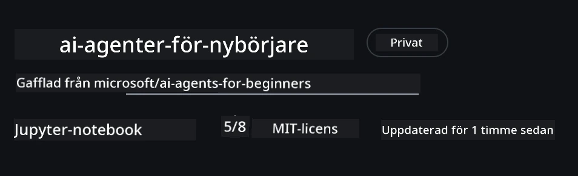
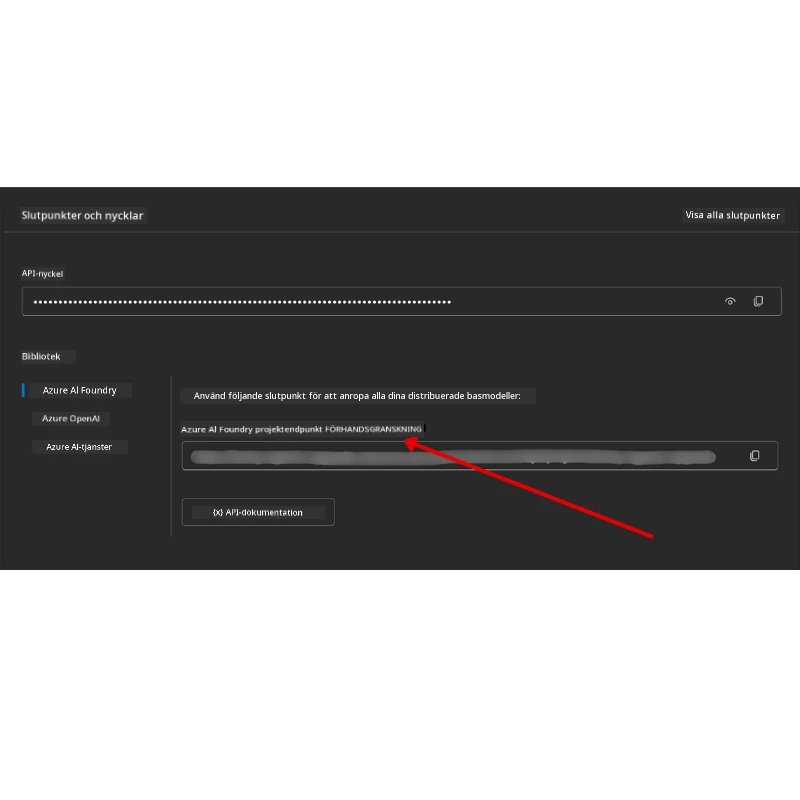

# Kursuppsättning

## Introduktion

Denna lektion kommer att täcka hur man kör kodexemplen i denna kurs.

## Gå med andra lärande och få hjälp

Innan du börjar klona ditt repo, gå med i [AI Agents For Beginners Discord channel](https://aka.ms/ai-agents/discord) för att få hjälp med installation, frågor om kursen eller för att koppla ihop dig med andra som lär sig.

## Klona eller Forka detta Repo

För att börja, klona eller forka GitHub-repositoriet. Detta skapar din egen version av kursmaterialet så att du kan köra, testa och justera koden!

Detta kan göras genom att klicka på länken för <a href="https://github.com/microsoft/ai-agents-for-beginners/fork" target="_blank">fork the repo</a>

Du ska nu ha din egen forkade version av denna kurs på följande länk:



### Shallow Clone (rekommenderas för workshop / Codespaces)

  >Det fullständiga repositoriet kan bli stort (~3 GB) när du laddar ner full historik och alla filer. Om du bara deltar i workshopen eller bara behöver några lektioners mappar, laddar en shallow clone (eller en sparse clone) ner mycket mindre.

#### Snabb shallow clone — minimal historik, alla filer

Ersätt `<your-username>` i kommandona nedan med din fork-URL (eller upstream-URL om du föredrar det).

För att klona endast den senaste commit-historiken (liten nedladdning):

```bash
git clone --depth 1 https://github.com/<your-username>/ai-agents-for-beginners.git
```

För att klona en specifik branch:

```bash
git clone --depth 1 --branch <branch-name> https://github.com/<your-username>/ai-agents-for-beginners.git
```

#### Delvis (sparse) klon — minimala blobbar + endast valda mappar

Detta använder partial clone och sparse-checkout (kräver Git 2.25+ och rekommenderas med modern Git med stöd för partial clone):

```bash
git clone --depth 1 --filter=blob:none --sparse https://github.com/<your-username>/ai-agents-for-beginners.git
```

Gå in i repomappen:

```bash
cd ai-agents-for-beginners
```

Specificera sedan vilka mappar du vill ha (exempel nedan visar två mappar):

```bash
git sparse-checkout set 00-course-setup 01-intro-to-ai-agents
```

Efter kloning och verifiering av filerna, om du endast behöver filerna och vill frigöra utrymme (ingen git-historik), radera då repository metadata (💀irreversibelt — du förlorar all Git-funktionalitet):

```bash
# zsh/bash
rm -rf .git
```

```powershell
# PowerShell
Remove-Item -Recurse -Force .git
```

#### Använda GitHub Codespaces (rekommenderas för att undvika stora lokala nedladdningar)

- Skapa en ny Codespace för detta repo via [GitHub UI](https://github.com/codespaces).  

- I terminalen för den nyskapade codespacen, kör ett av shallow/sparse clone-kommandona ovan för att bara hämta de lektionmappar du behöver till Codespace-arbetsytan.
- Valfritt: efter kloning inne i Codespaces, ta bort .git för att återfå extra utrymme (se borttagningskommandon ovan).
- Obs: Om du föredrar att öppna repot direkt i Codespaces (utan extra kloning), var medveten om att Codespaces konstruerar devcontainer-miljön och kan fortfarande provisionera mer än du behöver.

#### Tips

- Ersätt alltid klonings-URL med din fork om du vill redigera/committa.
- Om du senare behöver mer historik eller filer kan du hämta dem eller justera sparse-checkout för att inkludera fler mappar.

## Köra Koden

Denna kurs erbjuder en serie Jupyter-anteckningsböcker som du kan köra för att få praktisk erfarenhet att bygga AI-agenter.

Kodexemplen använder **Microsoft Agent Framework (MAF)** med `FoundryChatClient`, som kopplar till **Microsoft Foundry Agent Service V2** (Responses API) via **Microsoft Foundry**.

Alla Python-notebookar är märkta `*-python-agent-framework.ipynb`.

## Krav

- Python 3.12+
  - **OBS:** Om du inte har Python3.12 installerat, se till att installera det. Skapa sedan din venv med python3.12 för att försäkra att rätt versioner installeras från requirements.txt-filen.
  
    >Exempel

    Skapa Python venv-katalog:

    ```bash
    python -m venv venv
    ```

    Aktivera sedan venv-miljön för:

    ```bash
    # zsh/bash
    source venv/bin/activate
    ```
  
    ```dos
    # Command Prompt for Windows
    venv\Scripts\activate
    ```

- .NET 10+: För kodexemplen med .NET, se till att installera [.NET 10 SDK](https://dotnet.microsoft.com/download/dotnet/10.0) eller senare. Kontrollera därefter din installerade .NET SDK-version:

    ```bash
    dotnet --list-sdks
    ```

- **Azure CLI** — Krävs för autentisering. Installera från [aka.ms/installazurecli](https://aka.ms/installazurecli).
- **Azure-prenumeration** — För åtkomst till Microsoft Foundry och Microsoft Foundry Agent Service.
- **Microsoft Foundry-projekt** — Ett projekt med en distribuerad modell (t.ex. `gpt-5-mini`). Se [Steg 1](#steg-1-skapa-ett-microsoft-foundry-projekt) nedan.

Vi har inkluderat en `requirements.txt` fil i root av detta repo som innehåller alla nödvändiga Python-paket för att köra kodexemplen.

Du kan installera dem genom att köra följande kommando i terminalen i rotmappen av repositoriet:

```bash
pip install -r requirements.txt
```

Vi rekommenderar att du skapar en Python virtuell miljö för att undvika konflikter och problem.

## Installera VSCode

Se till att du använder rätt version av Python i VSCode.


## Ställ in Microsoft Foundry och Microsoft Foundry Agent Service

### Steg 1: Skapa ett Microsoft Foundry-projekt

Du behöver ett Microsoft Foundry **projekt** med en distribuerad modell för att köra notebookarna. Skapa projektet direkt i nuvarande Microsoft Foundry-upplevelse; en hub krävs inte.

1. Gå till [ai.azure.com](https://ai.azure.com) och logga in med ditt Azure-konto.
2. Välj **Create project** och följ instruktionerna för att skapa ditt projekt.
3. I projektet distribuerar du en modell (t.ex. `gpt-5-mini`) från **Models + Endpoints** → **Deploy model**.

### Steg 2: Hämta din projekts slutpunkt och modellens distributionsnamn

Från ditt projekt i Microsoft Foundry-portalen:

- **Project Endpoint** — Gå till **Overview**-sidan och kopiera slutpunkts-URL.



- **Model Deployment Name** — Gå till **Models + Endpoints**, välj din distribuerade modell och notera **Deployment name** (t.ex. `gpt-5-mini`).

### Steg 3: Logga in på Azure med `az login`

De flesta notebookar autentiserar genom din **Azure CLI login** — med `AzureCliCredential` eller `DefaultAzureCredential` (båda plockar upp din `az login`-session) från `azure-identity`-paketet — så de kräver inga API-nycklar. Några lektioner och valfria integrationer använder API-nycklar; kolla varje lektions förutsättningar för eventuella extra miljövariabler. Detta kräver att du är inloggad via Azure CLI.

1. **Installera Azure CLI** om du inte redan gjort det: [aka.ms/installazurecli](https://aka.ms/installazurecli)

2. **Logga in** genom att köra:

    ```bash
    az login
    ```

    Eller om du är i en remote/Codespace-miljö utan webbläsare:

    ```bash
    az login --use-device-code
    ```

3. **Välj din prenumeration** om du uppmanas — välj den som innehåller ditt Foundry-projekt.

4. **Verifiera** att du är inloggad:

    ```bash
    az account show
    ```

> **Varför `az login`?** Notebookarna autentiserar med `AzureCliCredential` (eller `DefaultAzureCredential`, som också plockar upp din Azure CLI inloggning) från `azure-identity`-paketet. Det betyder att din Azure CLI-session tillhandahåller referenserna — inga API-nycklar eller hemligheter i din `.env`-fil. Detta är en [säkerhetsbästa praxis](https://learn.microsoft.com/azure/developer/ai/keyless-connections).

### Steg 4: Skapa din `.env` fil

Kopiera exempel-filen:

```bash
# zsh/bash
cp .env.example .env
```

```powershell
# PowerShell
Copy-Item .env.example .env
```

Öppna `.env` och fyll i dessa två värden:

```env
AZURE_AI_PROJECT_ENDPOINT=https://<your-project>.services.ai.azure.com/api/projects/<your-project-id>
AZURE_AI_MODEL_DEPLOYMENT_NAME=gpt-5-mini
```

| Variabel | Var hittar du den |
|----------|-----------------|
| `AZURE_AI_PROJECT_ENDPOINT` | Foundry-portalen → ditt projekt → **Overview** sida |
| `AZURE_AI_MODEL_DEPLOYMENT_NAME` | Foundry-portalen → **Models + Endpoints** → namnet på din distribuerade modell |

Det är allt för de flesta lektioner! Notebookarna kommer att autentisera automatiskt genom din `az login` session.

### Steg 5: Installera Python-beroenden

```bash
pip install -r requirements.txt
```

Vi rekommenderar att köra detta inuti den virtuella miljön du skapade tidigare.

## Valfri uppsättning: Azure AI Search (Lektion 5 och 16)

Lektion 5 (Agentic RAG) och Lektion 16 notebookarna fungerar direkt med en **in-memory knowledge base** — inga extra Azure-resurser behövs. Om du vill använda en riktig **Azure AI Search** index, notera att **Lektion 16 notebook just nu använder nyckelbaserad autentisering**: den växlar från in-memory sökning till Azure AI Search endast när **både** `AZURE_SEARCH_SERVICE_ENDPOINT` **och** `AZURE_SEARCH_API_KEY` är satta, och annars förblir på in-memory sökning — så för att köra mot ett riktigt index måste du även sätta admin-nyckeln. Nyckelfri autentisering med Microsoft Entra ID (RBAC) är den rekommenderade metoden för egen produktionskod, i linje med `az login`-flödet som används i resten av kursen.

RBAC-stegen nedan gäller för installationsguidens exempel och din egen kod. De aktiverar inte nyckelfri autentisering i Lektion 16 notebook; Lektion 16 kräver fortfarande både endpoint och admin-nyckel för att använda Azure AI Search.

1. **Aktivera rollbaserad åtkomst** på din söktjänst:

    ```bash
    az search service update --name <service-name> --resource-group <resource-group> --auth-options aadOrApiKey
    ```

2. **Tilldela dig själv nödvändiga roller** (skapa/ladda index och göra förfrågningar):

    ```bash
    az role assignment create --assignee <your-user-or-principal-id> --role "Search Service Contributor" --scope $(az search service show -g <resource-group> -n <service-name> --query id -o tsv)
    az role assignment create --assignee <your-user-or-principal-id> --role "Search Index Data Contributor" --scope $(az search service show -g <resource-group> -n <service-name> --query id -o tsv)
    ```

3. **Lägg till endpoint** i din `.env` fil:

| Variabel | Var hittar du den |
|----------|-----------------|
| `AZURE_SEARCH_SERVICE_ENDPOINT` | Azure-portalen → din **Azure AI Search**-resurs → **Overview** → URL |
| `AZURE_SEARCH_API_KEY` | Krävs (med endpoint) för att aktivera Azure AI Search i Lektion 16 notebook, som använder nyckelbaserad auth. Azure-portalen → **Settings** → **Keys** → primär admin-nyckel |

> **Varför nyckelfri?** Admin-nycklar ger full skrivåtkomst till din söktjänst och kan läcka via `.env` filer. Med RBAC används istället din `az login` identitet — samma nyckelfria Entra ID-mönster som kursens notebookar använder (via `AzureCliCredential` / `DefaultAzureCredential`). Se [Anslut till Azure AI Search med roller](https://learn.microsoft.com/azure/search/search-security-rbac).

Se [Azure AI Search installationsguide](./AzureSearch.md) för kompletta index-skapande exempel i Python och .NET.

## Ytterligare uppsättning för lektioner som anropar Azure OpenAI direkt (Lektion 6 och 8)

Vissa notebookar i lektion 6 och 8 anropar **Azure OpenAI** direkt (med hjälp av **Responses API**) istället för genom ett Microsoft Foundry-projekt. Dessa exempel använde tidigare GitHub Models, som är föråldrat och inte stöder Responses API. Lägg till dessa variabler i din `.env` fil:

| Variabel | Var hittar du den |
|----------|-----------------|
| `AZURE_OPENAI_ENDPOINT` | Azure-portalen → din **Azure OpenAI**-resurs → **Keys and Endpoint** → Endpoint (t.ex. `https://<your-resource>.openai.azure.com`) |
| `AZURE_OPENAI_DEPLOYMENT` | Namnet på din distribuerade modell (t.ex. `gpt-5-mini`) som stöder Responses API |
| `AZURE_OPENAI_API_KEY` | Valfritt — bara om du använder nyckelbaserad auth istället för `az login` / Entra ID |

> Responses API använder den stabila `/openai/v1/` slutpunkten, så `api-version` krävs inte. Logga in med `az login` för att använda nyckelfri Entra ID-autentisering.

## Alternativ leverantör: MiniMax (OpenAI-kompatibel)

[MiniMax](https://platform.minimaxi.com/) erbjuder storskaliga modeller (upp till 204K tokens) via en OpenAI-kompatibel API. Eftersom Microsoft Agent Frameworks `OpenAIChatClient` fungerar med vilken OpenAI-kompatibel slutpunkt som helst, kan du använda MiniMax som ett drop-in-alternativ för lektioner som använder `OpenAIChatClient`.

Lägg till dessa variabler i din `.env` fil:

| Variabel | Var hittar du den |
|----------|-----------------|
| `MINIMAX_API_KEY` | [MiniMax Platform](https://platform.minimaxi.com/) → API-nycklar |
| `MINIMAX_BASE_URL` | Använd `https://api.minimax.io/v1` (standardvärde) |
| `MINIMAX_MODEL_ID` | Modellnamn att använda (t.ex. `MiniMax-M3`) |

**Exempelmodeller**: `MiniMax-M3` (rekommenderad), `MiniMax-M2.7`, `MiniMax-M2.7-highspeed` (snabbare svar). Modellnamn och tillgänglighet kan ändras över tid, och tillgång till en modell kan bero på ditt konto.

Kodexemplen som använder `OpenAIChatClient` (t.ex. Lektion 14 hotellbokningsflöde) kommer automatiskt att detektera och använda din MiniMax-konfiguration när `MINIMAX_API_KEY` är satt.

## Alternativ leverantör: Novita AI (OpenAI-kompatibel)

[Novita AI](https://novita.ai/llm-api) erbjuder ett OpenAI-kompatibelt API för open-source och framkantens LLMs (DeepSeek, Llama, Qwen och mer). Eftersom Microsoft Agent Frameworks `OpenAIChatClient` fungerar med vilken som helst OpenAI-kompatibel endpoint, kan du använda Novita AI som ett direkt alternativ till Azure OpenAI eller OpenAI.

Lägg till dessa variabler i din `.env`-fil:

| Variabel | Var du hittar den |
|----------|-----------------|
| `NOVITA_API_KEY` | [Novita AI Dashboard](https://novita.ai/settings/key-management) → API-nycklar |
| `NOVITA_BASE_URL` | Använd `https://api.novita.ai/openai/v1` (standardvärde) |
| `NOVITA_MODEL_ID` | Modellnamn att använda (t.ex. `moonshotai/kimi-k3`) |

**Exempelmodeller**: `moonshotai/kimi-k3`, `zai-org/glm-5.2`, `deepseek/deepseek-v4-flash-0731`. Novita AI värdar också många andra open-source modellfamiljer (Llama, Qwen, GLM och fler) — kolla [Novita AI modellbibliotek](https://novita.ai/llm-api) för en aktuell lista över tillgängliga modeller och deras modell-ID.

De nuvarande exemplen använder inte automatiskt `NOVITA_*` variabler. För att använda Novita AI, skicka dessa värden explicit när du skapar `OpenAIChatClient` i det exempel du kör.

## Alternativ leverantör: Foundry Local (Kör modeller på enheten)

[Foundry Local](https://foundrylocal.ai) är en lättviktig runtime som laddar ner, hanterar och tjänstgör språkmodeller **helt på din egen maskin** via ett OpenAI-kompatibelt API — ingen molnanslutning behövs.

Eftersom Microsoft Agent Frameworks `OpenAIChatClient` fungerar med vilken OpenAI-kompatibel endpoint som helst, är Foundry Local ett direkt lokalt alternativ till Azure OpenAI.

**1. Installera Foundry Local**

```bash
# Windows
winget install Microsoft.FoundryLocal

# macOS
brew install foundrylocal
```

**2. Ladda ner och kör en modell** (detta startar också den lokala tjänsten):

```bash
foundry model list          # see available models
foundry model run phi-4-mini
```

**3. Installera Python SDK:t** som används för att hitta den lokala endpointen:

```bash
pip install foundry-local-sdk
```

**4. Peka Microsoft Agent Framework mot din lokala modell:**

```python
from foundry_local import FoundryLocalManager
from agent_framework.openai import OpenAIChatClient

# Downloads (if needed) and serves the model locally, then discovers the endpoint/port.
manager = FoundryLocalManager("phi-4-mini")

chat_client = OpenAIChatClient(
    base_url=manager.endpoint,      # e.g. http://localhost:<port>/v1
    api_key=manager.api_key,        # always "not-required" for Foundry Local
    model_id=manager.get_model_info("phi-4-mini").id,
)

agent = chat_client.as_agent(
    name="LocalAgent",
    instructions="You are a helpful assistant running fully on-device.",
)
```

> **Notera:** Foundry Local exponerar en OpenAI-kompatibel **Chat Completions** endpoint. Använd den för lokal utveckling och offline-scenarier. För den fullständiga **Responses API**-funktionaliteten (tillståndsbevarande konversationer, etc.), använd Azure OpenAI eller ett Microsoft Foundry-projekt.

## Ytterligare inställningar för Lektion 8 (Bing Grounding Workflow)

Det villkorliga arbetsflödesanteckningsboken i lektion 8 använder **Bing grounding** via Microsoft Foundry. Om du planerar att köra det exemplet, lägg till denna variabel i din `.env`-fil:

| Variabel | Var du hittar den |
|----------|-----------------|
| `BING_CONNECTION_ID` | Microsoft Foundry portal → ditt projekt → **Management** → **Connected resources** → din Bing-anslutning → kopiera anslutnings-ID |

## Felsökning

### SSL-certifikatverifieringsfel på macOS

Om du är på macOS och stöter på ett fel som:

```plaintext
ssl.SSLCertVerificationError: [SSL: CERTIFICATE_VERIFY_FAILED] certificate verify failed: self-signed certificate in certificate chain
```

Detta är ett känt problem med Python på macOS där systemets SSL-certifikat inte automatiskt litas på. Prova följande lösningar i ordning:

**Alternativ 1: Kör Pythons Install Certificates-skript (rekommenderas)**

```bash
# Replace 3.XX with your installed Python version (e.g., 3.12 or 3.13):
/Applications/Python\ 3.XX/Install\ Certificates.command
```

**Alternativ 2: Använd `connection_verify=False` i din notebook (endast för GitHub Models notebookar)**

I Lektion 6-notebook (`06-building-trustworthy-agents/code_samples/06-system-message-framework.ipynb`) finns en utkommenterad lösning redan med. Avkommentera `connection_verify=False` när du får certifikatfel:

```python
client = ChatCompletionsClient(
    endpoint=endpoint,
    credential=AzureKeyCredential(token),
    connection_verify=False,  # Disable SSL verification if you encounter certificate errors
)
```

> **⚠️ Varning:** Att inaktivera SSL-verifiering (`connection_verify=False`) minskar säkerheten genom att hoppa över certifikatvalidering. Använd detta endast som en tillfällig lösning i utvecklingsmiljöer. Använd aldrig i produktion.

**Alternativ 3: Installera och använd `truststore`**

```bash
pip install truststore
```

Lägg sedan till följande högst upp i din notebook eller skript innan du gör några nätverksanrop:

```python
import truststore
truststore.inject_into_ssl()
```

## Fastnat någonstans?

Om du har problem med att köra denna installation, hoppa in i vår <a href="https://discord.gg/kzRShWzttr" target="_blank">Azure AI Community Discord</a> eller <a href="https://github.com/microsoft/ai-agents-for-beginners/issues?WT.mc_id=academic-105485-koreyst" target="_blank">skapa ett ärende</a>.

## Nästa lektion

Du är nu redo att köra koden för denna kurs. Lycka till med att lära dig mer om AI-agenter! 

[Introduktion till AI-agenter och Agentanvändningsfall](../01-intro-to-ai-agents/README.md)

---

<!-- CO-OP TRANSLATOR DISCLAIMER START -->
**Ansvarsfriskrivning**:
Detta dokument har översatts med hjälp av AI-översättningstjänsten [Co-op Translator](https://github.com/Azure/co-op-translator). Även om vi strävar efter noggrannhet, var vänlig notera att automatiska översättningar kan innehålla fel eller brister. Det ursprungliga dokumentet på dess modersmål bör betraktas som den auktoritativa källan. För kritisk information rekommenderas professionell mänsklig översättning. Vi ansvarar inte för några missförstånd eller feltolkningar som uppstår till följd av användningen av denna översättning.
<!-- CO-OP TRANSLATOR DISCLAIMER END -->