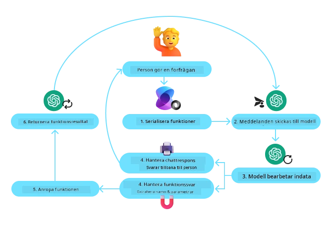
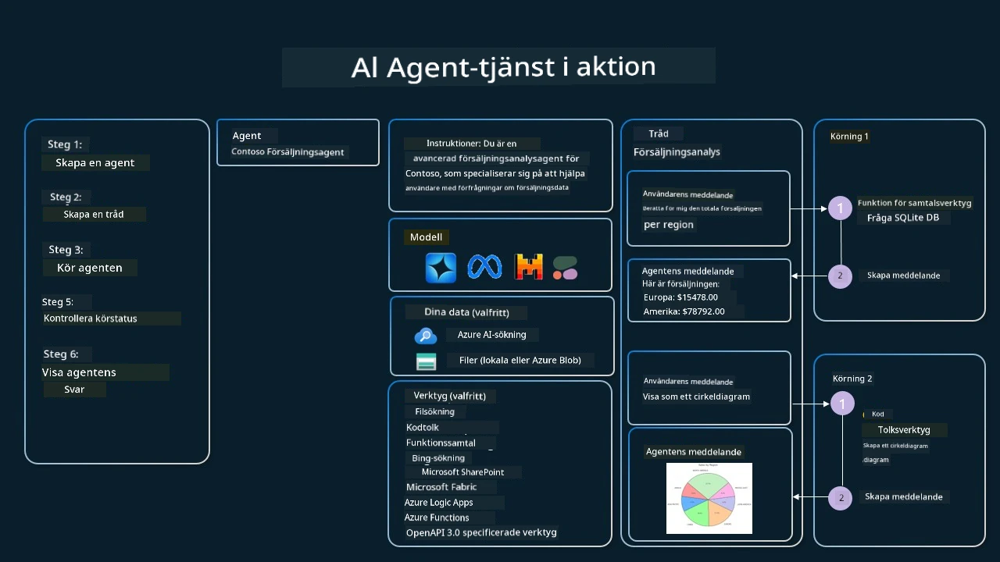

[](https://youtu.be/vieRiPRx-gI?si=cEZ8ApnT6Sus9rhn)

> _(Klicka på bilden ovan för att se videon av denna lektion)_

# Designmönstret för verktygsanvändning

Verktyg är intressanta eftersom de ger AI-agenter ett bredare spektrum av möjligheter. Istället för att agenten bara har en begränsad uppsättning åtgärder den kan utföra, kan agenten nu utföra ett brett utbud av handlingar genom att lägga till ett verktyg. I detta kapitel ska vi titta på designmönstret för verktygsanvändning, som beskriver hur AI-agenter kan använda specifika verktyg för att nå sina mål.

## Introduktion

I denna lektion vill vi besvara följande frågor:

- Vad är designmönstret för verktygsanvändning?
- Vilka användningsfall kan det tillämpas på?
- Vilka element/byggstenar behövs för att implementera designmönstret?
- Vilka speciella hänsyn måste tas vid användning av designmönstret för verktygsanvändning för att bygga pålitliga AI-agenter?

## Lärandemål

Efter att ha genomfört denna lektion kommer du att kunna:

- Definiera designmönstret för verktygsanvändning och dess syfte.
- Identifiera användningsfall där designmönstret för verktygsanvändning är tillämpligt.
- Förstå de viktigaste elementen som behövs för att implementera designmönstret.
- Känna igen hänsyn för att säkerställa pålitlighet i AI-agenter som använder detta designmönster.

## Vad är designmönstret för verktygsanvändning?

**Designmönstret för verktygsanvändning** fokuserar på att ge LLM:er (stora språkmodeller) möjlighet att interagera med externa verktyg för att uppnå specifika mål. Verktyg är kod som kan exekveras av en agent för att utföra åtgärder. Ett verktyg kan vara en enkel funktion som en kalkylator, eller ett API-anrop till en tredjepartstjänst som aktiekursuppslagning eller väderprognos. I sammanhanget med AI-agenter är verktyg designade för att exekveras av agenten som svar på **modellgenererade funktionsanrop**.

## Vilka användningsfall kan det tillämpas på?

AI-agenter kan använda verktyg för att utföra komplexa uppgifter, hämta information eller fatta beslut. Designmönstret för verktygsanvändning används ofta i scenarier som kräver dynamisk interaktion med externa system, såsom databaser, webbtjänster eller kodtolkar. Denna förmåga är användbar för en rad olika användningsfall, inklusive:

- **Dynamisk informationshämtning:** Agenter kan fråga externa API:er eller databaser för att hämta uppdaterad data (t.ex. fråga en SQLite-databas för dataanalys, hämta aktiekurser eller väderinformation).
- **Körning och tolkning av kod:** Agenter kan köra kod eller skript för att lösa matematiska problem, generera rapporter eller utföra simuleringar.
- **Automatisering av arbetsflöden:** Automatisera repetitiva eller flerstegsarbetsflöden genom att integrera verktyg som uppgiftsschemaläggare, e-posttjänster eller datapipelines.
- **Kundsupport:** Agenter kan interagera med CRM-system, ärendehanteringsplattformar eller kunskapsdatabaser för att lösa användarfrågor.
- **Innehållsgenerering och redigering:** Agenter kan använda verktyg som grammatikgranskare, textsammanfattare eller verktyg för innehållssäkerhet för att hjälpa till vid innehållsskapande uppgifter.

## Vilka element/byggstenar behövs för att implementera designmönstret för verktygsanvändning?

Dessa byggstenar gör det möjligt för AI-agenten att utföra ett brett spektrum av uppgifter. Låt oss titta på de nyckelelement som behövs för att implementera designmönstret för verktygsanvändning:

- **Funktions-/Verktygsscheman**: Detaljerade definitioner av tillgängliga verktyg, inklusive funktionsnamn, syfte, nödvändiga parametrar och förväntade utdata. Dessa scheman låter LLM förstå vilka verktyg som är tillgängliga och hur man konstruerar giltiga anrop.

- **Logik för funktionsanrop**: Styr hur och när verktyg anropas baserat på användarens avsikt och samtalskontext. Detta kan inkludera planeringsmoduler, ruttningsmekanismer eller villkorliga flöden som bestämmer verktygsanvändning dynamiskt.

- **Meddelandeshanteringssystem**: Komponenter som hanterar konversationsflödet mellan användarinmatningar, LLM-svar, verktygsanrop och verktygsutdata.

- **Verktygsintegrationsramverk**: Infrastruktur som kopplar agenten till olika verktyg, oavsett om de är enkla funktioner eller komplexa externa tjänster.

- **Felhantering & Validering**: Mekanismer för att hantera fel vid verktygsexekvering, validera parametrar och hantera oväntade svar.

- **Tillståndshantering**: Spårar samtalskontext, tidigare verktygsinteraktioner och persistent data för att säkerställa konsekvens över flerstegsinteraktioner.

Nästa, låt oss titta mer i detalj på Funktions-/Verktygsanrop.
 
### Funktions-/Verktygsanrop

Funktionsanrop är det primära sättet vi möjliggör för stora språkmodeller (LLM) att interagera med verktyg. Du ser ofta 'Function' och 'Tool' användas synonymt eftersom 'funktioner' (block av återanvändbar kod) är de 'verktyg' agenter använder för att utföra uppgifter. För att en funktions kod ska anropas måste en LLM jämföra användarens begäran med funktionsbeskrivningen. För detta skickas ett schema som innehåller beskrivningar av alla tillgängliga funktioner till LLM. LLM väljer sedan den mest lämpliga funktionen för uppgiften och returnerar dess namn och argument. Den valda funktionen anropas, dess svar skickas tillbaka till LLM, som använder informationen för att svara på användarens begäran.

För utvecklare som vill implementera funktionsanrop för agenter behöver du:

1. En LLM-modell som stödjer funktionsanrop
2. Ett schema som innehåller funktionsbeskrivningar
3. Koden för varje beskriven funktion

Låt oss använda ett exempel med att hämta aktuell tid i en stad för att illustrera:

1. **Initiera en LLM som stödjer funktionsanrop:**

    Inte alla modeller stödjer funktionsanrop, så det är viktigt att kontrollera att den LLM du använder gör det.     <a href="https://learn.microsoft.com/azure/ai-services/openai/how-to/function-calling" target="_blank">Azure OpenAI</a> stöder funktionsanrop. Vi kan börja med att initiera OpenAI-klienten mot Azure OpenAI **Responses API** (den stabila `/openai/v1/` endpoint — ingen `api_version` behövs). 

    ```python
    # Initialize the OpenAI client for Azure OpenAI (Responses API, v1 endpoint)
    client = OpenAI(
        base_url=f"{os.environ['AZURE_OPENAI_ENDPOINT'].rstrip('/')}/openai/v1/",
        api_key=os.environ["AZURE_OPENAI_API_KEY"],
    )
    deployment_name = os.environ["AZURE_OPENAI_DEPLOYMENT"]
    ```

1. **Skapa ett Funktionsschema**:

    Nästa steg är att definiera ett JSON-schema som innehåller funktionsnamn, beskrivning av vad funktionen gör, och namnen och beskrivningarna av funktionsparametrarna.
    Sedan skickar vi detta schema till klienten som skapades tidigare, tillsammans med användarens förfrågan att hitta tiden i San Francisco. Det viktiga att notera är att det som returneras är ett **verktygsanrop**, **inte** det slutgiltiga svaret på frågan. Som nämnts tidigare returnerar LLM namnet på den funktion som valts för uppgiften och de argument som ska skickas till den.

    ```python
    # Function description for the model to read (Responses API flat tool format)
    tools = [
        {
            "type": "function",
            "name": "get_current_time",
            "description": "Get the current time in a given location",
            "parameters": {
                "type": "object",
                "properties": {
                    "location": {
                        "type": "string",
                        "description": "The city name, e.g. San Francisco",
                    },
                },
                "required": ["location"],
            },
        }
    ]
    ```
   
    ```python
  
    # Initial user message
    messages = [{"role": "user", "content": "What's the current time in San Francisco"}]

    # First API call: Ask the model to use the function
    response = client.responses.create(
        model=deployment_name,
        input=messages,
        tools=tools,
        tool_choice="auto",
        store=False,
    )

    # The Responses API returns tool calls as function_call items in response.output.
    # Append them to the conversation so the model has full context on the next turn.
    messages += response.output

    print("Model's response:")
    print(response.output)
  
    ```

    ```bash
    Model's response:
    [ResponseFunctionToolCall(arguments='{"location":"San Francisco"}', call_id='call_pOsKdUlqvdyttYB67MOj434b', name='get_current_time', type='function_call')]
    ```
  
1. **Funktionskoden som behövs för att utföra uppgiften:**

    Nu när LLM har valt vilken funktion som ska köras behöver koden som utför uppgiften implementeras och exekveras.
    Vi kan implementera koden för att hämta aktuell tid i Python. Vi måste också skriva koden för att extrahera namn och argument från response_message för att få det slutliga resultatet.

    ```python
      def get_current_time(location):
        """Get the current time for a given location"""
        print(f"get_current_time called with location: {location}")  
        location_lower = location.lower()
        
        for key, timezone in TIMEZONE_DATA.items():
            if key in location_lower:
                print(f"Timezone found for {key}")  
                current_time = datetime.now(ZoneInfo(timezone)).strftime("%I:%M %p")
                return json.dumps({
                    "location": location,
                    "current_time": current_time
                })
      
        print(f"No timezone data found for {location_lower}")  
        return json.dumps({"location": location, "current_time": "unknown"})
    ```

     ```python
    # Handle function calls
    tool_calls = [item for item in response.output if item.type == "function_call"]
    if tool_calls:
        for tool_call in tool_calls:
            if tool_call.name == "get_current_time":

                function_args = json.loads(tool_call.arguments)

                time_response = get_current_time(
                    location=function_args.get("location")
                )

                # Return the tool result as a function_call_output item
                messages.append({
                    "type": "function_call_output",
                    "call_id": tool_call.call_id,
                    "output": time_response,
                })
    else:
        print("No tool calls were made by the model.")

    # Second API call: Get the final response from the model
    final_response = client.responses.create(
        model=deployment_name,
        input=messages,
        tools=tools,
        store=False,
    )

    return final_response.output_text
     ```

     ```bash
      get_current_time called with location: San Francisco
      Timezone found for san francisco
      The current time in San Francisco is 09:24 AM.
     ```

Funktionsanrop är kärnan i det mesta, om inte allt, av agenters design för verktygsanvändning, men att implementera det från grunden kan ibland vara utmanande.
Som vi lärde oss i [Lektion 2](../../../02-explore-agentic-frameworks) erbjuder agentramverk förbyggda byggstenar för att implementera verktygsanvändning.
 
## Exempel på verktygsanvändning med agentramverk

Här är några exempel på hur du kan implementera designmönstret för verktygsanvändning med olika agentramverk:

### Microsoft Agent Framework

<a href="https://learn.microsoft.com/azure/ai-services/agents/overview" target="_blank">Microsoft Agent Framework</a> är ett open-source AI-ramverk för att bygga AI-agenter. Det förenklar processen för funktionsanrop genom att låta dig definiera verktyg som Python-funktioner med `@tool`-dekorationen. Ramverket hanterar kommunikationen fram och tillbaka mellan modellen och din kod. Det ger också tillgång till förbyggda verktyg som fil-sökning och kodtolkare via `FoundryChatClient`.

Följande diagram illustrerar processen för funktionsanrop med Microsoft Agent Framework:



I Microsoft Agent Framework definieras verktyg som dekorerade funktioner. Vi kan konvertera den `get_current_time`-funktion vi såg tidigare till ett verktyg genom att använda `@tool`-dekorationen. Ramverket serialiserar automatiskt funktionen och dess parametrar, vilket skapar schemat som skickas till LLM.

```python
import os
from agent_framework import tool
from agent_framework.foundry import FoundryChatClient
from azure.identity import AzureCliCredential

@tool(approval_mode="never_require")
def get_current_time(location: str) -> str:
    """Get the current time for a given location"""
    ...

# Create the client
provider = FoundryChatClient(
    project_endpoint=os.environ["AZURE_AI_PROJECT_ENDPOINT"],
    model=os.environ["AZURE_AI_MODEL_DEPLOYMENT_NAME"],
    credential=AzureCliCredential(),
)

# Create an agent and run with the tool
agent = provider.as_agent(name="TimeAgent", instructions="Use available tools to answer questions.", tools=get_current_time)
response = await agent.run("What time is it?")
```

#### Verktyg från en MCP-server

Verktyg behöver inte vara funktioner i din egen kod. En server som talar Model Context Protocol (MCP, täckt i [Lektion 11](../11-agentic-protocols/README.md)) publicerar sina verktyg tillsammans med deras scheman, och ramverket kan ladda dem på samma sätt som det serialiserar en dekorerad funktion. `MCPStreamableHTTPTool` ansluter till en sådan server över HTTP, läser verktygsscheman och erbjuder dem till modellen bredvid eventuella lokala verktyg.

Exemplet nedan använder webb-sökservern som drivs av <a href="https://keenable.ai" target="_blank">Keenable</a>. Den är gratis att använda utan konto eller API-nyckel (förfrågningar begränsas per IP), så de enda uppgifterna du behöver är de för din modell. Precis som med alla fjärrverktyg skickas de frågor modellen skriver till den servern.

```python
from agent_framework import MCPStreamableHTTPTool

web_search = MCPStreamableHTTPTool(
    name="Keenable web search",
    url="https://api.keenable.ai/mcp",
)

# Connecting loads the server's tool schemas; the agent decides when to call them
async with web_search:
    agent = provider.as_agent(
        name="ResearchAgent",
        instructions="Use available tools to answer questions.",
        tools=[web_search],
    )
    response = await agent.run("What is new in the latest Python release?")
    print(response.text)
```

Servern publicerar två verktyg, `search_web_pages` och `fetch_page_content`. När en fråga kräver aktuell information anropar modellen `search_web_pages`, får tillbaka titlar, URL:er och textutdrag, och skriver sitt svar utifrån dem, samma loop som i `get_current_time`-exemplet ovan.
  
### Microsoft Foundry Agent Service

<a href="https://learn.microsoft.com/azure/ai-services/agents/overview" target="_blank">Microsoft Foundry Agent Service</a> är ett nyare agentramverk designat för att ge utvecklare möjlighet att säkert bygga, distribuera och skala AI-agenter av hög kvalitet och med god utbyggbarhet utan att behöva hantera underliggande beräknings- och lagringsresurser. Det är särskilt användbart för företagsapplikationer eftersom det är en fullt hanterad tjänst med företagsklassad säkerhet.

Jämfört med att utveckla direkt med LLM API:n ger Microsoft Foundry Agent Service några fördelar, inklusive:

- Automatiskt funktionsanrop – ingen behov av att tolka ett verktygsanrop, anropa verktyget och hantera svaret; allt detta görs nu på serversidan
- Säker hantering av data – istället för att hantera ditt eget samtalstillstånd kan du förlita dig på trådar som lagrar all information du behöver
- Verktyg färdiga att använda – verktyg för att interagera med dina datakällor, såsom Bing, Azure AI Search och Azure Functions.

Verktygen som finns tillgängliga i Microsoft Foundry Agent Service kan delas in i två kategorier:

1. Kunskapsverktyg:
    - <a href="https://learn.microsoft.com/azure/ai-services/agents/how-to/tools/bing-grounding?tabs=python&pivots=overview" target="_blank">Grundning med Bing Search</a>
    - <a href="https://learn.microsoft.com/azure/ai-services/agents/how-to/tools/file-search?tabs=python&pivots=overview" target="_blank">Fil-sökning</a>
    - <a href="https://learn.microsoft.com/azure/ai-services/agents/how-to/tools/azure-ai-search?tabs=azurecli%2Cpython&pivots=overview-azure-ai-search" target="_blank">Azure AI Search</a>

2. Åtgärdsverktyg:
    - <a href="https://learn.microsoft.com/azure/ai-services/agents/how-to/tools/function-calling?tabs=python&pivots=overview" target="_blank">Funktionsanrop</a>
    - <a href="https://learn.microsoft.com/azure/ai-services/agents/how-to/tools/code-interpreter?tabs=python&pivots=overview" target="_blank">Kodtolkare</a>
    - <a href="https://learn.microsoft.com/azure/ai-services/agents/how-to/tools/openapi-spec?tabs=python&pivots=overview" target="_blank">OpenAPI-definierade verktyg</a>
    - <a href="https://learn.microsoft.com/azure/ai-services/agents/how-to/tools/azure-functions?pivots=overview" target="_blank">Azure Functions</a>

Agent Service låter oss använda dessa verktyg tillsammans som ett `toolset`. Det använder också `threads` som håller reda på historiken av meddelanden från ett specifikt samtal.

Föreställ dig att du är en försäljningsagent på ett företag som heter Contoso. Du vill utveckla en konversationsagent som kan svara på frågor om din försäljningsdata.

Följande bild illustrerar hur du kan använda Microsoft Foundry Agent Service för att analysera din försäljningsdata:



För att använda något av dessa verktyg med tjänsten kan vi skapa en klient och definiera ett verktyg eller verktygsuppsättning. För att praktiskt implementera detta kan vi använda följande Python-kod. LLM kommer att kunna titta på verktygsuppsättningen och avgöra om den ska använda den användarskapade funktionen, `fetch_sales_data_using_sqlite_query`, eller den förbyggda Kodtolkaren beroende på användarförfrågan.

```python 
import os
from azure.ai.projects import AIProjectClient
from azure.identity import DefaultAzureCredential
from fetch_sales_data_functions import fetch_sales_data_using_sqlite_query # fetch_sales_data_using_sqlite_query function which can be found in a fetch_sales_data_functions.py file.
from azure.ai.projects.models import ToolSet, FunctionTool, CodeInterpreterTool

project_client = AIProjectClient.from_connection_string(
    credential=DefaultAzureCredential(),
    conn_str=os.environ["PROJECT_CONNECTION_STRING"],
)

# Initialize toolset
toolset = ToolSet()

# Initialize function calling agent with the fetch_sales_data_using_sqlite_query function and adding it to the toolset
fetch_data_function = FunctionTool(fetch_sales_data_using_sqlite_query)
toolset.add(fetch_data_function)

# Initialize Code Interpreter tool and adding it to the toolset. 
code_interpreter = CodeInterpreterTool()toolset.add(code_interpreter)

agent = project_client.agents.create_agent(
    model="gpt-5-mini", name="my-agent", instructions="You are helpful agent", 
    toolset=toolset
)
```

## Vilka speciella hänsyn måste tas vid användning av designmönstret för verktygsanvändning för att bygga pålitliga AI-agenter?

En vanlig oro med SQL som genereras dynamiskt av LLM är säkerhet, särskilt risken för SQL-injektion eller skadliga åtgärder, såsom att radera eller manipulera databasen. Även om dessa farhågor är giltiga kan de effektivt mildras genom korrekt konfiguration av databasåtkomstbehörigheter. För de flesta databaser innebär detta att konfigurera databasen som skrivskyddad. För databastjänster som PostgreSQL eller Azure SQL bör appen tilldelas en skrivskyddad (SELECT) roll.

Att köra appen i en säker miljö förbättrar ytterligare skyddet. I företagsmiljöer extraheras och transformeras data vanligtvis från operativa system till en läsbar databas eller datalager med ett användarvänligt schema. Detta tillvägagångssätt säkerställer att data är säkert, optimerat för prestanda och åtkomst, och att appen har begränsad, skrivskyddad åtkomst.

## Exempelkod

- Python: [Agent Framework](./code_samples/04-python-agent-framework.ipynb)
- .NET: [Agent Framework](./code_samples/04-dotnet-agent-framework.md)

## Har du fler frågor om designmönstren för verktygsanvändning?

Gå med i [Microsoft Foundry Discord](https://discord.com/invite/ATgtXmAS5D) för att träffa andra lärande, delta i kontorstid och få svar på dina frågor om AI-agenter.

## Ytterligare resurser

- <a href="https://microsoft.github.io/build-your-first-agent-with-azure-ai-agent-service-workshop/" target="_blank">Azure AI Agents Service Workshop</a>
- <a href="https://github.com/Azure-Samples/contoso-creative-writer/tree/main/docs/workshop" target="_blank">Contoso Creative Writer Multi-Agent Workshop</a>
- <a href="https://learn.microsoft.com/azure/ai-services/agents/overview" target="_blank">Microsoft Agent Framework Overview</a>

## Röktesta Denna Agent (Valfritt)

Efter att du har lärt dig att distribuera agenter i [Lektion 16](../16-deploying-scalable-agents/README.md), kan du röktesta `TravelToolAgent` från denna lektion (anropar den fortfarande sina verktyg och svarar?) med [`tests/lesson-04-smoke-tests.json`](../../../tests/lesson-04-smoke-tests.json). Se [`tests/README.md`](../tests/README.md) för hur du kör det.

## Föregående Lektion

[Förstå Agentbaserade Designmönster](../03-agentic-design-patterns/README.md)

## Nästa Lektion

[Agentic RAG](../05-agentic-rag/README.md)

---

<!-- CO-OP TRANSLATOR DISCLAIMER START -->
**Ansvarsfriskrivning**:
Detta dokument har översatts med hjälp av AI-översättningstjänsten [Co-op Translator](https://github.com/Azure/co-op-translator). Även om vi strävar efter noggrannhet, var vänlig notera att automatiska översättningar kan innehålla fel eller brister. Det ursprungliga dokumentet på dess modersmål bör betraktas som den auktoritativa källan. För kritisk information rekommenderas professionell mänsklig översättning. Vi ansvarar inte för några missförstånd eller feltolkningar som uppstår till följd av användningen av denna översättning.
<!-- CO-OP TRANSLATOR DISCLAIMER END -->