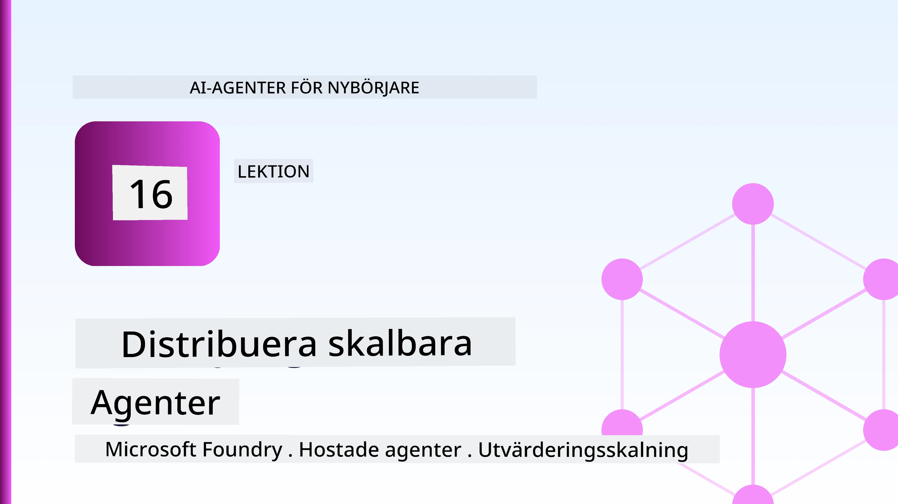
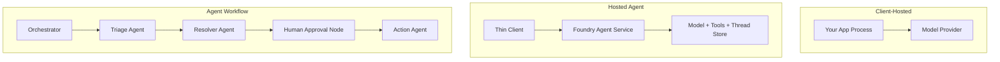
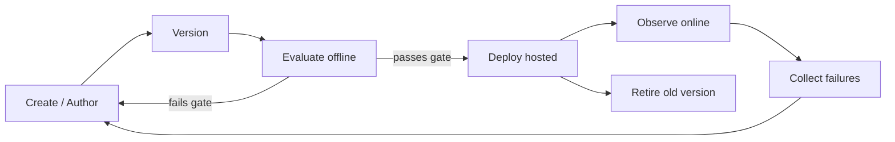
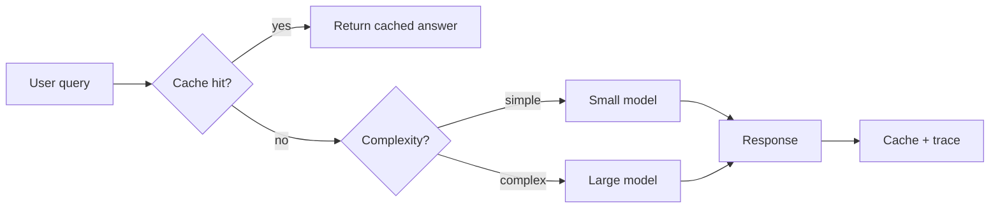
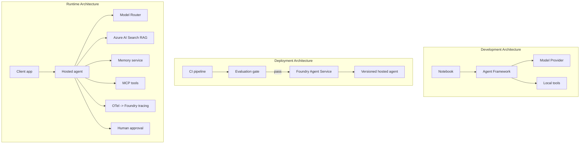

# Distribuera skalbara agenter med Microsoft Foundry



Fram till denna punkt i kursen har du byggt agenter som körs på din bärbara dator, inuti en anteckningsbok, drivna av `az login` och några miljövariabler. Det är precis rätt sätt att lära sig på. Det är inte rätt sätt att köra en agent som tusentals kunder är beroende av klockan 3 på morgonen.

Den här lektionen handlar om gapet mellan "det funkar på min maskin" och "det funkar, pålitligt och prisvärt, i produktion." Vi stänger det gapet med hjälp av **Microsoft Foundry** och **Microsoft Foundry Agent Service**, och gör det genom att bygga en riktig kundsupportagent som har verktyg, hämtning, minne, utvärdering och övervakning.

## Introduktion

Den här lektionen kommer att täcka:

- Skillnaden mellan en **prototypeagent** och en **distribuerad agent**, och varför övergången mest handlar om allt *runtomkring* modellen.
- **Distributionsmönster** för agenter: klienthostad, tjänstehostad (Hosted Agents), och arbetsflödesorkestrerade.
- **Agentens livscykel** på Microsoft Foundry — skapa, versionera, distribuera, utvärdera, observera, pensionera.
- **Scaling-strategier**: modellruttning, cachelagring, samtidighet och tillståndslös design.
- **Observerbarhet** med OpenTelemetry och Foundry-tracing.
- **Kostnadsoptimering** genom val av modell, ruttning och utvärderingsportar.
- **Företagsöverväganden**: styrning, mänskligt godkännande och säker drift av MCP-servrar i produktion.

## Lärandemål

Efter att ha slutfört denna lektion kommer du att kunna:

- Välja rätt distributionsmönster för en given agentbelastning.
- Distribuera en agent till Microsoft Foundry Agent Service så att den blir versionerad, styrd och observerbar.
- Instrumentera en agent för tracing och koppla en utvärderingspipeline som körs före varje release.
- Applicera modellruttning och cachelagring för att hålla latens och kostnad under kontroll i skala.
- Lägga till en mänsklig godkännandeport för högriskåtgärder och integrera en MCP-server på ett produktion-säkert sätt.

## Förkunskaper

Den här lektionen förutsätter att du har gjort de tidigare lektionerna och är bekväm med:

- Att bygga agenter med [Microsoft Agent Framework](../14-microsoft-agent-framework/README.md) (Lektion 14).
- [Verktygsanvändning](../04-tool-use/README.md) (Lektion 4) och [Agentic RAG](../05-agentic-rag/README.md) (Lektion 5).
- [Agentminne](../13-agent-memory/README.md) (Lektion 13) och [Agentic Protocols / MCP](../11-agentic-protocols/README.md) (Lektion 11).
- [Observerbarhet och utvärdering](../10-ai-agents-production/README.md) (Lektion 10) — denna lektion bygger direkt på den.

Du behöver också:

- En **Azure-prenumeration** och ett **Microsoft Foundry-projekt** med minst en distribuerad chattmodell.
- **Azure CLI** autentiserad (`az login`).
- Python 3.12+ och paketen i förvaret [`requirements.txt`](../../../requirements.txt).

## Från prototyp till produktion: vad ändras egentligen

En prototypeagent och en produktionsagent delar samma kärnloop — resonera, anropa verktyg, svara. Vad som ändras är allt som är omslutet runt den loopen. Modellen är kanske 20 % av en produktionsagent; de andra 80 % är den operationella skelettet.

| Aspekt | Prototyp | Produktion |
| --- | --- | --- |
| **Hosting** | Körs i din anteckningsbok | Körs som en hostad tjänst, versionerad och ut rullad |
| **Identitet** | Din `az login`-token | Hanterad identitet med avgränsad RBAC |
| **Tillstånd** | I minnet, förloras vid omstart | Externiserat (tråd-lagring, minnestjänst) |
| **Fel** | Du ser felspårningen | Försök igen, fallback, död-brevlåda, larm |
| **Kostnad** | "Det är några ören" | Spåras per förfrågan, routas, cachas, budgeteras |
| **Kvalitet** | Du granskare utdata | Utvärderas automatiskt före varje release |
| **Förtroende** | Du godkänner varje åtgärd | Policy + människa-i-slingan för riskfyllda åtgärder |

Tänk på denna tabell. Varje avsnitt nedan motsvarar en av dessa rader.

## Agentdistributionsmönster

Det finns tre mönster du kommer att använda, ofta i kombination.

### 1. Klienthostade agenter

Agentobjektet lever inuti *din* applikationsprocess. Din kod anropar modellleverantören direkt; resonemangsloopen körs i din tjänst. Detta är vad varje tidigare lektion har gjort.

- **Använd det när** du behöver full kontroll över loopen, anpassad middleware, eller om du bäddar in agenten i en befintlig backend.
- **Avvägning**: du äger skalning, tillstånd och motståndskraft själv.

### 2. Hostade agenter (Foundry Agent Service)

Agenten är *registrerad som en resurs* i Microsoft Foundry. Foundry hostar resonemangsloopen, lagrar trådar, upprätthåller innehållssäkerhet och RBAC, och gör agenten synlig i Foundry-portalen. Din app blir en tunn klient som skapar trådar och läser svar.

- **Använd det när** du vill ha hållbarhet, inbyggd observerbarhet, styrning och mindre operativ yta.
- **Avvägning**: mindre låg-nivå-kontroll i utbyte mot en hanterad runtime.

### 3. Agentarbetsflöden

Flera agenter (och verktyg) komponerade i en graf med explicit kontrollflöde — sekventiella steg, grenindelning, mänskliga godkännandenoder, och hållbara kontrollpunkter som kan pausa och återuppta. Detta är Microsoft Agent Frameworks **Workflows**-funktion använde i distributionsskala.

- **Använd det när** en enda uppgift sträcker sig över flera specialiserade agenter eller kräver ett godkännande mitt i processen.
- **Avvägning**: fler rörliga delar; kräver orkestreringsnivåobserverbarhet.



## Agentens livscykel på Microsoft Foundry

Att distribuera en agent är inte en engångshändelse `push`. Det är en loop, och det liknar mycket en mjukvarureleasecykel eftersom det är precis vad det är.



Nyckelidén, hämtad från [Lektion 10](../10-ai-agents-production/README.md): **offline-utvärdering är en port, inte en eftertanke.** En ny agentversion levereras inte om den inte klarar dina utvärderingströsklar. Online-observerbarhet matar sedan verkliga fel tillbaka in i din offline-testuppsättning. Det är hela loopen.

## Scaling-strategier

Att skala en agent skiljer sig från att skala ett tillståndslöst webb-API, eftersom varje förfrågan kan trigga flera kostsamma modell- och verktygsanrop. Fyra tekniker bär det mesta av lasten.

**Tillståndslös förfråganhantering.** Behåll inget användarspecifikt tillstånd i processminnet. Persistenta konversations-trådar i Foundrys trådlager eller en minnestjänst så att vilken instans som helst kan hantera vilken förfrågan som helst. Detta är vad som låter dig skala horisontellt — lägg till instanser, inga klibbiga sessioner.

**Modellruttning.** Inte varje förfrågan behöver din mest kapabla (och dyraste) modell. Rutt enkla förfrågningar — avsiktsklassificering, kortfattade faktasvar — till en liten, snabb modell, och reservera den stora modellen för verkligt resonemang. Foundrys **Model Router** kan göra detta åt dig, eller så kan du implementera en lättviktsklassificerare själv. Du bygger DIY-versionen i labbet.

**Svarscachelagring.** Många supportfrågor är nästan dubletter ("hur återställer jag mitt lösenord?"). Cachera svar på vanliga frågor och leverera dem utan att träffa modellen alls. Även en modest cacheträfffrekvens minskar kostnad och latens betydligt.

**Samtidighet och tryckavlastning.** Modellleverantörer har hastighetsbegränsningar. Begränsa din samtidighet, använd försök igen med exponentiell backoff, och feila snyggt (ett köat "vi jobbar på det"-svar är bättre än ett 500-fel).



## Observerbarhet i produktion

Du kan inte driva det du inte kan se. Som täcks i Lektion 10, emitterar Microsoft Agent Framework **OpenTelemetry**-spårningar nativt — varje modellanrop, verktygsanrop och orkestreringssteg blir en span. I produktion exporterar du dessa spans till Microsoft Foundry (eller någon OTel-kompatibel backend) så att du kan:

- Spåra ett enda kundklagomål från början till slut över varje modell- och verktygsanrop.
- Övervaka p50/p95 latens och kostnad per förfrågan över tid.
- Larma om felratepikar och kostnadsavvikelser innan dina användare (eller din ekonomiavdelning) märker det.

```python
from agent_framework.observability import get_tracer

tracer = get_tracer()

with tracer.start_as_current_span("support_request") as span:
    span.set_attribute("customer.tier", "enterprise")
    span.set_attribute("routed.model", "gpt-5-nano")
    # agent execution is traced automatically inside this span
```

Attribut som `customer.tier` och `routed.model` är vad som förvandlar en vägg av spårningar till besvarbara frågor ("blir företagskunder routade till den lilla modellen för ofta?").

## Kostnadsoptimering

Kostnaden i produktionsagenter domineras av tokens. Tre spakar, i ordning efter påverkan:

1. **Rätt storlek på modellen.** En liten modell som klarar din utvärderingsport är nästan alltid billigare än en stor som också klarar den. Använd utvärdering för att *bevisa* att den lilla modellen är tillräckligt bra istället för att som standard välja den största modellen av försiktighet.
2. **Ruta efter komplexitet.** Som ovan — betala stor-modell-priser bara för förfrågningar som behöver stor-modellresonemang.
3. **Cachelagra aggressivt.** Det billigaste modellanropet är det du aldrig gör.

Utvärderingsportar och kostnadskontroll är samma disciplin sedd från två vinklar: utvärdering talar om *kvalitetsgolvet*, ruttning och caching håller dig så nära golvets *kostnad* som möjligt.

## Företagsdistribution: överväganden

**Styrning.** Hostade agenter ärva Foundrys RBAC, innehållssäkerhet och revisionsloggning. Ge varje agent en hanterad identitet med minsta privilegium den behöver — läsbehörighet till kunskapsbasen, avgränsad åtkomst till ärende-API:et, inget mer.

**Människa-i-slingan.** Vissa åtgärder är för viktiga för att automatiseras rakt av — utfärda återbetalning, radera ett konto, eskalera till en juridisk avdelning. Microsoft Agent Framework stöder **godkännande-krävande** verktyg: agenten föreslår åtgärden, exekveringen pausas, en människa godkänner eller avvisar, och arbetsflödet fortsätter. Du såg primitivet i [Lektion 6](../06-building-trustworthy-agents/README.md); här distribuerar du det.

**MCP i produktion.** [MCP](../11-agentic-protocols/README.md) låter din agent använda externa verktyg genom ett standardgränssnitt. I produktion behandla varje MCP-server som en opålitlig gräns: fixa serverversionen, kör den med avgränsad identitet, validera dess resultat och exponera aldrig hemligheter för den. En MCP-server är ett beroende, och beroenden patchas, granskas och får hastighetsbegränsningar.



Dessa tre diagram — utveckling, distribution, körning — är samma agent i tre livsstadier. Labbet som följer går igenom att bygga den.

## Praktiskt labb: En produktionsklar kundsupportagent

Öppna [`code_samples/16-python-agent-framework.ipynb`](./code_samples/16-python-agent-framework.ipynb) och arbeta igenom den från början till slut. Du kommer att sätta ihop en **Contoso kundsupportagent** med alla produktionskrav inkopplade:

1. **Verktygsanrop** — slå upp orderstatus och öppna supportärenden.
2. **RAG** — svara på policyfrågor från en kunskapsbas (Azure AI Search, med en minnesbaserad fallback så att anteckningsboken körs utan en Search-resurs).
3. **Minne** — komma ihåg kunden över samtalsomgångar.
4. **Modellruttning** — en komplexitetsklassificerare skickar varje förfrågan till en liten eller stor modell.
5. **Cachelagring av svar** — upprepade frågor svaras från cache.
6. **Mänskligt godkännande** — återbetalningar över en gräns pausar för mänskligt godkännande.
7. **Utvärderingspipeline** — en liten offline-testuppsättning betygsätter agenten och fungerar som en release-port.
8. **Observerbarhet** — OpenTelemetry-tracing runt varje förfrågan.

### Genomgång

Anteckningsboken är organiserad så att varje produktionsaspekt är en självständig, körbar sektion. Hjärtat i den är routning-plus-cachehanteraren:

```python
async def handle_support_request(query: str, customer_id: str) -> str:
    # 1. Serve from cache when we can.
    cached = response_cache.get(normalize(query))
    if cached:
        return cached

    # 2. Route by complexity to control cost.
    model = "gpt-5-nano" if is_simple(query) else "gpt-5-mini"

    # 3. Run the agent inside a trace span for observability.
    with tracer.start_as_current_span("support_request") as span:
        span.set_attribute("routed.model", model)
        span.set_attribute("customer.id", customer_id)
        response = await support_agent.run(query, model=model)

    # 4. Cache and return.
    response_cache.set(normalize(query), response.text)
    return response.text
```

Utvärderingsporten som skyddar en release ser ut så här:

```python
async def evaluation_gate(agent, test_cases, threshold: float = 0.8) -> bool:
    passed = 0
    for case in test_cases:
        result = await agent.run(case["input"])
        if score_response(result.text, case["expected"]) >= 0.8:
            passed += 1
    pass_rate = passed / len(test_cases)
    print(f"Evaluation pass rate: {pass_rate:.0%} (gate: {threshold:.0%})")
    return pass_rate >= threshold  # only deploy if the gate passes
```

Läs varje rad — anteckningsboken håller primitivena medvetet små så att inget är dolt bakom en ramverksanrop.

## Validera en distribuerad agent med röktester

Utvärderingsporten ovan körs *offline* mot ditt agentobjekt. När agenten är distribuerad som Hosted Agent behöver du en till, ännu billigare kontroll: **svarar den distribuerade endpointen faktiskt?**

Att distribuera "framgångsrikt" bevisar bara att kontrollplanet accepterade definitionen — det bevisar inte att agenten svarar. En saknad beroende, en felaktig modellruttning eller en utgången anslutning kan lämna en grön distribution som inte returnerar något. Ett **röktest** fångar det på sekunder, vid varje distribution, utan kostnaden för en full utvärdering.

Detta förvar levereras med en färdig att använda röktestpipeline byggd på [AI Smoke Test](https://github.com/marketplace/actions/ai-smoke-test) GitHub Action:

- **Katalog** — [`tests/lesson-16-smoke-tests.json`](../../../tests/lesson-16-smoke-tests.json) innehåller prompts och påståenden för Contoso supportagent (grundade policy-svar, en orderuppslagning, hålla sig ämnesrelaterad och kontinuitet i flera svängar). Kataloger för andra lektionsagenter finns bredvid — se [`tests/README.md`](../tests/README.md).
- **Arbetsflöde** — [`.github/workflows/smoke-test.yml`](../../../.github/workflows/smoke-test.yml) loggar in med Azure OIDC och POST-ar varje prompt till agentens Responses-endpoint, misslyckas jobbet vid varje påståendefel.

```yaml
- name: Smoke-test hosted agent
  uses: JFolberth/ai-smoketest@v1
  with:
    project_endpoint: ${{ inputs.project_endpoint }}
    agent_name: ContosoSupportAgent
    tests_file: tests/lesson-16-smoke-tests.json
```

Kör det från fliken **Actions** när din agent är distribuerad, och ange din Foundry-projektendpoint och agentnamn. Den federerade identiteten behöver rollen **Azure AI User** på Foundry-projektets nivå. Tänk på lagren som en pyramid: röktester (tillgänglig och svarar?) körs vid varje distribution, offline utvärdering (bra nog för att leverera?) körs innan befordran, och online utvärdering (hur går det i verkligheten?) körs kontinuerligt.

## Kunskapskontroll

Testa din förståelse innan du går vidare till uppgiften.

**1. Ungefär hur stor del av en produktionsagent är "modellen" och vad är resten?**

<details>
<summary>Svar</summary>

Modellen är en minoritet av systemet — ofta angiven som runt 20%. Resten är den operativa stomme: hosting och versionering, identitet och RBAC, eksternlagrad status, felhantering, kostnadsspårning, utvärdering och mänskliga kontroller i loopen. Att gå till produktion handlar mest om att bygga allt *runt* resonemangsloopen.
</details>

**2. När skulle du välja en Hosted Agent framför en klienthostad agent?**

<details>
<summary>Svar</summary>

När du vill ha en hanterad runtime med inbyggd hållbarhet (trådar som kan fortsätta och återupptas), observabilitet, innehållssäkerhet och RBAC, och du är villig att byta bort lite lågnivåkontroll över resonemangsloopen för en mindre operativ yta. Klienthostad är att föredra när du behöver full kontroll över loopen eller integrerar agenten i en befintlig backend.
</details>

**3. Varför måste en skalbar agent vara stateless i sin egen processminne?**

<details>
<summary>Svar</summary>

Så att vilken instans som helst kan hantera vilken förfrågan som helst, vilket möjliggör horisontell skalning utan klibbiga sessioner. Per-användarsamtalsstatus lagras externt i en trådlager eller minnestjänst. Om status levde i processminnet skulle du förlora den vid omstart och inte kunna distribuera lasten fritt.
</details>

**4. Vilket problem löser modellriktning och hur relaterar det till utvärdering?**

<details>
<summary>Svar</summary>

Routing skickar enkla förfrågningar till en liten, billig, snabb modell och reserverar den stora modellen för äkta resonemang, vilket styr både latens och kostnad. Det relaterar till utvärdering eftersom utvärdering är vad som *bevisar* att den lilla modellen är tillräckligt bra för en klass av förfrågningar — routing utan utvärdering är gissning.
</details>

**5. Vad är en "utvärderingsgrind" och var sitter den i livscykeln?**

<details>
<summary>Svar</summary>

En utvärderingsgrind kör en offline testuppsättning mot en ny agentversion och blockerar distribution om inte godkännandegraden når en tröskel. Den sitter mellan "version" och "distribution" i livscykeln, och gör kvalitet till en förutsättning för release istället för något du kontrollerar efter leverans.
</details>

**6. Varför bör en MCP-server behandlas som en otillförlitlig gräns i produktion?**

<details>
<summary>Svar</summary>

Eftersom det är ett externt beroende som din agent kallar på. Du bör låsa dess version, köra den med en avgränsad identitet, validera dess utdata, begränsa begäran och aldrig exponera hemligheter för den — samma disciplin som för alla tredjepartsberoenden. Dess utdata flyter in i din agents resonemang, så ovaliderat förtroende är en säkerhetsrisk.
</details>

**7. Vilken enskild förändring har oftast störst påverkan på produktionsagentens kostnad, och varför?**

<details>
<summary>Svar</summary>

Att anpassa modellstorleken — att använda den minsta modellen som fortfarande klarar din utvärderingsgrind. Kostnaden domineras av tokens, och en mindre modell som uppfyller kvalitetsnivån är nästan alltid billigare än en större. Cachning och routing minskar sedan kostnaden ytterligare, men valet av rätt basmodell har den största direkta effekten.
</details>

**8. Vilken roll spelar spanattribut som `customer.tier` och `routed.model` i observabilitet?**

<details>
<summary>Svar</summary>

De förvandlar råa spår till besvarbara affärsfrågor. Utan attribut har du en vägg av spans; med dem kan du fråga "får företagskunder för ofta omdirigering till den lilla modellen?" eller "vilken modell hanterar våra långsammaste förfrågningar?" Attribut är hur du skär telemetri efter de dimensioner som är viktiga för din verksamhet.
</details>

## Uppgift

Ta kundsupportagenten från labbet och förstärk den för ett specifikt scenario: **en prenumerationsfaktureringssupportagent för ett SaaS-företag.**

Din inlämning ska:

1. **Byt ut verktygen** mot faktureringsrelevanta: `get_subscription_status`, `get_invoice`, och `issue_credit` (krediter över 50 dollar kräver mänskligt godkännande).
2. **Lägg till tre RAG-dokument** som täcker företagets återbetalningspolicy, faktureringscykel och avbokningspolicy.
3. **Utöka utvärderingsuppsättningen** till minst åtta fall, varav minst två *ska* trigga mänskligt godkännandespår, och bekräfta att din utvärderingsgrind godkänner eller underkänner korrekt.
4. **Lägg till en kostnadsrapport**: efter att ha kört tio blandade frågor genom agenten, skriv ut hur många som gick till den lilla modellen, hur många till den stora modellen, och hur många som serverades från cache.

Skriv ett kort stycke (i en markdowncell) som förklarar vilken modellroutningsregel du valde och hur du skulle validera den med verklig trafik. Det finns inget enda rätt svar — du bedöms på om produktionsaspekterna är sammanfogade på ett koherent sätt.

## Sammanfattning

I denna lektion gick du från prototyp till produktion med Microsoft Foundry:

- Steget till produktion handlar mest om **den operativa stommen** runt modellen — hosting, identitet, status, felhantering, kostnad, kvalitet och förtroende.
- Du lärde dig de tre **distributionsmönstren** — klienthostad, Hosted Agents och Agent Workflows — och när varje passar.
- Du gick igenom **agentens livscykel**, där offline **utvärdering fungerar som en releasegrind** och onlineobservabilitet matar tillbaka fel till testuppsättningen.
- Du tillämpade **skalningsstrategier** — stateless design, modellriktning, cachning och begränsad samtidighet — och kopplade dem till **kostnadsoptimering**.
- Du kopplade in **företagskontroller**: RBAC, mänskligt godkännande i loopen och produktionssäker MCP-integration.
- Du byggde en **produktionsklar kundsupportagent** som binder ihop alla dessa aspekter i körbar kod.

Nästa lektion tar motsatt väg: istället för att skala upp agenter i molnet tar du ner dem *till* en utvecklarmaskin och kör dem helt lokalt.

## Ytterligare resurser

- <a href="https://learn.microsoft.com/azure/ai-foundry/what-is-azure-ai-foundry" target="_blank">Microsoft Foundry-dokumentation</a>
- <a href="https://learn.microsoft.com/azure/ai-foundry/agents/overview" target="_blank">Översikt Microsoft Foundry Agent Service</a>
- <a href="https://learn.microsoft.com/en-us/agent-framework/overview/?wt.mc_id=youtube_26688_organicsocial_reactor&pivots=programming-language-python" target="_blank">Microsoft Agent Framework</a>
- <a href="https://learn.microsoft.com/en-us/azure/ai-foundry/openai/concepts/model-router" target="_blank">Model Router i Microsoft Foundry</a>
- <a href="https://learn.microsoft.com/azure/search/search-what-is-azure-search" target="_blank">Azure AI Search</a>
- <a href="https://opentelemetry.io/" target="_blank">OpenTelemetry</a>
- <a href="https://github.com/marketplace/actions/ai-smoke-test" target="_blank">AI Smoke Test GitHub Action</a>
- <a href="https://modelcontextprotocol.io/" target="_blank">Model Context Protocol (MCP)</a>

## Föregående lektion

[Bygga Computerrustningsagenter (CUA)](../15-browser-use/README.md)

## Nästa lektion

[Skapa Lokala AI-agenter](../17-creating-local-ai-agents/README.md)

---

<!-- CO-OP TRANSLATOR DISCLAIMER START -->
**Ansvarsfriskrivning**:
Detta dokument har översatts med hjälp av AI-översättningstjänsten [Co-op Translator](https://github.com/Azure/co-op-translator). Även om vi strävar efter noggrannhet, var vänlig notera att automatiska översättningar kan innehålla fel eller brister. Det ursprungliga dokumentet på dess modersmål bör betraktas som den auktoritativa källan. För kritisk information rekommenderas professionell mänsklig översättning. Vi ansvarar inte för några missförstånd eller feltolkningar som uppstår till följd av användningen av denna översättning.
<!-- CO-OP TRANSLATOR DISCLAIMER END -->