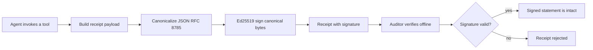
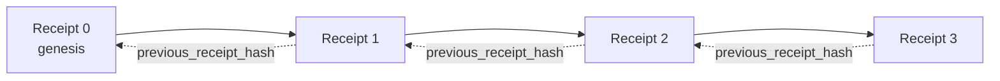

[Titta på lektionsvideon: Säkerställa AI-agenter med kryptografiska kvitton](https://youtu.be/PLACEHOLDER_VIDEO_ID)

> _(Lektionsvideo och miniatyrbild kommer att läggas till av Microsofts innehållsteam efter sammanslagning, matchande lektionsmönstret 14 / 15.)_

# Säkerställa AI-agenter med kryptografiska kvitton

## Introduktion

Den här lektionen täcker:

- Varför revisionsspår för AI-agenter är viktiga för efterlevnad, felsökning och förtroende.
- Vad ett kryptografiskt kvitto är och hur det skiljer sig från en osignerad loggrad.
- Hur man producerar ett signerat kvitto för en agents verktygssamtal i ren Python.
- Hur man verifierar ett kvitto offline och upptäcker manipulation.
- Hur man kedjar kvitton så att borttagning eller omordning av ett bryter kedjan.
- Vad kvitton bevisar och vad de uttryckligen inte bevisar.

## Lärandemål

Efter att ha genomfört denna lektion kommer du att veta hur man:

- Identifierar felmoder som motiverar kryptografiskt ursprung för agents handlingar.
- Producerar ett Ed25519-signerat kvitto över en kanonisk JSON-payload.
- Verifierar ett kvitto oberoende med endast utgivarens offentliga nyckel.
- Upptäcker manipulation genom att köra verifiering på nytt på ett modifierat kvitto.
- Bygger en hash-kedjad sekvens av kvitton och förklarar varför kedjan är viktig.
- Känner igen gränsen mellan vad kvitton bevisar (tilldelning, integritet, ordning) och vad de inte gör (riktigheten av handlingen, riktigheten av policyn).

## Problemet: Din agents revisionsspår

Föreställ dig att du har lanserat en AI-agent för Contoso Travel. Agenten läser kundförfrågningar, anropar en flyg-API för att leta upp alternativ och bokar platser för kundens räkning. Förra kvartalet behandlade agenten 50 000 bokningar.

Idag anländer en revisor. De ställer en enkel fråga: "Visa mig vad din agent gjorde."

Du överlämnar dina loggfiler. Revisorn tittar på dem och ställer den svårare frågan: "Hur vet jag att dessa loggar inte har redigerats?"

Detta är problemet med revisionsspår. De flesta agentdistributioner idag förlitar sig på:

- **Applikationsloggar**: skrivs av agenten själv, kan redigeras av vem som helst med filsystemåtkomst.
- **Molnloggtjänster**: manipulationssäkra på plattformsnivå men endast om revisorn litar på plattformsoperatören.
- **Databastransaktionsloggar**: väl lämpade för databasändringar men inte för godtyckliga verktygsanrop.

Ingen av dessa kan svara på revisorns fråga utan att revisorn måste lita på någon (dig, din molnleverantör, din databassäljare). För intern användning är det ofta acceptabelt. För reglerade arbetsbelastningar (finans, sjukvård, allt som omfattas av EU:s AI-förordning) är det inte det.

Kryptografiska kvitton begränsar detta problem genom att göra ett undertecknat uttalande oberoende
verifierbart. Revisorn behöver fortfarande en extern anledning att lita på signeringsnyckeln och
komponenten som producerade uttalandet. En inbäddad nyckel bevisar självkonsekvens,
inte utfärdaridentitet eller kontrollplacering.

## Vad är ett kryptografiskt kvitto?

Ett kvitto är ett JSON-objekt som registrerar vad en agent gjorde, signerat med en digital signatur.



Ett minimalt kvitto ser ut så här:

```json
{
  "type": "agent.tool_call.v1",
  "agent_id": "contoso-travel-bot",
  "tool_name": "lookup_flights",
  "tool_args_hash": "sha256:a3f9c1...",
  "result_hash": "sha256:7b2e1d...",
  "policy_id": "contoso-travel-policy-v3",
  "timestamp": "2026-04-25T14:30:00Z",
  "sequence": 47,
  "previous_receipt_hash": "sha256:9d4e6a...",
  "signature": {
    "alg": "EdDSA",
    "sig": "c5af83...",
    "public_key": "8f3b2c..."
  }
}
```

Tre egenskaper utför jobbet:

1. **Signaturen**. Kvittot signeras av agentens gateway med en privat Ed25519-nyckel. Vem som helst med motsvarande offentlig nyckel kan verifiera signaturen offline. En beroende part måste låsa fast den nyckeln eller hämta den från ett betrott register utanför kvittot. Manipulation med något signerat fält ogiltigförklarar signaturen.

2. **Kanonisk kodning**. Innan signering serialiseras kvittot med JSON Canonicalization Scheme (JCS, RFC 8785). Detta säkerställer att två implementationer som producerar samma logiska kvitto genererar byte-identiskt output. Utan kanonisering skulle olika JSON-serialiserare producera olika signaturer för samma innehåll.

3. **Hash-kedjning**. Fältet `previous_receipt_hash` länkar varje kvitto till det föregående. Att ta bort eller omordna ett kvitto bryter den presenterade sekvensen. Att upptäcka trunkering eller en signatörskontrollerad omskrivning kräver också ett låst aktuellt kedjehuvud, oberoende bevittnat kontrollpunkt eller autentiserat slutet populationsåtagande.

Tillsammans ger dessa egenskaper tre garantier:

- **Tillskrivning till en nyckel**: denna nyckel signerade detta innehåll. Organisatorisk eller mänsklig identitet kräver en betrodd nyckelbindning.
- **Integritet**: innehållet har inte ändrats sedan signeringen.
- **Ordning inom den verifierade sekvensen**: detta kvitto länkar till den föregångaren.

## Skapa ett kvitto i Python

Du behöver inget särskilt bibliotek för att skapa ett kvitto. De kryptografiska primitiven finns allmänt tillgängliga och logiken är några tiotals rader Python.

De praktiska övningarna i `code_samples/18-signed-receipts.ipynb` går igenom hela flödet. Den versionshanterade `code_samples/18-signed-receipts.execution-receipt.json` registrerar exakt notebook-hash, Python-miljö, cellantal och kontroller från senaste rena körningen utan att ändra lektionens sparade resultat. Sammanfattad version:

```python
import json
import hashlib
import base64
from nacl import signing
from jcs import canonicalize  # RFC 8785 canonical JSON

def b64url_nopad(data: bytes) -> str:
    return base64.urlsafe_b64encode(data).decode("ascii").rstrip("=")

def sha256_canonical(obj) -> str:
    """SHA-256 of a Python object's JCS-canonical JSON form."""
    return f"sha256:{hashlib.sha256(canonicalize(obj)).hexdigest()}"

# Generate or load a signing key (in production, store in a key vault)
signing_key = signing.SigningKey.generate()
verify_key = signing_key.verify_key
TRUSTED_PUBLIC_KEYS = {b64url_nopad(bytes(verify_key))}  # pinned out of band by the verifier

# Build the receipt payload (no signature yet)
tool_args = {"origin": "SYD", "destination": "LAX"}
tool_result = [{"flight": "QF11", "price": 1850, "stops": 0}]

payload = {
    "type": "agent.tool_call.v1",
    "agent_id": "contoso-travel-bot",
    "tool_name": "lookup_flights",
    "tool_args_hash": sha256_canonical(tool_args),
    "result_hash": sha256_canonical(tool_result),
    "policy_id": "contoso-travel-policy-v3",
    "timestamp": "2026-04-25T14:30:00Z",
    "sequence": 0,
    "previous_receipt_hash": None,
}

# Canonicalize and sign the JCS bytes directly. PureEdDSA hashes internally.
canonical_bytes = canonicalize(payload)
signature_bytes = signing_key.sign(canonical_bytes).signature

# Attach a structured signature object.
receipt = {
    **payload,
    "signature": {
        "alg": "EdDSA",
        "sig": b64url_nopad(signature_bytes),
        "public_key": b64url_nopad(bytes(verify_key)),
    },
}
```

Det är hela signeringspipen. Övningarna i notebooken går igenom varje steg.

## Verifiera ett kvitto och upptäcka manipulation

Verifiering är den omvända operationen:

```python
import base64
import hashlib
from nacl import signing
from nacl.exceptions import CryptoError
from jcs import canonicalize

def b64url_decode(s: str) -> bytes:
    # Strict: Python's decoder skips characters outside the alphabet and also
    # accepts padding, the standard +/ alphabet and non-zero spare bits.
    # Re-encoding and comparing accepts only the one unpadded base64url form.
    padding = "=" * ((4 - len(s) % 4) % 4)
    data = base64.urlsafe_b64decode(s + padding)
    if base64.urlsafe_b64encode(data).decode("ascii").rstrip("=") != s:
        raise ValueError("not canonical unpadded base64url")
    return data

def verify_receipt(receipt: dict, trusted_public_key: str) -> bool:
    # trusted_public_key is the issuer's key, obtained from somewhere other
    # than this receipt. Never use receipt["signature"]["public_key"] here:
    # see "What Receipts Prove (and What They Do Not)" below.
    # Fails closed: anything malformed returns False instead of raising.
    if not isinstance(receipt, dict) or not isinstance(trusted_public_key, str):
        return False
    sig_obj = receipt.get("signature")
    if not isinstance(sig_obj, dict) or sig_obj.get("alg") != "EdDSA":
        return False
    sig_b64 = sig_obj.get("sig")
    if not isinstance(sig_b64, str):
        return False

    try:
        # Reconstruct the payload that was actually signed (everything except signature).
        payload = {k: v for k, v in receipt.items() if k != "signature"}
        canonical_bytes = canonicalize(payload)
        verify_key = signing.VerifyKey(b64url_decode(trusted_public_key))
        verify_key.verify(canonical_bytes, b64url_decode(sig_b64))
        return True
    except (CryptoError, TypeError, ValueError, KeyError, OverflowError):
        return False
    except Exception:
        # An undecodable key or signature, or a payload that cannot be
        # canonicalized: fail closed rather than raise.
        return False
```

Den här funktionen tar ett kvitto och utgivarens offentliga nyckel och returnerar `True` om signaturen är giltig och `False` annars, även när indata är felaktig. Inget nätverksanrop och ingen verifieringstjänst: när du har utgivarens nyckel är verifiering helt lokal och offline. Vad det fortfarande kräver är den nyckeln, hämtad från någon annanstans än själva kvittot.

För att se manipulation upptäckas i praktiken går notebooken igenom:

1. Skapa ett giltigt kvitto och bekräfta att det verifierar.
2. Modifiera en byte av fältet `tool_args_hash`.
3. Köra verifiering på nytt och se att den misslyckas.
4. Manipulera igen, men denna gång signera om med en nyckel som angriparen genererat och inbädda den nyckeln i kvittot.

Steg 4 är det värt att fundera på. Det kvittot är internt konsekvent: dess signatur är äkta för dess innehåll och för den nyckel det bär, så det verifieras mot nyckeln inuti. Det misslyckas bara när det kontrolleras mot utgivarens riktiga nyckel. Steg 2 och 3 fångar en angripare som inte orkade signera om; steg 4 fångar den som gjorde det.

Detta är den praktiska demonstrationen att kvitton är manipulationssäkra: varje ändring av ett signerat fält bryter signaturen, förutsatt att du verifierar mot en nyckel som angriparen inte levererat. Själva objektet `signature` ligger utanför de signerade bytena, vilket är varför nyckeln du verifierar mot måste komma från någon annan källa än kvittot.

## Kedja kvitton för agenter med flera steg

Ett enda signerat kvitto skyddar en handling. En kedja av kvitton skyddar en sekvens.



Varje kvitto registrerar hashen av kvittot före det. För att tyst ta bort kvitto 2 skulle en angripare behöva antingen:

- Modifiera fältet `previous_receipt_hash` i kvitto 3 (bryter kvitto 3:s signatur), ELLER
- Förfalska en ny signatur på ett modifierat kvitto 3 (kräver agentens privata nyckel).

Om den privata nyckeln finns i en hårdvarunyckelvalv och verifierare kontrollerar varje kvitto mot utgivarens offentliga nyckel, som hämtats oberoende (en publicerad JWK Set eller ett låst konfigurationsvärde), är ingen attack möjlig utan upptäckt. Att publicera nyckeln inuti varje kvitto räcker inte: en angripare kan signera om med sin egen nyckel och istället bädda in den, vilket är fällan `04_resigned_receipt.json`.

Notebooken går igenom:

1. Bygga en kedja av tre kvitton.
2. Verifiera att varje kvittos `previous_receipt_hash` stämmer överens med den faktiska hashen av det föregående kvittot.
3. Manipulera ett kvitto i mitten och se kedjan brytas precis där.

Så här producerar du ett revisionsspår som en extern revisor kan verifiera under sina
egna låsta utgivarnycklar och kedjekontroller, utan att behöva lita på din oföränderliga loggdatabas.

## Vad kvitton bevisar (och vad de inte gör)

Detta är den viktigaste delen av lektionen. Kvitton är kraftfulla men deras kraft är begränsad.

**Kvitton bevisar tre saker:**

1. **Tillskrivning**: en specifik nyckel signerade en specifik payload.
2. **Integritet**: payloaden har inte ändrats sedan signering.
3. **Ordning inom en presenterad, verifierad sekvens**: detta kvitto länkar till den föregångaren.

**Kvitton bevisar INTE:**

1. **Korrekthet**: att agentens handling var rätt handling. Ett kvitto kan signeras för ett felaktigt svar lika rent som för ett rätt svar.
2. **Efterlevnad av policy**: att policyn som refereras i `policy_id` faktiskt utvärderades, eller att den skulle ha tillåtit denna handling om den kontrollerats. Kvittot registrerar vad som påstods, inte vad som efterlevdes.
3. **Identitet bortom nyckeln**: kvittot säger "denna nyckel signerade detta innehåll." Det säger inte "den här människan godkände detta." Att koppla en nyckel till en person eller organisation kräver separat identitetsinfrastruktur (en katalog, ett offentligt nyckelregister, etc.).
4. **Sanningshalt av indata**: om agenten får en manipulerad prompt och agerar på den, registrerar kvittot handlingen troget. Kvitton är efter validering av indata, inte en ersättning för det.
5. **Utförande eller verklig effekt**: ett kvitto efter anrop registrerar vad dess utgivare påstår hände. Att bevisa inträde eller förena en extern effekt kräver bevis från den faktiska utföraren eller leverantörsgränsen.
6. **Fullständighet**: ett frånvarande kvitto kan betyda spärrat, utelämnat, förlorat eller inte instrumenterat. Frånvaro blir bevis endast inom en autentiserad sluten population.
7. **Betrodd tid**: en signerad tidsstämpel bevisar att signatören bar det värdet, inte att värdet var korrekt. Betrodd tid kräver en separat tidmyndighet eller bevittnat kontrollpunkt.

**Nyckeln i kvittot är inte den nyckel du verifierar med.** Detta följer från punkt 3, och det är den enda plats där skillnaden måste ändra din kod snarare än din förståelse. `public_key` i exemplet ovan finns där så att exemplet är självförsörjande. En verifierare får aldrig lita på den. Vem som helst kan ta ett kvitto, ändra det, signera det med en nyckel de genererat och bädda in den nyckeln; resultatet verifierar perfekt mot sig självt. Det är fällan `04_resigned_receipt.json` i `sample_receipts/`, och det är därför `verify_receipt` ovan tar nyckeln som argument istället för att läsa ut den från kvittot. Skaffa utgivarens nyckel oberoende, från JWK Set i produktionskontrollistan nedan eller en annan förankring du låst fast i förväg, och verifiera mot den. En signatur kontrollerad med en nyckel som kommit i samma kuvert bevisar bara att kuvertet är självkonsekvent.

Den här gränsen är viktig av två skäl:

- Den berättar vad kvitton är användbara för: att göra agentbeteende revisionsbart och manipulationssäkert, även över organisatoriska gränser.
- Den berättar vilka ytterligare lager du fortfarande behöver: validering av indata (Lektionen 6), policyverkställighet (behandlas kort nedan) och identitetsinfrastruktur (utanför denna lektions omfattning).

Ett vanligt misstag är att anta att "vi har kvitton" betyder "vi är styrda." Det gör det inte. Kvitton är en grund. Styrning är systemet du bygger ovanpå.

## Binda en godkännares signatur till exakt handling

Punkt 3 ovan är värd en egen sektion: ett handlingskvitto säger "denna nyckel signerade detta innehåll," aldrig "en människa godkände detta." För högriskhandlingar (återbetalningar, borttagningar, banköverföringar) kan en separat godkännares signatur binda exakt handling. Att koppla den nyckeln till en människa och kontrollera mänsklig närvaro är fortfarande separata ansvar.

Följande notebook `code_samples/human-authorization-receipts.ipynb` lägger till en andra kvittotyp, `human.approval.v1`, i samma kuvertform som lektionens kvitton (en typad payload signerad med Ed25519 över dess kanoniska JCS-byten, med objektet `signature` utanför de signerade bytena). En godkännar-nyckel signerar **hela den kanoniska handlingen och dess digest**; en agentnyckel signerar ett påstående som bär **samma handlingsdigest** och ett `parent_approval_ref`, `receipt_hash` för godkännandet, samma konvention som `previous_receipt_hash` i kedjan du byggde ovan. En `verify_chain` verifierar båda artefakterna under **separata låsta nyckelregister** (godkännar-nycklar vs agent-nycklar), så kodvägen delas men myndigheterna aldrig.

Egenskapen detta skänker, uttryckt noggrant: *den låsta godkännar-nyckeln signerade denna exakta
handling, och agentnyckeln signerade senare ett påstående som bär samma handlingsdigest.*
Det är användbara bevis, men det är inte i sig själv bevis på att handlingen utfördes. För
att kontrollera utförandet måste det exakta godkännandet också reserveras och konsumeras en gång vid
den faktiska utförargränsen; okända leverantörsresultat måste förbli okända snarare än att
blint försöka igen. Notebookens vägras-fällor testar kvittokedjans lager:

- manipulation, förvirrad ställföreträdare, förfalskade nycklar på båda sidor och felaktigt indata;
- **gammal myndighet**: en signatur som fortfarande verifierar, vägras ändå eftersom policyn ändrats, godkännar-nyckeln roterats ut ur det låsta registret eller godkännandet gått ut före den angivna verifieringstiden;
- **digest-utbyte**: ett giltigt signerat handlingskvitto som pekar på ett *äkta* godkännande som binder en *annan* kanonisk handling.

Varje fel nekas med en distinkt anledning, så en revisor som läser en vägran kan avgöra om myndigheten gått ut eller om den påstådda handlingen ändrades. Verifiering är skrivskyddad och upprepbar: den konsumerar inte godkännandet eller anropar en leverantör. En separat utförare behöver hållbart, atomärt skydd för uppspelning och uttryckliga resultat för framgång, misslyckande och osäkert. Det mänskliga godkänningskvittot är en pedagogisk sammansättning definierad av denna lektion, inte en kvittotyp definierad av `draft-farley-acta-signed-receipts`.

## Produktionsreferenser

Python-koden i denna lektion är avsiktligt minimal så att du kan läsa varje rad och förstå exakt vad som händer. I produktion har du två alternativ:

1. **Bygg direkt på de kryptografiska primitives.** De 50 rader du såg ovan är tillräckliga för många användningsfall. PyNaCl (Ed25519) och `jcs`-paketet (kanonisk JSON) är väl underhållna och granskade bibliotek.

2. **Använd ett produktionsklart kvitto-bibliotek.** Flera open-source-projekt implementerar samma mönster med ytterligare funktioner (nyckelrotation, batchverifiering, JWK Set-distribution, integration med policy-motorer):
   - Signeringskedjan använder JCS och signatur-scope-konventioner i ett oberoende IETF Internet-Draft ([`draft-farley-acta-signed-receipts`](https://datatracker.ietf.org/doc/draft-farley-acta-signed-receipts/), revision 02). Denna lektionens enkla utbildningskvitto skiljer sig från utkastets `{payload, signature}`-kuvert och presenteras inte som en konform implementering. Utkastet publicerar en delad konformitetssvit ([agent-governance-testvectors](https://github.com/ScopeBlind/agent-governance-testvectors)) för implementationer som riktar sig mot dess trådadapterformat.
   - Microsoft Agent Governance Toolkit komponerar kvitton med Cedar-baserade policysbeslut; se Tutorial 33 i det arkivet för ett exempel från början till slut.
   - `protect-mcp` (npm) och `@veritasacta/verify` (npm)-paketen tillhandahåller en Node-baserad implementation av kvitto-signering och offline-verifiering, avsedd för att omsluta vilken MCP-server som helst med en manipuleringssäker revisionskedja, inklusive ett hold-for-ko-sign-flow där en pausad åtgärd genererar ett godkännandekvitto bundet till åtgärdens digest (WebAuthn-stödd i desktopflödet), samma godkännandekvittomönster som den ovan i människobaserad auktoriseringsanteckningsbok.
   - **[nobulex](https://github.com/arian-gogani/nobulex)** Python SDK (`pip install nobulex`) tillhandahåller samma Ed25519 + JCS signeringsmönster i Python med integrationer för LangChain och CrewAI, inklusive publicerade korsvaliderings-testvektorer och en överensstämmelsekarta bidragen via [OWASP PR #2210](https://github.com/OWASP/CheatSheetSeries/pull/2210).
   - **[EMILIA Protocol](https://github.com/emiliaprotocol/emilia-protocol)** tillhandahåller ett kompletterande exakt-åtgärdsverkställande lager: offline-verifierbara godkännandekvitton, fast WebAuthn eller kvorumauktoritet, engångskonsumtion vid utförarens gräns, och en explicit väg för oavgjort utfall. Dess ramverksadapter behandlar ett kvitto som nödvändig bevisning snarare än bevis för att en extern effekt ägt rum.

Beslutet mellan att skapa eget och att använda ett bibliotek speglar beslutet mellan att skriva ett eget JWT-bibliotek och använda ett testat: båda är rimliga; biblioteket sparar tid och minskar revisionsbredden; från-grunden-metoden tvingar dig att förstå varje primitiv. Den här lektionen lär ut från-grunden-vägen så att du har grunden för båda valen.

## Kunskapskontroll

Testa din förståelse innan du går vidare till övningsuppgiften.

**1. Ett kvitto signeras med agentens privata Ed25519-nyckel. Revisor har endast den publika nyckeln. Kan revisorn verifiera kvittot offline?**

<details>
<summary>Svar</summary>

Ja, kryptografisk verifiering kräver endast den publika nyckeln och de signerade bytena. 
Revisorn måste dock fortfarande erhålla och fastställa den accepterade publika nyckeln oberoende av kvittot.
Inga nätverksanrop krävs efter att den tillitskonfigurationen etablerats.
</details>

**2. En angripare ändrar `policy_id`-fältet i ett kvitto för att hävda att det styrdes av en mer tillåtande policy. Signaturen var över den ursprungliga nyttolasten. Vad händer vid verifiering?**

<details>
<summary>Svar</summary>

Verifieringen misslyckas. Signaturen beräknades över de kanoniska byten av den ursprungliga nyttolasten; att ändra något fält i nyttolasten ändrar dessa byte, vilket gör signaturen ogiltig. Angriparen skulle behöva den privata nyckeln för att skapa en ny giltig signatur, vilket de inte har.
</details>

**3. Varför inkluderar kvittot en `tool_args_hash` och `result_hash` istället för de råa argumenten och resultatet?**

<details>
<summary>Svar</summary>

Två orsaker. För det första kan det vara nödvändigt att arkivera eller överföra kvittot i miljöer där det är problematiskt att läcka rått innehåll (personuppgifter, affärsdata). Hashning håller kvittot litet och innehållet privat; granskaren verifierar att hashen matchar en separat lagrad kopia av det faktiska innehållet. För det andra har hashar en fast storlek; ett kvitto med hashar är storleksbegränsat oavsett hur stora indata och utdata varit.
</details>

**4. Fältet `previous_receipt_hash` länkar varje kvitto till dess föregångare. Om en angripare tyst raderar ett kvitto från mitten av en kedja, vad blir ogiltigt?**

<details>
<summary>Svar</summary>

Varje kvitto efter det borttagna. Deras `previous_receipt_hash`-fält stämmer inte längre med den faktiska kedjan (eftersom kvittot de refererade till inte längre finns, eller kedjan nu pekar på en annan föregångare). För att dölja raderingen skulle angriparen behöva signera om varje senare kvitto, vilket kräver utfärdarens privata nyckel. Omsignering med någon annan nyckel misslyckas vid kontroll mot utfärdarens nyckel.
</details>

**5. Ett kvitto verifieras utan fel. Bevisar det att agentens åtgärd var korrekt, rimlig eller överensstämmande med policyn?**

<details>
<summary>Svar</summary>

Nej. Under en fixerad nyckel och kedjekontext bevisar ett giltigt kvitto signaturtillhörighet,
innehållsintegritet och en länk till den presenterade föregångaren. Det bevisar INTE att
åtgärden var korrekt eller genomförd, att policyn utvärderades, att tidsstämpeln är
trovärdig eller att registeruppsättningen är komplett. Detta är den viktigaste gränsen i lektionen.
</details>

## Praktisk övning

Öppna `code_samples/18-signed-receipts.ipynb` och slutför alla fyra sektioner:

1. **Sektion 1**: Signera ditt första kvitto och verifiera det.
2. **Sektion 2**: Manipulera kvittot och observera att verifieringen misslyckas.
3. **Sektion 3**: Bygg en kedja med tre kvitton och verifiera kedjans integritet.
4. **Sektion 4**: Applicera mönstret på en agent byggd med Microsoft Agent Framework: kapsla in ett verktygsanrop i kvittosigneringsprocessen och verifiera sedan kvittot oberoende.

**Utmaning 1:** Utöka kvittoschemat med ett extra fält efter eget val (t.ex. en begäran-ID för spårning), uppdatera den kanoniska signeringslogiken för att inkludera det, och bekräfta att kvittot fortfarande genomgår verifiering utan problem. Modifiera sedan fältet efter signering och bekräfta att verifieringen misslyckas. Detta tvingar dig att förstå hur varje byte i den kanoniska kodningen bidrar till signaturen.

**Stretch-uppgift 2:** Sha256-hasha två av dina kvitton tillsammans (sammanfoga deras kanoniska byte i en deterministisk ordning) och bädda in den resulterande digesten som ett nytt fält på ett tredje kvitto innan du signerar det. Verifiera att alla tre kvitton fortfarande kan återläsa varandra. Du har precis byggt ett ettstegs inkluderingsbevis: vem som helst som har det tredje kvittot kan bevisa att de två första fanns när det signerades, utan att behöva avslöja deras innehåll. Detta är mönstret som kvitton för selektiv avslöjande använder i skala (Merkle-åtaganden, RFC 6962).

## Slutsats

Kryptografiska kvitton ger AI-agenter en revisionskedja som är:

- **Oberoende verifierbar under fastställd tillit**: en part med accepterade publika nycklar och signerade byte kan verifiera utan beroende av tjänst.
- **Manipulationspåvisbar**: varje ändring ogiltigförklarar signaturen.
- **Portabel**: ett kvitto är en liten JSON-fil; den kan arkiveras, skickas och verifieras var som helst.
- **Standardanpassad**: bygger på Ed25519 (RFC 8032), JCS (RFC 8785) och SHA-256, alla allmänt använda byggstenar.

De ersätter inte inputvalidering, policyuppföljning, exekutörsbehörighet,
resultatbevis, fullständighetskontroller eller identitetsinfrastruktur. De är en grund
för dessa lager. I reglerade eller flerorganisatoriska arbetsflöden gör kvitton specifika
utfärdaruttalanden självständigt kontrollerbara under granskarnas egen tillitskonfiguration.

Den viktigaste slutsatsen: kvitton bevisar att en viss nyckel signerat ett visst
innehåll. En medföljande tidsstämpel är ett påstående från signaturen om det inte är tidstämplat separat. Ett
kvitto bevisar inte att dess innehåll var sant, att en åtgärd utfördes eller att
uppsättningen poster är fullständig. Håll dessa skillnader tydliga.

## Produktionschecklista

När du är redo att gå vidare från den här lektionen till att distribuera kvitto-signerade agenter i en riktig miljö:

- [ ] **Flytta signeringsnyckeln från utvecklarens laptop.** Använd Azure Key Vault, AWS KMS eller en hårdvarusäkerhetsmodul. Den privata nyckel som signerar dina kvitton får aldrig finnas i källkontroll eller i klartext på applikationsmaskiner.
- [ ] **Etablera verifierarens nyckeltillit.** Publicera nycklar via en JWK-set eller register, och låt berörda parter fästa accepterad utfärdaridentitet, nyckeluppsättning och rotationspolicy utanför enskilda kvitton. En inline-nyckel är inte ett tillitankare.
- [ ] **Fäst kedjan externt.** Skriv periodiskt den senaste kedjans huvudhash till en transparenslogg (Sigstore Rekor, RFC 3161 tidsstämpelmyndighet eller ett andra internt system) så att en extern part kan bekräfta "den här kedjan existerade vid denna tidpunkt."
- [ ] **Spara kvitton oföränderliga.** Append-bara blob-lagring (Azure Storage med oföränderlighetsregler, AWS S3 Object Lock) förhindrar en insider från att skriva om historiken på lagringsnivå.
- [ ] **Bestäm lagringsperiod.** Många regelverk kräver flerårig lagring. Planera för kvittotillväxt (varje kvitto är ~500 byte; en agent som gör 10 000 anrop per dag producerar ~1,8 GB per år).
- [ ] **Dokumentera vad kvitton inte täcker.** Kvitton bevisar attribution, integritet och ordning. Din körbok bör uttryckligen lista vilka ytterligare kontroller (inmatningsvalidering, policyuppföljning, hastighetsbegränsning, identitetsinfrastruktur) som ligger tillsammans med kvitton i din styrningsmodell.

### Fler frågor om att säkra AI-agenter?

Gå med i [Microsoft Foundry Discord](https://aka.ms/ai-agents/discord) för att träffa andra elever, delta i kontorstid och få svar på dina frågor om AI-agenter.

## Utöver denna lektion

Denna lektion täcker signering av enstaka kvitton och hash-kedjade sekvenser. Samma primitiva byggstenar utgör flera mer avancerade mönster som du kan stöta på när din styrningsposition mognar:

- **Selektiv avslöjning.** När ett kvittos fält är oberoende fastställda (RFC 6962-stil Merkle-träd), kan du avslöja specifika fält för specifika revisorer och bevisa att resten är oförändrade utan att exponera dem. Användbart när samma kvitto måste uppfylla både en omfattande revision (som vill ha fullständighet) och dataminimeringsregler som GDPR (som vill att revisorn ska se så lite som möjligt).
- **Kvittoåterkallelse.** Om en signeringsnyckel har äventyrats behöver du ett sätt att markera alla kvitton signerade med den nyckeln som opålitliga från en viss tidpunkt framåt. Standardmönster: kortlivade signeringsnycklar plus en publicerad återkallelselista, eller en transparenslogg med återkallelseposter.
- **Bilaterala / delade signaturkvitton.** Vissa implementationer delar upp den signerade nyttolasten i förutförande (`authorization_*`) och efterutförande (`result_*`) halvor med oberoende signaturer, användbart när auktorisationsbeslutet och det observerade resultatet produceras av olika aktörer eller vid olika tider. Detta bygger på kvittoformatet som lärs ut i denna lektion.
- **Sammansättning av nyttolast.** Ett kvitto förseglar vilka byte du än lägger in i `result_hash`. Verkliga nyttolaster är ofta rikare än ett enskilt verktygsresultat: resonemang före beslut (modellprediktion, övervägda alternativ, bevis och dess fullständighet, riskställning, ansvarskedja, portutfall) kan allt finnas inom nyttolasten, förseglad av ett enda kvitto. Detta håller kvittoformatet minimalt samtidigt som nyttolastscheman kan utvecklas domän för domän.
- **Jämförbarhet mellan implementationer.** Flera oberoende implementationer av samma kvittoformat (Python, TypeScript, Rust, Go) verifierar mot gemensamma testvektorer. Om du bygger din egen implementation, bekräftar validering mot publicerade vektorer kabelkompatibilitet.
- **Post-kvantmigration.** Ed25519 används mycket idag men är inte kvantsäker. En `alg`-etikett ensam är inte en migration: en profil måste definiera ML-DSA nyckelkodning, kanoniska signerade bytes, verifiering, beroendeparts-policy, nedgraderingsmotstånd och övergångssemantik. Planera och testa en övergång med dubbla signaturer mot gemensamma vektorer innan kompatibilitetsanspråk görs.

## Ytterligare resurser

- <a href="https://datatracker.ietf.org/doc/draft-farley-acta-signed-receipts/" target="_blank">IETF Internet-Draft: Signed Decision Receipts for Machine-to-Machine Access Control</a>
- <a href="https://learn.microsoft.com/azure/ai-studio/responsible-use-of-ai-overview" target="_blank">Ansvarsfull AI översikt (Azure AI)</a>
- <a href="https://datatracker.ietf.org/doc/html/rfc8032" target="_blank">RFC 8032: Edwards-kurvas Digital Signaturalgoritm (EdDSA)</a>
- <a href="https://datatracker.ietf.org/doc/html/rfc8785" target="_blank">RFC 8785: JSON Kanoniseringsschema (JCS)</a>
- <a href="https://datatracker.ietf.org/doc/html/rfc6962" target="_blank">RFC 6962: Certifikattransparens</a> (Merkle-träd konstruktion som används av selektiv-avslöjningskvitton)
- <a href="https://github.com/microsoft/agent-governance-toolkit/blob/main/docs/tutorials/33-offline-verifiable-receipts.md" target="_blank">Microsoft Agent Governance Toolkit, Tutorial 33: Offline-verifierbara beslutskvitton</a>
- <a href="https://github.com/ScopeBlind/agent-governance-testvectors" target="_blank">Konformitetstestvektorer för flera implementationer</a> för kvittosformatet som används i denna lektion (Apache-2.0)
- <a href="https://pynacl.readthedocs.io/" target="_blank">PyNaCl-dokumentation</a> (Ed25519 i Python)

## Föregående Lektion

[Skapa lokala AI-agenter](../17-creating-local-ai-agents/README.md)

---

<!-- CO-OP TRANSLATOR DISCLAIMER START -->
**Ansvarsfriskrivning**:
Detta dokument har översatts med hjälp av AI-översättningstjänsten [Co-op Translator](https://github.com/Azure/co-op-translator). Även om vi strävar efter noggrannhet, var vänlig notera att automatiska översättningar kan innehålla fel eller brister. Det ursprungliga dokumentet på dess modersmål bör betraktas som den auktoritativa källan. För kritisk information rekommenderas professionell mänsklig översättning. Vi ansvarar inte för några missförstånd eller feltolkningar som uppstår till följd av användningen av denna översättning.
<!-- CO-OP TRANSLATOR DISCLAIMER END -->