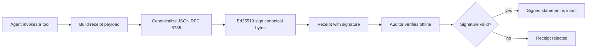
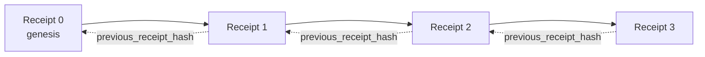

[Titta på lektionsvideon: Säkerställa AI-agenter med kryptografiska kvitton](https://youtu.be/PLACEHOLDER_VIDEO_ID)

> _(Lektionsvideo och miniatyrbild ska läggas till av Microsofts innehållsteam efter sammanslagning, i enlighet med lektion 14 / 15-mönstret.)_

# Säkerställa AI-agenter med kryptografiska kvitton

## Introduktion

Den här lektionen kommer att täcka:

- Varför revisionsspår för AI-agenter är viktiga för regelefterlevnad, felsökning och tillit.
- Vad ett kryptografiskt kvitto är och hur det skiljer sig från en osignerad loggrad.
- Hur man skapar ett signerat kvitto för en agents verktygssamtal i vanlig Python.
- Hur man verifierar ett kvitto offline och upptäcker manipulation.
- Hur man kedjar kvitton så att borttagning eller omordning av ett bryter kedjan.
- Vad kvitton bevisar och vad de uttryckligen inte bevisar.

## Läromål

Efter att ha slutfört den här lektionen kommer du att veta hur man:

- Identifierar felmodeller som motiverar kryptografiskt ursprung för agents handlingar.
- Skapar ett Ed25519-signerat kvitto över en kanonisk JSON-betalast.
- Verifierar ett kvitto oberoende med endast signerarens offentliga nyckel.
- Upptäcker manipulation genom att köra verifieringen igen på ett modifierat kvitto.
- Bygger en hash-kedjad sekvens av kvitton och förklarar varför kedjan är viktig.
- Känner igen gränsen mellan vad kvitton bevisar (attribution, integritet, ordning) och vad de inte gör (riktigheten i handlingen, rimligheten i policyn).

## Problemet: Din agents revisionsspår

Föreställ dig att du har distribuerat en AI-agent för Contoso Travel. Agenten läser kundförfrågningar, anropar ett flyg-API för att kolla upp alternativ och bokar platser åt kunden. Förra kvartalet behandlade agenten 50 000 bokningar.

Idag kommer en revisor. De ställer en enkel fråga: "Visa mig vad din agent gjorde."

Du lämnar över dina loggfiler. Revisorn granskar dem och ställer den svårare frågan: "Hur vet jag att dessa loggar inte har redigerats?"

Detta är revisionsspårsproblemet. De flesta agentdistribueringar idag förlitar sig på:

- **Applikationsloggar**: skrivna av agenten själv, redigerbara av vem som helst med filsystemstillgång.
- **Molnloggningsstjänster**: manipulationssäkra på plattformsnivå men bara om revisorn litar på plattformsoperatören.
- **Databas-transaktionsloggar**: väl lämpade för databasändringar men inte för godtyckliga verktygsanrop.

Ingen av dessa kan svara på revisorns fråga utan att revisorn måste lita på någon (dig, din molnleverantör, din databastillverkare). För internt bruk är den tilliten ofta acceptabel. För reglerade arbetsbelastningar (finans, hälsovård, allt som omfattas av EU:s AI-förordning) är det inte det.

Kryptografiska kvitton begränsar detta problem genom att göra ett signerat uttalande oberoende
verifierbart. Revisorn behöver fortfarande en utomstående anledning att lita på signeringsnyckeln och
komponenten som skapade uttalandet. En inbäddad nyckel bevisar självkonsekvens,
inte utfärdarens identitet eller var polisen appliceras.

## Vad är ett kryptografiskt kvitto?

Ett kvitto är ett JSON-objekt som registrerar vad en agent gjorde, signerat med en digital signatur.



Ett minimalt kvitto ser ut så här:

```json
{
  "type": "agent.tool_call.v1",
  "agent_id": "contoso-travel-bot",
  "tool_name": "lookup_flights",
  "tool_args_hash": "sha256:a3f9c1...",
  "result_hash": "sha256:7b2e1d...",
  "policy_id": "contoso-travel-policy-v3",
  "timestamp": "2026-04-25T14:30:00Z",
  "sequence": 47,
  "previous_receipt_hash": "sha256:9d4e6a...",
  "signature": {
    "alg": "EdDSA",
    "sig": "c5af83...",
    "public_key": "8f3b2c..."
  }
}
```

Tre egenskaper gör jobbet:

1. **Signaturen**. Kvitto signeras av agentens gateway med en Ed25519-privat nyckel. Vem som helst med motsvarande offentliga nyckel kan verifiera signaturen offline. En förlitande part måste spika den nyckeln eller lösa den från ett betrott register utanför kvittot. Manipulation av något signerat fält ogiltigförklarar signaturen.

2. **Kanonisk kodning**. Före signering serialiseras kvittot med JSON Canonicalization Scheme (JCS, RFC 8785). Detta säkerställer att två implementationer som producerar samma logiska kvitto genererar byte-identisk output. Utan kanonisering skulle olika JSON-serialiserare ge olika signaturer för samma innehåll.

3. **Hash-kedjning**. Fältet `previous_receipt_hash` länkar varje kvitto till det föregående. Att ta bort eller omordna ett kvitto bryter den presenterade sekvensen. Att upptäcka trunkering eller skrivarstyrd omskrivning kräver också en spikad nuvarande kedjehuvud, oberoende bevittnad kontrollpunkt eller autentiserad åtagelse från sluten population.

Tillsammans ger dessa egenskaper tre garantier:

- **Attribution till en nyckel**: den här nyckeln signerade detta innehåll. Organisatorisk eller mänsklig identitet kräver en betrodd nyckelbindning.
- **Integritet**: innehållet har inte ändrats sedan signering.
- **Ordning inom den verifierade sekvensen**: detta kvitto länkar till dess föregångare.

## Skapa ett kvitto i Python

Du behöver inget särskilt bibliotek för att skapa ett kvitto. De kryptografiska primitiva funktionerna är allmänt tillgängliga och logiken är bara ett par dussin rader Python.

De praktiska övningarna i `code_samples/18-signed-receipts.ipynb` går igenom hela flödet. Den källkontrollerade `code_samples/18-signed-receipts.execution-receipt.json` registrerar exakt notebook hash, Python-miljö, antal celler och kontroller från senaste rena körningen utan att ändra lektionens sparade resultat. Sammanfattande version:

```python
import json
import hashlib
import base64
from nacl import signing
from jcs import canonicalize  # RFC 8785 canonical JSON

def b64url_nopad(data: bytes) -> str:
    return base64.urlsafe_b64encode(data).decode("ascii").rstrip("=")

def sha256_canonical(obj) -> str:
    """SHA-256 of a Python object's JCS-canonical JSON form."""
    return f"sha256:{hashlib.sha256(canonicalize(obj)).hexdigest()}"

# Generate or load a signing key (in production, store in a key vault)
signing_key = signing.SigningKey.generate()
verify_key = signing_key.verify_key
TRUSTED_PUBLIC_KEYS = {b64url_nopad(bytes(verify_key))}  # pinned out of band by the verifier

# Build the receipt payload (no signature yet)
tool_args = {"origin": "SYD", "destination": "LAX"}
tool_result = [{"flight": "QF11", "price": 1850, "stops": 0}]

payload = {
    "type": "agent.tool_call.v1",
    "agent_id": "contoso-travel-bot",
    "tool_name": "lookup_flights",
    "tool_args_hash": sha256_canonical(tool_args),
    "result_hash": sha256_canonical(tool_result),
    "policy_id": "contoso-travel-policy-v3",
    "timestamp": "2026-04-25T14:30:00Z",
    "sequence": 0,
    "previous_receipt_hash": None,
}

# Canonicalize and sign the JCS bytes directly. PureEdDSA hashes internally.
canonical_bytes = canonicalize(payload)
signature_bytes = signing_key.sign(canonical_bytes).signature

# Attach a structured signature object.
receipt = {
    **payload,
    "signature": {
        "alg": "EdDSA",
        "sig": b64url_nopad(signature_bytes),
        "public_key": b64url_nopad(bytes(verify_key)),
    },
}
```

Det är hela signeringssättet. Övningarna i notebooken går igenom varje steg.

## Verifiera ett kvitto och upptäcka manipulation

Verifiering är den inversa operationen:

```python
import base64
import hashlib
from nacl import signing
from nacl.exceptions import CryptoError
from jcs import canonicalize

def b64url_decode(s: str) -> bytes:
    padding = "=" * ((4 - len(s) % 4) % 4)
    return base64.b64decode(s + padding, altchars=b"-_", validate=True)

def verify_receipt(receipt: dict, trusted_public_keys: set[str]) -> bool:
    # The signature is a structured object: {"alg", "sig", "public_key"}.
    if not isinstance(receipt, dict):
        return False
    sig_obj = receipt.get("signature")
    if not isinstance(sig_obj, dict) or sig_obj.get("alg") != "EdDSA":
        return False
    try:
        # An inline key proves only self-consistency. Trust is configured out of band.
        public_key = sig_obj.get("public_key")
        signature = sig_obj.get("sig")
        if not isinstance(public_key, str) or not isinstance(signature, str):
            return False
        if public_key not in trusted_public_keys:
            return False
        payload = {k: v for k, v in receipt.items() if k != "signature"}
        canonical_bytes = canonicalize(payload)
        verify_key = signing.VerifyKey(b64url_decode(public_key))
        verify_key.verify(canonical_bytes, b64url_decode(signature))
        return True
    except (CryptoError, TypeError, ValueError, KeyError, OverflowError):
        return False
```

Denna funktion tar ett kvitto plus den förlitande partens spikade nyckeluppsättning och returnerar
`True` endast om signaturen är giltig under en accepterad nyckel. Verifiering kräver ingen
nätverksanrop, men nyckeltillit är fortfarande ett externt konfigurationsbeslut.

För att se upptäckt av manipulation i praktiken går notebooken igenom:

1. Skapa ett giltigt kvitto och bekräfta att det verifieras.
2. Modifiera en byte av fältet `tool_args_hash`.
3. Kör verifieringen igen och se att det misslyckas.

Detta är den praktiska demonstrationen att kvitton är manipulationssäkra: varje ändring, hur liten den än är, bryter signaturen.

## Kedja kvitton för mångstegsagenter

Ett enda signerat kvitto skyddar en enda handling. En kedja av kvitton skyddar en sekvens.



Varje kvitto registrerar hashen av kvittot innan det. För att ta bort kvitto 2 i tysthet skulle en angripare behöva antingen:

- Modifiera kvitto 3:s `previous_receipt_hash`-fält (bryter kvitto 3:s signatur), ELLER
- Förfalska en ny signatur på ett modifierat kvitto 3 (kräver agentens privata nyckel).

Om den privata nyckeln är skyddad och en verifierare fäster en oberoende bevittnad kedje-
spets, är dessa attacker möjliga att upptäcka. Att publicera nyckeln i varje kvitto är inte
tillräckligt: en signatär eller angripare kan presentera en annan nyckel, skriva om ett suffix eller
förkorta kedjan om den beroende parten inte har ett externt förtroende- och fullständighetsankare.

Anteckningsboken går igenom:

1. Att bygga en kedja av tre kvitton.
2. Att verifiera att varje kvittos `previous_receipt_hash` stämmer överens med den faktiska hashen av föregående kvitto.
3. Att manipulera ett kvitto i mitten och se kedjan brytas exakt vid den punkten.

Så här producerar du en revisionskedja som en extern revisor kan verifiera under sina
egna fastsatta utgivarnycklar och kedjekontroller, utan att behöva lita på din ändringsbara logg.

## Vad kvitton bevisar (och vad de inte gör)

Detta är den viktigaste delen av denna lektion. Kvitton är kraftfulla men deras kraft är begränsad.

**Kvitton bevisar tre saker:**

1. **Attribuering**: en specifik nyckel signerade en specifik last.
2. **Integritet**: lasten har inte ändrats sedan signeringen.
3. **Ordning i en presenterad, verifierad sekvens**: detta kvitto länkar till den föregående.

**Kvitton bevisar INTE:**

1. **Korrekthet**: att agentens åtgärd var rätt åtgärd. Ett kvitto kan signeras för ett felaktigt svar lika lätt som för ett rätt svar.
2. **Efterlevnad av policy**: att policyn refererad i `policy_id` verkligen utvärderades, eller att den skulle ha tillåtit denna åtgärd om den kontrollerades. Kvitto registrerar vad som påstås, inte vad som upprätthölls.
3. **Identitet bortom nyckeln**: kvittot säger "denna nyckel signerade detta innehåll." Det säger inte "denna person godkände detta." Att koppla en nyckel till en person eller organisation kräver separat identitetsinfrastruktur (en katalog, ett offentligt nyckelregister, etc.).
4. **Sanningshalt i indata**: om agenten får en manipulerad prompt och agerar på den, registrerar kvittot handlingen troget. Kvitton är nedströms från indata-validering, inte en ersättning för den.
5. **Utförande eller verklig effekt**: ett kvitto efter samtal registrerar vad dess utgivare påstår hände. Att bevisa inträde eller stämma av en extern effekt kräver bevis från den faktiska utföraren eller tjänsteleverantören.
6. **Fullständighet**: ett frånvarande kvitto kan betyda blockerat, utelämnat, förlorat eller inte instrumenterat. Frånvaro blir bevis endast inom en autentiserad sluten population.
7. **Betrodd tid**: en signerad tidsstämpel bevisar att signatären bar det värdet, inte att värdet var korrekt. Betrodd tid kräver en separat tidsmyndighet eller bevittnad kontrollpunkt.

Denna gräns är viktig av två skäl:

- Den berättar vad kvitton är användbara för: att göra agentbeteende granskningsbart och manipulations-synligt, även över organisationsgränser.
- Den berättar vilka ytterligare lager du fortfarande behöver: indata-validering (Lektionen 6), policy-upprätthållande (behandlas kortfattat nedan), och identitetsinfrastruktur (utanför denna lektions omfång).

Ett vanligt misstag är att anta att "vi har kvitton" betyder "vi är styrda." Det gör det inte. Kvitton är en grund. Styrning är systemet du bygger ovanpå.

## Att binda en godkännandes signatur till exakt åtgärd

Punkt 3 ovan är värd en egen sektion: ett åtgärdskvitto säger "denna nyckel signerade detta innehåll," aldrig "en människa godkände detta." För hög-risk åtgärder (återbetalningar, borttagningar, banköverföringar), kan en separat godkännandes signatur binda just den exakta åtgärden. Att koppla den nyckeln till en människa och kontrollera mänsklig närvaro är ändå separata ansvar.

Nästa anteckningsbok `code_samples/human-authorization-receipts.ipynb` lägger till en andra kvittotyp, `human.approval.v1`, i samma kuvert-form som lektionens kvitton (en typad last signerad med Ed25519 över dess kanoniska JCS-byte, med `signature` objektet utanför de signerade byten). En godkännandenyckel signerar **hela den kanoniska åtgärden och dess digest**; en agentnyckel signerar ett påstående som bär **samma åtgärdsdigest** och en `parent_approval_ref`, `receipt_hash` av godkännandet, samma konvention som `previous_receipt_hash` i kedjan du byggde ovan. En `verify_chain` går igenom båda artefakterna under **separata fästa nyckelregister** (godkännandenycklar vs agentnycklar), så kodvägen är delad men myndigheterna aldrig är det.

Egenskapen detta ger, noga formulerat: *den fastsatta godkännandenyckeln signerade denna exakta
åtgärd, och agentnyckeln signerade senare ett uttalande bärande samma åtgärdsdigest.*
Det är användbart bevis, men det är inte i sig bevis för att åtgärden utfördes. För att
styra utförande måste exakt godkännande också reserveras och förbrukas en gång vid
faktisk utförarbegränsning; okända leverantörsutgångar måste förbli okända snarare än
blint försöka igen. Anteckningsbokens avvisnings-fixturer testar kvitto-kedjans lager:

- manipulation, förvirrad ställföreträdare, förfalskade nycklar på båda sidor, och felaktigt indata;
- **gammal myndighet**: en signatur som fortfarande verifierar, ändå nekad eftersom policy-versionen ändrats, godkännandenyckeln roterats ut från det fasta registret, eller godkännandet gick ut före den angivna verifieringstiden;
- **digest-utbyte**: ett giltigt signerat åtgärdskvitto som pekar på ett *verkligt* godkännande som binder en *annan* kanonisk åtgärd.

Varje fel nekas med en distinkt orsak, så en revisor som läser en avvisning kan avgöra om myndigheten gått ut eller om den påstådda åtgärden ändrats. Verifiering är skrivskyddad och upprepbar: den förbrukar inte godkännandet eller anropar en leverantör. En separat utförare behöver hållbart, atomärt skydd mot uppspelning och uttryckliga utfall för framgång, fel och osäkert. Mänskligt godkännande-kvittot är en pedagogisk sammansättning definierad av denna lektion, inte en kvittotyp definierad av `draft-farley-acta-signed-receipts`.

## Referenser från produktion

Python-koden i denna lektion är medvetet minimal så att du kan läsa varje rad och förstå exakt vad som händer. I produktion har du två alternativ:

1. **Bygg direkt på de kryptografiska primitiva.** De 50 rader du såg ovan är tillräckliga för många användningsfall. PyNaCl (Ed25519) och `jcs`-paketet (kanonisk JSON) är väl underhållna och granskade bibliotek.

2. **Använd ett produktionsbibliotek för kvittenser.** Flera öppen källkodsprojekt implementerar samma mönster med ytterligare funktioner (nyckelrotation, batchverifiering, distribution av JWK Set, integration med policymotorer):
   - Signeringspipeline använder JCS- och signaturscope-konventionerna i ett oberoende IETF Internet-Draft ([`draft-farley-acta-signed-receipts`](https://datatracker.ietf.org/doc/draft-farley-acta-signed-receipts/), revision 02). Denna lektions platta utbildningskvitto skiljer sig från utkastets `{payload, signature}`-kuvert och presenteras inte som en konform implementation. Utkastet publicerar en delad konformitetssvit ([agent-governance-testvectors](https://github.com/ScopeBlind/agent-governance-testvectors)) för implementationer som riktar sig mot dess wireformat.
   - Microsoft Agent Governance Toolkit skapar kvittenser med Cedar-baserade policys beslut; se Tutorial 33 i det förrådet för ett ända-till-ända-exempel.
   - Paketet `protect-mcp` (npm) och `@veritasacta/verify` (npm) erbjuder en Node-baserad implementation för kvittosignering och offline-verifiering, avsedd för att omsluta vilken MCP-server som helst med en manipuleringssäkert revisionsspår, inklusive ett håll-för-sam-signering-flöde där en pausad åtgärd avger en godkännandekvittens bunden till åtgärdens digest (WebAuthn-stödd i desktop-flödet), samma godkännandekvittensmönster som människogodkännande anteckningsboken ovan.
   - **[nobulex](https://github.com/arian-gogani/nobulex)** Python SDK (`pip install nobulex`) tillhandahåller samma Ed25519 + JCS signeringsmönster i Python med LangChain och CrewAI-integrationer, inklusive publicerade testvektorer för korsvalidering och en efterlevnadskartläggning bidragen via [OWASP PR #2210](https://github.com/OWASP/CheatSheetSeries/pull/2210).
   - **[EMILIA Protocol](https://github.com/emiliaprotocol/emilia-protocol)** erbjuder ett kompletterande lager för exakt åtgärdsgenomförande: offline-verifierbara godkännandeslipp, fastnålad WebAuthn eller kvorumauktoritet, engångskonsumtion vid exekutorns gräns, och en explicit väg för oavgjort resultat. Dess ramverksadaptrar behandlar ett kvitto som nödvändigt bevis snarare än bevis på att en extern effekt inträffade.

Beslutet mellan att skapa egen kod och använda ett bibliotek speglar beslutet mellan att skriva ditt eget JWT-bibliotek och använda ett testat: båda är rimliga; biblioteket sparar tid och minskar granskningsytan; från-grunden-metoden tvingar dig att förstå varje primitiv. Den här lektionen lär ut från-grunden-vägen så att du har grunden för båda valen.

## Kunskapskontroll

Testa din förståelse innan du går vidare till praktikövningen.

**1. Ett kvitto är signerat med agentens privata Ed25519-nyckel. Revisor har endast den publika nyckeln. Kan revisorn verifiera kvittot offline?**

<details>
<summary>Svar</summary>

Ja, kryptografisk verifiering kräver endast den publika nyckeln och signerade bytes. 
Revisorn måste fortfarande erhålla och fastnåla den accepterade publika nyckeln oberoende av kvittot.
Efter att den förtroendekonfigurationen är etablerad krävs inget nätverksanrop.
</details>

**2. En angripare ändrar `policy_id`-fältet i ett kvitto för att hävda att det styrdes av en mer tillåtande policy. Signaturen var över den ursprungliga nyttolasten. Vad händer vid verifiering?**

<details>
<summary>Svar</summary>

Verifieringen misslyckas. Signaturen beräknades över de kanoniska bytes för den ursprungliga nyttolasten; att ändra något fält ändrar de bytes, vilket gör signaturen ogiltig. Angriparen skulle behöva den privata nyckeln för att producera en ny giltig signatur, vilket de inte har.
</details>

**3. Varför inkluderar kvittot ett `tool_args_hash` och `result_hash` istället för de råa argumenten och resultatet?**

<details>
<summary>Svar</summary>

Två skäl. För det första kan kvittot behöva arkiveras eller överföras i miljöer där läckage av rått innehåll (PII, affärsdata) är ett problem. Hashning håller kvittot litet och innehållet privat; revisorn verifierar att hashen matchar en separat lagrad kopia av det faktiska innehållet. För det andra har hashar fast storlek; ett kvitto med hashar är begränsat i storlek oavsett hur stora in- och utdata var.
</details>

**4. `previous_receipt_hash`-fältet länkar varje kvitto till dess föregångare. Om en angripare tyst tar bort ett kvitto mitt i en kedja, vad blir ogiltigt?**

<details>
<summary>Svar</summary>

Nästa presenterade kvitto länkar inte längre till sin förväntade föregångare, så verifiering
av den presenterade sekvensen misslyckas från luckan och framåt. Om signeraren kontrollerar den privata
nyckeln kan den skriva om eller trunkera en suffix. Att upptäcka det kräver en fastnålad aktuell topp,
extern kontrollpunkt eller autentiserat befolkningsåtagande.
</details>

**5. Ett kvitto verifieras rent. Bevisar det att agentens åtgärd var korrekt, sund eller i enlighet med policyn?**

<details>
<summary>Svar</summary>

Nej. Under en fastnålad nyckel och kedjekontext bevisar ett giltigt kvitto signatursatribution,
innehållsintakthet och en länk till den presenterade föregångaren. Det bevisar INTE att
åtgärden var korrekt eller utförd, att policyn utvärderades, att tidsstämpeln är
betrodd, eller att postuppsättningen är komplett. Detta är den viktigaste gränsen i lektionen.
</details>

## Praktisk övning

Öppna `code_samples/18-signed-receipts.ipynb` och slutför alla fyra sektioner:

1. **Sektion 1**: Signera ditt första kvitto och verifiera det.
2. **Sektion 2**: Manipulera kvittot och observera verifieringsfel.
3. **Sektion 3**: Bygg en tre-kvitto kedja och verifiera kedjans integritet.
4. **Sektion 4**: Applicera mönstret på en agent byggd med Microsoft Agent Framework: omslut ett verktygsanrop i kvittosignering, och verifiera sedan kvittot oberoende.

**Utmaning 1:** utöka kvittoschemat med ett ytterligare fält som du själv väljer (t.ex. ett begäran-ID för spårning), uppdatera den kanoniska signeringslogiken att inkludera det, och bekräfta att kvittot fortfarande kan verifieras. Modifiera sedan fältet efter signering och bekräfta att verifiering misslyckas. Detta tvingar dig att förstå hur varje byte i den kanoniska kodningen bidrar till signaturen.

**Utmaning 2:** SHA-256-hasha två av dina kvitton tillsammans (sammanfoga deras kanoniska bytes i en deterministisk ordning) och bädda in den resulterande digesten som ett nytt fält på ett tredje kvitto innan signering. Verifiera att alla tre kvitton fortfarande kan verifieras. Du har precis byggt ett steg-i-bevis för inkludering: vem som helst som har det tredje kvittot kan bevisa att de första två existerade vid tidpunkten för signeringen utan att behöva avslöja deras innehåll. Detta är mönstret som selektiv-avslöjande kvitton använder i stor skala (Merkle-åtaganden, RFC 6962).

## Slutsats

Kryptografiska kvitton ger AI-agenter en revisionskedja som är:

- **Oberoende verifierbar under fastnålat förtroende**: en part med accepterade publika nycklar och signerade bytes kan verifiera utan en tjänsteberoende.
- **Manipuleringspåvisande**: varje ändring ogiltigförklarar signaturen.
- **Bärbar**: ett kvitto är en liten JSON-fil; det kan arkiveras, överföras och verifieras var som helst.
- **Standardanpassad**: byggt på Ed25519 (RFC 8032), JCS (RFC 8785) och SHA-256, alla mycket använda primitiv.

De är inget substitut för indata-validering, polisiutövning, exekutor-admission,
resultatbevis, kompletthetskontroller eller identitets-infrastruktur. De är en grund
för dessa lager. I reglerade eller multi-organisationsarbetsflöden gör kvitton specifika
utfärdaruttalanden oberoende kontrollerbara under revisorns egen förtroendekonfiguration.

Den viktigaste slutsatsen: kvitton bevisar att en viss nyckel signerat ett visst
innehåll. En medburen tidsstämpel är en signeringspåstående såvida den inte är separat tidsgodkänd. Ett
kvitto bevisar inte att dess innehåll var sant, att en åtgärd utfördes eller att
postuppsättningen är komplett. Håll dessa distinktioner hårt.

## Produktionschecklista

När du är redo att gå vidare från denna lektion till att distribuera kvittosignerade agenter i en riktig miljö:

- [ ] **Flytta signeringsnyckeln bort från utvecklarens laptop.** Använd Azure Key Vault, AWS KMS eller en hårdvarusäkerhetsmodul. Den privata nyckeln som signerar dina kvitton får aldrig finnas i källkontroll eller i klartext på applikationsmaskiner.
- [ ] **Etablera verifieringsnyckelns förtroende.** Publicera nycklar genom en JWK Set eller register, och låt sedan beroende parter fästa den accepterade utfärdaridentiteten, nyckeluppsättningen och rotationspolicyn utanför enskilda kvitton. En inline-nyckel ensam är inte en förtrosankare.
- [ ] **Fäst kedjan externt.** Skriv periodiskt den senaste kedjetoppens hash till en transparenslogg (Sigstore Rekor, RFC 3161 tidsstämpelmyndighet eller ett andra internt system) så att en extern part kan bekräfta "denna kedja existerade vid denna tidpunkt."
- [ ] **Lagra kvitton oföränderliga.** Append-only blob-lagring (Azure Storage med oföränderlighetspolicys, AWS S3 Object Lock) förhindrar att en insider omskriver historik på lagringsnivå.
- [ ] **Bestäm lagringsperiod.** Många regelverk kräver flerårig lagring. Planera för kvittotillväxt (varje kvitto är ~500 bytes; en agent som gör 10K anrop per dag producerar ~1.8 GB per år).
- [ ] **Dokumentera vad kvitton inte täcker.** Kvitton bevisar tillskrivning, integritet och ordning. Din körbok bör uttryckligen lista vilka extra kontroller (indatavalidering, polisiutövning, hastighetsbegränsning, identitetsinfrastruktur) som fungerar tillsammans med kvitton i din styrningsposition.

### Har du fler frågor om att säkra AI-agenter?

Gå med i [Microsoft Foundry Discord](https://aka.ms/ai-agents/discord) för att möta andra lärande, delta i kontorstid och få svar på dina frågor om AI-agenter.

## Utöver denna lektion

Denna lektion täcker enkel kvittosignering och hash-kedjade sekvenser. Samma primitiv kan byggas ihop till flera mer avancerade mönster du kan stöta på när din styrningsposition mognar:

- **Selektiv avslöjning.** När ett kvittos fält är oberoende åtagna (RFC 6962-stil Merkle-träd), kan du avslöja specifika fält för specifika revisorer och bevisa att resten är oförändrade utan att exponera dem. Användbart när samma kvitto måste uppfylla både en omfattande revision (som vill ha kompletthet) och dataminimeringsregler som GDPR (som vill att revisorn ser så lite som möjligt).
- **Kvittoåterkallelse.** Om en signeringsnyckel komprometteras behöver du ett sätt att markera alla kvitton signerade med den nyckeln som opålitliga från en viss tidpunkt framåt. Standardmönster: kortlivade signeringsnycklar plus en publicerad återkallelselista, eller en transparenslogg med återkallelseposter.
- **Bilaterala / delade signaturkvitton.** Vissa implementationer delar upp den signerade nyttolasten i före-exekvering (`authorization_*`) och efter-exekvering (`result_*`) halvor med oberoende signaturer, användbara när auktorisationsbeslutet och det observerade resultatet produceras av olika aktörer eller vid olika tidpunkter. Detta bygger additivt ovanpå kvittformatet som lärs ut i denna lektion.
- **Nyssammansättning av nyttolast.** Ett kvitto förseglar de bytes du stoppar i `result_hash`. Verkliga nyttolaster är ofta rikare än ett enskilt verktygsanropsresultat: förbeslutsresonemang (modellprediktion, övervägda alternativ, bevis och dess fullständighet, riskposition, ansvarskedja, grindresultat) kan alla leva inuti nyttolasten, förseglade av ett enda kvitto. Detta håller kvittformatet minimalt medan nyttolastscheman kan utvecklas domänvis.
- **Kross-implementationskonformitet.** Flera oberoende implementeringar av samma kvittformat (Python, TypeScript, Rust, Go) korsverifierar mot gemensamma testvektorer. Om du bygger egen implementation bekräftar validering mot publicerade vektorer trådbaserad kompatibilitet.
- **Postkvantmigrering.** Ed25519 är idag vida utbredd men ej kvantresistent. En `alg`-etikett ensam är inte migration: en profil måste definiera ML-DSA-nyckelkodning, kanoniska signerade bytes, verifiering, beroendeparts-policy, nedgraderingsmotstånd och övergångssemantik. Planera och testa en dual-signaturövergång mot gemensamma vektorer innan du gör kompatibilitetsanspråk.

## Ytterligare resurser

- <a href="https://datatracker.ietf.org/doc/draft-farley-acta-signed-receipts/" target="_blank">IETF Internet-Draft: Signed Decision Receipts for Machine-to-Machine Access Control</a>
- <a href="https://learn.microsoft.com/azure/ai-studio/responsible-use-of-ai-overview" target="_blank">Ansvarig AI-översikt (Azure AI)</a>
- <a href="https://datatracker.ietf.org/doc/html/rfc8032" target="_blank">RFC 8032: Edwards-kurva digital signaturalgoritm (EdDSA)</a>
- <a href="https://datatracker.ietf.org/doc/html/rfc8785" target="_blank">RFC 8785: JSON-kanoniseringsschema (JCS)</a>
- <a href="https://datatracker.ietf.org/doc/html/rfc6962" target="_blank">RFC 6962: Certifikattransparens</a> (Merkle-trädkonstruktion använd av selektiv-avslöjande kvitton)
- <a href="https://github.com/microsoft/agent-governance-toolkit/blob/main/docs/tutorials/33-offline-verifiable-receipts.md" target="_blank">Microsoft Agent Governance Toolkit, Tutorial 33: Offline-verifierbara beslutskvitton</a>
- <a href="https://github.com/ScopeBlind/agent-governance-testvectors" target="_blank">Korsimplementations testvektorer</a> för kvittformatet som används i denna lektion (Apache-2.0)
- <a href="https://pynacl.readthedocs.io/" target="_blank">PyNaCl dokumentation</a> (Ed25519 i Python)

## Föregående lektion

[Skapa lokala AI-agenter](../17-creating-local-ai-agents/README.md)

---

<!-- CO-OP TRANSLATOR DISCLAIMER START -->
**Ansvarsfriskrivning**:
Detta dokument har översatts med hjälp av AI-översättningstjänsten [Co-op Translator](https://github.com/Azure/co-op-translator). Även om vi strävar efter noggrannhet, var vänlig notera att automatiska översättningar kan innehålla fel eller brister. Det ursprungliga dokumentet på dess modersmål bör betraktas som den auktoritativa källan. För kritisk information rekommenderas professionell mänsklig översättning. Vi ansvarar inte för några missförstånd eller feltolkningar som uppstår till följd av användningen av denna översättning.
<!-- CO-OP TRANSLATOR DISCLAIMER END -->