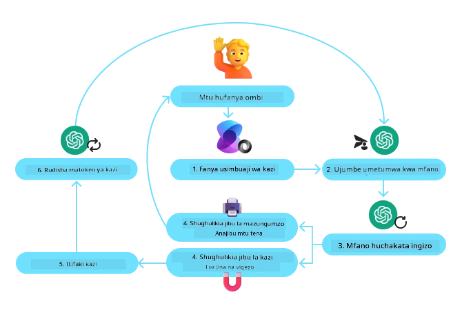
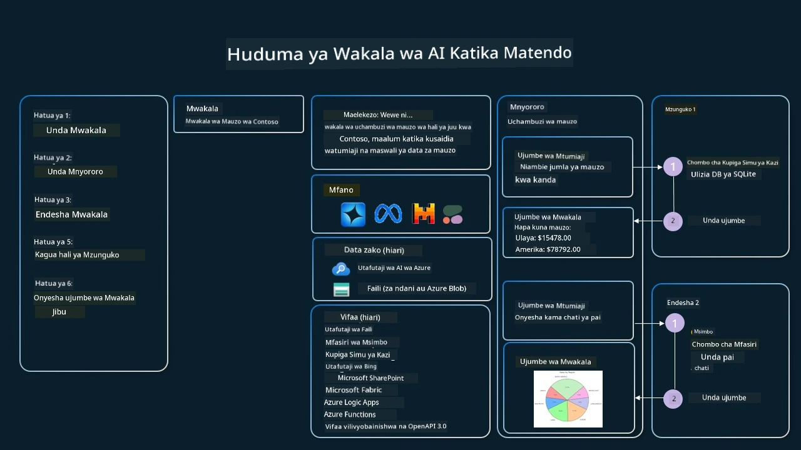

[](https://youtu.be/vieRiPRx-gI?si=cEZ8ApnT6Sus9rhn)

> _(Bonyeza picha hapo juu kutazama video ya somo hili)_

# Mchoro wa Muundo wa Matumizi ya Zana

Zana ni za kuvutia kwa sababu zinawawezesha mawakala wa AI kuwa na uwezo mpana zaidi wa uwezo. Badala ya wakala kuwa na seti ndogo ya vitendo anavyoweza kufanya, kwa kuongeza zana, wakala sasa anaweza kutekeleza vitendo vingi. Katika sura hii, tutachunguza Mchoro wa Muundo wa Matumizi ya Zana, unaoelezea jinsi mawakala wa AI wanavyoweza kutumia zana maalum kufikia malengo yao.

## Utangulizi

Katika somo hili, tunatafuta kujibu maswali yafuatayo:

- Ni nini mchoro wa muundo wa matumizi ya zana?
- Matumizi gani yanaweza kutekelezwa kwa ajili yake?
- Ni vipengele/vipande gani vinavyohitajika kutekeleza mchoro wa muundo huu?
- Ni maelezo gani maalum kuhusu matumizi ya Mchoro wa Muundo wa Matumizi ya Zana ili kujenga mawakala wa AI wanaoaminika?

## Malengo ya Kujifunza

Baada ya kumaliza somo hili, utaweza:

- Eleza Mchoro wa Muundo wa Matumizi ya Zana na kusudi lake.
- Tambua matumizi ambapo Mchoro wa Muundo wa Matumizi ya Zana unaweza kutumika.
- Elewa vipengele muhimu vinavyohitajika kutekeleza mchoro wa muundo.
- Tambua mambo ya kuzingatia kuhakikisha uaminifu kwa mawakala wa AI wanaotumia mchoro huu wa muundo.

## Ni Nini Mchoro wa Muundo wa Matumizi ya Zana?

**Mchoro wa Muundo wa Matumizi ya Zana** unalenga kuwapa LLM uwezo wa kuingiliana na zana za nje kufikia malengo maalum. Zana ni nambari inayoweza kutekelezwa na wakala kufanya vitendo. Zana inaweza kuwa kazi rahisi kama kalukata, au simu ya API kwa huduma ya mtu wa tatu kama utafutaji wa bei za hisa au hali ya hewa. Katika muktadha wa mawakala wa AI, zana zimetengenezwa kutekelezwa na mawakala kama jibu kwa **miito ya kazi inayozalishwa na mfano**.

## Matumizi gani yanaweza kutekelezwa?

Wakala wa AI wanaweza kutumia zana kukamilisha kazi tata, kupata taarifa, au kufanya maamuzi. Mchoro wa muundo wa matumizi ya zana mara nyingi hutumika katika matukio yanayohitaji mwingiliano wa mabadiliko na mifumo ya nje, kama vile hifadhidata, huduma za wavuti, au watafsiri wa nambari. Uwezo huu ni muhimu kwa matumizi tofauti ikiwemo:

- **Kupata Taarifa Zinazobadilika:** Wakala wanaweza kuuliza API za nje au hifadhidata kupata data ya hivi punde (mfano, kuuliza hifadhidata ya SQLite kwa uchambuzi wa data, kupata bei za hisa au taarifa za hali ya hewa).
- **Utekelezaji na Tafsiri ya Nambari:** Wakala wanaweza kutekeleza nambari au maandishi kutatua matatizo ya hisabati, kuzalisha ripoti, au kufanya majaribio.
- **Uendeshaji wa Mchakato:** Kuendesha moja kwa moja michakato inayorudiwa au yenye hatua nyingi kwa kutumia zana kama ratiba za kazi, huduma za barua pepe, au bomba za data.
- **Msaada kwa Wateja:** Wakala wanaweza kuingiliana na mifumo ya CRM, majukwaa ya tiketi, au hifadhidata za maarifa kutatua maswali ya watumiaji.
- **Uzalishaji na Uhariri wa Maudhui:** Wakala wanaweza kutumia zana kama wakaguzi wa sarufi, muhtasari wa maandishi, au wapimaji usalama wa maudhui kusaidia kazi za uundaji wa maudhui.

## Ni Vipengele gani/husika vinavyohitajika kutekeleza mchoro wa muundo wa matumizi ya zana?

Vipengele hivi vinamruhusu wakala wa AI kutekeleza aina nyingi za kazi. Tuchunguze vipengele muhimu vinavyohitajika kutekeleza Mchoro wa Muundo wa Matumizi ya Zana:

- **Michoro ya Kazi/Zana**: Maelezo ya kina ya zana zilizopo, ikiwa ni pamoja na jina la kazi, kusudi, vigezo vinavyohitajika, na matokeo yanayotarajiwa. Michoro hii inaruhusu LLM kuelewa zana zilizopo na jinsi ya kutengeneza maombi halali.

- **Mantiki ya Utekelezaji wa Kazi**: Inasimamia jinsi na lini zana zinaitwa kulingana na nia ya mtumiaji na muktadha wa mazungumzo. Hii inaweza kujumuisha moduli za mipango, mbinu za njia, au mtiririko wa masharti unaoamua matumizi ya zana kwa mabadiliko.

- **Mfumo wa Kuhudumia Ujumbe**: Vipengele vinavyosimamia mzunguko wa mazungumzo kati ya ingizo za mtumiaji, majibu ya LLM, miito ya zana, na matokeo ya zana.

- **Msingi wa Kuunganisha Zana**: Miundombinu inayounganisha wakala na zana mbalimbali, iwe ni kazi rahisi au huduma za nje tata.

- **Usimamizi wa Makosa & Uthibitishaji**: Mifumo ya kushughulikia kushindwa kwa utekelezaji wa zana, kuthibitisha vigezo, na kushughulikia majibu yasiyotegemewa.

- **Usimamizi wa Hali**: Kufuatilia muktadha wa mazungumzo, mwingiliano wa awali wa zana, na data inayodumu ili kuhakikisha uthabiti katika mwingiliano wa mizunguko mingi.

Sasa, tuchunguze Zaidi kuhusu Miito ya Kazi/Zana.
 
### Miito ya Kazi/Zana

Miito ya kazi ni njia kuu tunaowezesha Vifaa Vikubwa vya Lugha (LLMs) kuingiliana na zana. Mara nyingi utaona 'Kazi' na 'Zana' zikitumika badilika kwani 'kazi' (vipande vya nambari vinavyoweza kutumika tena) ni 'zana' ambazo mawakala hutumia kutekeleza kazi. Ili nambari ya kazi iitwe, LLM lazima itasie ombi la mtumiaji dhidi ya maelezo ya kazi. Kufanya hivyo, kielelezo chenye maelezo ya kazi zote zinazopatikana kinarudishwa kwa LLM. LLM huchagua kazi inayofaa zaidi kwa kazi na kurudisha jina lake pamoja na hoja. Kazi iliyochaguliwa huitwa, jibu lake hurudishwa kwa LLM, ambalo hutumia taarifa hizo kujibu ombi la mtumiaji.

Kwa waendelezaji kutekeleza miito ya kazi kwa mawakala, utahitaji:

1. Mfano wa LLM unaounga mkono miito ya kazi
2. Kielelezo chenye maelezo ya kazi
3. Nambari kwa kila kazi iliyoelezwa

Tuchukue mfano wa kupata saa za sasa mjini kuonyesha:

1. **anzisha LLM inayounga mkono miito ya kazi:**

    Sio modeli zote zinaunga mkono miito ya kazi, kwa hiyo ni muhimu kuangalia kwamba LLM unayotumia inaunga mkono hilo. <a href="https://learn.microsoft.com/azure/ai-services/openai/how-to/function-calling" target="_blank">Azure OpenAI</a> inaunga mkono miito ya kazi. Tunaweza kuanza kwa kuanzisha mteja wa OpenAI dhidi ya Azure OpenAI **API ya Majibu** (mwisho thabiti wa `/openai/v1/` — hakuna `api_version` inahitajika). 

    ```python
    # Initialize the OpenAI client for Azure OpenAI (Responses API, v1 endpoint)
    client = OpenAI(
        base_url=f"{os.environ['AZURE_OPENAI_ENDPOINT'].rstrip('/')}/openai/v1/",
        api_key=os.environ["AZURE_OPENAI_API_KEY"],
    )
    deployment_name = os.environ["AZURE_OPENAI_DEPLOYMENT"]
    ```

1. **Tengeneza Kielelezo cha Kazi**:

    Ifuatayo tutaunda kielelezo cha JSON kinachoelezea jina la kazi, maelezo ya kazi hiyo, na majina pamoja na maelezo ya vigezo vya kazi.
    Kisha tutaipasa hii kwa mteja aliyeanzishwa hapo awali, pamoja na ombi la mtumiaji kupata saa mjini San Francisco. Muhimu ni kwamba **miito ya zana** ndio inayorejeshwa, **si** jibu la mwisho kwa swali. Kama ilivyotajwa awali, LLM hurudisha jina la kazi iliyoichagua kwa kazi, pamoja na hoja zitakazopitishwa.

    ```python
    # Function description for the model to read (Responses API flat tool format)
    tools = [
        {
            "type": "function",
            "name": "get_current_time",
            "description": "Get the current time in a given location",
            "parameters": {
                "type": "object",
                "properties": {
                    "location": {
                        "type": "string",
                        "description": "The city name, e.g. San Francisco",
                    },
                },
                "required": ["location"],
            },
        }
    ]
    ```
   
    ```python
  
    # Initial user message
    messages = [{"role": "user", "content": "What's the current time in San Francisco"}]

    # First API call: Ask the model to use the function
    response = client.responses.create(
        model=deployment_name,
        input=messages,
        tools=tools,
        tool_choice="auto",
        store=False,
    )

    # The Responses API returns tool calls as function_call items in response.output.
    # Append them to the conversation so the model has full context on the next turn.
    messages += response.output

    print("Model's response:")
    print(response.output)
  
    ```

    ```bash
    Model's response:
    [ResponseFunctionToolCall(arguments='{"location":"San Francisco"}', call_id='call_pOsKdUlqvdyttYB67MOj434b', name='get_current_time', type='function_call')]
    ```
  
1. **Nambari ya kazi inayohitajika kutekeleza kazi:**

    Sasa LLM imeshachagua ni kazi gani itaendeshwa, nambari inayotekeleza kazi inapaswa kutekelezwa.
    Tunaweza kutekeleza nambari ya kupata saa za sasa kwa Python. Pia tutahitaji kuandika nambari ya kutoa jina na hoja kutoka kwenye response_message kupata matokeo ya mwisho.

    ```python
      def get_current_time(location):
        """Get the current time for a given location"""
        print(f"get_current_time called with location: {location}")  
        location_lower = location.lower()
        
        for key, timezone in TIMEZONE_DATA.items():
            if key in location_lower:
                print(f"Timezone found for {key}")  
                current_time = datetime.now(ZoneInfo(timezone)).strftime("%I:%M %p")
                return json.dumps({
                    "location": location,
                    "current_time": current_time
                })
      
        print(f"No timezone data found for {location_lower}")  
        return json.dumps({"location": location, "current_time": "unknown"})
    ```

     ```python
    # Handle function calls
    tool_calls = [item for item in response.output if item.type == "function_call"]
    if tool_calls:
        for tool_call in tool_calls:
            if tool_call.name == "get_current_time":

                function_args = json.loads(tool_call.arguments)

                time_response = get_current_time(
                    location=function_args.get("location")
                )

                # Return the tool result as a function_call_output item
                messages.append({
                    "type": "function_call_output",
                    "call_id": tool_call.call_id,
                    "output": time_response,
                })
    else:
        print("No tool calls were made by the model.")

    # Second API call: Get the final response from the model
    final_response = client.responses.create(
        model=deployment_name,
        input=messages,
        tools=tools,
        store=False,
    )

    return final_response.output_text
     ```

     ```bash
      get_current_time called with location: San Francisco
      Timezone found for san francisco
      The current time in San Francisco is 09:24 AM.
     ```

Miito ya Kazi iko katikati ya mchoro wa muundo wa matumizi ya zana nyingi, hata zote, ingawa kutekeleza kutoka mwanzo kunaweza kuwa changamoto.
Kama tulivyojifunza katika [Somo la 2](../../../02-explore-agentic-frameworks) mfumo wa agentic hutoa vipande vya awali ambavyo vinawezesha utekelezaji wa matumizi ya zana.
 
## Mifano ya Matumizi ya Zana na Mfumo za Agentic

Hapa kuna mifano ya jinsi unaweza kutekeleza Mchoro wa Muundo wa Matumizi ya Zana kwa kutumia mfumo tofauti za agentic:

### Mfumo wa Microsoft Agent

<a href="https://learn.microsoft.com/azure/ai-services/agents/overview" target="_blank">Mfumo wa Microsoft Agent</a> ni mfumo wa AI wa chanzo huria wa kujenga mawakala wa AI. Unarahisisha matumizi ya miito ya kazi kwa kuruhusu kufafanua zana kama kazi za Python zilizo na makazi ya `@tool`. Mfumo huu hushughulikia mawasiliano ya mizunguko kati ya mfano na nambari yako. Pia hutoa zana zilizo tayari kama Utafutaji Faili na Mtafsiri wa Nambari kupitia `FoundryChatClient`.

Mchoro ufuatao unaonyesha mchakato wa miito ya kazi na Mfumo wa Microsoft Agent:



Katika Mfumo wa Microsoft Agent, zana zinafafanuliwa kama kazi zilizo na mapambo. Tunaweza kubadilisha kazi ya `get_current_time` tuliyoiona hapo awali kuwa zana kwa kutumia mapambo ya `@tool`. Mfumo utaelezea kazi na vigezo vyake kiotomatiki, kuunda kielelezo cha kutuma kwa LLM.

```python
import os
from agent_framework import tool
from agent_framework.foundry import FoundryChatClient
from azure.identity import AzureCliCredential

@tool(approval_mode="never_require")
def get_current_time(location: str) -> str:
    """Get the current time for a given location"""
    ...

# Create the client
provider = FoundryChatClient(
    project_endpoint=os.environ["AZURE_AI_PROJECT_ENDPOINT"],
    model=os.environ["AZURE_AI_MODEL_DEPLOYMENT_NAME"],
    credential=AzureCliCredential(),
)

# Create an agent and run with the tool
agent = provider.as_agent(name="TimeAgent", instructions="Use available tools to answer questions.", tools=get_current_time)
response = await agent.run("What time is it?")
```

#### Zana kutoka kwa seva ya MCP

Zana hazihitaji kuwa kazi katika nambari yako mwenyewe. Seva inayozungumza Protokali ya Muktadha wa Mfano (MCP, iliyoelezwa katika [Somo la 11](../11-agentic-protocols/README.md)) hutoa zana zake pamoja na michoro yao, na mfumo unaweza kuzipakia kama anavyofanya kwa kazi zilizo na mapambo. `MCPStreamableHTTPTool` huungana na seva hiyo kupitia HTTP, husoma michoro ya zana, na kutoa kwa mfano pamoja na zana za ndani.

Mfano ufuatao unatumia seva ya utafutaji wavuti inayohudumiwa na <a href="https://keenable.ai" target="_blank">Keenable</a>. Ni bure kutumia bila akaunti au API key (maombi yanapimwa kwa IP), kwa hivyo cheti pekee unachohitaji ni zile za mfano wako. Kama zana nyingine za mbali, maswali yanayoandikwa na mfano hutumwa kwa seva hiyo.

```python
from agent_framework import MCPStreamableHTTPTool

web_search = MCPStreamableHTTPTool(
    name="Keenable web search",
    url="https://api.keenable.ai/mcp",
)

# Connecting loads the server's tool schemas; the agent decides when to call them
async with web_search:
    agent = provider.as_agent(
        name="ResearchAgent",
        instructions="Use available tools to answer questions.",
        tools=[web_search],
    )
    response = await agent.run("What is new in the latest Python release?")
    print(response.text)
```

Seva hutoa zana mbili, `search_web_pages` na `fetch_page_content`. Wakati swali linahitaji taarifa za sasa, mfano huita `search_web_pages`, hupokea vichwa vya habari, URL na vipande vya maandishi, na huandika jibu kutoka kwao, mzunguko sawa na mfano wa `get_current_time` hapo juu.
  
### Huduma ya Wakala wa Microsoft Foundry

<a href="https://learn.microsoft.com/azure/ai-services/agents/overview" target="_blank">Huduma ya Wakala wa Microsoft Foundry</a> ni mfumo mpya wa agentic uliobuniwa kumwezesha msanidi kuunda, kusambaza, na kupanua mawakala bora wa AI kwa usalama bila hitaji la kusimamia rasilimali za kompyuta na hifadhi vinavyofichwa. Ni muhimu kwa matumizi ya biashara kwani ni huduma iliyosimamiwa kikamilifu yenye usalama wa kiwango cha biashara.

Ukilinganisha na kuendeleza moja kwa moja na API ya LLM, Huduma ya Wakala wa Microsoft Foundry inatoa faida kadhaa, ikiwemo:

- Miito ya zana ya kiotomatiki – hakuna haja ya kuchambua miito ya zana, kuiita zana, na kushughulikia majibu; yote haya hufanyika upande wa seva sasa
- Usimamizi salama wa data – badala ya kusimamia hali yako ya mazungumzo, unaweza kutegemea 'threads' kuhifadhi taarifa zote unazohitaji
- Zana zilizopo mara moja – Zana ambazo unaweza kutumia kuingiliana na vyanzo vyako vya data, kama Bing, Azure AI Search, na Azure Functions.

Zana zinazopatikana katika Huduma ya Wakala wa Microsoft Foundry zinaweza kugawanywa katika makundi mawili:

1. Zana za Maarifa:
    - <a href="https://learn.microsoft.com/azure/ai-services/agents/how-to/tools/bing-grounding?tabs=python&pivots=overview" target="_blank">Kuimarisha kwa Bing Search</a>
    - <a href="https://learn.microsoft.com/azure/ai-services/agents/how-to/tools/file-search?tabs=python&pivots=overview" target="_blank">Utafutaji Faili</a>
    - <a href="https://learn.microsoft.com/azure/ai-services/agents/how-to/tools/azure-ai-search?tabs=azurecli%2Cpython&pivots=overview-azure-ai-search" target="_blank">Azure AI Search</a>

2. Zana za Vitendo:
    - <a href="https://learn.microsoft.com/azure/ai-services/agents/how-to/tools/function-calling?tabs=python&pivots=overview" target="_blank">Miito ya Kazi</a>
    - <a href="https://learn.microsoft.com/azure/ai-services/agents/how-to/tools/code-interpreter?tabs=python&pivots=overview" target="_blank">Mtafsiri wa Nambari</a>
    - <a href="https://learn.microsoft.com/azure/ai-services/agents/how-to/tools/openapi-spec?tabs=python&pivots=overview" target="_blank">Zana zilizo fafanuliwa na OpenAPI</a>
    - <a href="https://learn.microsoft.com/azure/ai-services/agents/how-to/tools/azure-functions?pivots=overview" target="_blank">Azure Functions</a>

Huduma ya Wakala hutuwezesha kutumia zana hizi pamoja kama sehemu ya `toolset`. Pia hutumia `threads` ambazo zinafuatilia historia ya ujumbe kutoka katika mazungumzo maalum.

Fikiria wewe ni wakala wa mauzo katika kampuni iitwayo Contoso. Unataka kuunda wakala wa mazungumzo ambaye anaweza kujibu maswali kuhusu takwimu zako za mauzo.

Picha ifuatayo inaonyesha jinsi unavyoweza kutumia Huduma ya Wakala wa Microsoft Foundry kuchambua takwimu zako za mauzo:



Ili kutumia zana zozote za huduma hii tunaweza kuunda mteja na kufafanua zana au seti ya zana. Kutekeleza hili kimazingira tunaweza kutumia nambari ya Python ifuatayo. LLM itakuwa na uwezo wa kuangalia seti ya zana na kuamua kutumia kazi iliyotengenezwa na mtumiaji, `fetch_sales_data_using_sqlite_query`, au Mtafsiri wa Nambari aliyejengwa awali kulingana na ombi la mtumiaji.

```python 
import os
from azure.ai.projects import AIProjectClient
from azure.identity import DefaultAzureCredential
from fetch_sales_data_functions import fetch_sales_data_using_sqlite_query # fetch_sales_data_using_sqlite_query function which can be found in a fetch_sales_data_functions.py file.
from azure.ai.projects.models import ToolSet, FunctionTool, CodeInterpreterTool

project_client = AIProjectClient.from_connection_string(
    credential=DefaultAzureCredential(),
    conn_str=os.environ["PROJECT_CONNECTION_STRING"],
)

# Initialize toolset
toolset = ToolSet()

# Initialize function calling agent with the fetch_sales_data_using_sqlite_query function and adding it to the toolset
fetch_data_function = FunctionTool(fetch_sales_data_using_sqlite_query)
toolset.add(fetch_data_function)

# Initialize Code Interpreter tool and adding it to the toolset. 
code_interpreter = CodeInterpreterTool()toolset.add(code_interpreter)

agent = project_client.agents.create_agent(
    model="gpt-5-mini", name="my-agent", instructions="You are helpful agent", 
    toolset=toolset
)
```

## Ni Maelezo Maalum Gani Kuhusu Matumizi ya Mchoro wa Muundo wa Zana Kujenga Wakala wa AI Wanaoaminika?

Wasiwasi wa kawaida kuhusu SQL inayozalishwa moja kwa moja na LLM ni usalama, hasa hatari ya sindano ya SQL au vitendo vya uovu, kama kufuta au kuharibu hifadhidata. Ingawa wasiwasi huu ni halali, unaweza kudhibitiwa kwa ufanisi kwa kusanidi vibali vya upatikanaji wa hifadhidata ipasavyo. Kwa hifadhidata nyingi hili linahusisha kusanidi hifadhidata kwa kusoma tu. Kwa huduma za hifadhidata kama PostgreSQL au Azure SQL, programu inapaswa kuteuliwa na hali ya kusoma tu (SELECT).

Kuendesha programu katika mazingira salama kunaboresha ulinzi zaidi. Katika matukio ya biashara, data kawaida hutolewa na kubadilishwa kutoka mifumo ya uendeshaji hadi hifadhidata au hazina ya data yenye usomaji tu na kielelezo rafiki kwa mtumiaji. Njia hii inahakikisha data ni salama, imeboreshwa kwa utendaji na upatikanaji, na programu ina upatikanaji wa kusoma tu uliodhibitiwa.

## Mifano ya Msimbo

- Python: [Mfumo wa Wakala](./code_samples/04-python-agent-framework.ipynb)
- .NET: [Mfumo wa Wakala](./code_samples/04-dotnet-agent-framework.md)

## Je, Una Maswali Zaidi Kuhusu Mchoro wa Muundo wa Matumizi ya Zana?

Jiunge na [Microsoft Foundry Discord](https://discord.com/invite/ATgtXmAS5D) kukutana na wanafunzi wengine, kuhudhuria saa za ofisi na kupata majibu ya maswali yako kuhusu Wakala wa AI.

## Rasilimali Zaidi

- <a href="https://microsoft.github.io/build-your-first-agent-with-azure-ai-agent-service-workshop/" target="_blank">Warsha ya Huduma za Azure AI Agents</a>
- <a href="https://github.com/Azure-Samples/contoso-creative-writer/tree/main/docs/workshop" target="_blank">Warsha ya Waandishi wa Ubunifu wa Contoso Multi-Agent</a>
- <a href="https://learn.microsoft.com/azure/ai-services/agents/overview" target="_blank">Muhtasari wa Mfumo wa Wakala wa Microsoft</a>

## Kupima Moshi Wakala Huyu (Hiari)

Baada ya kujifunza jinsi ya kupeleka mawakala katika [Somo la 16](../16-deploying-scalable-agents/README.md), unaweza kupima moshi `TravelToolAgent` wa somo hili (je, bado inaita zana zake na kujibu?) kwa kutumia [`tests/lesson-04-smoke-tests.json`](../../../tests/lesson-04-smoke-tests.json). Angalia [`tests/README.md`](../tests/README.md) kwa jinsi ya kuendesha.

## Somo Lililopita

[Kuelewa Mifumo ya Ubunifu wa Wakala](../03-agentic-design-patterns/README.md)

## Somo Linalofuata

[Agentic RAG](../05-agentic-rag/README.md)

---

<!-- CO-OP TRANSLATOR DISCLAIMER START -->
**Kionyozo**:
Hati hii imetafsiriwa kwa kutumia huduma ya tafsiri ya AI [Co-op Translator](https://github.com/Azure/co-op-translator). Ingawa tunajitahidi kupata usahihi, tafadhali fahamu kwamba tafsiri za kiotomatiki zinaweza kuwa na makosa au upungufu wa usahihi. Hati ya asili katika lugha yake halisi inapaswa kuchukuliwa kama chanzo cha mamlaka. Kwa taarifa muhimu, tafsiri ya kitaalamu inayofanywa na binadamu inapendekezwa. Hatutojibu kwa kuelewa vibaya au tafsiri potofu zinazotokea kutokana na matumizi ya tafsiri hii.
<!-- CO-OP TRANSLATOR DISCLAIMER END -->