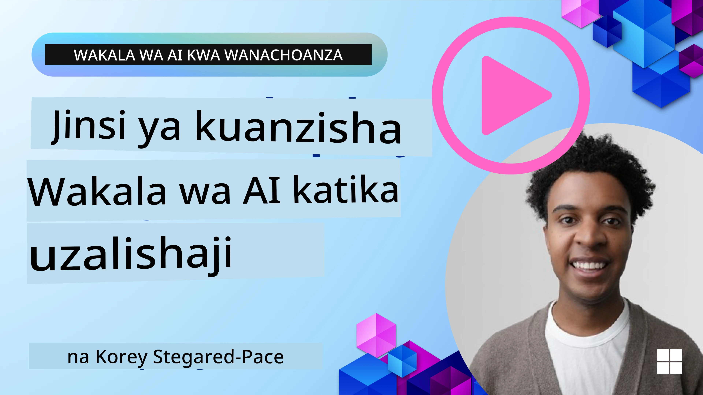

# Wakala wa AI Katika Uzalishaji: Uwezo wa Kuangalia na Tathmini

[](https://youtu.be/l4TP6IyJxmQ?si=reGOyeqjxFevyDq9)

Wakati mawakala wa AI wanapobadilika kutoka kwa majaribio ya maumbo hadi matumizi halisi ya ulimwengu, uwezo wa kuelewa tabia zao, kufuatilia utendaji wao, na kutathmini kwa mfumo matokeo yao unakuwa muhimu.

## Malengo ya Kujifunza

Baada ya kumaliza somo hili, utajua jinsi ya/kuelewa:
- Dhana kuu za uwezo wa kuangalia na tathmini ya wakala
- Mbinu za kuboresha utendaji, gharama, na ufanisi wa mawakala
- Nini na jinsi ya kutathmini mawakala wako wa AI kwa mfumo
- Jinsi ya kudhibiti gharama wakati wa kupeleka mawakala wa AI katika uzalishaji
- Jinsi ya kuweka vifaa kwa mawakala waliotengenezwa kwa Microsoft Agent Framework

Lengo ni kukupa maarifa ya kubadilisha mawakala yako "kifaa kisichoonekana" kuwa mifumo yenye uwazi, inayoweza kusimamiwa, na kuaminika.

_**Kumbuka:** Ni muhimu kupeleka Wakala wa AI ambao ni salama na wa kuaminika. Angalia pia somo la [Kujenga Wakala wa AI wa Kuaminika](../06-building-trustworthy-agents/README.md)._

## Mfuatano na Matambiko

Vifaa vya kuangalia kama vile [Langfuse](https://langfuse.com/) au [Microsoft Foundry](https://learn.microsoft.com/en-us/azure/ai-foundry/what-is-azure-ai-foundry) kawaida huwakilisha utekelezaji wa wakala kama mfuatano na matambiko.

- **Mfuatano** unaonyesha kazi kamili ya wakala kutoka mwanzo hadi mwisho (kama kushughulikia swali la mtumiaji).
- **Matambiko** ni hatua za kibinafsi ndani ya mfuatano (kama kuitisha mfano wa lugha au kupata data).


<!-- Image URL retained for illustration purposes -->

Bila uwezo wa kuangalia, wakala wa AI anaweza kuhisi kama "kisanduku cheusi" - hali yake ya ndani na mantiki ni ya wazi, na kufanya iwe vigumu kugundua matatizo au kuboresha utendaji. Kwa uwezo wa kuangalia, mawakala wanakuwa "kisanduku cha kioo," wakitoa uwazi muhimu kwa kujenga kuaminika na kuhakikisha wanafanya kazi kama ilivyokusudiwa.

## Kwa Nini Uwezo wa Kuangalia Ni Muhimu Katika Mazingira ya Uzalishaji

Kuanzisha mawakala wa AI katika mazingira ya uzalishaji kunaleta changamoto mpya na mahitaji. Uwezo wa kuangalia si tena "ni kitu kizuri kuwa nacho" bali ni uwezo muhimu:

*   **Uchambuzi wa Mazingira na Sababu Kuu**: Wakati wakala anashindwa au kutoa matokeo yasiyotarajiwa, vifaa vya kuangalia hutoa mfuatano unaohitajika kugundua chanzo cha kosa. Hii ni muhimu hasa kwa mawakala tata yanayoweza kujumuisha wito wa LLM nyingi, mwingiliano wa zana, na mantiki ya masharti.
*   **Ufuatiliaji wa Kasoro na Usimamizi wa Gharama**: Ma wakala wa AI mara nyingi hutegemea LLM na API za nje zinazolipishwa kwa tiketi au kwa wito. Uwezo wa kuangalia huruhusu kufuatilia kwa usahihi wito hizi, kusaidia kubaini shughuli zinazoenda polepole sana au gharama kubwa. Hii inawawezesha timu kuboresha maelekezo, kuchagua mifano bora, au kubadilisha utaratibu kudhibiti gharama za uendeshaji na kuhakikisha uzoefu mzuri wa mtumiaji.
*   **Imani, Usalama, na Uzingatiaji**: Katika matumizi mengi, ni muhimu kuhakikisha mawakala wanafanya kazi kwa usalama na kimaadili. Uwezo wa kuangalia hutoa kumbukumbu ya shughuli na maamuzi ya wakala. Hii inaweza kutumika kugundua na kupunguza matatizo kama sindano za maelekezo, uzalishaji wa maudhui hatari, au kushughulikia vibaya taarifa binafsi (PII). Kwa mfano, unaweza kupitia mfuatano kuelewa kwanini wakala alitoa jibu fulani au kutumia zana maalum.
*   **Mizunguko ya Kuboresha Endelevu**: Data ya kuangalia ni msingi wa mchakato wa maendeleo wa mara kwa mara. Kwa kufuatilia jinsi mawakala wanavyofanya kazi katika ulimwengu halisi, timu zinaweza kubaini maeneo ya kuboresha, kukusanya data ya kurekebisha mifano, na kuthibitisha athari za mabadiliko. Hii huunda mzunguko wa mrejesho ambapo maarifa ya uzalishaji kutoka tathmini mtandaoni huelekeza majaribio na uboreshaji wa mtandaoni, ikielekea utendaji bora wa wakala.

## Vipimo Muhimu vya Kufuatilia

Ili kufuatilia na kuelewa tabia ya wakala, kuna vipimo na ishara mbalimbali vinavyopaswa kufuatiliwa. Ingawa vipimo maalum vinaweza kutofautiana kulingana na lengo la wakala, baadhi ni muhimu kwa jumla.

Hapa kuna baadhi ya vipimo vya kawaida vinavyoangaliwa na vifaa vya kuangalia:

**Kasoro:** Wakala hujibu haraka kiasi gani? Muda mrefu wa kusubiri huathiri uzoefu wa mtumiaji vibaya. Unapaswa kupima kasoro kwa kazi na hatua za kibinafsi kwa kufuatilia utekelezaji wa wakala. Kwa mfano, wakala anayechukua sekunde 20 kwa wito wote wa mfano anaweza kuharakishwa kwa kutumia mfano wa kasi zaidi au kwa kuendesha wito wa mfano sambamba.

**Gharama:** Ni gharama gani kwa kila utekelezaji wa wakala? Ma wakala wa AI hutegemea wito wa LLM waliolipishwa kwa tiketi au API za nje. Matumizi mara kwa mara ya zana au maelekezo mengi yanaweza kuongeza gharama haraka. Kwa mfano, kama wakala anaitisha LLM mara tano kwa uboreshaji mdogo wa ubora, unapaswa kutathmini kama gharama inastahili au kama unaweza kupunguza idadi ya wito au kutumia mfano wa bei nafuu. Ufuatiliaji wa wakati halisi pia unaweza kusaidia kugundua mabadiliko yasiyotarajiwa (km. mende zinazosababisha mzunguko mwingi wa API).

**Makosa ya Maombi:** Ni maombi mangapi wakala ameshindwa kuyatekeleza? Hii inaweza kujumuisha makosa ya API au wito wa zana uliofeli. Ili kufanya wakala wako kuwa imara zaidi dhidi ya hizi katika uzalishaji, unaweza kuweka mbadala au jaribio la kurudia. Mfano: ikiwa mtoaji wa LLM A hayupo, unabadilisha kwa mtoaji wa LLM B kama chelezo.

**Maoni ya Mtumiaji:** Kutekeleza tathmini za moja kwa moja kutoka kwa watumiaji hutoa maarifa muhimu. Hii inaweza kujumuisha tathmini waziwazi (👍piga kidole juu/👎chini, ⭐nyota 1-5) au maoni ya maandishi. Maoni hasi ya mara kwa mara yanapaswa kukujulisha kuwa huu ni ishara kwamba wakala hafanyi kazi kama ilivyotarajiwa.

**Maoni Yasiyo ya Moja kwa Moja ya Mtumiaji:** Tabia za watumiaji hutoa maoni ya moja kwa moja hata bila tathmini waziwazi. Hii inaweza kujumuisha kuandika swali upya mara moja, kuuliza maswali mara kwa mara au kubofya kitufe cha jaribio tena. Mfano: kama unaona watumiaji wanauliza swali lile mara kwa mara, huu ni ishara kwamba wakala hafanyi kazi kama ilivyotarajiwa.

**Usahihi:** Mara ngapi wakala huleta matokeo sahihi au yanayotakiwa? Maana ya usahihi hutofautiana (km. usahihi wa kutatua matatizo, usahihi wa kupata taarifa, kuridhika kwa mtumiaji). Hatua ya kwanza ni kufafanua jinsi mafanikio yanavyoonekana kwa wakala wako. Unaweza kufuatilia usahihi kupitia ukaguzi wa moja kwa moja, alama za tathmini, au lebo za kukamilika kwa kazi. Kwa mfano, kuorodhesha mfuatano kama "imefanikiwa" au "imeshindwa".

**Vipimo vya Tathmini za Kiotomatiki:** Unaweza pia kuweka tathmini za kiotomatiki. Kwa mfano, unaweza kutumia LLM kupima matokeo ya wakala kama ni msaada, sahihi, au siyo. Kuna maktaba kadhaa za chanzo huria zinazokusaidia kupima vipengele tofauti vya wakala. Mfano: [RAGAS](https://docs.ragas.io/) kwa mawakala wa RAG au [LLM Guard](https://github.com/protectai/llm-guard) kugundua lugha hatari au sindano za maelekezo.

Katika vitendo, mchanganyiko wa vipimo hivi hutoa uwanja mzuri wa afya ya wakala wa AI. Katika [daftari la mfano](./code_samples/10-expense_claim-demo.ipynb) la sura hii, tutakuonyesha jinsi vipimo hivi vinaonekana katika mifano halisi lakini kwanza, tutajifunza jinsi mtiririko wa tathmini ya kawaida unavyoonekana.

## Weka Vifaa kwa Wakala Wako

Ili kukusanya data ya mfuatano, utahitaji kuweka vifaa kwenye msimbo wako. Lengo ni kuweka vifaa kwenye msimbo wa wakala kutoa mfuatano na vipimo vinavyoweza kukusanywa, kusindika, na kuonyeshwa na jukwaa la kuangalia.

**OpenTelemetry (OTel):** [OpenTelemetry](https://opentelemetry.io/) imeibuka kama kiwango cha viwanda kwa uwezo wa kuangalia LLM. Inatoa seti ya API, SDK, na zana za kuzalisha, kukusanya, na kusafirisha data ya telemetri.

Kuna maktaba nyingi za kuweka vifaa ambazo hufunga mifumo ya wakala iliyopo na kufanya iwe rahisi kusafirisha matambiko ya OpenTelemetry kwa chombo cha kuangalia. Microsoft Agent Framework inaunganishwa moja kwa moja na OpenTelemetry. Hapo chini kuna mfano wa kuweka vifaa kwa wakala wa MAF:

```python
from agent_framework.observability import get_tracer, get_meter

tracer = get_tracer()
meter = get_meter()

with tracer.start_as_current_span("agent_run"):
    # Agent execution is traced automatically
    pass
```

[daftari la mfano](./code_samples/10-expense_claim-demo.ipynb) katika sura hii litaonyesha jinsi ya kuweka vifaa kwa wakala wako wa MAF.

**Uundaji wa Matambiko kwa Mkono:** Ingawa maktaba za kuweka vifaa hutoa msingi mzuri, mara nyingi kuna kesi ambapo habari zaidi au maalum inahitajika. Unaweza kuunda matambiko kwa mkono kuongeza mantiki maalum ya programu. Zaidi ya hayo, zinaweza kuimarisha matambiko yaliyoanzishwa kiotomatiki au kwa mkono kwa sifa maalum (zinazoitwa pia lebo au metadata). Sifa hizi zinaweza kujumuisha data maalum ya biashara, mahesabu ya kati, au muktadha wowote unaoweza kusaidia kwa uchambuzi au uchambuzi, kama `user_id`, `session_id`, au `model_version`.

Mfano wa kuunda mfuatano na matambiko kwa mkono kwa kutumia [Langfuse Python SDK](https://langfuse.com/docs/sdk/python/sdk-v3): 

```python
from langfuse import get_client
 
langfuse = get_client()
 
span = langfuse.start_span(name="my-span")
 
span.end()
```

## Tathmini ya Wakala

Uwezo wa kuangalia hutupa vipimo, lakini tathmini ni mchakato wa kuchambua data hiyo (na kufanya majaribio) kuamua jinsi wakala wa AI anavyofanya kazi vizuri na jinsi unaweza kuboresha. Kwa maneno mengine, mara tu unapopata mfuatano na vipimo hivyo, unavyovitumia hukumu wakala na kufanya maamuzi?

Tathmini ya mara kwa mara ni muhimu kwa sababu mawakala wa AI mara nyingi hawana utabiri na wanaweza kuibadilika (kupitia masasisho au mwelekeo tofauti wa tabia ya mfano) – bila tathmini, hutajua kama "wakala mwenye akili" wako anafanya kazi yake vizuri au kama umepungua.

Kuna aina mbili za tathmini kwa mawakala wa AI: **tathmini mtandaoni** na **tathmini nje ya mtandao**. Zote ni za thamani, na zinaendana. Kwa kawaida huanza na tathmini nje ya mtandao, kwani hii ndio hatua ya chini kabisa kabla ya kupeleka wakala wowote.

### Tathmini Nje ya Mtandao


Hii inahusisha kutathmini wakala katika mazingira yaliyodhibitiwa, kawaida kwa kutumia seti za majaribio ya data, si maombi ya mtumiaji wa moja kwa moja. Unatumia seti za data zilizochaguliwa ambapo unajua matokeo yanayotarajiwa au tabia sahihi, na kisha kuendesha wakala wako kwenye hizo.

Kwa mfano, ikiwa umeunda wakala wa matatizo ya hesabu ya maneno, unaweza kuwa na [seti ya majaribio](https://huggingface.co/datasets/openai/gsm8k) ya matatizo 100 yenye majibu yaliyojulikana. Tathmini nje ya mtandao mara nyingi hufanywa wakati wa maendeleo (na inaweza kuwa sehemu ya mizunguko ya CI/CD) kuangalia maboresho au kulinda dhidi ya mapungufu. Faida ni kwamba ni **inayoweza kurudiwa na unaweza kupata vipimo wazi vya usahihi kwa kuwa una ukweli wa msingi**. Unaweza pia kuiga maombi ya watumiaji na kupima majibu ya wakala dhidi ya majibu bora au kutumia vipimo vya kiotomatiki kama ilivyoelezwa hapo juu.

Changamoto kuu na tathmini nje ya mtandao ni kuhakikisha seti yako ya majaribio ni kamili na inaendelea kuwa ya maana – wakala anaweza kufanya vizuri kwenye seti ya majaribio iliyowekwa lakini kukutana na maombi tofauti sana katika uzalishaji. Kwa hiyo, unapaswa kuendeleza seti za majaribio kwa kesi mpya za kipekee na mifano inayowakilisha hali halisi. Mchanganyiko wa kesi ndogo za "mtihani wa moshi" na seti kubwa za tathmini ni muhimu: seti ndogo kwa ukaguzi wa haraka na kubwa kwa vipimo vya utendaji kwa ujumla.

### Tathmini Mtandaoni 


Hii inamaanisha kutathmini wakala katika mazingira halisi ya moja kwa moja, yaani wakati wa matumizi halisi katika uzalishaji. Tathmini mtandaoni inahusisha kufuatilia utendaji wa wakala katika mwingiliano halisi wa watumiaji na kuchambua matokeo kwa kuendelea.

Kwa mfano, unaweza kufuatilia viwango vya mafanikio, alama za kuridhika kwa mtumiaji, au vipimo vingine katika trafiki hai. Faida ya tathmini mtandaoni ni kwamba **inakamata mambo ambayo huenda hukuyatarajia katika maabara** – unaweza kuona mabadiliko ya mfano kwa wakati (kama ufanisi wa wakala unapungua wakati mifumo ya ingizo inabadilika) na kupata maombi yasiyotarajiwa au hali ambazo hazikuwa katika seti yako ya majaribio. Hutoa picha halisi ya jinsi wakala anavyotenda jangwani.

Tathmini mtandaoni mara nyingi huhusisha kukusanya maoni ya watu moja kwa moja na ya moja kwa moja, kama ilivyojadiliwa, na pengine kuendesha majaribio ya kivuli au majaribio ya A/B (ambapo toleo jipya la wakala linaendesha sambamba kulinganisha na la zamani). Changamoto ni kwamba inaweza kuwa vigumu kupata lebo au alama za kuaminika kwa mwingiliano wa moja kwa moja – unaweza kutegemea maoni ya watumiaji au vipimo vya chini (kama mtumiaji alibofya matokeo).

### Kuunganisha Zote Mbili

Tathmini mtandaoni na nje ya mtandao si tofauti kabisa; zinaendana sana. Maarifa kutoka kwa ufuatiliaji mtandaoni (km. aina mpya za maombi ya watumiaji ambapo wakala hafanyi vizuri) yanaweza kutumika kuongeza na kuboresha seti za majaribio ya nje ya mtandao. Kinyume chake, mawakala wanaofanya vizuri katika majaribio ya nje ya mtandao basi wanaweza kupelekwa kwa ujasiri zaidi na kufuatiliwa mtandaoni.

Kwa kweli, timu nyingi hutumia mzunguko:

_kutathmini nje ya mtandao -> kupeleka -> kufuatilia mtandaoni -> kukusanya kesi mpya za kushindwa -> kuongezea kwenye seti ya data ya nje ya mtandao -> kuboresha wakala -> rudia_.

## Masuala ya Kawaida

Unapowapeleka mawakala wa AI katika uzalishaji, unaweza kukutana na changamoto mbalimbali. Hapa kuna baadhi ya masuala ya kawaida na suluhisho zao zinazowezekana:

| **Tatizo**    | **Suluhisho Linalowezekana**   |
| ------------- | ------------------ |
| Wakala wa AI hafanyi kazi kwa kuzingatia utaratibu | - Boresha maelekezo yaliyotolewa kwa Wakala wa AI; kuwa wazi kuhusu malengo.<br>- Tambua maeneo ambapo kugawanya kazi katika sehemu ndogo na kuzikwa na mawakala wengi kunaweza kusaidia. |
| Wakala wa AI anakumbwa na mizunguko mingi isiyoisha  | - Hakikisha una vigezo vya kumaliza wazi ili Wakala ajue lini aache mchakato.<br>- Kwa kazi ngumu zinazohitaji kufikiri na kupanga, tumia mfano mkubwa ulio maalum kwa kazi za kufikiri. |
| Miito ya zana za Wakala wa AI haitoi matokeo mazuri   | - Jaribu na thibitisha matokeo ya zana nje ya mfumo wa wakala.<br>- Boresha vigezo vilivyowekwa, maelekezo, na majina ya zana.  |
| Mfumo wa Multi-Agent hauendi vizuri kwa uthabiti | - Boresha maelekezo yaliyotolewa kwa kila wakala kuhakikisha ni maalum na tofauti kutoka kwa kila mmoja.<br>- Jenga mfumo wa ngazi kwa kutumia wakala wa " routing " au wa udhibiti kuamua wakala sahihi. |

Masuala haya mengi yanaweza kubainika kwa ufanisi zaidi ukiwa na uwezo wa kuangalia. Mfuatano na vipimo tulivyojadili awali husaidia kugundua kwa usahihi eneo la matatizo katika mtiririko wa kazi wa wakala, na kufanya utatuzi wa matatizo na uboreshaji kuwa wa ufanisi zaidi.

## Kusimamia Gharama

Hapa kuna mikakati ya kusimamia gharama za kupeleka mawakala wa AI katika uzalishaji:

**Kutumia Modeli Ndogo:** Modeli Ndogo za Lugha (SLMs) zinaweza kufanya kazi vizuri kwenye baadhi ya matumizi ya wakala na zitapunguza gharama kwa kiasi kikubwa. Kama ilivyotajwa hapo awali, kujenga mfumo wa tathmini ili kubaini na kulinganisha utendaji dhidi ya modeli kubwa ni njia bora ya kuelewa jinsi SLM itakavyofanya kazi kwa matumizi yako. Fikiria kutumia SLM kwa kazi rahisi kama uainishaji wa nia au uchukuaji wa vigezo, huku ukihifadhi modeli kubwa kwa ajili ya hoja ngumu.

**Kutumia Modeli ya Router:** Mkakati sawa ni kutumia utofauti wa modeli na ukubwa. Unaweza kutumia LLM/SLM au kazi isiyo na seva kuweka ombi kulingana na ugumu kwa modeli zinazofaa zaidi. Hii pia itasaidia kupunguza gharama huku ikihakikisha utendaji kwa kazi sahihi. Kwa mfano, elekeza maswali rahisi kwa modeli ndogo, haraka, na tumia tu modeli kubwa ghali kwa kazi ngumu za hoja.

**Kuhifadhi Majibu:** Kutambua maombi na kazi za kawaida na kutoa majibu kabla hayajapitia mfumo wako wa wakala ni njia nzuri ya kupunguza idadi ya maombi yanayofanana. Unaweza hata kutekeleza mtiririko wa kutambua jinsi ombi linavyofanana na maombi yaliyohifadhiwa kwa kutumia modeli za msingi za AI. Mkakati huu unaweza kupunguza sana gharama kwa maswali yanayoulizwa mara kwa mara au taratibu za kawaida.

## Tuone jinsi hili linavyofanya kazi kwa vitendo

Katika [kumbukumbu ya mfano wa sehemu hii](./code_samples/10-expense_claim-demo.ipynb), tutaona mifano ya jinsi tunavyoweza kutumia zana za uangalizi kufuatilia na kutathmini wakala wetu.


### Una Maswali Zaidi kuhusu Wakala wa AI Katika Utengenezaji?

Jiunge na [Microsoft Foundry Discord](https://discord.com/invite/ATgtXmAS5D) kukutana na wasomi wengine, kuhudhuria saa za ofisi na kupata majibu ya maswali yako kuhusu Wakala wa AI.

## Somo Lililotangulia

[Muundo wa Ubunifu wa Metacognition](../09-metacognition/README.md)

## Somo Linalofuata

[Itifaki za Wakala](../11-agentic-protocols/README.md)

---

<!-- CO-OP TRANSLATOR DISCLAIMER START -->
**Kionyozo**:
Hati hii imetafsiriwa kwa kutumia huduma ya tafsiri ya AI [Co-op Translator](https://github.com/Azure/co-op-translator). Ingawa tunajitahidi kupata usahihi, tafadhali fahamu kwamba tafsiri za kiotomatiki zinaweza kuwa na makosa au upungufu wa usahihi. Hati ya asili katika lugha yake halisi inapaswa kuchukuliwa kama chanzo cha mamlaka. Kwa taarifa muhimu, tafsiri ya kitaalamu inayofanywa na binadamu inapendekezwa. Hatutojibu kwa kuelewa vibaya au tafsiri potofu zinazotokea kutokana na matumizi ya tafsiri hii.
<!-- CO-OP TRANSLATOR DISCLAIMER END -->