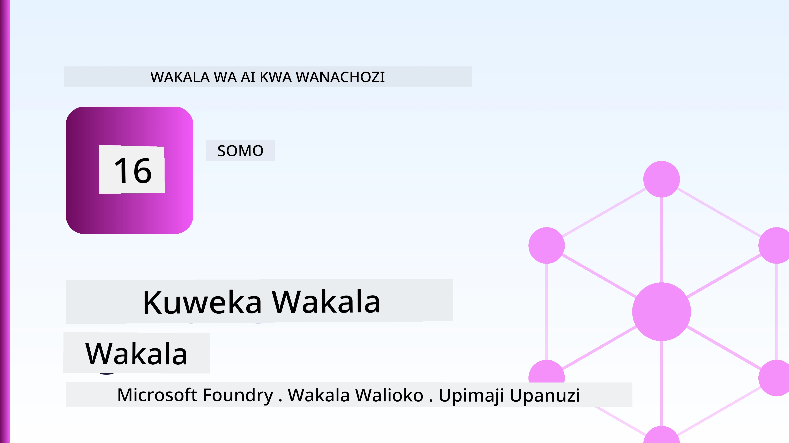
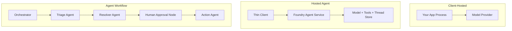
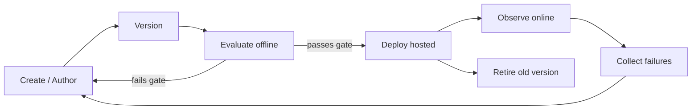
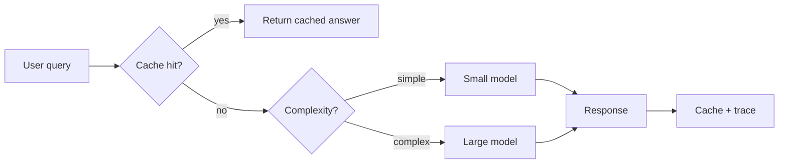
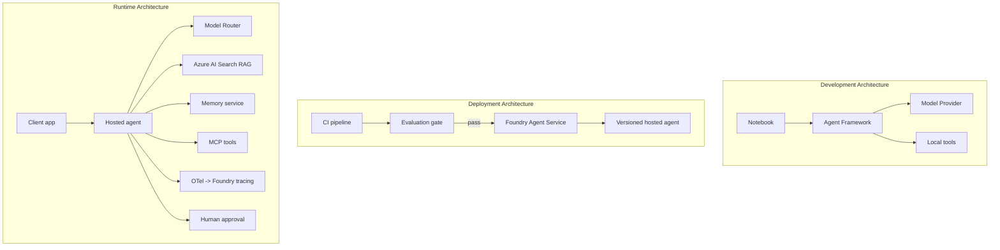

# Kupeleka Wakaaji Wanaoweza Kukua kwa Microsoft Foundry



Hadi sasa katika kozi umejenga wakaaji wanaoendesha kwenye kompyuta yako ndogo, ndani ya daftari, wakiongozwa na `az login` na mfululizo mdogo wa vigezo vya mazingira. Hiyo ni njia sahihi kabisa ya kujifunza. Sio njia sahihi ya kuendesha mxaaji ambaye maelfu ya wateja wanategemea saa 3 asubuhi.

Somo hili ni kuhusu pengo kati ya "inafanya kazi kwenye mashine yangu" na "inafanya kazi, kwa uhakika na kwa bei rahisi, katika uzalishaji." Tunafunga pengo hilo kutumia **Microsoft Foundry** na **Huduma ya Wakaaji ya Microsoft Foundry**, na tunafanya hivyo kwa kujenga mxaaji halisi wa msaada kwa wateja ambaye ana zana, urejeshaji, kumbukumbu, tathmini, na ufuatiliaji.

## Utangulizi

Somo hili litashughulikia:

- Tofauti kati ya **mxaaji wa kielelezo** na **mxaaji aliyepelekwa**, na kwa nini mabadiliko ni kuhusu kila kitu kinachoizunguka *mwelekeo*.
- **Mifumo ya upelelezaji** ya wakaaji: inayohudumiwa na mteja, inayohudumiwa na huduma (Wakaaji Waliotumiwa), na iliyoratibiwa kwa mtiririko wa kazi.
- **Mzunguko wa maisha ya mxaaji** kwenye Microsoft Foundry — tengeneza, toleo, peleka, tathmini, angalia, pokwa.
- **Mikakati ya upanuzi**: upitishaji wa mwelekeo, uhifadhi, mara kwa mara, na muundo usio na hali.
- **Ufuatiliaji** kwa OpenTelemetry na ufuatiliaji wa Foundry.
- **Kuboresha gharama** kupitia uteuzi wa mwelekeo, upitishaji, na vizingiti vya tathmini.
- **Mambo ya kampuni**: utawala, idhini ya binadamu, na kuendesha seva za MCP kwa usalama katika uzalishaji.

## Malengo ya Kujifunza

Baada ya kumaliza somo hili, utajua jinsi ya:

- Kuchagua mfumo sahihi wa upelelezaji kwa mzigo wa mxaaji fulani.
- Kuweka mxaaji kwenye Huduma ya Wakaaji ya Microsoft Foundry ili uwe na toleo, utawala, na ufuatiliaji.
- Kufunga mxaaji kwa ufuatiliaji na kuunganisha mchakato wa tathmini unaoendesha kabla ya kila uzinduzi.
- Kutumia upitishaji wa modeli na uhifadhi ili kudhibiti ucheleweshaji na gharama kwa kiwango kikubwa.
- Kuongeza mlango wa idhini ya binadamu kwa vitendo vyenye hatari kubwa na kuunganisha seva ya MCP kwa njia salama ya uzalishaji.

## Msingi wa Kujifunza

Somo hili linadai kuwa umekamilisha masomo ya awali na uko vizuri na:

- Kujenga wakaaji kwa kutumia [Microsoft Agent Framework](../14-microsoft-agent-framework/README.md) (Somo la 14).
- [Matumizi ya Zana](../04-tool-use/README.md) (Somo la 4) na [Agentic RAG](../05-agentic-rag/README.md) (Somo la 5).
- [Kumbukumbu ya Mxaaji](../13-agent-memory/README.md) (Somo la 13) na [Agentic Protocols / MCP](../11-agentic-protocols/README.md) (Somo la 11).
- [Ufuatiliaji na Tathmini](../10-ai-agents-production/README.md) (Somo la 10) — somo hili linaendelea moja kwa moja.

Pia utahitaji:

- **Usajili wa Azure** na **mradi wa Microsoft Foundry** ulioweka toleo moja la mfano wa mazungumzo.
- Kifaa cha **Azure CLI** kilichoidhinishwa (`az login`).
- Python 3.12+ na vifurushi katika hifadhidata [`requirements.txt`](../../../requirements.txt).

## Kutoka kwa Kielelezo hadi Uzalishaji: Nini Kinabadilika Kweli

Mxaaji wa kielelezo na mxaaji wa uzalishaji wanashiriki mzunguko wa msingi — kufikiri, kuitisha zana, kujibu. Kinachobadilika ni kila kitu kinachoizunguka mzunguko huo. Mfano ni labda asilimia 20% ya mxaaji wa uzalishaji; asilimia 80% iliyobaki ni miili ya uendeshaji.

| Kuhusu | Kielelezo | Uzalishaji |
| --- | --- | --- |
| **Huduma** | Inaendesha ndani ya daftari lako | Inaendesha kama huduma iliyo hifadhiwa, ina toleo na inasambazwa |
| **Utambulisho** | Tokeni yako ya `az login` | Utambulisho ulioendeshwa na RBAC ya eneo lililopangwa |
| **Hali** | Katika kumbukumbu za ndani, hupotea wakati wa kuanzisha upya | Imewekwa nje (hifadhi za nyuzi, huduma ya kumbukumbu) |
| **Kushindwa** | Unaona taarifa za makosa | Jaribu tena, mbadala, barua ya ujumbe mbaya, tahadhari |
| **Gharama** | "Ni senti chache" | Inafuatiliwa kwa kila ombi, inapitishwa, kuhifadhiwa, bajeti |
| **Ubora** | Unaangaliza matokeo mwenyewe | Inathaminiwa kiotomatiki kabla ya kila uzinduzi |
| **Imani** | Unakubali kila kitendo | Sera + binadamu ndani ya mzunguko kwa vitendo vyenye hatari |

Kumbuka jedwali hili. Kila sehemu hapa chini inaongoza moja ya safu hizi.

## Mifumo ya Upelelezaji wa Wakaaji

Kuna mifumo mitatu utatumia, mara nyingi kwa pamoja.

### 1. Wakaaji Wanaohudumiwa na Mteja

Kitu cha mxaaji kinaishi ndani ya *mchakato wa programu yako*. Msimbo wako unaitisha mtoaji wa mfano moja kwa moja; mzunguko wa kufikiri unaendesha kwenye huduma yako. Hii ndiyo kila somo lililopita lilifanya.

- **Tumia wakati** unahitaji udhibiti kamili wa mzunguko, kati ya kati maalum, au unaingiza mxaaji ndani ya backend iliyopo.
- **Kushindwa**: wewe unamiliki upanuzi, hali, na uimara binafsi.

### 2. Wakaaji Waliohudumiwa (Huduma ya Wakaaji ya Foundry)

Mxaaji ni *sajiliwa kama rasilimali* katika Microsoft Foundry. Foundry hudhamini mzunguko wa kufikiri, huhifadhi nyuzi, hutekeleza usalama wa yaliyomo na RBAC, na hufanya mxaaji aonekane katika portal ya Foundry. Programu yako inakuwa mteja mwembamba anayetengeneza nyuzi na kusoma majibu.

- **Tumia wakati** unataka uimara, ufuatiliaji uliowekwa ndani, utawala, na eneo dogo la uendeshaji.
- **Kushindwa**: udhibiti mdogo wa kina kwa kubadilishana na mazingira yaliyo thibitika.

### 3. Mtiririko wa Kazi wa Wakaaji

Wakaaji wengi (na zana) wameunganishwa katika mchoro wa mwelekeo wa udhibiti wazi — hatua za mfuatano, kupita matawi, nodi za idhini ya binadamu, na vituo vya kudumu ambavyo vinaweza kusimamisha na kuendelea. Hii ni uwezo wa Microsoft Agent Framework **Workflows** unaotumika kwa kiwango cha upelelezaji.

- **Tumia wakati** kazi moja inavuja kupitia wakaaji maalum kadhaa au inahitaji hatua ya idhini katikati.
- **Kushindwa**: sehemu nyingi zinazohamisha; inahitaji ufuatiliaji wa ngazi ya uelekezaji.



## Mzunguko wa Maisha wa Mxaaji katika Microsoft Foundry

Kuweka mxaaji sio tukio la mara moja `push`. Ni mzunguko, na unaonekana kama mzunguko wa uzinduzi wa programu kwa sababu ndio hasa unavyokuwa.



Wazo kuu, lililoletwa kutoka [Somo la 10](../10-ai-agents-production/README.md): **tathmini ya nje ni mlango, sio mawazo baadae.** Toa toleo jipya la mxaaji halitapelekwa isipokuwa litakapovuka viwango vyako vya tathmini. Ufuatiliaji mtandaoni kisha hurejesha makosa halisi katika seti yako ya majaribio ya nje. Hilo ndilo mzunguko mzima.

## Mikakati ya Upanuzi

Kupanua mxaaji ni tofauti na kupanua API ya wavuti isiyo na hali, kwa sababu kila ombi linaweza kusababisha maombi mengi ya mfano na zana ghali. Mbinu nne zinabeba mzigo mkubwa.

**Kushughulikia ombi bila hali.** Usihifadhi hali yoyote ya mtumiaji ndani ya kumbukumbu ya mchakato wako. Hifadhi nyuzi za mazungumzo katika hifadhi ya nyuzi ya Foundry au huduma ya kumbukumbu ili kificho chochote kiweze kushughulikia ombi lolote. Hii ndio inayokuwezesha kupanua kwa wima — ongeza vificho, hakuna vikao vya kubana.

**Upitishaji wa mfano.** Siyo kila ombi linahitaji mfano wako mwenye uwezo mkubwa (na ghali zaidi). Pitia maombi rahisi — utambuzi wa nia, majibu mafupi ya ukweli — kwa mfano mdogo, haraka, na uhifadhi mfano mkubwa kwa kufikiri halisi. **Model Router** ya Foundry inaweza kufanya hivyo kwa niaba yako, au unaweza kutekeleza kipeperushi mwenyewe. Utaunda toleo la DIY maabara.

**Uhifadhi wa majibu.** Maswali mengi ya msaada ni karibu nakala ("ninawezaje kuweka upya nenosiri langu?"). Hifadhi majibu kwa maswali ya kawaida na uyatoa bila kugonga mfano kabisa. Hata kiwango kidogo cha mafanikio ya cache hunyakua gharama na ucheleweshaji kwa maana.

**Mara kwa mara na shinikizo la nyuma.** Watoaji wa mfano wana viwango vya kasi. Tenga kiwango chako cha mara kwa mara, tumia jaribio tena na kurudi nyuma kwa eksponenti, na shindwa kwa neema (jibu la "tunaendelea na hilo" lililosimamiwa linaimiza 500).



## Ufuatiliaji Katika Uzalishaji

Huwezi kuendesha kile usichoweza kuona. Kama ilivyoripotiwa katika Somo la 10, Microsoft Agent Framework hutuma vituo vya **OpenTelemetry** moja kwa moja — kila wito wa mfano, kuitishwa kwa zana, na hatua ya uelekezaji zinakuwa sehemu. Katika uzalishaji unatoa sehemu hizo kwa Microsoft Foundry (au backend yoyote inayoungwa mkono na OTel) ili uweze:

- Fuata kero moja ya mteja kutoka mwanzo hadi mwisho katika kila wito wa mfano na zana.
- Tazama ucheleweshaji wa p50/p95 na gharama kwa kila ombi kwa muda.
- Toa tahadhari juu ya miongezeko ya kiwango cha makosa na mabadiliko ya gharama kabla ya watumiaji wako (au timu yako ya fedha) kutambua.

```python
from agent_framework.observability import get_tracer

tracer = get_tracer()

with tracer.start_as_current_span("support_request") as span:
    span.set_attribute("customer.tier", "enterprise")
    span.set_attribute("routed.model", "gpt-5-nano")
    # agent execution is traced automatically inside this span
```

Sifa kama `customer.tier` na `routed.model` ndizo zinazoibadilisha ukuta wa vituo kuwa maswali yanayojibiwa ("je, wateja wa kampuni wanapelekwa mara nyingi kwa mfano mdogo?").

## Kuboresha Gharama

Gharama katika wakaaji wa uzalishaji zinadhibitiwa na tokeni. Kuna vifungo vitatu, kwa mpangilio wa athari:

1. **Kukidhi mfano kwa saizi sawa.** Mfano mdogo unaopita mlango wako wa tathmini kawaida huwa rahisi zaidi kuliko mkubwa anayepita pia. Tumia tathmini kuthibitisha kwamba mfano mdogo ni mzuri badala ya kugusa mfano mkubwa kwa tahadhari.
2. **Pitia kwa ugumu.** Kama hapo juu — lipa bei ya mfano mkubwa tu kwa maombi yanayohitaji fikra ya mfano mkubwa.
3. **Hifadhi kwa nguvu.** Wito wa mfano wa bei rahisi ni ule usiofanya.

Milango ya tathmini na udhibiti wa gharama ni nidhamu moja kuangaliwa kwa pembe mbili: tathmini inakuambia *sehemu ya ubora*, na upitishaji na uhifadhi vinakuduma karibu zaidi na *gharama* ya sehemu hiyo.

## Mambo ya Kuzingatia kwa Upelekaji wa Kampuni

**Utawala.** Wakaaji Waliohudumiwa wanaleta RBAC, usalama wa yaliyomo, na kumbukumbu za ukaguzi za Foundry. Mpa kila mxaaji utambulisho ulioendeshwa na ruhusa ndogo zaidi unazohitaji — ufikiaji wa kusoma tu kwa hifadhidata ya maarifa, ufikiaji uliopangwa kwa API ya tiketi, kitu kingine.

**Binadamu katikati ya mzunguko.** Vitendo vingine ni vya nguvu mno kuendeshwa moja kwa moja — kutoa marejesho, kufuta akaunti, kupeleka kwa timu ya sheria. Microsoft Agent Framework inasaidia zana za **zinazohitaji idhini**: mxaaji anapendekeza kitendo, utekelezaji unasimamishwa, binadamu anakubali au anakataa, na mtiririko wa kazi unaendelea. Umeona mtangulizi katika [Somo la 6](../06-building-trustworthy-agents/README.md); hapa unalielekeza.

**MCP katika uzalishaji.** [MCP](../11-agentic-protocols/README.md) huruhusu mxaaji wako kutumia zana za nje kupitia kiolesura cha kawaida. Katika uzalishaji, chukulia kila seva ya MCP kama mpaka usiojaliwa: ganga toleo la seva, uendeshe kwa utambulisho ulio na mipaka, hakikisha matokeo yake, na usiweze kufichua siri kwako. Seva ya MCP ni tegemezi, na tegemezi hupatiwa maboresho, ukaguzi, na mipaka ya kasi.



Mchoro huo mitatu — maendelezo, upelelezaji, wakati wa utekelezaji — ni mxaaji mmoja katika hatua tatu za maisha yake. Maabara inayofuata itakuongoza kujenga.

## Maabara ya Vitendo: Mxaaji wa Msaada kwa Wateja Tayari kwa Uzalishaji

Fungua [`code_samples/16-python-agent-framework.ipynb`](./code_samples/16-python-agent-framework.ipynb) na fanyia kazi hadi mwisho. Utaunganisha **mxaaji wa msaada wa wateja wa Contoso** na kila jambo la uzalishaji limeunganishwa:

1. **Kuitisha zana** — angalia hali ya agizo na fungua tiketi za msaada.
2. **RAG** — jibu maswali ya sera kutoka hifadhidata ya maarifa (Azure AI Search, kwa kushindwa kumbukumbu ili daftari liondolee bila rasilimali za Search).
3. **Kumbukumbu** — kumbuka mteja kati ya mizunguko ya mazungumzo.
4. **Upitishaji wa mfano** — kipeperushi cha ugumu hupitisha kila ombi kwa mfano mdogo au mkubwa.
5. **Uhifadhi wa majibu** — maswali yanayojirudia hutolewa kutoka kwa cache.
6. **Idhini ya binadamu** — marejesho zaidi ya kikomo hukatazwa kusubiri sahihi za binadamu.
7. **Mchakato wa tathmini** — seti ndogo ya majaribio isiyokuwa mtandaoni inatoa alama kwa mxaaji na hutumika kama mlango wa uzinduzi.
8. **Ufuatiliaji** — ufuatiliaji wa OpenTelemetry kwa kila ombi.

### Mwongozo

Daftari limepangwa kila jambo la uzalishaji liwe sehemu huru, inayoweza kuendeshwa. Msingi wake ni mshughuliki wa ombi wa upitishaji-na-uhifadhi:

```python
async def handle_support_request(query: str, customer_id: str) -> str:
    # 1. Serve from cache when we can.
    cached = response_cache.get(normalize(query))
    if cached:
        return cached

    # 2. Route by complexity to control cost.
    model = "gpt-5-nano" if is_simple(query) else "gpt-5-mini"

    # 3. Run the agent inside a trace span for observability.
    with tracer.start_as_current_span("support_request") as span:
        span.set_attribute("routed.model", model)
        span.set_attribute("customer.id", customer_id)
        response = await support_agent.run(query, model=model)

    # 4. Cache and return.
    response_cache.set(normalize(query), response.text)
    return response.text
```

Mlango wa tathmini unaolinda uzinduzi unaonekana hivi:

```python
async def evaluation_gate(agent, test_cases, threshold: float = 0.8) -> bool:
    passed = 0
    for case in test_cases:
        result = await agent.run(case["input"])
        if score_response(result.text, case["expected"]) >= 0.8:
            passed += 1
    pass_rate = passed / len(test_cases)
    print(f"Evaluation pass rate: {pass_rate:.0%} (gate: {threshold:.0%})")
    return pass_rate >= threshold  # only deploy if the gate passes
```

Soma kila mstari — daftari linahifadhi vitu vidogo kwa makusudi ili hakuna kinacho fichika nyuma ya wito wa mfumo.

## Kuhakiki Mxaaji Aliyewekwa kwa Majaribio ya Mvuke

Mlango wa tathmini ulio juu unafanya kazi *nje ya mtandao* dhidi ya kitu cha mxaaji wako. Mara mxaaji apokelewa kama Mxaaji Aliyehudumiwa, unahitaji ukaguzi mmoja zaidi, hata wa bei rahisi zaidi: **je, sehemu iliyopelekwa inajibu kweli?**

Kupelekwa "kwa mafanikio" kunathibitisha tu ndege ya udhibiti ilikubaliana na ufafanuzi — hauthibitishi mxaaji anajibu. Kutokuwepo kwa tegemezi, upitishaji mbaya wa mfano, au muunganisho uliyokamilika kunaweza kuachia upelelezaji kijani usiorejea chochote. **Jaribio la mvuke** linagundua hilo ndani ya sekunde, kila upelelezaji, bila gharama ya tathmini kamili.

Hifadhidata hii inaleta mchakato wa jaribio la mvuke tayari kutumia uliotengenezwa kwa [AI Smoke Test](https://github.com/marketplace/actions/ai-smoke-test) GitHub Action:

- **Katalogi** — [`tests/lesson-16-smoke-tests.json`](../../../tests/lesson-16-smoke-tests.json) ina maelekezo na matangazo ya mxaaji wa msaada wa Contoso (majibu ya sera yaliyothibitishwa, utafutaji wa agizo, kubaki kwenye mada, na uendelevu wa nyuzi nyingi). Katalogi za wakaaji wa masomo mengine ziko kando yake — ona [`tests/README.md`](../tests/README.md).
- **Mtiririko wa Kazi** — [`.github/workflows/smoke-test.yml`](../../../.github/workflows/smoke-test.yml) inaingia na Azure OIDC na POSTs maelekezo kila mmoja kwenye sehemu ya Majibu ya mxaaji, ikikosea kazi hupigwa chapa.

```yaml
- name: Smoke-test hosted agent
  uses: JFolberth/ai-smoketest@v1
  with:
    project_endpoint: ${{ inputs.project_endpoint }}
    agent_name: ContosoSupportAgent
    tests_file: tests/lesson-16-smoke-tests.json
```

Endesha kutoka kichupo cha **Actions** mara wakala wako atakapowekwa, ukiipa kiungo cha mradi wako wa Foundry na jina la wakala. Utambulisho wa muungano unahitaji nafasi ya **Azure AI User** katika kiwango cha mradi wa Foundry. Fikiria tabaka kama piramidi: majaribio ya moshi (yanapatikana na yanajibu?) yanaendeshwa kila mara unapoweka, tathmini ya nje ya mtandao (inatosha kusafirisha?) inaendeshwa kabla ya kukuza, na tathmini ya mtandaoni (inafanya aje porini?) inaendeshwa kila mara.

## Jaribio la Maarifa

Jaribu uelewa wako kabla ya kuendelea na kazi.

**1. Takriban wakala wa tija ni kiasi gani "mfano," na sehemu iliyonayo ni nini?**

<details>
<summary>Jibu</summary>

Mfano ni sehemu ndogo ya mfumo — mara nyingi inatajwa kuwa takriban 20%. Sehemu iliyobaki ni mifupa ya uendeshaji: mwenyeji na toleo, utambulisho na RBAC, hali iliyotolewa nje, kusimamia makosa, kufuatilia gharama, tathmini, na udhibiti wa binadamu katika mzunguko. Kuhamia uzalishaji ni zaidi kuhusu kujenga kila kitu *karibu* na mzunguko wa fikra.
</details>

**2. Utachagua wakala aliye Kwenye Hosting au wakala aliye kwenye mteja lini?**

<details>
<summary>Jibu</summary>

Unapotaka runtime iliyosimamiwa yenye uimara uliyojengwa ndani (mishale inayodumu na inaweza kuendelea), uwezo wa kuchunguza, usalama wa maudhui, na RBAC, na uko tayari kubadili udhibiti wa kiwango cha chini wa mzunguko wa fikra kwa eneo dogo la uendeshaji. Mteja aliye mhudumu ni bora unapohitaji udhibiti kamili juu ya mzunguko au unapojumlisha wakala katika backend iliyopo.
</details>

**3. Kwa nini wakala anayeweza kuongezeka anapaswa kuwa isiyo na hali katika kumbukumbu yake ya mchakato?**

<details>
<summary>Jibu</summary>

Ili mfano wowote uweze kushughulikia ombi lolote, jambo ambalo linawezesha kuongeza usambazaji bila vikao fijo. Hali ya mazungumzo kwa mtumiaji hutolewa nje kwa kuhifadhi kwa mfululizo au huduma ya kumbukumbu. Ikiwa hali ingekuwa katika kumbukumbu ya mchakato, ungeipoteza wakati wa kuanzisha upya na usingeweza kugawanya mzigo huru.
</details>

**4. Suluhisho gani hufanikishwa na urejeleaji wa mfano, na inahusiana vipi na tathmini?**

<details>
<summary>Jibu</summary>

Urejeleaji hupeleka maombi rahisi kwa mfano mdogo, wa bei nafuu, na wa haraka na kuhifadhi mfano mkubwa kwa kuelewa kweli, kudhibiti ucheleweshaji na gharama. Inahusiana na tathmini kwa sababu tathmini ndio *inathibitisha* kuwa mfano mdogo unatosha kwa daraja fulani la maombi — urejeleaji bila tathmini ni kubahatisha.
</details>

**5. Ni nini "lango la tathmini" na lina wapi katika mzunguko wa maisha?**

<details>
<summary>Jibu</summary>

Lango la tathmini linaendesha seti ya mtihani wa nje ya mtandao dhidi ya toleo jipya la wakala na linazuia kuweka ikiwa kiwango cha kupita hakifanyi vizingiti. Lina kati ya "toleo" na "uwekaji" katika mzunguko wa maisha, likifanya ubora kuwa sharti la kutolewa badala ya kitu unachokagua baada ya kusafirisha.
</details>

**6. Kwa nini seva ya MCP inapaswa kushughulikiwa kama mpaka usioaminika katika uzalishaji?**

<details>
<summary>Jibu</summary>

Kwa sababu ni utegemezi wa nje ambao wakala wako hunakili. Unapaswa kuweka toleo lake, kuendesha kwa utambulisho wa eneo, kuthibitisha matokeo yake, kuweka kikomo cha kiwango, na kamwe usifichue siri kwake — nidhamu sawa unayotumia kwa utegemezi wowote wa mtu wa tatu. Matokeo yake husogea kwenye fikra za wakala wako, hivyo kuamini bila kuthibitisha ni hatari ya usalama.
</details>

**7. Mabadiliko gani moja mara nyingi huathiri gharama kubwa zaidi ya wakala wa tija, na kwa nini?**

<details>
<summary>Jibu</summary>

Kupima ukubwa sahihi wa mfano — kutumia mfano mdogo zaidi ambao bado unapita lango la tathmini. Gharama inaongozwa na tokeni, na mfano mdogo unaokidhi kiwango cha ubora karibu kila mara ni wa bei nafuu zaidi kuliko mkubwa. Kuweka akiba na urejeleaji kisha hupunguza gharama zaidi, lakini kuchagua mfano msingi sahihi kuna athari kubwa ya awali.
</details>

**8. Ni nafasi gani mali za span kama `customer.tier` na `routed.model` huchukua katika uchunguzi?**

<details>
<summary>Jibu</summary>

Hubadilisha rekodi ghafi kuwa maswali ya kibiashara yanayoweza kujibiwa. Bila mali una ukuta wa spans; nazo unaweza kuuliza "je, wateja wa kampuni wanarejelewa kwa mfano mdogo mara nyingi?" au "ni mfano gani hushughulikia maombi yetu polepole zaidi?" Mali ni jinsi unavyogawanya telemetry kwa vipimo vinavyohitajika kwa uendeshaji wako.
</details>

## Kazi

Chukua wakala wa msaada wa wateja kutoka maabara na uthibitishe kwa hali maalum: **wakala wa msaada wa bili wa usajili kwa kampuni ya SaaS.**

Kutoa kwako kunapaswa:

1. **Badilisha zana** kwa zile zinazohusiana na bili: `get_subscription_status`, `get_invoice`, na `issue_credit` (kredit zaidi ya $50 zinahitaji idhini ya binadamu).
2. **Ongeza hati tatu za RAG** zikiwemo sera ya marejesho ya kampuni, mzunguko wa bili, na sera ya kufuta.
3. **Panua seti ya tathmini** hadi angalau kesi nane, ikiwa ni pamoja na angalau mbili *zinazotakiwa* kusababisha njia ya idhini ya binadamu, na thibitisha lango lako la tathmini linapita au kushindwa vyema.
4. **Ongeza ripoti moja ya gharama**: baada ya kuendesha maombi kumi mchanganyiko kupitia wakala, chapisha ni ngapi zilitumwa kwa mfano mdogo, ngapi kwa mfano mkubwa, na ngapi zilitolewa kutoka kwa akiba.

Andika aya fupi (katika seli ya markdown) ikielezea sheria gani ya urejeleaji wa mfano uliyochagua na jinsi unavyothibitisha na trafiki halisi. Hakuna jibu moja sahihi — unakaguliwa kama wasiwasi wa uzalishaji umeunganishwa kwa usahihi.

## Muhtasari

Katika somo hili ulihamisha wakala kutoka mfano hadi uzalishaji na Microsoft Foundry:

- Kuingia uzalishaji ni zaidi kuhusu **mifupa ya uendeshaji** karibu na mfano — mwenyeji, utambulisho, hali, usimamizi wa makosa, gharama, ubora, na kuaminika.
- Ulijifunza **mifumo mitatu ya kuweka** — client-hosted, Hosted Agents, na Agent Workflows — na wakati kila moja inafaa.
- Ulisafiri katika **mzunguko wa maisha wa wakala**, ambapo tathmini ya nje ya mtandao **inakaa kama lango la kutolewa** na uchunguzi wa mtandaoni hurudisha makosa kwenye seti ya mtihani.
- Ulitumia **mbinu za kuongeza kiwango** — muundo usio na hali, urejeleaji wa mfano, kuweka akiba, na usawa mdogo wa concurrency — na kuziunganisha na **kupunguza gharama**.
- Uliunganisha **dhibiti za kampuni**: RBAC, idhini ya binadamu katika mzunguko, na usalama wa uzalishaji MCP.
- Ulimjenga **wakala wa msaada wa wateja tayari kwa uzalishaji** anayehusisha wasiwasi wote hawa katika msimbo unaoweza kuendeshwa.

Somo lijalo linakuchukua safari kinyume: badala ya kuinua mawakala hadi wingu, utaweka chini kwenye mashine moja ya mendelevu na kuendesha kikamilifu ndani.

## Rasilimali Zaidi

- <a href="https://learn.microsoft.com/azure/ai-foundry/what-is-azure-ai-foundry" target="_blank">Nyaraka za Microsoft Foundry</a>
- <a href="https://learn.microsoft.com/azure/ai-foundry/agents/overview" target="_blank">Muhtasari wa Huduma ya Wakala wa Microsoft Foundry</a>
- <a href="https://learn.microsoft.com/en-us/agent-framework/overview/?wt.mc_id=youtube_26688_organicsocial_reactor&pivots=programming-language-python" target="_blank">Mifumo ya Wakala wa Microsoft</a>
- <a href="https://learn.microsoft.com/en-us/azure/ai-foundry/openai/concepts/model-router" target="_blank">Model Router katika Microsoft Foundry</a>
- <a href="https://learn.microsoft.com/azure/search/search-what-is-azure-search" target="_blank">Utafutaji wa Azure AI</a>
- <a href="https://opentelemetry.io/" target="_blank">OpenTelemetry</a>
- <a href="https://github.com/marketplace/actions/ai-smoke-test" target="_blank">Hatua ya Mtihani wa Moshi wa AI katika GitHub</a>
- <a href="https://modelcontextprotocol.io/" target="_blank">Mkataba wa Muktadha wa Mfano (MCP)</a>

## Somo lililopita

[Kujenga Mawakala wa Matumizi ya Kompyuta (CUA)](../15-browser-use/README.md)

## Somo lijalo

[Kuumba Mawakala wa AI wa Kienyeji](../17-creating-local-ai-agents/README.md)

---

<!-- CO-OP TRANSLATOR DISCLAIMER START -->
**Kionyozo**:
Hati hii imetafsiriwa kwa kutumia huduma ya tafsiri ya AI [Co-op Translator](https://github.com/Azure/co-op-translator). Ingawa tunajitahidi kupata usahihi, tafadhali fahamu kwamba tafsiri za kiotomatiki zinaweza kuwa na makosa au upungufu wa usahihi. Hati ya asili katika lugha yake halisi inapaswa kuchukuliwa kama chanzo cha mamlaka. Kwa taarifa muhimu, tafsiri ya kitaalamu inayofanywa na binadamu inapendekezwa. Hatutojibu kwa kuelewa vibaya au tafsiri potofu zinazotokea kutokana na matumizi ya tafsiri hii.
<!-- CO-OP TRANSLATOR DISCLAIMER END -->