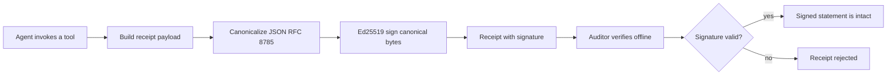
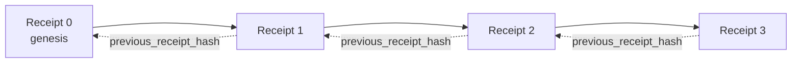

[Tazama video ya somo: Kuhifadhi Wakala wa AI kwa Mapokezi ya Cryptographic](https://youtu.be/PLACEHOLDER_VIDEO_ID)

> _(Video ya somo na kichwa kidogo vitaongezwa na timu ya maudhui ya Microsoft baada ya muungano, ikilingana na muundo wa somo 14 / 15.)_

# Kuhifadhi Wakala wa AI kwa Mapokezi ya Cryptographic

## Utangulizi

Somo hili litahusu:

- Kwa nini njia za ukaguzi kwa mawakala wa AI ni muhimu kwa uzingatiaji, utatuzi wa kasoro, na imani.
- Nini maana ya risiti ya cryptographic na jinsi inavyotofautiana na mstari usio saini wa kumbukumbu.
- Jinsi ya kutengeneza risiti iliyosainiwa kwa wito wa zana ya wakala kwa Python wazi.
- Jinsi ya kuthibitisha risiti bila mtandao na kugundua uharibifu.
- Jinsi ya kuunganisha risiti ili kuondoa au kubadilisha mpangilio wa moja kuvunja mnyororo.
- Nini risiti zinathibitisha na nini hazithibitishi kwa wazi.

## Malengo ya Kujifunza

Baada ya kumaliza somo hili, utajua jinsi ya:

- Kubaini njia za kushindwa ambazo zinahamasisha uhalisia wa cryptographic kwa hatua za wakala.
- Kutengeneza risiti iliyosainiwa kwa Ed25519 juu ya mzigo wa JSON wa kawaida.
- Kuhakikisha risiti kwa uhuru kwa kutumia tu ufunguo wa umma wa msaini.
- Kugundua uharibifu kwa kurudia uthibitisho kwenye risiti iliyobadilishwa.
- Kujenga mnyororo wa kanuni za hash za risiti na kuelezea kwa nini mnyororo ni muhimu.
- Kutambua kingo kati ya kile risiti zinachothibitisha (kuhusishwa, uadilifu, mpangilio) na kile hazichothibitishi (uksahihi wa hatua, sauti ya sera).

## Shida: Njia ya Ukaguzi ya Wakala Wako

Fikiria umeweka wakala wa AI kwa Contoso Travel. Wakala husoma maombi ya wateja, huita API ya ndege kutafuta chaguzi, na kuwekea viti kwa niaba ya mteja. Robo ya mwisho, wakala alishughulikia bookings 50,000.

Leo mkaguzi anakuja. Anauliza swali rahisi: "Nionyeshe kile wakala wako alichofanya."

Unamkabidhi faili zako za kumbukumbu. Mkaguzi anazitazama na kuuliza swali ngumu zaidi: "Jinsi gani ninajua kumbukumbu hizi hazikuharibiwa?"

Hii ndiyo shida ya njia ya ukaguzi. Wengi wa maajiri wa mawakala leo hutegemea:

- **Kumbukumbu za programu**: zilizoandikwa na wakala mwenyewe, zinaweza kuharibiwa na mtu yeyote anayekuwa na ufikiaji wa mfumo wa faili.
- **Huduma za kumbukumbu za wingu**: zinaonesha uharibifu kwenye ngazi ya jukwaa lakini tu kama mkaguzi anamuamini mwendeshaji wa jukwaa.
- **Kumbukumbu za miamala ya hifadhidata**: zinafaa kwa mabadiliko ya hifadhidata lakini si kwa wito wowote wa zana.

Hakuna kati ya hizi zinazoweza kujibu swali la mkaguzi bila kumlazimisha mkaguzi kuamini mtu fulani (wewe, mtoa huduma wako wa wingu, muuzaji wako wa hifadhidata). Kwa matumizi ya ndani, imani hiyo mara nyingi inakubalika. Kwa mizigo iliyodhibitiwa (fedha, afya, chochote kinachozingatia Sheria ya AI ya EU), haikubaliki.

Mapokezi ya cryptographic huhesha shida hii kwa kufanya tamko lililosainiwa liwe la kuthibitisha kwa uhuru.
Mkaguzi bado anahitaji sababu mbali na njia kuu ya kuamini ufunguo wa usaini na
sehemu inayotengeneza tamko. Ufunguzi uliowekwa ndani unabaini muingiliano wa ndani,
si utambulisho wa mtumaji au mahali pa utekelezaji.

## Risiti ya Cryptographic ni Nini?

Risiti ni kitu cha JSON kinachorekodi kile ambacho wakala alifanya, kilisainiwa kwa saini ya kidijitali.



Risiti ya chini kabisa inaonekana kama hii:

```json
{
  "type": "agent.tool_call.v1",
  "agent_id": "contoso-travel-bot",
  "tool_name": "lookup_flights",
  "tool_args_hash": "sha256:a3f9c1...",
  "result_hash": "sha256:7b2e1d...",
  "policy_id": "contoso-travel-policy-v3",
  "timestamp": "2026-04-25T14:30:00Z",
  "sequence": 47,
  "previous_receipt_hash": "sha256:9d4e6a...",
  "signature": {
    "alg": "EdDSA",
    "sig": "c5af83...",
    "public_key": "8f3b2c..."
  }
}
```

Sifa tatu zinafanya kazi:

1. **Saini**. Risiti imesainiwa na lango la wakala kwa kutumia ufunguo wa faragha wa Ed25519. Kila mtu mwenye ufunguo wa umma unaolingana anaweza kuthibitisha saini bila mtandao. Mtafutaji anapaswa kufunga ufunguo huo au kuupata kutoka kwenye rejista ya kuaminika nje ya risiti. Kuvuruga sehemu yoyote iliyosainiwa kutaifanya saini isiwe halali.

2. **Usimbaji wa kawaida**. Kabla ya kusaini, risiti hufanyiwa serialization kwa kutumia Mpango wa Kawaida wa JSON (JCS, RFC 8785). Hii inahakikisha utekelezaji wawili zinazotengeneza risiti sawa za mantiki hutengeza matokeo yanayolingana kabisa kwa byte. Bila usimbaji huu, serializer tofauti za JSON zingetengeneza saini tofauti kwa maudhui yale yale.

3. **Ufuatiliaji wa hash**. Sehemu ya `previous_receipt_hash` inaunganisha kila risiti na ile iliyotangulia. Kuondoa au kubadili mpangilio wa risiti kutavunja mnyororo wa mlolongo. Kugundua upungufu au uandishi upya unaodhibitiwa na msaini pia kunahitaji kichwa cha mnyororo kilichofungwa, mahali pa kudhibitishwa kwa uhuru, au ahadi ya idadi iliyofungwa yenye uthibitisho.

Pamoja sifa hizi hutoa dhamana tatu:

- **Kuambatanisha kwa ufunguo**: ufunguo huu ulisaini maudhui haya. Utambulisho wa shirika au binadamu unahitaji uhusiano wa kuaminika wa ufunguo.
- **Uadilifu**: maudhui hayajakabadilika tangu kusainiwa.
- **Mpangilio ndani ya mlolongo uliothibitishwa**: risiti hii inaunganisha ile ya awali.

## Kutengeneza Risiti kwa Python

Huna haja ya maktaba maalum kutengeneza risiti. Vifaa vya cryptographic vinapatikana kwa wingi na mantiki ni mistari michache ya Python.

Mazoezi ya vitendo katika `code_samples/18-signed-receipts.ipynb` huleta mtiririko mzima. `code_samples/18-signed-receipts.execution-receipt.json` inayodhibitiwa na chanzo inarekodi hash halisi ya daftari, mazingira ya Python, idadi ya seli, na ukaguzi kutoka kwa utekelezaji safi wa hivi karibuni bila kubadilisha matokeo yaliyohifadhiwa ya somo. Toleo la muhtasari:

```python
import json
import hashlib
import base64
from nacl import signing
from jcs import canonicalize  # RFC 8785 canonical JSON

def b64url_nopad(data: bytes) -> str:
    return base64.urlsafe_b64encode(data).decode("ascii").rstrip("=")

def sha256_canonical(obj) -> str:
    """SHA-256 of a Python object's JCS-canonical JSON form."""
    return f"sha256:{hashlib.sha256(canonicalize(obj)).hexdigest()}"

# Generate or load a signing key (in production, store in a key vault)
signing_key = signing.SigningKey.generate()
verify_key = signing_key.verify_key
TRUSTED_PUBLIC_KEYS = {b64url_nopad(bytes(verify_key))}  # pinned out of band by the verifier

# Build the receipt payload (no signature yet)
tool_args = {"origin": "SYD", "destination": "LAX"}
tool_result = [{"flight": "QF11", "price": 1850, "stops": 0}]

payload = {
    "type": "agent.tool_call.v1",
    "agent_id": "contoso-travel-bot",
    "tool_name": "lookup_flights",
    "tool_args_hash": sha256_canonical(tool_args),
    "result_hash": sha256_canonical(tool_result),
    "policy_id": "contoso-travel-policy-v3",
    "timestamp": "2026-04-25T14:30:00Z",
    "sequence": 0,
    "previous_receipt_hash": None,
}

# Canonicalize and sign the JCS bytes directly. PureEdDSA hashes internally.
canonical_bytes = canonicalize(payload)
signature_bytes = signing_key.sign(canonical_bytes).signature

# Attach a structured signature object.
receipt = {
    **payload,
    "signature": {
        "alg": "EdDSA",
        "sig": b64url_nopad(signature_bytes),
        "public_key": b64url_nopad(bytes(verify_key)),
    },
}
```

Huo ndio mchakato mzima wa kusaini. Mazoezi katika daftari hayo huchukua kila hatua.

## Kutathmini Risiti na Kugundua Uharibifu

Uthibitisho ni jambo la kinyume:

```python
import base64
import hashlib
from nacl import signing
from nacl.exceptions import CryptoError
from jcs import canonicalize

def b64url_decode(s: str) -> bytes:
    # Strict: Python's decoder skips characters outside the alphabet and also
    # accepts padding, the standard +/ alphabet and non-zero spare bits.
    # Re-encoding and comparing accepts only the one unpadded base64url form.
    padding = "=" * ((4 - len(s) % 4) % 4)
    data = base64.urlsafe_b64decode(s + padding)
    if base64.urlsafe_b64encode(data).decode("ascii").rstrip("=") != s:
        raise ValueError("not canonical unpadded base64url")
    return data

def verify_receipt(receipt: dict, trusted_public_key: str) -> bool:
    # trusted_public_key is the issuer's key, obtained from somewhere other
    # than this receipt. Never use receipt["signature"]["public_key"] here:
    # see "What Receipts Prove (and What They Do Not)" below.
    # Fails closed: anything malformed returns False instead of raising.
    if not isinstance(receipt, dict) or not isinstance(trusted_public_key, str):
        return False
    sig_obj = receipt.get("signature")
    if not isinstance(sig_obj, dict) or sig_obj.get("alg") != "EdDSA":
        return False
    sig_b64 = sig_obj.get("sig")
    if not isinstance(sig_b64, str):
        return False

    try:
        # Reconstruct the payload that was actually signed (everything except signature).
        payload = {k: v for k, v in receipt.items() if k != "signature"}
        canonical_bytes = canonicalize(payload)
        verify_key = signing.VerifyKey(b64url_decode(trusted_public_key))
        verify_key.verify(canonical_bytes, b64url_decode(sig_b64))
        return True
    except (CryptoError, TypeError, ValueError, KeyError, OverflowError):
        return False
    except Exception:
        # An undecodable key or signature, or a payload that cannot be
        # canonicalized: fail closed rather than raise.
        return False
```

Kazi hii inachukua risiti na ufunguo wa umma wa mtumaji, na kurudisha `True` ikiwa saini ni halali na `False` vinginevyo, ikiwa ni pamoja na wakati ingizo ni batili. Hakuna simu ya mtandao wala huduma ya uthibitisho: mara unaweza kushikilia ufunguo wa mtumaji, uthibitisho ni wa ndani kabisa na bila mtandao. Kinachohitaji ni ufunguo huo, unaopatikana kutoka sehemu nyingine isipokuwa risiti yenyewe.

Ili kuona kugundua uharibifu kwa vitendo, daftari linapitia:

1. Kutengeneza risiti halali na kuthibitisha kuwa inathibitishwa.
2. Kubadilisha byte moja ya sehemu ya `tool_args_hash`.
3. Kurudia uthibitisho na kuona inashindwa.
4. Kuudanganya tena, lakini wakati huu kusaini tena kwa ufunguo uliotengenezwa na mdukuzi na kuingiza ufunguo huo ndani ya risiti.

Hatua ya 4 ni muhimu kusoma kwa kina. Risiti hiyo ni ya kuaminika ndani: saini yake ni halisi kwa maudhui yake na kwa ufunguo inayobeba, hivyo inathibitisha dhidi ya ufunguo uliotoka ndani yake. Inashindwa tu wakati inakaguliwa dhidi ya ufunguo halisi wa mtumaji. Hatua 2 na 3 zinakamata mdukuzi ambaye hakujaribu kusaini tena; hatua ya 4 inakamata yule aliyejaribu.

Hii ni maonyesho ya vitendo kuwa risiti zinaonyesha uharibifu: mabadiliko yoyote kwenye sehemu iliyosainiwa huvunja saini, mradi unathibitisha dhidi ya ufunguo ambao mdukuzi hakuutoa. Kitu cha `signature` kiko nje ya bayti zilizosisainiwa, ndiyo maana ufunguo unathibitishwaki lazima uje kutoka sehemu nyingine isipokuwa risiti.

## Kuunganisha Risiti kwa Mawakala wa Hatua Nyingi

Risiti moja iliyosainiwa inalinda kitendo kimoja. Mnyororo wa risiti unalinda mlolongo.



Kila risiti inarekodi hash ya risiti iliyotangulia. Kuondoa risiti 2 kimya kimya, mdukuzi angelazimika:

- Kubadilisha sehemu ya `previous_receipt_hash` ya risiti 3 (inavunja saini ya risiti 3), AU
- Kutengeneza saini mpya kwenye risiti 3 iliyobadilishwa (inahitaji ufunguo wa faragha wa wakala).

Ikiwa ufunguo wa faragha uko kwenye hazina ya ngumu ya ufunguo na wakaguzi hukagua kila risiti kwa ufunguo wa umma wa mtumaji, unaopatikana kwa uhuru (Seti ya JWK iliyochapishwa au thamani ya usanidi iliyopigwa), shambulio lolote halitoweza kufanyika bila kugunduliwa. Kuchapisha ufunguo ndani ya kila risiti haitoshi: mdukuzi anaweza kusaini tena kwa ufunguo wao wa binafsi na kuweka ufunguo huo badala yake, ambayo ni tatizo katika `04_resigned_receipt.json`.

Daftari linapitia:

1. Kujenga mnyororo wa risiti tatu.
2. Kuhakikisha kuwa `previous_receipt_hash` ya kila risiti inalingana na hash halisi ya risiti iliyotangulia.
3. Kuudanganya risiti moja katikati na kuona mnyororo umeromoka mahali hapo hapo.

Hii ndiyo jinsi unavyotengeneza njia ya ukaguzi ambayo mkaguzi wa nje anaweza kuthibitisha chini ya
funguo za mtumaji zilizowekwa na alama za mnyororo, bila kuamini hifadhi yako ya kumbukumbu inayobadilika.

## Nini Risiti Zina Thibitisha (na Nini Hazithibitishi)

Hii ndio sehemu muhimu zaidi ya somo hili. Risiti ni zenye nguvu lakini nguvu zao zinalindwa.

**Risiti zinathibitisha mambo matatu:**

1. **Kuambatanisha**: ufunguo maalum ulisaini mzigo maalum.
2. **Uadilifu**: mzigo haujakabadilishwa tangu kusainiwa.
3. **Mpangilio ndani ya mlolongo uliowasilishwa na kuthibitishwa**: risiti hii inaunganisha ile ya awali.

**Risiti hazithibitishi:**

1. **Ukweli wa kitendo**: kwamba kitendo cha wakala kilikuwa kitendo sahihi. Risiti inaweza kusainiwa kwa jibu lisilo sahihi kwa usahihi kama ilivyo kwa jibu sahihi.
2. **Uzingatiaji wa sera**: kwamba sera inayozungumziwa katika `policy_id` ilitathminiwa kweli, au kwamba ingeturuhusu kitendo hiki kama ingekaguliwa. Risiti inarekodi kilichodaiwa, si kilichotekelezwa.
3. **Utambulisho zaidi ya ufunguo**: risiti inasema "ufunguo huu ulisaini maudhui haya." Haisemi "mtu huyu alikubali." Kuunganisha ufunguo na mtu au shirika kunahitaji miundombinu nyingine ya utambulisho (orodha, rejista ya funguo za umma, nk).
4. **Ukweli wa maingizo**: ikiwa wakala anapokea amri iliyorekebishwa na kutenda juu yake, risiti inarekodi hatua kwa uaminifu. Risiti ni downstream ya uthibitishaji wa maingizo, si mbadala yake.
5. **Utekelezaji au athari halisi**: risiti ya baada ya wito inarekodi kile mtumaji wake anadai kilitokea. Kuhakikisha kukubaliwa au kufananisha athari ya nje kunahitaji ushahidi kutoka kwa mtekelezaji halisi au mpakani wa mtoa huduma.
6. **Ukamilifu**: risiti iliyokosekana inaweza kumaanisha imezuiwa, haikutajwa, imepotea, au haikutumika. Ukosefu huweza kuwa ushahidi tu ndani ya idadi iliyofungwa yenye uthibitisho.
7. **Muda wa kuaminika**: wakati uliosainiwa unaonyesha mtumaji alibeba hiyo thamani, sio kwamba thamani ilikuwa sahihi. Muda wa kuaminika unahitaji mamlaka ya muda tofauti au mahali pa kudhibitisha kilichoshuhudiwa.

**Ufunguo uliomo kwenye risiti si ufunguo unaothibitishwa nalo.** Hii inatokana na nukta ya 3, na ni sehemu pekee ambapo tofauti hii inapaswa kubadilisha msimbo wako badala ya ufahamu wako. `public_key` katika mfano hapo juu ipo ili mfano uwe wa kujitegemea. Mkaguzi haipaswi kamwe kuamini. Kila mtu anaweza kuchukua risiti, kuibadilisha, kuisaini kwa ufunguo alioutengeneza, na kuingiza ufunguo huo; matokeo yanathibitisha vizuri dhidi ya yenyewe. Hii ni tatizo katika `04_resigned_receipt.json` katika `sample_receipts/`, na ndiyo sababu `verify_receipt` hapo juu huichukua ufunguo kama hoja badala ya kuusoma kutoka kwenye risiti. Pata ufunguo wa mtumaji kwa uhuru, kutoka kwenye Seti ya JWK kwenye Orodha ya Uzalishaji hapa chini au tawi lingine ulilolifunga kabla, na uthibitishe dhidi yake. Saini iliyosuzumwa kwa ufunguo ulio ndani ya kifurushi hicho inathibitisha tu kwamba kifurushi hicho ni cha kujitosheleza.

Kingo hii ni muhimu kwa sababu mbili:

- Inakuambia kwa ajili gani risiti zinafaa: kufanya tabia za wakala ziwe za kukaguliwa na kuonyesha uharibifu, hata kileleni mwa mipaka ya shirika.
- Inakuambia ni ngazi gani za ziada unazohitaji bado: uthibitishaji wa maingizo (Somo 6), utekelezaji wa sera (ulimwengu kidogo hapo chini), na miundombinu ya utambulisho (haijajumuishwa kwa somo hili).

Makosa ya kawaida ni kudhani "tuna risiti" maana yake "tumepewa utawala." Sio hivyo. Risiti ni msingi. Utawala ni mfumo unaoujenga juu yake.

## Kufunga Saini ya Mthibiti kwa Kitendo Kamili

Kifungu cha 3 hapo juu kinastahili sehemu yake: risiti ya kitendo inasema "ufunguo huu ulisaini maudhui haya," si "mtu alikubali." Kwa vitendo hatari (rudi malipo, kufuta, uhamisho wa fedha), saini ya mtu mthibiti inaweza kufunga kitendo kamili. Kuunganisha ufunguo huo na mtu na kuthibitisha uwepo wa mtu bado ni wajibu tofauti.

Daftari la kufuatilia `code_samples/human-authorization-receipts.ipynb` linaongeza aina ya risiti ya pili, `human.approval.v1`, katika umbo lile lile la kifurushi kama risiti za somo (mzigo uliotambulika uliosainiwa kwa Ed25519 juu ya bayti zake za JCS za kawaida, na kitu cha `signature` nje ya bayti zilizosisainiwa). Ufunguo wa mthibiti unasaini **kitendo kamili cha kawaida na digest yake**; ufunguo wa wakala unasaini dai lenye **digest sawa la kitendo** na `parent_approval_ref`, `receipt_hash` ya idhini, kanuni ile ile na `previous_receipt_hash` katika mnyororo ulioujenga hapo juu. `verify_chain` hupitia kandarasi zote mbili chini ya **rejista za funguo zilizofungwa tofauti** (funguo za mthibiti dhidi ya funguo za wakala), hivyo njia ya msimbo ni moja lakini mamlaka hayachangiani kamwe.

Kipengele kinachopatikana, kikitolewa kwa tahadhari: *ufunguo wa mthibiti aliyehifadhiwa ulisaini kitendo hiki hasa,
na ufunguo wa wakala baadaye ulisaini tamko lenye digest sawa la kitendo.*
Hii ni ushahidi muhimu, lakini si ushahidi wa moja kwa moja kwamba kitendo kilitekelezwa. Ili
kudhibiti utekelezaji, idhini kamili pia lazima ihifadhiwe na itumike mara moja katika
mpaka wa mtekelezaji halisi; matokeo yasiyojulikana ya mtoa huduma lazima yabaki yasiyojulikana badala ya
kujaribu tena bila kufikiria. Vipengele vya kufutilia mbali vya daftari hili vya kujaribu safu ya mnyororo wa risiti ni:

- uharibifu, mhalo mchanganyiko, funguo bandia upande wowote, na ingizo batili;
- **mamlaka iliyochoka**: saini ambayo bado inathibitisha, ilikanushwa hata hivyo kwa sababu toleo la sera lilihamishwa, ufunguo wa mthibitishaji uligeuzwa kutoka kwa rejista iliyopigwa marufuku, au idhini ilitimia kabla ya wakati wa uthibitishaji uliotolewa;
- **badiliko la muhtasari**: risiti ya kitendo iliyo saini kwa uhalali ikielekeza kwenye idhini *halisi* inayobana kitendo *kingine* halali cha kanuni.

Kila kushindwa hukataa kwa sababu tofauti, hivyo mkaguzi anayesoma kukataa anaweza kusema kama mamlaka yalichoka au kitendo kilichodaiwa kilibadilika. Uthibitishaji ni wa kusoma tu na unaorudiwa: haujali idhini wala kuanzisha mtoa huduma. Mtendaji tofauti anahitaji ulinzi wa mchezo wa kurudia ulio imara na wa atomiki pamoja na mafanikio, kushindwa, na matokeo yasiyo wazi wazi. Risiti ya idhini ya mwanadamu ni muundo wa kielimu uliofafanuliwa na somo hili, si aina ya risiti iliyo fafanuliwa na `draft-farley-acta-signed-receipts`.

## Marejeleo ya Uzalishaji

Msimbo wa Python katika somo hili ni mdogo kwa makusudi ili uweze kusoma kila mstari na kuelewa hasa kinachotokea. Katika uzalishaji, una chaguzi mbili:

1. **Jenga moja kwa moja juu ya primitives za kriptografia.** Mistari 50 uliyoyaona hapo juu ni ya kutosha kwa matumizi mengi. PyNaCl (Ed25519) na kifurushi cha `jcs` (JSON halali) ni maktaba zinazotunzwa vizuri na zilizopitiwa.

2. **Tumia maktaba ya risiti ya uzalishaji.** Miradi kadhaa ya chanzo wazi hutekeleza mtindo huo huo na vipengele vya ziada (mzunguko wa funguo, uhakiki wa kundi, ugawaji wa Seti ya JWK, muingiliano na injini za sera):
   - Mchakato wa kusaini hutumia miongozo ya JCS na kiwango cha saini katika Rasimu huru ya IETF Internet-Draft ([`draft-farley-acta-signed-receipts`](https://datatracker.ietf.org/doc/draft-farley-acta-signed-receipts/), marekebisho 02). Risiti ya elimu ya wima ya somo hili ni tofauti na koni ya risasi ya rasimu ya `{payload, signature}` na haijatolewa kama utekelezaji unaokubaliana na conformance. Rasimu hutoa suite ya conformance ya pamoja ([agent-governance-testvectors](https://github.com/ScopeBlind/agent-governance-testvectors)) kwa utekelezaji unaolenga muundo wake wa waya.
   - Mfuko wa Vifaa vya Usimamizi wa Wakala wa Microsoft hutengeneza risiti pamoja na maamuzi ya sera yanayotokana na Cedar; ona Mafunzo 33 kwenye hifadhidata hiyo kwa mfano kamili wa mwisho hadi mwisho.
   - Kifurushi cha `protect-mcp` (npm) na `@veritasacta/verify` (npm) hutoa utekelezaji wa Node wa kusaini risiti na uhakiki wa nje ya mtandao, iliyokusudiwa kwa kufunga seva yoyote ya MCP na njia ya ukaguzi isiyo ya udanganyifu, ikiwa ni pamoja na mtiririko wa kushikiliwa kwa usimbaji pamoja ambapo hatua iliyokataliwa hutoa risiti ya idhini iliyounganishwa na uchambuzi wa hatua (inayoungwa mkono na WebAuthn katika mtiririko wa desktop), mtindo ule ule wa risiti ya idhini kama ile kwenye daftari la ruhusa ya binadamu hapo juu.
   - **[nobulex](https://github.com/arian-gogani/nobulex)** SDK ya Python (`pip install nobulex`) hutoa mtindo ule ule wa saini wa Ed25519 + JCS kwa Python na muingiliano wa LangChain na CrewAI, pamoja na vigezo vya mtihani wa mabadiliko ya kuvuka vilivyochapishwa na ramani ya ulinganifu inayochangia kupitia [OWASP PR #2210](https://github.com/OWASP/CheatSheetSeries/pull/2210).
   - **[EMILIA Protocol](https://github.com/emiliaprotocol/emilia-protocol)** hutoa safu ya utekelezaji wa utekelezaji kamili wa hatua: risiti za idhini zinazothibitishwa nje ya mtandao, WebAuthn iliyowekwa au mamlaka ya hiyo ya kundi, matumizi ya mara moja kwenye mpaka wa mtendaji, na njia wazi ya matokeo yasiyo na uhakika. Viambatisho vyake vya mfumo huwatendea risiti kama ushahidi muhimu badala ya uthibitisho kwamba athari ya nje ilitokea.

Uamuzi kati ya kuandika yako mwenyewe na kutumia maktaba unalingana na uamuzi kati ya kuandika maktaba yako mwenyewe ya JWT na kutumia ile iliyojaribiwa: zote ni za busara; maktaba huokoa muda na kupunguza maeneo ya ukaguzi; njia ya kuanzia kabisa hukufanya kuelewa kila primitive. Somo hili linakufundisha njia ya kuanzia kutoka mwanzo ili uwe na msingi kwa chaguo lolote.

## Ukaguzi wa Maarifa

Jaribu kuelewa kwako kabla ya kuendelea na zoezi la mazoezi.

**1. Risiti imesainiwa kwa kutumia funguo binafsi ya Ed25519 ya wakala. Mkaguzi ana funguo ya umma pekee. Je, mkaguzi anaweza kuhakiki risiti nje ya mtandao?**

<details>
<summary>Jibu</summary>

Ndiyo, uhakikisho wa kriptografia unahitaji funguo ya umma pekee na baiti zilizotiwa sahihi. 
Mkaguzi bado anahitaji kupata na kuweka funguo ya umma iliyokubaliwa kwa uhuru kutoka kwa risiti.
Hakuna wito wa mtandao unaohitajika baada ya kuanzishwa kwa usanidi huo wa uaminifu.
</details>

**2. Mshambulizi hubadilisha uwanja wa `policy_id` wa risiti kudai ilidhibitiwa na sera inayoruhusu zaidi. Sahihi ilikuwa juu ya mzigo wa asili. Nini hutokea wakati wa uhakiki?**

<details>
<summary>Jibu</summary>

Uhakiki unabaini kosa. Sahihi ilihesabiwa juu ya bajiti za asili za mzigo; kubadilisha kitu chochote katika sehemu ya mzigo hubadilisha bajiti hizo, jambo ambalo hufanya sahihi kuwa batili. Mshambulizi ingehitaji ufunguo binafsi kuzalisha sahihi mpya halali, ambayo hana.
</details>

**3. Kwa nini risiti ina `tool_args_hash` na `result_hash` badala ya hoja na matokeo ya moja kwa moja?**

<details>
<summary>Jibu</summary>

Sababu mbili. Kwanza, risiti inaweza kuhitajika kuhifadhiwa au kusafirishwa katika mazingira ambapo kutolewa kwa maudhui ya moja kwa moja (PII, data ya biashara) ni tatizo. Uli hashing hufanya risiti iwe ndogo na maudhui kuwa ya faragha; mkaguzi anathibitisha kuwa hash inaendana na nakala iliyohifadhiwa tofauti ya maudhui halisi. Pili, hash zina ukubwa wa kawaida; risiti yenye hash ina ukubwa wa fijo bila kujali ukubwa wa pembejeo na matokeo.
</details>

**4. Uwanja wa `previous_receipt_hash` unaunganisha kila risiti na ile iliyotangulia. Ikiwa mshambulizi anafuta kimya risiti moja kutoka katikati ya mnyororo, ni nini kinakuwa batili?**

<details>
<summary>Jibu</summary>

Kila risiti iliyofuata ile iliyofutwa. Viwanja vyao vya `previous_receipt_hash` havilingani tena na mnyororo halisi (kwa sababu risiti waliorejelea haipo tena, au mnyororo sasa unaelekeza kwa mzingatiwa tofauti). Kuficha ufutaji, mshambulizi angenehitaji kusaini upya kila risiti baada ya hapo, jambo linalohitaji ufunguo binafsi wa mtoaji. Saini mpya yenye ufunguo mwingine wowote itaanguka ukaguzi dhidi ya ufunguo wa mtoaji.
</details>

**5. Risiti inathibitishwa bila hitilafu. Je, hilo linaonyesha kuwa kitendo cha msemaji kilikuwa sahihi, salama, au kimezingatia sera?**

<details>
<summary>Jibu</summary>

Hapana. Kwa ufunguo uliowekwa na muktadha wa mnyororo, risiti halali inaonyesha utoaji sahihi wa saini,
uadilifu wa maudhui, na kiungo kwa mzingatiwa aliyewasilishwa. Haionyeshi kuwa
kitendo kilikuwa sahihi au kilifanyika, kuwa sera ilikaguliwa, kuwa muda uliaminiwa,
au kuwa seti ya rekodi ni kamili. Hii ni mpaka muhimu zaidi katika somo.
</details>

## Mazoezi ya Kutoa Maisha

Fungua `code_samples/18-signed-receipts.ipynb` na ukamilishe sehemu zote nne:

1. **Sehemu 1**: Saini risiti yako ya kwanza na uthibitishe.
2. **Sehemu 2**: Badilisha risiti na uone uhakiki ukishindwa.
3. **Sehemu 3**: Jenga mnyororo wa risiti tatu na uthibitishe uadilifu wa mnyororo.
4. **Sehemu 4**: Tumia muundo huo kwa msemaji aliyojengwa na Microsoft Agent Framework: funika wito la zana kwa usaini wa risiti, kisha uthibitishe risiti kwa kujitegemea.

**Changamoto ya kupanua 1:** ongeza uwanja wa ziada wa risiti unayochagua (kwa mfano, kitambulisho cha ombi kwa kufuatilia), sasisha mantiki ya usaini wa kanoni kuijumisha, na uthibitishe kuwa risiti bado inarudi kupitia uhakiki. Kisha badilisha uwanja baada ya kusaini na uthibitishe uhakiki ukishindwa. Hii inakuamsha kuelewa jinsi kila bajiti ya usimbaji wa kanoni huchangia saini.

**Changamoto ya kupanua 2:** SHAs-256-hasha risiti zako mbili pamoja (unganisha bajiti zao za kanoni kwa mpangilio wa kina) na weka muhtasari uliopatikana kama uwanja mpya kwenye risiti ya tatu kabla ya kusaini. Thibitisha kuwa risiti zote tatu bado zinaweza kurudiwa. Umejenga uthibitisho wa hatua moja wa ujumuishaji: yeyote anayeinua risiti ya tatu anaweza kuthibitisha kuwa risiti mbili za kwanza zilikuwepo wakati zilisainiwa, bila kuonyesha maudhui yao. Huu ni muundo unaotumika na risiti za ufunuo wa uteuzi kwa wingi (ahadi za Merkle, RFC 6962).

## Hitimisho

Risiti za kriptografia hutoa wawakilishi wa AI njia ya ukaguzi ambayo ni:

- **Inaweza kuthibitishwa kwa kujitegemea chini ya uaminifu uliowekwa**: upande wenye funguo zilizokubaliwa za umma na bajiti zilizosainiwa anaweza kuthibitisha bila utegemezi wa huduma.
- **Inaonyesha evidensia ya uvunjifu**: mabadiliko yoyote hufanya sahihi kuwa batili.
- **Inayosafirishika**: risiti ni faili ndogo ya JSON; inaweza kuhifadhiwa, kusafirishwa, na kuthibitishwa popote.
- **Inazingatia viwango**: imetengenezwa kwa Ed25519 (RFC 8032), JCS (RFC 8785), na SHA-256, vifaa vyote vinavyotumika sana.

Hazichaguli mabadiliko ya pembejeo, utekelezaji wa sera, kibali cha mtekelezaji,
ushahidi wa matokeo, ukaguzi wa ukamilifu, au miundombinu ya kitambulisho. Ni msingi
wa tabaka hizo. Katika mashamba yaliyodhibitiwa au mkondo wa kazi wa mashirika mengi, risiti hupangilia 
taarifa maalum za mtoaji kuthibitishwa kwa kujitegemea chini ya usanidi wa uaminifu wa mkaguzi.

Muhimu zaidi: risiti inathibitisha kuwa ufunguo fulani ulimuandikia maudhui fulani.
Muda uliobebwa ni uthibitisho wa msaini isipokuwa umehakikishwa kwa wakati tofauti. Risiti
haishughulikii kuonyesha kuwa maudhui yake yalikuwa ya kweli, kitendo kilifanyika, au kuwa
seti ya rekodi ni kamili. Tambua tofauti hizo kwa karibu.

## Orodha ya Kukagua Kutayarisha

Unapokuwa tayari kuondoka somo hili kwenda kwenye kupeleka wawakilishi waliosainiwa kwa risiti katika mazingira halisi:

- [ ] **Hamisha ufunguo wa usaini kutoka kwenye kompyuta ya mpangaji programu.** Tumia Azure Key Vault, AWS KMS, au moduli ya usalama ya kifaa. Funguo binafsi inayosaini risiti zako haipaswi kuishi katika udhibiti wa chanzo au wazi katika mashine za programu.
- [ ] **Weka uaminifu kwa ufunguo wa uhakiki.** Chapisha funguo kupitia JWK Set au rejesta, kisha wapate washiriki wanaotegemea kuweka kitambulisho cha mtoaji kilichokubaliwa, seti ya funguo, na sera za mzunguko nje ya risiti binafsi. Funguo ya ndani pekee si kitovu cha uaminifu.
- [ ] **Weka mnyororo kuwa thabiti kwa nje.** Andika mara kwa mara msururu wa hash wa mnyororo wa mwisho kwenye kumbukumbu ya uwazi (Sigstore Rekor, mamlaka ya wakati wa RFC 3161, au mfumo wa ndani wa pili) ili upande wa nje uthibitishe "mnyororo huu ulipo wakati huu."
- [ ] **Hifadhi risiti kwa usioongozwa.** Hifadhi ya blob ya append-only (Azure Storage yenye sera za kutotolewa taarifa, AWS S3 Object Lock) inazuia mtu wa ndani kuandika upya historia kwenye tabaka la kuhifadhi.
- [ ] **Amua juu ya uhifadhi.** Mipango mingi ya utimilifu inaohitaji kuhifadhi kwa miaka mingi. Panga ukuaji wa risiti (kila risiti ni karibu bajiti 500; msemaji anayefanya wito 10,000 kila siku hutengeneza karibu GB 1.8 kwa mwaka).
- [ ] **Andika kile risiti hazijashughulikia.** Risiti zinaonyesha utoaji saini, uadilifu, na utaratibu. Mwongozo wako unapaswa kuwa na orodha wazi ya udhibiti zaidi (uhakikisho wa pembejeo, utekelezaji wa sera, mipaka ya kiwango, miundombinu ya kitambulisho) inayoshikilia pamoja na risiti katika sera yako ya usimamizi.

### Je, Una Maswali Zaidi Kuhusu Usalama wa Wawakilishi wa AI?

Jiunge na [Microsoft Foundry Discord](https://aka.ms/ai-agents/discord) kukutana na wasomi wengine, kuhudhuria saa za ofisi, na kupata majibu ya maswali yako kuhusu Wakala wa AI.

## Zaidi Za Masomo Haya

Somo hili linashughulikia saini ya risiti moja na mfululizo wa hash-uliojengwa mnyororo. Viashirio hivyo vikuu huunganishwa pamoja katika mifumo mingi zaidi ya hali ya juu utakayokutana nayo unapoimarisha utungaji wako wa utawala:

- **Ufunuo wa kuchagua.** Wakati maeneo ya risiti yanathibitishwa kando kwa kila moja (kama mti wa Merkle wa mtindo wa RFC 6962), unaweza kufichua maeneo maalum kwa wakaguzi maalum na kuthibitisha kwamba mengine hayawezi kubadilika bila kuyaonyesha. Inasaidia pale risiti hiyo hiyo inapotakiwa kukidhi ukaguzi mpana (unaotaka ukamilifu) na kanuni za kupunguza takwimu kama GDPR (zinazotaka mkaguzi kuona kidogo tu kinachohitajika).
- **Kufutwa kwa risiti.** Ikiwa ufunguo wa kusaini umeathirika, unahitaji njia ya kuashiria risiti zote zilizotiwa saini kwa ufunguo huo kuwa hazina uaminifu kuanzia wakati fulani. Mifumo ya kawaida: funguo za kusaini za muda mfupi pamoja na orodha iliyochapishwa ya kufutwa, au logi ya uwazi yenye rekodi za kufutwa.
- **Risiti za saini za pande mbili / zilizogawanyika.** Baadhi ya utekelezaji hugawanya mzigo uliotiwa saini katika nusu za kabla ya utekelezaji (`authorization_*`) na baada ya utekelezaji (`result_*`) zenye saini huru, zinazofaa wakati uamuzi wa ruhusa na matokeo yaliyotazamwa hutolewa na watu tofauti au wakati tofauti. Hii huongezwa juu ya muundo wa risiti uliofundishwa kwenye somo hili.
- **Muundo wa mzigo.** Risiti inaweka muhuri vingi vyovyote unavyoweka kwenye `result_hash`. Mizigo halisi mara nyingi ni tajiri zaidi kuliko matokeo ya wito moja wa zana: sababu za kabla ya uamuzi (utabiri wa mfano, chaguzi zilizozingatiwa, ushahidi na ukamilifu wake, mtazamo wa hatari, mnyororo wa uwajibikaji, matokeo ya lango) vinaweza kuishi ndani ya mzigo huo, kufungiwa na risiti moja. Hii inahifadhi muundo wa risiti kuwa mdogo huku ikiruhusu mipango ya mzigo kuendelea kubadilika kwingineko kwa kwingineko.
- **Ulinganifu wa utekelezaji mwingi.** Utekelezaji huru kadhaa wa muundo huo huo wa risiti (Python, TypeScript, Rust, Go) huthibitisha kwa kutumia mifano ya majaribio ya kawaida. Ikiwa unajenga utekelezaji wako, kuthibitisha dhidi ya mifano iliyochapishwa kunathibitisha muunganisho wa waya.
- **Uhamiaji wa baada ya quantum.** Ed25519 imeenea sana leo lakini si upinzani dhidi ya quantum. Lebo ya `alg` peke yake si uhamiaji: profaili lazima itafsiri uandishi wa funguo za ML-DSA, baiti zilizotiwa saini za kawaida, uthibitisho, sera ya upande unaotegemea, upinzani wa kupunguza hadhi, na mantiki ya mabadiliko. Panga na jaribu mabadiliko ya saini mbili dhidi ya mifano ya kawaida kabla ya kudai ulinganifu.

## Rasilimali Zaidi

- <a href="https://datatracker.ietf.org/doc/draft-farley-acta-signed-receipts/" target="_blank">IETF Internet-Draft: Risiti za Maamuzi Zilizotiwa Saini kwa Udhibiti wa Ufikiaji wa Mashine kwa Mashine</a>
- <a href="https://learn.microsoft.com/azure/ai-studio/responsible-use-of-ai-overview" target="_blank">Muhtasari wa AI yenye Uwajibikaji (Azure AI)</a>
- <a href="https://datatracker.ietf.org/doc/html/rfc8032" target="_blank">RFC 8032: Edwards-Curve Digital Signature Algorithm (EdDSA)</a>
- <a href="https://datatracker.ietf.org/doc/html/rfc8785" target="_blank">RFC 8785: Mpango wa Kuweka JSON Kwenye Kanuni (JCS)</a>
- <a href="https://datatracker.ietf.org/doc/html/rfc6962" target="_blank">RFC 6962: Uwazi wa Cheti</a> (Ujenzi wa mti wa Merkle unaotumika na risiti za ufunuo wa kuchagua)
- <a href="https://github.com/microsoft/agent-governance-toolkit/blob/main/docs/tutorials/33-offline-verifiable-receipts.md" target="_blank">Seti ya Zana ya Utawala wa Wakala wa Microsoft, Kozi ya 33: Risiti za Maamuzi Zinazothibitishwa Nje ya Mtandao</a>
- <a href="https://github.com/ScopeBlind/agent-governance-testvectors" target="_blank">Mifano ya majaribio ya ulinganifu wa utekelezaji mwingi</a> kwa muundo wa risiti ulio tumika katika somo hili (Apache-2.0)
- <a href="https://pynacl.readthedocs.io/" target="_blank">Nyaraka za PyNaCl</a> (Ed25519 katika Python)

## Somo Lililopita

[Kuunda Wakala wa AI wa Kijiji](../17-creating-local-ai-agents/README.md)

---

<!-- CO-OP TRANSLATOR DISCLAIMER START -->
**Kionyozo**:
Hati hii imetafsiriwa kwa kutumia huduma ya tafsiri ya AI [Co-op Translator](https://github.com/Azure/co-op-translator). Ingawa tunajitahidi kupata usahihi, tafadhali fahamu kwamba tafsiri za kiotomatiki zinaweza kuwa na makosa au upungufu wa usahihi. Hati ya asili katika lugha yake halisi inapaswa kuchukuliwa kama chanzo cha mamlaka. Kwa taarifa muhimu, tafsiri ya kitaalamu inayofanywa na binadamu inapendekezwa. Hatutojibu kwa kuelewa vibaya au tafsiri potofu zinazotokea kutokana na matumizi ya tafsiri hii.
<!-- CO-OP TRANSLATOR DISCLAIMER END -->