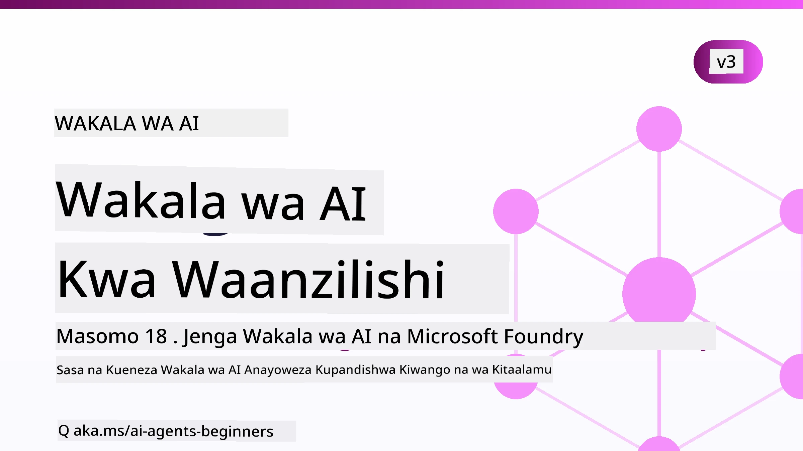

# Maajenti ya AI kwa Waanzilishi - Kozi



## Kozi inayofundisha kila kitu unachohitaji kujua ili kuanza kujenga Maajenti ya AI

[](https://github.com/microsoft/ai-agents-for-beginners/blob/master/LICENSE?WT.mc_id=academic-105485-koreyst)
[](https://GitHub.com/microsoft/ai-agents-for-beginners/graphs/contributors/?WT.mc_id=academic-105485-koreyst)
[](https://GitHub.com/microsoft/ai-agents-for-beginners/issues/?WT.mc_id=academic-105485-koreyst)
[](https://GitHub.com/microsoft/ai-agents-for-beginners/pulls/?WT.mc_id=academic-105485-koreyst)
[](http://makeapullrequest.com?WT.mc_id=academic-105485-koreyst)

### 🌐 Msaada wa Lugha Nyingi

#### Tafsiri zinahifadhiwa na [Mfasiri wa Ushirikiano](https://github.com/Azure/co-op-translator)

<!-- CO-OP TRANSLATOR LANGUAGES TABLE START -->
[Kiarabu](../ar/README.md) | [Kibengali](../bn/README.md) | [Kibulgaria](../bg/README.md) | [Kiburma (Myanmar)](../my/README.md) | [Kichina (Rahisi)](../zh-CN/README.md) | [Kichina (Msingi, Hong Kong)](../zh-HK/README.md) | [Kichina (Msingi, Macau)](../zh-MO/README.md) | [Kichina (Msingi, Taiwan)](../zh-TW/README.md) | [Kroeshia](../hr/README.md) | [Kicheki](../cs/README.md) | [Kidenmaki](../da/README.md) | [Kiholanzi](../nl/README.md) | [Kiestonia](../et/README.md) | [Kifini](../fi/README.md) | [Kifaransa](../fr/README.md) | [Kijerumani](../de/README.md) | [Kigiriki](../el/README.md) | [Kiebrania](../he/README.md) | [Kihindi](../hi/README.md) | [Kihungari](../hu/README.md) | [Kiindonesia](../id/README.md) | [Kiitaliano](../it/README.md) | [Kijapani](../ja/README.md) | [Kikannada](../kn/README.md) | [Kikmeari](../km/README.md) | [Kikorea](../ko/README.md) | [Kilithuania](../lt/README.md) | [Kimalayi](../ms/README.md) | [Kimalayalam](../ml/README.md) | [Kimarathi](../mr/README.md) | [Kinepali](../ne/README.md) | [Pidgin ya Nijeria](../pcm/README.md) | [Kinorwe](../no/README.md) | [Kiajemi (Farsi)](../fa/README.md) | [Kipolishi](../pl/README.md) | [Kireno (Brazili)](../pt-BR/README.md) | [Kireno (Ureno)](../pt-PT/README.md) | [Kipunajabi (Gurmukhi)](../pa/README.md) | [Kiromania](../ro/README.md) | [Kirusi](../ru/README.md) | [Kiserbia (Kiriliki)](../sr/README.md) | [Kislovakia](../sk/README.md) | [Kisloveni](../sl/README.md) | [Kihispania](../es/README.md) | [Kiswahili](./README.md) | [Kiswidi](../sv/README.md) | [Kitagalog (Kifilipino)](../tl/README.md) | [Kitamili](../ta/README.md) | [Kitelugu](../te/README.md) | [Kithai](../th/README.md) | [Kituruki](../tr/README.md) | [Kiukrania](../uk/README.md) | [Kiurdu](../ur/README.md) | [Kivenyeeti](../vi/README.md)

> **Ungependa Kukopa Kwenye Kompyuta Moja kwa Moja?**
>
> Hifadhi hii ina tafsiri za lugha 50+ ambazo zinaongeza kiasi cha kupakua kwa kiasi kikubwa. Ili kukopa bila tafsiri, tumia sparse checkout:
>
> **Bash / macOS / Linux:**
> ```bash
> git clone --filter=blob:none --sparse https://github.com/microsoft/ai-agents-for-beginners.git
> cd ai-agents-for-beginners
> git sparse-checkout set --no-cone '/*' '!translations' '!translated_images'
> ```
>
> **CMD (Windows):**
> ```cmd
> git clone --filter=blob:none --sparse https://github.com/microsoft/ai-agents-for-beginners.git
> cd ai-agents-for-beginners
> git sparse-checkout set --no-cone "/*" "!translations" "!translated_images"
> ```
>
> Hii inakupa kila kitu unachohitaji kukamilisha kozi kwa kupakua kwa haraka zaidi.
<!-- CO-OP TRANSLATOR LANGUAGES TABLE END -->

**Kwa chaguzi za ziada za lugha, angalia [lugha zinazoungwa mkono na Mfasiri wa Ushirikiano](https://github.com/Azure/co-op-translator/blob/main/docs/supported-languages.md).**

[](https://GitHub.com/microsoft/ai-agents-for-beginners/watchers/?WT.mc_id=academic-105485-koreyst)
[](https://GitHub.com/microsoft/ai-agents-for-beginners/network/?WT.mc_id=academic-105485-koreyst)
[](https://GitHub.com/microsoft/ai-agents-for-beginners/stargazers/?WT.mc_id=academic-105485-koreyst)

[](https://discord.com/invite/ATgtXmAS5D)


## 🌱 Kuanzia

Kozi hii ina masomo yanayofunika misingi ya ujenzi wa Maajenti ya AI. Kila somo lina mada yake hivyo anza popote upendavyo!

Kuna msaada wa lugha nyingi kwa kozi hii. Nenda kwenye [lugha zinazopatikana hapa](#-multi-language-support).

Ikiwa huu ni mara yako ya kwanza kujenga kwa kutumia mifano ya AI ya Kizazi, angalia kozi yetu ya [AI ya Kizazi kwa Waanzilishi](https://aka.ms/genai-beginners), ambayo ina masomo 21 kuhusu ujenzi na GenAI.

Usisahau [kutoa nyota (🌟) kwa repo hii](https://docs.github.com/en/get-started/exploring-projects-on-github/saving-repositories-with-stars?WT.mc_id=academic-105485-koreyst) na [kufagia repo hii](https://github.com/microsoft/ai-agents-for-beginners/fork) ili kuendesha msimbo.

### Kutana na Wanafunzi Wengine, Pata Majibu kwa Maswali Yako

Ikiwa unakumbwa na shida au una maswali kuhusu ujenzi wa Maajenti ya AI, jiunge na Kituo chetu maalum cha Discord katika [Microsoft Foundry Discord](https://aka.ms/ai-agents/discord).

### Unachohitaji

Kila somo katika kozi hii lina mifano ya msimbo, ambayo inaweza kupatikana kwenye folda ya code_samples. Unaweza [kufagia repo hii](https://github.com/microsoft/ai-agents-for-beginners/fork) ili kuunda nakala yako mwenyewe.

Mifano ya msimbo katika mazoezi haya inatumia Microsoft Agent Framework na Huduma ya Wakala ya Microsoft Foundry V2:

- [Microsoft Foundry](https://aka.ms/ai-agents-beginners/ai-foundry) - Akaunti ya Azure Inahitajika

Kozi hii inatumia mifumo na huduma zifuatazo za Maajenti ya AI kutoka Microsoft:

- [Microsoft Agent Framework (MAF)](https://learn.microsoft.com/agent-framework/overview/)
- [Huduma ya Wakala wa Microsoft Foundry V2](https://aka.ms/ai-agents-beginners/ai-agent-service)

Baadhi ya mifano ya msimbo pia inaunga mkono watoa huduma mbadala wanaolingana na OpenAI kama vile [MiniMax](https://platform.minimaxi.com/), ambayo hutoa mifano ya muktadha mkubwa (hadi tokeni 204K). Angalia [Usanidi wa Kozi](./00-course-setup/README.md) kwa maelezo ya usanidi.

Kwa taarifa zaidi kuhusu kuendesha msimbo wa kozi hii, nenda kwenye [Usanidi wa Kozi](./00-course-setup/README.md).

## 🙏 Unataka kusaidia?

Una mapendekezo au umeona makosa ya tahajia au msimbo? [Inua suala](https://github.com/microsoft/ai-agents-for-beginners/issues?WT.mc_id=academic-105485-koreyst) au [Unda ombi la kuvuta](https://github.com/microsoft/ai-agents-for-beginners/pulls?WT.mc_id=academic-105485-koreyst)


## 📂 Kila somo linajumuisha

- Somo lililoandikwa lililo katika README na video fupi
- Mifano ya msimbo ya Python inayotumia Microsoft Agent Framework na Microsoft Foundry
- Viungo vya rasilimali za ziada kuendelea na kujifunza kwako


## 🗃️ Masomo

| **Somo**                                   | **Nakala na Msimbo**                                    | **Video**                                                  | **Mafunzo ya Ziada**                                                                     |
|----------------------------------------------|----------------------------------------------------|------------------------------------------------------------|----------------------------------------------------------------------------------------|
| Utangulizi kwa Maajenti wa AI na Matumizi ya Maajenti       | [Kiungo](./01-intro-to-ai-agents/README.md)          | [Video](https://youtu.be/3zgm60bXmQk?si=z8QygFvYQv-9WtO1)  | [Kiungo](https://aka.ms/ai-agents-beginners/collection?WT.mc_id=academic-105485-koreyst) |
| Kuchunguza Mfumo wa Maajenti wa AI              | [Kiungo](./02-explore-agentic-frameworks/README.md)  | [Video](https://youtu.be/ODwF-EZo_O8?si=Vawth4hzVaHv-u0H)  | [Kiungo](https://aka.ms/ai-agents-beginners/collection?WT.mc_id=academic-105485-koreyst) |
| Kuelewa Mifumo ya Ubunifu wa Maajenti wa AI     | [Kiungo](./03-agentic-design-patterns/README.md)     | [Video](https://youtu.be/m9lM8qqoOEA?si=BIzHwzstTPL8o9GF)  | [Kiungo](https://aka.ms/ai-agents-beginners/collection?WT.mc_id=academic-105485-koreyst) |
| Mfumo wa Ubunifu wa Matumizi ya Zana                      | [Kiungo](./04-tool-use/README.md)                    | [Video](https://youtu.be/vieRiPRx-gI?si=2z6O2Xu2cu_Jz46N)  | [Kiungo](https://aka.ms/ai-agents-beginners/collection?WT.mc_id=academic-105485-koreyst) |
| Agentic RAG                                  | [Kiungo](./05-agentic-rag/README.md)                 | [Video](https://youtu.be/WcjAARvdL7I?si=gKPWsQpKiIlDH9A3)  | [Kiungo](https://aka.ms/ai-agents-beginners/collection?WT.mc_id=academic-105485-koreyst) |
| Kujenga Maajenti wa AI wa Kuaminika               | [Kiungo](./06-building-trustworthy-agents/README.md) | [Video](https://youtu.be/iZKkMEGBCUQ?si=jZjpiMnGFOE9L8OK ) | [Kiungo](https://aka.ms/ai-agents-beginners/collection?WT.mc_id=academic-105485-koreyst) |
| Mfumo wa Ubunifu wa Mipango                      | [Kiungo](./07-planning-design/README.md)             | [Video](https://youtu.be/kPfJ2BrBCMY?si=6SC_iv_E5-mzucnC)  | [Kiungo](https://aka.ms/ai-agents-beginners/collection?WT.mc_id=academic-105485-koreyst) |
| Mfumo wa Ubunifu wa Maajenti Wengi                   | [Kiungo](./08-multi-agent/README.md)                 | [Video](https://youtu.be/V6HpE9hZEx0?si=rMgDhEu7wXo2uo6g)  | [Kiungo](https://aka.ms/ai-agents-beginners/collection?WT.mc_id=academic-105485-koreyst) |
| Mfumo wa Ubunifu wa Metakognitio                 | [Kiungo](./09-metacognition/README.md)               | [Video](https://youtu.be/His9R6gw6Ec?si=8gck6vvdSNCt6OcF)  | [Kiungo](https://aka.ms/ai-agents-beginners/collection?WT.mc_id=academic-105485-koreyst) |
| Maajenti ya AI Kazini                      | [Kiungo](./10-ai-agents-production/README.md)        | [Video](https://youtu.be/l4TP6IyJxmQ?si=31dnhexRo6yLRJDl)  | [Kiungo](https://aka.ms/ai-agents-beginners/collection?WT.mc_id=academic-105485-koreyst) |
| Kutumia Itifaki za Maajenti (MCP, A2A na NLWeb) | [Kiungo](./11-agentic-protocols/README.md)           | [Video](https://youtu.be/X-Dh9R3Opn8)                                 | [Kiungo](https://aka.ms/ai-agents-beginners/collection?WT.mc_id=academic-105485-koreyst) |
| Uhandisi wa Muktadha kwa Maajenti ya AI            | [Kiungo](./12-context-engineering/README.md)         | [Video](https://youtu.be/F5zqRV7gEag)                                 | [Kiungo](https://aka.ms/ai-agents-beginners/collection?WT.mc_id=academic-105485-koreyst) |
| Usimamizi wa Kumbukumbu za Maajenti                      | [Kiungo](./13-agent-memory/README.md)     |      [Video](https://youtu.be/QrYbHesIxpw?si=vZkVwKrQ4ieCcIPx)                                                      |                                                                                        |
| Kuchunguza Microsoft Agent Framework                         | [Kiungo](./14-microsoft-agent-framework/README.md)                            |                                                            |                                                                                        |
| Kujenga Maajenti wa Matumizi ya Kompyuta (CUA)           | [Kiungo](./15-browser-use/README.md)     |                                                            | [Kiungo](https://docs.browser-use.com/examples/templates/playwright-integration)         |
| Kutoa Maajenti Yanayoweza Kupanuliwa                    | [Kiungo](./16-deploying-scalable-agents/README.md) |                                                    | [Kiungo](https://learn.microsoft.com/azure/ai-foundry/agents/overview)                   |
| Kuunda Maajenti wa AI wa Ndani                     | [Kiungo](./17-creating-local-ai-agents/README.md)  |                                                    | [Kiungo](https://learn.microsoft.com/azure/ai-foundry/foundry-local/)                    |
| Kuweka Usalama wa Maajenti wa AI                           | [Kiungo](./18-securing-ai-agents/README.md)  |                                                            | [Kiungo](https://aka.ms/ai-agents-beginners/collection?WT.mc_id=academic-105485-koreyst) |

## 🎒 Kozi Nyingine

Timu yetu hutengeneza kozi nyingine! Angalia:

<!-- CO-OP TRANSLATOR OTHER COURSES START -->
### LangChain
[](https://aka.ms/langchain4j-for-beginners)
[](https://aka.ms/langchainjs-for-beginners?WT.mc_id=m365-94501-dwahlin)
[](https://github.com/microsoft/langchain-for-beginners?WT.mc_id=m365-94501-dwahlin)
---

### Azure / Edge / MCP / Maajenti
[](https://github.com/microsoft/AZD-for-beginners?WT.mc_id=academic-105485-koreyst)
[](https://github.com/microsoft/edgeai-for-beginners?WT.mc_id=academic-105485-koreyst)
[](https://github.com/microsoft/mcp-for-beginners?WT.mc_id=academic-105485-koreyst)
[](https://github.com/microsoft/ai-agents-for-beginners?WT.mc_id=academic-105485-koreyst)

---
 
### Mfululizo wa AI ya Kizazi
[](https://github.com/microsoft/generative-ai-for-beginners?WT.mc_id=academic-105485-koreyst)
[-9333EA?style=for-the-badge&labelColor=E5E7EB&color=9333EA)](https://github.com/microsoft/Generative-AI-for-beginners-dotnet?WT.mc_id=academic-105485-koreyst)
[-C084FC?style=for-the-badge&labelColor=E5E7EB&color=C084FC)](https://github.com/microsoft/generative-ai-for-beginners-java?WT.mc_id=academic-105485-koreyst)
[-E879F9?style=for-the-badge&labelColor=E5E7EB&color=E879F9)](https://github.com/microsoft/generative-ai-with-javascript?WT.mc_id=academic-105485-koreyst)

---
 
### Kujifunza Msingi
[](https://aka.ms/ml-beginners?WT.mc_id=academic-105485-koreyst)
[](https://aka.ms/datascience-beginners?WT.mc_id=academic-105485-koreyst)
[](https://aka.ms/ai-beginners?WT.mc_id=academic-105485-koreyst)
[](https://github.com/microsoft/Security-101?WT.mc_id=academic-96948-sayoung)
[](https://aka.ms/webdev-beginners?WT.mc_id=academic-105485-koreyst)
[](https://aka.ms/iot-beginners?WT.mc_id=academic-105485-koreyst)
[](https://github.com/microsoft/xr-development-for-beginners?WT.mc_id=academic-105485-koreyst)

---
 
### Mfululizo wa Copilot
[](https://aka.ms/GitHubCopilotAI?WT.mc_id=academic-105485-koreyst)
[](https://github.com/microsoft/mastering-github-copilot-for-dotnet-csharp-developers?WT.mc_id=academic-105485-koreyst)
[](https://github.com/microsoft/CopilotAdventures?WT.mc_id=academic-105485-koreyst)
<!-- CO-OP TRANSLATOR OTHER COURSES END -->

## 🌟 Shukrani kwa Jamii

Shukrani kwa [Shivam Goyal](https://www.linkedin.com/in/shivam2003/) kwa kuchangia sampuli muhimu za msimbo zinaonyesha Agentic RAG. 

## Kuchangia

Mradi huu unakaribisha michango na mapendekezo. Michango mingi inahitaji kukubaliana na
Makubaliano ya Leseni ya Mchango (CLA) yanayothibitisha kwamba una haki ya, na kweli unampa,
haki za kutumia mchango wako. Kwa maelezo, tembelea <https://cla.opensource.microsoft.com>.

Unapowasilisha maombi ya kuvuta mabadiliko, bot ya CLA itahakikisha moja kwa moja kama unahitaji
kutoa CLA na kuweka alama ipasavyo (kwa mfano, ukaguzi wa hali, maoni). Fuata tu maagizo
yaliyotolewa na bot. Utahitaji kufanya hivi mara moja tu katika hifadhidata zote zinazotumia CLA yetu.

Mradi huu umezingatia [Microsoft Kanuni ya Maadili ya Chanzo Huria](https://opensource.microsoft.com/codeofconduct/).
Kwa maelezo zaidi, angalia [Maswali Yanayoulizwa Mara kwa Mara kuhusu Kanuni ya Maadili](https://opensource.microsoft.com/codeofconduct/faq/) au
wasiliana na [opencode@microsoft.com](mailto:opencode@microsoft.com) kwa maswali au maoni zaidi.

## Alama Zilizoandikwa

Mradi huu unaweza kuwa na alama au nembo za miradi, bidhaa, au huduma. Matumizi yaliyoruhusiwa ya alama za Microsoft
zinafuata na lazima zifuate
[Miongozo ya Alama na Brand ya Microsoft](https://www.microsoft.com/legal/intellectualproperty/trademarks/usage/general).
Matumizi ya alama au nembo za Microsoft katika toleo zilizobadilishwa za mradi huu hayapaswi kusababisha mkanganyiko au kudokeza udhamini wa Microsoft.
Matumizi yoyote ya alama au nembo za wahusika wa tatu yanatawaliwa na sera za wahusika hao wa tatu.

## Kupata Msaada


Ukikumbwa na shida au ikiwa na maswali kuhusu kujenga programu za AI, jiunge na:

[](https://aka.ms/foundry/discord)

Ikiwa una maoni au hitilafu wakati wa kujenga, tembelea:

[](https://aka.ms/foundry/forum)

---

<!-- CO-OP TRANSLATOR DISCLAIMER START -->
**Kionyozo**:
Hati hii imetafsiriwa kwa kutumia huduma ya tafsiri ya AI [Co-op Translator](https://github.com/Azure/co-op-translator). Ingawa tunajitahidi kupata usahihi, tafadhali fahamu kwamba tafsiri za kiotomatiki zinaweza kuwa na makosa au upungufu wa usahihi. Hati ya asili katika lugha yake halisi inapaswa kuchukuliwa kama chanzo cha mamlaka. Kwa taarifa muhimu, tafsiri ya kitaalamu inayofanywa na binadamu inapendekezwa. Hatutojibu kwa kuelewa vibaya au tafsiri potofu zinazotokea kutokana na matumizi ya tafsiri hii.
<!-- CO-OP TRANSLATOR DISCLAIMER END -->