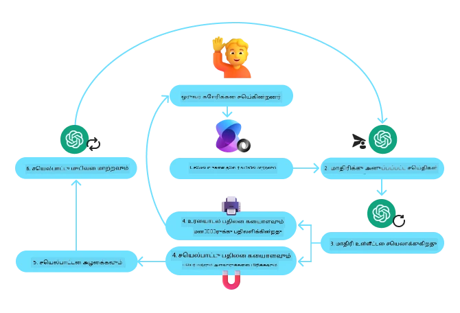
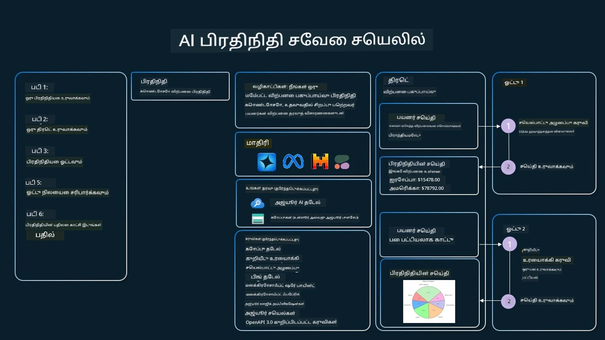

[](https://youtu.be/vieRiPRx-gI?si=cEZ8ApnT6Sus9rhn)

> _(இந்த பாடத்தின் வீடியோவைப் பார்க்க மேலே உள்ள படத்தை கிளிக் செய்யவும்)_

# கருவி பயன்பாட்டுக் கட்டமைப்பு

கருவிகள் ஆர்வமிக்கவை, ஏனெனில் அவை AI முகவர்களுக்கு அதிக பரப்பளவு திறன்களை வழங்கும். முகவர் செய்யும் செயல்களின் வரம்பு குறைக்கப்பட்டிருப்பதற்கு பதிலாக, ஒரு கருவியைச் சேர்ப்பதன் மூலம், முகவர் விரிந்த செயல்களை செய்யக்கூடியதாக হয়. இந்த அத்தியாயத்தில், AI முகவர்கள் தங்களது குறிக்கோள்களை அடைய குறிப்பிட்ட கருவிகளை எப்படி பயன்படுத்தலாம் என்பதைக் கூறும் கருவி பயன்பாட்டுக் கட்டமைப்பைப் பார்ப்போம்.

## அறிமுகம்

இந்த பாடத்தில், நாம் கீழ்க்கண்ட கேள்விகளுக்கு பதிலளிக்க முயற்சிக்கிறோம்:

- கருவி பயன்பாட்டுக் கட்டமைப்பு என்ன?
- இது எந்த பயன்பாடுகளுக்கு பொருந்தும்?
- இந்த கட்டமைப்பை நடைமுறைப்படுத்த தேவையான கூறுகள்/அடிப்படை கட்டங்கள் என்ன?
- நம்பகமான AI முகவர்களை உருவாக்க கருவி பயன்பாட்டுக் கட்டமைப்பைப் பயன்படுத்தும் போது உள்ள சிறப்பான பரிசீலனைகள் என்ன?

## கற்றல் குறிக்கோள்கள்

இந்த பாடத்தை முடித்த பிறகு, நீங்கள்:

- கருவி பயன்பாட்டுக் கட்டமைப்பின் வரையை மற்றும் நோக்கத்தைக் குறிப்பது.
- கருவி பயன்பாட்டுக் கட்டமைப்பு பொருந்தக்கூடிய பயன்பாடுகளை அடையாளம் காண்பது.
- கட்டமைப்பை நடைமுறைப்படுத்த தேவையான முக்கிய கூறுகளைப் புரிந்துகொள்வது.
- இந்த கட்டமைப்பைப் பயன் படுத்தும் AI முகவர்கள் நம்பகத்தன்மையை உறுதி செய்யும் பரிசீலனைகளை அறிதல்.

## கருவி பயன்பாட்டுக் கட்டமைப்பு என்றால் என்ன?

**கருவி பயன்பாட்டுக் கட்டமைப்பு** என்பது LLMக்கள் குறிப்பிட்ட கோட்பாடுகளை அடைய வெளிப்புற கருவிகளுடன் தொடர்பு கொள்ளும் திறனைக் கொடுக்க கவனம் செலுத்துகிறது. கருவிகள் என்பது செயல்களை மேற்கொள்ள முகவர் இயக்கக்கூடிய கோடுகளாகும். ஒரு கருவி கூலியக்கூடிய கணக்கோடியா போன்ற எளிய செயல்பாட்டோ, பங்கு விலைதோற்றம் அல்லது காலநிலை முன்னறிவிப்புச் சேவை போன்ற மூன்றாம் தரப்பு சேவைக்கு API அழைப்போ ஆக இருக்கலாம். AI முகவர்களின் சூழலில், கருவிகள் **மாதிரி-உருவாக்கப்பட்ட செயல்பாட்டுக் அழைப்புகளுக்கு** பதிலளிக்க முகவர்களால் இயக்கப்பட தயாரிக்கப்படுகின்றன.

## இது எந்த பயன்பாடுகளுக்கு பொருந்தும்?

AI முகவர்கள், கடினமான பணிகளை முடிக்க, தகவலைப் பெற அல்லது முடிவெடுக்க கருவிகளை பயன்படுத்தலாம். கருவி பயன்பாட்டுக் கட்டமைப்பு பொதுவாக தரவுத்தளங்கள், வலை சேவைகள் அல்லது குறியீடு மொழிபெயர்ப்பாளர்கள் போன்ற வெளிப்புற அமைப்புகளுடன் இயக்கத்தில் தேவைப்படும் சூழலில் பயன்படுத்தப்படுகிறது. இது பல்வேறு பயன்பாடுகளில் உதவியாக இருக்கும், உதாரணமாக:

- **செயல்திறன் தகவல் மீட்டெடு:** முகவர்கள் புதுப்பித்த தரவைப் பெற வெளிப்புற APIகளை அல்லது தரவுத்தளங்களை விசாரிக்கலாம் (எ.கா., SQLite தரவுத்தளத்தில் தரவுக் கணக்காய்வுக்காக வினவல், பங்கு விலை அல்லது காலநிலை தகவலை பெறுதல்).
- **குறியீடு இயக்கம் மற்றும் விளக்கம்:** கணக்கீட்டு பிரச்சனைகளைத் தீர்க்க, அறிக்கைகளை உருவாக்க, அல்லது ஒப்பந்தங்களை செய்ய குறியீடுகள் அல்லது ஸ்கிரிப்ட்களை இயக்கு.
- **வேலைப்பாட்டை தானியங்கி செய்யல்:** பணிகளுக்கான திட்டமிடிகள், மின்னஞ்சல் சேவைகள் அல்லது தரவு குழாய்களை இணைத்துக்கொண்டு மீண்டும் மீண்டும் செய்யும் அல்லது பல படிகளான வேலைப்பாட்டை தானியக்கமாக்கல்.
- **வாடிக்கையாளர் ஆதரவு:** CRM அமைப்புகள், டிக்கெட் பராமரிப்பு தளம் அல்லது அறிவுக் கண்காட்சிகளுடன் தொடர்பு கொண்டு பயனர் கேள்விகளை தீர்க்க.
- **உள்ளடக்கமும் தொகுப்பும் உருவாக்குதல்:** இலக்கணம் சரிபார்ப்போர், உரை சுருக்கிகள் அல்லது உள்ளடக்கு பாதுகாப்புக் கருவிகள் போன்ற கருவிகளை பயன்படுத்தி உள்ளடக்க உருவாக்க உதவி.

## கருவி பயன்பாட்டுக் கட்டமைப்பை நடைமுறைப்படுத்த தேவையான கூறுகள்/அடிப்படை கட்டங்கள் என்ன?

இந்த அடிப்படை கட்டங்கள் AI முகவர்க்கு விசாலமான பணிகளை செய்வதற்கு உதவுகிறது. கருவி பயன்பாட்டுக் கட்டமைப்பை நிர்வகிக்க தேவையான முக்கிய கூறுகளைப் பார்ப்போம்:

- **செயல்பாடு/கருவி விளக்கக்கோவைகள்**: கிடைக்கும் கருவிகள் பற்றிய விரிவான விவரக்குறிப்புகள், செயல்பாட்டுப் பெயர், நோக்கம், தேவையான அளவுருக்கள் மற்றும் எதிர்பார்க்கப்படும் வெளியீடுகள். இவை LLMக்கு எந்த கருவிகள் கிடைக்கின்றன என்பதைப் புரிந்து கொண்டு செல்லுபடியான கோரிக்கைகளை உருவாக்க உதவும்.

- **செயல்பாடு இயக்கக் கட்டளைமைப்பு**: பயனர் நோக்கம் மற்றும் உரையாடல் சூழலை அடிப்படையாக கொண்டு கருவிகள் எப்போது மற்றும் எப்படி அழைக்கப்படுகின்றன என்று நிர்ணயிக்கும். இதில் திட்டமிடும் பகுதிகள், வழியமைப்பு இயந்திரங்கள் அல்லது நிபந்தனை ஓட்டங்கள் இருக்கலாம்.

- **செய்தி கையாளல் அமைப்பு**: பயனர் உள்ளீடுகள், LLM பதில்கள், கருவி அழைப்புகள் மற்றும் கருவி வெளியீடுகளுக்கிடையேயான உரையாடல் ஓட்டத்தை நிர்வகிக்கும் கூறுகள்.

- **கருவி ஒருங்கிணைப்பு வடிவமைப்பு**: முகவரைக் காரியங்களை பல்வேறு கருவிகளோடு (எளிய செயல்பாடுகளோ, சிக்கலான வெளிப்புற சேவைகளோ) இணைக்கும் அடித்தளம்.

- **பிழை கையாளல் மற்றும் சான்று சரிபார்ப்பு**: கருவி செயல்பாட்டில் தோல்விகளை கையாளுதல், அளவுருக்களை சரிபார்த்தல் மற்றும் எதிர்பாராத பதில்களை நிர்வகித்தல்.

- **நிலை மேலாண்மை**: உரையாடல் சூழல், முந்தைய கருவி தொடர்புகள் மற்றும் நிலையான தரவுகளை கண்காணித்து, பல முறை தொடர்புகளில் ஒத்திசைவைக் காப்பது.

அடுத்து, செயல்பாடு/கருவி அழைப்பை விரிவாக பார்ப்போம்.
 
### செயல்பாடு/கருவி அழைப்புத் தளம்

செயல்பாட்டு அழைப்பு என்பது LLMக்களை கருவிகளுடன் தொடர்பு கொள்ள உதவும் முதன்மையான வழி. 'செயல்பாடு' மற்றும் 'கருவி' என்ற சொற்கள் பரிமாறிக்கொள்ளப்பட்டு பயன்படுத்தப்படுகின்றன, ஏனெனில் 'செயல்பாடுகள்' (மறு பயன்பாட்டுக்குரிய குறியீடு தொகுதிகள்) என்பது முகவர்கள் பணிகளை செய்ய பயன்படுத்தும் 'கருவிகள்' ஆகும். ஒரு செயல்பாட்டின் குறியீட்டை இயக்க, LLM பயனரின் கோரிக்கையை செயல்பாட்டின் விளக்கத்துடன் ஒப்பிட வேண்டும். இதற்கு, கிடைக்கும் செயல்பாடுகளின் விளக்கங்கள் உள்ள ஒருங்கு ஸ்கீமா LLMக்கு அனுப்பப்படுகிறது. LLM அப்பாடத்திற்கு ஏற்ற செயல்பாட்டைத் தேர்ந்தெடுத்து அதன் பெயர் மற்றும் அளவுருக்களை வழங்கும். தேர்ந்தெடுக்கப்பட்ட செயல்பாடு இயக்கப்படும்போது, அதன் பதிலை LLMக்கு திருப்பி வழங்கி அதனை பயன்படுத்தி பயனர் கோரிக்கைக்கு பதிலளிக்கிறது.

முகவர்களுக்கு செயல்பாட்டு அழைப்பை நடைமுறைப்படுத்த, நீங்கள் தேவைப்படும்:

1. செயல்பாட்டு அழைப்பை ஆதரிக்கும் ஒரு LLM மாதிரியை
2. செயல்பாடு விளக்கங்களைக் கொண்ட ஸ்கீமா
3. ஒவ்வொரு செயல்பாட்டுக்குமான குறியீடு

ஒரு நகரில் தற்போதைய நேரத்தைப் பெறும் எடுத்துக்காட்டை பயன்படுத்துவோம்:

1. **செயல்பாட்டு அழைப்பை ஆதரிக்கும் LLM ஐ துவக்கவும்:**

    எல்லா மாதிரிகளும் செயல்பாட்டு அழைப்பை ஆதரிக்காது, அதனால் நீங்கள் பயன்படுத்தும் LLM ஆதரிக்கிறதா என்பதை சரிபார்க்க வேண்டும்.     <a href="https://learn.microsoft.com/azure/ai-services/openai/how-to/function-calling" target="_blank">அஜூர் ஓபன்ஏஐ</a> செயல்பாட்டு அழைப்பை ஆதரிக்கிறது. நாம் அஜூர் ஓபன்ஏஐ **பதில்கள் API** (நிலையான `/openai/v1/` குறுக்கிடை — `api_version` தேவையில்லை) பதிலுக்கு OpenAI கிளையன்டை துவக்கலாம்.

    ```python
    # Initialize the OpenAI client for Azure OpenAI (Responses API, v1 endpoint)
    client = OpenAI(
        base_url=f"{os.environ['AZURE_OPENAI_ENDPOINT'].rstrip('/')}/openai/v1/",
        api_key=os.environ["AZURE_OPENAI_API_KEY"],
    )
    deployment_name = os.environ["AZURE_OPENAI_DEPLOYMENT"]
    ```

1. **செயல்பாட்டு ஸ்கீமாவை உருவாக்குக:**

    அடுத்ததாக, செயல்பாட்டின் பெயர், செயல்பாடு செய்வதை விவரித்தல் மற்றும் செயல்பாட்டுப் பரிமாறிகள் பற்றிய பெயர்கள் மற்றும் விளக்கங்களைக் கொண்ட JSON ஸ்கீமாவை வரையறுக்கிறோம்.
    பின்னர், இந்த ஸ்கீமாவை முன்பு உருவாக்கிய கிளையன்டிற்கு எடுத்துச் செல்ல, பயனர் கோரிக்கை (சான் ப்ரான்சிஸ்கோவில் நேரம் அறிய) உடன் அனுப்புகிறோம். முக்கியமானது, **கருவி அழைப்பு** இது என்று திரும்புகிறது, கேள்விக்கான இறுதி பதில் அல்ல. முன்பே கூறியபடி, LLM தேர்ந்தெடுத்த செயல்பாட்டின் பெயரும் அதற்கான அளவுருக்களும் வழங்கப்படுகின்றன.

    ```python
    # Function description for the model to read (Responses API flat tool format)
    tools = [
        {
            "type": "function",
            "name": "get_current_time",
            "description": "Get the current time in a given location",
            "parameters": {
                "type": "object",
                "properties": {
                    "location": {
                        "type": "string",
                        "description": "The city name, e.g. San Francisco",
                    },
                },
                "required": ["location"],
            },
        }
    ]
    ```
   
    ```python
  
    # Initial user message
    messages = [{"role": "user", "content": "What's the current time in San Francisco"}]

    # First API call: Ask the model to use the function
    response = client.responses.create(
        model=deployment_name,
        input=messages,
        tools=tools,
        tool_choice="auto",
        store=False,
    )

    # The Responses API returns tool calls as function_call items in response.output.
    # Append them to the conversation so the model has full context on the next turn.
    messages += response.output

    print("Model's response:")
    print(response.output)
  
    ```

    ```bash
    Model's response:
    [ResponseFunctionToolCall(arguments='{"location":"San Francisco"}', call_id='call_pOsKdUlqvdyttYB67MOj434b', name='get_current_time', type='function_call')]
    ```
  
1. **பணி செய்ய தேவையான செயல்பாட்டுக் குறியீடு:**

    LLM தேர்ந்தெடுத்த செயல்பாடு இயங்க சரியான குறியீட்டை நாம் உருவாக்கி இயக்க வேண்டும்.
    Pythonல் தற்போதைய நேரத்தைப் பெறும் குறியீட்டை எழுதுவோம். பதிலிலிருந்து பெயர் மற்றும் அளவுருக்களை வித்தியாசிக்கும் குறியீட்டையும் எழுத வேண்டும்.

    ```python
      def get_current_time(location):
        """Get the current time for a given location"""
        print(f"get_current_time called with location: {location}")  
        location_lower = location.lower()
        
        for key, timezone in TIMEZONE_DATA.items():
            if key in location_lower:
                print(f"Timezone found for {key}")  
                current_time = datetime.now(ZoneInfo(timezone)).strftime("%I:%M %p")
                return json.dumps({
                    "location": location,
                    "current_time": current_time
                })
      
        print(f"No timezone data found for {location_lower}")  
        return json.dumps({"location": location, "current_time": "unknown"})
    ```

     ```python
    # Handle function calls
    tool_calls = [item for item in response.output if item.type == "function_call"]
    if tool_calls:
        for tool_call in tool_calls:
            if tool_call.name == "get_current_time":

                function_args = json.loads(tool_call.arguments)

                time_response = get_current_time(
                    location=function_args.get("location")
                )

                # Return the tool result as a function_call_output item
                messages.append({
                    "type": "function_call_output",
                    "call_id": tool_call.call_id,
                    "output": time_response,
                })
    else:
        print("No tool calls were made by the model.")

    # Second API call: Get the final response from the model
    final_response = client.responses.create(
        model=deployment_name,
        input=messages,
        tools=tools,
        store=False,
    )

    return final_response.output_text
     ```

     ```bash
      get_current_time called with location: San Francisco
      Timezone found for san francisco
      The current time in San Francisco is 09:24 AM.
     ```

செயல்பாட்டு அழைப்பு பெரும்பாலும் முகவர் கருவி பயன்பாட்டுக் கட்டமைப்பின் மையமாக உள்ளது, ஆனால் அதை துவக்கம் இருந்து உருவாக்குவது சிரமமாக இருக்கலாம்.
நாங்கள் [பாடம் 2](../../../02-explore-agentic-frameworks) இல் கற்றபடி, முகவரியடிப்படைக் கட்டமைப்புகள் (agentic frameworks) முன்கூட்டியே தயாரிக்கப்பட்ட தொகுதிகளை வழங்குகின்றன.
 
## முகவரியடிப்படைக் கட்டமைப்புடன் கருவி பயன்பாட்டு எடுத்துக்காட்டுகள்

இங்கே பிற முகவரியடிப்படைக் கட்டமைப்புகளைப் பயன்படுத்தி கருவி பயன்பாட்டுக் கட்டமைப்பை எப்படி நடைமுறைப்படுத்தலாம் என சில எடுத்துக்காட்டுகள் உள்ளன:

### Microsoft முகவர் கட்டமைப்பு

<a href="https://learn.microsoft.com/azure/ai-services/agents/overview" target="_blank">Microsoft முகவர் கட்டமைப்பு</a> என்பது AI முகவர்களை உருவாக்கும் திறனாய்வு திறந்த மூல வடிவமைப்பு. இது செயல்பாட்டு அழைப்பை எளிதாக்க Python செயல்பாடுகளை `@tool` அலங்கரிப்பாளர் (decorator) உபயோகித்து கருவி ஆக கையாள அனுமதிக்கிறது. இது மாதிரி மற்றும் குறியீடு இடையேயான தொடர்பைப் பராமரிக்கிறது. மேலும், முன்னாள் உருவாக்கப்பட்ட கருவிகளான கோப்பு தேடல் மற்றும் குறியீடு மொழிபெயர்ப்பாளா்களுக்கு `FoundryChatClient` வழியாக அணுகல் கொடுக்கின்றது.

கீழ்கண்ட வரைபடம், Microsoft முகவர் கட்டமைப்புடன் செயல்பாட்டு அழைப்பின் செயல்முறையை விளக்குகிறது:



Microsoft முகவர் கட்டமைப்பில், கருவிகள் அலங்கரிக்கப்பட்ட செயல்பாடுகளாக வரையறுக்கப்படுகின்றன. முந்தயமாக பார்த்த `get_current_time` செயல்பாட்டை `@tool` அலங்கரிப்பாளரைப் பயன்படுத்தி கருவியாக மாற்றலாம். கட்டமைப்பு தன்னிச்சையாக செயல்பாடும் அதன் அளவுருக்களும் வரிசைப்படுத்தி, LLMக்கு அனுப்ப வேண்டிய ஸ்கீமாவை உருவாக்கும்.

```python
import os
from agent_framework import tool
from agent_framework.foundry import FoundryChatClient
from azure.identity import AzureCliCredential

@tool(approval_mode="never_require")
def get_current_time(location: str) -> str:
    """Get the current time for a given location"""
    ...

# Create the client
provider = FoundryChatClient(
    project_endpoint=os.environ["AZURE_AI_PROJECT_ENDPOINT"],
    model=os.environ["AZURE_AI_MODEL_DEPLOYMENT_NAME"],
    credential=AzureCliCredential(),
)

# Create an agent and run with the tool
agent = provider.as_agent(name="TimeAgent", instructions="Use available tools to answer questions.", tools=get_current_time)
response = await agent.run("What time is it?")
```

#### MCP சேவையகம் மூலம் கருவிகள்

கருவிகள் உங்கள் சொந்த குறியீட்டில் செயல்பாடாக இருக்க வேண்டிய அவசியமில்லை. Model Context Protocol (MCP, [பாடம் 11](../11-agentic-protocols/README.md) இல் கையாளப்பட்டது) பேச்சு நடத்தும் சேவையகம், கருவிகளையும் அவற்றின் ஸ்கீமாக்களையும் வெளிமூல்களால் வெளியிடுகிறது; கட்டமைப்பு அலங்கரிக்கப்பட்ட செயல்பாட்டைப் போல அவற்றை ஏற்ற முடியும். `MCPStreamableHTTPTool` HTTP வழியாக அந்த சேவையகத்துடன் இணைந்து கருவி ஸ்கீமாவை வாசித்து, உள்ளக கருவிகளுடன் சேர்த்து மாதிரிக்கு வழங்கும்.

கீழ்காணும் எடுத்துக்காட்டு <a href="https://keenable.ai" target="_blank">Keenable</a> வழங்கும் வலை தேடு சேவையை பயன்படுத்துகிறது. இது கணக்கு அல்லது API விசையில்லாமல் இலவசமாக பயன்படுகிறது (கோரிக்கைகள் IP அடிப்படையில் வரம்பிடப்பட்டுள்ளது), எனவே உங்கள் மாதிரிக்கு தேவையான அங்கீகாரம் மட்டும் தேவையாகும். எவ்வாறு தொலைநிலை கருவியாக இருந்தாலும், மாதிரி எழுதும் வினாக்கள் அந்த சேவையகத்துக்கு அனுப்பப்படுகிறது.

```python
from agent_framework import MCPStreamableHTTPTool

web_search = MCPStreamableHTTPTool(
    name="Keenable web search",
    url="https://api.keenable.ai/mcp",
)

# Connecting loads the server's tool schemas; the agent decides when to call them
async with web_search:
    agent = provider.as_agent(
        name="ResearchAgent",
        instructions="Use available tools to answer questions.",
        tools=[web_search],
    )
    response = await agent.run("What is new in the latest Python release?")
    print(response.text)
```

சேவையகம் இரண்டு கருவிகளை வெளியிடுகிறது, `search_web_pages` மற்றும் `fetch_page_content`. தற்போதைய தகவல் தேவைப்பட்டால், மாதிரி `search_web_pages` ஐ அழைத்து, தலைப்புகள், URLகள் மற்றும் உரை துணுக்குகள் திரும்பப் பெறுகிறது, பின்னர் அவற்றிலிருந்து பதில் எழுதுகிறது, மேலே உள்ள `get_current_time` எடுத்துக்காட்டில் போன்று.
  
### Microsoft Foundry முகவர் சேவை

<a href="https://learn.microsoft.com/azure/ai-services/agents/overview" target="_blank">Microsoft Foundry முகவர் சேவை</a>, மேம்படுத்துனருக்கு பாதுகாப்பாக, வசதியாக வளர்த்து, பரவலாக AI முகவர்களை உருவாக்க பதிய வழங்கப்படும் புதிய முகவரியடிப்படைக் கட்டமைப்பு. இது அடிப்படைக் கணினி மற்றும் சேமிப்புத் தொகுதிகளை நிர்வகிக்க தேவையில்லாமல் வேலை செய்கிறது. இது குறிப்பாக நிறுவன பயன்பாடுகளுக்கு ஏற்றது, ஏனெனில் முழுமையான மேலாண்மை சேவை மற்றும் நிறுவன தரத்துடன் பாதுகாப்பு உள்ளடங்கியுள்ளது.

LLM API-யுடன் நேரடியாக உருவாக்குவதை ஒப்பிட்டால், Microsoft Foundry Agent Service இற்கு சில நன்மைகள் உள்ளன, அவை:

- தானாக கருவி அழைப்பு – கருவி அழைப்பை பிரித்தெடுத்தல், கருவி இயக்கு, பதிலைக் கையாள தேவையில்லை; இவை அனைத்தும் சேவையகதிலே நடைபெறுகிறது
- பாதுகாப்பாக தரவு மேலாண்மை – உரையாடல் நிலைப் பகுதியை நிர்வகிப்பதற்கு பதிலாக, தேவையான அனைத்து தகவலையும் தீம்கள் (threads) மூலம் சேமிக்க முடியும்
- பாக்ஸ் வெளியே கருவிகள் – Bing, Azure AI தேடு, Azure செயல்பாடுகள் போன்ற தரவுத்தளங்களுடன் பணியாற்ற பயன்படும் கருவிகள்.

Microsoft Foundry முகவர் சேவையில் கிடைக்கும் கருவிகள் இரண்டு வகைகளாக பிரிக்கப்படுகின்றன:

1. அறிவுப் பயன்பாட்டு கருவிகள்:
    - <a href="https://learn.microsoft.com/azure/ai-services/agents/how-to/tools/bing-grounding?tabs=python&pivots=overview" target="_blank">Bing தேட்டுடன் அடிப்படை அமைத்தல்</a>
    - <a href="https://learn.microsoft.com/azure/ai-services/agents/how-to/tools/file-search?tabs=python&pivots=overview" target="_blank">கோப்பு தேடல்</a>
    - <a href="https://learn.microsoft.com/azure/ai-services/agents/how-to/tools/azure-ai-search?tabs=azurecli%2Cpython&pivots=overview-azure-ai-search" target="_blank">Azure AI தேடு</a>

2. செயல் கருவிகள்:
    - <a href="https://learn.microsoft.com/azure/ai-services/agents/how-to/tools/function-calling?tabs=python&pivots=overview" target="_blank">செயல்பாட்டு அழைப்பு</a>
    - <a href="https://learn.microsoft.com/azure/ai-services/agents/how-to/tools/code-interpreter?tabs=python&pivots=overview" target="_blank">குறியீடு மொழிபெயர்ப்பாளர்</a>
    - <a href="https://learn.microsoft.com/azure/ai-services/agents/how-to/tools/openapi-spec?tabs=python&pivots=overview" target="_blank">OpenAPI வரையறுக்கப்பட்ட கருவிகள்</a>
    - <a href="https://learn.microsoft.com/azure/ai-services/agents/how-to/tools/azure-functions?pivots=overview" target="_blank">Azure செயல்பாடுகள்</a>

முகவர் சேவை இவை அனைத்தையும் `toolset` ஆக பயன்படுத்த அனுமதிக்கிறது. மேலும், உரையாடல் குறிப்புகளை இனம் காணும் `threads` ஐப் பயன்படுத்து.

நீங்கள் Contoso என்ற நிறுவனத்தில் விற்பனை முகவராக இருக்கிறீர்கள் என்று கற்பனை செய்யவும். உங்கள் விற்பனைத் தரவுகளுக்கான கேள்விகளுக்கு பதிலளிக்கும் உரையாடல் முகவரியை நீங்கள் உருவாக்க விரும்புகிறீர்கள்.

Microsoft Foundry முகவர் சேவையைப் பயன்படுத்தி உங்கள் விற்பனை தரவுகளை பகுப்பாய்வு செய்வது எப்படியென கீழ்காணும் படம் விளக்குகிறது:



இந்த சேவையுடன் எந்த கருவியையும் பயன்படுத்த, நாம் ஒரு கிளையன்டை உருவாக்கி கருவி அல்லது கருவி தொகுப்பை வரையறுக்கலாம். இது நடைமுறைப்படுத்த Python குறியீட்டை பயன்படுத்தலாம். LLM கருவி தொகுப்பைக் காண்ந்து, பயனர் உருவாக்கிய செயல்பாடு, `fetch_sales_data_using_sqlite_query`, அல்லது முன்னால் உருவாக்கப்பட்ட குறியீடு மொழிபெயர்ப்பாளர் பயன்படுத்துவது இடையே முடிவுசெய்யும்.

```python 
import os
from azure.ai.projects import AIProjectClient
from azure.identity import DefaultAzureCredential
from fetch_sales_data_functions import fetch_sales_data_using_sqlite_query # fetch_sales_data_using_sqlite_query function which can be found in a fetch_sales_data_functions.py file.
from azure.ai.projects.models import ToolSet, FunctionTool, CodeInterpreterTool

project_client = AIProjectClient.from_connection_string(
    credential=DefaultAzureCredential(),
    conn_str=os.environ["PROJECT_CONNECTION_STRING"],
)

# Initialize toolset
toolset = ToolSet()

# Initialize function calling agent with the fetch_sales_data_using_sqlite_query function and adding it to the toolset
fetch_data_function = FunctionTool(fetch_sales_data_using_sqlite_query)
toolset.add(fetch_data_function)

# Initialize Code Interpreter tool and adding it to the toolset. 
code_interpreter = CodeInterpreterTool()toolset.add(code_interpreter)

agent = project_client.agents.create_agent(
    model="gpt-5-mini", name="my-agent", instructions="You are helpful agent", 
    toolset=toolset
)
```

## நம்பகமான AI முகவர்களை கட்டமைப்பதற்கு கருவி பயன்பாட்டுக் கட்டமைப்பைப் பயன்படுத்தும் போது சிறப்பு கவனிப்புகள் என்ன?

LLMகளால் இயங்கும் SQL இல் பொதுவாக உள்ள பாதுகாப்பு கவலை SQL ஊற்று தாக்குதல் அல்லது தரவுத்தளத்தை தவறாக மாற்றுதல் போன்ற தீய செயல்களின் ஆபத்து. இந்தப் பிரச்சினைகளை சரியான தரவுத்தள அணுகல் அனுமதிகளை அமைத்தல் மூலம் கட்டுப்படுத்தலாம். பெரும்பாலான தரவுத்தளங்களில், இதற்கு தரவுத்தளத்தை படிக்க மட்டுமே அனுமதிக்க வேண்டும். PostgreSQL அல்லது Azure SQL போன்ற சேவைகளில், செயலிக்கு படிக்க மட்டுமே அனுமதி (SELECT) வழங்கப்பட வேண்டும்.

செயலியை பாதுகாப்பான சூழலில் இயக்குவது கூடுதல் பாதுகாப்பை தரும். நிறுவன சூழலில், தரவு சாதாரணமாக செயல்பாட்டு அமைப்புகளிலிருந்து படிக்க மட்டுமே உள்ளத்தளத்திற்கு அல்லது தரவுக் கிடங்கிற்கு மாற்றி வடிவமைக்கப்படுகின்றது. இந்த முறையால் தரவு பாதுகாப்பாகவும், செயல்திறன் மற்றும் அணுகல் மேம்பட்டதாகவும் இருக்கும்; செயலிக்கு படிக்க மட்டுமே அனுமதி வழங்கப்படும்.

## எடுத்துக்காட்டு குறியீடுகள்

- Python: [முகவர் கட்டமைப்பு](./code_samples/04-python-agent-framework.ipynb)
- .NET: [முகவர் கட்டமைப்பு](./code_samples/04-dotnet-agent-framework.md)

## கருவி பயன்பாட்டுக் கட்டமைப்புகள் பற்றி மேலும் கேள்விகள் உண்டா?

[Microsoft Foundry Discord](https://discord.com/invite/ATgtXmAS5D) இல் சேர்ந்து மற்ற கற்க்டவர்களுடன் சந்திக்கவும், அலுவலக நேரங்களில் பங்கேற்கவும், உங்கள் AI முகவர் தொடர்பான கேள்விகளுக்கு பதில்கள் பெறவும்.

## மேலதிக ஆதாரங்கள்

- <a href="https://microsoft.github.io/build-your-first-agent-with-azure-ai-agent-service-workshop/" target="_blank">Azure AI முகவர் சேவை பணிமனை</a>
- <a href="https://github.com/Azure-Samples/contoso-creative-writer/tree/main/docs/workshop" target="_blank">Contoso Creative Writer Multi-Agent Workshop</a>
- <a href="https://learn.microsoft.com/azure/ai-services/agents/overview" target="_blank">Microsoft Agent Framework Overview</a>

## இந்த முகவரியை சிகரெட்-சோதனை செய்தல் (விருப்பத்தைச் சேர்ந்தது)

[பாடம் 16](../16-deploying-scalable-agents/README.md) இல் முகவரிகளை அமைப்பது பற்றி நீங்கள் கற்று கொண்ட பிறகு, நீங்கள் இந்த பாடத்தின் `TravelToolAgent` (அது இன்னும் தனது கருவிகளை அழைக்கிறதா மற்றும் பதிலளிக்கிறதா?) ஐ [`tests/lesson-04-smoke-tests.json`](../../../tests/lesson-04-smoke-tests.json) உடன் சிகரெட்-சோதனை செய்யலாம். இது எப்படி இயக்குவது என்பதை பார்க்க [`tests/README.md`](../tests/README.md).

## முந்தைய பாடம்

[எஜென்டிக் வடிவமைப்பு மாதிரிகள் புரிதல்](../03-agentic-design-patterns/README.md)

## அடுத்த பாடம்

[எஜென்டிக் RAG](../05-agentic-rag/README.md)

---

<!-- CO-OP TRANSLATOR DISCLAIMER START -->
**மறுப்பு**:
இந்த ஆவணம் AI மொழிபெயர்ப்பு சேவை [Co-op Translator](https://github.com/Azure/co-op-translator) பயன்படுத்தி மொழிபெயர்க்கப்பட்டுள்ளது. நாங்கள் துல்லியத்திற்காக முயற்சி செய்துள்ளோம், ஆனால் தானாக செய்யப்படும் மொழிபெயர்ப்புகளில் பிழைகள் அல்லது தவறுகள் இருக்கலாம் என்பதை கவனத்தில் கொள்ளவும். அசல் ஆவணம் அதன் தாய்மொழியில் அதிகாரப்பூர்வ ஆதாரமாக கருதப்பட வேண்டும். முக்கியமான தகவல்களுக்கு, தொழில்நுட்பமான மனித மொழிபெயர்ப்பு பரிந்துரைக்கப்படுகிறது. இந்த மொழிபெயர்ப்பைப் பயன்படுத்துவதால் ஏற்படும் எந்த தவறான புரிதல்கள் அல்லது தவறான விளக்கத்திற்கும் நாங்கள் பொறுப்பில்வில்லை.
<!-- CO-OP TRANSLATOR DISCLAIMER END -->