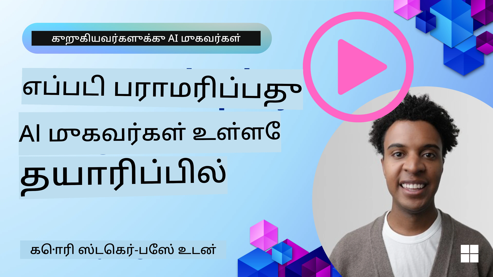

# உற்பத்தியில் AI முகவர்கள்: காணொளி மற்றும் மதிப்பீடு

[](https://youtu.be/l4TP6IyJxmQ?si=reGOyeqjxFevyDq9)

AI முகவர்கள் பரிசோதனை மாதிரிகளிலிருந்து சர்வதேச செயலிகளுக்கு செல்லும்போது, அவர்களின் நடத்தை புரிந்துகொள்ளும் திறன், செயல்திறன் கண்காணிப்பு மற்றும் வெளியீட்டுகளை முறையாக மதிப்பீடு செய்வது முக்கியமாகிறது.

## கற்றல் இலக்குகள்

இந்த பாடத்தை முடித்த பிறகு, நீங்கள் எப்படி/எதை புரிந்து கொள்ளலாமென்றால்:
- முகவர் காணொளி மற்றும் மதிப்பீட்டின் அடிப்படைக் கருத்துகள்
- முகவர்களின் செயல்திறனைக், செலவுகளையும், விளைவுகளையும் மேம்படுத்த பயன்கள்
- உங்கள் AI முகவர்களை முறையாக எப்படி மதிப்பீடு செய்வது என்று
- உற்பத்தியில் AI முகவர்களை அனுப்பும்போது செலவுகளை எப்படி கட்டுப்படுத்துவது
- Microsoft முகவர் வடிவமைப்பால் உருவாக்கப்பட்ட முகவர்களை எப்படி கருவியாக்குவது

குறிக்கோள் என்பது உங்கள் "கருப்பு பெட்டி" முகவர்களை வெளிப்படையான, நிர்வகிக்கக்கூடிய மற்றும் நம்பகமான அமைப்புகளாக மாற்றுவதற்கான அறிவை வழங்குவதாகும்.

_**குறிப்பு:** பாதுகாப்பான மற்றும் நம்பகமான AI முகவர்களை அனுப்புவது முக்கியம். மேலும் [நம்பகமான AI முகவர்கள் உருவாக்குதல்](../06-building-trustworthy-agents/README.md) பாடத்தையும் பார்க்கவும்._

## தடங்கள் மற்றும் தாக்கல்கள் (Traces and Spans)

[Langfuse](https://langfuse.com/) அல்லது [Microsoft Foundry](https://learn.microsoft.com/en-us/azure/ai-foundry/what-is-azure-ai-foundry) போன்ற காணொளி கருவிகள் பொதுவாக முகவர் இயங்குதளங்களை தடங்கள் மற்றும் தாக்கல்கள் என்ற வடிவில் நுட்பமாகக் காட்டுகின்றன.

- **தடம் (Trace)** என்பது முழுமையான முகவர் பணியை தொடக்கத்திலிருந்து முடிவில் வரை காட்டும் (பயனர் கேள்வியை கையாளுவது போன்றது).
- **தாக்கல்கள் (Spans)** என்பது அந்த தடத்தின் உள்ளே தனிப்பட்ட படிகள் (ஒரு மொழி மாதிரியை அழைக்கும் அல்லது தரவை பெறுதல் போன்றது).


<!-- படத்தின் URL விளக்கத்திற்காக தொடர்கிறது -->

காணொளி இல்லாமல், ஒரு AI முகவர் "கருப்பு பெட்டியாக" தோன்றலாம் - அதனுடைய உள்நிலை நிலையும் காரணமும் தெளிவில்லாமல் இருப்பதால் பிரச்சினைகளை கண்டுபிடிக்கவும் செயல்திறனை மேம்படுத்தவும் கடினமாகிறது. காணொளி மூலமாக, முகவர்கள் "கண்ணாடி பெட்டிகள்" ஆக மாறுகின்றனர், இது நம்பிக்கையை உருவாக்க எளிதாக்குகிறது மற்றும் அவர்கள் திட்டமிட்டபடி செயல்படுவதை உறுதி செய்கின்றது.

## உற்பத்தி சூழல்களில் காணொளியின் முக்கியத்துவம்

AI முகவர்களை உற்பத்தி சூழலுக்கு மாற்றுவதன் மூலம் புதிய சவால்கள் மற்றும் தேவைமைகள் தோன்றுகின்றன. காணொளி மிக அவசியமான திறனாக மாறுகிறது:

*   **பிழை கண்டறிதல் மற்றும் காரண ஆராய்ச்சி**: முகவர் தோல்வியடைந்தால் அல்லது எதிர்பாராத வெளியீட்டை வழங்கினால், காணொளி கருவிகள் பிழையின் ஆதாரத்தை கண்டறிய தேவையான தடங்களை வழங்கும். இது பல LLM அழைப்புகள், கருவி தொடர்புகளும் மற்றும் நிபந்தனை தீர்மானங்களும் உள்ள சிக்கலான முகவர்களுக்கு மிக முக்கியம்.
*   **தாமதமும் செலவு மேலாண்மையும்**: AI முகவர்கள் பெரும்பாலும் குறுக்கு அல்லது அழைப்புகளுக்கு கட்டணம் விதிக்கப்படும் LLMகளையும் பிற வெளிப்புற APIகளையும் பயன்படுத்துகின்றனர். காணொளி இந்த அழைப்புகளை செல்வாக்காக கண்காணிக்க உதவி செய்யும், மெதுவான அல்லது மிகச் செலவான செயல்பாடுகளை கண்டறிய உதவும். இதனால் குழுக்கள் வழி கூறுகளை சீரமைத்துக் கொள்ள, மெக்கான்களை தேர்ந்தெடுக்க அல்லது செலவுகளை கட்டுப்படுத்த வேலைப்பாட்டை மறுசீரமைக்க வாய்ப்பு ஏற்படும்.
*   **நம்பிக்கை, பாதுகாப்பு மற்றும் இணக்கங்கள்**: பல செயலிகளிலும், முகவர்கள் பாதுகாப்பாக மற்றும் நெறிமுறைகளை பின்பற்றி இருக்க வேண்டும். காணொளி முகவர் நடவடிக்கைகள் மற்றும் தீர்மானங்களின் கணக்கு பாதையை வழங்குகிறது. இது புரட்சி செய்யப்பட்ட உள்ளீடு, தீங்கு விளைவிக்கும் உள்ளடக்கம் உருவாக்குதல், அல்லது தனிப்பட்ட தகவல் தவறான முறையில் கையாள்தல் போன்ற பிரச்சினைகளை கண்டறிந்து கையாள உதவும். உதாரணமாக, ஒரு தடங்களை பார்வையிட்டு ஒரு முகவர் ஏன் ஒரு குறிப்பிட்ட பதிலை வழங்கினோ அல்லது ஒரு குறிப்பிட்ட கருவியை பயன்படுத்தினோ என்று புரிந்து கொள்ளலாம்.
*   **தொடரும் மேம்பாட்டு சுற்றுகள்**: காணொளி தரவு திருத்தம் செய்யும் செயல்முறை அடிப்படையாகும். முகவர்கள் உண்மையான உலகில் எவ்வாறு செயல்படுகின்றன என்பதை கண்காணித்து, குழுக்கள் மேம்பாடுகளுக்கு இடங்களை கண்டுபிடிக்க மற்றும் மாதிரிகளை சிறப்பாக்குவதற்கான தரவை சேகரித்து, மாற்றங்களின் விளைவுகளை மதிப்பீடு செய்வது போன்ற செயல்களை செய்துகொள்ள முடியும். இது ஒரு பின்னூட்டச் சுற்று உருவாக்குகிறது, உற்பத்தி அறிவுரைகள் ஆன்லைன் மதிப்பீட்டிலிருந்து ஆஃப்லைன் பரிசோதனை மற்றும் சீரமைப்புக்கு வழிகாட்டும், இதன் மூலம் சிறந்த முகவர் செயல்திறன் பெறப்படுகிறது.

## கண்காணிக்க வேண்டிய முக்கிய அளவுகோல்கள்

முகவர் நடத்தை கண்காணிக்க மற்றும் புரிந்துகொள்ள பல அளவுகோல்கள் மற்றும் அடையாளங்களை பின்தொடர வேண்டும். முகவரின் நோக்கத்திற்கு ஏற்ப குறிப்பிடப்பட்ட அளவுகோல்கள் மாறக்கூடும், ஆனால் சில பொதுவாக முக்கியமானவை.

காணொளி கருவிகள் கண்காணிக்கும் பொதுவான சில அளவுகோல்கள்:

**தாமதம்:** முகவர் எவ்வளவு விரைவில் பதிலளிக்கிறான்? நீண்ட காத்திருப்பு நேரங்கள் பயனர் அனுபவத்தை பாதிக்கும். பணிகளுக்கான மற்றும் தனிப்பட்ட படிகளுக்கான தாமதத்தை முகவர் இயங்குதளங்களைக் கண்டறிய கணக்கிட வேண்டும். உதாரணமாக, அனைத்து மாதிரி அழைப்புகளுக்கும் 20 வினாடிகள் எடுக்கும் முகவர், வேகமான மாதிரியை பயன்படுத்தும் அல்லது மாதிரி அழைப்புகளை ஒரே நேரத்தில் இயக்குவதால் வேகமாக்கப்படலாம்.

**செலவுகள்:** ஒரு முகவர் இயங்குதளத்துக்கான செலவு என்ன? AI முகவர்கள் குறுக்கு அழைப்புகளுக்கு கட்டணமிடப்படும் LLM அழைப்புகளை அல்லது வெளிப்புற APIகளை அடிப்படையாக்கொண்டு இயங்குகின்றனர். அதிக கருவி பயன்பாடுகள் அல்லது பல வழங்கல்கள் செலவுகளை விரைவில் அதிகரிக்கலாம். உதாரணமாக, ஒரு முகவர் தரம் சிறிது மேம்பாட்டிற்காக LLM ஐ ஐந்து முறை அழைத்தால், செலவு நியாயம் உள்ளதோ அல்லையோ ஆய்வு செய்ய வேண்டும் அல்லது அழைப்புகளின் எண்ணிக்கையை குறைக்கவும் அல்லது மலிவான மாதிரியை பயன்படுத்தலாம். நேரடி கண்காணிப்பும் எதிர்பாராத உயர்வுகளை கண்டறிய உதவும் (எ.கா., பிழைகள் அதிக API அழைப்புகளுக்கு வழிவகுக்கும்).

**அறிக்கை பிழைகள்:** எத்தனை கோரிக்கைகளை முகவர் தோல்வியாக்கினான்? இது API பிழைகள் அல்லது கருவி அழைப்புகளின் தோல்விகள் அடங்கும். உற்பத்தியில் உங்கள் முகவரின் நிலைத்தன்மையை அதிகரிக்க, நீங்கள் மாற்று நிலைமைகளை அல்லது மீண்டும் முயற்சிகளை அமைக்கலாம். உதாரணமாக, LLM வழங்குநர் A செயலிழந்து இருந்தால், நீங்கள் ஆபத்துக்கு LLM வழங்குநர் B ஐ மாற்றாக மாற்றுகிறீர்கள்.

**பயனர் பின்னூட்டம்:** நேரடி பயனர் மதிப்பீடுகள் மூலம் பயனுள்ள கருத்துக்களை பெறலாம். இது தெளிவான மதிப்பீடுகள் (👍 கூர்மையான/👎 கீழ்மையான, ⭐1-5 நட்சத்திரங்கள்) அல்லது உரை கருத்துக்களை உள்ளடக்கலாம். தொடர்ச்சியான எதிர்மறை பின்னூட்டங்கள் உங்கள் முகவர் எதிர்பார்த்தபடி செயல்படவில்லை என்பதை குறிக்க வேண்டும்.

**மறைமுக பயனர் பின்னூட்டம்:** பயனர் நடத்தை தெளிவான மதிப்பீடுகள் இல்லாமல் மறைமுக கருத்துக்களை வழங்கும். இது உடனடி கேள்வி மறுபிரிவாக்கம், மீண்டும் கேள்விகள் கேட்குதல் அல்லது மீண்டும் முயற்சி பொத்தானை அழுத்துதல் போன்றவை அடங்கும். உதாரணமாக, பயனர்கள் ஒரே கேள்வியை தொடர்ந்து கேட்கிறதை நீங்கள் காண்கிறீர்கள் என்றால், இது முகவர் எதிர்பார்த்தபடி செயல்படவில்லை என்பதைக் குறிக்கும்.

**துல்லியம்:** சமயோசித அல்லது விரும்பத்தக்க வெளியீடுகளை முகவர் எவ்வளவு நிதானமாக வழங்குகின்றான்? துல்லியம் வரைவுகள் மாறுபடும் (எ.கா., பிரச்சனை தீர்க்கும் சரியான பதில்கள், தகவல் மீட்டெடுக்கும் துல்லியம், பயனர் திருப்தி). முதல் படி உங்கள் முகவருக்கு வெற்றி என்பது எப்படியும் என்பதை வரையறுக்க வேண்டும். துல்லியத்தை தானாகச் சோதனைகள், மதிப்பீட்டு மதிப்பெண்கள் அல்லது பணிசெய்தி அடையாளங்கள் மூலம் கண்காணிக்கலாம். உதாரணமாக, தடங்களை "வெற்றி பெற்றது" அல்லது "தோல்வி" என குறி ஊதல்.

**தானியங்கி மதிப்பீட்டு அளவுகோல்கள்:** தானியங்கி மதிப்பீடுகளை அமைக்கலாம். உதாரணமாக, நீங்கள் ஒரு LLM ஐப் பயன்படுத்தி முகவரின் வெளியீட்டை மதிப்பீடு செய்யலாம் (அதாவது உதவிகரமானதா, துல்லியமானதா என). பல திறந்த மூல நூலகங்களும் முகவரின் வேறு அம்சங்களைக் கணக்கிட உதவும். எ.கா., RAG முகவர்களுக்கு [RAGAS](https://docs.ragas.io/) அல்லது தீங்கான மொழி அல்லது புகார்புப்படுத்தலை கண்டறிய [LLM Guard](https://github.com/protectai/llm-guard).

நடைமுறையில், இந்த அளவுகோல்களின் கலவையே ஒரு AI முகவரின் நிலையை முழுமையாகப் புரிந்துகொள்ள உதவும். இந்த அத்தியாயத்தின் [உதாரண நோட்டுப்புத்தகம்](./code_samples/10-expense_claim-demo.ipynb) இல் இந்த அளவுகோல்கள் உண்மையான உதாரணங்களில் எப்படி இருக்கும் என்பதை காட்டுவோம், ஆனால் முதலில், சாதாரண மதிப்பீட்டு பணியின் வடிவத்தை கற்றுக்கொள்வோம்.

## உங்கள் முகவரைக் கருவியாக்குங்கள்

தடம் தரவை சேகரிக்க, உங்கள் குறியீட்டை கருவியாக்க வேண்டும். குறியீட்டை கருவியாக்கி, தடங்கள் மற்றும் அளவுகோல்கள் வெளியிடப்பட வேண்டும், இவை காணொளி தளத்தில் பதிவு செய்யப்படுவது, செயலாக்கப்படுவது மற்றும் காட்சிப்படுத்தப்படுவது அவசியம்.

**OpenTelemetry (OTel):** [OpenTelemetry](https://opentelemetry.io/) தொழில்துறையில் LLM காணொளிக்கான தரநிலை ஆகியுள்ளது. இது APIகள், SDKகள் மற்றும் கருவிகளை வழங்கி, தொலைநோக்கித் தரவை உருவாக்க, சேகரிக்க மற்றும் ஏற்றுமதி செய்ய உதவுகிறது.

பல கருவியாக்கல் நூலகங்கள் உள்ளன, இவை உள்ளமைந்த முகவர் வடிவமைப்புகளை மூடி OpenTelemetry தாக்கல்களை எளிதாக ஏற்றுமதி செய்கின்றன. Microsoft முகவர் வடிவமைப்பு இயல்பாக OpenTelemetry உடன் இணைக்கப்பட்டுள்ளது. கீழே MAF முகவர்களை கருவியாக்கும் உதாரணம்:

```python
from agent_framework.observability import get_tracer, get_meter

tracer = get_tracer()
meter = get_meter()

with tracer.start_as_current_span("agent_run"):
    # Agent execution is traced automatically
    pass
```

இந்த அத்தியாயத்தின் [உதாரண நோட்டுப்புத்தகம்](./code_samples/10-expense_claim-demo.ipynb) உங்கள் MAF முகவரியை எப்படி கருவியாக்குவது என்பதை காட்டும்.

**கைமுறை தாக்கல் உருவாக்கல்:** கருவியாக்கல் நூலகங்கள் நல்ல அடிப்படை அளவுகோலை வழங்கினாலும், சில சமயங்களில் மேலும் விரிவான அல்லது தனிப்பயன் தகவல்கள் தேவைப்படும். நீங்கள் தனிப்பயன் செயல்முறைகளைச் சேர்க்க கைமுறை தாக்கல்களை உருவாக்கலாம். முக்கியமாக, அவர்கள் தானாக அல்லது கைமுறையாக உருவாக்கப்பட்ட தாக்கல்களுக்கு தனித்துவமான பண்புகள் (அல்லது குறிச்சொற்கள் அல்லது மெட்டாடேட்டா) சேர்க்க முடியும். இவை வணிக-பிரதிபல செய்திகள், இடைநிலை கணக்கீடுகள் அல்லது பிழை கண்டறிதல் மற்றும் பகுப்பாய்வுக்கான மிகவும் பயனுள்ள சூழலை உள்ளடக்கியிருக்கலாம், உதாரணம்`user_id`, `session_id` அல்லது `model_version` போன்றவை.

[Langfuse Python SDK](https://langfuse.com/docs/sdk/python/sdk-v3) உடன் தடங்கள் மற்றும் தாக்கல்களை கைமுறையாக உருவாக்கல் உதாரணம்:

```python
from langfuse import get_client
 
langfuse = get_client()
 
span = langfuse.start_span(name="my-span")
 
span.end()
```

## முகவர் மதிப்பீடு

காணொளி என்னென்ன அளவுகோல்களை கொடுப்பதோ, மதிப்பீடு அந்த தரவை (மற்றும் சோதனைகள் மூலம்) பகுப்பாய்வு செய்து ஒரு AI முகவர் எப்படி செயல்படுகின்றான் மற்றும் எப்படி மேம்படுத்தலாம் என்பது ஆகும். மற்றொரு சொல்லில், தடங்கள் மற்றும் அளவுகோல்கள் இருந்தால், அவற்றை பயன்படுத்தி முகவரைக் எப்படி மதிப்பீடு செய்து முடிவெடுக்க வேண்டும்?

திடீரென மதிப்பீடு அவசியம், ஏனெனில் AI முகவர்கள் பலமுறை தடவை இல்லாதவை; அவர்கள் மேம்பற்றுக்கொண்டும் இருக்கலாம் (புதுப்பிப்புகளால் அல்லது முறை மாதிரி குணத் திருப்பங்களால்) – மதிப்பீடு இல்லாமல் உங்கள் “புத்திசாலி முகவர்” உண்மையில் தனது பணியை நன்கு செய்து கொண்டிருப்பதா அல்லது பின்னடைவு அடைந்துள்ளதா என்று தெரியாது.

AI முகவர்களுக்கு இரண்டு வகையான மதிப்பீடுகள் உள்ளன: **ஆன்லைன் மதிப்பீடு** மற்றும் **ஆஃப்லைன் மதிப்பீடு**. இரண்டும் மதிப்புமிக்கவை மற்றும் ஒன்றுக்கொன்றுக்கொடு補充ப்படுகின்றன. பொதுவாக நாம் ஆஃப்லைன் மதிப்பீட்டால் தொடங்குகிறோம், ஏனெனில் இது முகவர்களை அனுப்புவதற்கு முன் கடைசித் தேவையான படி.

### ஆஃப்லைன் மதிப்பீடு


இது முகவர்களை கட்டுப்பாட்டில் மதிப்பீடு செய்வதற்கு, பொதுவாக தேர்வு செய்யப்பட்ட தரவுத்தொகுப்புகளை பயன்படுத்தி, நேரடி பயனர் கேள்விகள் இல்லாமல் செய்கிறது. நீங்கள் எதிர்பார்க்கப்பட்ட வெளியீடு அல்லது சரியான நடத்தையை அறிவது மற்றும் அதை உங்கள் முகவரை ஓட்டி பார்க்கின்றீர்கள்.

உதாரணமாக, நீங்கள் கணித சொல்-பிரச்சனை முகவரைக் கட்டமைத்திருந்தால், 100 பிரச்சனைகளுடன் ஏற்கனவே தீர்வுகள் தெரிந்த [சோதனை தரவுத்தொகுப்பைக்](https://huggingface.co/datasets/openai/gsm8k) கொண்டிருக்கலாம். ஆஃப்லைன் மதிப்பீடு வளர்ச்சியின் போது அதிகமாக செய்யப்படுகிறது (CI/CD குழாய்களில் அங்கமாக அமைகிறது), மேம்பாடுகளை சரிபார்க்கவும் பின்னடைவுகளை தடுக்கும் நோக்கில். அதன் நன்மை **மீண்டும் செய்யக்கூடியது மற்றும் நிஜ கருத்துக்கள் இருப்பதால் தெளிவான துல்லியம் அளவுகோல் பெற முடியும்**. நீங்கள் பயனர் கேள்விகளை உருவாக்கவும், முகவரின் பதில்களை மிகச்சிறந்த பதில்களுடன் ஒப்பிட்டு மதிப்பீடு செய்யலாம் அல்லது மேலே குறிப்பிட்ட தானியங்கி அளவுகோல்களை பயன்படுத்தலாம்.

ஆஃப்லைன் மதிப்பீட்டின் முக்கிய சவால் உங்கள் சோதனை தரவுத்தொகுப்பு முழுமையாக மற்றும் பொருத்தமானவையாக இருக்க வேண்டும் என்பது - முகவர் நிலையான சோதனை தரவுத் தொகுப்பில் நன்கு செயல்படும்போது, உற்பத்தியில் பலவிதமான கேள்விகள் வரும் வாய்ப்பு உண்டு. எனவே சோதனை தொகுப்புகளை புதுப்பித்து பரபரப்பான வழக்கங்கள் மற்றும் உண்மை உலகக் கதைகளுக்கு பொருந்தும் எடுத்துக்காட்டுகளில் இடுகையிட வேண்டும். சிறிய “தீய வாசனை சோதனை” வழக்குகள் மற்றும் பெரிய மதிப்பீடு தொகுப்புகள் கலவையாக இருந்தால் பயனாகும்: சிறிய தொகுப்புகள் விரைவான சோதனைகளுக்கே, பெரியவைகள் பரபரப்பான செயல்திறனுக்கே.

### ஆன்லைன் மதிப்பீடு


இது முகவர்களை நேரடி, உண்மையான சூழலில், அதாவது உற்பத்தியில் நேரடி பயன்பாட்டில் மதிப்பீடு செய்வதாகும். ஆன்லைன் மதிப்பீடு முகவர் செயல்திறனை நேரடி பயனர் தொடர்புகளில் கண்காணித்து முடிவுகளை தொடர்ந்து பகுப்பாய்வு செய்வதை உள்ளடக்கியது.

உதாரணமாக, நீங்கள் வெற்றி விகிதம், பயனர் திருப்தி மதிப்பெண் அல்லது உற்பத்தி நிதானங்களில் பிற அளவுகோல்களை கண்காணிக்கலாம். ஆன்லைன் மதிப்பீட்டின் நன்மை என்பது **ஆய்வுக்கூட அமைபில் எதிர்பாராத விஷயங்களைப் பதிவு செய்வதாகும்** – மாதிரி நேரடிச் சீர்ச்செயலாக்கத்தை (input வடிவம் மாறும் போது முகவரின் செயல்திறன் குறைவதைக்) நீங்கள் காணலாம்; சோதனை தரவு இல்லாத எதிர்பாராத கேள்விகளையும் நிலைகளையும் கண்டறியலாம்​. இது முகவர் வனத்தில் எப்படி நடக்கும் என்பது பற்றிய உண்மையான படத்தை வழங்குகிறது.

ஆன்லைன் மதிப்பீடு மறைமுக மற்றும் வெளிப்படையான பயனர் பின்னூட்டங்களை சேகரிப்பது பொதுவாக உள்ளது, மேலும் தோன்றும் சோதனைகள் அல்லது A/B சோதனைகள் நடத்தலாம் (புதுப்பிக்கப்பட்ட முகவர் பழைய முகவருடன் ஒப்பிடப்படுகிறது). சவால் என்பது நேரடி தொடர்புக்களில் நம்பகமான அடையாளங்கள் அல்லது மதிப்பெண்களை பெறுவது கடினம் – பயனர் பின்னூட்டம் அல்லது இறங்கும் அளவுகோல்களைப் பொறுத்திருக்கலாம் (பயனர் விளைவிற்கு கிளிக் செய்தார்களா என்பதைக் குறிப்பிட).

### இரண்டையும் இணைத்தல்

ஆன்லைன் மற்றும் ஆஃப்லைன் மதிப்பீடுகள் ஒருவருக்கு மற்றொன்று பதிலாக இல்லை; அவை பரஸ்பர ஒத்துழைப்பில் உள்ளன. ஆன்லைன் கண்காணிப்பிலிருந்து கிடைக்கும் அறிவுரைகள் (எ.கா., புதிய வகை பயனர் கேள்விகள், முகவர் மோசமாக செயல்படும்) ஆஃப்லைன் சோதனை தரவுத்தொகுப்புகளை மேம்படுத்த பயன்படுத்தப்படலாம். மாறாக, ஆஃப்லைன் சோதனைகளில் நன்கு செயல்படும் முகவர்கள் ஆன்லைனில் திடீர் அனுப்பப்பட்டு கண்காணிக்கப்படலாம்.

நிஜத்தில், பல குழுக்கள் இந்த சுற்றுவழியை பின்பற்றுகின்றன: 

_ஆஃப்லைனில் மதிப்பீடு -> அனுப்பவும் -> ஆன்லைனில் கண்காணிக்கவும் -> புதிய தோல்வி வழக்குகளை சேகரிக்கவும் -> ஆஃப்லைன் தரவுத்தொகுப்பில் சேர்க்கவும் -> முகவரைப் பலப்படுத்தவும் -> மறுபடியும் செய்யவும்_.

## பரவலாக வரும் சிக்கல்கள்

AI முகவர்களை உற்பத்திக்கு அனுப்பும் போது பல சவால்களை எதிர்கொள்ளலாம். சில பரவலான பிரச்சினைகளும் அவற்றுக்கு தீர்வுகளும்:

| **சிக்கல்**    | **சாத்தியமாகும் தீர்வு**   |
| ------------- | ------------------ |
| AI முகவர் பணிகளைத் தொடர்ந்து சரியாக செய்யாத போது | - AI முகவருக்கு வழங்கப்பட்ட குறிப்பை தெளிவுபடுத்தவும்.<br>- பணிகளை துணைப் பணிகளாகப் பிரித்து பல முகவர்களால் கையாளவும் பார்க்கவும். |
| AI முகவர் தொடர்ச்சியான சுற்றுல்களில் சிக்கித்தான் | - முகவர் செயல்முறை எப்போது நிறுத்த வேண்டும் என்பதை தெளிவுபடுத்தும் நிறுத்த விதிமுறைகளைப் பிரிப்பதை உறுதி செய்யவும்.<br>- கடினமான பணிகளுக்குத் தேவைப்படும் நிபுணத்துவ உடைய பெரிய மாதிரியை பயன்படுத்தவும். |
| AI முகவர் கருவி அழைப்புகள் நன்கு செயல்படாத நேரம் | - கருவியின் வெளியீட்டை முகவர் அமைப்பிற்கு வெளியே சோதித்து சரிபார்க்கவும்.<br>- கருவி பணாமையங்கள், குறிப்புகள் மற்றும் பெயரிடுதலைத் துல்லியமாக்கவும். |
| பல முகவர்கள் கொண்ட அமைப்பு தொடர்ச்சியான செயல்திறன் காட்டவில்லை | - ஒவ்வொரு முகவருக்கும் வழங்கப்படும் குறிப்புகளை தெளிவாக தனித்துவமாக்கவும்.<br>- சரியான முகவரைக் கண்டறியும் "மாற்று வழி" அல்லது கட்டுப்பாட்டு முகவரைக் கொண்டு படிமுறை அமைக்கவும். |

இந்தப் பிரச்சினைகள் பலவாக காணொளி இருந்தால் இன்னும் விளக்கம் பெற துணியாக்கும். மேலே பேசப்பட்ட தடங்களும் அளவுகோல்களும் முகவர் பணிவழியில் பிரச்சினைகள் எங்கே எழுகின்றன என்பதை தெளிவுபடுத்தும், பிழை திருத்தல் மற்றும் மேம்பாடு எளிதாகும்.

## செலவுகளைக் கட்டுப்படுத்தல்

AI முகவர்களை உற்பத்திக்கு அனுப்பும் செலவுகளை நிர்வகிக்க உள்ள சில முறைகள் இங்கே:

**சிறிய மாதிரிகள் பயன்படுத்துதல்:** சிறிய மொழி மாதிரிகள் (SLMs) குறிப்பிட்ட முகவர் பயன்பாடுகளில் நன்கு செயலாற்றலாம் மற்றும் செலவுகளை பெரிதும் குறைக்கும். முன்னர் குறிப்பிடப்பட்டபோல், செயல்திறனை பெரிய மாதிரிகளுடன் ஒப்பிடும் மதிப்பீடு அமைப்பை உருவாக்குவது உங்கள் பயன்பாட்டில் SLM எவ்வளவு நன்றாக செயலாற்றும் என்பதை அறிய சிறந்த வழி. பொதுவான பணிகளுக்கு, உதாரணமாக நோக்கத் வகைப்படுத்தல் அல்லது அளவுரு எடுப்பதற்கு SLMகளை பயன்படுத்தலாம், ஆனால் சிக்கலான காரணாதாரத்திற்காக பெரிய மாதிரிகளை ஒதுக்கி வைக்கவும் கவனிக்கவும்.

**ஒரு ரவுட்டர் மாதிரியை பயன்படுத்துதல்:** இதற்கு இணையான யுக்தி - பல்வகை மாதிரிகள் மற்றும் அளவுகளைக் கொண்டு செயல்படுதல். LLM/SLM அல்லது சர்வர் இல்லா செயல்பாட்டைப் பயன்படுத்தி கோரிக்கைகளை சிக்கலின் அடிப்படையில் சிறந்த பொருத்த மாதிரிகளுக்கு வழி நடத்தலாம். இது செலவுகளை குறைக்கும் மட்டுமின்றி, சரியான பணிகளில் செயல்திறனை உறுதிசெய்யும். உதாரணமாக, எளிய கேள்விகளை சிறிய, விரைவான மாதிரிகளுக்கு அனுப்பி, சிக்கலான காரணீக பணிகளுக்கு மட்டும் விலையுயர்ந்த பெரிய மாதிரிகளை பயன்படுத்தலாம்.

**பதில் குறி செய்தல்:** பொதுவான கோரிக்கைகள் மற்றும் பணிகளை அடையாளம் பார்த்து, அவற்றை உங்கள் முகவர் அமைப்புக்கு முன்பே பதிலளிக்க வைத்து, ஒரே மாதிரியான கோரிக்கைகள் வரம்பை குறைக்கிறது. மேலும், அடிப்படையான AI மாதிரிகளை பயன்படுத்தி, ஒரு கோரிக்கை எவ்வளவு துல்லியமாக உங்கள் பதில் குறிகளுக்கு இணையாக உள்ளது என்பதை கண்டறிய ஒரு செயல்முறையை அறிமுகப்படுத்தலாம். இது அடிக்கடி கேட்கப்பட்ட கேள்விகள் அல்லது பொதுவான பணிக்குழுவுகளுக்கு சிறந்த செலவு குறைப்பை ஏற்படுத்தும்.

## இதை நடைமுறையில் எப்படி செயல்படுகிறது பார்ப்போம்

[இந்த பிரிவு எடுத்துக்காட்டு நோட்புக்](./code_samples/10-expense_claim-demo.ipynb) ல், observability கருவிகளை பயன்படுத்தி எங்கள் முகவர்களை கண்காணித்து, மதிப்பீடு செய்வதற்கான உதாரணங்களை காணலாம்.


### உற்பத்தியில் AI முகவர்கள் பற்றி மேலும் கேள்விகள் உள்ளதா?

[Microsoft Foundry Discord](https://discord.com/invite/ATgtXmAS5D) இல் சேர்ந்து, பிற கற்றல் பயிலர்களுடன் சந்தித்து, அலுவலக நேரங்களுக்கு கலந்து, உங்கள் AI முகவர் கேள்விகளுக்கு பதில்கள் பெறுங்கள்.

## முந்தைய பாடம்

[Metacognition Design Pattern](../09-metacognition/README.md)

## அடுத்த பாடம்

[Agentic Protocols](../11-agentic-protocols/README.md)

---

<!-- CO-OP TRANSLATOR DISCLAIMER START -->
**மறுப்பு**:
இந்த ஆவணம் AI மொழிபெயர்ப்பு சேவை [Co-op Translator](https://github.com/Azure/co-op-translator) பயன்படுத்தி மொழிபெயர்க்கப்பட்டுள்ளது. நாங்கள் துல்லியத்திற்காக முயற்சி செய்துள்ளோம், ஆனால் தானாக செய்யப்படும் மொழிபெயர்ப்புகளில் பிழைகள் அல்லது தவறுகள் இருக்கலாம் என்பதை கவனத்தில் கொள்ளவும். அசல் ஆவணம் அதன் தாய்மொழியில் அதிகாரப்பூர்வ ஆதாரமாக கருதப்பட வேண்டும். முக்கியமான தகவல்களுக்கு, தொழில்நுட்பமான மனித மொழிபெயர்ப்பு பரிந்துரைக்கப்படுகிறது. இந்த மொழிபெயர்ப்பைப் பயன்படுத்துவதால் ஏற்படும் எந்த தவறான புரிதல்கள் அல்லது தவறான விளக்கத்திற்கும் நாங்கள் பொறுப்பில்வில்லை.
<!-- CO-OP TRANSLATOR DISCLAIMER END -->