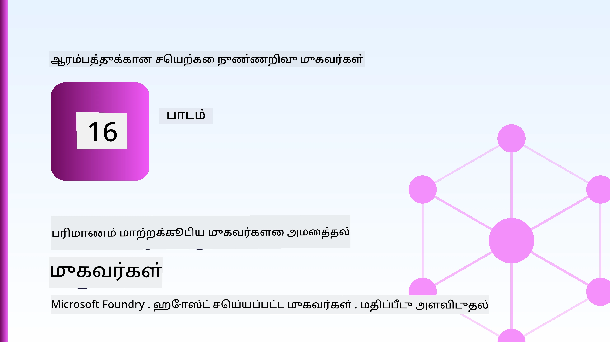
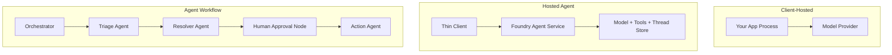
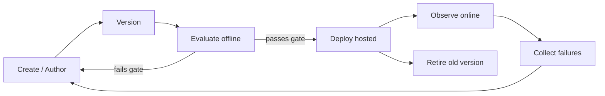
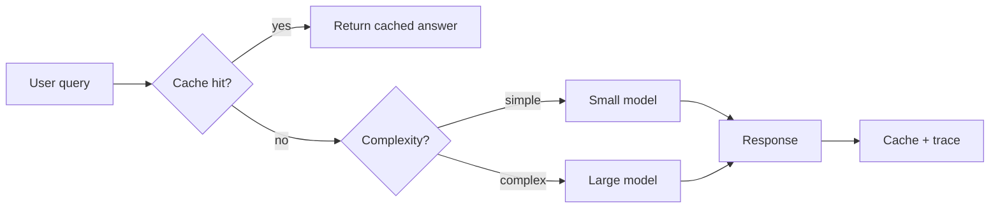
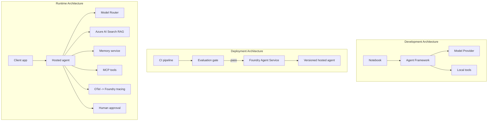

# Microsoft Foundry உடன் விரிவாக்கக்கூடிய முகவர்கள் ஐ உடுத்தல்



இந்தக் கட்டத்தில், நீங்கள் உங்கள் நோட்புக் உள், உங்கள் லேப்டாப்பில் இயங்கும், `az login` மற்றும் சில சூழல் மாறிகளால் இயக்கப்படும் முகவர்களை உருவாக்கியுள்ளீர்கள். அது கற்க சரியான வழி தான். ஆயினும், வடிகட்டி ஆயிரக்கணக்கான வாடிக்கையாளர்கள் தேவைப்படும் முகவர்களை 3 மணிக்கு இயக்கவேண்டுமென்றால் அது சரியான வழி அல்ல.

இந்த பாடம் **Microsoft Foundry** மற்றும் **Microsoft Foundry Agent Service** ஐ பயன்படுத்தி "என் கணினியில் செயல்படுகிறது" மற்றும் "தொழிற்படுத்தலில் நம்பகமாகவும் மலிவாகவும் செயல்படுகிறது" என்பதில் உள்ள இடைவெளியை மூடுவது பற்றி. இது ஒரு உண்மையான வாடிக்கையாளர் ஆதரவு முகவரைக் கட்டி, உபகரணங்கள், மீட்புகள், நினைவகம், மதிப்பீடு மற்றும் கண்காணிப்பு கொண்டது.

## அறிமுகம்

இந்தப் பாடத்தில்:

- **முன்மாதிரி முகவர்** மற்றும் **ப்ரொடக்க்ஷன் முகவர்** இடையிலான வேறுபாடு மற்றும் மாற்றம் அடிப்படையில் மாடலில் சுற்றிக்கொண்டுள்ளது.
- முகவர்களின் **உட்பொதிவு மாதிரிகள்**: கிளையெண்ட்-ஹோஸ்டெட், சர்வீஸ்-ஹோஸ்டெட் (ஹோஸ்டெட் முகவர்கள்), மற்றும் பணிச்சுழற்சி ஒருங்கிணைவு.
- Microsoft Foundry இல் **முகவர் வாழ்நாள் சுழற்சி** — உருவாக்கல், பதிப்பு, உட்பொதி, மதிப்பீடு, கண்காணிப்பு, ஓய்வு.
- **விரிவாக்கக் கொள்கைகள்**: மாடல் வழிமுறை, கேச்சிங், கூட்டு செயல்பாடு மற்றும் நிலைமையற்ற வடிவமைப்பு.
- OpenTelemetry மற்றும் Foundry பின்தொடர்வு மூலம் **கண்காணிப்பு**.
- மாடல் தேர்வு, வழிமுறை மற்றும் மதிப்பீடு வாயிலாக **செலவு குறைத்தல்**.
- நிறுவன பரிமாணங்கள்: ஆணைத்தன்மை, மனித ஒப்புதல் மற்றும் MCP சர்வர்களை பாதுகாப்பாக இயக்குதல்.

## கற்றல் இலக்குகள்

இந்த பாடத்தைக் கடந்த பிறகு, நீங்கள் என்ன செய்யக்கூடுமென தெரியும்:

- குறிப்பிட்ட முகவர் பணிசுமைக்கு சரியான உட்பொதி மாதிரியை தேர்வு செய்ய.
- முகவரைக் Microsoft Foundry Agent Service இல் பதிப்பிட, ஆணைத்தல் மற்றும் கண்காணிக்கப்பட்டதாக உட்பொதிக்க.
- பின்தொடர மறுபார்வைக்கான கருவி மற்றும் ஒவ்வொரு வெளியீட்டிற்கும் முன் ஓடும் மதிப்பீடு குழாயை கருவூலம் செய்ய.
- மாடல் வழிமுறை மற்றும் கேச்சிங்கை விரிவாக்கத்தில் விலையில் மற்றும் தாமதத்தில் கட்டுப்படுத்த பாவனை செய்ய.
- உயர்த்துக்கொள்ளும் ஆபத்துகளுக்கு மனித ஒப்புதல் வாயில் சேர்க்கவும், MCP சர்வரை உற்பத்தி பாதுகாப்பான முறையில் ஒத்துழைத்தல்.

## முன்னேற்பாடுகள்

இந்தப் பாடம் முந்தைய பாடங்களை முடித்திருப்பதாகவும், கீழ்காணும் விஷயங்களில் நிபுணத்துவம் பெற்றிருக்கவும் எதிர்பார்க்கப்படுகிறது:

- [Microsoft Agent Framework](../14-microsoft-agent-framework/README.md) கொண்டு முகவர்களை உருவாக்கல் (பாடம் 14).
- [கருவி பயன்படுத்தல்](../04-tool-use/README.md) (பாடம் 4) மற்றும் [Agentic RAG](../05-agentic-rag/README.md) (பாடம் 5).
- [Agent நினைவகம்](../13-agent-memory/README.md) (பாடம் 13) மற்றும் [Agentic நெறிமுறைகள் / MCP](../11-agentic-protocols/README.md) (பாடம் 11).
- [கண்காணிப்பு மற்றும் மதிப்பீடு](../10-ai-agents-production/README.md) (பாடம் 10) — இந்த பாடம் அதில் நேரடியாக கட்டமைக்கிறது.

நீங்கள் தேவையானவை:

- குறைந்தது ஒன்று உற்பத்தியில் உள்ளப் பேச்சு மாதிரி கொண்ட **Azure சந்தா** மற்றும் **Microsoft Foundry திட்டம்**.
- முதிர்ந்த **Azure CLI** அங்கீகாரம் (`az login`).
- Python 3.12+ மற்றும் `requirements.txt` உள்ள பாதுகாப்பு தொகுப்புகள் [../requirements.txt].

## முன்மாதிரியில் இருந்து உற்பத்தி வரை: என்ன மாற்றுகிறது

ஒரு முன்மாதிரி முகவரும் ஒரு உற்பத்தி முகவரும் ஒரே முக்கிய சுழற்சியை பகிர்ந்து கொள்கின்றன — காரணம், கருவிகள் அழைப்பு, பதில் கூறுதல். மாற்றம் சுழற்சியினை சுற்றி உள்ள அனைத்தும். உற்பத்தி முகவரின் 20% விட்டு அதிகம் மாடல்; மற்ற 80% இயங்கும் அமைப்பு தான்.

| கவனம் | முன்மாதிரி | உற்பத்தி |
| --- | --- | --- |
| **ஹோஸ்டிங்** | உங்கள் நோட்புக்கில் இயங்கும் | ஹோஸ்டிங் சேவையாக இயங்கும், பதிப்பிடப்பட்ட மற்றும் பரப்பப்படுகிறது |
| **அடையாளம்** | உங்கள் `az login` டோக்கன் | நிலைபேறாய் RBAC கொண்ட முகவரான அடையாளம் |
| **நிலை** | நினைவகத்தில், மீண்டும் துவங்குகையில் இழக்கிறது | வெளிப்புறம் (தொட்டி சேமிப்பு, நினைவக சேவை) |
| **தோல்வி** | நீங்கள் பிழை பயன்முறை காண்கிறீர்கள் | மீண்டும் முயற்சி, பின்தள்ளல்கள், டெட்-லெட்டர், எச்சரிக்கை |
| **செலவு** | "சில சென்டுகள்" | கோரிக்கைக்கு இணையான கண்காணிப்பு, வழிமுறை, கேச்சிங், பட்ஜெட் |
| **தர** | நீங்கள் வெளியீட்டை பார்வையிடுகிறீர்கள் | ஒவ்வொரு வெளியீட்டுக்கும்முன் தானாகவே மதிப்பீடு செய்யப்படுகிறது |
| **நம்பிக்கை** | நீங்கள் ஒவ்வொரு நடவடிக்கையையும் ஒப்புக்கொள்கிறீர்கள் | ஆணையும் + ஆபத்தான நடவடிக்கைகளுக்கு மனித ஒழுங்கு |

இந்த அட்டவணையை கவனத்தில் வைக்கவும். பின் வரும் ஒவ்வொரு பிரிவும் இதில் ஒன்று சார்ந்தது.

## முகவர் உட்பொதி மாதிரிகள்

மூன்று மாதிரிகள் உபயோகிக்கப்படுகின்றன, பெரும்பாலும் சேர்த்து.

### 1. கிளையெண்ட்-ஹோஸ்டெட் முகவர்கள்

முகவர் பொருள் உங்கள் செயலியில் உள்ளது. உங்கள் குறியீடு நேரடியாக மாடல் வழங்குநர் அழைக்கிறது; காரண சுழற்சி உங்கள் சேவையில் இயங்குகிறது. இது முந்தைய பாடங்களில் செய்தது.

- **பயன்பாடு**: முழு கட்டுப்பாடு தேவைப்பட்டால் அல்லது தனிப்பயன் மிடில்வேர் வேண்டுமானால், அல்லது முகவரைக் ஏற்கனவே உள்ள பின்புலப் பகுதியில் உள்ளே சேர்க்கும்போது.
- **சரிவருமாறுகள்**: நீங்களே விரிவாக்கம், நிலை மற்றும் நிலைத்தன்மையை கவனிக்க வேண்டியிருக்க வேண்டும்.

### 2. ஹோஸ்டெட் முகவர்கள் (Foundry Agent Service)

முகவர் *Microsoft Foundry இல் ஒரு வளமாக பதிவு செய்யப்படுகிறது*. Foundry காரண சுழற்சியை ஹோஸ்ட் செய்கிறது, தொட்டிகளை சேமிக்கிறது, உள்ளடக்க பாதுகாப்பும் RBAC ஐ கட்டுப்படுத்துகிறது, மற்றும் முகவர்களை Foundry போர்டலில் வெளிப்படையாக காட்டுகிறது. உங்கள் பயன்பாடு குறும்பட கிளையெண்டாக கொண்டு தொட்டிகள் உருவாக்கி பதில்களை வாசிக்கிறது.

- **பயன்பாடு**: நிலைத்தன்மை, அடிப்படை கண்காணிப்பு, ஆணைத்தன்மை மற்றும் குறைவான செயற்பாட்டு பகுதியுடன்.
- **சரிவருமாறுகள்**: நிர்வகிக்கப்படும் ஓட்டுநேரத்தில் குறைவான கீழ்த் தள கட்டுப்பாடு.

### 3. முகவர் பணிச்சுழற்சிகள்

பல முகவர்கள் (மற்றும் கருவிகள்) கட்டமைப்புடன் இணைக்கப்படுகின்றன - தொடர் படிகள், கிளை பிரிவு, மனித ஒப்புதல் முனைகள் மற்றும் நிறுத்தி மீண்டும் தொடக்கக் கூடிய நிலைத்தCheckpointகள். இது Microsoft Agent Framework இன் **Workflows** திறனின் உற்பத்தி அளவில் பயன்பாடு.

- **பயன்பாடு**: ஒரு வேலை பல சிறப்பான முகவர்களை விரக்கும் போது அல்லது நடுவே ஒப்புதல்படி தேவைப்பட்டது.
- **சரிவருமாறுகள்**: அதிகமான நகரும் பகுதிகள்; ஒருங்கிணைப்பு நிலை கண்காணிப்பு தேவை.



## Microsoft Foundry இல் முகவர் வாழ்நாள் சுழற்சி

ஒரு முகவரைக் கடவுளாக உட்பொதிப்பது ஒருமுறை காரியம் அல்ல `push`. இது ஒரு சுழற்சியாகும், மேலும் அது மென்பொருள் வெளியீட்டு சுழற்சியைப் போலவே உள்ளது.



முக்கியக் கருத்து, [பாடம் 10](../10-ai-agents-production/README.md) இருந்து எடுத்தது: **நிறுத்தும் நேர மதிப்பீடு ஒரு வாயில், பின்னர் எண்ணம் அல்ல.** ஒரு புதிய முகவர் பதிப்பை வெளியீடு செய்ய உங்கள் மதிப்பீட்டுப் பாதிப்புகளை தாண்டாமல் விடுவதில்லை. ஆன்லைன் கண்காணிப்பு பிறகு உலகில் நிகழும் தோல்விகளை உங்கள் நிறுத்து சோதனை தொகுப்புக்கு ஊட்டுகிறது. முழு சுழற்சி அதுவே.

## விரிவாக்கக் கொள்கைகள்

ஒரு முகவரைக் விரிவாக்குவது நிலைமையற்ற வலை API விரிவாக்கத்திலிருந்து வேறுபடுகிறது, ஏனென்றால் ஒவ்வொரு கோரிக்கையும் பல திருமதி மாடல் மற்றும் கருவி அழைப்புகளை தூண்டும். நான்கு தொழில்நுட்பங்கள் பெரும்பாலான ஏற்றத்தை ஏற்றுக்கொள்கின்றன.

**நிலைமையற்ற கோரிக்கை கையாளுதல்.** உங்கள் செயலியில் ஒவ்வொரு பயனரின் நிலையை நினைவில் வைக்க வேண்டாம். உரையாடல் தொட்டிகளை Foundry தொட்டிசேமிப்பில் அல்லது நினைவக சேவையில் நிலைத்தவையாகக் காப்பாற்றுங்கள் எனவே எந்த நிகழ்வும் எந்த கோரிக்கையையும் கையாளலாம். இதுவே நீளஎப்படிக்கு உங்களை நெருக்காமல் விரிவாக்க உதவும்.

**மாடல் வழிமுறை.** அனைத்து கோரிக்கைகளும் மிகவும் திறமையான (மற்றும் மிகச் செலவு கூடிய) மாடலை வேண்டாம். எளிய கோரிக்கைகளை — நோக்கம் வகை, குறுகிய உண்மைபூர்வமான பதில்கள் — சிறிய மற்றும் வேகமான மாடலுக்கு வழிமுறை செய்யவும், பெரிய மாடலை உண்மையான காரணத்திற்காக வைக்கவும். Foundry இன் **மாடல் ரௌட்டர்** இது செய்யலாம் அல்லது நீங்கள் உங்கள் சொந்த சுருக்கமான வகைப்பாட்டை அமைக்கலாம். இதை ஆய்வுகூடத்தில் உங்களுக்கு கட்டமைக்கப்போகிறீர்கள்.

**பதில்கள் கேச்சிங்.** பல ஆதரவு கேள்விகள் அப்படியே மறுபடியும் ("எப்படி என் கடவுச்சொல்லை மீட்டமைப்பது?"). பொதுவான கேள்விகளுக்கான பதில்களை கேச் செய்து மாடலை பயன்படுத்தாமல் சேர். ஒரு சற்றே கேச் அடிப்படையில் தாக்கல் விலை மற்றும் தாமதம் குறைகிறது.

**கூட்டுத்தன்மை மற்றும் பின் அழுத்தம்.** மாடல் வழங்குநர்களுக்கு விகித வரம்புகள் உண்டு. உங்கள் கூட்டுத்தன்மையை கட்டுப்படுத்துங்கள், எக்ஸ்போனென்ஷியல் பின்வட்ட வழிசெலுத்தல் retryகளைப் பயன்படுத்துங்கள், அழிவின்றி தோல்வி கொடுக்கவும் (வரிசையில் “நாங்கள் அதில் செயல் நடக்கின்றது” பதில் 500 விட சிறந்தது).



## உற்பத்தியில் கண்காணிப்பு

நீங்கள் காணாததைப் பராமரிக்க முடியாது. பாடம் 10 இல் பற்றி கூறப்பட்டபடி, Microsoft Agent Framework **OpenTelemetry** தடங்களை இயல்புநிலையாக வெளியிடுகிறது — ஒவ்வொரு மாடல் அழைக்கும், கருவி அழைக்கும் மற்றும் ஒருங்கிணைப்பு அடுக்கு ஒரு தடம் ஆகும். உற்பத்தியில் நீங்கள் அந்த தடங்களை Microsoft Foundry (அல்லது எந்த OTel-பொதுவான பின்னணி)க்கு ஏற்றுவீர்கள் எனவே:

- ஒவ்வொரு வாடிக்கையாளர் புகாரையும் மாடல் மற்றும் கருவி அழைப்புகளுக்குள் முழுமையாக தடம் பிடிக்க.
- p50/p95 தாமதம் மற்றும் கோரிக்கை ஒன்றிற்கான செலவை தொடர்ந்து பாழ்ட் பார்.
- பிழை வீதம் மற்றும் செலவு அசாமானங்கள் மேல் எச்சரிக்கை வழங்குங்கள், உங்கள் பயனர்கள் (அல்லது உங்கள் நிதி குழு) கவனிக்கும்முன்.

```python
from agent_framework.observability import get_tracer

tracer = get_tracer()

with tracer.start_as_current_span("support_request") as span:
    span.set_attribute("customer.tier", "enterprise")
    span.set_attribute("routed.model", "gpt-5-nano")
    # agent execution is traced automatically inside this span
```

`customer.tier` மற்றும் `routed.model` போன்ற பண்புகள் தடங்களின் சந்தேகங்களை பதில் அளிக்கும் கேள்விகளாக்குகிறது ("நிறுவன வாடிக்கையாளர்கள் சிறிய மாடலுக்கு மிகவும் அடிக்கடி வழிமுறை செய்யப்படுகின்றனவா?").

## செலவு குறைத்தல்

உற்பத்தி முகவர்களில் செலவை மிகைப்படுத்துவது டோக்கன்களால். மூன்று முதன்மை рыல்குஅள் படி:

1. **மாடலை சரியான அளவில் தேர்வு செய்ய.** ஒரு சிறிய மாடல் உங்கள் மதிப்பீடு வாயிலாக மூலம் கடந்து விடுமானால் அது பெரிய மாதிரியை விட எப்போதும் மலிவானதாக இருக்கும். மிகப்பெரிய மாடலை அடிப்படையாக எடுத்துக் கொள்ளாமல் சிறிய மாடல் போதுமானது என்பதை மதிப்பீடு மூலம் நிரூபிக்கவும்.
2. **சிக்கலால் வழிமுறை செய்.** மேலே கூறப்பட்டபோல் — பெரிய மாடல் காரணம் தேவைப்படும் கோரிக்கைகளுக்கு மட்டுமே அதன் விலை செலுத்தவும்.
3. **கேச்சை தீவிரமாகப் பயன்படுத்தவும்.** நீங்கள் ஒருபோதும் செய்யாத மாடல் அழைப்பு மிகவும் மலிவு.

மதிப்பீடு வாயில்கள் மற்றும் செலவு கட்டுப்பாடு இரண்டும் ஒரே ஒழுங்கு சார்ந்தவை: மதிப்பீடு உங்களுக்கு *தர தரத்தை*, வழிமுறை மற்றும் கேச்சிங் அந்த தரத்தின் *செலவை* அளவை மிக அருகிலேயே வைக்கின்றன.

## நிறுவன உட்பொதி பரிசீலனைகள்

**ஆணைத்தன்மை.** ஹோஸ்டெட் முகவர்கள் Foundry இன் RBAC, உள்ளடக்க பாதுகாப்பு மற்றும் கணக்கிடல் பதிவேத்தலை அடக்கி கொள்கின்றனர். ஒவ்வொரு முகவருக்கும் குறைந்தபட்ச அனுமதியுடன் ஒரு முகவர் அடையாளம் வழங்கவும் — அறிவுத்தொகுப்பு வாசிப்பு மட்டும், டிக்கெட் APIக்கு வரையறுக்கப்பட்ட அணுகல், இதுவும் கூட மிகச்சிறிது.

**மனிதன் ஓட்டத்தில்.** சில செயல்கள் முழுமையாக தானாக செய்யப்பட முடியாதவை — தொகை திரும்புதல், கணக்கு நீக்கம், சட்டக் குழுவுக்கு மேல் உயர்த்தல். Microsoft Agent Framework **அனுமதி-தேவைப்படும்** கருவிகளை ஆதரிக்கிறது: முகவர் நடவடிக்கையை முன்மொழிகிறது, நிறுத்தி, மனிதன் ஒப்புக்கொள்கிறார் அல்லது நிராகரிக்கிறார், பணிச்சுழற்சி தொடர்கிறது. நீங்கள் இதை [பாடம் 6](../06-building-trustworthy-agents/README.md) இல் பார்த்தீர்கள்; இங்கு நீங்கள் இதனை உட்பொதிக்கிறீர்கள்.

**MCP உற்பத்தியில்.** [MCP](../11-agentic-protocols/README.md) உங்கள் முகவருக்கு வெளியீடு கருவிகளைக் கீழ்காணும் தொழில்நுட்ப முகாமையில் பயன்படுத்த அனுமதிக்கிறது. உற்பத்தியில், ஒவ்வொரு MCP சர்வரையும் நம்பகமில்லாத எல்லையாக கருதி: சர்வர் பதிப்பை பின் கொள்கை செய்யவும், வரையறுக்கப்பட்ட அடையாளத்துடன் இயக்கவும், அதன் முடிவுகளை சரிபார்க்கவும், மற்றும் இரகசியங்களை அதற்கு ஒருபோதும் தெரியப்படுத்த கூடாது. MCP சர்வர் என்பது תלותம், மற்றும் அது திருத்தப்பட்டு, கண்காணிக்கப்பட்டு, மற்றும் வரையீட்டுக்குட்படுத்தப்பட வேண்டும்.



இந்த மூன்று வரைபடங்கள் — மேம்பாடு, உட்பொதி, ஓட்டுநேரம் — இதே முகவரின் வாழ்நாள் மூன்று கட்டங்கள். பின்வரும் ஆய்வு உங்களை அதை உருவாக்க வழிகாட்டும்.

## செய்முறை ஆய்வு: உற்பத்தி தயார் வாடிக்கையாளர் ஆதரவு முகவர்

[`code_samples/16-python-agent-framework.ipynb`](./code_samples/16-python-agent-framework.ipynb) ஐ திறந்து முழுமையாக செயல்படுத்துங்கள். நீங்கள் **Contoso வாடிக்கையாளர் ஆதரவு முகவர்யை** உருவாக்குவீர்கள், அதில் ஒவ்வொரு உற்பத்தி கவலைகளும் அடக்கம் செய்யப்பட்டுள்ளது:

1. **கருவி அழைப்பு** — ஆர்டர் நிலையில் பார்வை மற்றும் உதவி டிக்கெட்டுகளை திறத்தல்.
2. **RAG** — அறிவுத் தொகுப்பிலிருந்து கொள்கை கேள்விகளுக்கு பதிலளித்தல் (Azure AI Search, நினைவக ஆதரவை கொண்டது எனவே நோட்புக் தேடல் வளமின்றி இயங்கும்).
3. **நினைவகம்** — உரையாடலின் முறைகளை தாண்டி வாடிக்கையாளரை நினைவில் வைக்க.
4. **மாடல் வழிமுறை** — சிக்கல் வகைப்பான் ஒவ்வொரு கோரிக்கையையும் சிறிய அல்லது பெரிய மாடலுக்கு வழிமுறை செய்கிறது.
5. **பதில் கேச்சிங்** — மறுபடியான கேள்விகள் கேச்சில் இருந்து வழங்கப்படுகின்றன.
6. **மனித ஒப்புதல்** — ஒரு வரம்பை தாண்டிய பணத்தை திரும்பப்பெறுதல் மனித ஒப்புதலை நிறுத்துகிறது.
7. **மதிப்பீடு குழாய்** — ஒரு சிறிய நிறுத்து சோதனை தொகுப்பு முகவரைக் மதிப்பீடு செய்து வெளியீட்டு வாயிலை செய்கிறது.
8. **கண்காணிப்பு** — ஒவ்வொரு கோரிக்கும் சுற்றிய OpenTelemetry தடம்.

### பயன்முறை விளக்கம்

நோட்புக் ஒவ்வொரு உற்பத்தி கவலையும் தனித்தனிப் பகுதி ஆக ஒன்றிணைக்கப்பட்டுள்ளது. இதன் இதயம் வழிமுறை-கேச்சிங் கோரிக்கை கையாள்பவர்:

```python
async def handle_support_request(query: str, customer_id: str) -> str:
    # 1. Serve from cache when we can.
    cached = response_cache.get(normalize(query))
    if cached:
        return cached

    # 2. Route by complexity to control cost.
    model = "gpt-5-nano" if is_simple(query) else "gpt-5-mini"

    # 3. Run the agent inside a trace span for observability.
    with tracer.start_as_current_span("support_request") as span:
        span.set_attribute("routed.model", model)
        span.set_attribute("customer.id", customer_id)
        response = await support_agent.run(query, model=model)

    # 4. Cache and return.
    response_cache.set(normalize(query), response.text)
    return response.text
```

வெளியீட்டை காவலிடும் மதிப்பீடு வாயில் இப்படியே இருக்கும்:

```python
async def evaluation_gate(agent, test_cases, threshold: float = 0.8) -> bool:
    passed = 0
    for case in test_cases:
        result = await agent.run(case["input"])
        if score_response(result.text, case["expected"]) >= 0.8:
            passed += 1
    pass_rate = passed / len(test_cases)
    print(f"Evaluation pass rate: {pass_rate:.0%} (gate: {threshold:.0%})")
    return pass_rate >= threshold  # only deploy if the gate passes
```

ஒவ்வொரு வரியையும் வாசியுங்கள் — நோட்புக் பழமையானவற்றை சிறியவையாக வைத்துள்ளது, எந்ததொரு முறையிலும் பின்னர் அழைக்கும் என்று மறைக்கப்படவில்லை.

## புகுபதிகை முகவரியை புகைச்சோதனைகளால் சரிபார்த்தல்

மேலே உள்ள மதிப்பீடு வாயில் உங்கள் முகவர்கள் பொருளிட *மின்கண்காணியை* இயக்குகிறது. முகவர் ஹோஸ்டெட் முகவராக உட்பொதிக்கப்பட்ட பிறகு, மேலும் ஓர் இகழ்வான சோதனை தேவை: **உட்பொதிக்கப்பட்ட முடிவு வலைத்தளம் பதிலளிக்கின்றதா?**

"வெற்றிகரமாக" உட்பொதித்தல் என்பது கட்டுப்பாட்டு மேடையானது வரையறுப்பை ஏற்றுக்கொண்டது மட்டுமே நிரூபிக்கிறது — முகவர் பதிலளிக்கின்றதா என்பதைக் கூறாது. ஒரு இழந்த சார்பு, தவறான மாடல் வழிமுறை, அல்லது காலாவதியான தொடர்பு ஒரு பச்சை உட்பொதிப்பை வெளிப்படுத்தலாம் அது எதையும் திருப்பிக் கொடுக்காது. ஒரு **புகைச் சோதனை** அதனை சில விநாடிகளில் பிடிக்கின்றன, ஒவ்வொரு உட்பொதிப்பிலும், முழுமையான மதிப்பீட்டின் செலவு இல்லாமல்.

இந்தச் சேமிப்பகம் பயனுள்ள புகைச் சோதனை குழாயை AI Smoke Test (https://github.com/marketplace/actions/ai-smoke-test) GitHub நடவடிக்கையில் கட்டமைத்துள்ளது:

- **கேட்டலை** — [`tests/lesson-16-smoke-tests.json`](../../../tests/lesson-16-smoke-tests.json) Contoso ஆதரவு முகவர்க்கான தீர்வுகள் மற்றும் உறுதிப்படுத்தல்களை (அடித்து வைக்கும் கொள்கை பதில்கள், ஆர்டர் பார்வை, தலைப்பில் நிலைத்திருத்தல், மற்றும் பல முறை உரையாடல் தொடர்ச்சியை) கொண்டுள்ளது. பிற பாடங்களின் முகவர்களுக்கு கேட்டல்கள் அதனோடு அருகிலேயே இருக்கின்றன — [`tests/README.md`](../tests/README.md) பார்க்கவும்.
- **பணிச்சுழற்சி** — [`.github/workflows/smoke-test.yml`](../../../.github/workflows/smoke-test.yml) Azure OIDC கொண்டு உள்நுழைத்து ஒவ்வொரு தீர்வை Responses முடிவு பின்னணிக்கு POST செய்கிறது, எந்த உறுதி தவறானால் செருகுமுறை தோல்வியாக்கப்படுகிறது.

```yaml
- name: Smoke-test hosted agent
  uses: JFolberth/ai-smoketest@v1
  with:
    project_endpoint: ${{ inputs.project_endpoint }}
    agent_name: ContosoSupportAgent
    tests_file: tests/lesson-16-smoke-tests.json
```

உங்கள் முகவர் உருவாக்கப்பட்டதும், உங்கள் Foundry திட்டத்தின் முனைநிலை மற்றும் முகவர் பெயரை வழங்கி **Actions** தாவரிலிருந்து அதை இயக்கவும். கூட்டாட்சி அடையாளத்துக்கு Foundry திட்ட அளவுக்குள் **Azure AI User** பங்கு தேவையுள்ளது. அடுக்குகளை உருக்கோணம் போலக் கற்பனை செய்யுங்கள்: புகை சோதனைகள் (மேல்சொன்னதா மற்றும் பதிலளிக்கிறதா?) ஒவ்வொரு பிரசுரத்திலும் இயக்கப்படுகிறது, ஆஃப்லைன் மதிப்பீடு (அனைத்தும் அனுப்ப போதுமானதா?) முன்னேற்றத்திற்கு முன் இயக்கப்படுகிறது, மற்றும் ஆன்லைன் மதிப்பீடு (காடுகளில் எப்படி செயல்படுகிறது?) தொடர்ந்து இயங்குகிறது.

## அறிவு சரிபார்ப்பு

வேலைக்கு செல்லும் முன் உங்கள் புரிதலை சோதிக்கவும்.

**1. ஒரு உற்பத்தியின் முகவரில் சுமார் எவ்வளவு பகுதி "மாதிரி" ஆகும், மற்றும் மீதமுள்ளவை என்ன?**

<details>
<summary>பதில்</summary>

மாதிரி என்பது அமைப்பின் சிறிய பகுதி — பொதுவாக சுமார் 20% என்று குறிப்பிடப்படுகிறது. மீதமுள்ளത് செயல்பாட்டு அடைந்த உடலமைப்பு: ஹோஸ்டிங் மற்றும் பதிப்பேற்றம், அடையாளம் மற்றும் RBAC, வெளிப்புற மாநிலம், தோல்வி கையாளுதல், செலவு கண்காணிப்பு, மதிப்பீடு மற்றும் மனிதன் இடையில் கட்டுப்பாடுகள். உற்பத்திக்கு நகர்வு பெரும்பாலும் இந்த அறிவாற்றல் வளைவுக்குத் *சுற்றிலும்* அனைத்தையும் கட்டமைப்பது குறித்து தான்.
</details>

**2. நீங்கள் ஒரு ஹோஸ்டட் முகவரைக் கிளையன்ட்-ஹோஸ்டட் முகவருக்கு பதிலாக எப்போது தேர்ந்தெடுப்பீர்கள்?**

<details>
<summary>பதில்</summary>

நீங்கள் நிர்வகிக்கப்பட்ட ஓட்டுநர் சூழலை வேண்டும்போது, அதற்குள் சுதந்திர நீடித்தும் பராமரிக்கப்பட்டு, கண்காணிப்பு, உள்ளடக்க பாதுகாப்பு மற்றும் RBAC உடன் இருந்தால், அறிவாற்றல் வளைவின் குறைந்த நிலை கட்டுப்பாட்டுக்காக குறைத்த பாதையை நீங்கள் ஏற்றுக்கொள்ள தயங்கினால். தொகுப்பு-ஹோஸ்டட் நேரத்தில் நீங்கள் வளைவை முழுமையாகக் கட்டுப்படுத்த வேண்டியிருந்தால் அல்லது முகவரை ஏற்கனவே உள்ள பின்பக்கத்தில் நுழைத்தால் அது மேல்.
</details>

**3. ஒரு பரிமாறக்கூடிய முகவர் தன் சொந்த செயல்முறை நினைவகத்தில் நிலைறிதல் இல்லாமல் இருக்க வேண்டிய காரணம் என்ன?**

<details>
<summary>பதில்</summary>

எந்த ஒவ்வொரு பண்பும் எந்த கோரிக்கையையும் கையாள முடியும், இதுவே நிலை அறிமுகங்கள் இல்லாமல் தொடர்ச்சி செங்குத்துக் கூட்டலுக்கான வழியை அனுமதிக்கிறது. பயனாளர் வாரியான உரையாடல் நிலை பகுதியை ஒரு திரை சேமிப்பகம் அல்லது நினைவக சேவைக்கு வெளிப்படுத்தப்படுகிறது. நிலை செயல்முறை நினைவகத்தில் இருந்தால், மீண்டும் துவங்கும்போது அந்த நிலையை இழக்கும் மற்றும் சுமையை சுதந்திரமாக பகிர முடியாது.
</details>

**4. மாதிரி வழிச்செலுத்தல் எந்த பிரச்சினையை தீர்க்கிறது, மற்றும் அது மதிப்பீட்டுடன் எப்படி தொடர்புடையது?**

<details>
<summary>பதில்</summary>

வழிச்செலுத்தல் எளிய கோரிக்கைகளை சிறிய, மலிவான, விரைவான மாதிரிக்கு அனுப்புகிறது மற்றும் பெரிய மாதிரியை உண்மையான சிந்தனைக்காக காப்பாற்றுகிறது, இரண்டும் காலதாமதமும் செலவையும் கட்டுப்படுத்துகிறது. இது மதிப்பீட்டுடன் தொடர்புடையது ஏனெனில் மதிப்பீடு தான் அந்த சிறிய மாதிரி ஒரு கோரிக்கைகளின் வகைக்கு போதுமானது என்பதை *சான்றளிக்கிறது* — மதிப்பீடு இல்லாமல் வழிச்செலுத்தல் கற்பனைதான்.
</details>

**5. "மதிப்பீட்டு நெருப்பு" என்பது என்ன மற்றும் அது வாழ்க்கைச் சுழறலில் எங்கே இருக்கும்?**

<details>
<summary>பதில்</summary>

ஒரு மதிப்பீட்டு நெருப்பு புதிய முகவர் பதிப்புக்கான ஆஃப்லைன் சோதனை தொகுப்பை இயக்கி, வெற்றி விகிதம் ஒரு மட்டத்தை கடக்காவிட்டால் பிரசுரத்தை தடுக்கும். இது வாழ்க்கைச் சுழறலில் "பதிப்பு" மற்றும் "பிரசுரம்" இடையே அமையும், வெளியீட்டை பிறகு பரிசீலிப்பதற்கு பதிலாக தரத்தை முன் நிபந்தனையாக்கிறது.
</details>

**6. உற்பத்தியில் MCP சேவையகத்தை நம்பிக்கையில்லா எல்லையாகக் கருத வேண்டும் என்பது ஏன்?**

<details>
<summary>பதில்</summary>

இது உங்கள் முகவர் அழைக்கும் வெளிப்புற சார்பு ஆகும். அதன் பதிப்பை பின் பிடிக்க வேண்டும், குறிப்பிட்ட அடையாளத்துடன் அதை இயக்க வேண்டும், அதன் வெளியீடுகளை சரிபார்க்க வேண்டும், வீதம் வரம்பிட வேண்டும், மற்றும் அதற்கு ரகசியங்களை எப்போதும் வெளிப்படுத்தக் கூடாது — நீங்கள் எந்த மூன்றாம் தரப்பு சார்பிலும் பின்பற்றும் ஒழுங்கு இதே. இதன் வெளியீடுகள் உங்கள் முகவரின் சிந்தனையில் செல்லும், ஆகையால் சரிபார்க்கப்படாத நம்பிக்கை பாதுகாப்பு ஆபத்தாகும்.
</details>

**7. உற்பத்தி முகவர் செலவுக்கு சாதாரணமாக மிகப்பெரிய தாக்கம் தரும் ஒரே மாற்றம் எது, மற்றும் ஏன்?**

<details>
<summary>பதில்</summary>

மாதிரியை சரியாக அளவிடுதல் — உங்கள் மதிப்பீட்டு நெருப்பை கடந்த சிறிய மாதிரியை பயன்படுத்துதல். செலவு பொதுவாக டோக்கன்களால் நிர்ணயிக்கப்படுகிறது, மற்றும் தர தரம் பந்தம் நிறைவேற்றும் சிறிய மாதிரி பெரும்பாலும் பெரியதற்காகவோவாகவும் குறைவான செலவாகும். பாம்பு சேமிப்பு மற்றும் வழிச்செலுத்தல் மேலும் செலவைக் குறைக்கின்றன, ஆனால் சரியான அடிப்படைக் மாதிரியை தேர்ந்தெடுத்தல் முதன்மையான விளைவுகளைக் கொடுக்கும்.
</details>

**8. `customer.tier` மற்றும் `routed.model` போன்ற பரப்பளவியல் பண்புகள் கண்காணிப்பில் என்ன பங்கு வகிக்கின்றன?**

<details>
<summary>பதில்</summary>

அவை மெய்யான தடத்தைக் கேள்விக்குரிய வணிக கேள்விகளாக மாற்றுகின்றன. பண்புகள் இல்லாமல் தடதுகளின் சுவர்கள் உண்டு; பண்புகளுடன், "தொழில் வாடிக்கையாளர்கள் சிறிய மாதிரிக்கு அடிக்கடி வழிநடத்தப்படுகிறார்களா?" அல்லது "எந்த மாதிரி எங்கள் மந்தமான கோரிக்கைகளை கையாள்கிறது?" என்று கேட்க முடியும். பண்புகள் உங்களது இயங்குதளத்திற்குப் பொருந்தும் பரிமாணங்களைக் கொண்டு தொலைநோக்கியை துண்டாய்வு செய்வது.
</details>

## பணிச்சுமை

ஆய்வகத்திலிருந்து வாடிக்கையாளர் ஆதரவு முகவரைக் கொண்டு அதை ஒரு குறிப்பிட்ட சூழலுக்காக வலுப்படுத்துங்கள்: **ஒரு SaaS நிறுவத்துக்கான சந்தா பில்லிங் ஆதரவு முகவர்.**

உங்கள் சமர்ப்பிப்பு:

1. **கருவிகள்** சேர்த்ததை பில்லிங் சம்பந்தப்பட்டவை `get_subscription_status`, `get_invoice` மற்றும் `issue_credit` ஆக மாற்றவும் (50 டாலருக்கு மேலான கடன் மனித ஒப்புதலை தேவையாக்கும்).
2. **நிறுவனத்தின் பணத்தைத் திரும்பப்பெறும் கொள்கை, பில்லிங் சுழற்சி மற்றும் ரத்து கொள்கைகளை பதிவு செய்யும் மூன்று RAG ஆவணங்களை சேர்க்கவும்.**
3. **மதிப்பீட்டு தொகுப்பை** குறைந்தது எட்டு வழக்குகளுக்கு விரிவுப்படுத்தவும், அதில் குறைந்தது இரண்டு மனித-ஒப்புதல் பாதையைத் தொடங்கும்படி இருக்க வேண்டும், உங்கள் மதிப்பீட்டு நெருப்பு சரியாக செயல்திறந்தது என்று உறுதிசெய்யவும்.
4. **ஒரு செலவு அறிக்கையை** சேர்க்கவும்: பதினொரு கலந்த கோரிக்கைகளை முகவர்கள் மூலம் ஓட்டி, எத்தனை சிறிய மாதிரிக்கு, எத்தனை பெரிய மாதிரிக்கு, எத்தனை காஷிலிருந்து சேவை செய்யப்பட்டன என்று அச்சிடவும்.

ஒரு குறுகிய கட்டுரையைக் (ஒரு மார்க்டவுன செல்லில்) எழுதுக, நீங்கள் எந்த மாதிரி வழிச்செலுத்தல் விதியைக் தேர்ந்தெடுத்தீர்கள் மற்றும் அதை உண்மையான போக்குடன் எப்படி சரிபார்க்க முடியும் என்பதை விளக்குகிறது. ஒரே சரியான விடை எதுவும் இல்லை — உற்பத்தி கவனிப்புக்கள் சொல்லப்படுவது ஒருங்கிணைந்த முறையில் இருக்குமா என்பது மதிப்பீட்டில் உள்ளது.

## சுருக்கம்

இந்த பாடத்தில் நீங்கள் Microsoft Foundry மூலம் ஒரு முகவரை வடிவமைப்பிலிருந்து உற்பத்திக்கு நகர்த்தினீர்கள்:

- உற்பத்திக்கு தாா்வுதல் பெரும்பாலும் மாதிரிக்கு சுற்றிலும் **செயல்பாட்டு அடைந்த உடலமைப்பை** பற்றியது — ஹோஸ்டிங், அடையாளம், மாநிலம், தோல்வி கையாளுதல், செலவு, தரம் மற்றும் நம்பிக்கை.
- நீங்கள் மூன்று **பிரசுர மாதிரிகள்** கல்லைத் தெரிந்து கொண்டீர்கள் — தொகுப்பு-ஹோஸ்டட், ஹோஸ்டட் முகவர்கள் மற்றும் முகவர் வேலைமுறை — எப்போது ஒவ்வொன்றும் பொருத்தமாகிறது.
- நீங்கள் **முகவர் வாழ்க்கைச்சுழற்றைப்** பின்தொடர்ந்தீர்கள், அங்கே ஆஃப்லைன் **மதிப்பீடு வெளியீட்டுத் துவாரமாக செயற்படுகிறது** மற்றும் ஆன்லைன் கண்காணிப்பு தோல்விகளை சோதனை தொகுப்பிற்கு திரும்ப விடுகிறது.
- நீங்கள் **விருத்துக் கொள்கைகளை** பயன்படுத்தினீர்கள் — நிலைறிதல் வடிவமைப்பு, மாதிரி வழிச்செலுத்தல், காஷிங் மற்றும் வரையறுக்கப்பட்ட ஒருங்கிணைப்புக் — மற்றும் அவற்றை **செலவு சீரமைப்புடன்** இணைத்தீர்கள்.
- நீங்கள் **தொழில் கட்டுப்பாடுகளை** இணைத்தீர்கள்: RBAC, மனிதனிடையே ஒப்புதல் மற்றும் உற்பத்தி பாதுகாப்பான MCP ஒருங்கிணைப்பு.
- நீங்கள் **உற்பத்திக்கு தயாரான வாடிக்கையாளர் ஆதரவு முகவரைக்** கட்டியமைத்தீர்கள், இக்கணக்குகளில் ஒவ்வொன்றும் இயங்கு குறியீட்டில் ஒன்றாக ஒன்றிணைக்கிறது.

அடுத்த பாடம் மறு பாதையை எடுத்துக்கொள்ளும்: முகவர்களை மேகத்திற்கு விருத்தி செய்வதும் நிலை மாற்றுவதும் இல்லாமல், அவற்றை ஒரே பணி செய்யும் மெஷினில் இறக்கி முழுமையாக உள்ளூர் இயக்க வேண்டும்.

## கூடுதல் வளங்கள்

- <a href="https://learn.microsoft.com/azure/ai-foundry/what-is-azure-ai-foundry" target="_blank">Microsoft Foundry ஆவணங்கள்</a>
- <a href="https://learn.microsoft.com/azure/ai-foundry/agents/overview" target="_blank">Microsoft Foundry முகவர் சேவை அறிமுகம்</a>
- <a href="https://learn.microsoft.com/en-us/agent-framework/overview/?wt.mc_id=youtube_26688_organicsocial_reactor&pivots=programming-language-python" target="_blank">Microsoft முகவர் கட்டமைப்பு</a>
- <a href="https://learn.microsoft.com/en-us/azure/ai-foundry/openai/concepts/model-router" target="_blank">Microsoft Foundry இல் மாதிரி வழிச்செலுத்தல்</a>
- <a href="https://learn.microsoft.com/azure/search/search-what-is-azure-search" target="_blank">Azure AI தேடல்</a>
- <a href="https://opentelemetry.io/" target="_blank">OpenTelemetry</a>
- <a href="https://github.com/marketplace/actions/ai-smoke-test" target="_blank">AI புகை சோதனை GitHub செயல்</a>
- <a href="https://modelcontextprotocol.io/" target="_blank">மாதிரி சூழல் நெறிமுறை (MCP)</a>

## முந்தைய பாடம்

[கணினி பயன்பாட்டு முகவர்கள் உருவாக்குதல் (CUA)](../15-browser-use/README.md)

## அடுத்த பாடம்

[உள்ளூர் AI முகவர்கள் உருவாக்கல்](../17-creating-local-ai-agents/README.md)

---

<!-- CO-OP TRANSLATOR DISCLAIMER START -->
**மறுப்பு**:
இந்த ஆவணம் AI மொழிபெயர்ப்பு சேவை [Co-op Translator](https://github.com/Azure/co-op-translator) பயன்படுத்தி மொழிபெயர்க்கப்பட்டுள்ளது. நாங்கள் துல்லியத்திற்காக முயற்சி செய்துள்ளோம், ஆனால் தானாக செய்யப்படும் மொழிபெயர்ப்புகளில் பிழைகள் அல்லது தவறுகள் இருக்கலாம் என்பதை கவனத்தில் கொள்ளவும். அசல் ஆவணம் அதன் தாய்மொழியில் அதிகாரப்பூர்வ ஆதாரமாக கருதப்பட வேண்டும். முக்கியமான தகவல்களுக்கு, தொழில்நுட்பமான மனித மொழிபெயர்ப்பு பரிந்துரைக்கப்படுகிறது. இந்த மொழிபெயர்ப்பைப் பயன்படுத்துவதால் ஏற்படும் எந்த தவறான புரிதல்கள் அல்லது தவறான விளக்கத்திற்கும் நாங்கள் பொறுப்பில்வில்லை.
<!-- CO-OP TRANSLATOR DISCLAIMER END -->