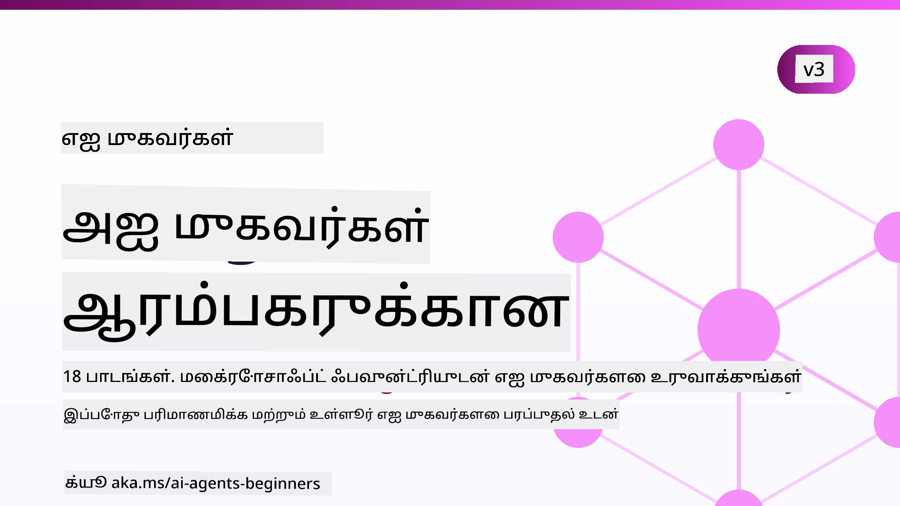

# துவக்கத்துக்கான AI முகவரிகள் - ஒரு பாடக்கூடு



## AI முகவரிகளை கட்டுமானம் செய்யத் துவங்க தேவையான எல்லாவற்றையும் கற்பிக்கும் ஒரு பாடக்கூடு

[](https://github.com/microsoft/ai-agents-for-beginners/blob/master/LICENSE?WT.mc_id=academic-105485-koreyst)
[](https://GitHub.com/microsoft/ai-agents-for-beginners/graphs/contributors/?WT.mc_id=academic-105485-koreyst)
[](https://GitHub.com/microsoft/ai-agents-for-beginners/issues/?WT.mc_id=academic-105485-koreyst)
[](https://GitHub.com/microsoft/ai-agents-for-beginners/pulls/?WT.mc_id=academic-105485-koreyst)
[](http://makeapullrequest.com?WT.mc_id=academic-105485-koreyst)

### 🌐 பல்மொழி ஆதரவு

#### [Co-op Translator](https://github.com/Azure/co-op-translator) மூலம் பராமரிக்கப்படும் மொழிபெயர்ப்புகள்

<!-- CO-OP TRANSLATOR LANGUAGES TABLE START -->
[அரபு](../ar/README.md) | [பெங்காலி](../bn/README.md) | [பல்கேரியன்](../bg/README.md) | [புர்மீஸ் (மியான்மர்)](../my/README.md) | [அஞ்சலீஸ்சீ (எளிமையானது)](../zh-CN/README.md) | [அஞ்சலீஸ்சீ (சாம்பியன், ஹாங்காங்)](../zh-HK/README.md) | [அஞ்சலீஸ்சீ (சாம்பியன், மாகாவ்)](../zh-MO/README.md) | [அஞ்சலீஸ்சீ (சாம்பியன், தைவான்)](../zh-TW/README.md) | [குரோஷியன்](../hr/README.md) | [செக்](../cs/README.md) | [டேனிஷ்](../da/README.md) | [டச்சு](../nl/README.md) | [எஸ்டோனியன்](../et/README.md) | [பின்னிஷ்](../fi/README.md) | [பிரஞ்சு](../fr/README.md) | [ஜெர்மன்](../de/README.md) | [கிரேக்கம்](../el/README.md) | [எபிரூ](../he/README.md) | [இந்தி](../hi/README.md) | [ஹங்கேரியன்](../hu/README.md) | [இந்தோனீஷியன்](../id/README.md) | [இத்தாலியன்](../it/README.md) | [ஜப்பானியன்](../ja/README.md) | [கன்னடம்](../kn/README.md) | [க்மர்](../km/README.md) | [கொரியன்](../ko/README.md) | [லிதுவேனியன்](../lt/README.md) | [மலாய்](../ms/README.md) | [மலையாளம்](../ml/README.md) | [மணிப்புரி (மெய்தி மயெக்)](../mni/README.md) | [மராத்தி](../mr/README.md) | [நேபாளி](../ne/README.md) | [நைஜீரியன் பிகின்](../pcm/README.md) | [நார்வேஜியன்](../no/README.md) | [பேர்சியன் (பார்சி)](../fa/README.md) | [போலிஷ்](../pl/README.md) | [போர்ச்சுகீஸ் (பிரேசில்)](../pt-BR/README.md) | [போர்ச்சுகீஸ் (போர்ச்சுகல்)](../pt-PT/README.md) | [பஞ்சாபி (குர்முகி)](../pa/README.md) | [ரோமானியன்](../ro/README.md) | [ரஷ்யன்](../ru/README.md) | [செர்பியன் (சிரிலிக்)](../sr/README.md) | [ஸ்லோவாக்](../sk/README.md) | [ஸ்லோவேனியன்](../sl/README.md) | [ஸ்பானிஷ்](../es/README.md) | [ஸுவாஹிலி](../sw/README.md) | [ஸ்வீடிஷ்](../sv/README.md) | [தகாலோக் (ஃபிலிபினோ)](../tl/README.md) | [தமிழ்](./README.md) | [தெலுங்கு](../te/README.md) | [தை](../th/README.md) | [துருக்கிய](../tr/README.md) | [உக்ரைனியன்](../uk/README.md) | [உர்து](../ur/README.md) | [வியட்நாமீஸ்](../vi/README.md)

> **உள்ளூரில் கிளோன் செய்ய விரும்புகிறீர்களா?**
>
> இந்த ரெப்போசிடரி 50+ மொழி மொழிபெயர்ப்புகளை கொண்டுள்ளது, இது பதிவிறக்கமான அளவை பெரிதாக அதிகரிக்கிறது. மொழிபெயர்ப்புகள் இல்லாமல் கிளோன் செய்ய, ஸ்பெர்ஸ் சேகரிப்பை பயன்படுத்துங்கள்:
>
> **Bash / macOS / Linux:**
> ```bash
> git clone --filter=blob:none --sparse https://github.com/microsoft/ai-agents-for-beginners.git
> cd ai-agents-for-beginners
> git sparse-checkout set --no-cone '/*' '!translations' '!translated_images'
> ```
>
> **CMD (Windows):**
> ```cmd
> git clone --filter=blob:none --sparse https://github.com/microsoft/ai-agents-for-beginners.git
> cd ai-agents-for-beginners
> git sparse-checkout set --no-cone "/*" "!translations" "!translated_images"
> ```
>
> இவ்வாறு நீங்கள் பாடத்திட்டத்தை முடிக்க தேவையான அனைத்தையும் much வேகமான பதிவிறக்கத்துடன் பெறுவீர்கள்.
<!-- CO-OP TRANSLATOR LANGUAGES TABLE END -->

**மேலும் மொழி விருப்பங்களுக்கு, [Co-op Translator's supported languages](https://github.com/Azure/co-op-translator/blob/main/docs/supported-languages.md) பார்க்கவும்.**

[](https://GitHub.com/microsoft/ai-agents-for-beginners/watchers/?WT.mc_id=academic-105485-koreyst)
[](https://GitHub.com/microsoft/ai-agents-for-beginners/network/?WT.mc_id=academic-105485-koreyst)
[](https://GitHub.com/microsoft/ai-agents-for-beginners/stargazers/?WT.mc_id=academic-105485-koreyst)

[](https://discord.com/invite/ATgtXmAS5D)


## 🌱 துவக்கம்

இந்த பாடத்திட்டத்தில் AI முகவரிகள் கட்டுமானத்தின் அடிப்படைகளை உள்ளடக்கிய பாடங்கள் உள்ளன. ஒவ்வொரு பாடமும் தனிப்பட்ட தலைப்பை கையாள்கிறது, ஆகவே உங்கள் விருப்பப்படி எங்கு வேண்டுமானாலும் துவங்குங்கள்!

இந்த பாடத்திட்டத்திற்கு பல்மொழி ஆதரவு உள்ளது. எங்கள் [இங்கு கிடைக்கும் மொழிகள்](#-multi-language-support) காணவும்.

இது உங்கள் முதல் முறையாக உருவாக்கும் Generative AI மாதிரிகள் கட்டுமானமாக இருந்தால், எங்கள் [துவக்கத்துக்கான Generative AI](https://aka.ms/genai-beginners) பாடத்திட்டத்தை பார்க்கவும், இதில் GenAI கொண்டு கட்டுமானம் செய்வது குறித்த 21 பாடங்கள் உள்ளன.

இந்த ரெப்போவை [நட்சத்திரம் (🌟) செய்ய மறக்காமல்](https://docs.github.com/en/get-started/exploring-projects-on-github/saving-repositories-with-stars?WT.mc_id=academic-105485-koreyst) மற்றும் [கிளோன் செய்யவும்](https://github.com/microsoft/ai-agents-for-beginners/fork), குறியீட்டை இயக்க.

### மற்ற கற்றித்தலைவர்களை சந்திக்கவும், உங்கள் கேள்விகளுக்கு பதில் பெறவும்

நீங்கள் திண்டாட்டமாக இருந்தால் அல்லது AI முகவரிகள் பற்றிய கேள்விகள் இருந்தால், எங்கள் [Microsoft Foundry Discord](https://aka.ms/ai-agents/discord) என்பதில் உள்ள நியமிக்கப்பட்ட Discord சேனலில் சேர்ந்திடவும்.

### தேவையானவை

இந்த பாடத்திட்டத்தின் ஒவ்வொரு பாடத்திலும் குறியீட்டு எடுத்துக்காட்டுகள் உள்ளன, அவை code_samples என்ற கோப்புறையில் உள்ளன. நீங்கள் [இந்த ரெப்போவை கிளோன் செய்யலாம்](https://github.com/microsoft/ai-agents-for-beginners/fork) உங்கள் சொந்த көшியை உருவாக்க.

இந்த பயிற்சி குறியீட்டு எடுத்துக்காட்டுகளில் Microsoft Agent Framework மற்றும் Microsoft Foundry Agent Service V2 உபயோகிக்கப்படுகிறது:

- [Microsoft Foundry](https://aka.ms/ai-agents-beginners/ai-foundry) - Azure கணக்கு தேவை

இந்த பாடத்திட்டத்தில் Microsoft வழங்கும் பின்வரும் AI முகவர் கட்டமைப்புகளும் சேவைகளும் பயன்படுத்தப்படுகின்றன:

- [Microsoft Agent Framework (MAF)](https://learn.microsoft.com/agent-framework/overview/)
- [Microsoft Foundry Agent Service V2](https://aka.ms/ai-agents-beginners/ai-agent-service)

சில குறியீட்டு எடுத்துக்காட்டுகள் OpenAI-போன்ற பிரதிநிதிகளான [MiniMax](https://platform.minimaxi.com/) போன்ற மாற்று வழங்குநர்களையும் ஆதரிக்கின்றன, இது பெரிய உள்ளடக்க மாதிரிகள் (204K டோகன்களுக்குப் புறம்பாக) வழங்குகிறது. கட்டமைப்பு விவரங்களுக்கு [பாடத்திட்ட அமைப்பு](./00-course-setup/README.md) பார்க்கவும்.

இந்த பாடத்திட்ட குறியீட்டை இயக்குவதற்கான மேலதிகத் தகவலுக்கு, [பாடத்திட்ட அமைப்பு](./00-course-setup/README.md) பார்க்கவும்.

## 🙏 உதவ விரும்புகிறீர்களா?

பரிந்துரைகள் உள்ளதா அல்லது எழுத்துப்பிழைகள் அல்லது குறியீட்டு பிழைகள் கண்டுபிடித்தீர்களா? [ஒரு பிரச்சினையை எழுப்பவும்](https://github.com/microsoft/ai-agents-for-beginners/issues?WT.mc_id=academic-105485-koreyst) அல்லது [ஒரு புல் கோரிக்கையை உருவாக்கவும்](https://github.com/microsoft/ai-agents-for-beginners/pulls?WT.mc_id=academic-105485-koreyst)


## 📂 ஒவ்வொரு பாடத்திலும் உள்ளது

- README இல் உள்ள எழுத்துப் பாடம் மற்றும் ஒரு குறுகிய வீடியோ
- Microsoft Agent Framework மற்றும் Microsoft Foundry பயன்படுத்தி பைதான் குறியீட்டுத் எடுத்துக்காட்டுகள்
- தொடர்ந்து கற்றுக்கொள்ள அதிக வன்கோல்கள்


## 🗃️ பாடங்கள்

| **பாடம்**                                   | **எழுத்து மற்றும் குறியீடு**                                    | **வீடியோ**                                                  | **மேலும் கற்றல்**                                                                     |
|----------------------------------------------|----------------------------------------------------|------------------------------------------------------------|----------------------------------------------------------------------------------------|
| AI முகவரிகளுக்கான அறிமுகம் மற்றும் முகவர் பயன்பாடுகள்       | [இணைப்பு](./01-intro-to-ai-agents/README.md)          | [வீடியோ](https://youtu.be/3zgm60bXmQk?si=z8QygFvYQv-9WtO1)  | [இணைப்பு](https://aka.ms/ai-agents-beginners/collection?WT.mc_id=academic-105485-koreyst) |
| AI முகவர் கட்டமைப்புகளை ஆராய்தல்              | [இணைப்பு](./02-explore-agentic-frameworks/README.md)  | [வீடியோ](https://youtu.be/ODwF-EZo_O8?si=Vawth4hzVaHv-u0H)  | [இணைப்பு](https://aka.ms/ai-agents-beginners/collection?WT.mc_id=academic-105485-koreyst) |
| AI முகவர் வடிவமைப்பு மாதிரிகளை புரிந்துகொள்வது     | [இணைப்பு](./03-agentic-design-patterns/README.md)     | [வீடியோ](https://youtu.be/m9lM8qqoOEA?si=BIzHwzstTPL8o9GF)  | [இணைப்பு](https://aka.ms/ai-agents-beginners/collection?WT.mc_id=academic-105485-koreyst) |
| கருவி பயன்பாட்டு வடிவமைப்பு மாதிரி                      | [இணைப்பு](./04-tool-use/README.md)                    | [வீடியோ](https://youtu.be/vieRiPRx-gI?si=2z6O2Xu2cu_Jz46N)  | [இணைப்பு](https://aka.ms/ai-agents-beginners/collection?WT.mc_id=academic-105485-koreyst) |
| முகவர் RAG                                  | [இணைப்பு](./05-agentic-rag/README.md)                 | [வீடியோ](https://youtu.be/WcjAARvdL7I?si=gKPWsQpKiIlDH9A3)  | [இணைப்பு](https://aka.ms/ai-agents-beginners/collection?WT.mc_id=academic-105485-koreyst) |
| நம்பகத்தன்மையுள்ள AI முகவரிகளை கட்டிடம் செய்கிறது               | [இணைப்பு](./06-building-trustworthy-agents/README.md) | [வீடியோ](https://youtu.be/iZKkMEGBCUQ?si=jZjpiMnGFOE9L8OK ) | [இணைப்பு](https://aka.ms/ai-agents-beginners/collection?WT.mc_id=academic-105485-koreyst) |
| திட்டமிடல் வடிவமைப்பு மாதிரி                      | [இணைப்பு](./07-planning-design/README.md)             | [வீடியோ](https://youtu.be/kPfJ2BrBCMY?si=6SC_iv_E5-mzucnC)  | [இணைப்பு](https://aka.ms/ai-agents-beginners/collection?WT.mc_id=academic-105485-koreyst) |
| பல முகவர் வடிவமைப்பு மாதிரி                   | [இணைப்பு](./08-multi-agent/README.md)                 | [வீடியோ](https://youtu.be/V6HpE9hZEx0?si=rMgDhEu7wXo2uo6g)  | [இணைப்பு](https://aka.ms/ai-agents-beginners/collection?WT.mc_id=academic-105485-koreyst) |
| மேட்டகொக்னிஷன் வடிவமைப்பு மாதிரி                 | [இணைப்பு](./09-metacognition/README.md)               | [வீடியோ](https://youtu.be/His9R6gw6Ec?si=8gck6vvdSNCt6OcF)  | [இணைப்பு](https://aka.ms/ai-agents-beginners/collection?WT.mc_id=academic-105485-koreyst) |
| உற்பத்தியில் AI முகவர்கள்                      | [இணைப்பு](./10-ai-agents-production/README.md)        | [வீடியோ](https://youtu.be/l4TP6IyJxmQ?si=31dnhexRo6yLRJDl)  | [இணைப்பு](https://aka.ms/ai-agents-beginners/collection?WT.mc_id=academic-105485-koreyst) |
| முகவர்களின் உயிரின் நடைமுறைகள் (MCP, A2A மற்றும் NLWeb) பயன்படுத்தல் | [இணைப்பு](./11-agentic-protocols/README.md)           | [வீடியோ](https://youtu.be/X-Dh9R3Opn8)                                 | [இணைப்பு](https://aka.ms/ai-agents-beginners/collection?WT.mc_id=academic-105485-koreyst) |
| AI முகவரிகள் கானும் சூழ்நிலை பொறியியல்            | [இணைப்பு](./12-context-engineering/README.md)         | [வீடியோ](https://youtu.be/F5zqRV7gEag)                                 | [இணைப்பு](https://aka.ms/ai-agents-beginners/collection?WT.mc_id=academic-105485-koreyst) |
| முகவர் நினைவக மேலாண்மை                      | [இணைப்பு](./13-agent-memory/README.md)     |      [வீடியோ](https://youtu.be/QrYbHesIxpw?si=vZkVwKrQ4ieCcIPx)                                                      |                                                                                        |
| Microsoft Agent Framework ஆராய்தல்                         | [இணைப்பு](./14-microsoft-agent-framework/README.md)                            |                                                            |                                                                                        |
| கணினி பயன்பாட்டு முகவரிகளை கட்டுதல் (CUA)           | [இணைப்பு](./15-browser-use/README.md)     |                                                            | [இணைப்பு](https://docs.browser-use.com/examples/templates/playwright-integration)         |
| விரிவாக்கக்கூடிய முகவர்களை ஒப்படைப்பு                    | [இணைப்பு](./16-deploying-scalable-agents/README.md) |                                                    | [இணைப்பு](https://learn.microsoft.com/azure/ai-foundry/agents/overview)                   |
| உள்ளூர் AI முகவரிகளை உருவாக்குதல்                     | [இணைப்பு](./17-creating-local-ai-agents/README.md)  |                                                    | [இணைப்பு](https://learn.microsoft.com/azure/ai-foundry/foundry-local/)                    |
| AI முகவரிகளை பாதுகாப்பது                           | [இணைப்பு](./18-securing-ai-agents/README.md)  |                                                            | [இணைப்பு](https://aka.ms/ai-agents-beginners/collection?WT.mc_id=academic-105485-koreyst) |

## 🎒 பிற பாடத்திட்டங்கள்

எங்கள் குழு பிற பாடத்திட்டங்களையும் தயாரிக்கிறது! பார்க்கவும்:

<!-- CO-OP TRANSLATOR OTHER COURSES START -->
### LangChain
[](https://aka.ms/langchain4j-for-beginners)
[](https://aka.ms/langchainjs-for-beginners?WT.mc_id=m365-94501-dwahlin)
[](https://github.com/microsoft/langchain-for-beginners?WT.mc_id=m365-94501-dwahlin)
---

### Azure / Edge / MCP / முகவர்கள்
[](https://github.com/microsoft/AZD-for-beginners?WT.mc_id=academic-105485-koreyst)
[](https://github.com/microsoft/edgeai-for-beginners?WT.mc_id=academic-105485-koreyst)
[](https://github.com/microsoft/mcp-for-beginners?WT.mc_id=academic-105485-koreyst)
[](https://github.com/microsoft/ai-agents-for-beginners?WT.mc_id=academic-105485-koreyst)

---
 
### உருவாக்கும் AI தொடர்ச்சி
[](https://github.com/microsoft/generative-ai-for-beginners?WT.mc_id=academic-105485-koreyst)
[-9333EA?style=for-the-badge&labelColor=E5E7EB&color=9333EA)](https://github.com/microsoft/Generative-AI-for-beginners-dotnet?WT.mc_id=academic-105485-koreyst)
[-C084FC?style=for-the-badge&labelColor=E5E7EB&color=C084FC)](https://github.com/microsoft/generative-ai-for-beginners-java?WT.mc_id=academic-105485-koreyst)
[-E879F9?style=for-the-badge&labelColor=E5E7EB&color=E879F9)](https://github.com/microsoft/generative-ai-with-javascript?WT.mc_id=academic-105485-koreyst)

---
 
### மையக் கற்றல்
[](https://aka.ms/ml-beginners?WT.mc_id=academic-105485-koreyst)
[](https://aka.ms/datascience-beginners?WT.mc_id=academic-105485-koreyst)
[](https://aka.ms/ai-beginners?WT.mc_id=academic-105485-koreyst)
[](https://github.com/microsoft/Security-101?WT.mc_id=academic-96948-sayoung)
[](https://aka.ms/webdev-beginners?WT.mc_id=academic-105485-koreyst)
[](https://aka.ms/iot-beginners?WT.mc_id=academic-105485-koreyst)
[](https://github.com/microsoft/xr-development-for-beginners?WT.mc_id=academic-105485-koreyst)

---
 
### கோபைலட் தொடர்
[](https://aka.ms/GitHubCopilotAI?WT.mc_id=academic-105485-koreyst)
[](https://github.com/microsoft/mastering-github-copilot-for-dotnet-csharp-developers?WT.mc_id=academic-105485-koreyst)
[](https://github.com/microsoft/CopilotAdventures?WT.mc_id=academic-105485-koreyst)
<!-- CO-OP TRANSLATOR OTHER COURSES END -->

## 🌟 சமூகவிற்கு நன்றி

மேம்படுத்தலில் முக்கிய Kod சாம்பிள்களை வழங்கிய [ஷிவம் கோயல்](https://www.linkedin.com/in/shivam2003/) அவர்களுக்கு நன்றி. 

## பங்களிப்பு

இந்தத் திட்டம் பங்களிப்புகளையும் பரிந்துரைகளையும் வரவேற்கிறது. பெரும்பாலான பங்களிப்புகள் நீங்கள் ஒப்புக்கொள்ள வேண்டிய
பங்களிப்பு உரிமம் ஒப்பந்தத்துக்கு (CLA) உங்களை உடன்படச் செய்வதைக் கோருகின்றன, இது நீங்கள் உங்கள் பங்களிப்பை பயன்படுத்த உரிமை
கொண்டிருக்கிறீர்கள் என்றும் நிச்சயமாக வழங்குகிறீர்கள் என்றும் அறிவித்தல் ஆகும். விவரங்களுக்கு <https://cla.opensource.microsoft.com> பார்க்கவும்.

புல் கோரிக்கையை சமர்ப்பித்தவுடன், ஒரு CLA பாட்டெரால் நீங்கள் CLA தர வேண்டும் எனத் தானாக தீர்மானித்து,
சிபார்சுகளை சரியாக அலங்கரிக்கும் (எ.கா., நிலை சரிபார்ப்பு, கருத்து). பாட்டரால் வழங்கப்படும் அறிவுறுத்தல்களை பின்பற்றவும்.
அனைத்து ரெப்போக்களிலும் நீங்கள் ஒருமுறை மட்டுமே இதை செய்ய வேண்டியிருக்கும்.

இந்தத் திட்டம் [Microsoft Open Source Code of Conduct](https://opensource.microsoft.com/codeofconduct/) ஐ ஏற்றுக்கொண்டது.
மேலதிக தகவலுக்குத் [Code of Conduct FAQ](https://opensource.microsoft.com/codeofconduct/faq/) காணவும் அல்லது
[opencode@microsoft.com](mailto:opencode@microsoft.com) தொடர்பு கொண்டு கேள்விகள் அல்லது கருத்துக்கள் தெரிவிக்கவும்.

## வர்த்தகமூலம் அங்கீகாரம்

இந்தத் திட்டத்தில் திட்டங்கள், தயாரிப்புகள் அல்லது சேவைகளுக்கான வர்த்தகமூலம் அல்லது லோகோக்கள் இருக்கலாம். Microsoft
வர்த்தகமூலம் அல்லது லோகோக்களின் அங்கீகாரம் மற்றும் பயன்பாடு
[Microsoft's Trademark & Brand Guidelines](https://www.microsoft.com/legal/intellectualproperty/trademarks/usage/general) உடன் இணங்க இருக்க வேண்டும்.
இந்தத் திட்டத்தின் மாற்றப்பட்ட பதிப்புகளில் Microsoft வர்த்தகமூலம் அல்லது லோகோக்களைப் பயன்படுத்துதல் குழப்பத்தை ஏற்படுத்தக் கூடாது அல்லது Microsoft பங்களிப்பை குறிக்கக்கூடாது.
மூன்றாம் தரப்பட்டவர்களின் வர்த்தகமூலம் அல்லது லோகோக்கள் பயன்படுத்தல் அவர்களது விதிமுறைகளின் கீழே இருக்க வேண்டும்.

## உதவி பெறுதல்


AI செயலிகள் கட்டுமானத்தில் சிக்கலில் இருப்பினும் அல்லது கேள்விகள் இருந்தால், இணைக:

[](https://aka.ms/foundry/discord)

உங்களுக்கு தயாரிப்பு கருத்துக்கள் அல்லது கட்டுமானத்தில் பிழைகள் இருந்தால் பார்வையிடுங்கள்:

[](https://aka.ms/foundry/forum)

---

<!-- CO-OP TRANSLATOR DISCLAIMER START -->
**மறுப்பு**:
இந்த ஆவணம் AI மொழிபெயர்ப்பு சேவை [Co-op Translator](https://github.com/Azure/co-op-translator) பயன்படுத்தி மொழிபெயர்க்கப்பட்டுள்ளது. நாங்கள் துல்லியத்திற்காக முயற்சி செய்துள்ளோம், ஆனால் தானாக செய்யப்படும் மொழிபெயர்ப்புகளில் பிழைகள் அல்லது தவறுகள் இருக்கலாம் என்பதை கவனத்தில் கொள்ளவும். அசல் ஆவணம் அதன் தாய்மொழியில் அதிகாரப்பூர்வ ஆதாரமாக கருதப்பட வேண்டும். முக்கியமான தகவல்களுக்கு, தொழில்நுட்பமான மனித மொழிபெயர்ப்பு பரிந்துரைக்கப்படுகிறது. இந்த மொழிபெயர்ப்பைப் பயன்படுத்துவதால் ஏற்படும் எந்த தவறான புரிதல்கள் அல்லது தவறான விளக்கத்திற்கும் நாங்கள் பொறுப்பில்வில்லை.
<!-- CO-OP TRANSLATOR DISCLAIMER END -->