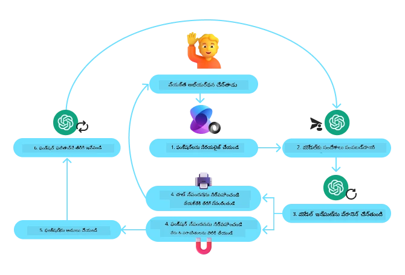
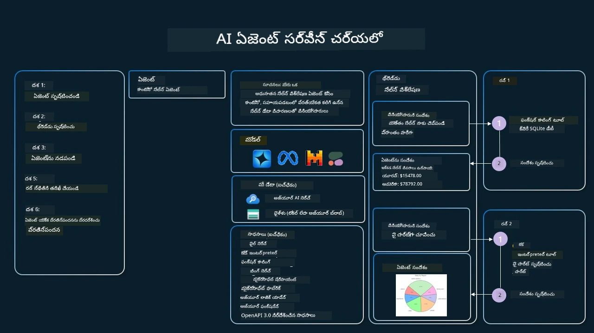

[](https://youtu.be/vieRiPRx-gI?si=cEZ8ApnT6Sus9rhn)

> _(ఈ పాఠం యొక్క వీడియోను చూడటానికి పై చిత్రం క్లిక్ చేయండి)_

# టూల్ వినియోగ డిజైన్ ప్యాటర్న్

టూల్స్ ఆసక్తికరమైనవి ఎందుకంటే అవి AI ఏజెంట్లు విస్తృత శ్రేణి సామర్థ్యాలను పొందగలుగుతాయి. ఏజెంట్ పనులు చేసే చర్యల యొక్క పరిమిత సమాహారం ఉండటం కంటే, టూల్ చేర్చడం ద్వారా, ఏజెంట్లు ఇప్పుడు విస్తృత శ్రేణి చర్యలను పెర్ఫార్మ్ చేయగలుగుతాయి. ఈ అధ్యాయంలో, మేము టూల్ వినియోగ డిజైన్ ప్యాటర్న్‌ని వెతుకుతాము, ఇది AI ఏజెంట్లు తమ లక్ష్యాలను చేరుకోవడానికి నిర్దిష్ట టూల్స్‌ని ఎలా ఉపయోగించవచ్చో వివరిస్తుంది.

## పరిచయం

ఈ పాఠంలో మేము క్రింది ప్రశ్నలకు సమాధానం ఇవ్వాలని చూస్తున్నాము:

- టూల్ వినియోగ డిజైన్ ప్యాటర్న్ అంటే ఏమిటి?
- ఇది ఉపయోగించగల వినియోగాలు ఏవేమిటి?
- డిజైన్ ప్యాటర్న్ అమలు చేయడానికి కావాల్సిన అంశాలు/బిల్డింగ్ బ్లాక్స్ ఏమిటి?
- నమ్మకమైన AI ఏజెంట్లను నిర్మించడానికి టూల్ వినియోగ డిజైన్ ప్యాటర్న్ ఉపయోగించే ప్రత్యేక పరి�శీలనలు ఏమిటి?

## నేర్చుకునే లక్ష్యాలు

ఈ పాఠాన్ని పూర్తి చేసిన తర్వాత, మీరు చేయగలుగుతారు:

- టూల్ వినియోగ డిజైన్ ప్యాటర్న్ మరియు దాని ఉద్దేశ్యాన్ని నిర్వచించగలగడం.
- టూల్ వినియోగ డిజైన్ ప్యాటర్న్ వర్తించగల వినియోగాలను గుర్తించగలుగుట.
- డిజైన్ ప్యాటర్న్ అమలు చేయడానికి అవసరమైన ముఖ్యమైన అంశాలను అర్థం చేసుకోవడం.
- ఈ డిజైన్ ప్యాటర్న్ ఉపయోగించి నమ్మకమైన AI ఏజెంట్లను సృష్టించడంలో పరి�శీలనలు గుర్తించగలగడం.

## టూల్ వినియోగ డిజైన్ ప్యాటర్న్ అంటే ఏమిటి?

**టూల్ వినియోగ డిజైన్ ప్యాటర్న్** LLMలకు నిర్దిష్ట లక్ష్యాలను సాధించడానికి బయటి టూల్స్‌తో అనుసంధానం చేయగల సామర్థ్యాన్ని ఇస్తుంది. టూల్స్ అంటే ఏజెంట్ కూడగట్టుకొని ఆధారంగా చర్యలను చేయగల కోడు. ఒక టూల్ సాదారణ ఫంక్షన్ (ఉదాహరణకు కాలిక్యులేటర్) లేదా స్టాక్ ధరలు చూస్తున్నట్లు, వాతావరణ సమాచారం వంటి మూడవ పార్టీ సేవలకు API కాల్ అయి ఉండవచ్చు. AI ఏజెంట్ల సందర్భంలో, టూల్స్ LLMs తయారు చేసిన ఫంక్షన్ కాల్స్‌కు స్పందనగా ఏజెంట్లు అమలు చేయడానికి రూపొందించబడ్డాయి.

## ఇది ఉపయోగించగల వినియోగాలు ఏవేమిటి?

AI ఏజెంట్లు క్లిష్ట పనులను పూర్తి చేయడానికి, సమాచారం పొందడానికి లేదా నిర్ణయాలు తీసుకోవడానికి టూల్స్ ఉపయోగించగలరు. టూల్ వినియోగ డిజైన్ ప్యాటర్న్ ప్రధానంగా బయటి వ్యవస్థలతో డైనమిక్ ఇంటరాక్షన్ అవసరమయ్యే సందర్భాలలో, ఉదా: డేటాబేసులు, వెబ్ సర్వీసులు లేదా కోడ్ ఇంటర్ప్రెటర్లతో ఉపయోగిస్తారు. ఇది క్రింది వినియోగాలకు ఉపయోగపడుతుంది:

- **డైనమిక్ సమాచారం పొందడం:** ఏజెంట్లు బయటి APIs లేదా డేటాబేసులను ప్రశ్నించి తాజా డేటాను పొందగలరు (ఉదా: SQLite డేటాబేసును డేటా విశ్లేషణ కోసం ప్రశ్నించడం, స్టాక్ ధరలు లేదా వాతావరణ సమాచారం పొందడం).
- **కోడ్ అమలు మరియు వివరణ:** ఏజెంట్లు గణిత సమస్యలు పరిష్కరించడానికి, నివేదికలు తయారు చేసేందుకు లేదా సిమ్యులేషన్లు చేయడానికి కోడ్ లేదా స్క్రిప్ట్లను అమలు చేయగలరు.
- **వర్క్‌ఫ్లో ఆటోమేషన్:** పని పునరావృత లేదా బహుళ దశల వర్క్‌ఫ్లోలను ఆటోమేట్ చేయడానికి టాస్క్ షెడ్యూలర్లు, ఇమెయిల్ సర్వీసులు లేదా డేటా పైప్‌లైన్లను ఇంటిగ్రేట్ చేయడం.
- **కస్టమర్ సపోర్ట్:** ఏజెంట్లు CRM సిస్టమ్స్, టికెటింగ్ ప్లాట్‌ఫార్మ్స్ లేదా నోलेज్భేస్‌లతో ఇంటరాక్ట్ చేసి వినియోగదారుల ప్రశ్నలను పరిష్కరించగలరు.
- **కంటెంట్ సృష్టి మరియు ఎడిటింగ్:** ఏజెంట్లు గ్రీమర్ర్ చెకర్లు, టెక్స్ట్ సమ్మరైజర్లు లేదా కంటెంట్ సేఫ్‌టీ మూల్యాంకకాలను ఉపయోగించి కంటెంట్ సృష్టి పనులను సాయపడగలరు.

## టూల్ వినియోగ డిజైన్ ప్యాటర్న్ అమలు కోసం కావాల్సిన అంశాలు/బిల్డింగ్ బ్లాక్స్ ఏమిటి?

ఈ బిల్డింగ్ బ్లాక్స్ AI ఏజెంట్లు విస్తృత రకాల పనులను చేయగలుగుతాయిం. టూల్ వినియోగ డిజైన్ ప్యాటర్న్ అమలు చేయడానికి కావలసిన ప్రధాన అంశాలను చూద్దాం:

- **ఫంక్షన్/టూల్ స్కీమాస్:** అందుబాటు టూల్స్ యొక్క వివరమైన నిర్వచనాలు, ఫంక్షన్ పేరు, ఉద్దేశ్యం, అవసరమైన పారామీటర్లు, మరియు అవకాశ్య ఉత్పత్తులు. ఈ స్కీమాలు LLMకి అందుబాటులో ఉన్న టూల్స్ ఏమిటి మరియు ఎలా చెల్లుబాటు చేసే అభ్యర్థనలు రూపొందించాలి అనేది అర్థం చేసుకోవడంలో సహాయం చేస్తాయి.

- **ఫంక్షన్ అమల లాజిక్:** టూల్స్ ఎప్పుడు మరియు ఎలా వాడబడుతాయో యూజర్ ఉద్దేశ్యం మరియు సంభాషణ సందర్భం ఆధారంగా నియంత్రిస్తుంది. ఇందులో ప్లానర్ మాడ్యూల్స్, రూటింగ్ విధానాలు లేదా షరతులు ఆధారిత ప్రవాహాలు ఉండవచ్చు.

- **మెసేజ్ హాండ్లింగ్ సిస్టమ్:** వినియోగదారుల ఇన్‌పుట్లు, LLM ప్రతిస్పందనలు, టూల్ కాల్స్ మరియు అవుట్పుట్లు మధ్య సంభాషణ ప్రవాహం నిర్వహించే భాగాలు.

- **టూల్ ఇంటిగ్రేషన్ ఫ్రేమ్‌వర్క్:** ఏజెంట్ను విభిన్న టూల్స్‌తో కనెక్ట్ చేసే ఇన్‌ఫ్రాస్ట్రక్చర్, ఇవి సాదారణ ఫంక్షన్లు కావచ్చు లేదా కన్నికైన బయటి సర్వీసులు కావచ్చు.

- **లోపాలు నిర్వహణ మరియు ధ్రువీకరణ:** టూల్ అమలు వైఫల్యాలను నిర్వహించడం, పారామీటర్లను ధృవీకరించడం మరియు అప్రత్యాశిత ప్రతిస్పందనలను నిర్వహించే వ్యవస్థలు.

- **స్టేట్ మేనేజ్‌మెంట్:** సంభాషణ సందర్భం, మునుపటి టూల్ ఇంటరాక్షన్లు మరియు స్థిరమైన డేటాను ట్రాక్ చేయడం, బహుళ-టర్న్ ఇంటరాక్షన్లలో సారూప్యతను నిర్ధారించేందుకు.

తరువాత, ఫంక్షన్/టూల్ కాలింగ్ వివరంగా చూద్దాం.
 
### ఫంక్షన్/టూల్ కాలింగ్

ఫంక్షన్ కాలింగ్ LLMలు టూల్స్ తో అనుసంధానం సాధించడానికి ప్రధాన మార్గం. ఫంక్షన్స్ (పునఃఉపయోగించగల కోడ్ బ్లాక్లు) అనేవి ఏజెంట్లు పనులు చేయడానికి ఉపయోగించే టూల్స్ కావడంతో ఎక్కువగా 'ఫంక్షన్' మరియు 'టూల్' పదాలు పరస్పరం మార్చి ఉపయోగిస్తారు. ఫంక్షన్ కోడ్ అమలు కావాలంటే, LLM యూజర్ అభ్యర్థనను ఫంక్షన్ వివరణతో పోల్చాలి. అందుకు అందుబాటులో ఉన్న అన్ని ఫంక్షన్స్ వివరణలు ఉన్న స్కీమా LLMకి పంపబడుతుంది. LLM అటువంటివి పనికి సరిపడే ఫంక్షన్ ఎంచుకుని దాని పేరు, అర్గుమెంట్లను తిరిగి ఇస్తుంది. ఎంపిక చేసిన ఫంక్షన్ అమలవుతుంది, దాని ప్రతిస్పందన LLMకి పంపబడుతుంది, అది సమాచారాన్ని ఉపయోగించి యూజర్ అభ్యర్థనకు జవాబివ్వడానికి ఉపయోగిస్తుంది.

ఏజెంట్లకు ఫంక్షన్ కాలింగ్ అమలు చేయడానికి డెవలపర్లకు కావాల్సింది:

1. ఫంక్షన్ కాలింగ్ మద్దతు ఇస్తున్న LLM మోడల్
2. ఫంక్షన్ వివరణలు ఉన్న స్కీమా
3. ప్రతి ఫంక్షన్ కోసం కోడ్

నగరంలో ప్రస్తుత సమయాన్ని పొందే ఉదాహరణ తీసుకుందాం:

1. **ఫంక్షన్ కాలింగ్ మద్దతు చేసే LLMని ఆరంభించండి:**

    అన్ని మోడల్స్ ఫంక్షన్ కాలింగ్ మద్దతు ఇవ్వవు, కాబట్టి మీరు ఉపయోగిస్తున్న LLM మద్దతు ఉందో లేదో నిర్ధారించుకోండి. <a href="https://learn.microsoft.com/azure/ai-services/openai/how-to/function-calling" target="_blank">Azure OpenAI</a> ఫంక్షన్ కాలింగ్ మద్దతు ఇస్తుంది. మేము Azure OpenAI **Responses API** (స్థిరమైన `/openai/v1/` ఎండ్‌పాయింట్ — `api_version` అవసరం లేదు) మీద OpenAI క్లయింట్ ను ప్రారంభించవచ్చు.

    ```python
    # Initialize the OpenAI client for Azure OpenAI (Responses API, v1 endpoint)
    client = OpenAI(
        base_url=f"{os.environ['AZURE_OPENAI_ENDPOINT'].rstrip('/')}/openai/v1/",
        api_key=os.environ["AZURE_OPENAI_API_KEY"],
    )
    deployment_name = os.environ["AZURE_OPENAI_DEPLOYMENT"]
    ```

1. **ఫంక్షన్ స్కీమా సృష్టించండి**:

    తర్వాత ఫంక్షన్ పేరు, దాని పనిని వివరిస్తూ, ఫంక్షన్ పారామీటర్లు పేర్లు మరియు వివరణలు ఉన్న JSON స్కీమా నిర్వచిస్తాం.  
    ఆపై ఈ స్కీమాను మరియు యూజర్ అభ్యర్థనను క్లయింట్‌కు పంపి సాన్ ఫ్రాన్సిస్కోలో సమయాన్ని కనుగొంటాం. గమనించదగిన విషయం ఏమిటంటే ఫలితం **ప్రత్యుత్తరం కాదు, టూల్ కాల్ మాత్రమే**. LLM పని కోసం ఎంచుకున్న ఫంక్షన్ పేరు మరియు అర్గుమెంట్లు తిరిగి ఇస్తుంది.

    ```python
    # Function description for the model to read (Responses API flat tool format)
    tools = [
        {
            "type": "function",
            "name": "get_current_time",
            "description": "Get the current time in a given location",
            "parameters": {
                "type": "object",
                "properties": {
                    "location": {
                        "type": "string",
                        "description": "The city name, e.g. San Francisco",
                    },
                },
                "required": ["location"],
            },
        }
    ]
    ```
   
    ```python
  
    # Initial user message
    messages = [{"role": "user", "content": "What's the current time in San Francisco"}]

    # First API call: Ask the model to use the function
    response = client.responses.create(
        model=deployment_name,
        input=messages,
        tools=tools,
        tool_choice="auto",
        store=False,
    )

    # The Responses API returns tool calls as function_call items in response.output.
    # Append them to the conversation so the model has full context on the next turn.
    messages += response.output

    print("Model's response:")
    print(response.output)
  
    ```

    ```bash
    Model's response:
    [ResponseFunctionToolCall(arguments='{"location":"San Francisco"}', call_id='call_pOsKdUlqvdyttYB67MOj434b', name='get_current_time', type='function_call')]
    ```
  
1. **టాస్క్ చేయడానికి అవసరమైన ఫంక్షన్ కోడ్:**

    ఇప్పుడు LLM ఎంచుకున్న ఫంక్షన్ అమలు చేయడానికి కోడ్ అమలు చేసి, అంతిమ ఫలితాన్ని పొందడానికి response_message నుండి పేరు మరియు అర్గుమెంట్లను తీసుకోవాల్సి ఉంటుంది.
    ప్రస్తుత సమయం పొందడానికి Pythonలో కోడ్ అమలు చేయవచ్చు.

    ```python
      def get_current_time(location):
        """Get the current time for a given location"""
        print(f"get_current_time called with location: {location}")  
        location_lower = location.lower()
        
        for key, timezone in TIMEZONE_DATA.items():
            if key in location_lower:
                print(f"Timezone found for {key}")  
                current_time = datetime.now(ZoneInfo(timezone)).strftime("%I:%M %p")
                return json.dumps({
                    "location": location,
                    "current_time": current_time
                })
      
        print(f"No timezone data found for {location_lower}")  
        return json.dumps({"location": location, "current_time": "unknown"})
    ```

     ```python
    # Handle function calls
    tool_calls = [item for item in response.output if item.type == "function_call"]
    if tool_calls:
        for tool_call in tool_calls:
            if tool_call.name == "get_current_time":

                function_args = json.loads(tool_call.arguments)

                time_response = get_current_time(
                    location=function_args.get("location")
                )

                # Return the tool result as a function_call_output item
                messages.append({
                    "type": "function_call_output",
                    "call_id": tool_call.call_id,
                    "output": time_response,
                })
    else:
        print("No tool calls were made by the model.")

    # Second API call: Get the final response from the model
    final_response = client.responses.create(
        model=deployment_name,
        input=messages,
        tools=tools,
        store=False,
    )

    return final_response.output_text
     ```

     ```bash
      get_current_time called with location: San Francisco
      Timezone found for san francisco
      The current time in San Francisco is 09:24 AM.
     ```

ఫంక్షన్ కాలింగ్ చాలా ఏజెంట్ టూల్ వినియోగ డిజైన్ యొక్క హృదయం, కానీ దీన్ని సున్నితంగా అమలు చేయడం కొద్దిగా సవాలు కావచ్చు.
[Lesson 2](../../../02-explore-agentic-frameworks)లొ నేర్చుకున్నట్టు agentic frameworks మాకు టూల్ వినియోగానికి మునుపటి బిల్డింగ్ బ్లాక్స్ ఇస్తాయి.
 
## Agentic Frameworks తో టూల్ వినియోగ ఉదాహరణలు

వివిధ agentic frameworks ఉపయోగించి టూల్ వినియోగ డిజైన్ ప్యాటర్న్ ఎలా అమలు చేయవచ్చో కింది ఉదాహరణలు ఉన్నాయి:

### Microsoft Agent Framework

<a href="https://learn.microsoft.com/azure/ai-services/agents/overview" target="_blank">Microsoft Agent Framework</a> AI ఏజెంట్లు నిర్మించడానికి ఓపెన్ స్ర్కోర్స్ ఫ్రేమ్‌వర్క్. ఇది ఫంక్షన్ కాలింగ్ ఉపయోగించడం సులభతరం చేస్తుంది, Python ఫంక్షన్స్‌ను టూల్స్ గా నిర్వచించడానికి `@tool` డెకరేటర్ ఉపయోగింపచేస్తుంది. ఫ్రేమ్‌వర్క్ మోడల్ మరియు మీ కోడ్ మధ్య కమ్యూనికేషన్ నిర్వహిస్తుంది. కూడా ఫైల్ సెర్చ్ మరియు కోడ్ ఇంటర్ప్రెటర్ వంటి మునుపటి టూల్‌లు `FoundryChatClient` ద్వారా అందుబాటులో ఉంచుతుంది.

క్రింది చిత్రం Microsoft Agent Framework లో ఫంక్షన్ కాలింగ్ ప్రక్రియను చూపిస్తుంది:



Microsoft Agent Framework లో టూల్స్ డెకరేటర్‌తో నిర్వచించే ఫంక్షన్స్. ముందు చూచిన `get_current_time` ఫంక్షన్‌ను `@tool` డెకరేటర్ ఉపయోగించి టూల్ గా మార్చవచ్చు. ఫ్రేమ్‌వర్క్ ఆటోమేటిక్‌గా ఫంక్షన్, పారామీటర్లను సీరియలైజ్ చేసి LLMకి పంపడానికి స్కీమా తయారు చేస్తుంది.

```python
import os
from agent_framework import tool
from agent_framework.foundry import FoundryChatClient
from azure.identity import AzureCliCredential

@tool(approval_mode="never_require")
def get_current_time(location: str) -> str:
    """Get the current time for a given location"""
    ...

# Create the client
provider = FoundryChatClient(
    project_endpoint=os.environ["AZURE_AI_PROJECT_ENDPOINT"],
    model=os.environ["AZURE_AI_MODEL_DEPLOYMENT_NAME"],
    credential=AzureCliCredential(),
)

# Create an agent and run with the tool
agent = provider.as_agent(name="TimeAgent", instructions="Use available tools to answer questions.", tools=get_current_time)
response = await agent.run("What time is it?")
```

#### MCP సర్వర్ నుండీ టూల్స్

టూల్స్ మీ స్వంత కోడ్ ఫంక్షన్స్ అయి ఉండకూడదు. Model Context Protocol (MCP, [Lesson 11](../11-agentic-protocols/README.md) లో చర్చించబడింది) మాట్లాడే సర్వర్ తన టూల్స్ మరియు వాటి స్కీమాలు ప్రచురిస్తుంటుంది, ఫ్రేమ్‌వర్క్ అవి డెకరేటెడ్ ఫంక్షన్ లాగా చదివి లోడ్ చేయగలదు. `MCPStreamableHTTPTool` HTTP ద్వారా ఇలాంటి సర్వర్‌తో కనెక్ట్ అయి, టూల్ స్కీమాలు చదివి, స్థానిక టూల్స్ పక్కన మోడల్ కోసం అందజేస్తుంది.

క్రింది ఉదాహరణలో <a href="https://keenable.ai" target="_blank">Keenable</a> హోస్ట్ చేసే వెబ్ సెర్చ్ సర్వర్ ఉపయోగించారు. ఖాతా లేదా API కీ లేకుండా ఉచితంగా వాడవచ్చు (అభ్యర్థనలు ఐపి ప్రకారం పరిమితం చేయబడతాయి), కాబట్టి మీరు అవసరమయ్యేది మీ మోడల్ క్రెడెన్షియల్స్ మాత్రమే. దూర టూల్‌ల లాగా, మోడల్ రాసిన ప్రశ్నలు ఆ సర్వర్‌కు పంపబడతాయి.

```python
from agent_framework import MCPStreamableHTTPTool

web_search = MCPStreamableHTTPTool(
    name="Keenable web search",
    url="https://api.keenable.ai/mcp",
)

# Connecting loads the server's tool schemas; the agent decides when to call them
async with web_search:
    agent = provider.as_agent(
        name="ResearchAgent",
        instructions="Use available tools to answer questions.",
        tools=[web_search],
    )
    response = await agent.run("What is new in the latest Python release?")
    print(response.text)
```

సర్వర్ రెండు టూల్స్, `search_web_pages` మరియు `fetch_page_content`ని ప్రచురిస్తుంది. ప్రస్తుత సమాచారం కోసం ప్రశ్న అవసరమైతే, మోడల్ `search_web_pages` ను కాల్ చేసి, శీర్షికలు, URLs మరియు టెక్స్ట్ స్నిపెట్స్ పొందుతుంది, అటువంటి మార్గంలో `get_current_time` ఉదాహరణలో ఉన్న లూప్ వంటి సమాధానాన్ని తయారు చేస్తుంది.
  
### Microsoft Foundry Agent Service

<a href="https://learn.microsoft.com/azure/ai-services/agents/overview" target="_blank">Microsoft Foundry Agent Service</a> అధునాతన agentic ఫ్రేమ్‌వర్క్, డెవలపర్లకు ఆపత్కాల సంఘటనలు, నిల్వ వనరులు నిర్వహించాల్సిన అవసరం లేకుండా నమ్మకమైన, విస్తరించదగిన AI ఏజెంట్లను సురక్షితంగా నిర్మించడానికి రూపొందించబడింది. ఇది ముఖ్యంగా సంస్థా అప్లికేషన్లకు ఉపయోగకరం ఎందుకంటే ఇది పూర్తిగా నిర్వహించబడే సర్వీస్ మరియు సంస్థా గ్రేడ్ భద్రతను అందిస్తుంది.

LLM APIతో గనక పోల్చితే, Microsoft Foundry Agent Service కొన్ని ప్రయోజనాల్ని అందిస్తుంది:

- ఆటోమేటిక్ టూల్ కాలింగ్ – టూల్ కాల్‌ను విడదీసి, టూల్‌ను సక్రియం చేసి, ప్రతిస్పందనను నిర్వహించడం అవసరం లేదు; ఇవన్నీ సర్వర్-సైడ్‌లో జరుగుతాయి
- సురక్షితంగా నిర్వహించబడిన డేటా – మీ స్వంత సంభాషణ స్థితిని నిర్వహించకుండా, థ్రెడ్‌లను ఆధారంగా ఉంచవచ్చు, అవసరమైన సమాచారాన్ని భద్రపరచుటకు
- ప్యాకేజీగా అందుబాటులో ఉన్న టూల్స్ – Bing, Azure AI Search, Azure Functions వంటి డేటా మూలాలకు ఇంటరాక్ట్ అయ్యే టూల్స్

Microsoft Foundry Agent Serviceలో అందుబాటులో ఉన్న టూల్స్ రెండు వర్గాలకు చెందుతాయి:

1. విజ్ఞాన టూల్స్:
    - <a href="https://learn.microsoft.com/azure/ai-services/agents/how-to/tools/bing-grounding?tabs=python&pivots=overview" target="_blank">Bing Search తో గ్రౌండింగ్</a>
    - <a href="https://learn.microsoft.com/azure/ai-services/agents/how-to/tools/file-search?tabs=python&pivots=overview" target="_blank">ఫైల్ సెర్చ్</a>
    - <a href="https://learn.microsoft.com/azure/ai-services/agents/how-to/tools/azure-ai-search?tabs=azurecli%2Cpython&pivots=overview-azure-ai-search" target="_blank">Azure AI Search</a>

2. చర్య టూల్స్:
    - <a href="https://learn.microsoft.com/azure/ai-services/agents/how-to/tools/function-calling?tabs=python&pivots=overview" target="_blank">ఫంక్షన్ కాలింగ్</a>
    - <a href="https://learn.microsoft.com/azure/ai-services/agents/how-to/tools/code-interpreter?tabs=python&pivots=overview" target="_blank">కోడ్ ఇంటర్ప్రెటర్</a>
    - <a href="https://learn.microsoft.com/azure/ai-services/agents/how-to/tools/openapi-spec?tabs=python&pivots=overview" target="_blank">OpenAPI నిర్వచించిన టూల్స్</a>
    - <a href="https://learn.microsoft.com/azure/ai-services/agents/how-to/tools/azure-functions?pivots=overview" target="_blank">Azure Functions</a>

ఏజెంట్ సర్వీస్ ఈ టూల్స్‌ను `toolset`గా ఉపయోగించగలమని అనుమతిస్తుంది. ఇది కూడా`threads`ను ఉపయోగిస్తుంది, ఇవి నిర్దిష్ట సంభాషణ నుండి సందేశాల చరిత్రను ట్రాక్ చేస్తాయి.

మీరు Contoso అనే సంస్థలోని సేల్స్ ఏజెంట్ అని ఊహించుకోండి. మీ సేల్స్ డేటాకు సంబంధించిన ప్రశ్నలు జవాబివ్వగల పరిచయ ఏజెంట్ అభివృద్ధి చేయాలనుకుంటున్నారు.

క్రింది చిత్రం Microsoft Foundry Agent Service ఉపయోగించి మీ సేల్స్ డేటాను విశ్లేషించే విధానాన్ని చూపిస్తుంది:



ఈ టూల్స్ ఏదైనా సర్వీస్‌తో ఉపయోగించాలంటే, క్లయింట్ సృష్టించి టూల్ లేదా టూల్‌సెట్ నిర్వచించవచ్చు. ప్రాయోగిక రీతిలో Python కోడ్ ఉపయోగించి దీన్ని అమలు చేయవచ్చు. LLM టూల్‌సెట్ చూసి యూజర్ తయారుచేసిన ఫంక్షన్, `fetch_sales_data_using_sqlite_query` లేదా ప్రీ-బిల్ట్ కోడ్ ఇంటర్ప్రెటర్‌ను యూజర్ అభ్యర్థన ఆధారంగా ఎంచుకుంటుంది.

```python 
import os
from azure.ai.projects import AIProjectClient
from azure.identity import DefaultAzureCredential
from fetch_sales_data_functions import fetch_sales_data_using_sqlite_query # fetch_sales_data_using_sqlite_query function which can be found in a fetch_sales_data_functions.py file.
from azure.ai.projects.models import ToolSet, FunctionTool, CodeInterpreterTool

project_client = AIProjectClient.from_connection_string(
    credential=DefaultAzureCredential(),
    conn_str=os.environ["PROJECT_CONNECTION_STRING"],
)

# Initialize toolset
toolset = ToolSet()

# Initialize function calling agent with the fetch_sales_data_using_sqlite_query function and adding it to the toolset
fetch_data_function = FunctionTool(fetch_sales_data_using_sqlite_query)
toolset.add(fetch_data_function)

# Initialize Code Interpreter tool and adding it to the toolset. 
code_interpreter = CodeInterpreterTool()toolset.add(code_interpreter)

agent = project_client.agents.create_agent(
    model="gpt-5-mini", name="my-agent", instructions="You are helpful agent", 
    toolset=toolset
)
```

## నమ్మకమైన AI ఏజెంట్లు సృష్టించడానికి టూల్ వినియోగ డిజైన్ ప్యాటర్న్ ఉపయోగానికి ప్రత్యేక పరి�శీలనలు ఏవీ?

LLMలచే డైనమిక్‌గా రూపొందించబడే SQL కి సాధారణంగా భద్రతతో సంబంధించిన ఆందోళన ఉంటుంది, ముఖ్యంగా SQL ఇంజెక్షన్ లేదా దుష్ట చర్యలు (డేటాబేస్‌ను డ్రాప్ చేయడం లేదా తేడాలు చేయడం) ప్రమాదం. ఇవి సరైన డేటాబేస్ అనుమతులతో సక్రమంగా నియంత్రించవచ్చు. ఎక్కువ డేటాబేస్‌ల కోసం ఈ నియంత్రణను రీడ్-ఒన్లీగా (SELECT) చేయడం అవసరం. PostgreSQL లేదా Azure SQL వంటి డేటాబేస్ సేవలకు, యాప్‌కు రీడ్-ఒన్లీ (SELECT) పాత్రను కేటాయించాలి.

యాప్ సురక్షిత వాతావరణంలో నడుపుట మరో రక్షణను పెంచుతుంది. సంస్థా సందర్భాలలో, డేటాను సాధారణంగా ఆపరేషనల్ వ్యవస్థల నుంచి రీడ్-ఒన్లీ డేటాబేస్ లేదా డేటా వేర్‌హౌస్‌కు ఎగుమతి చేసి, వినియోగంలో సానుకూలమైన స్కీమాతో మార్చుతారు. ఈ ప్రణాళిక డేటా సురక్షితం అయి, పనితనం మరియు ప్రాప్యతకు ఆప్టిమైజ్ ఉండాలని నిర్ధారిస్తుంది, యాప్‌కు పరిమితమై రీడ్-ఒన్లీ యాక్సెస్ మాత్రమే ఉంటుందిగా చేస్తుంది.

## నమూనా కోడ్లు

- Python: [Agent Framework](./code_samples/04-python-agent-framework.ipynb)
- .NET: [Agent Framework](./code_samples/04-dotnet-agent-framework.md)

## టూల్ వినియోగ డిజైన్ ప్యాటర్న్స్ గురించి మరిన్ని ప్రశ్నలున్నాయా?

మరొకరిద్దరి తో కలుసుకునేందుకు, ఆఫీస్ అవర్స్ లో పాల్గొనడానికి మరియు మీ AI ఏజెంట్ల ప్రశ్నలకు సమాధానాలు పొందటానికి [Microsoft Foundry Discord](https://discord.com/invite/ATgtXmAS5D) లో చేరండి.

## అదనపు వనరులు

- <a href="https://microsoft.github.io/build-your-first-agent-with-azure-ai-agent-service-workshop/" target="_blank">Azure AI ఏజెంట్ సర్వీస్ వర్క్‌షాప్</a>
- <a href="https://github.com/Azure-Samples/contoso-creative-writer/tree/main/docs/workshop" target="_blank">కాంటోసో క్రియేటివ్ రైటర్ మల్టీ-ఏజెంట్ వర్క్‌షాప్</a>
- <a href="https://learn.microsoft.com/azure/ai-services/agents/overview" target="_blank">మైక్రోసాఫ్ట్ ఏజెంట్ ఫ్రేమ్‌వర్క్ అవలోకనం</a>

## ఈ ఏజెంట్‌ను స్మోక్-టెస్టింగ్ చేయడం (ఐచ్ఛికం)

మీరు [పాఠం 16](../16-deploying-scalable-agents/README.md) లో ఏజెంట్లను డిప్లాయ్ చేయడం నేర్చుకున్న తర్వాత, మీరు ఈ పాఠం యొక్క `TravelToolAgent` (ఇది ఇంకా దాని టూల్స్‌ను పిలుస్తుందా మరియు సమాధానం ఇస్తుందా?) ని [`tests/lesson-04-smoke-tests.json`](../../../tests/lesson-04-smoke-tests.json) తో స్మోక్-టెస్ట్ చేయవచ్చు. దీనిని ఎలా నిర్వహించాలో చూడడానికి [`tests/README.md`](../tests/README.md) ను చూడండి.

## గత పాఠం

[ఏజెంటిక్ డిజైన్ ప్యాటర్న్‌ల అవగాహన](../03-agentic-design-patterns/README.md)

## తర్వాతి పాఠం

[ఏజెంటిక్ RAG](../05-agentic-rag/README.md)

---

<!-- CO-OP TRANSLATOR DISCLAIMER START -->
**అస్వీకరణ**:
ఈ పత్రం AI అనువాద సేవ [Co-op Translator](https://github.com/Azure/co-op-translator) ఉపయోగించి అనువదించబడింది. మేము ఖచ్చితత్వానికి ప్రయత్నిస్తున్నప్పటికీ, ఆటోమేటెడ్ అనువాదాలు తప్పులు లేదా అసమగ్రతలను కలిగి ఉండవచ్చు. దాని స్వదేశ భాషలో ఉన్న అసలు పత్రాన్ని అధికారం కలిగిన మూలంగా పరిగణించాలి. కీలకమైన సమాచారం కోసం, ప్రొఫెషనల్ మానవ అనువాదాన్ని సిఫారసు చేస్తాము. ఈ అనువాదం ఉపయోగం వల్ల కలిగే ఏవైనా అపార్థాలు లేదా తప్పుదారులు కోసం మేము బాధ్యత వహించము.
<!-- CO-OP TRANSLATOR DISCLAIMER END -->