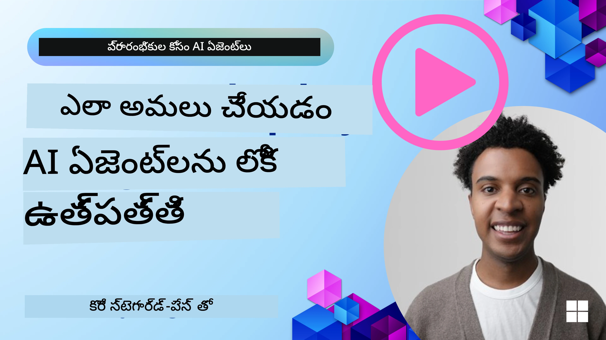

# ఉత్పత్తిలో AI ఏజెంట్లు: దర్శనశక్తి & మూల్యాంకనం

[](https://youtu.be/l4TP6IyJxmQ?si=reGOyeqjxFevyDq9)

AI ఏజెంట్లు ప్రయోగాత్మక నమూనాల నుండి వాస్తవ ప్రపంచ వినియోగాలకు మారుతున్నప్పుడు, వారి ప్రవర్తనను అర్థం చేసుకోవడం, వారి పనితీరు పరిశీలించడం, మరియు వారి అవుట్పుట్‌ల‌ను పద్ధతిగా మూల్యాంకనం చేయడం కీలకం అవుతుంది.

## నేర్చుకోవడానికి లక్ష్యాలు

ఈ పాఠాన్ని పూర్తి చేసిన తర్వాత, మీరు ఇలా తెలుసుకుంటారు/అర్థం చేసుకుంటారు:
- ఏజెంట్ల దర్శనశక్తి మరియు మూల్యాంకనం యొక్క ప్రాథమిక సూత్రాలు
- ఏజెంట్ల పనితీరు, ఖర్చులు, మరియు సమర్థత మెరుగుపర్చే సాంకేతికతలు
- మీ AI ఏజెంట్లను పద్ధతిగానూ ఎలా మూల్యాంకనం చేయాలనే విషయము
- ఉద్యోగిలో AI ఏజెంట్లను అమలు చేసే సమయంలో ఖర్చులను ఎలా నియంత్రించాలి
- Microsoft Agent Frameworkతో నిర్మించిన ఏజెంట్లను ఎలా ఇన్స్ట్రుమెంట్ చేయాలి

గోల్ మీ "బ్లాక్ బాక్స్" ఏజెంట్లను పారదర్శక, నిర్వహించదగిన, మరియు నమ్మకమైన సిస్టమ్‌లుగా మార్చడానికి కావలసిన జ్ఞానంతో మీను సుసజ్ఞత చేయడం.

_**గమనిక:** సురక్షితమైన మరియు నమ్మకమైన AI ఏజెంట్లను నిమగ్నం చేయడం ముఖ్యం. [నమ్మకమైన AI ఏజెంట్లు నిర్మించడం](../06-building-trustworthy-agents/README.md) పాఠాన్ని కూడా చూడండి._

## ట్రేసులు మరియు స్పాన్లు

[Langfuse](https://langfuse.com/) లేదా [Microsoft Foundry](https://learn.microsoft.com/en-us/azure/ai-foundry/what-is-azure-ai-foundry) వంటి దర్శనశక్తి సాధనాలు సాధారణంగా ఏజెంట్ ప్రదర్శనలను ట్రేసులు మరియు స్పాన్లుగా ప్రాతినిధ్యం చేస్తాయి.

- **ట్రేస్** ఒక పూర్తి ఏజెంట్ పని ను మొదలు నుంచి ముగింపు వరకు సూచిస్తుంది (ఉదా: వాడుకరి ప్రశ్నను హ్యాండిల్ చేయడం).
- **స్పాన్లు** ట్రేస్ అంతర్గత వ్యక్తిగత దశలుగా ఉంటాయి (ఉదా: లాంగ్వేజ్ మోడల్ కాల్ చేయడం లేదా డేటాను పొందడం).


<!-- Image URL retained for illustration purposes -->

దర్శనశక్తి లేకుండా, AI ఏజెంట్ ఒక "బ్లాక్ బాక్స్" లాగా అనిపిస్తుంది - దాని అంతర్గత స్థితి మరియు తర్కం పారదర్శకం కాకపోవడం వల్ల సమస్యల్ని గుర్తించటం లేదా పనితీరు మెరుగుపర్చటం కష్టంగా ఉంటుంది. దర్శనశక్తితో, ఏజెంట్లు "గ్లాస్ బాక్స్" లా మారతాయి, ఇది నమ్మకాన్ని సంపాదించటానికి మరియు అవి లక్ష్యంగా ఉద్దేశించిన విధంగా పనిచేసేందుకు అవశ్యకమైన పారదర్శకత అందిస్తుంది.

## ఉత్పత్తి వాతావరణంలో దర్శనశక్తి ఎందుకు ముఖ్యం

AI ఏజెంట్లను ఉత్పత్తి వాతావరణానికి బదిలీ చేసేటప్పుడు కొత్త సవాళ్లు మరియు అవసరాలు వస్తాయి. దర్శనశక్తి ఇప్పుడేమైనా "ఉండటం మంచి విషయం" కాకుండా, అత్యంత కీలక సామర్థ్యంగా మారిపోయింది:

*   **డీబగ్గింగ్ మరియు మూల కారణ విశ్లేషణ**: ఏజెంట్ విఫలమైతే లేదా అనుకోని అవుట్పుట్ విడుదల చేస్తే, దర్శనశక్తి సాధనాలు సమస్య మూలాన్ని గుర్తించడానికి కావలసిన ట్రేసులను అందిస్తాయి. ఇది అనేక LLM కాల్స్, టూల్ ఇన్‌టరాక్షన్స్, మరియు షరతు తర్కం కలిగిన కాంప్లెక్స్ ఏజెంట్లలో ప్రత్యేకంగా ముఖ్యం.
*   **వెళ్ళిపోయే సమయం మరియు ఖర్చు నిర్వహణ**: AI ఏజెంట్లు తరచుగా టోకెన్ లేదా కాల్ ఆధారంగా బిల్ చేయబడే LLMలు మరియు ఇతర బాహ్య APIలపై ఆధారపడి ఉంటాయి. దర్శనశక్తి వాటి కాల్స్ ని ఖచ్చితంగా ట్రాక్ చేయటానికి అనుమతిస్తుంది, ఇది మెరుగైన పనితీరు కలిగిన ఆపరేషన్లను గుర్తించడంలో సహాయపడుతుంది. దీని ద్వారా బృందాలు ప్రాంప్ట్స్‌ను మెరుగుపరచుకోవచ్చు, సమర్థవంతమైన మోడల్స్ ఎంచుకోవచ్చు, లేదా ఆపరేషనల్ ఖర్చులను నియంత్రించేందుకు వర్క్ఫ్లోలను పునఃడిజైన్ చేయవచ్చు మరియు మంచి వినియోగదారు అనుభవాన్ని నిర్థారించవచ్చు.
*   **నమ్మకం, భద్రత, మరియు సవరించు మీరు**: అనేక అప్లికేషన్లలో, ఏజెంట్లు భద్రకంగా మరియు నైతికంగా ప్రవర్తిస్తోందని నిర్ధారించడం ముఖ్యం. దర్శనశక్తి ఏజెంట్ చర్యలు మరియు నిర్ణయాల ఆడిట్ ట్రైల్ ను అందిస్తుంది. ఇది ప్రాంప్ట్ ఇంజెక్షన్, హానికరమైన కంటెంట్ ఉత్పత్తి, లేదా వ్యక్తిగత గుర్తింపు సమాచారం (PII) తప్పుగా నిర్వహణ వంటి సమస్యలను గుర్తించడానికి మరియు పరిష్కరించడానికి ఉపయోగపడుతుంది. ఉదా: ఏజెంట్ ఏ రిస్పాన్స్ ఇచ్చిందో లేదా ఏ టూల్ ఉపయోగించిందో తెలుసుకోవడానికి మీరు ట్రేసులను సమీక్షించవచ్చు.
*   **నిరంతర మెరుగుదల చక్రాలు**: దర్శనశక్తి డేటా అనేది పునరావృత అభివృద్ధి ప్రక్రియ యొక్క పునాది. ఏజెంట్లు వాస్తవ ప్రపంచంలో ఎలా స్పందిస్తోందో పర్యవేక్షించడం ద్వారా, బృందాలు మెరుగుదల అవసరాలను గుర్తించవచ్చు, మోడల్స్‌ను సరిచేయడానికి డేటా సేకరించవచ్చు, మరియు మార్పుల ప్రభావాన్ని ధృవీకరించవచ్చు. ఇది ఒక ఫీడ్‌బ్యాక్ లూపును సృష్టిస్తుంది, ఇక్కడ ఆన్‌లైన్ మూల్యాంకనం నుండి వచ్చిన ఉత్పత్తి అవగాహన ఆఫ్‌లైన్ ప్రయోగాలు మరియు సవరణలను సూచిస్తుంది, తద్వారా ఏజెంట్ పనితీరు అనుక్రమంగా మెరుగవుతుంది.

## ట్రాక్ చేయగల ముఖ్యమైన గణాంకాలు

ఏజెంట్ ప్రవర్తనను పర్యవేక్షించి అర్థం చేసుకోవటానికి, వివిధ గణాంకాలు మరియు సంకేతాలను ట్రాక్ చేయాలి. ఏజెంట్ లక్ష్యం ఆధారంగా నిర్దిష్ట గణాంకాలు మారవచ్చు, కానీ కొన్ని సర్వత్రా ముఖ్యం.

దర్శనశక్తి సాధనాలు ట్రాక్ చేసే సామాన్యమైన గణాంకాలలో కొన్ని ఇవి:

**వైమానికత్వం:** ఏజెంట్ ఎంత వేగంగా స్పందిస్తుంది? ఎక్కువ వేచి ఉండటం వినియోగదారు అనుభవాన్ని ప్రతికూలంగా ప్రభావితం చేస్తుంది. మీరు ఏజెంట్ సంచలనాలను ట్రేస్ చేయడం ద్వారా పనుల మరియు వ్యక్తిగత దశల వైమానికత్వాన్ని కొలవాలి. ఉదా: ఒక ఏజెంట్ అన్ని మోడల్ కాల్స్ కోసం 20 సెకన్లు పట్టితే, వేగంగా పనిచేసే మోడల్ ఉపయోగించడం లేదా మోడల్ కాల్స్‌ను సమాంతరంగా నడపడం ద్వారా వేగవంతం చేయవచ్చు.

**ఖర్చులు:** ప్రత్తి ఏజెంట్ సంచలనంపై ఖర్చు ఎంత? AI ఏజెంట్లు టోకెన్ లేదా బాహ్య APIలు ఆధారంగా బిల్ చేయబడే LLM కాల్స్‌పై ఆధారపడి ఉంటాయి. తరచుగా టూల్ వినియోగం లేదా పలు ప్రాంప్ట్స్ ఖర్చులను వేగంగా పెంచవచ్చు. ఉదా: ఒక ఏజెంట్ ఐదు సార్లు LLMను పిలుస్తే సున్నితమైన నాణ్యత మెరుగుదల కోసం, మీరు ఖర్చు విలువైనదిగా ఉంది లేదా కాల్స్ సంఖ్యను తగ్గించవచ్చు లేదా తక్కువ ఖర్చుతో మోడల్ ఉపయోగించవచ్చు అని అంచనా వేయాలి. రియల్-టైమ్ పర్యవేక్షణ కూడా అనుకోని పీక్స్ గుర్తించడంలో సహాయపడుతుంది (ఉదా: బగ్స్ కారణంగా ఎక్కువ API లూప్స్).

**అభ్యర్థన దోషాలు:** ఏజెంట్ ఎన్ని అభ్యర్థనలు విఫలం చేశారు? ఇది API దోషాలు లేదా విఫలమైన టూల్ కాల్స్ కలిగి ఉండవచ్చు. ఉత్పత్తిలో మీ ఏజెంట్‌ను మరింత బలవంతంగా చేయడానికి, మీరు తర్వాత ఫాల్బ్యాక్‌లు లేదా మళ్లింపు వ్యవస్థలను ఏర్పాటు చేయవచ్చు. ఉదా: LLM ప్రొవైడర్ A బ్యాక్కావుతున్నప్పుడు, LLM ప్రొవైడర్ Bకి మార్చటం బ్యాకప్‌గా పనిచేస్తుంది.

**వినియోగదారు అభిప్రాయం:** ప్రత్యక్ష వినియోగదారు మూల్యాంకనాలు విలువైన అవగాహనలను అందిస్తాయి. ఇవి స్పష్టమైన రేటింగ్‌లను (👍తుమ్స్-అప్/👎తుమ్స్-డౌన్, ⭐1-5 స్టార్‌లు) లేదా వచన వ్యాఖ్యలను కూడా కలిగి ఉండవచ్చు. సుసంకల్పితమైన ప్రతికూల అభిప్రాయం మీకు ఒక హెచ్చరికగా ఉంటుంది ఇది ఏజెంట్ ఆశించిన రీతిగా పని చేయడం లేదని సూచిస్తుంది.

**గోచర వినియోగదారు అభిప్రాయం:** వినియోగదారు ప్రవర్తనలు ప్రత్యక్ష రేటింగ్ లేకుండానే పరోక్ష అభిప్రాయం ఇస్తాయి. ఇది తక్షణ ప్రశ్న మళ్లింపు, పునరావృత ప్రశ్నలను లేదా రీట్రై బటన్ క్లిక్ చేయడం వంటి చర్యలను కలిగి ఉండవచ్చు. ఉదా: మీరు వాడుకరులు ఆ mesma ప్రశ్నను పునరావృతంగా అడుగుతున్నట్లు చూస్తే, ఇది ఏజెంట్ ఆశించిన విధంగా పని చేయట్లేదని సూచన.

**ఖచ్చితత్వం:** ఏజెంట్ ఎంతసేపు సరైన లేదా కోరుకునే అవుట్పుట్‌లను ఉత్పత్తి చేస్తుంది? ఖచ్చితత్వ నిర్వచనలు మారవచ్చు (ఉదా: సమస్య పరిష్కార సరైనత, సమాచార పునఃప్రాప్తి ఖచ్చితత్వం, వినియోగదారు సంతృప్తి). మొదటి దశ మీ ఏజెంట్ యొక్క విజయాన్ని నిర్వచించడం. మీరు ఖచ్చితత్వాన్ని ఆటోమేటెడ్ తనిఖీలు, మూల్యాంకన స్కోర్లు, లేదా పనుల సమాప్తి లేబుల్‌ల ద్వారా ట్రాక్ చేయవచ్చు. ఉదా: ట్రేసులను "సఫలమైంది" లేదా "విఫలమైంది" అని గుర్తించడం.

**ఆటోమేటెడ్ మూల్యాంకన గణాంకాలు:** మీరు ఆటోమేటెడ్ మూల్యాంకనలను కూడా ఏర్పాటు చేయవచ్చు. ఉదా: జారీ చేసిన అవుట్పుట్ ఎంత ఉపయోగకరంగా, ఖచ్చితంగా ఉందో LLM ఉపయోగించి స్కోరు ఇవ్వవచ్చు. కొన్ని ఓపెన్ సోర్స్ లైబ్రరీలు కూడా ఉన్నాయి, ఇవి ఏజెంట్ యొక్క వేర్వేరు అంశాలను స్కోర్ చేయడంలో సహాయపడతాయి. ఉదా: [RAGAS](https://docs.ragas.io/) RAG ఏజెంట్ల కొరకు లేదా [LLM Guard](https://github.com/protectai/llm-guard) హానికరమైన భాష లేదా ప్రాంప్ట్ ఇంజెక్షన్ గుర్తించేందుకు.

ఆచరణలో, ఈ గణాంకాల సమ్మేళనం AI ఏజెంట్ ఆరోగ్యానికి అతి ఉత్తమ కవరేజ్‌ను అందిస్తుంది. ఈ అధ్యాయం యొక్క [ఉదాహరణ నోట్‌బుక్](./code_samples/10-expense_claim-demo.ipynb) లో, మీరు ఈ గణాంకాలు నిజ జీవిత నమూనాలలో ఎలా కనిపిస్తాయో చూపిస్తాము కానీ ముందుగా, సాధారణ మూల్యాంకన వర్క్‌ఫ్లో ఎలా ఉండొచ్చో అధ్యయనం చేద్దాం.

## మీ ఏజెంట్‌ని ఇన్స్ట్రుమెంట్ చేయండి

ట్రేసింగ్ డేటా సేకరించడానికి, మీరు మీ కోడ్‌ను ఇన్స్ట్రుమెంట్ చేయాలి. గోల్ ఏజెంట్ కోడ్‌ను ఇన్స్ట్రుమెంట్ చేయడం, చూపించే ట్రేసులు మరియు గణాంకాలను ఉత్పత్తి చేయడం, అవి దర్శనశక్తి ప్లాట్‌ఫారమ్ ద్వారా క్యాప్చర్, ప్రాసెస్, మరియు విజువలైజ్ చేయబడేలా చేయడం.

**ఓపెన్‌టెలిమెట్రీ (OTel):** [ఓపెన్‌టెలిమెట్రీ](https://opentelemetry.io/) LLM దర్శనశక్తి కోసం పరిశ్రమ ప్రమాణంగా మారింది. ఇది APIలు, SDKలు, మరియు టెలిమెట్రీ డేటాను ఉత్పత్తి, సేకరణ, మరియు ఎగుమతి చేయడానికి టూల్స్ అందిస్తుంది.

అనేక ఇన్స్ట్రుమెంటేషన్ లైబ్రరీలు ఇప్పటికే ఉన్న ఏజెంట్ ఫ్రేమ్‌వర్క్లను ర్యాప్ చేసి OpenTelemetry స్పాన్లను దర్శనశక్తి సాధనానికి ఎగుమతి చేయడం సులభతరం చేస్తాయి. Microsoft Agent Framework స్వాభావికంగా OpenTelemetryతో సమన్వయం చేస్తుంది. క్రింద MAF ఏజెంట్ ఇన్స్ట్రుమెంట్ చేయడంలో ఉదాహరణ ఉంది:

```python
from agent_framework.observability import get_tracer, get_meter

tracer = get_tracer()
meter = get_meter()

with tracer.start_as_current_span("agent_run"):
    # Agent execution is traced automatically
    pass
```

ఈ అధ్యాయం లోని [ఉదాహరణ నోట్‌బుక్](./code_samples/10-expense_claim-demo.ipynb) లో మీ MAF ఏజెంట్ ఇన్స్ట్రుమెంట్ ఎలా చేయాలో చూపిస్తాము.

**మాన్యువల్ స్పాన్ సృష్టి:** ఇన్స్ట్రుమెంటేషన్ లైబ్రరీలు మంచి ఆది పాయింట్ ఇస్తాయి, కానీ మరిన్ని వివరమైన లేదా ప్రత్యేక సమాచారం అవసరం అయిన సందర్భాలు ఉంటాయి. మీరు కస్టమ్ అప్లికేషన్ లాజిక్ జోడించడానికి మాన్యువల్‌గా స్పాన్లను సృష్టించవచ్చు. ముఖ్యంగా, అవి ఆటోమేటుగా లేదా మాన్యువల్‌గా సృష్టించిన స్పాన్లను కస్టమ్ లక్షణాలతో (టాగ్లు లేదా మెటాడేటా అని కూడా పిలుస్తారు) అందించవచ్చు. ఈ లక్షణాలలో వ్యాపార-సంబంధిత డేటా, మధ్యవైపు లెక్కింపులు, లేదా డీబగ్గింగ్ లేదా విశ్లేషణకు ఉపయోగపడే ఏదైనా సందర్భం ఉండవచ్చు, ఉదా: `user_id`, `session_id`, లేదా `model_version`.

[Langfuse Python SDK](https://langfuse.com/docs/sdk/python/sdk-v3) తో మాన్యువల్‌గా ట్రేసులు మరియు స్పాన్లు సృష్టించే ఉదాహరణ:

```python
from langfuse import get_client
 
langfuse = get_client()
 
span = langfuse.start_span(name="my-span")
 
span.end()
```

## ఏజెంట్ మూల్యాంకనం

దర్శనశక్తి మనకు గణాంకాలను ఇస్తుంది, కానీ మూల్యాంకనం ఆ డేటాని విశ్లేషించి (పరీక్షలు నిర్వహించి) AI ఏజెంట్ ఎంత బాగా ప్రదర్శిస్తున్నాడో మరియు ఎలా మెరుగుపరచాలో నిర్ణయించటం. మరో మాటల్లో, ట్రేసులు మరియు గణాంకాలు ఉన్న తర్వాత, మీరు వాటిని ఏజెంట్ ను తీర్పు చేసే మరియు నిర్ణయాలు తీసుకునే విధానంలో ఎలా ఉపయోగిస్తారు?

పునరావృత మూల్యాంకనం ముఖ్యం ఎందుకంటే AI ఏజెంట్లు తరచుగా నిర్థారిత వ్య‌వ‌హారం లేకపోవడం (నాన్-డిటర్మినిస్టిక్) మరియు మెరుగుపడటం (అప్డేట్ల లేదా మోడల్ ప్రవర్తన మార్పుల ద్వార) – మూల్యాంకనం లేకుండా, మీ "స్మార్ట్ ఏజెంట్" నిజంగా తన పని బాగా చేస్తున్నాడా లేదా వెనుకబడుతున్నాడో తెలియదు.

AI ఏజెంట్ల కోసం రెండు మూల్యాంకన వర్గాలు ఉన్నాయి: **ఆన్‌లైన్ మూల్యాంకనం** మరియు **ఆఫ్‌లైన్ మూల્યాంకనం**. రెండూ విలువైనవి, మరియు అవి ఒకరికొకరు అనుకూలంగా ఉంటాయి. మేము సాధారణంగా ఆఫ్‌లైన్ మూల్యాంకనంతో ప్రారంభిస్తాము, ఇది ఏజెంట్‌ను నియమించేముందు కనీస అవసరమైన దశ.

### ఆఫ్‌లైన్ మూల్యాంకనం


ఇది ఏజెంట్‌ను నియంమిత పరిస్థితిలో, సాధారణంగా పరీక్షా డేటాసెట్లను ఉపయోగించి, ప్రత్యక్ష వాడుకరి ప్రశ్నలు కాకుండా మూల్యాంకనం చేయటాన్ని సూచిస్తుంది. మీరు గుర్తించిన అవుట్పుట్ లేదా సరైన ప్రవర్తన తెలిసిన శ్రేణి డేటాసెట్స్‌ను తీసుకుని వాటి పై ఏజెంట్‌ను నడిపిస్తారు.

ఉదా: మీరు ఒక గణిత పద సమస్య ఏజెంట్‌ను నిర్మించినట్లయితే, మీకు 100 సమస్యలు_known_ జవాబులతో ఉన్న [పరీక్షా డేటాసెట్](https://huggingface.co/datasets/openai/gsm8k) ఉండవచ్చు. ఆఫ్‌లైన్ మూల్యాంకనం సాధారణంగా అభివృద్ధి సందర్భంగా (మరియు CI/CD పైప్లైన్ల భాగంగా) మార్పులు పరీక్షించడానికి లేదా వెనుకబడటాల నుంచి రక్షించడానికి జరుగుతుంది. దీని ప్రయోజనం ఏమిటంటే, ఇది **పునరావృతం చేయదగినది మరియు భూమిక సత్యం (గ్రౌండ్ ట్రూత్) ఉన్న కారణంగా స్పష్టమైన ఖచ్చితత్వ గణాంకాలు పొందవచ్చు**. మీరు వినియోగదారు ప్రశ్నలను అనుకరించవచ్చు మరియు ఏజెంట్ ప్రతిస్పందనలను సిద్దమైన జవాబులతో కొలవచ్చు లేదా పై పేర్కొన్న ఆటోమేటెడ్ గణాంకాలను ఉపయోగించవచ్చు.

ఆఫ్‌లైన్ మూల్యాంకనలో ప్రధాన సవాలు మీ పరీక్ష డేటాసెట్ సమగ్రంగా మరియు సంబంధితంగా ఉండాలని నిర్ధారించుకోవడమనేది – ఏజెంట్ ఫిక్స్ పరీక్ష సెట్‌లో బాగా పనిచేయవచ్చు కానీ ఉత్పత్తిలో పూర్తిగా భిన్నమైన ప్రశ్నలను ఎదుర్కోవచ్చు. కాబట్టి, మీరు పరీక్ష సెట్లను కొత్త ఎడ్జ్ కేసులు మరియు వాస్తవ ప్రపంచ పరిస్థితులను ప్రతిబింబించే ఉదాహరణలతో అప్‌డేట్ చేయాలి​. చిన్న "స్మోక్ టెస్ట్" కేసులు మరియు విస్తృత మూల్యాంకన సెట్లు అనుపాతంగా ఉపయోగకరంగా ఉంటాయి: చిన్న సెట్లు వేగవంతమైన తనిఖీలకోసం మరియు పెద్దవాటితో విస్తృత పనితీరు మాపింగ్ కోసం.

### ఆన్‌లైన్ మూల్యాంకనం 


ఇది ఉత్పత్తి వాతావరణంలో ప్రత్యక్ష, వాస్తవ-ప్రపంచ ఉపయోగంలో ఏజెంట్ పనితీరు మూల్యాంకనం చేయడం. ఆన్‌లైన్ మూల్యాంకనంలో ఏజెంట్ రియల్ యూజర్ అంతర్‌క్రియలపై పనితీరును పర్యవేక్షించడం మరియు ఫలితాలను నిరంతరం విశ్లేషించడం ఉంటుంది.

ఉదా: మీరు ప్రత్యక్ష ట్రాఫిక్‌పై విజయం రేట్లు, వినియోగదారు సంతృప్తి స్కోర్లు లేదా ఇతర గణాంకాలను ట్రాక్ చేయవచ్చు. ఆన్‌లైన్ మూల్యాంకన ప్రయోజనం ఏమిటంటే, ఇది **ల్యాబ్ సెట్టింగ్‌లో ఊహించలేని విషయాలను కూడా పట్టుకుంటుంది** – మీరు మోడల్ డ్రిఫ్ట్‌ను గమనించవచ్చు (ఆర్ ఉపయోగకత మరియు ప్రవేశ నమూనాలు మారినప్పుడు ఏజెంట్ సమర్థత తగ్గడం) మరియు అనుకోని ప్రశ్నలు లేదా పరిస్థితులను గుర్తించవచ్చు, ఇవి మీ పరీక్షా డేటాలో లేవు​. ఇది ఏజెంట్ వనరులో ఎలా ప్రవర్తిస్తుందో నిజమైన దృశ్యాన్ని అందిస్తుంది.

ఆన్‌లైన్ మూల్యాంకన తరచూ పరోక్ష మరియు ప్రత్యక్ష వినియోగదారు అభిప్రాయాన్ని సేకరించడం, అలాగే షాడో పరీక్షలు లేదా A/B పరీక్షలు నిర్వహించడం (ఇక్కడ కొత్త ఏజెంట్ వెర్షన్ పాతదానికి సరిపోల్చి పాలు నడుస్తుంది) కలిగి ఉంటుంది. సవాలు ఏమిటంటే ప్రత్యక్ష అంతర్‌క్రియలకు నమ్మకమైన లేబుళ్ళు లేదా స్కోర్లను పొందటం కష్టం – మీరు వినియోగదారు అభిప్రాయం లేదా డౌన్‌స్ట్రీమ్ గణాంకాలపై (వినియోగదారు ఫలితాన్ని క్లిక్ చేశారా లేదా వంటి) ఆధారపడవచ్చు.

### రెండింటినీ కలిసి చూడటం

ఆన్‌లైన్ మరియు ఆఫ్‌లైన్ మూల్యాంకన పరస్పర విరుద్ధమైనవి కావు; అవి పరస్పరం సహాయకం. ఆన్‌లైన్ పర్యవేక్షణ నుంచిబడ్డ అవగాహనలను (ఉదా: ఏవిధమైన వినియోగదారు ప్రశ్నల్లో ఏజెంట్ బాగా ప్రదర్శించట్లేదో) ఆఫ్‌లైన్ పరీక్షా డేటాసెట్‌లను మెరుగుపర్చడానికి ఉపయోగించవచ్చు. తిరిగీ, ఆఫ్‌లైన్ పరీక్షల్లో బాగా పనిచేస్తున్న ఏజెంట్లను ఆన్‌లైన్‌లో మరింత నమ్మకంగా నియమించవచ్చు మరియు పర్యవేక్షించవచ్చు.

వాస్తవానికి, అనేక బృందాలు ఈ లూప్‌ను అనుసరిస్తారు:

_ఆఫ్‌లైన్ మూల్యాంకనం -> నియామకం -> ఆన్‌లైన్ పర్యవేక్షణ -> కొత్త విఫల కేసులను సేకరణ -> ఆఫ్‌లైన్ డేటాసెట్‌కు జోడింపు -> ఏజెంట్ సవరణ -> పునరావృతం_.

## సాధారణ సమస్యలు

మీరు AI ఏజెంట్లను ఉత్పత్తిలో అమలు చేసినప్పుడు వివిధ సవాళ్లను ఎదుర్కొనవచ్చు. ఇక్కడ కొన్ని సాధారణ సమస్యలు మరియు వాటి సాధ్యమైన పరిష్కారాలు ఉన్నాయి:

| **సమస్య**    | **సాధ్యమైన పరిష్కారం**   |
| ------------- | ------------------ |
| AI ఏజెంట్ దృఢంగా పనులు నిర్వహించడంలో విఫలమవుతున్నాడు | - AI ఏజెంట్‌కు ఇచ్చే ప్రాంప్ట్‌ని మెరుగుపరచండి; లక్ష్యాలు స్పష్టంగా ఉండాలి.<br>- పనులను ఉపపనులకు విభజించడం మరియు వాటిని బహుళ ఏజెంట్‌ల ద్వారా నిర్వహించడం ఎక్కడ సహాయపడుతుందో గుర్తించండి. |
| AI ఏజెంట్ నిరంతర లూప్‌లలో అమాయకంగా పని చేస్తోంది | - ఏజెంట్ ప్రక్రియను ఎప్పుడు ఆపాలో గుర్తించే స్పష్టమైన ముగింపు నిబంధనలను నిర్ధారించండి.<br>- తర్కం మరియు ప్రణాళిక అవసరమయ్యే సంక్లిష్ట పనుల కొరకు, తర్క పనులకు ప్రత్యేకంగా రూపొందించిన పెద్ద మోడల్ ఉపయోగించండి. |
| AI ఏజెంట్ టూల్ కాల్స్ బాగా పనులు చేయడం లేదు | - ఏజెంట్ సిస్టమ్ వెలుపలి టూల్ అవుట్పుట్‌ను పరీక్షించి ధృవీకరించండి.<br>- నిర్వచించిన పరిమాణాలు, ప్రాంప్ట్లు, మరియు టూల్స్ పేర్లను మెరుగుపరచండి. |
| బహుళ ఏజెంట్ సిస్టమ్ స్థిరంగా పనులు చేయడం లేదు | - ప్రతి ఏజెంట్‌కు ఇచ్చే ప్రాంప్ట్‌లను ప్రత్యేకమైన మరియు వేర్వేరు మార్చండి.<br>- సరైన ఏజెంట్‌ను నిర్ణయించడానికి "రోటింగ్" లేదా కంట్రోలర్ ఏజెంట్ ఉపయోగించి ఒక హైర్ార్కికల్ సిస్టమ్ నిర్మించండి. |

ఈ సమస్యలలో చాలావి దర్శనశక్తి అమలు చేసినప్పుడు మరింత సమర్థవంతంగా గుర్తించవచ్చు. మునుపటి ట్రేసులు మరియు గణాంకాలు ఏజెంట్ వర్క్‌ఫ్లోలో సమస్యలు ఎక్కడ జరుగుతున్నాయో ఖచ్చితంగా చూపించడంతో, డీబగ్గింగ్ మరియు ఆప్టిమైజేషన్ చాలా సమర్థవంతంగా మారుతుంది.

## ఖర్చుల నిర్వహణ

AI ఏజెంట్లను ఉత్పత్తిలో అమలు చేసే ఖర్చులను నిర్వహించడానికి కొన్ని వ్యూహాలు ఇక్కడ ఉన్నాయి:

**చిన్న మోడల్స్ వాడటం:** చిన్న భాషా మోడల్స్ (SLMs) కొన్ని ఏజెంటిక్ వినియోగదారుల సందర్భాలలో మంచి పనితనం చూపగలవు మరియు వ్యయాలను గణనీయంగా తగ్గిస్తాయి. ముందుగా చెప్పినట్లుగా, పనితనాన్ని పెద్ద మోడల్స్‌తో పోల్చేందుకు మరియు అంచనా వేయడానికి ఒక అంచనా వ్యవస్థను నిర్మించడం అనేది SLM మీ వినియోగానికి ఎంత మంచిగా పనికిరావొచ్చో అర్థం చేసుకోవడంలో ఉత్తమ మార్గం. సులభ పనుల కోసం, ఉదాహరణకు ఉద్దేశ్య వర్గీకరణ లేదా పారామితి చేదింపు వంటి పనులకు SLMలను వాడడం, మరియు క్లిష్టమైన తర్కానికి పెద్ద మోడల్స్ వాడటం మంచిది.

**ఒక రూటర్ మోడల్ ఉపయోగించడం:** సమానమైన వ్యూహం అనగా విభిన్న మోడల్స్ మరియు పరిమాణాలను ఉపయోగించడం. మీరు LLM/SLM లేదా సర్వర్‌లెస్ ఫంక్షన్‌ను వినియోగించి, పాటించాల్సిన సవాళ్ల ఆధారంగా రిక్వెస్ట్‌లను ఉత్తమ సరిపోయే మోడల్స్‌ కొరకు మార్గనిర్దేశం చేయవచ్చు. దీని ద్వారా వ్యయాలు తగ్గించబడతాయి మరియు సరైన పనులపై పనితనం నిర్ధారించబడుతుంది. ఉదాహరణకి, సులభ ప్రశ్నలను చిన్న, వేగవంతమైన మోడల్స్‌కు పంపించండి, క్లిష్ట తర్కాల కోసం మాత్రమే ఖరీదు ఎక్కువ ఉన్న పెద్ద మోడల్స్ వాడండి.

**ప్రత్యుత్తరాలను క్యాష్ చేయడం:** సాధారణ అభ్యర్థనలు మరియు పనులను గుర్తించి, అవి మీ ఏజెంటిక్ системой ద్వారా వెళ్లకముందే ప్రత్యుత్తరాలను అందించడం దాదాపు ఒకే విధమైన అభ్యర్థనల పరిమాణాన్ని తగ్గించే మంచి మార్గం. మీరు మరింత ప్రాథమిక AI మోడల్స్ ఉపయోగించి ఒక ప్రవాహాన్ని అమలు చేసి, ఒక అభ్యర్థన మీ క్యాష్ చేసిన అభ్యర్థనలకు ఎంత సమానమో గుర్తించవచ్చు. ఈ వ్యూహం తరచుగా అడిగే ప్రశ్నలు లేదా సాధారణ వర్క్‌ఫ్లోలకు గణనీయంగా వ్యయాలను తగ్గిస్తుంది.

## ఇది వాస్తవంలో ఎలా పనిచేస్తుందో చూద్దాం

[ఈ విభాగంలోని ఉదాహరణ నోట్‌బుక్](./code_samples/10-expense_claim-demo.ipynb)లో, మనం ఎలా పరిశీలనా సాధనాలు ఉపయోగించి మన ఏజెంట్‌ను పర్యవేక్షించి, అంచనా వేయవచ్చో చూడబోతున్నాం.


### ఉత్పత్తిలో AI ఏజెంట్ల గురించి మరింత ప్రశ్నలున్నవా?

ఇతర అభ్యాసకులతో కలవడానికి, ఆఫీస్ అవర్స్‌కి హాజరుకావడానికి మరియు మీ AI ఏజెంట్ల ప్రశ్నల సమాధానం పొందడానికి [Microsoft Foundry Discord](https://discord.com/invite/ATgtXmAS5D)లో చేరండి.

## గత పాఠం

[మెటాకాగ్నిషన్ డిజైన్ ప్యాటర్న్](../09-metacognition/README.md)

## తదుపరి పాఠం

[ఏజెంటిక్ ప్రోటోకాల్‌లు](../11-agentic-protocols/README.md)

---

<!-- CO-OP TRANSLATOR DISCLAIMER START -->
**అస్వీకరణ**:
ఈ పత్రం AI అనువాద సేవ [Co-op Translator](https://github.com/Azure/co-op-translator) ఉపయోగించి అనువదించబడింది. మేము ఖచ్చితత్వానికి ప్రయత్నిస్తున్నప్పటికీ, ఆటోమేటెడ్ అనువాదాలు తప్పులు లేదా అసమగ్రతలను కలిగి ఉండవచ్చు. దాని స్వదేశ భాషలో ఉన్న అసలు పత్రాన్ని అధికారం కలిగిన మూలంగా పరిగణించాలి. కీలకమైన సమాచారం కోసం, ప్రొఫెషనల్ మానవ అనువాదాన్ని సిఫారసు చేస్తాము. ఈ అనువాదం ఉపయోగం వల్ల కలిగే ఏవైనా అపార్థాలు లేదా తప్పుదారులు కోసం మేము బాధ్యత వహించము.
<!-- CO-OP TRANSLATOR DISCLAIMER END -->