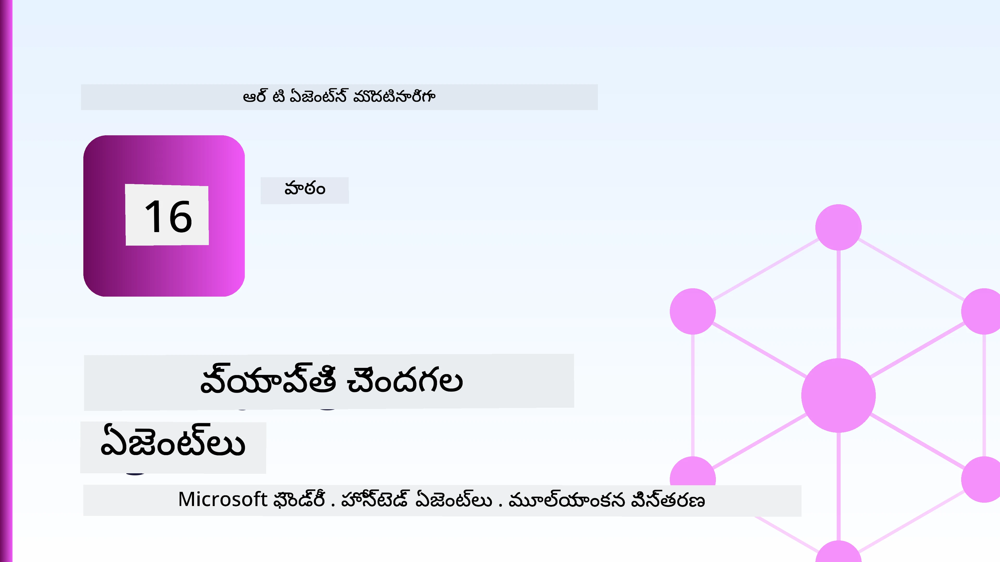
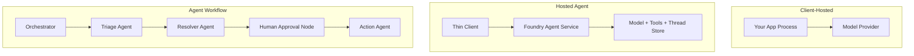
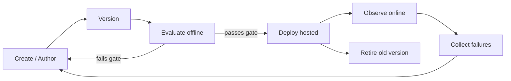
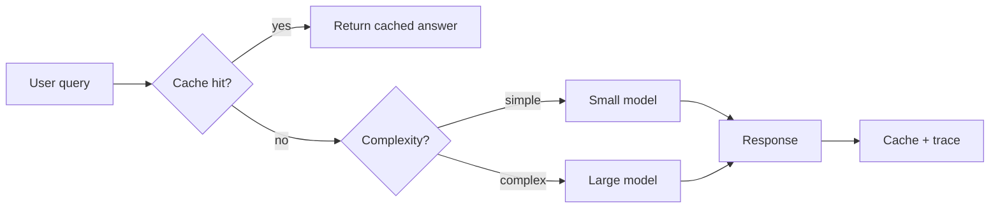
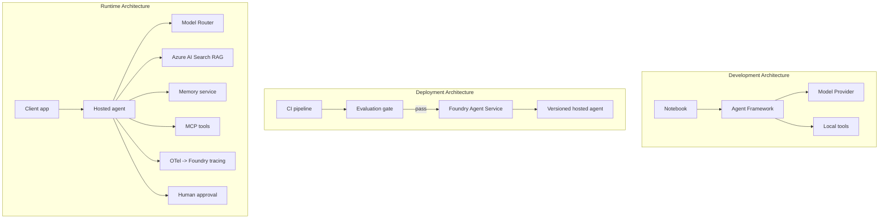

# Microsoft Foundry తో స్కేలబుల్ ఏజెంట్లను డిప్లాయ్ చేయడం



ఈ కోర్సులో ఇంతవరకు మీరు ల్యాప్‌టాప్‌లో, నోట్‌బుక్‌లో, `az login` మరియు కొన్ని ఎన్‌విరాన్‌మెంట్ వేరియబుల్స్ ఆధారంగా నడిచే ఏజెంట్లను నిర్మించారు. నేర్చుకోవడానికి ఇది సరిగ్గా సరైన విధానం. కానీ, వేలకు వేల మంది కస్టమర్లు اعتماد చేసే ఏజెంట్‌ని ఉదయం 3 గంటలకు నడిపించడానికి ఇది సరైన మార్గం కాదు.

ఈ పాఠం "It works on my machine" మరియు "It works, reliably and affordably, in production" మధ్య ఉన్న గ్యాప్ గురించి. మేము **Microsoft Foundry** మరియు **Microsoft Foundry Agent Service** ఉపయోగించి ఆ గ్యాప్‌ని మూసేస్తాము, అలాగే టూల్స్, రిట్రీవల్, మెమరీ, ఈవాల్యుయేషన్ మరియు మానిటరింగ్ ఉన్న నిజమైన కస్టమర్ సపోర్ట్ ఏజెంట్‌ని నిర్మించడం ద్వారా ఇది చేస్తాము.

## పరిచయం

ఈ పాఠం కింది విషయాలను కవర్ చేస్తుంది:

- **ప్రోటోటైప్ ఏజెంట్** మరియు **డిప్లాయ్ చేసిన ఏజెంట్** మధ్య తేడా, మరియు ఇదొక మోడల్ చుట్టూ ఉన్న అన్ని విషయాల గురించి.
- ఏజెంట్లకు **డిప్లాయ్‌మెంట్ నమూనాలు**: క్లయెంటు-హోస్టెడ్, సర్వీస్-హోస్టెడ్ (హోస్టెడ్ ఏజెంట్లు), మరియు వర్క్ఫ్లో-ఆర్చెస్ట్రేటెడ్.
- Microsoft Foundryలో **ఏజెంట్ లైఫ్‌సైకిల్** — సృష్టించడం, వెర్షన్ చేయడం, డిప్లాయ్ చేయడం, మదింపు చేయడం, పరిశీలించడం, రిటైర్ చేయడం.
- **స్కేలింగ్ వ్యూహాలు**: మోడల్ రౌటింగ్, క్యాచింగ్, కంకరెన్సీ, మరియు స్టేట్‌లెస్ డిజైన్.
- OpenTelemetry మరియు Foundry ట్రేసింగ్ ద్వారా **అన్వేషణ సామర్ధ్యం**.
- మోడల్ ఎంపిక, రౌటింగ్ మరియు ఈవాల్యుయేషన్ గేట్ల ద్వారా **ఖర్చు ఆప్టిమైజేషన్**.
- **ఎంటర్ప్రైజ్ పరిగణనలు**: పాలన, మానవ అనుమతి, మరియు ప్రొడక్షన్‌లో MCP సర్వర్లు సురక్షితంగా నడపడం.

## నేర్చుకునే లక్ష్యాలు

ఈ పాఠం పూర్తయిన తర్వాత మీరు తెలుసుకుంటారు:

- ఏజెంట్ వర్క్‌లోడ్ కోసం సరైన డిప్లాయ్‌మెంట్ నమూనాను ఎంచుకోవడం.
- Microsoft Foundry Agent Serviceలో ఏజెంట్‌ను డిప్లాయ్ చేసి, అది వెర్షన్ చేయబడినదిగా, పాలించబడినదిగా, మరియు అన్వేషించదగినదిగా ఉండేలా చేయడం.
- ట్రేసింగ్ కోసం ఏజెంట్‌ని ఇన్‌స్ట్రుమెంట్స్ చేయడం మరియు ప్రతి రీలీస్‌కు ముందు నడిచే ఈవాల్యుయేషన్ పైప్‌లైన్‌ని అనుసంధానం చేయడం.
- స్కేల్ సమయంలో లేటెన్సీ మరియు ఖర్చును నియంత్రించడానికి మోడల్ రౌటింగ్ మరియు క్యాచింగ్‌ను వర్తింపజేయడం.
- అధిక-ప్రమాద చర్యల కోసం మానవ అనుమతి గేట్‌ని జోడించడం మరియు ప్రొడక్షన్-సురక్షిత మార్గంలో MCP సర్వర్‌ని క‌లిపివేయడం.

## ముందస్తు అవసరాలు

ఈ పాఠం ముందు పాఠాలు పూర్తి చేసినట్లుగా మరియు ఈ క్రింది వాటితో సౌకర్యంగా ఉన్నట్లుగా అనుకొని ఉంటుంది:

- [Microsoft Agent Framework](../14-microsoft-agent-framework/README.md)తో ఏజెంట్లను నిర్మించడం (పాఠం 14).
- [టూల్ ఉపయోగం](../04-tool-use/README.md) (పాఠం 4) మరియు [Agentic RAG](../05-agentic-rag/README.md) (పాఠం 5).
- [Agent Memory](../13-agent-memory/README.md) (పాఠం 13) మరియు [Agentic Protocols / MCP](../11-agentic-protocols/README.md) (పాఠం 11).
- [అన్వేషణ మరియు ఈవాల్యుయేషన్](../10-ai-agents-production/README.md) (పాఠం 10) — ఈ పాఠం దాని మీద నేరుగా ఆధారపడింది.

మీరు దీనితో పాటు అవసరం:

- కనీసం ఒక డిప్లాయ్ చేసిన చాట్ మోడల్ ఉన్న **Azure సబ్‌స్క్రిప్షన్** మరియు **Microsoft Foundry ప్రాజెక్ట్**.
- ధృవీకరిత **Azure CLI** (`az login`).
- పైన ఉన్న రిపోజిటరీలోని Python 3.12+ మరియు ప్యాకేజీలు [`requirements.txt`](../../../requirements.txt).

## ప్రోటోటైప్లోనుండి ప్రొడక్షన్: నిజంగా ఏమి మారుతుంది

ఒక ప్రోటోటైప్ ఏజెంట్ మరియు ఒక ప్రొడక్షన్ ఏజెంట్ అదే కోర్ లూప్‌ను పంచుకుంటాయి — కారణం, టూల్స్‌ని పిలవడం, ప్రతిస్పందించడం. మార్పు ఆ లూప్ చుట్టూ ఉన్న ప్రతిదీ. మోడల్ ఒక ప్రొడక్షన్ ఏజెంట్‌లో సుమారు 20%; మిగతా 80% ఆపరేషన్ ఎంకెలెటన్.

| సమస్య | ప్రోటోటైప్ | ప్రొడక్షన్ |
| --- | --- | --- |
| **హోస్టింగ్** | మీ నోట్‌బుక్‌లో నడుస్తుంది | హోస్టెడ్ సర్వీస్‌లా నడుస్తుంది, వెర్షన్ చేయబడింది మరియు రోల్ అవుట్ చేయబడింది |
| **గుర్తింపు** | మీ `az login` టోకెన్ | స్కోప్డ్ RBAC తో మేనేజ్ చేసిన గుర్తింపు |
| **స్థితి** | ఇన్-మెమరీ, రీస్టార్ట్‌పై కోల్పోతుంది | బాహ్యీకరించబడింది (థ్రెడ్స్ స్టోర్, మెమరీ సర్వీసు) |
| **విఫలాలు** | మీరు ట్రేస్‌బ్యాక్‌ను చూస్తారు | రీట్రైలు, ఫాల్బ్యాక్‌లు, డెడ్-లెటర్, అలర్ట్లు |
| **ఖర్చు** | "కొన్ని సెంట్లు మాత్రమే" | ప్రతి అభ్యర్థనకు ట్రాక్ చేయబడింది, రౌటేడ్, క్యాచ్ చేయబడింది, బడ్జెట్ చేయబడింది |
| **నాణ్యత** | మీరు అవుట్‌పుట్‌ను చూయ్‌స్తారు | ప్రతి రిలీస్ ముందు ఆటోమేటిక్ గా ఈవాల్యుయేట్ చేయబడుతుంది |
| **నమ్మకం** | మీరు ప్రతి చర్యను ఆమోదిస్తారు | పాలసీ + మానవ-ఇన్-ది-లూప్ ప్రమాదకర చర్యల కోసం |

ఈ పట్టిక మర్చిపోకండి. కింది ప్రతి సెక్షన్ ఈ వరుసలను సూచిస్తుంది.

## ఏజెంట్ డిప్లాయ్‌మెంట్ నమూనాలు

మీరు తరచుగా ఉపయోగించే మూడు నమూనాలు ఉన్నాయి, తరచుగా కలిపి.

### 1. క్లయెంట్-హోస్టెడ్ ఏజెంట్లు

ఏజెంట్ ఆబ్జెక్ట్ *మీ* అప్లికేషన్ ప్రాసెస్‌లో ఉంటుంది. మీ కోడ్ మోడల్ ప్రొవైడర్‌ను నేరుగా పిలుస్తుంది; రీజనింగ్ లూప్ మీ సర్వీస్‌లో నడుస్తుంది. ఇది ప్రతి ఇంతకుముందు పాఠం చేశేది.

- **ఏ సమయంలో ఉపయోగించాలి** మీరు పూర్తి నియంత్రణ కోరినప్పుడు, కస్టమ్ మిడిల్‌వేర్ కావాలంటే, లేదా ఏజెంట్‌ని ఇప్పటికే ఉన్న బ్యాకెండ్‌లో ఎంబెడ్డింగ్ చేయాలంటే.
- **వాణిజ్య-ఆశయము**: మీరు స్వయంగా స్కేలింగ్, స్థితి, మరియు సులభతలను నిర్వహించాలి.

### 2. హోస్టెడ్ ఏజెంట్లు (Foundry Agent Service)

ఏజెంట్ Microsoft Foundryలో *వనరుగా నమోదు చేయబడింది*. Foundry రీజనింగ్ లూప్‌ను హోస్ట్ చేస్తుంది, థ్రెడ్స్‌ని నిల్వ చేస్తుంది, కంటెంట్ సేఫ్టీ మరియు RBAC ను అమలు చేస్తుంది, మరియు ఏజెంట్‌ను Foundry పోర్టల్‌లో కనిపిస్తుంది చేస్తుంది. మీ అప్లికేషన్ ఒక తక్కువ క్లయింట్ అవుతుంది, థ్రెడ్స్ సృష్టించి స్పందనలు చదువుతుంది.

- **ఏ సమయంలో ఉపయోగించాలి** మీరు దీర్ఘకాలికత, బిల్ట్-ఇన్ అన్వేషణ, పాలన, ఇంకా తక్కువ ఆపరేషన్ సర్వీస్ ఏరియా కావాలంటే.
- **వాణిజ్య-ఆశయము**: నిర్వహించబడే రన్‌టైమ్ కోసం తక్కువ స్థాయి నియంత్రణ.

### 3. ఏజెంట్ వర్క్‌ఫ్లోలు

బహుళ ఏజెంట్లు (మరియు టూల్స్) స్పష్టం చేసిన నియంత్రణ ప్రవాహంతో ఒక గ్రాఫ్‌లో కలిపి — వరుస దశలు, శాఖలు, మానవ అనుమతి నోడ్లు, మరియు నిలిపి పెడుట మరియు పునరారంభించదగిన నిల్వ పాయింట్లు. ఇది Microsoft Agent Framework **Workflows** సామర్థ్యం డిప్లాయ్‌మెంట్ స్కేల్ వద్ద వర్తిస్తుంది.

- **ఏ సమయంలో ఉపయోగించాలి** ఒక పని అనేక ప్రత్యేక ఏజెంట్లను కలవడం లేదా మధ్యలో అనుమతి దశ అవసరం ఉంటే.
- **వాణిజ్య-ఆశయము**: ఇంకా ఎక్కువ భాగాలు; ఆర్చెస్ట్రేషన్-స్థాయి అన్వేషణ అవసరం.



## Microsoft Foundryలో ఏజెంట్ లైఫ్‌సైకిల్

ఏజెంట్ డిప్లాయ్‌మెంట్ ఒకసారి చేసేవి కాదు `push`. ఇది ఒక లూప్, మరియు ఇది సాఫ్ట్‌వేర్ రిలీజ్ సైకిల్‌లా ఉంటుందిలా ఎందుకంటే నిజంగా అదే.



ముఖ్యమైన ఆలోచన, [పాఠం 10](../10-ai-agents-production/README.md) నుండి తీసుకుంది: **ఆఫ్లైన్ ఈవాల్యుయేషన్ ఒక గేట్, ఆలోచనకు తిరుగుబాటు కాదు.** ఒక కొత్త ఏజెంట్ వెర్షన్ మీ ఈవాల్యుయేషన్ తీరును పాస్ చేయకపోతే పంపబడదు. ఆన్లైన్ అన్వేషణ నిజ ప్రపంచ విఫలం‌లను మీ ఆఫ్లైన్ టెస్ట్ సెట్‌కు తిరగబస్తుంది. అదే మొత్తం లూప్.

## స్కేలింగ్ వ్యూహాలు

ఏజెంట్‌ను స్కేలు చేయడం ఒక స్టేట్‌లెస్ వెబ్ API స్కేలింగ్ కంటే తేడా, ఎందుకంటే ప్రతి అభ్యర్థన బహుళ ఖరీదైన మోడల్ మరియు టూల్ పిలుపులను ప్రారంభించవచ్చు. నాలుగు సాంకేతికతలు అత్యధిక లోడును తీసుకుంటాయి.

**స్టేట్‌లెస్ అభ్యర్థన నిర్వహణ.** ప్రతీ యూజర్ స్టేట్‌ని మీ ప్రాసెస్ మెమరీలో ఉంచవద్దు. సంభాషణ థ్రెడ్స్‌ను Foundry థ్రెడ్ స్టోర్ లేదా మెమరీ సర్వీసులో నిల్వ చేయండి, తద్వారా ఏ ఉదాహరణ అయినా ఏ అభ్యర్థనను నిర్వహించగలదు. ఇది మీరు అనువుగా స్కేలు చేయటానికి సహాయపడుతుంది — ఉదాహరణలు జోడించండి, ఎలాంటి స్టికీ సెషన్లు కావు.

**మోడల్ రౌటింగ్.** ప్రతి అభ్యర్థనకు మీ అత్యంత సామర్థ్యవంతమైన (మరియు అత్యంత ఖరీదైన) మోడల్ అవసరం ఉండదు. సింపుల్ అభ్యర్థనలు — ఉద్ధేశం వర్గీకరణ, చిన్న వాస్తవ జవాబులు — చెన్నీ, వేగవంతమైన మోడల్‌కు రూట్ చేయండి, పెద్ద మోడల్ నిజమైన రీజనింగ్‌కు ఉంచండి. Foundry యొక్క **Model Router** ఇది మీకోసం చేస్తుంది, లేదా మీరు స్వయంగా లైట్‌వెయిట్ క్లాసిఫయినర్‌ని అమలు చేయవచ్చు. మీరు ల్యాబ్‌లో డీఐవై వెర్షన్‌ను నిర్మిస్తారు.

**స్పందన క్యాచింగ్.** చాలా సపోర్ట్ ప్రశ్నలు సమీపద్వితీయాలు ("నా పాస్‌వర్డ్‌ను ఎలా రీసెట్ చేస్తాను?"). సాధారణ ప్రశ్నలకు జవాబులను క్యాచ్ చేసి, వాటిని మోడల్‌ను హిట్ చేయకుండా సేవ్ చేయండి. సగటు క్యాచ్ హిట్ రేట్ కూడా ఖర్చు మరియు లేటెన్సీని గమనించదగిన విధంగా తక్కువ చేస్తుంది.

**కంకరెన్సీ మరియు బ్యాక్‌ప్రెషర్.** మోడల్ ప్రొవైడర్లు రేటు పరిమితులు కలిగి ఉంటారు. మీ కంకరెన్సీని పరిమితం చేయండి, ఎక్స్పొనెన్షియల్ బ్యాక్‌ఆఫ్‌తో.retryలు వాడండి, మరియు నిగ్రహంగా విఫలమవ్వండి (క్యూలో ఉన్న "మేము పనిచేస్తున్నాం" స్పందన 500 కన్నా మంచిది).



## ప్రొడక్షన్‌లో అన్వేషణ సామర్ధ్యం

మీరు చూడలేని దాన్ని నిర్వహించలేరు. పాఠం 10లో కవర్ చేసినట్లుగా, Microsoft Agent Framework స్వదేశీగా **OpenTelemetry** ట్రేసులను విడుదల చేస్తుంది — ప్రతి మోడల్ పిలువు, టూల్ ఆహ్వానం, మరియు ఆర్చెస్ట్రేషన్ దశ ఒక స్పాన్ అవుతుంది. ప్రొడక్షన్‌లో మీరు ఆ స్పాన్లను Microsoft Foundry (లేదా ఏదైనా OTel-అనుకూల బ్యాక్‌ఎండ్)కు ఎగుమతి చేస్తారు, అందువల్ల మీరు:

- ప్రతి మోడల్ మరియు టూల్ పిలువంతా ఒక కస్టమర్ ఫిర్యాదు ఆరంభం నుండి ముగింపు వరకు ట్రేస్ చేయవచ్చు.
- సమయం వెంట‌నే p50/p95 లేటెన్సీ మరియు ఖర్చు per అభ్యర్థన చూడవచ్చు.
- తప్పుల రేటు ఆకస్మిక వృద్ధి మరియు ఖర్చు అసాధారణలపై మీ యూజర్లు (లేదా మీ ఆర్థిక బృందం) గమనించే ముందు అలర్ట్ చేయవచ్చు.

```python
from agent_framework.observability import get_tracer

tracer = get_tracer()

with tracer.start_as_current_span("support_request") as span:
    span.set_attribute("customer.tier", "enterprise")
    span.set_attribute("routed.model", "gpt-5-nano")
    # agent execution is traced automatically inside this span
```

`customer.tier` మరియు `routed.model` వంటి లక్షణాలు ట్రేస్ గోడను సమాధానాలైన ప్రశ్నలుగా మారుస్తాయని ("ఎంటర్ప్రైజ్ కస్టమర్లు చాలా సార్లు చిన్న మోడల్‌కు వెళ్తున్నారా?").

## ఖర్చు ఆప్టిమైజేషన్

ప్రొడక్షన్ ఏజెంట్లలో ఖర్చు టోకెన్ల పై ఆధారపడింది. మూడు అనుసంధానాలు, ప్రభావం పరంగా:

1. **తగిన పరిమాణం మోడల్.** మీ ఈవాల్యుయేషన్ గేట్‌ని పాస్ చేసే చిన్న మోడల్ పెద్దదానికంటే సర్వసాధారణంగా తక్కువ ఖర్చు. పెద్ద మోడల్ బహుళ ఆలోచనలతో ఉన్నది కాకుండా, చిన్న మోడల్ సరిపోతుందని ఈవాల్యుయేషన్ ద్వారా నిరూపించండి.
2. **సామర్థ్యం మేరకు రౌట్ చేయండి.** పైన చెప్పినట్లు — పెద్ద మోడల్ ధరలు అవసరమయిన అభ్యర్థనలకు మాత్రమే చెల్లించండి.
3. **క్యాష్‌ను శక్తివంతంగా చేయండి.** మీరు ఎప్పుడూ చేయని మోడల్ కాల్ అత్యంత చవకమైనదే.

ఈవాల్యుయేషన్ గేట్లు మరియు ఖర్చు నియంత్రణ రెండు కోణాల నుండి చూచిన ఒకే శిక్షణ: ఈవాల్యుయేషన్ మీకు *నాణ్యత స్థాయిని* తెలుపుతుంది, రౌటింగ్ మరియు క్యాచింగ్ మీరు ఆ స్థాయి *ఖర్చుకు* దగ్గరగా ఉంచుతాయి.

## ఎంటర్ప్రైజ్ డిప్లాయ్‌మెంట్ పరిగణనలు

**పాలన.** హోస్టెడ్ ఏజెంట్లు Foundry యొక్క RBAC, కంటెంట్ సేఫ్టీ, మరియు ఆడిట్ లాగింగ్‌ను ఎంటర్ పొందుతాయి. ప్రతి ఏజెంట్‌కు తక్కువ హక్కులతో మేనేజ్ చేయబడిన గుర్తింపు ఇవ్వండి — నాలెడ్జ్ బేస్‌కు చదవడం మాత్రమే, టిక్టింగ్ APIకి స్కోప్డ్ లభ్యత, మరేదీ కాదు.

**మానవ-ఇన్-ది-లూప్.** కొన్ని చర్యలు స్వయంచాలకంగా చేయడం చాలా ముఖ్యం కాదు — రీఫండ్లు జారీ చేయడం, ఖాతాను డిలీట్ చేయడం, లీగల్ టీమ్‌కి పెంచడం. Microsoft Agent Framework **అనుమతి అవసరం టూల్స్**ను మద్దతు ఇస్తుంది: ఏజెంట్ చర్యను ప్రతిపాదిస్తుంది, అమలు నిలిపివేయబడుతుంది, మానవుడు ఆమోదిస్తాడు లేదా తిరస్కరిస్తాడు, వర్క్‌ఫ్లో పునరారంభం అవుతుంది. మీరు [పాఠం 6](../06-building-trustworthy-agents/README.md)లో ప్రిమిటివ్‌ను చూశారు; ఇక్కడ మీరు దాన్ని డిప్లాయ్ చేస్తారు.

**MCP ప్రొడక్షన్‌లో.** [MCP](../11-agentic-protocols/README.md) మీ ఏజెంట్‌కు బాహ్య టూల్స్‌ను స్టాండర్డ్ ఇంటర్‌ఫేస్ ద్వారా సేవ్ చేయవచ్చు. ప్రొడక్షన్‌లో, ప్రతి MCP సర్వర్‌ను నమ్మకమైన సరిహద్దుగా గుర్తించండి: సర్వర్ వెర్షన్‌ను పిన్ చేయండి, స్కోప్డ్ గుర్తింపు సంతోషంతో నడపండి, అవుట్పుట్లను ధృవీకరించండి, మరియు ఎప్పుడూ రహస్యాలు వెల్లడించకండి. MCP సర్వర్ ఒక ఆధారపడే వ్యవస్థ, మరియు ఆధారపడే వ్యవస్థలు ప్యాచ్, ఆడిట్, మరియు రేట్-లిమిట్లను పొందుతాయి.



ఆ మూడు డాగ్రామ్లు — అభివృద్ధి, డిప్లాయ్‌మెంట్, రన్‌టైమ్ — ఒకే ఏజెంట్ ఆధారంగా జీవితం మూడు దశలను సూచిస్తాయి. తరువాత ల్యాబ్ మీరు దాన్ని నిర్మించేలా మీరు నడిపిస్తుంది.

## ప్రాయోగిక ల్యాబ్: ప్రొడక్షన్-సిద్ధ కస్టమర్ సపోర్ట్ ఏజెంట్

[`code_samples/16-python-agent-framework.ipynb`](./code_samples/16-python-agent-framework.ipynb) తెరిచి తొలగిపోయే వరకు దాని ద్వారా పని చేయండి. మీరు అన్ని ప్రొడక్షన్ అంశాలతో కూడిన **Contoso కస్టమర్ సపోర్ట్ ఏజెంట్** ని సేకరిస్తారు:

1. **టూల్ పిలుపులు** — ఆర్డర్ స్థితిని గమనించడం మరియు సపోర్ట్ టిక్టులను తెరవడం.
2. **RAG** — నాలెడ్జ్ బేస్ నుండి పాలసీ ప్రశ్నలకు సమాధానం (Azure AI Search, ఒక ఇన్-మెమరీ ఫాల్‌బ్యాక్‌తో, తద్వారా నోట్‌బుక్ సెర్చ్ వనరులుండదు).
3. **మెమరీ** — సంభాషణ తిలకాలు అంతటా కస్టమర్‌ని గుర్తుంచు.
4. **మోడల్ రౌటింగ్** — ఒక కాంప్లెక్సిటీ క్లాసిఫయినర్ ప్రతీ అభ్యర్థనని చిన్న లేదా పెద్ద మోడల్‌కు రూట్ చేస్తుంది.
5. **స్పందన క్యాచింగ్** — పునరావృత ప్రశ్నలను క్యాచి నుండి సేవ్ చేస్తుంది.
6. **మానవ అనుమతి** — ఒక గరిష్ట ముప్పు ఉన్న రీఫండ్లు మానవ ఆమోదం కోసం ఆగిపోతాయి.
7. **ఈవాల్యుయేషన్ పైప్‌లైన్** — చిన్న ఆఫ్లైన్ టెస్ట్ సెట్ ఏజెంట్‌ను స్కోరు చేస్తుంది మరియు సంచిక గేట్‌గా పని చేస్తుంది.
8. **అన్వేషణ సామర్థ్యం** — ప్రతి అభ్యర్థన చుట్టూ OpenTelemetry ట్రేసింగ్.

### వాక్త్రూ

నోట్‌బుక్ ప్రతి ప్రొడక్షన్ అంశం స్వీయంగా నడిచే విభాగంగా రూపొందించబడింది. దాని హృదయం రౌటింగ్-ప్లస్-క్యాచింగ్ అభ్యర్థన హ్యాండ్లర్:

```python
async def handle_support_request(query: str, customer_id: str) -> str:
    # 1. Serve from cache when we can.
    cached = response_cache.get(normalize(query))
    if cached:
        return cached

    # 2. Route by complexity to control cost.
    model = "gpt-5-nano" if is_simple(query) else "gpt-5-mini"

    # 3. Run the agent inside a trace span for observability.
    with tracer.start_as_current_span("support_request") as span:
        span.set_attribute("routed.model", model)
        span.set_attribute("customer.id", customer_id)
        response = await support_agent.run(query, model=model)

    # 4. Cache and return.
    response_cache.set(normalize(query), response.text)
    return response.text
```

విడుదలను రక్షించే ఈవాల్యుయేషన్ గేట్ ఇలా ఉంటుంది:

```python
async def evaluation_gate(agent, test_cases, threshold: float = 0.8) -> bool:
    passed = 0
    for case in test_cases:
        result = await agent.run(case["input"])
        if score_response(result.text, case["expected"]) >= 0.8:
            passed += 1
    pass_rate = passed / len(test_cases)
    print(f"Evaluation pass rate: {pass_rate:.0%} (gate: {threshold:.0%})")
    return pass_rate >= threshold  # only deploy if the gate passes
```

ప్రతి లైన్ చదవండి — నోట్‌బుక్ ప్రిమిటివ్‌లను జాగ్రత్తగా చిన్నగా ఉంచింది, ఫ్రేమ్‌వర్క్ కాల్ వెనుక ఏదీ దాచబడలేదు.

## డిప్లాయ్ చేసిన ఏజెంట్‌ను స్మోక్ టెస్టులతో ధృవీకరించడం

పై ఈవాల్యుయేషన్ గేట్ ఆఫ్లైన్‌గా మీ ఏజెంట్ ఆబ్జెక్ట్‌పై నడుస్తుంది. ఏజెంట్‌ను Hosted Agentగా డిప్లాయ్ చేసాక, మీరు మరొకటి, ఇంకా తక్కువ ఖర్చు పరీక్ష అవసరం: **డిప్లాయ్డ్ ఎండ్‌పాయింట్ కుడా సమాధానం ఇస్తుందా?**

"విజయవంతంగా" డిప్లాయ్ చేయడం కంట్రోల్ ప్లేన్ నిర్వచనాన్ని ఆమోదించినట్టే నిరూపిస్తుంది — ఏజెంట్ స్పందిస్తున్నదని కాదు. ఒక మిస్సింగ్ డిపెండెన్సీ, చెడ్డ మోడల్ రౌటింగ్ లేదా కాలుష్యం చెందిన కనెక్షన్ గ్రీన్ డిప్లాయ్‌మెంట్‌ను ఆపకుండా ఉంచవచ్చు. ఒక **స్మోక్ టెస్ట్** ఇది కొన్ని సెకన్లలో పట్టుకుంటుంది, ప్రతి డిప్లాయ్‌పై, పూర్తి ఈవాల్యుయేషన్ ఖర్చు లేకుండా.

ఈ రిపాజిటరీ [AI స్మోక్ టెస్ట్](https://github.com/marketplace/actions/ai-smoke-test) GitHub యాక్షన్ ఆధారంగా రేడీ-టు-యూజ్ స్మోక్-టెస్ట్ పైప్‌లైన్‌ను పంపిస్తుంది:

- **క్యాటలాగ్** — [`tests/lesson-16-smoke-tests.json`](../../../tests/lesson-16-smoke-tests.json) Contoso సపోర్ట్ ఏజెంట్ కోసం ప్రాంప్ట్లు మరియు నిర్ధారణలను కలిగి ఉంది (గ్రౌండెడ్ పాలసీ జవాబులు, ఆర్డర్ లుక్‌ప్, ఆవిష్కరణ, మరియు బహుళ-తిరుగు థ్రెడ్ కంటిన్యూయిటీ). ఇతర పాఠాల ఏజెంట్ల క్యాటలాగ్లు దానితో పాటు ఉంటాయి — చూడండి [`tests/README.md`](../tests/README.md).
- **వర్క్‌ఫ్లో** — [`.github/workflows/smoke-test.yml`](../../../.github/workflows/smoke-test.yml) Azure OIDCతో లాగిన్‌ అయి, ఏజెంట్ యొక్క Responses ఎండ్‌పాయింట్‌కు ప్రతీ ప్రాంప్ట్‌ను POST చేస్తుంది, ఏ నిర్ధారణ తప్పులపై పని విఫలమవుతుంది.

```yaml
- name: Smoke-test hosted agent
  uses: JFolberth/ai-smoketest@v1
  with:
    project_endpoint: ${{ inputs.project_endpoint }}
    agent_name: ContosoSupportAgent
    tests_file: tests/lesson-16-smoke-tests.json
```

మీ ఏజెంట్‌ను పంపిణీ చేసిన తర్వాత **Actions** టాబ్ నుండి దీన్ని నడపండి, మీ Foundry ప్రాజెక్ట్ ఎండ్పాయింట్ మరియు ఏజెంట్ పేరును సమకూర్చండి. ఫెడరేట్ చేసిన ఐడెంటిటికి Foundry ప్రాజెక్ట్ పరిమాణంలో **Azure AI User** పాత్ర అవసరం. లేయర్లు పిరమిడ్ లాగానే ఉంచుకోండి: స్మోక్ టెస్ట్లు (పరీక్షించదగినది మరియు స్పందిస్తున్నదా?) ప్రతి డిప్లాయ్‌పై నడుస్తాయి, ఆఫ్‌లైన్ మూల్యాంకనం (పంపిణీకి తగినదా?) ప్రమోషన్‌కు ముందు నడుస్తుంది, మరియు ఆన్‌లైన్ మూల్యాంకనం (వనరులో ఎలా పనిచేస్తుంది?) నిరంతరం నడుస్తుంది.

## జ్ఞాన పరీక్ష

అసైన్‌మెంట్‌కు ముందుగా మీ అవగాహనను పరీక్షించండి.

**1. ఉత్పత్తి ఏజెంట్‌లో సుమారు ఎంత భాగం "మోడల్," మరియు మిగిలిన వాటి ఏమిటి?**

<details>
<summary>సమాధానం</summary>

మోడల్ వ్యవస్థలో కనిష్ట భాగం మాత్రమే — సాధారణంగా సుమారు 20% అని పేర్కొంటారు. మిగిలినది ఆపరేషనల్ కంకాలేదు: హోస్టింగ్ మరియు వెర్షనింగ్, గుర్తింపు మరియు RBAC, బాహ్య స్థితి, వైఫల్య నిర్వహణ, వ్యయం ట్రాకింగ్, మూల్యాంకనం, మరియు మానవ-ఇన్-ది-లూప్ నియంత్రణలు. ఉత్పత్తికి వెళ్లడం ఎక్కువగా తర్క సంధి చుట్టూ అన్ని అంశాలను నిర్మించడం గురించి.
</details>

**2. మీరు ఎప్పుడు హోస్టెడ్ ఏజెంట్‌ను క్లయింట్-హోస్టెడ్ ఏజెంట్ కంటే ఎంచుకుంటారు?**

<details>
<summary>సమాధానం</summary>

మీరు ఒక నిర్వహణలో రన్‌టైమ్ కావాలనుకుంటున్నప్పుడు, అందులో బలమైన స్తిరత్వం ( తిరిగి ప్రారంభించగల స్థిరమైన థ్రెడ్‌లు), పరిశీలన, కంటెంట్ భద్రత, మరియు RBAC ఉంటాయి మరియు మీరు తర్క పరిధి పై కొన్ని కనిష్ట నియంత్రణలను త్యజించి తక్కువ ఆపరేషనల్ ఎరియాను కోరుకుంటారు. మీరు తర్కపై పూర్తిగా నియంత్రణ అవసరమైతే లేదా ఏజెంట్‌ను ఇప్పటికే ఉన్న బ్యాక్‌ఎండ్‌లో ఎంబెడ్ చేస్తుంటే క్లయింట్-హోస్టెడ్ అర్హత.
</details>

**3. ఒక స్కేలబుల్ ఏజెంట్ తన స్వంత ప్రాసెస్ మెమొరీలో స్టేట్లెస్ అవ్వాలి ఎందుకు?**

<details>
<summary>సమాధానం</summary>

అందువల్ల ఏ ఇన్స్టెన్స్ ఏ అభ్యర్థనను హ్యాండిల్ చేయగలదు, ఇది స్టికీ సెషన్ల లేకుండా హారిజాంటల్ స్కేలింగ్ కి అనుమతిస్తుంది. ప్రతి-యూజర్ సంభాషణ స్థితి థ్రెడ్ స్టోర్ లేదా మెమొరీ సర్వీస్ కు బాహ్యీకృతమవుతుంది. స్థితి ప్రాసెస్ మెమొరీలో ఉంటే, మీరు రీస్టార్ట్‌పై దాన్ని కోల్పోతారు మరియు లోడ్‌ని స్వేచ్ఛగా పంపిణీ చేయలేరు.
</details>

**4. మోడల్ రౌటింగ్ ఏ సమస్యను పరిష్కరిస్తుంది, మరియు అది మూల్యాంకనంతో ఎలా సంబంధించకుండా ఉంటుంది?**

<details>
<summary>సమాధానం</summary>

రౌటింగ్ సరళ అభ్యర్థనలను చిన్న, చవకైన, వేగవంతమైన మోడల్‌కు పంపుతుంది మరియు పెద్ద మోడల్‌ని నిజమైన తర్క కోసం అమర్చేస్తుంది, ద్విచక్ర వేగం మరియు ఖర్చును నియంత్రిస్తుంది. ఇది మూల్యాంకనంతో కలిసిపోతుంది ఎందుకంటే మూల్యాంకనం చిన్న మోడల్ ఒక క్లాస్ అభ్యర్థనలకు సరిపోతుందని రుజువు చేయడం — రౌటింగ్ మూల్యాంకనం లేకుండా ఊహించడం మాత్రమే.
</details>

**5. "మూల్యాంకన గేట్" అంటే ఏమిటి మరియు ఇది జీవిత చక్రంలో ఎక్కడ ఉంటుంది?**

<details>
<summary>సమాధానం</summary>

మూల్యాంకన గేట్ ఒక ఆఫ్‌లైన్ పరీక్ష సెట్‌ను కొత్త ఏజెంట్ వెర్షన్ పై నడిపిస్తుంది మరియు పాస్ రేట్ తియ్యబడిన పరిమితిని మేర చేయకపోతే పంపిణీని అడ్డుకుంటుంది. ఇది జీవిత చక్రంలో "వర్షన్" మరియు "డిప్లాయ్" మధ్య ఉంటుంది, విడుదల కోసం నాణ్యతను ముందు షరతుగా చేస్తుంది, పంపిణీ తరువాత మీరు తేల్చుకునే విషయం కాదు.
</details>

**6. ఉత్పత్తిలో ఒక MCP సర్వర్‌ను ఎందుకు నమ్మలేని పరిమితిగా చూడాలి?**

<details>
<summary>సమాధానం</summary>

ఎందుకంటే ఇది మీ ఏజెంట్ పిలిచే బాహ్య ఆధారపడి ఉంటుంది. మీరు దాని వెర్షన్‌ను నిర్దిష్టంగా నిర్ధారించాలి, దాన్ని స్కోప్ చేయబడిన ఐడెంటిటీతో నడపాలి, దాని అవుట్పుట్లను ధృవీకరించాలి, రేట్-లిమిట్ చేయాలి మరియు దానికి రహస్యాలను ఎప్పుడూ తెలియజేయకూడదు — మీరు ఏ మూడవ పార్టీ ఆధారపడి చేసే ఇదే శ్రద్ధ అవసరం. దాని అవుట్పుట్లు మీ ఏజెంట్ తర్కలో ప్రవహిస్తాయి, కాబట్టి ధృవీకరించని నమ్మకం భద్రతా ముప్పుగా ఉంటుంది.
</details>

**7. ఉత్పత్తి ఏజెంట్ ఖర్చుపై సాధారణంగా ఏ ఒకే మార్పు అతి పెద్ద ప్రభావం చూపుతుంది, మరియు ఎందుకు?**

<details>
<summary>సమాధానం</summary>

సరైన పరిమాణం ఉన్న మోడల్‌ను ఉపయోగించడం — మీ మూల్యాంకన గేట్‌ని పాస్ చేసే అత్యల్ప మోడల్ ఉపయోగించడం. ఖర్చు టోకెన్ల ద్వారా ప్రభావితం అవుతుంది, మరియు నాణ్యతా ప్రమాణం దాటి చేసే చిన్న మోడల్ చాలా తక్కువ ఖరీదుగా ఉంటుంది. క్యాచింగ్ మరియు రౌటింగ్ తరువాత ఖర్చు మరింత తగ్గుతుంది, కానీ సరైన బేస్ మోడల్ ఎంచుకోవడం మొదటి స్థాయి ప్రభావం కలిగి ఉంటుంది.
</details>

**8. `customer.tier` మరియు `routed.model` వంటి స్పాన్ లక్షణాలు పరిశీలనలో ఏ పాత్ర పోషిస్తాయి?**

<details>
<summary>సమాధానం</summary>

అవి రా ట్రేసులను జవాబుతీర్చగల వ్యాపార ప్రశ్నలుగా మార్చేస్తాయి. లక్షణాలు లేకుండా మీరు ఒక పెద్ద స్పాన్ గోడను కలిగి ఉంటారు; వాటితో మీరు "ఎంటర్‌ప్రైజ్ ఖాతాదారులు ఎక్కువసార్లు చిన్న మోడల్‌కి మారుతున్నారా?" లేదా "మనం మెల్లగా హ్యాండిల్ చేసే అభ్యర్థనలకు ఏ మోడల్ బాధ్యత ఉంటుంది?" అని అడగవచ్చు. లక్షణాలు మీ ఆపరేషన్‌కు ముఖ్యం అయిన కొలతల ద్వారా టెలిమెట్రీని విభజించే విధానంఇత.
</details>

## అసైన్‌మెంట్

ప్రయోగశాల నుండి కస్టమర్ సపోర్ట్ ఏజెంట్‌ను తీసుకొని దీన్ని నిర్దిష్ట దృశ్యం కోసం బలపర్చండి: **ఒక SaaS కంపెనీకి సబ్‌స్క్రిప్షన్ బిల్లింగ్ సపోర్ట్ ఏజెంట్.**

మీ సమర్పణలో ఉండాలి:

1. **బిల్లింగ్-సంబంధిత టూల్స్‌తో పాత టూల్స్‌ను మార్పిడి చేయండి:** `get_subscription_status`, `get_invoice`, మరియు `issue_credit` ($50 కంటే ఎక్కువ క్రెడిట్లకు మానవ ఆమోదం అవసరం).
2. **రెండు RAG డాక్యుమెంట్లు చేర్చండి:** కంపెనీ రిఫండ్ విధానం, బిల్లింగ్ సైక్ల్, మరియు క్యాన్సిలేషన్ పాలసీ.
3. **మూల్యాంకన సెట్‌ను కనీసం ఎనిమిది కేసుల వరకు పెంచండి, అందులో కనీసం రెండు మానవ-ఆమోదం మార్గాన్ని ట్రిగ్గర్ చేయాలి** మరియు మీ మూల్యాంకన గేట్ సక్రమంగా పాస్ లేదా ఫెయిల్ అవుతుందని నిర్ధారించండి.
4. **ఒక ఖర్చు నివేదిక చేర్చండి:** ఏజెంట్ ద్వారా పది మిశ్రమ ప్రశ్నలను నడిపించిన తర్వాత, ఎన్ని ప్రశ్నలు చిన్న మోడల్‌కు, ఎన్ని పెద్ద మోడల్‌కు వెళ్ళాయని, ఎన్ని ప్రశ్నలు క్యాచేతో సర్వ్ అయినాయో ప్రింట్ చేయండి.

ఒక సన్నివేశ వివరణ (మార్క్డౌన్ సెల్) రాయండి, మీరు ఎంచుకున్న మోడల్-రౌటింగ్ నియమం ఏమిటి మరియు దాన్ని వాస్తవ ట్రాఫిక్‌తో ఎలా ధృవీకరించగలరు. ఏకైక సరైన సమాధానం లేరు — మీరు ఉత్పత్తి సంబంధిత అంశాలను సమగ్రంగా కలుపుకున్నారా అనేది గమనించబడుతుంది.

## సారాంశం

ఈ పాఠంలో మీరు ఏజెంట్‌ను Microsoft Foundryతో ప్రోటోటైప్ నుండి ఉత్పత్తికి తీసుకెళ్లారు:

- ఉత్పత్తికి జంప్ చేయడం ఎక్కువగా మోడల్ చుట్టూ ఉన్న **ఆపరేషనల్ కంకాలేడు** గురించి — హోస్టింగ్, గుర్తింపు, స్థితి, వైఫల్య నిర్వహణ, వ్యయం, నాణ్యత, మరియు నమ్మకం.
- మీరు మూడు **డిప్లాయ్‌మెంట్ నమూనాలు** నేర్చుకున్నారు — క్లయింట్-హోస్టెడ్, హోస్టెడ్ ఏజెంట్లు, మరియు ఏజెంట్ వర్క్ఫ్లోలు — మరియు వాటి సరిపోయే సందర్భాలు.
- మీరు **ఏజెంట్ జీవన చక్రం**ను అనుసరించారు, అందులో ఆఫ్‌లైన్ **మూల్యాంకనం విడుదల గేట్‌గా పనిచేస్తుంది** మరియు ఆన్‌లైన్ పరిశీలన వైఫల్యాలను పరీక్ష సెట్‌కు తిరిగి పంపుతుంది.
- మీరు **સ્કేలింగ్ వ్యూహాలు** — స్టేట్లెస్ డిజైన్, మోడల్ రౌటింగ్, క్యాచింగ్, మరియు పరిమిత కంకరెన్సీ — ఉపయోగించి వాటిని **ఖర్చు ఆప్టిమైజేషన్**కి కనెక్ట్ చేశారు.
- మీరు **ఎంటర్‌ప్రైజ్ నియంత్రణలు** ఏర్పాటు చేశారు: RBAC, మానవ-ఇన్-ది-లూప్ ఆమోదం, మరియు ఉత్పత్తికి సురక్షితమైన MCP ఇంటిగ్రేషన్.
- మీరు ఒక **ఉత్పత్తి-సన్నాహక కస్టమర్ సపోర్ట్ ఏజెంట్** నిర్మించారు, ఇది ఈ అన్ని అంశాలను నడిచే కోడ్‌లో కలిపిస్తుంది.

తదుపరి పాఠం తార్కికంగా వ్యతిరేకమైన ప్రయాణం తీసుకుంటుంది: క్లౌడ్‌లో ఏజెంట్లను పెంచడం కాకుండా, మీరు వాటిని ఒకే డెవలపర్ మిషన్‌పైకి తీసుకుని పూర్తిగా స్థానికంగా నడపబోతున్నారు.

## అదనపు వనరులు

- <a href="https://learn.microsoft.com/azure/ai-foundry/what-is-azure-ai-foundry" target="_blank">Microsoft Foundry డాక్యుమెంటేషన్</a>
- <a href="https://learn.microsoft.com/azure/ai-foundry/agents/overview" target="_blank">Microsoft Foundry ఏజెంట్ సర్వీస్ అవలోకనం</a>
- <a href="https://learn.microsoft.com/en-us/agent-framework/overview/?wt.mc_id=youtube_26688_organicsocial_reactor&pivots=programming-language-python" target="_blank">Microsoft Agent Framework</a>
- <a href="https://learn.microsoft.com/en-us/azure/ai-foundry/openai/concepts/model-router" target="_blank">Microsoft Foundryలో మోడల్ రౌటర్</a>
- <a href="https://learn.microsoft.com/azure/search/search-what-is-azure-search" target="_blank">Azure AI సెర్చ్</a>
- <a href="https://opentelemetry.io/" target="_blank">OpenTelemetry</a>
- <a href="https://github.com/marketplace/actions/ai-smoke-test" target="_blank">AI స్మోక్ టెస్ట్ GitHub యాక్షన్</a>
- <a href="https://modelcontextprotocol.io/" target="_blank">మోడల్ కాంటెక్స్ట్ ప్రోటోకాల్ (MCP)</a>

## మునుపటి పాఠం

[కంప్యూటర్ యూజ్ ఏజెంట్లు (CUA) నిర్మాణం](../15-browser-use/README.md)

## తర్వాత పాఠం

[స్థానిక AI ఏజెంట్లు సృష్టించడం](../17-creating-local-ai-agents/README.md)

---

<!-- CO-OP TRANSLATOR DISCLAIMER START -->
**అస్వీకరణ**:
ఈ పత్రం AI అనువాద సేవ [Co-op Translator](https://github.com/Azure/co-op-translator) ఉపయోగించి అనువదించబడింది. మేము ఖచ్చితత్వానికి ప్రయత్నిస్తున్నప్పటికీ, ఆటోమేటెడ్ అనువాదాలు తప్పులు లేదా అసమగ్రతలను కలిగి ఉండవచ్చు. దాని స్వదేశ భాషలో ఉన్న అసలు పత్రాన్ని అధికారం కలిగిన మూలంగా పరిగణించాలి. కీలకమైన సమాచారం కోసం, ప్రొఫెషనల్ మానవ అనువాదాన్ని సిఫారసు చేస్తాము. ఈ అనువాదం ఉపయోగం వల్ల కలిగే ఏవైనా అపార్థాలు లేదా తప్పుదారులు కోసం మేము బాధ్యత వహించము.
<!-- CO-OP TRANSLATOR DISCLAIMER END -->