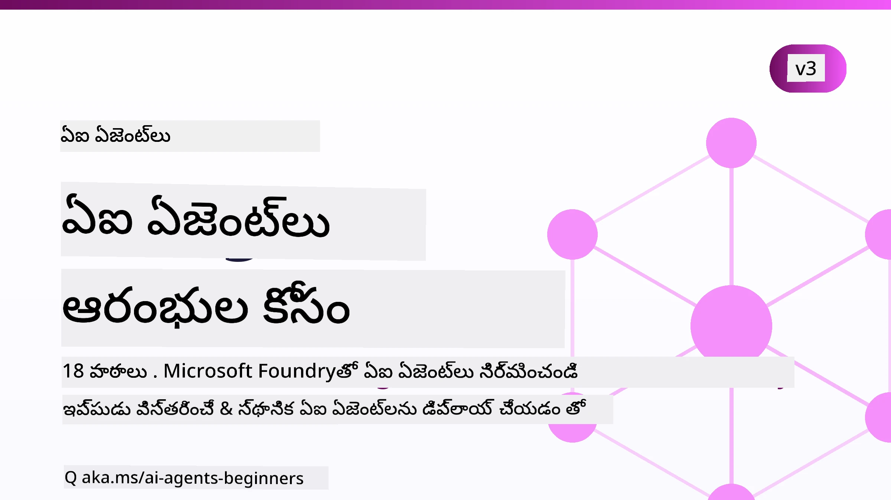

# కొత్తవారికి AI ఏజెంట్స్ - ఒక కోర్సు



## AI ఏజెంట్స్ నిర్మించడం ప్రారంభించడానికి మీకు అవసరమైన ప్రతింటిని నేర్పించే కోర్సు

[](https://github.com/microsoft/ai-agents-for-beginners/blob/master/LICENSE?WT.mc_id=academic-105485-koreyst)
[](https://GitHub.com/microsoft/ai-agents-for-beginners/graphs/contributors/?WT.mc_id=academic-105485-koreyst)
[](https://GitHub.com/microsoft/ai-agents-for-beginners/issues/?WT.mc_id=academic-105485-koreyst)
[](https://GitHub.com/microsoft/ai-agents-for-beginners/pulls/?WT.mc_id=academic-105485-koreyst)
[](http://makeapullrequest.com?WT.mc_id=academic-105485-koreyst)

### 🌐 బహుభాషా మద్దతు

#### [కో-ఆప్ ట్రాన్స్లేటర్](https://github.com/Azure/co-op-translator)తో నిర్వహించబడిన అనువాదాలు

<!-- CO-OP TRANSLATOR LANGUAGES TABLE START -->
[Arabic](../ar/README.md) | [Bengali](../bn/README.md) | [Bulgarian](../bg/README.md) | [Burmese (Myanmar)](../my/README.md) | [Chinese (Simplified)](../zh-CN/README.md) | [Chinese (Traditional, Hong Kong)](../zh-HK/README.md) | [Chinese (Traditional, Macau)](../zh-MO/README.md) | [Chinese (Traditional, Taiwan)](../zh-TW/README.md) | [Croatian](../hr/README.md) | [Czech](../cs/README.md) | [Danish](../da/README.md) | [Dutch](../nl/README.md) | [Estonian](../et/README.md) | [Finnish](../fi/README.md) | [French](../fr/README.md) | [German](../de/README.md) | [Greek](../el/README.md) | [Hebrew](../he/README.md) | [Hindi](../hi/README.md) | [Hungarian](../hu/README.md) | [Indonesian](../id/README.md) | [Italian](../it/README.md) | [Japanese](../ja/README.md) | [Kannada](../kn/README.md) | [Khmer](../km/README.md) | [Korean](../ko/README.md) | [Lithuanian](../lt/README.md) | [Malay](../ms/README.md) | [Malayalam](../ml/README.md) | [Manipuri (Meitei Mayek)](../mni/README.md) | [Marathi](../mr/README.md) | [Nepali](../ne/README.md) | [Nigerian Pidgin](../pcm/README.md) | [Norwegian](../no/README.md) | [Persian (Farsi)](../fa/README.md) | [Polish](../pl/README.md) | [Portuguese (Brazil)](../pt-BR/README.md) | [Portuguese (Portugal)](../pt-PT/README.md) | [Punjabi (Gurmukhi)](../pa/README.md) | [Romanian](../ro/README.md) | [Russian](../ru/README.md) | [Serbian (Cyrillic)](../sr/README.md) | [Slovak](../sk/README.md) | [Slovenian](../sl/README.md) | [Spanish](../es/README.md) | [Swahili](../sw/README.md) | [Swedish](../sv/README.md) | [Tagalog (Filipino)](../tl/README.md) | [Tamil](../ta/README.md) | [Telugu](./README.md) | [Thai](../th/README.md) | [Turkish](../tr/README.md) | [Ukrainian](../uk/README.md) | [Urdu](../ur/README.md) | [Vietnamese](../vi/README.md)

> **స్థానికంగా క్లోన్ చేయాలని ఇష్టపడ్డారా?**
>
> ఈ రిపాజిటరీ 50+ భాషా అనువాదాలను కలిగి ఉంటుంది, ఇది డౌన్లోడ్ పరిమాణాన్ని గణనీయంగా పెంచుతుంది. అనువాదాల లేకుండా క్లోన్ చేయడానికి, స్పార్స్ చెకౌట్ ఉపయోగించండి:
>
> **Bash / macOS / Linux:**
> ```bash
> git clone --filter=blob:none --sparse https://github.com/microsoft/ai-agents-for-beginners.git
> cd ai-agents-for-beginners
> git sparse-checkout set --no-cone '/*' '!translations' '!translated_images'
> ```
>
> **CMD (Windows):**
> ```cmd
> git clone --filter=blob:none --sparse https://github.com/microsoft/ai-agents-for-beginners.git
> cd ai-agents-for-beginners
> git sparse-checkout set --no-cone "/*" "!translations" "!translated_images"
> ```
>
> ఇది మీకు కోర్సును పూర్తి చేసుకోవడానికి అవసరమైన ప్రతిదాన్ని చాలా వేగంగా డౌన్లోడ్ చేసేలా ఇస్తుంది.
<!-- CO-OP TRANSLATOR LANGUAGES TABLE END -->

**మరిన్ని భాషా ఎంపికల కోసం, చూడండి [కో-ఆప్ ట్రాన్స్లేటర్ సపోర్టెడ్ భాషలు](https://github.com/Azure/co-op-translator/blob/main/docs/supported-languages.md).**

[](https://GitHub.com/microsoft/ai-agents-for-beginners/watchers/?WT.mc_id=academic-105485-koreyst)
[](https://GitHub.com/microsoft/ai-agents-for-beginners/network/?WT.mc_id=academic-105485-koreyst)
[](https://GitHub.com/microsoft/ai-agents-for-beginners/stargazers/?WT.mc_id=academic-105485-koreyst)

[](https://discord.com/invite/ATgtXmAS5D)


## 🌱 ప్రారంభించండి

ఈ కోర్సు AI ఏజెంట్స్ నిర్మాణం యొక్క సూత్రాలను కవర్ చేసే పాఠాలు ఉన్నాయి. ప్రతి పాఠం దాని ప్రత్యేక విషయాన్ని కవర్ చేస్తుంది కాబట్టి మీరు ఇష్టమైనదానితో ప్రారంభించండి!

ఈ కోర్సుకు బహుభాషా మద్దతు ఉంది. మా [ఇక్కడ అందుబాటులో ఉన్న భాషలను](#-multi-language-support) చూడండి. 

మీకు ఇది జనరేటివ్ AI మోడల్స్‌తో మొదటి సారి నిర్మాణం అయితే, మా [కొత్తవారికి జనరేటివ్ AI](https://aka.ms/genai-beginners) కోర్సును చూడండి, దీనిలో 21 పాఠాలు GenAIతో నిర్మాణం గురించి ఉన్నాయి.

ఈ రిపోను [స్టార్ చేయడం (🌟)](https://docs.github.com/en/get-started/exploring-projects-on-github/saving-repositories-with-stars?WT.mc_id=academic-105485-koreyst) మరియు కోడ్ రన్ చేయడానికి [ఫోర్క్ చేయడం](https://github.com/microsoft/ai-agents-for-beginners/fork) మర్చిపోవద్దు.

### ఇతర అభ్యసనసంబంధులను కలుసుకోండి, మీ ప్రశ్నలకు జవాబులు పొందండి

మీరు ఇబ్బందిలోపోతే లేదా AI ఏజెంట్స్ నిర్మాణంపై ఏదైనా ప్రశ్నలు ఉంటే, మా ప్రత్యేక డిస్కార్డ్ ఛానెల్‌లో చేరండి [Microsoft Foundry Discord](https://aka.ms/ai-agents/discord).

### మీకు అవసరం ఉన్నవి

ఈ కోర్సులో ప్రతి పాఠం కోడ్ ఉదాహరణలను కలిగి ఉంటుంది, అవి code_samples ఫోల్డర్‌లో ఉన్నాయి. మీరు మీకు స్వంత కాపీ సృష్టించడానికి [ఈ రిపోను ఫోర్క్ చేయవచ్చు](https://github.com/microsoft/ai-agents-for-beginners/fork).

ఈ వ్యాయామాలలోని కోడ్ ఉదాహరణలు Microsoft Agent Framework ను Microsoft Foundry Agent Service V2తో ఉపయోగిస్తున్నాయి:

- [Microsoft Foundry](https://aka.ms/ai-agents-beginners/ai-foundry) - Azure ఖాతా అవసరం

ఈ కోרסు Microsoft నుండి క్రింది AI ఏజెంట్ ఫ్రేమ్‌వర్క్స్ మరియు సేవలను ఉపయోగిస్తుంది:

- [Microsoft Agent Framework (MAF)](https://learn.microsoft.com/agent-framework/overview/)
- [Microsoft Foundry Agent Service V2](https://aka.ms/ai-agents-beginners/ai-agent-service)

కొన్ని కోడ్ నమూనాలు [MiniMax](https://platform.minimaxi.com/) వంటి ఎంపిక OpenAI-సరిపోలిన ప్రొవైడర్లను మద్దతు ఇస్తాయి, ఇవి పెద్ద-సందర్భ మోడల్స్ (204K టోకన్ల వరకు) అందిస్తున్నాయి. కాన్ఫిగరేషన్ వివరాలకు [కోర్సు సెటప్](./00-course-setup/README.md) చూడండి.

ఈ కోర్సు కోడ్ నడిపించడానికి మరింత సమాచారం కోసం [కోర్సు సెటప్](./00-course-setup/README.md)కు వెళ్ళండి.

## 🙏 సహాయం చేయాలనుకుంటున్నారా?

మీకు సూచనలు లేదా స్పెల్లింగ్ లేదా కోడ్ లో తప్పిదాలు కనిపిస్తే, [Issue నమోదు చేయండి](https://github.com/microsoft/ai-agents-for-beginners/issues?WT.mc_id=academic-105485-koreyst) లేదా [పుల్ రిక్వెస్ట్ సృష్టించండి](https://github.com/microsoft/ai-agents-for-beginners/pulls?WT.mc_id=academic-105485-koreyst)


## 📂 ప్రతి పాఠంలో ఉన్నవి

- READMEలో ఉన్న రాత పాఠం మరియు ఒక చిన్న వీడియో
- Microsoft Agent Frameworkతో Python కోడ్ నమూనాలు Microsoft Foundry సహాయంతో
- మీ అభ్యాసాన్ని కొనసాగించడానికి అదనపు వనరులకి లింకులు


## 🗃️ పాఠాలు

| **పాఠం**                                  | **రాత & కోడ్**                                | **వీడియో**                                           | **మరింత అభ్యాసం**                                                                            |
|--------------------------------------------|---------------------------------------------|-----------------------------------------------------|---------------------------------------------------------------------------------------------|
| AI ఏజెంట్స్ మరియు ఏజెంట్ వాడుక పరిచయం         | [లింక్](./01-intro-to-ai-agents/README.md)              | [వీడియో](https://youtu.be/3zgm60bXmQk?si=z8QygFvYQv-9WtO1)                 | [లింక్](https://aka.ms/ai-agents-beginners/collection?WT.mc_id=academic-105485-koreyst)                                                              |
| AI ఏజెంటిక్ ఫ్రేమ్‌వర్క్ల అన్వేషణ             | [లింక్](./02-explore-agentic-frameworks/README.md)              | [వీడియో](https://youtu.be/ODwF-EZo_O8?si=Vawth4hzVaHv-u0H)                 | [లింక్](https://aka.ms/ai-agents-beginners/collection?WT.mc_id=academic-105485-koreyst)                                                              |
| AI ఏజెంటిక్ డిజైన్ నమూనాల అవగాహన            | [లింక్](./03-agentic-design-patterns/README.md)              | [వీడియో](https://youtu.be/m9lM8qqoOEA?si=BIzHwzstTPL8o9GF)                 | [లింక్](https://aka.ms/ai-agents-beginners/collection?WT.mc_id=academic-105485-koreyst)                                                              |
| టూల్ వాడకం డిజైన్ నమూనా                      | [లింక్](./04-tool-use/README.md)              | [వీడియో](https://youtu.be/vieRiPRx-gI?si=2z6O2Xu2cu_Jz46N)                | [లింక్](https://aka.ms/ai-agents-beginners/collection?WT.mc_id=academic-105485-koreyst)                                                             |
| ఏజెంటిక్ RAG                                  | [లింక్](./05-agentic-rag/README.md)             | [వీడియో](https://youtu.be/WcjAARvdL7I?si=gKPWsQpKiIlDH9A3)                | [లింక్](https://aka.ms/ai-agents-beginners/collection?WT.mc_id=academic-105485-koreyst)                                                             |
| నమ్మదగిన AI ఏజెంట్స్ నిర్మించడం             | [లింక్](./06-building-trustworthy-agents/README.md)             | [వీడియో](https://youtu.be/iZKkMEGBCUQ?si=jZjpiMnGFOE9L8OK)                | [లింక్](https://aka.ms/ai-agents-beginners/collection?WT.mc_id=academic-105485-koreyst)                                                             |
| ప్లానింగ్ డిజైన్ నమూనా                        | [లింక్](./07-planning-design/README.md)             | [వీడియో](https://youtu.be/kPfJ2BrBCMY?si=6SC_iv_E5-mzucnC)                | [లింక్](https://aka.ms/ai-agents-beginners/collection?WT.mc_id=academic-105485-koreyst)                                                             |
| బహుఎజెంట్ డిజైన్ నమూనా                        | [లింక్](./08-multi-agent/README.md)             | [వీడియో](https://youtu.be/V6HpE9hZEx0?si=rMgDhEu7wXo2uo6g)                | [లింక్](https://aka.ms/ai-agents-beginners/collection?WT.mc_id=academic-105485-koreyst)                                                             |
| మెటాకాగ్నిషన్ డిజైన్ నమూనా                    | [లింక్](./09-metacognition/README.md)             | [వీడియో](https://youtu.be/His9R6gw6Ec?si=8gck6vvdSNCt6OcF)                | [లింక్](https://aka.ms/ai-agents-beginners/collection?WT.mc_id=academic-105485-koreyst)                                                             |
| ఉత్పత్తిలో AI ఏజెంట్స్                        | [లింక్](./10-ai-agents-production/README.md)             | [వీడియో](https://youtu.be/l4TP6IyJxmQ?si=31dnhexRo6yLRJDl)                | [లింక్](https://aka.ms/ai-agents-beginners/collection?WT.mc_id=academic-105485-koreyst)                                                             |
| ఏజెంటిక్ ప్రోటోకాల్స్ వాడకం (MCP, A2A మరియు NLWeb) | [లింక్](./11-agentic-protocols/README.md)             | [వీడియో](https://youtu.be/X-Dh9R3Opn8)                | [లింక్](https://aka.ms/ai-agents-beginners/collection?WT.mc_id=academic-105485-koreyst)                                                             |
| AI ఏజెంట్స్ కోసం కాంటెక్స్ ఇంజనీరింగ్        | [లింక్](./12-context-engineering/README.md)             | [వీడియో](https://youtu.be/F5zqRV7gEag)                | [లింక్](https://aka.ms/ai-agents-beginners/collection?WT.mc_id=academic-105485-koreyst)                                                             |
| ఏజెంటిక్ మెమరీ నిర్వహణ                     | [లింక్](./13-agent-memory/README.md)             | [వీడియో](https://youtu.be/QrYbHesIxpw?si=vZkVwKrQ4ieCcIPx)                                                        |                                                                                              |
| Microsoft Agent Framework అన్వేషణ            | [లింక్](./14-microsoft-agent-framework/README.md)                                                        |                                                     |                                                                                              |
| కంప్యూటర్ వాడుకునే ఏజెంట్స్ (CUA) నిర్మాణం       | [లింక్](./15-browser-use/README.md)                                                        |                                                     | [లింక్](https://docs.browser-use.com/examples/templates/playwright-integration)                                                             |
| పెరిగే ఏజెంట్స్ ని డిప్లాయ్ చేయడం             | [లింక్](./16-deploying-scalable-agents/README.md)                                                        |                                                     | [లింక్](https://learn.microsoft.com/azure/ai-foundry/agents/overview)                                                             |
| స్థానిక AI ఏజెంట్స్ సృష్టించడం               | [లింక్](./17-creating-local-ai-agents/README.md)                                                        |                                                     | [లింక్](https://learn.microsoft.com/azure/ai-foundry/foundry-local/)                                                             |
| AI ఏజెంట్స్ భద్రపరచడం                        | [లింక్](./18-securing-ai-agents/README.md)                                                        |                                                     | [లింక్](https://aka.ms/ai-agents-beginners/collection?WT.mc_id=academic-105485-koreyst)                                                             |

## 🎒 ఇతర కోర్సులు

మా బృందం ఇతర కోర్సులూ ఉత్పత్తి చేస్తోంది! చూసి చూడండి:

<!-- CO-OP TRANSLATOR OTHER COURSES START -->
### లాంగ్‌చైన్
[](https://aka.ms/langchain4j-for-beginners)
[](https://aka.ms/langchainjs-for-beginners?WT.mc_id=m365-94501-dwahlin)
[](https://github.com/microsoft/langchain-for-beginners?WT.mc_id=m365-94501-dwahlin)
---

### Azure / Edge / MCP / ఏజెంట్స్
[](https://github.com/microsoft/AZD-for-beginners?WT.mc_id=academic-105485-koreyst)
[](https://github.com/microsoft/edgeai-for-beginners?WT.mc_id=academic-105485-koreyst)
[](https://github.com/microsoft/mcp-for-beginners?WT.mc_id=academic-105485-koreyst)
[](https://github.com/microsoft/ai-agents-for-beginners?WT.mc_id=academic-105485-koreyst)

---
 
### జనరేటివ్ AI సీరీస్
[](https://github.com/microsoft/generative-ai-for-beginners?WT.mc_id=academic-105485-koreyst)
[-9333EA?style=for-the-badge&labelColor=E5E7EB&color=9333EA)](https://github.com/microsoft/Generative-AI-for-beginners-dotnet?WT.mc_id=academic-105485-koreyst)
[-C084FC?style=for-the-badge&labelColor=E5E7EB&color=C084FC)](https://github.com/microsoft/generative-ai-for-beginners-java?WT.mc_id=academic-105485-koreyst)
[-E879F9?style=for-the-badge&labelColor=E5E7EB&color=E879F9)](https://github.com/microsoft/generative-ai-with-javascript?WT.mc_id=academic-105485-koreyst)

---
 
### ప్రాథమిక అభ్యాసం
[](https://aka.ms/ml-beginners?WT.mc_id=academic-105485-koreyst)
[](https://aka.ms/datascience-beginners?WT.mc_id=academic-105485-koreyst)
[](https://aka.ms/ai-beginners?WT.mc_id=academic-105485-koreyst)
[](https://github.com/microsoft/Security-101?WT.mc_id=academic-96948-sayoung)
[](https://aka.ms/webdev-beginners?WT.mc_id=academic-105485-koreyst)
[](https://aka.ms/iot-beginners?WT.mc_id=academic-105485-koreyst)
[](https://github.com/microsoft/xr-development-for-beginners?WT.mc_id=academic-105485-koreyst)

---
 
### కోపైలట్ సిరీస్
[](https://aka.ms/GitHubCopilotAI?WT.mc_id=academic-105485-koreyst)
[](https://github.com/microsoft/mastering-github-copilot-for-dotnet-csharp-developers?WT.mc_id=academic-105485-koreyst)
[](https://github.com/microsoft/CopilotAdventures?WT.mc_id=academic-105485-koreyst)
<!-- CO-OP TRANSLATOR OTHER COURSES END -->

## 🌟 సముదాయం ధన్యవాదాలు

Agentic RAGను ప్రదర్శించే ముఖ్యమైన కోడ్ నమూనాలను అందించినందుకు [శివం గొయల్](https://www.linkedin.com/in/shivam2003/)కు ధన్యవాదాలు.

## సహకారం

ఈ ప్రాజెక్ట్ సహకారాలు మరియు సూచనలను స్వాగతిస్తుంది.  చాలా సహకారాలు మీరు ఒక
కాంట్రిబ్యూటర్ లైసెన్స్ ఒప్పందం (CLA)కి అంగీకరించాలన్న విషయం కోరతాయి, ఇది మీరు మీ
సహకారాన్ని ఉపయోగించుకునేందుకు హక్కు కలిగి మరియు నిజంగా అందిస్తున్నారని ప్రస్తావిస్తుంది. వివరాలకు, సందర్శించండి <https://cla.opensource.microsoft.com>.

మీరు ఒక పుల్ రిక్వెస్ట్‌ను సమర్పించినప్పుడు, CLA బాట్ ఆటోమాటిక్‌ గా మీరు CLA అందించాల్సి ఉందా లేదా అని నిర్ధారించి
PRకు సరైన అలంకరణ (ఉదాహరణకు, స్థితి తనిఖీ, వ్యాఖ్య) చేస్తుంది. బాట్ ఇస్తున్న సూచనలను అనుసరించండి.
ఇది మీరు మా CLAని ఉపయోగిస్తున్న అన్ని రిపోజిటరీలలో ఒక్కసారి మాత్రమే చేయవలసి ఉంటుంది.

ఈ ప్రాజెక్ట్ [Microsoft ఓపెన్ సోర్స్ కోడ్ ఆఫ్ కండక్ట్](https://opensource.microsoft.com/codeofconduct/)ను అనుసరిస్తుంది.
మరిన్ని సమాచారానికి [Code of Conduct FAQ](https://opensource.microsoft.com/codeofconduct/faq/) ను చూడండి లేదా
ఏవైనా అదనపు ప్రశ్నలు లేదా הערות కోసం [opencode@microsoft.com](mailto:opencode@microsoft.com) ను సంప్రదించండి.

## ట్రేడ్మార్కులు

ఈ ప్రాజెక్ట్ ప్రాజెక్టులు, ఉత్పత్తులు లేదా సేవల కోసం ట్రేడ్మార్కులు లేదా లోగోలతో ఉండవచ్చు. Microsoft
ట్రేడ్మార్కులు లేదా లోగోల అధికృత వినియోగం [Microsoft's Trademark & Brand Guidelines](https://www.microsoft.com/legal/intellectualproperty/trademarks/usage/general) అనుసరించాలి.

ఈ ప్రాజెక్ట్ మార్పిడి సంస్కరణల్లో Microsoft ట్రేడ్మార్కులు లేదా లోగోల వినియోగం గందరగోళం కలిగించకూడదు లేదా Microsoft స్పాన్సర్షిప్ సూచించకూడదు.
మూడో పార్టీ ట్రేడ్మార్కులు లేదా లోగోలు వినియోగం ఆ మూడో పార్టీ పాలసీలకు అనుగుణంగా ఉండాలి.

## సహాయం పొందడం


మీరు ఇబ్బందిలో పడ్డా లేదా AI యాప్‌లను నిర్మించడంపై ఏవైనా ప్రశ్నలుంటే, క్రింది లింక్ ద్వారా చేరండి:

[](https://aka.ms/foundry/discord)

మీరు ఉత్పత్తిపై సూచనలు లేదా నిర్మాణ సమయంలో లోపాలను కలిగి ఉంటే సందర్శించండి:

[](https://aka.ms/foundry/forum)

---

<!-- CO-OP TRANSLATOR DISCLAIMER START -->
**అస్వీకరణ**:
ఈ పత్రం AI అనువాద సేవ [Co-op Translator](https://github.com/Azure/co-op-translator) ఉపయోగించి అనువదించబడింది. మేము ఖచ్చితత్వానికి ప్రయత్నిస్తున్నప్పటికీ, ఆటోమేటెడ్ అనువాదాలు తప్పులు లేదా అసమగ్రతలను కలిగి ఉండవచ్చు. దాని స్వదేశ భాషలో ఉన్న అసలు పత్రాన్ని అధికారం కలిగిన మూలంగా పరిగణించాలి. కీలకమైన సమాచారం కోసం, ప్రొఫెషనల్ మానవ అనువాదాన్ని సిఫారసు చేస్తాము. ఈ అనువాదం ఉపయోగం వల్ల కలిగే ఏవైనా అపార్థాలు లేదా తప్పుదారులు కోసం మేము బాధ్యత వహించము.
<!-- CO-OP TRANSLATOR DISCLAIMER END -->