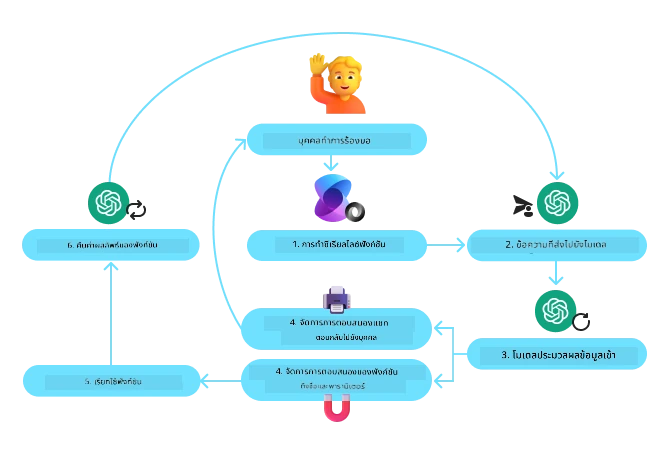
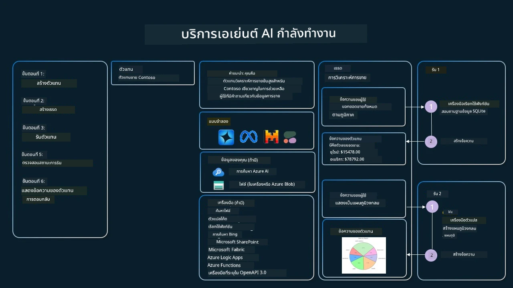

[](https://youtu.be/vieRiPRx-gI?si=cEZ8ApnT6Sus9rhn)

> _(คลิกที่รูปภาพด้านบนเพื่อดูวิดีโอของบทเรียนนี้)_

# รูปแบบการออกแบบการใช้เครื่องมือ

เครื่องมือเป็นสิ่งที่น่าสนใจเพราะช่วยให้เอเย่นต์ AI มีความสามารถที่กว้างกว่า แทนที่จะให้เอเย่นต์มีชุดการกระทำที่จำกัดเพียงอย่างเดียว การเพิ่มเครื่องมือเข้าไปทำให้เอเย่นต์สามารถทำการกระทำที่หลากหลายได้ ในบทนี้เราจะมาดูรูปแบบการออกแบบการใช้เครื่องมือ ซึ่งอธิบายว่าเอเย่นต์ AI สามารถใช้เครื่องมือเฉพาะเพื่อบรรลุเป้าหมายได้อย่างไร

## บทนำ

ในบทเรียนนี้ เราจะตอบคำถามต่อไปนี้:

- รูปแบบการออกแบบการใช้เครื่องมือคืออะไร?
- มีกรณีใช้งานประเภทใดบ้างที่สามารถใช้ได้?
- องค์ประกอบหรือบล็อกการสร้างใดที่จำเป็นสำหรับการใช้งานรูปแบบการออกแบบนี้?
- มีข้อพิจารณาพิเศษใดบ้างเมื่อต้องใช้รูปแบบการออกแบบการใช้เครื่องมือเพื่อสร้างเอเย่นต์ AI ที่น่าเชื่อถือ?

## เป้าหมายการเรียนรู้

หลังจากจบบทเรียนนี้ คุณจะสามารถ:

- นิยามรูปแบบการออกแบบการใช้เครื่องมือและวัตถุประสงค์ของมันได้
- ระบุกรณีใช้งานที่สามารถนำรูปแบบการออกแบบการใช้เครื่องมือไปใช้ได้
- เข้าใจองค์ประกอบสำคัญที่จำเป็นสำหรับการใช้งานรูปแบบการออกแบบนี้
- ตระหนักถึงข้อพิจารณาเพื่อความน่าเชื่อถือในเอเย่นต์ AI ที่ใช้รูปแบบการออกแบบนี้

## รูปแบบการออกแบบการใช้เครื่องมือคืออะไร?

**รูปแบบการออกแบบการใช้เครื่องมือ** มุ่งเน้นที่การให้ LLMs มีความสามารถในการโต้ตอบกับเครื่องมือภายนอกเพื่อบรรลุเป้าหมายเฉพาะ เครื่องมือคือโค้ดที่สามารถถูกดำเนินการโดยเอเย่นต์เพื่อทำภารกิจ เครื่องมืออาจเป็นฟังก์ชันง่าย ๆ เช่น เครื่องคิดเลข หรือการเรียก API ไปยังบริการของบุคคลที่สาม เช่น การค้นหาราคาหุ้นหรือพยากรณ์อากาศ ในบริบทของเอเย่นต์ AI เครื่องมือถูกออกแบบให้เอเย่นต์สามารถเรียกใช้งานได้ในตอบสนองต่อ **ฟังก์ชันที่โมเดลสร้างขึ้น** 

## กรณีใช้งานที่สามารถนำไปใช้ได้มีอะไรบ้าง?

เอเย่นต์ AI สามารถใช้เครื่องมือเพื่อทำงานที่ซับซ้อน ดึงข้อมูล หรือการตัดสินใจ รูปแบบการออกแบบการใช้เครื่องมือมักใช้ในสถานการณ์ที่ต้องมีการโต้ตอบแบบไดนามิกกับระบบภายนอก เช่น ฐานข้อมูล บริการเว็บ หรือเครื่องมือแปลความโค้ด ความสามารถนี้เหมาะสำหรับกรณีใช้งานหลายประเภทได้แก่:

- **การดึงข้อมูลแบบไดนามิก:** เอเย่นต์สามารถสอบถามข้อมูลจาก API ภายนอกหรือฐานข้อมูลเพื่อดึงข้อมูลที่เป็นปัจจุบัน (เช่น การสอบถามฐานข้อมูล SQLite สำหรับการวิเคราะห์ข้อมูล, การดึงราคาหุ้นหรือข้อมูลสภาพอากาศ)
- **การดำเนินการและการแปลความโค้ด:** เอเย่นต์สามารถรันโค้ดหรือสคริปต์เพื่อแก้ปัญหาทางคณิตศาสตร์ สร้างรายงาน หรือทำการจำลอง
- **การทำงานอัตโนมัติในกระบวนการทำงาน:** อัตโนมัติการทำงานที่ซ้ำซ้อนหรือหลายขั้นตอนโดยผสานรวมเครื่องมือ เช่น ตัวกำหนดเวลางาน บริการอีเมล หรือท่อข้อมูล
- **บริการลูกค้า:** เอเย่นต์สามารถโต้ตอบกับระบบ CRM แพลตฟอร์มตั๋ว หรือฐานความรู้เพื่อตอบคำถามของผู้ใช้
- **การสร้างและแก้ไขเนื้อหา:** เอเย่นต์สามารถใช้เครื่องมือตรวจแกรมม่าร์ ตัวสรุปข้อความ หรือเครื่องมือประเมินความปลอดภัยของเนื้อหาเพื่อช่วยในงานสร้างเนื้อหา

## องค์ประกอบหรือบล็อกการสร้างที่จำเป็นสำหรับการใช้งานรูปแบบการออกแบบการใช้เครื่องมือคืออะไร?

บล็อกการสร้างเหล่านี้ช่วยให้เอเย่นต์ AI สามารถทำงานที่หลากหลายได้ เรามาดูองค์ประกอบสำคัญที่จำเป็นสำหรับการใช้งานรูปแบบการออกแบบการใช้เครื่องมือกัน:

- **สคีมาฟังก์ชั่น/เครื่องมือ:** คำจำกัดความอย่างละเอียดของเครื่องมือที่มีอยู่ รวมถึงชื่อฟังก์ชัน วัตถุประสงค์ พารามิเตอร์ที่ต้องการ และผลลัพธ์ที่คาดหวัง สคีมาเหล่านี้ช่วยให้ LLM เข้าใจว่าเครื่องมือใดที่พร้อมใช้งานและวิธีสร้างคำขอที่ถูกต้อง

- **ตรรกะการดำเนินการฟังก์ชัน:** กำหนดวิธีและเวลาที่เครื่องมือถูกเรียกใช้งานตามความตั้งใจของผู้ใช้และบริบทการสนทนา อาจรวมถึงโมดูลวางแผน กลไกการจัดเส้นทาง หรือการไหลเงื่อนไขที่กำหนดการใช้เครื่องมือแบบไดนามิก

- **ระบบจัดการข้อความ:** ส่วนประกอบที่จัดการการไหลของการสนทนาระหว่างอินพุตผู้ใช้ การตอบกลับของ LLM การเรียกเครื่องมือ และผลลัพธ์ของเครื่องมือ

- **โครงสร้างผสานเครื่องมือ:** โครงสร้างพื้นฐานที่เชื่อมต่อเอเย่นต์กับเครื่องมือต่าง ๆ ไม่ว่าจะเป็นฟังก์ชันง่าย ๆ หรือบริการภายนอกที่ซับซ้อน

- **การจัดการข้อผิดพลาดและการตรวจสอบ:** กลไกจัดการความล้มเหลวในการดำเนินการเครื่องมือ ตรวจสอบพารามิเตอร์ และจัดการกับผลลัพธ์ที่ไม่คาดคิด

- **การจัดการสถานะ:** ติดตามบริบทการสนทนา การโต้ตอบเครื่องมือก่อนหน้า และข้อมูลทนทานเพื่อให้มั่นใจในความสอดคล้องตลอดการโต้ตอบหลายรอบ

ต่อไปเราจะมาดูรายละเอียดของการเรียกใช้ฟังก์ชัน/เครื่องมือ
 
### การเรียกใช้งานฟังก์ชัน/เครื่องมือ

การเรียกใช้งานฟังก์ชันเป็นวิธีหลักที่ช่วยให้โมเดลภาษาใหญ่ (LLMs) สามารถโต้ตอบกับเครื่องมือได้ คุณมักจะเห็นคำว่า 'ฟังก์ชัน' และ 'เครื่องมือ' ใช้แทนกันเพราะ 'ฟังก์ชัน' (บล็อกโค้ดที่นำกลับมาใช้ได้) คือ 'เครื่องมือ' ที่เอเย่นต์ใช้ทำงาน เพื่อให้โค้ดของฟังก์ชันถูกเรียกใช้งาน LLM ต้องเปรียบเทียบคำขอของผู้ใช้กับคำอธิบายของฟังก์ชัน โดยจะส่งสคีมาที่มีคำอธิบายของทุกฟังก์ชันที่มีให้ LLM จากนั้น LLM จะเลือกฟังก์ชันที่เหมาะสมที่สุดสำหรับงานและส่งคืนชื่อฟังก์ชันพร้อมอาร์กิวเมนต์ ฟังก์ชันที่เลือกจะถูกเรียกใช้งาน ผลตอบกลับถูกส่งกลับไปให้ LLM ซึ่งใช้ข้อมูลนั้นเพื่อตอบคำขอของผู้ใช้

สำหรับนักพัฒนาในการใช้งานการเรียกฟังก์ชันสำหรับเอเย่นต์ คุณจะต้องมี:

1. โมเดล LLM ที่รองรับการเรียกฟังก์ชัน
2. สคีมาที่มีคำอธิบายของฟังก์ชันต่าง ๆ
3. โค้ดของแต่ละฟังก์ชันที่อธิบายไว้

เราจะใช้ตัวอย่างการขอเวลาปัจจุบันในเมืองหนึ่งมาอธิบาย:

1. **เริ่มต้นโมเดล LLM ที่รองรับการเรียกฟังก์ชัน:**

    ไม่ใช่โมเดลทุกตัวที่รองรับการเรียกฟังก์ชัน ดังนั้นจึงสำคัญที่ต้องตรวจสอบว่า LLM ที่คุณใช้รองรับหรือไม่     <a href="https://learn.microsoft.com/azure/ai-services/openai/how-to/function-calling" target="_blank">Azure OpenAI</a> รองรับการเรียกฟังก์ชัน เราสามารถเริ่มต้นโดยการสร้างไคลเอนต์ OpenAI กับ Azure OpenAI **Responses API** (endpoint `/openai/v1/` ที่เสถียร — ไม่ต้องใช้ `api_version`)

    ```python
    # Initialize the OpenAI client for Azure OpenAI (Responses API, v1 endpoint)
    client = OpenAI(
        base_url=f"{os.environ['AZURE_OPENAI_ENDPOINT'].rstrip('/')}/openai/v1/",
        api_key=os.environ["AZURE_OPENAI_API_KEY"],
    )
    deployment_name = os.environ["AZURE_OPENAI_DEPLOYMENT"]
    ```

1. **สร้างสคีมาฟังก์ชัน**:

    ต่อไปเราจะกำหนด JSON สคีมาที่มีชื่อฟังก์ชัน คำอธิบายว่าฟังก์ชันทำอะไร และชื่อรวมถึงคำอธิบายของพารามิเตอร์ฟังก์ชัน
    แล้วเราจะส่งสคีมานี้ให้ไคลเอนต์ที่สร้างขึ้นก่อนหน้า พร้อมกับคำขอของผู้ใช้ที่ต้องการค้นหาเวลาที่ San Francisco สิ่งสำคัญที่ต้องเข้าใจคือ **การเรียกเครื่องมือ** คือผลลัพธ์ที่ส่งกลับมา **ไม่ใช่** คำตอบสุดท้ายของคำถาม ตามที่กล่าวไว้ก่อนหน้านี้ LLM จะส่งคืนชื่อฟังก์ชันที่เลือกสำหรับงานและอาร์กิวเมนต์ที่จะส่งไปให้

    ```python
    # Function description for the model to read (Responses API flat tool format)
    tools = [
        {
            "type": "function",
            "name": "get_current_time",
            "description": "Get the current time in a given location",
            "parameters": {
                "type": "object",
                "properties": {
                    "location": {
                        "type": "string",
                        "description": "The city name, e.g. San Francisco",
                    },
                },
                "required": ["location"],
            },
        }
    ]
    ```
   
    ```python
  
    # Initial user message
    messages = [{"role": "user", "content": "What's the current time in San Francisco"}]

    # First API call: Ask the model to use the function
    response = client.responses.create(
        model=deployment_name,
        input=messages,
        tools=tools,
        tool_choice="auto",
        store=False,
    )

    # The Responses API returns tool calls as function_call items in response.output.
    # Append them to the conversation so the model has full context on the next turn.
    messages += response.output

    print("Model's response:")
    print(response.output)
  
    ```

    ```bash
    Model's response:
    [ResponseFunctionToolCall(arguments='{"location":"San Francisco"}', call_id='call_pOsKdUlqvdyttYB67MOj434b', name='get_current_time', type='function_call')]
    ```
  
1. **โค้ดฟังก์ชันที่จำเป็นสำหรับการทำงาน:**

    เมื่อ LLM เลือกฟังก์ชันที่จะเรียกใช้งานแล้ว โค้ดที่ทำงานจริงต้องถูกเขียนและดำเนินการ
    เราสามารถเขียนโค้ดเพื่อดึงเวลาปัจจุบันใน Python และต้องเขียนโค้ดเพื่อสกัดชื่อกับอาร์กิวเมนต์จาก response_message เพื่อรับผลลัพธ์สุดท้าย

    ```python
      def get_current_time(location):
        """Get the current time for a given location"""
        print(f"get_current_time called with location: {location}")  
        location_lower = location.lower()
        
        for key, timezone in TIMEZONE_DATA.items():
            if key in location_lower:
                print(f"Timezone found for {key}")  
                current_time = datetime.now(ZoneInfo(timezone)).strftime("%I:%M %p")
                return json.dumps({
                    "location": location,
                    "current_time": current_time
                })
      
        print(f"No timezone data found for {location_lower}")  
        return json.dumps({"location": location, "current_time": "unknown"})
    ```

     ```python
    # Handle function calls
    tool_calls = [item for item in response.output if item.type == "function_call"]
    if tool_calls:
        for tool_call in tool_calls:
            if tool_call.name == "get_current_time":

                function_args = json.loads(tool_call.arguments)

                time_response = get_current_time(
                    location=function_args.get("location")
                )

                # Return the tool result as a function_call_output item
                messages.append({
                    "type": "function_call_output",
                    "call_id": tool_call.call_id,
                    "output": time_response,
                })
    else:
        print("No tool calls were made by the model.")

    # Second API call: Get the final response from the model
    final_response = client.responses.create(
        model=deployment_name,
        input=messages,
        tools=tools,
        store=False,
    )

    return final_response.output_text
     ```

     ```bash
      get_current_time called with location: San Francisco
      Timezone found for san francisco
      The current time in San Francisco is 09:24 AM.
     ```

การเรียกฟังก์ชันเป็นหัวใจสำคัญของรูปแบบการออกแบบการใช้เครื่องมือตัวส่วนใหญ่ แม้กระทั่งทั้งหมด แต่การสร้างขึ้นเองตั้งแต่ต้นอาจท้าทายได้บางครั้ง
ดังที่เราได้เรียนรู้ใน [บทเรียนที่ 2](../../../02-explore-agentic-frameworks) เฟรมเวิร์กเอเย่นต์ที่มีอยู่ให้บล็อกสร้างพร้อมใช้สำหรับการใช้เครื่องมือ
 
## ตัวอย่างการใช้เครื่องมือกับเฟรมเวิร์กเอเย่นต์

นี่คือตัวอย่างบางส่วนของวิธีการใช้งานรูปแบบการออกแบบการใช้เครื่องมือโดยใช้เฟรมเวิร์กเอเย่นต์ต่าง ๆ:

### Microsoft Agent Framework

<a href="https://learn.microsoft.com/azure/ai-services/agents/overview" target="_blank">Microsoft Agent Framework</a> เป็นเฟรมเวิร์ก AI แบบโอเพนซอร์สสำหรับสร้างเอเย่นต์ AI ช่วยให้การเรียกฟังก์ชันง่ายขึ้นโดยอนุญาตให้คุณกำหนดเครื่องมือเป็นฟังก์ชัน Python ที่มีตัวประดับ `@tool` เฟรมเวิร์กจะจัดการการสื่อสารไปมาระหว่างโมเดลและโค้ดของคุณ นอกจากนี้ยังมีเครื่องมือสำเร็จรูป เช่น การค้นหาไฟล์ และตัวแปลความโค้ดผ่าน `FoundryChatClient`

ภาพประกอบต่อไปนี้อธิบายกระบวนการเรียกฟังก์ชันกับ Microsoft Agent Framework:



ใน Microsoft Agent Framework เครื่องมือถูกกำหนดเป็นฟังก์ชันที่มีตัวประดับ เราสามารถแปลงฟังก์ชัน `get_current_time` ที่เห็นก่อนหน้านี้ให้เป็นเครื่องมือโดยใช้ตัวประดับ `@tool` เฟรมเวิร์กจะทำการซีเรียลไลซ์ฟังก์ชันและพารามิเตอร์โดยอัตโนมัติ สร้างสคีมาส่งไปยัง LLM

```python
import os
from agent_framework import tool
from agent_framework.foundry import FoundryChatClient
from azure.identity import AzureCliCredential

@tool(approval_mode="never_require")
def get_current_time(location: str) -> str:
    """Get the current time for a given location"""
    ...

# Create the client
provider = FoundryChatClient(
    project_endpoint=os.environ["AZURE_AI_PROJECT_ENDPOINT"],
    model=os.environ["AZURE_AI_MODEL_DEPLOYMENT_NAME"],
    credential=AzureCliCredential(),
)

# Create an agent and run with the tool
agent = provider.as_agent(name="TimeAgent", instructions="Use available tools to answer questions.", tools=get_current_time)
response = await agent.run("What time is it?")
```

#### เครื่องมือจากเซิร์ฟเวอร์ MCP

เครื่องมือไม่จำเป็นต้องเป็นฟังก์ชันในโค้ดของคุณ เซิร์ฟเวอร์ที่ใช้โปรโตคอล Model Context Protocol (MCP, ซึ่งครอบคลุมใน [บทเรียนที่ 11](../11-agentic-protocols/README.md)) จะเผยแพร่เครื่องมือพร้อมสคีมา และเฟรมเวิร์กสามารถโหลดเครื่องมือเหล่านั้นได้เหมือนกับที่ซีเรียลไลซ์ฟังก์ชันที่มีตัวประดับ `MCPStreamableHTTPTool` เชื่อมต่อกับเซิร์ฟเวอร์แบบ HTTP อ่านสคีมาเครื่องมือ และนำเสนอต่อโมเดลเลียบเคียงกับเครื่องมือในเครื่อง

ตัวอย่างด้านล่างใช้เซิร์ฟเวอร์ค้นหาบนเว็บที่โฮสต์โดย <a href="https://keenable.ai" target="_blank">Keenable</a> สามารถใช้ได้ฟรีโดยไม่ต้องมีบัญชีหรือคีย์ API (คำขอถูกจำกัดจำนวนตาม IP) ดังนั้นข้อมูลรับรองที่จำเป็นคือของโมเดลเท่านั้น เช่นเดียวกับเครื่องมือภายนอกอื่น ๆ แบบสอบถามที่โมเดลเขียนจะถูกส่งไปยังเซิร์ฟเวอร์นั้น

```python
from agent_framework import MCPStreamableHTTPTool

web_search = MCPStreamableHTTPTool(
    name="Keenable web search",
    url="https://api.keenable.ai/mcp",
)

# Connecting loads the server's tool schemas; the agent decides when to call them
async with web_search:
    agent = provider.as_agent(
        name="ResearchAgent",
        instructions="Use available tools to answer questions.",
        tools=[web_search],
    )
    response = await agent.run("What is new in the latest Python release?")
    print(response.text)
```

เซิร์ฟเวอร์เผยแพร่เครื่องมือสองตัว ได้แก่ `search_web_pages` และ `fetch_page_content` เมื่อต้องการข้อมูลปัจจุบัน โมเดลจะเรียกใช้งาน `search_web_pages` รับชื่อเรื่อง(URL) และข้อความย่อ และเขียนคำตอบจากข้อมูลเหล่านั้น เป็นวงจรเดียวกับตัวอย่าง `get_current_time` ข้างต้น
  
### Microsoft Foundry Agent Service

<a href="https://learn.microsoft.com/azure/ai-services/agents/overview" target="_blank">Microsoft Foundry Agent Service</a> เป็นเฟรมเวิร์กเอเย่นต์รุ่นใหม่ที่ออกแบบเพื่อช่วยให้นักพัฒนาสามารถสร้าง ปล่อยใช้งาน และขยายเอเย่นต์ AI คุณภาพสูงและขยายตัวได้อย่างปลอดภัย โดยไม่ต้องจัดการทรัพยากรคอมพิวเตอร์และพื้นที่จัดเก็บเบื้องหลัง มีประโยชน์โดยเฉพาะสำหรับแอปพลิเคชันองค์กรเนื่องจากเป็นบริการที่จัดการครบวงจรพร้อมความปลอดภัยระดับองค์กร

เมื่อเทียบกับการพัฒนาโดยตรงด้วย API ของ LLM แล้ว Microsoft Foundry Agent Service มีข้อดีบางอย่าง เช่น:

- การเรียกเครื่องมือโดยอัตโนมัติ – ไม่ต้องแยกวิเคราะห์การเรียกเครื่องมือเอง, เรียกเครื่องมือ, หรือจัดการคำตอบ; ทุกอย่างทำงานบนเซิร์ฟเวอร์
- การจัดการข้อมูลอย่างปลอดภัย – แทนที่จะจัดการสถานะการสนทนาเอง คุณสามารถพึ่งพา threads เก็บข้อมูลทั้งหมดที่ต้องการ
- เครื่องมือพร้อมใช้งานทันที – เครื่องมือที่ช่วยเชื่อมต่อกับแหล่งข้อมูลของคุณ เช่น Bing, Azure AI Search, และ Azure Functions

เครื่องมือที่มีใน Microsoft Foundry Agent Service สามารถแบ่งออกเป็นสองประเภท:

1. เครื่องมือความรู้:
    - <a href="https://learn.microsoft.com/azure/ai-services/agents/how-to/tools/bing-grounding?tabs=python&pivots=overview" target="_blank">เชื่อมต่อกับ Bing Search</a>
    - <a href="https://learn.microsoft.com/azure/ai-services/agents/how-to/tools/file-search?tabs=python&pivots=overview" target="_blank">ค้นหาไฟล์</a>
    - <a href="https://learn.microsoft.com/azure/ai-services/agents/how-to/tools/azure-ai-search?tabs=azurecli%2Cpython&pivots=overview-azure-ai-search" target="_blank">Azure AI Search</a>

2. เครื่องมือปฏิบัติการ:
    - <a href="https://learn.microsoft.com/azure/ai-services/agents/how-to/tools/function-calling?tabs=python&pivots=overview" target="_blank">การเรียกฟังก์ชัน</a>
    - <a href="https://learn.microsoft.com/azure/ai-services/agents/how-to/tools/code-interpreter?tabs=python&pivots=overview" target="_blank">ตัวแปลความโค้ด</a>
    - <a href="https://learn.microsoft.com/azure/ai-services/agents/how-to/tools/openapi-spec?tabs=python&pivots=overview" target="_blank">เครื่องมือที่กำหนดโดย OpenAPI</a>
    - <a href="https://learn.microsoft.com/azure/ai-services/agents/how-to/tools/azure-functions?pivots=overview" target="_blank">Azure Functions</a>

บริการเอเย่นต์ช่วยให้เราสามารถใช้เครื่องมือเหล่านี้ร่วมกันเป็น `toolset` นอกจากนี้ยังใช้ `threads` ซึ่งติดตามประวัติข้อความจากการสนทนาเฉพาะ

ลองจินตนาการว่าคุณเป็นตัวแทนขายที่บริษัทชื่อ Contoso คุณต้องการพัฒนาเอเย่นต์สนทนาที่ตอบคำถามเกี่ยวกับข้อมูลการขายของคุณ

ภาพด้านล่างแสดงการใช้ Microsoft Foundry Agent Service เพื่อวิเคราะห์ข้อมูลการขายของคุณ:



เพื่อใช้เครื่องมือใด ๆ เหล่านี้กับบริการ เราสามารถสร้างไคลเอนต์และกำหนดเครื่องมือหรือชุดเครื่องมือ ในการใช้งานจริงเราสามารถใช้โค้ด Python ต่อไปนี้ ที่ LLM จะสามารถดูชุดเครื่องมือและตัดสินใจว่าควรใช้ฟังก์ชันที่ผู้ใช้สร้าง `fetch_sales_data_using_sqlite_query` หรือ Code Interpreter ที่สร้างไว้ล่วงหน้าขึ้นอยู่กับคำขอของผู้ใช้

```python 
import os
from azure.ai.projects import AIProjectClient
from azure.identity import DefaultAzureCredential
from fetch_sales_data_functions import fetch_sales_data_using_sqlite_query # fetch_sales_data_using_sqlite_query function which can be found in a fetch_sales_data_functions.py file.
from azure.ai.projects.models import ToolSet, FunctionTool, CodeInterpreterTool

project_client = AIProjectClient.from_connection_string(
    credential=DefaultAzureCredential(),
    conn_str=os.environ["PROJECT_CONNECTION_STRING"],
)

# Initialize toolset
toolset = ToolSet()

# Initialize function calling agent with the fetch_sales_data_using_sqlite_query function and adding it to the toolset
fetch_data_function = FunctionTool(fetch_sales_data_using_sqlite_query)
toolset.add(fetch_data_function)

# Initialize Code Interpreter tool and adding it to the toolset. 
code_interpreter = CodeInterpreterTool()toolset.add(code_interpreter)

agent = project_client.agents.create_agent(
    model="gpt-5-mini", name="my-agent", instructions="You are helpful agent", 
    toolset=toolset
)
```

## ข้อควรพิเศษเมื่อต้องใช้รูปแบบการออกแบบการใช้เครื่องมือเพื่อสร้างเอเย่นต์ AI ที่น่าเชื่อถือคืออะไร?

ความกังวลทั่วไปเกี่ยวกับ SQL ที่สร้างขึ้นแบบไดนามิกโดย LLM คือความปลอดภัย โดยเฉพาะความเสี่ยงของ SQL injection หรือลักษณะการกระทำที่ไม่ดี เช่น การลบหรือแก้ไขฐานข้อมูล แม้ความกังวลเหล่านี้จะสมเหตุสมผล แต่มันสามารถลดความเสี่ยงได้อย่างมีประสิทธิภาพโดยการตั้งค่าการเข้าถึงฐานข้อมูลอย่างเหมาะสม สำหรับฐานข้อมูลส่วนใหญ่ สิ่งนี้หมายถึงการตั้งค่าฐานข้อมูลให้อยู่ในสถานะอ่านอย่างเดียว สำหรับบริการฐานข้อมูลอย่าง PostgreSQL หรือ Azure SQL แอปควรถูกกำหนดบทบาทอ่านอย่างเดียว (SELECT)

การรันแอปในสภาพแวดล้อมที่ปลอดภัยยิ่งเพิ่มความคุ้มครอง ในสถานการณ์องค์กร ข้อมูลมักจะถูกดึงและแปลงจากระบบปฏิบัติการสู่ฐานข้อมูลหรือคลังข้อมูลที่อ่านอย่างเดียวโดยมีสคีมาที่ใช้งานสะดวก วิธีนี้รับประกันว่าข้อมูลปลอดภัย ปรับแต่งสำหรับประสิทธิภาพและการเข้าถึง และแอปมีสิทธิ์เข้าถึงแบบอ่านอย่างเดียวที่จำกัด

## ตัวอย่างโค้ด

- Python: [Agent Framework](./code_samples/04-python-agent-framework.ipynb)
- .NET: [Agent Framework](./code_samples/04-dotnet-agent-framework.md)

## มีคำถามเพิ่มเติมเกี่ยวกับ รูปแบบการออกแบบการใช้เครื่องมือ หรือไม่?

เข้าร่วม [Microsoft Foundry Discord](https://discord.com/invite/ATgtXmAS5D) เพื่อพบปะกับผู้เรียนคนอื่น ๆ เข้าร่วมชั่วโมงทำงาน และสอบถามคำถามเกี่ยวกับเอเย่นต์ AI ของคุณ

## แหล่งข้อมูลเพิ่มเติม

- <a href="https://microsoft.github.io/build-your-first-agent-with-azure-ai-agent-service-workshop/" target="_blank">เวิร์กช็อป Azure AI Agents Service</a>
- <a href="https://github.com/Azure-Samples/contoso-creative-writer/tree/main/docs/workshop" target="_blank">เวิร์กช็อปผู้เขียนครีเอทีฟ Contoso Multi-Agent</a>
- <a href="https://learn.microsoft.com/azure/ai-services/agents/overview" target="_blank">ภาพรวม Microsoft Agent Framework</a>

## การทดสอบเบื้องต้นของเอเจนต์นี้ (ไม่บังคับ)

หลังจากที่คุณเรียนรู้การปรับใช้เอเจนต์ใน [บทเรียนที่ 16](../16-deploying-scalable-agents/README.md) คุณสามารถทำการทดสอบเบื้องต้นของ `TravelToolAgent` จากบทเรียนนี้ (ตรวจสอบว่ายังคงเรียกใช้เครื่องมือและตอบคำถามหรือไม่) ด้วย [`tests/lesson-04-smoke-tests.json`](../../../tests/lesson-04-smoke-tests.json) ดู [`tests/README.md`](../tests/README.md) สำหรับวิธีการรันมัน

## บทเรียนก่อนหน้า

[ทำความเข้าใจรูปแบบการออกแบบเอเจนต์](../03-agentic-design-patterns/README.md)

## บทเรียนถัดไป

[Agentic RAG](../05-agentic-rag/README.md)

---

<!-- CO-OP TRANSLATOR DISCLAIMER START -->
**ปฏิเสธความรับผิดชอบ**:
เอกสารนี้ได้รับการแปลโดยใช้บริการแปลภาษา AI [Co-op Translator](https://github.com/Azure/co-op-translator) ขณะที่เราพยายามให้ความถูกต้อง โปรดทราบว่าการแปลโดยอัตโนมัติอาจมีข้อผิดพลาดหรือความไม่ถูกต้อง เอกสารต้นฉบับในภาษาต้นทางควรถูกพิจารณาเป็นแหล่งข้อมูลที่เชื่อถือได้ สำหรับข้อมูลที่สำคัญ แนะนำให้ใช้การแปลโดยมนุษย์มืออาชีพ เราไม่รับผิดชอบต่อความเข้าใจผิดหรือการตีความที่ผิดพลาดที่เกิดขึ้นจากการใช้การแปลนี้
<!-- CO-OP TRANSLATOR DISCLAIMER END -->