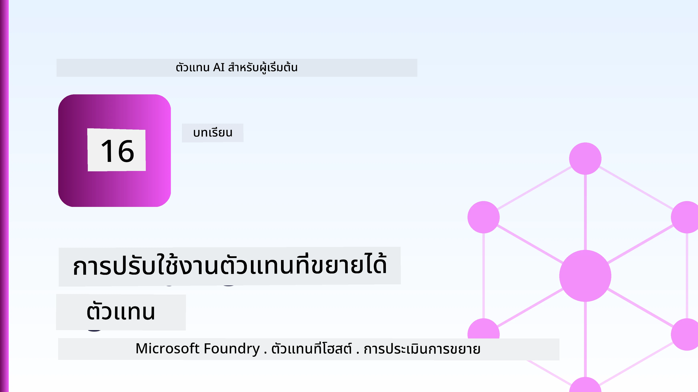
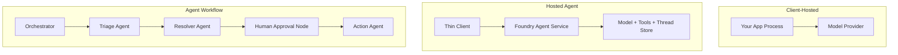
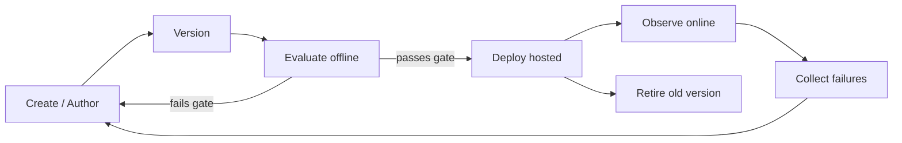
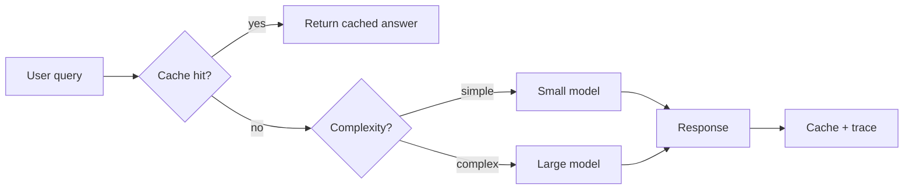
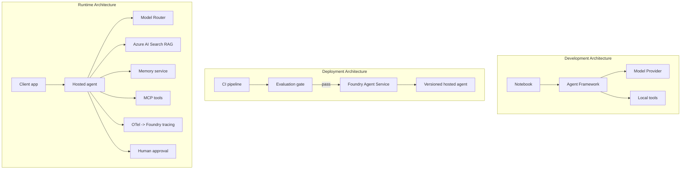

# การปรับใช้เอเจนต์ที่ปรับขนาดได้ด้วย Microsoft Foundry



จนถึงจุดนี้ในคอร์ส คุณได้สร้างเอเจนต์ที่ทำงานบนแล็ปท็อปของคุณ ภายในโน้ตบุ๊ก ใช้ `az login` และตัวแปรสภาพแวดล้อมบางตัว นั่นคือวิธีที่ถูกต้องในการเรียนรู้ แต่มันไม่ใช่วิธีที่เหมาะสมในการรันเอเจนต์ที่ลูกค้านับพันขึ้นอยู่ด้วยในเวลา 3 โมงเช้า

บทเรียนนี้เกี่ยวกับช่องว่างระหว่าง "มันใช้งานได้บนเครื่องฉัน" กับ "มันใช้งานได้จริง อย่างเชื่อถือได้และคุ้มค่าในสภาพแวดล้อมการผลิต" เราปิดช่องว่างนั้นด้วย **Microsoft Foundry** และ **Microsoft Foundry Agent Service** โดยเราจะสร้างเอเจนต์สนับสนุนลูกค้าจริงที่มีเครื่องมือ การดึงข้อมูล ความจำ การประเมินผล และการติดตาม

## บทนำ

บทเรียนนี้จะครอบคลุม:

- ความแตกต่างระหว่าง **เอเจนต์ต้นแบบ** กับ **เอเจนต์ที่ปรับใช้จริง** และเหตุใดการเปลี่ยนผ่านจึงเกี่ยวกับทุกอย่าง *รอบตัว* โมเดล
- **รูปแบบการปรับใช้** สำหรับเอเจนต์: โฮสต์โดยลูกค้า, โฮสต์โดยบริการ (Hosted Agents), และการจัดการกระบวนงาน
- **วงจรชีวิตของเอเจนต์** บน Microsoft Foundry — สร้าง, ทำเวอร์ชัน, ปรับใช้, ประเมินผล, สังเกต, เกษียณ
- **กลยุทธ์การปรับขนาด**: การส่งเส้นทางโมเดล, การแคช, ความขนาน, และการออกแบบแบบไร้สถานะ
- **การสังเกตการณ์** ด้วย OpenTelemetry และการติดตามของ Foundry
- **การเพิ่มประสิทธิภาพค่าใช้จ่าย** ผ่านการเลือกโมเดล การส่งเส้นทาง และประตูการประเมินผล
- **ข้อพิจารณาสำหรับองค์กร**: การกำกับดูแล การอนุมัติจากมนุษย์ และการรันเซิร์ฟเวอร์ MCP อย่างปลอดภัยในสภาพแวดล้อมการผลิต

## เป้าหมายการเรียนรู้

หลังจากทำบทเรียนนี้เสร็จ คุณจะรู้วิธี:

- เลือกรูปแบบการปรับใช้ที่เหมาะสมสำหรับงานของเอเจนต์แต่ละงาน
- ปรับใช้เอเจนต์สู่ Microsoft Foundry Agent Service ให้มีเวอร์ชัน มีการกำกับดูแล และสามารถสังเกตได้
- ติดตั้งเครื่องมือสำหรับการติดตาม และเชื่อมต่อสายการประเมินผลที่จะรันก่อนการปล่อยใช้งานทุกครั้ง
- ใช้การส่งเส้นทางโมเดลและการแคชเพื่อลดความล่าช้าและค่าใช้จ่ายเมื่อปรับขนาด
- เพิ่มช่องทางการอนุมัติจากมนุษย์สำหรับการกระทำที่มีความเสี่ยงสูง และผสาน MCP server ในแบบปลอดภัยสำหรับการใช้งานจริง

## สิ่งที่ต้องมีพื้นฐานมาก่อน

บทเรียนนี้สมมติว่าคุณได้ทำบทเรียนก่อนหน้าและคุ้นเคยกับ:

- การสร้างเอเจนต์ด้วย [Microsoft Agent Framework](../14-microsoft-agent-framework/README.md) (บทเรียนที่ 14)
- [การใช้เครื่องมือ](../04-tool-use/README.md) (บทเรียนที่ 4) และ [Agentic RAG](../05-agentic-rag/README.md) (บทเรียนที่ 5)
- [ความจำของเอเจนต์](../13-agent-memory/README.md) (บทเรียนที่ 13) และ [ โปรโตคอล Agentic / MCP ](../11-agentic-protocols/README.md) (บทเรียนที่ 11)
- [การสังเกตการณ์และการประเมินผล](../10-ai-agents-production/README.md) (บทเรียนที่ 10) — บทเรียนนี้ต่อยอดโดยตรงจากบทเรียนนั้น

คุณจะต้องมี:

- **การสมัครใช้งาน Azure** และ **โปรเจกต์ Microsoft Foundry** ที่มีโมเดลแชทปรับใช้แล้วอย่างน้อยหนึ่งตัว
- **Azure CLI** ที่ได้รับการยืนยันตัวตน (`az login`)
- Python 3.12+ และแพ็กเกจในรีโพสิตอรี [`requirements.txt`](../../../requirements.txt)

## จากต้นแบบสู่การผลิต: สิ่งที่เปลี่ยนแปลงจริงๆ

เอเจนต์ต้นแบบและเอเจนต์การผลิตใช้ลูปแกนเดียวกัน — การใช้เหตุผล, เรียกใช้เครื่องมือ, ตอบสนอง สิ่งที่เปลี่ยนไปคือทุกสิ่งที่อยู่รอบลูปนั้น โมเดลอาจเป็นเพียง 20% ของเอเจนต์ในการผลิต ส่วนอีก 80% คือโครงกระดูกการดำเนินงาน

| ความกังวล | ต้นแบบ | การผลิต |
| --- | --- | --- |
| **โฮสต์** | รันในโน้ตบุ๊กของคุณ | รันเป็นบริการโฮสต์, มีเวอร์ชัน และเผยแพร่ |
| **ตัวตน** | โทเค็น `az login` ของคุณ | ตัวตนที่จัดการพร้อม RBAC ขอบเขตจำกัด |
| **สถานะ** | อยู่ในหน่วยความจำ สูญหายเมื่อรีสตาร์ท | เก็บข้อมูลภายนอก (เก็บกระทู้, บริการความจำ) |
| **ข้อผิดพลาด** | คุณเห็นแทรซแบ็ค | มีการลองใหม่, สำรองข้อมูล, อีเมลแจ้งเตือน, แจ้งเตือน |
| **ค่าใช้จ่าย** | "แค่ไม่กี่เซนต์" | ติดตามตามคำขอ, ส่งเส้นทาง, แคช, มีงบประมาณ |
| **คุณภาพ** | คุณตรวจสอบผลลัพธ์ | ประเมินอัตโนมัติก่อนปล่อยทุกครั้ง |
| **ความน่าเชื่อถือ** | คุณอนุมัติทุกการกระทำ | นโยบาย + มนุษย์ในกระบวนการสำหรับการกระทำเสี่ยง |

จดจำตารางนี้ไว้ ส่วนแต่ละส่วนด้านล่างจะเกี่ยวข้องกับแถวในตารางนี้

## รูปแบบการปรับใช้เอเจนต์

มีสามรูปแบบที่คุณจะใช้ มักใช้รวมกัน

### 1. เอเจนต์โฮสต์โดยลูกค้า

วัตถุเอเจนต์จะอยู่ภายในกระบวนการแอปพลิเคชัน *ของคุณ* โค้ดของคุณเรียกโมเดลโดยตรง; ลูปเหตุผลทำงานในบริการของคุณ นี่คือสิ่งที่ทุกบทเรียนที่ผ่านมาได้ทำ

- **ใช้เมื่อ** คุณต้องการควบคุมลูปเต็มรูปแบบ มีมิดเดิลแวร์กำหนดเอง หรือฝังเอเจนต์ในแบ็คเอนด์ที่มีอยู่
- **ข้อแลกเปลี่ยน**: คุณต้องดูแลการปรับขนาด สถานะ และความทนทานเอง

### 2. Hosted Agents (Foundry Agent Service)

เอเจนต์ถูก *ลงทะเบียนเป็นทรัพยากร* ใน Microsoft Foundry Foundry โฮสต์ลูปเหตุผล เก็บข้อมูลกระทู้ บังคับใช้ความปลอดภัยของเนื้อหาและ RBAC และทำให้เอเจนต์มองเห็นได้ในพอร์ทัล Foundry แอปของคุณกลายเป็นไคลเอนต์บาง ๆ ที่สร้างกระทู้และอ่านการตอบสนอง

- **ใช้เมื่อ** คุณต้องการความทนทาน การสังเกตการณ์ในตัว การกำกับดูแล และพื้นที่การดำเนินงานที่น้อยลง
- **ข้อแลกเปลี่ยน**: การควบคุมระดับต่ำมีน้อยลงแลกกับการรันไทม์ที่จัดการให้

### 3. กระบวนงานของเอเจนต์

เอเจนต์หลายตัว (และเครื่องมือ) รวมกันเป็นกราฟที่มีการควบคุมการไหลชัดเจน — ขั้นตอนต่อเนื่อง, การแยกทางเลือก, โหนดอนุมัติจากมนุษย์, และจุดตรวจสอบทนทานที่สามารถหยุดและทำงานต่อได้ นี่คือความสามารถของ Microsoft Agent Framework **Workflows** ที่ใช้ในระดับการปรับใช้

- **ใช้เมื่อ** งานเดียวครอบคลุมหลายเอเจนต์ที่มีความชำนาญเฉพาะ หรือจำเป็นต้องมีขั้นตอนการอนุมัติระหว่างทาง
- **ข้อแลกเปลี่ยน**: มีชิ้นส่วนมากขึ้น ต้องการการสังเกตการณ์ในระดับการจัดการ



## วงจรชีวิตของเอเจนต์บน Microsoft Foundry

การปรับใช้เอเจนต์ไม่ใช่การดำเนินการครั้งเดียว `push` แต่มันคือวัฏจักร และดูคล้ายกับวงจรการปล่อยซอฟต์แวร์เพราะนั่นคือสิ่งที่มันเป็น



ไอเดียสำคัญที่นำมาจาก [บทเรียน 10](../10-ai-agents-production/README.md): **การประเมินผลแบบออฟไลน์คือประตู ไม่ใช่ของหลังความคิด** เวอร์ชันใหม่ของเอเจนต์จะไม่ปล่อยเว้นแต่ว่าจะผ่านเกณฑ์การประเมินของคุณ การสังเกตการณ์ออนไลน์จะป้อนข้อผิดพลาดในโลกจริงกลับเข้าสู่ชุดทดสอบออฟไลน์ของคุณ นั่นคือวงจรทั้งหมด

## กลยุทธ์การปรับขนาด

การปรับขนาดเอเจนต์แตกต่างจากการปรับขนาดเว็บ API แบบไร้สถานะ เพราะแต่ละคำขออาจกระตุ้นให้เกิดการเรียกโมเดลและเครื่องมือที่มีค่าใช้จ่ายสูงหลายครั้ง สี่เทคนิคหลักรับภาระส่วนใหญ่

**การจัดการคำขอแบบไร้สถานะ** อย่าเก็บสถานะต่อผู้ใช้ในหน่วยความจำของกระบวนการ ให้เก็บกระทู้สนทนาในที่เก็บกระทู้ของ Foundry หรือบริการความจำ เพื่อให้อินสแตนซ์ใดก็ได้สามารถจัดการคำขอได้ นี่คือสิ่งที่ทำให้คุณปรับขนาดในแนวนอนได้ — เพิ่มอินสแตนซ์โดยไม่ต้องมีเซสชันที่ติดหนึบ

**การส่งเส้นทางโมเดล** ไม่ใช่ทุกคำขอต้องใช้โมเดลที่มีประสิทธิภาพที่สุด (และแพงที่สุด) ส่งคำขอที่ง่าย — การจำแนกเจตนา ตอบคำถามข้อเท็จจริงสั้น ๆ — ไปยังโมเดลเล็กและรวดเร็ว และสงวนโมเดลใหญ่ไว้สำหรับการใช้เหตุผลจริง ๆ Foundry's **Model Router** สามารถทำสิ่งนี้ให้คุณ หรือคุณสามารถสร้างตัวจำแนกน้ำหนักเบาเอง คุณจะสร้างเวอร์ชัน DIY ในห้องปฏิบัติการ

**การแคชการตอบกลับ** คำถามสนับสนุนหลายคำถามเป็นคำถามซ้ำ ("ฉันจะรีเซ็ตรหัสผ่านได้อย่างไร?") แคชคำตอบสำหรับคำถามที่พบบ่อยและให้คำตอบโดยไม่ต้องเรียกใช้โมเดลเลยแม้แต่น้อย แม้แต่การแคชที่ถือว่าไม่มากก็ช่วยลดค่าใช้จ่ายและความล่าช้าได้อย่างมีนัยสำคัญ

**ความขนานและแรงกดดันย้อนกลับ** ผู้ให้บริการโมเดลมีข้อจำกัดอัตราการเรียก คืนค่า concurrency ของคุณ ใช้การลองใหม่แบบ Backoff แบบทวีคูณ และล้มเหลวอย่างนุ่มนวล (การตอบสนองคิวแบบ "เรากำลังดำเนินการ" ดีกว่าข้อผิดพลาด 500)



## การสังเกตการณ์ในสภาพแวดล้อมการผลิต

คุณไม่สามารถดำเนินการสิ่งที่คุณมองไม่เห็น ดังที่อธิบายในบทเรียน 10 Microsoft Agent Framework ส่งออก **OpenTelemetry** traces โดยตรง — ทุกการเรียกโมเดล เรียกใช้เครื่องมือ และขั้นตอนการจัดการกลายเป็น span ในสภาพแวดล้อมการผลิต คุณส่งออก spans เหล่านั้นไปยัง Microsoft Foundry (หรือแบ็คเอนด์ที่รองรับ OTel ใด ๆ) เพื่อที่คุณจะได้:

- ตรวจสอบข้อร้องเรียนลูกค้าแต่ละรายตั้งแต่ต้นจนจบ ผ่านทุกการเรียกโมเดลและเครื่องมือ
- ดู latency p50/p95 และค่าใช้จ่ายต่อคำขอตามเวลา
- แจ้งเตือนเมื่อเกิดอัตราความผิดพลาดเพิ่มขึ้นอย่างผิดปกติและความผิดปกติของค่าใช้จ่ายก่อนที่ผู้ใช้ (หรือทีมการเงินของคุณ) จะสังเกตเห็น

```python
from agent_framework.observability import get_tracer

tracer = get_tracer()

with tracer.start_as_current_span("support_request") as span:
    span.set_attribute("customer.tier", "enterprise")
    span.set_attribute("routed.model", "gpt-5-nano")
    # agent execution is traced automatically inside this span
```

คุณลักษณะเช่น `customer.tier` และ `routed.model` คือสิ่งที่เปลี่ยนแผงของ traces ให้กลายเป็นคำถามที่ตอบได้ ("ลูกค้าองค์กรถูกส่งไปโมเดลเล็กบ่อยเกินไปหรือไม่?")

## การเพิ่มประสิทธิภาพค่าใช้จ่าย

ค่าใช้จ่ายในเอเจนต์การผลิตถูกครอบงำด้วยโทเค็น มีสามคันโยก ตามลำดับผลกระทบ:

1. **ขนาดโมเดลที่เหมาะสม** โมเดลเล็กที่ผ่านประตูการประเมินของคุณมักจะถูกกว่าโมเดลใหญ่ที่ผ่านเหมือนกัน ใช้การประเมินผลเพื่อ *พิสูจน์* ว่าโมเดลเล็กดีพอ แทนที่จะเลือกโมเดลที่ใหญ่ที่สุดเพียงเพราะความระมัดระวัง
2. **ส่งเส้นทางตามความซับซ้อน** ตามที่กล่าวข้างต้น — จ่ายราคาของโมเดลใหญ่เฉพาะสำหรับคำขอที่ต้องใช้เหตุผลระดับโมเดลใหญ่เท่านั้น
3. **แคชอย่างหนัก** การเรียกโมเดลที่ถูกที่สุดคือการที่คุณไม่ต้องเรียกเลย

ประตูการประเมินและการควบคุมค่าใช้จ่ายคือระเบียบวินัยเดียวกันที่มองจากสองมุม: การประเมินบอกคุณถึง *พื้นคุณภาพ* การส่งเส้นทางและการแคชช่วยให้คุณรักษาค่าใช้จ่ายให้อยู่ใกล้จุด *ต่ำสุด* นั้น

## ข้อพิจารณาสำหรับการปรับใช้ในองค์กร

**การกำกับดูแล** Hosted Agents สืบทอด RBAC, ความปลอดภัยของเนื้อหา และการบันทึกการตรวจสอบของ Foundry มอบตัวตนที่จัดการให้เอเจนต์แต่ละตัว ด้วยสิทธิ์น้อยที่สุดที่ต้องการ — อ่านฐานความรู้ได้อย่างเดียว เข้าถึง API ตั๋วได้ในขอบเขตที่กำหนด ไม่เกินกว่านี้

**มนุษย์ในวงจร** การกระทำบางอย่างมีความสำคัญมากเกินกว่าที่จะทำแบบอัตโนมัติโดยตรง — การคืนเงิน การลบบัญชี การยกระดับไปยังทีมกฎหมาย Microsoft Agent Framework รองรับเครื่องมือที่ต้อง **อนุมัติ**: เอเจนต์เสนอการกระทำ หยุดการดำเนินการ รอการอนุมัติหรือปฏิเสธจากมนุษย์ แล้วกระบวนงานดำเนินต่อ คุณเห็นสิ่งนี้เป็นพื้นฐานใน [บทเรียน 6](../06-building-trustworthy-agents/README.md); ที่นี่คุณปรับใช้มัน

**MCP ในการผลิต** [MCP](../11-agentic-protocols/README.md) ช่วยให้เอเจนต์ของคุณใช้เครื่องมือภายนอกผ่านอินเทอร์เฟซมาตรฐาน ในการผลิต ให้ถือว่าเซิร์ฟเวอร์ MCP ทุกเครื่องเป็นขอบเขตที่ไม่เชื่อถือ: กำหนดเวอร์ชันเซิร์ฟเวอร์ รันด้วยตัวตนที่มีขอบเขตจำกัด ตรวจสอบผลลัพธ์ และอย่าเปิดเผยความลับให้กับมัน เซิร์ฟเวอร์ MCP เป็นการพึ่งพิง และการพึ่งพาได้รับการแพทช์ ตรวจสอบ และจำกัดอัตรา



แผนภาพสามอันนั้น — การพัฒนา การปรับใช้ และการรันไทม์ — คือเอเจนต์เดียวกันในสามขั้นตอนของชีวิต ห้องปฏิบัติการต่อไปจะพาคุณสร้างมัน

## ห้องปฏิบัติการปฏิบัติ: เอเจนต์สนับสนุนลูกค้าที่พร้อมผลิต

เปิด [`code_samples/16-python-agent-framework.ipynb`](./code_samples/16-python-agent-framework.ipynb) และทำตามตั้งแต่ต้นจนจบ คุณจะประกอบ **เอเจนต์สนับสนุนลูกค้า Contoso** ที่มีข้อกังวลในการผลิตทุกอย่างเชื่อมโยง:

1. **การเรียกเครื่องมือ** — ตรวจสอบสถานะคำสั่งซื้อและเปิดตั๋วสนับสนุน
2. **RAG** — ตอบคำถามนโยบายจากฐานความรู้ (Azure AI Search พร้อมทางเลือกหน่วยความจำในตัวเพื่อให้โน้ตบุ๊กทำงานได้โดยไม่ต้องมีทรัพยากร Search)
3. **ความจำ** — จำลูกค้าข้ามรอบการสนทนา
4. **การส่งเส้นทางโมเดล** — ตัวจำแนกความซับซ้อนส่งคำขอแต่ละรายการไปยังโมเดลเล็กหรือใหญ่
5. **การแคชการตอบกลับ** — คำถามที่ซ้ำกันถูกให้คำตอบจากแคช
6. **การอนุมัติจากมนุษย์** — การคืนเงินที่เกินเกณฑ์ต้องพักรอการเซ็นชื่อจากมนุษย์
7. **สายการประเมินผล** — ชุดทดสอบออฟไลน์เล็กๆ ประเมินเอเจนต์และทำหน้าที่เป็นประตูการปล่อยเวอร์ชัน
8. **การสังเกตการณ์** — การติดตาม OpenTelemetry รอบคำขอทุกคำขอ

### การเดินผ่าน

โน้ตบุ๊กถูกจัดอย่างเป็นระเบียบโดยแต่ละข้อกังวลในสภาพแวดล้อมการผลิตจะเป็นส่วนที่รันได้แยกกัน ใจกลางคือผู้จัดการคำขอที่รวมการส่งเส้นทางและแคช:

```python
async def handle_support_request(query: str, customer_id: str) -> str:
    # 1. Serve from cache when we can.
    cached = response_cache.get(normalize(query))
    if cached:
        return cached

    # 2. Route by complexity to control cost.
    model = "gpt-5-nano" if is_simple(query) else "gpt-5-mini"

    # 3. Run the agent inside a trace span for observability.
    with tracer.start_as_current_span("support_request") as span:
        span.set_attribute("routed.model", model)
        span.set_attribute("customer.id", customer_id)
        response = await support_agent.run(query, model=model)

    # 4. Cache and return.
    response_cache.set(normalize(query), response.text)
    return response.text
```

ประตูประเมินที่ปกป้องการปล่อยเวอร์ชันดูเหมือนนี้:

```python
async def evaluation_gate(agent, test_cases, threshold: float = 0.8) -> bool:
    passed = 0
    for case in test_cases:
        result = await agent.run(case["input"])
        if score_response(result.text, case["expected"]) >= 0.8:
            passed += 1
    pass_rate = passed / len(test_cases)
    print(f"Evaluation pass rate: {pass_rate:.0%} (gate: {threshold:.0%})")
    return pass_rate >= threshold  # only deploy if the gate passes
```

อ่านทุกบรรทัด — โน้ตบุ๊กทำให้โครงสร้างพื้นฐานเล็กจงใจเพื่อให้ไม่มีอะไรซ่อนอยู่หลังการเรียกใช้เฟรมเวิร์ก

## การตรวจสอบเอเจนต์ที่ปรับใช้ด้วยการทดสอบ smoke

ประตูการประเมินข้างต้นทำงาน *แบบออฟไลน์* กับวัตถุเอเจนต์ของคุณ เมื่อเอเจนต์ปรับใช้เป็น Hosted Agent คุณยังต้องการการตรวจสอบที่ถูกกว่าหนึ่งอย่าง: **จุดปลายที่ปรับใช้จริงตอบสนองไหม?**

การปรับใช้ "สำเร็จ" เพียงพิสูจน์ว่าแพลนควบคุมรับนิยาม แต่ไม่พิสูจน์ว่าเอเจนต์ตอบสนอง การขาดการพึ่งพิง การส่งเส้นทางโมเดลผิดพลาด หรือการเชื่อมต่อหมดอายุ อาจทำให้เกิดการปรับใช้สีเขียวที่ไม่คืนค่าอะไร การ **ทดสอบ smoke** ตรวจจับสิ่งนั้นในไม่กี่วินาที ทุกการปรับใช้ โดยไม่มีค่าใช้จ่ายเท่ากับการประเมินเต็มรูปแบบ

รีโพสิตอรีนี้มีสายงานทดสอบ smoke ที่พร้อมใช้สร้างบน [AI Smoke Test](https://github.com/marketplace/actions/ai-smoke-test) GitHub Action:

- **แคตตาล็อก** — [`tests/lesson-16-smoke-tests.json`](../../../tests/lesson-16-smoke-tests.json) มีพรอมต์และสมมุติฐานสำหรับเอเจนต์สนับสนุน Contoso (คำตอบนโยบายที่ยืนยันฐานความรู้, การค้นหาคำสั่งซื้อ, อยู่ในหัวข้อ และความต่อเนื่องของกระทู้หลายรอบ) แคตตาล็อกสำหรับเอเจนต์บทเรียนอื่น ๆ อยู่ข้างๆ ดู [`tests/README.md`](../tests/README.md)
- **กระบวนงาน** — [`.github/workflows/smoke-test.yml`](../../../.github/workflows/smoke-test.yml) เข้าสู่ระบบด้วย Azure OIDC และ POST ทุกพรอมต์ไปยังจุดตอบสนองของเอเจนต์ หากไม่ผ่านสมมุติฐานใดงานจะล้มเหลว

```yaml
- name: Smoke-test hosted agent
  uses: JFolberth/ai-smoketest@v1
  with:
    project_endpoint: ${{ inputs.project_endpoint }}
    agent_name: ContosoSupportAgent
    tests_file: tests/lesson-16-smoke-tests.json
```

รันจากแท็บ **Actions** เมื่อเอเจนท์ของคุณถูกติดตั้งแล้ว โดยระบุจุดเชื่อมต่อโปรเจกต์ Foundry และชื่อเอเจนท์ของคุณ ตัวตนแบบ federated ต้องมีบทบาท **Azure AI User** ในขอบเขตโปรเจกต์ Foundry คิดถึงเลเยอร์เป็นรูปปิรามิด: การทดสอบควัน (เข้าถึงและตอบสนองได้ไหม?) ถูกรันทุกครั้งที่ติดตั้งใหม่, การประเมินแบบออฟไลน์ (ดีพอที่จะส่งมอบไหม?) รันก่อนการโปรโมต, และการประเมินออนไลน์ (ทำงานได้ดีแค่ไหนในสภาพแวดล้อมจริง?) รันอย่างต่อเนื่อง

## ตรวจสอบความรู้

ทดสอบความเข้าใจก่อนที่จะไปยังงานมอบหมาย

**1. โดยประมาณแล้วเอเจนท์ที่ใช้งานจริงมีสัดส่วนเท่าไหร่ที่เป็น "โมเดล" และส่วนที่เหลือคืออะไร?**

<details>
<summary>คำตอบ</summary>

โมเดลเป็นส่วนน้อยของระบบ — มักอ้างว่าอยู่ราว 20% ส่วนที่เหลือคือโครงสร้างปฏิบัติการ: การโฮสต์และเวอร์ชัน, การพิสูจน์ตัวตนและ RBAC, สถานะที่แยกออกมา, การจัดการความล้มเหลว, การติดตามต้นทุน, การประเมินผล และการควบคุมโดยมนุษย์ การย้ายไปสู่การผลิตส่วนใหญ่คือการสร้างทุกอย่าง *รอบๆ* วงจรการให้เหตุผล
</details>

**2. เมื่อไรที่คุณเลือกใช้ Hosted Agent แทนเอเจนท์ที่โฮสต์บนไคลเอนต์?**

<details>
<summary>คำตอบ</summary>

เมื่อคุณต้องการรันไทม์ที่จัดการโดยอัตโนมัติพร้อมความทนทานในตัว (เธรดที่คงอยู่และสามารถทำงานต่อได้), การสังเกตการณ์, ความปลอดภัยของเนื้อหา และ RBAC และคุณพร้อมที่จะแลกกับการควบคุมวงจรให้เหตุผลในระดับต่ำแลกกับพื้นที่ปฏิบัติการที่น้อยลง การโฮสต์บนไคลเอนต์เหมาะสมกว่าหากคุณต้องการควบคุมเต็มที่กับวงจรหรือฝังเอเจนท์ในแบ็กเอนด์ที่มีอยู่แล้ว
</details>

**3. ทำไมเอเจนท์ที่ขยายตัวได้ต้องไม่มีสถานะในหน่วยความจำของกระบวนการของตัวเอง?**

<details>
<summary>คำตอบ</summary>

เพื่อให้แต่ละอินสแตนซ์สามารถจัดการคำขอใดก็ได้ ซึ่งทำให้สามารถปรับขนาดแนวนอนได้โดยไม่ต้องมีเซสชันยึดติด สถานะบทสนทนาของแต่ละผู้ใช้จะถูกแยกออกไปยังที่เก็บเธรดหรือบริการหน่วยความจำ หากสถานะอยู่ในหน่วยความจำของกระบวนการ คุณจะสูญเสียมันเมื่อรีสตาร์ทและไม่สามารถกระจายโหลดได้อย่างอิสระ
</details>

**4. การกำหนดเส้นทางโมเดลแก้ไขปัญหาอะไร และเกี่ยวข้องกับการประเมินผลอย่างไร?**

<details>
<summary>คำตอบ</summary>

การกำหนดเส้นทางส่งคำขอที่ง่ายไปยังโมเดลเล็กที่ถูก, รวดเร็ว และประหยัด และสงวนโมเดลใหญ่สำหรับการให้เหตุผลจริง ควบคุมทั้งความล่าช้าและค่าใช้จ่าย มันเกี่ยวข้องกับการประเมินเพราะการประเมินเป็นสิ่งที่ *พิสูจน์* ว่าโมเดลเล็กนั้นดีพอสำหรับหมวดคำขอหนึ่งๆ — การกำหนดเส้นทางโดยไม่มีการประเมินเป็นแค่การเดา
</details>

**5. "เกตการประเมิน" คืออะไร และอยู่ในช่วงใดของวงจรชีวิต?**

<details>
<summary>คำตอบ</summary>

เกตการประเมินจะรันชุดทดสอบแบบออฟไลน์กับเวอร์ชันเอเจนท์ใหม่และบล็อกการติดตั้งหากอัตราผ่านไม่ถึงเกณฑ์ มันอยู่ระหว่าง "เวอร์ชัน" และ "การติดตั้ง" ในวงจรชีวิต ทำให้คุณภาพเป็นเงื่อนไขล่วงหน้าสำหรับการปล่อยแทนที่จะตรวจสอบหลังจากส่งมอบแล้ว
</details>

**6. ทำไมเซิร์ฟเวอร์ MCP ต้องถูกปฏิบัติเหมือนเป็นขอบเขตที่ไม่เชื่อถือได้ในสภาพแวดล้อมการผลิต?**

<details>
<summary>คำตอบ</summary>

เพราะมันเป็นการพึ่งพาภายนอกที่เอเจนท์ของคุณเรียกใช้ คุณควรตรึงเวอร์ชันของมัน, รันด้วยตัวตนที่กำหนดขอบเขต, ตรวจสอบผลลัพธ์, จำกัดอัตราการเรียก, และไม่เคยเปิดเผยความลับแก่มัน — วินัยเดียวกับที่คุณใช้กับการพึ่งพาของบุคคลที่สาม ผลลัพธ์ของมันไหลเข้าสู่วงจรให้เหตุผลของเอเจนท์ของคุณ ดังนั้นการเชื่อถือโดยไม่ตรวจสอบจึงเป็นความเสี่ยงด้านความปลอดภัย
</details>

**7. การเปลี่ยนแปลงอย่างเดียวที่มักมีผลกระทบมากที่สุดต่อค่าใช้จ่ายของเอเจนท์ที่ใช้งานจริงคืออะไร และทำไม?**

<details>
<summary>คำตอบ</summary>

การปรับขนาดโมเดลให้พอดี — ใช้โมเดลเล็กที่สุดที่ผ่านเกตการประเมิน ค่าใช้จ่ายส่วนใหญ่ขึ้นกับโทเค็น และโมเดลเล็กที่ได้คุณภาพมาตรฐานมักจะถูกกว่าโมเดลที่ใหญ่กว่า การแคชและการกำหนดเส้นทางช่วยลดค่าใช้จ่ายได้อีก แต่การเลือกโมเดลฐานที่ถูกต้องมีผลลัพธ์อันดับแรกที่ใหญ่ที่สุด
</details>

**8. แอตทริบิวต์ของสแปนเช่น `customer.tier` และ `routed.model` มีบทบาทอย่างไรในด้านการสังเกตการณ์?**

<details>
<summary>คำตอบ</summary>

พวกมันเปลี่ยนแทรซดิบให้กลายเป็นคำถามทางธุรกิจที่ตอบได้ หากไม่มีแอตทริบิวต์คุณจะมีแต่กองสแปน แต่กับพวกมันคุณสามารถถามว่า "ลูกค้าองค์กรถูกกำหนดเส้นทางไปยังโมเดลเล็กบ่อยเกินไปไหม?" หรือ "โมเดลใดจัดการคำขอที่ช้าที่สุดของเรา?" แอตทริบิวต์คือวิธีที่คุณแบ่งเทเลเมทรีตามมิติที่สำคัญต่อการปฏิบัติงานของคุณ
</details>

## งานมอบหมาย

นำเอเจนท์สนับสนุนลูกค้าจากห้องทดลองมาเสริมความแข็งแกร่งสำหรับสถานการณ์เฉพาะ: **เอเจนท์สนับสนุนบิลค่าสมาชิกสำหรับบริษัท SaaS**

การส่งของคุณควร:

1. **แทนที่เครื่องมือ** ด้วยเครื่องมือที่เกี่ยวข้องกับบิลลิ่ง: `get_subscription_status`, `get_invoice`, และ `issue_credit` (เครดิตมากกว่า $50 ต้องได้รับการอนุมัติจากมนุษย์)
2. **เพิ่มเอกสาร RAG สามชุด** ครอบคลุมนโยบายคืนเงินของบริษัท, รอบบิล, และนโยบายการยกเลิก
3. **ขยายชุดประเมินผล** ให้มีอย่างน้อยแปดกรณี รวมอย่างน้อยสองกรณีที่ *ควร* กระตุ้นเส้นทางอนุมัติจากมนุษย์ และยืนยันว่าเกตการประเมินของคุณผ่านหรือไม่ผ่านอย่างถูกต้อง
4. **เพิ่มรายงานต้นทุนหนึ่งฉบับ**: หลังจากรันคำถามผสมสิบคำถามผ่านเอเจนท์ แสดงจำนวนที่ส่งไปยังโมเดลเล็ก, โมเดลใหญ่, และที่ให้บริการจากแคช

เขียนย่อหน้าเล็ก ๆ (ในเซลล์มาร์กดาวน์) อธิบายว่าเลือกกฎการกำหนดเส้นทางโมเดลใดและวิธีที่คุณจะยืนยันกับทราฟฟิกจริง ไม่มีคำตอบที่ถูกต้องเดียว — คุณจะถูกประเมินว่ากังวลเรื่องการผลิตถูกเชื่อมโยงกันอย่างสอดคล้องหรือไม่

## สรุป

ในบทเรียนนี้คุณได้ย้ายเอเจนท์จากต้นแบบไปสู่การผลิตด้วย Microsoft Foundry:

- การก้าวเข้าสู่การผลิตนั้นส่วนใหญ่เกี่ยวกับ **โครงสร้างปฏิบัติการ** รอบโมเดล — การโฮสต์, ตัวตน, สถานะ, การจัดการความล้มเหลว, ต้นทุน, คุณภาพ, และความน่าเชื่อถือ
- คุณได้เรียนรู้สาม **รูปแบบการติดตั้ง** — โฮสต์บนไคลเอนต์, Hosted Agents, และ Agent Workflows — และเมื่อใดที่แต่ละแบบเหมาะสม
- คุณได้เดินผ่าน **วงจรชีวิตเอเจนท์** ซึ่งการประเมินออฟไลน์ทำหน้าที่เป็นเกตปล่อย และการสังเกตการณ์ออนไลน์จะส่งข้อผิดพลาดกลับไปยังชุดทดสอบ
- คุณได้ใช้ **กลยุทธ์การปรับขนาด** — การออกแบบไร้สถานะ, การกำหนดเส้นทางโมเดล, การแคช, และการจำกัดความพร้อมกัน — และเชื่อมโยงกับ **การปรับต้นทุนให้เหมาะสม**
- คุณได้เชื่อมควบคุมองค์กร: RBAC, การอนุมัติมนุษย์ในวงจร, และการรวม MCP ที่ปลอดภัยสำหรับการผลิต
- คุณได้สร้าง **เอเจนท์สนับสนุนลูกค้าพร้อมสำหรับการผลิต** ที่รวมความกังวลทุกอย่างเข้าด้วยกันในโค้ดที่สามารถรันได้

บทเรียนถัดไปจะเดินทางย้อนกลับ: แทนที่จะขยายเอเจนท์ขึ้นในคลาวด์ คุณจะนำพวกมัน *ลง* บนเครื่องนักพัฒนาคนเดียวและรันทั้งหมดในเครื่องแบบโลคัล

## แหล่งข้อมูลเพิ่มเติม

- <a href="https://learn.microsoft.com/azure/ai-foundry/what-is-azure-ai-foundry" target="_blank">เอกสาร Microsoft Foundry</a>
- <a href="https://learn.microsoft.com/azure/ai-foundry/agents/overview" target="_blank">ภาพรวม Microsoft Foundry Agent Service</a>
- <a href="https://learn.microsoft.com/en-us/agent-framework/overview/?wt.mc_id=youtube_26688_organicsocial_reactor&pivots=programming-language-python" target="_blank">Microsoft Agent Framework</a>
- <a href="https://learn.microsoft.com/en-us/azure/ai-foundry/openai/concepts/model-router" target="_blank">Model Router ใน Microsoft Foundry</a>
- <a href="https://learn.microsoft.com/azure/search/search-what-is-azure-search" target="_blank">Azure AI Search</a>
- <a href="https://opentelemetry.io/" target="_blank">OpenTelemetry</a>
- <a href="https://github.com/marketplace/actions/ai-smoke-test" target="_blank">AI Smoke Test GitHub Action</a>
- <a href="https://modelcontextprotocol.io/" target="_blank">Model Context Protocol (MCP)</a>

## บทเรียนก่อนหน้า

[Building Computer Use Agents (CUA)](../15-browser-use/README.md)

## บทเรียนถัดไป

[Creating Local AI Agents](../17-creating-local-ai-agents/README.md)

---

<!-- CO-OP TRANSLATOR DISCLAIMER START -->
**ปฏิเสธความรับผิดชอบ**:
เอกสารนี้ได้รับการแปลโดยใช้บริการแปลภาษา AI [Co-op Translator](https://github.com/Azure/co-op-translator) ขณะที่เราพยายามให้ความถูกต้อง โปรดทราบว่าการแปลโดยอัตโนมัติอาจมีข้อผิดพลาดหรือความไม่ถูกต้อง เอกสารต้นฉบับในภาษาต้นทางควรถูกพิจารณาเป็นแหล่งข้อมูลที่เชื่อถือได้ สำหรับข้อมูลที่สำคัญ แนะนำให้ใช้การแปลโดยมนุษย์มืออาชีพ เราไม่รับผิดชอบต่อความเข้าใจผิดหรือการตีความที่ผิดพลาดที่เกิดขึ้นจากการใช้การแปลนี้
<!-- CO-OP TRANSLATOR DISCLAIMER END -->