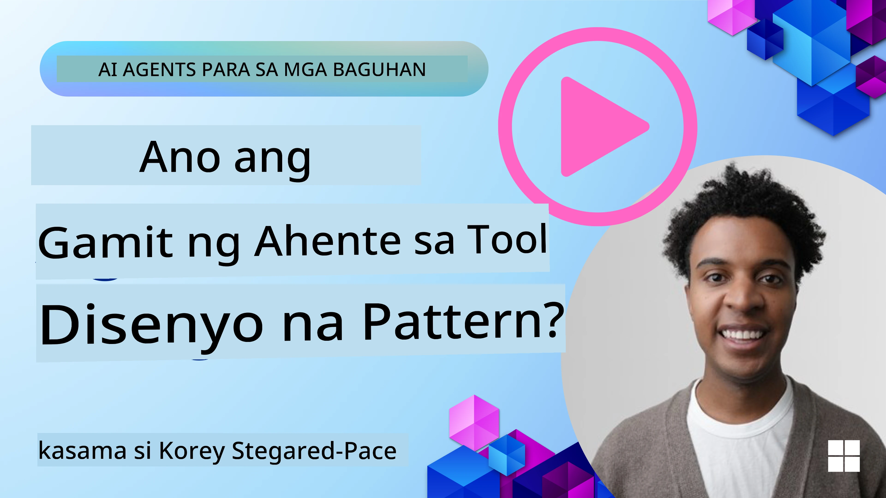
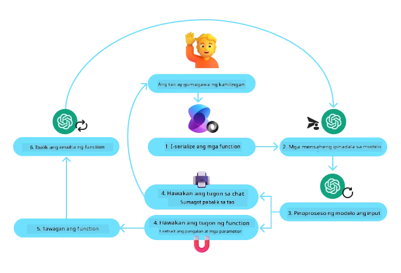
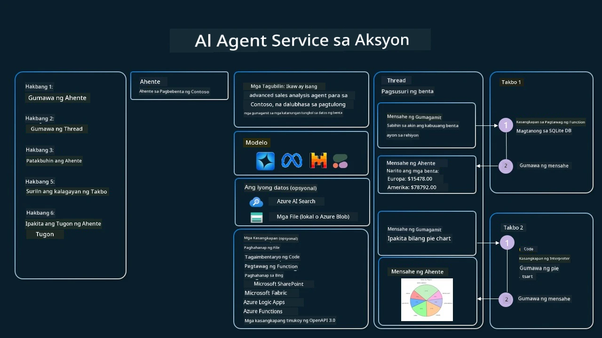

[](https://youtu.be/vieRiPRx-gI?si=cEZ8ApnT6Sus9rhn)

> _(I-click ang larawan sa itaas upang mapanood ang video ng araling ito)_

# Tool Use Design Pattern

Ang mga tools ay kawili-wili dahil pinapayagan nila ang mga AI agent na magkaroon ng mas malawak na hanay ng mga kakayahan. Sa halip na limitado lang ang mga aksyon na maaaring gawin ng agent, sa pamamagitan ng pagdagdag ng tool, maaari na ngayong magsagawa ng iba't ibang aksyon ang agent. Sa kabanatang ito, titingnan natin ang Tool Use Design Pattern, na naglalarawan kung paano maaaring gamitin ng mga AI agent ang partikular na mga tool upang makamit ang kanilang mga layunin.

## Panimula

Sa araling ito, hinahanap nating sagutin ang mga sumusunod na tanong:

- Ano ang tool use design pattern?
- Ano ang mga kaso kung saan ito maaaring magamit?
- Ano ang mga elemento/pundasyon na kailangan upang ipatupad ang design pattern?
- Ano ang mga espesyal na konsiderasyon sa paggamit ng Tool Use Design Pattern upang makabuo ng mapagkakatiwalaang mga AI agent?

## Mga Layunin ng Pag-aaral

Pagkatapos makumpleto ang araling ito, magagawa mong:

- Ilarawan ang Tool Use Design Pattern at ang layunin nito.
- Tiyakin ang mga kaso kung saan ang Tool Use Design Pattern ay naaangkop.
- Maunawaan ang mga pangunahing elemento na kailangan upang ipatupad ang design pattern.
- Kilalanin ang mga konsiderasyon para sa pagtitiyak ng pagiging mapagkakatiwalaan sa mga AI agent na gumagamit ng design pattern na ito.

## Ano ang Tool Use Design Pattern?

Ang **Tool Use Design Pattern** ay nakatuon sa pagbibigay sa mga LLM ng kakayahang makipag-ugnayan sa mga panlabas na tool upang makamit ang mga partikular na layunin. Ang mga tool ay mga code na maaaring patakbuhin ng isang agent upang magsagawa ng mga aksyon. Ang isang tool ay maaaring maging simpleng function tulad ng calculator, o API call papunta sa third-party na serbisyo tulad ng pagtingin ng presyo ng stock o forecast ng panahon. Sa konteksto ng mga AI agent, ang mga tool ay idinisenyo upang patakbuhin ng mga agent bilang tugon sa **model-generated function calls**.

## Ano ang mga kaso kung saan ito maaaring magamit?

Maaaring gamitin ng mga AI Agent ang mga tool upang tapusin ang mga komplikadong gawain, kumuha ng impormasyon, o gumawa ng mga desisyon. Ang tool use design pattern ay kadalasang ginagamit sa mga sitwasyon na nangangailangan ng dynamic na interaksyon sa mga panlabas na sistema, tulad ng mga database, web services, o code interpreters. Ang kakayahang ito ay kapaki-pakinabang sa iba’t ibang kaso kabilang ang:

- **Dynamic Information Retrieval:** Maaaring mag-query ang mga agent sa mga panlabas na API o database upang kumuha ng up-to-date na data (hal., pag-query sa SQLite database para sa pagsusuri ng data, pagkuha ng presyo ng stock o impormasyon ng panahon).
- **Code Execution and Interpretation:** Maaaring magpatakbo ng code o mga script ang mga agent upang lutasin ang mga problemang matematika, gumawa ng mga ulat, o magsagawa ng mga simulasyon.
- **Workflow Automation:** Pag-automate ng paulit-ulit o multi-step na workflow sa pamamagitan ng pag-integrate ng mga tool tulad ng task schedulers, email services, o data pipelines.
- **Customer Support:** Maaaring makipag-ugnayan ang mga agent sa mga CRM system, ticketing platform, o knowledge bases upang masagot ang mga tanong ng mga user.
- **Content Generation and Editing:** Maaaring gamitin ng mga agent ang mga tool tulad ng grammar checkers, text summarizers, o content safety evaluators upang tumulong sa mga gawain ng paggawa ng nilalaman.

## Ano ang mga elemento/pundasyon na kailangan upang ipatupad ang tool use design pattern?

Ang mga pundasyong ito ang nagpapahintulot sa AI agent na magsagawa ng malawak na hanay ng mga gawain. Tingnan natin ang mga pangunahing elemento na kailangan upang ipatupad ang Tool Use Design Pattern:

- **Function/Tool Schemas**: Detalyadong mga depinisyon ng mga magagamit na tool, kabilang ang pangalan ng function, layunin, mga kinakailangang parametro, at inaasahang salida. Pinapahintulutan ng mga schema na ito ang LLM na maunawaan kung ano ang mga magagamit na tool at kung paano bumuo ng wastong mga request.

- **Function Execution Logic**: Namamahala kung paano at kailan tinatawag ang mga tool batay sa intensyon ng user at konteksto ng pag-uusap. Maaari itong kabilang ang mga planner module, routing mechanism, o mga conditional flow na tumutukoy sa dinamiko ng paggamit ng tool.

- **Message Handling System**: Mga bahagi na namamahala sa daloy ng pag-uusap sa pagitan ng mga input ng user, mga tugon ng LLM, pagtawag ng tool, at mga output ng tool.

- **Tool Integration Framework**: Estruktura na kumokonekta sa agent sa iba't ibang tool, maging ang mga ito ay simpleng function o komplikadong panlabas na serbisyo.

- **Error Handling & Validation**: Mga mekanismo para hawakan ang mga pagkabigo sa pagpapatakbo ng tool, pagpapatunay ng mga parametro, at pamamahala ng mga hindi inaasahang tugon.

- **State Management**: Nagtatala ng konteksto ng pag-uusap, mga naunang interaksyon sa tool, at persistenteng data upang matiyak ang pagkakapare-pareho sa mga multi-turn na interaksyon.

Sunod, titingnan natin nang mas detalyado ang Function/Tool Calling.
 
### Function/Tool Calling

Ang function calling ang pangunahing paraan para payagan ang Large Language Models (LLMs) na makipag-ugnayan sa mga tool. Madalas mong makita ang 'Function' at 'Tool' na ginagamit na palitan dahil ang mga 'function' (mga bahagi ng reusable na code) ang mga 'tool' na ginagamit ng mga agent upang maisagawa ang mga gawain. Para mapatakbo ang code ng isang function, kailangang ikumpara ng LLM ang kahilingan ng user sa paglalarawan ng mga function. Upang magawa ito, ipinapadala sa LLM ang isang schema na naglalaman ng mga paglalarawan ng lahat ng magagamit na function. Pipili ang LLM ng pinaka-angkop na function para sa gawain at ibabalik ang pangalan nito at mga argumento. Tatawagin ang napiling function, ang tugon nito ay ipapadala pabalik sa LLM, na gagamitin ang impormasyon upang tumugon sa kahilingan ng user.

Para sa mga developer na magpatupad ng function calling para sa mga agent, kailangan mo ng:

1. Isang LLM model na sumusuporta sa function calling
2. Isang schema na naglalaman ng paglalarawan ng function
3. Ang code para sa bawat inilalarawang function

Gamitin natin ang halimbawa ng pagkuha ng kasalukuyang oras sa isang lungsod para ipaliwanag:

1. **I-initialize ang LLM na sumusuporta sa function calling:**

    Hindi lahat ng modelo ay sumusuporta sa function calling, kaya mahalagang tiyakin na ang LLM na ginagamit mo ay sumusuporta rito.     <a href="https://learn.microsoft.com/azure/ai-services/openai/how-to/function-calling" target="_blank">Suportado ng Azure OpenAI</a> ang function calling. Magsisimula tayo sa pag-initialize ng OpenAI client laban sa Azure OpenAI **Responses API** (ang stable `/openai/v1/` endpoint — walang kailangan na `api_version`). 

    ```python
    # Initialize the OpenAI client for Azure OpenAI (Responses API, v1 endpoint)
    client = OpenAI(
        base_url=f"{os.environ['AZURE_OPENAI_ENDPOINT'].rstrip('/')}/openai/v1/",
        api_key=os.environ["AZURE_OPENAI_API_KEY"],
    )
    deployment_name = os.environ["AZURE_OPENAI_DEPLOYMENT"]
    ```

1. **Gumawa ng Function Schema**:

    Susunod, magdedefine tayo ng JSON schema na naglalaman ng pangalan ng function, paglalarawan ng ginagawa ng function, at mga pangalan at paglalarawan ng mga parametro ng function.
    Pagkatapos ay ipapasa natin ang schema na ito sa client na ginawa kanina, kasabay ng kahilingan ng user upang malaman ang oras sa San Francisco. Mahalaga ring tandaan na ang **tool call** ang ibinabalik, **hindi** ang panghuling sagot sa tanong. Tulad ng nabanggit, ibinabalik ng LLM ang pangalan ng function na napili para sa gawain, at mga argumentong ipapasa dito.

    ```python
    # Function description for the model to read (Responses API flat tool format)
    tools = [
        {
            "type": "function",
            "name": "get_current_time",
            "description": "Get the current time in a given location",
            "parameters": {
                "type": "object",
                "properties": {
                    "location": {
                        "type": "string",
                        "description": "The city name, e.g. San Francisco",
                    },
                },
                "required": ["location"],
            },
        }
    ]
    ```
   
    ```python
  
    # Initial user message
    messages = [{"role": "user", "content": "What's the current time in San Francisco"}]

    # First API call: Ask the model to use the function
    response = client.responses.create(
        model=deployment_name,
        input=messages,
        tools=tools,
        tool_choice="auto",
        store=False,
    )

    # The Responses API returns tool calls as function_call items in response.output.
    # Append them to the conversation so the model has full context on the next turn.
    messages += response.output

    print("Model's response:")
    print(response.output)
  
    ```

    ```bash
    Model's response:
    [ResponseFunctionToolCall(arguments='{"location":"San Francisco"}', call_id='call_pOsKdUlqvdyttYB67MOj434b', name='get_current_time', type='function_call')]
    ```
  
1. **Ang code ng function na kailangan upang maisagawa ang gawain:**

    Ngayong napili na ng LLM kung aling function ang kailangan patakbuhin, kailangang ipatupad at isagawa ang code na gagawa ng gawain.
    Maaari nating ipatupad ang code upang makuha ang kasalukuyang oras gamit ang Python. Kailangan din nating isulat ang code upang kunin ang pangalan at mga argumento mula sa response_message upang makuha ang panghuling resulta.

    ```python
      def get_current_time(location):
        """Get the current time for a given location"""
        print(f"get_current_time called with location: {location}")  
        location_lower = location.lower()
        
        for key, timezone in TIMEZONE_DATA.items():
            if key in location_lower:
                print(f"Timezone found for {key}")  
                current_time = datetime.now(ZoneInfo(timezone)).strftime("%I:%M %p")
                return json.dumps({
                    "location": location,
                    "current_time": current_time
                })
      
        print(f"No timezone data found for {location_lower}")  
        return json.dumps({"location": location, "current_time": "unknown"})
    ```

     ```python
    # Handle function calls
    tool_calls = [item for item in response.output if item.type == "function_call"]
    if tool_calls:
        for tool_call in tool_calls:
            if tool_call.name == "get_current_time":

                function_args = json.loads(tool_call.arguments)

                time_response = get_current_time(
                    location=function_args.get("location")
                )

                # Return the tool result as a function_call_output item
                messages.append({
                    "type": "function_call_output",
                    "call_id": tool_call.call_id,
                    "output": time_response,
                })
    else:
        print("No tool calls were made by the model.")

    # Second API call: Get the final response from the model
    final_response = client.responses.create(
        model=deployment_name,
        input=messages,
        tools=tools,
        store=False,
    )

    return final_response.output_text
     ```

     ```bash
      get_current_time called with location: San Francisco
      Timezone found for san francisco
      The current time in San Francisco is 09:24 AM.
     ```

Ang Function Calling ay nasa puso ng karamihan, kung hindi lahat, ng disenyo ng paggamit ng tool para sa mga agent, ngunit ang pagpapatupad nito mula sa simula ay maaaring minsang maging hamon.
Tulad ng natutunan natin sa [Lesson 2](../../../02-explore-agentic-frameworks), nagbibigay ang mga agentic framework ng mga pre-built na pundasyon upang ipatupad ang paggamit ng tool.
 
## Mga Halimbawa ng Paggamit ng Tool gamit ang Agentic Frameworks

Narito ang ilang mga halimbawa kung paano mo maaaring ipatupad ang Tool Use Design Pattern gamit ang iba't ibang agentic frameworks:

### Microsoft Agent Framework

<a href="https://learn.microsoft.com/azure/ai-services/agents/overview" target="_blank">Microsoft Agent Framework</a> ay isang open-source na AI framework para sa paggawa ng mga AI agent. Pinapadali nito ang proseso ng paggamit ng function calling sa pamamagitan ng pagpapahintulot na idefine ang mga tool bilang mga Python function gamit ang `@tool` decorator. Pinamamahalaan ng framework ang komunikasyon papunta at pabalik sa pagitan ng modelo at ng iyong code. Nagbibigay din ito ng access sa mga pre-built na tool tulad ng File Search at Code Interpreter sa pamamagitan ng `FoundryChatClient`.

Ipinapakita ng sumusunod na diagram ang proseso ng function calling gamit ang Microsoft Agent Framework:



Sa Microsoft Agent Framework, ang mga tool ay dinefine bilang mga decorated function. Maaari nating gawing tool ang `get_current_time` function na nakita natin kanina gamit ang `@tool` decorator. Awtomatikong ise-serialize ng framework ang function at mga parametro nito, na lumilikha ng schema na ipapadala sa LLM.

```python
import os
from agent_framework import tool
from agent_framework.foundry import FoundryChatClient
from azure.identity import AzureCliCredential

@tool(approval_mode="never_require")
def get_current_time(location: str) -> str:
    """Get the current time for a given location"""
    ...

# Create the client
provider = FoundryChatClient(
    project_endpoint=os.environ["AZURE_AI_PROJECT_ENDPOINT"],
    model=os.environ["AZURE_AI_MODEL_DEPLOYMENT_NAME"],
    credential=AzureCliCredential(),
)

# Create an agent and run with the tool
agent = provider.as_agent(name="TimeAgent", instructions="Use available tools to answer questions.", tools=get_current_time)
response = await agent.run("What time is it?")
```

#### Mga Tool mula sa isang MCP server

Hindi kailangang mga function sa iyong sariling code ang mga tool. Isang server na sumusunod sa Model Context Protocol (MCP, tinalakay sa [Lesson 11](../11-agentic-protocols/README.md)) ang naglalathala ng mga tool nito kasama ng mga schema, at kayang i-load ng framework ang mga ito sa parehong paraan ng pag-serialize sa isang decorated function. Nakakonekta ang `MCPStreamableHTTPTool` sa ganitong server gamit ang HTTP, binabasa ang mga tool schema, at inaalok ang mga ito sa model kasabay ng anumang lokal na tool.

Ginagamit ng halimbawang nasa ibaba ang web search server na pinapatakbo ng <a href="https://keenable.ai" target="_blank">Keenable</a>. Libre itong gamitin nang walang account o API key (may rate limit ang mga request kada IP), kaya ang tanging kredensyal na kailangan mo ay para sa iyong model. Tulad ng anumang remote tool, ipinapadala sa server na iyon ang mga query na nililikha ng model.

```python
from agent_framework import MCPStreamableHTTPTool

web_search = MCPStreamableHTTPTool(
    name="Keenable web search",
    url="https://api.keenable.ai/mcp",
)

# Connecting loads the server's tool schemas; the agent decides when to call them
async with web_search:
    agent = provider.as_agent(
        name="ResearchAgent",
        instructions="Use available tools to answer questions.",
        tools=[web_search],
    )
    response = await agent.run("What is new in the latest Python release?")
    print(response.text)
```

Inilalathala ng server ang dalawang tool, `search_web_pages` at `fetch_page_content`. Kapag kailangan ng kasalukuyang impormasyon ang isang tanong, tinatawag ng model ang `search_web_pages`, bumabalik ang mga pamagat, URL, at mga teksto, at sinusulat ang sagot mula sa kanila, katulad ng loop sa halimbawang `get_current_time` sa itaas.
  
### Microsoft Foundry Agent Service

<a href="https://learn.microsoft.com/azure/ai-services/agents/overview" target="_blank">Microsoft Foundry Agent Service</a> ay isang mas bagong agentic framework na idinisenyo upang bigyang kapangyarihan ang mga developer na ligtas na makabuo, makapag-deploy, at makapagskala ng mataas na kalidad at extensible na mga AI agent nang hindi kailangang pamahalaan ang mga pinagbabatayang compute at storage resources. Partikular itong kapaki-pakinabang para sa mga enterprise application dahil ito ay isang fully managed service na may enterprise grade security.

Kung ikukumpara sa direktang pag-develop gamit ang LLM API, nagbibigay ang Microsoft Foundry Agent Service ng ilang mga benepisyo, kabilang ang:

- Awtomatikong pagtawag ng tool – hindi na kailangang i-parse ang tool call, patakbuhin ang tool, at hawakan ang tugon; lahat ng ito ay ginagawa na server-side
- Ligtas na pinamamahalaang data – sa halip na pamahalaan ang sariling estado ng pag-uusap, maaari kang umasa sa mga thread para itago ang lahat ng impormasyong kailangan mo
- Mga out-of-the-box na tool – Mga tool na maaari mong gamitin para makipag-ugnayan sa iyong mga pinanggagalingang data, tulad ng Bing, Azure AI Search, at Azure Functions.

Ang mga tool na magagamit sa Microsoft Foundry Agent Service ay maaaring hatiin sa dalawang kategorya:

1. Mga Knowledge Tools:
    - <a href="https://learn.microsoft.com/azure/ai-services/agents/how-to/tools/bing-grounding?tabs=python&pivots=overview" target="_blank">Grounding gamit ang Bing Search</a>
    - <a href="https://learn.microsoft.com/azure/ai-services/agents/how-to/tools/file-search?tabs=python&pivots=overview" target="_blank">File Search</a>
    - <a href="https://learn.microsoft.com/azure/ai-services/agents/how-to/tools/azure-ai-search?tabs=azurecli%2Cpython&pivots=overview-azure-ai-search" target="_blank">Azure AI Search</a>

2. Mga Action Tool:
    - <a href="https://learn.microsoft.com/azure/ai-services/agents/how-to/tools/function-calling?tabs=python&pivots=overview" target="_blank">Function Calling</a>
    - <a href="https://learn.microsoft.com/azure/ai-services/agents/how-to/tools/code-interpreter?tabs=python&pivots=overview" target="_blank">Code Interpreter</a>
    - <a href="https://learn.microsoft.com/azure/ai-services/agents/how-to/tools/openapi-spec?tabs=python&pivots=overview" target="_blank">Mga tool na tinukoy ng OpenAPI</a>
    - <a href="https://learn.microsoft.com/azure/ai-services/agents/how-to/tools/azure-functions?pivots=overview" target="_blank">Azure Functions</a>

Pinapayagan tayo ng Agent Service na magamit ang mga tool na ito nang magkasama bilang isang `toolset`. Ginagamit din nito ang `threads` na nagtatala ng kasaysayan ng mga mensahe mula sa isang partikular na pag-uusap.

Isipin mong isa kang sales agent sa kumpanyang Contoso. Nais mong bumuo ng isang conversational agent na makakasagot ng mga tanong tungkol sa iyong sales data.

Ipinapakita ng larawan sa ibaba kung paano mo magagamit ang Microsoft Foundry Agent Service upang suriin ang iyong sales data:



Upang magamit ang alinman sa mga tool na ito sa serbisyo, maaari tayong gumawa ng client at magdefine ng tool o toolset. Para maisakatuparan ito nang praktikal, magagamit natin ang sumusunod na Python code. Magagawa ng LLM na tingnan ang toolset at magpasya kung gagamitin ang user-created function na `fetch_sales_data_using_sqlite_query`, o ang pre-built na Code Interpreter depende sa kahilingan ng user.

```python 
import os
from azure.ai.projects import AIProjectClient
from azure.identity import DefaultAzureCredential
from fetch_sales_data_functions import fetch_sales_data_using_sqlite_query # fetch_sales_data_using_sqlite_query function which can be found in a fetch_sales_data_functions.py file.
from azure.ai.projects.models import ToolSet, FunctionTool, CodeInterpreterTool

project_client = AIProjectClient.from_connection_string(
    credential=DefaultAzureCredential(),
    conn_str=os.environ["PROJECT_CONNECTION_STRING"],
)

# Initialize toolset
toolset = ToolSet()

# Initialize function calling agent with the fetch_sales_data_using_sqlite_query function and adding it to the toolset
fetch_data_function = FunctionTool(fetch_sales_data_using_sqlite_query)
toolset.add(fetch_data_function)

# Initialize Code Interpreter tool and adding it to the toolset. 
code_interpreter = CodeInterpreterTool()toolset.add(code_interpreter)

agent = project_client.agents.create_agent(
    model="gpt-5-mini", name="my-agent", instructions="You are helpful agent", 
    toolset=toolset
)
```

## Ano ang mga espesyal na konsiderasyon sa paggamit ng Tool Use Design Pattern upang makabuo ng mapagkakatiwalaang AI agents?

Isang karaniwang pag-aalala sa SQL na dinamiko na nabubuo ng LLMs ay ang seguridad, lalo na ang panganib ng SQL injection o malisyosong aksyon, tulad ng pag-drop o pagmamanipula ng database. Bagaman makatwiran ang mga pangamba, maaari itong epektibong mapigilan sa pamamagitan ng maayos na pag-configure ng mga permiso sa pag-access ng database. Para sa karamihan ng mga database, ito ay nangangahulugan ng pag-configure ng database bilang read-only. Para sa mga database service tulad ng PostgreSQL o Azure SQL, dapat bigyan ang app ng read-only (SELECT) role.

Ang pagpapatakbo ng app sa isang secure na kapaligiran ay lalong nagpapaganda ng proteksyon. Sa mga enterprise scenario, karaniwang kinukuha at inililipat ang data mula sa mga operational system papunta sa isang read-only na database o data warehouse na may user-friendly na schema. Tinitiyak ng paraang ito na ang data ay ligtas, na-optimize para sa performance at accessibility, at ang app ay may limitadong read-only access.

## Mga Halimbawang Code

- Python: [Agent Framework](./code_samples/04-python-agent-framework.ipynb)
- .NET: [Agent Framework](./code_samples/04-dotnet-agent-framework.md)

## May Iba Ka Pang Tanong tungkol sa Tool Use Design Patterns?

Sumali sa [Microsoft Foundry Discord](https://discord.com/invite/ATgtXmAS5D) upang makipagtagpo sa ibang mga nag-aaral, dumalo sa office hours, at masagot ang iyong mga tanong tungkol sa AI Agents.

## Karagdagang Mga Mapagkukunan

- <a href="https://microsoft.github.io/build-your-first-agent-with-azure-ai-agent-service-workshop/" target="_blank">Azure AI Agents Service Workshop</a>
- <a href="https://github.com/Azure-Samples/contoso-creative-writer/tree/main/docs/workshop" target="_blank">Contoso Creative Writer Multi-Agent Workshop</a>
- <a href="https://learn.microsoft.com/azure/ai-services/agents/overview" target="_blank">Microsoft Agent Framework Overview</a>

## Pagsubok ng Agent na Ito (Opsyonal)

Pagkatapos mong matutunan kung paano mag-deploy ng mga agent sa [Lesson 16](../16-deploying-scalable-agents/README.md), maaari mong subukan ang lesson na ito na `TravelToolAgent` (tumatawag pa ba ito sa kanyang mga tool at sumasagot?) gamit ang [`tests/lesson-04-smoke-tests.json`](../../../tests/lesson-04-smoke-tests.json). Tingnan ang [`tests/README.md`](../tests/README.md) para sa kung paano ito patakbuhin.

## Nakaraang Aralin

[Understanding Agentic Design Patterns](../03-agentic-design-patterns/README.md)

## Susunod na Aralin

[Agentic RAG](../05-agentic-rag/README.md)

---

<!-- CO-OP TRANSLATOR DISCLAIMER START -->
**Pagtatanggi**:
Ang dokumentong ito ay isinalin gamit ang serbisyo ng AI translation na [Co-op Translator](https://github.com/Azure/co-op-translator). Bagama't nagsusumikap kami para sa katumpakan, pakatandaan na ang awtomatikong pagsasalin ay maaaring maglaman ng mga pagkakamali o hindi pagkakatugma. Ang orihinal na dokumento sa orihinal nitong wika ang dapat ituring na pangunahing sanggunian. Para sa mahahalagang impormasyon, inirerekomenda ang propesyonal na pagsasalin ng tao. Hindi kami mananagot sa anumang maling pagkakaintindi o maling interpretasyon na nagmula sa paggamit ng pagsasaling ito.
<!-- CO-OP TRANSLATOR DISCLAIMER END -->