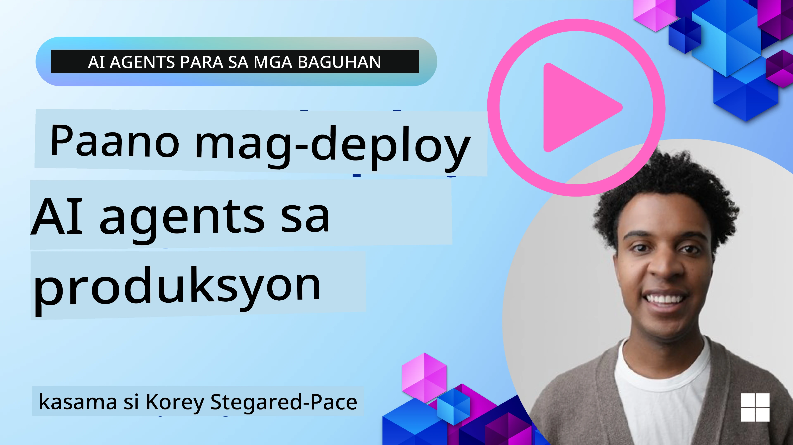

# AI Agents sa Produksyon: Observability at Pagsusuri

[](https://youtu.be/l4TP6IyJxmQ?si=reGOyeqjxFevyDq9)

Habang ang mga AI agent ay lumilipat mula sa mga experimental na prototype patungo sa mga aplikasyon sa totoong mundo, nagiging mahalaga ang kakayahang maunawaan ang kanilang pag-uugali, subaybayan ang kanilang performance, at sistematikong suriin ang kanilang mga resulta.

## Mga Layunin sa Pagkatuto

Pagkatapos makumpleto ang araling ito, malalaman/mauunawaan mo kung paano:
- Mga pangunahing konsepto ng agent observability at pagsusuri
- Mga teknik para mapabuti ang performance, gastos, at bisa ng mga agent
- Ano at paano sistematikong susuriin ang iyong mga AI agent
- Paano makokontrol ang gastos kapag nag-deploy ng mga AI agent sa produksyon
- Paano i-instrument ang mga agent na ginawa gamit ang Microsoft Agent Framework

Ang layunin ay bigyan ka ng kaalaman upang gawing transparent, napamamahalaan, at mapagkakatiwalaang mga sistema ang iyong mga "black box" agent.

_**Tandaan:** Mahalaga na mag-deploy ng mga ligtas at mapagkakatiwalaang AI Agent. Tignan din ang araling [Building Trustworthy AI Agents](../06-building-trustworthy-agents/README.md)._

## Traces at Spans

Karaniwang inilalarawan ng mga tool para sa observability tulad ng [Langfuse](https://langfuse.com/) o [Microsoft Foundry](https://learn.microsoft.com/en-us/azure/ai-foundry/what-is-azure-ai-foundry) ang mga agent run bilang mga trace at span.

- **Trace** ay kumakatawan sa kumpletong gawain ng agent mula umpisa hanggang matapos (katulad ng pag-handle ng tanong ng user).
- **Spans** ay mga indibidwal na hakbang sa loob ng trace (halimbawa, pagtawag sa language model o pagkuha ng data).


<!-- Image URL retained for illustration purposes -->

Kung walang observability, ang isang AI agent ay maaaring magmukhang isang "black box" - ang panloob nitong estado at pamamaraan ay hindi malinaw, kaya mahirap tuklasin ang mga isyu o ayusin ang performance. Sa observability, ang mga agent ay nagiging "glass boxes," na nag-aalok ng transparency na mahalaga para sa pagtitiwala at tiyakin na gumagana sila ayon sa inaasahan.

## Bakit Mahalaga ang Observability sa Production Environments

Ang paglipat ng mga AI agent sa mga production environment ay nagdudulot ng mga bagong hamon at pangangailangan. Hindi na "nice-to-have" ang observability kundi isang kritikal na kakayahan:

*   **Debugging at Root-Cause Analysis**: Kapag pumalya ang isang agent o nagbigay ng di-inaasahang resulta, nagbibigay ang mga tool sa observability ng mga trace upang matukoy ang pinagmulan ng error. Lalo itong mahalaga sa mga komplikadong agent na maaaring may maraming LLM call, interaksyon sa tool, at kondisyunal na lohika.
*   **Pagkontrol ng Latency at Gastos**: Kadalasang nakadepende ang mga AI agent sa mga LLM at iba pang external API na sinisingil bawat token o bawat tawag. Pinapayagan ng observability ang tumpak na pagsubaybay sa mga tawag, na tumutulong tuklasin ang mga operasyong mabagal o mahal. Nakakatulong ito sa mga koponan na i-optimize ang mga prompt, pumili ng mas epektibong modelo, o baguhin ang workflow para kontrolin ang gastusin at matiyak ang magandang karanasan ng user.
*   **Tiwala, Kaligtasan, at Pagsunod**: Sa maraming aplikasyon, mahalaga na tiyakin na ang mga agent ay kumikilos nang ligtas at etikal. Nagbibigay ang observability ng audit trail ng mga aksyon at desisyon ng agent. Maaari itong gamitin upang matukoy at mabawasan ang mga isyu gaya ng prompt injection, paggawa ng nakakapinsalang nilalaman, o maling paghawak ng personal na impormasyon (PII). Halimbawa, maaari mong suriin ang mga trace para maunawaan kung bakit nagbigay ang agent ng partikular na tugon o gumamit ng partikular na tool.
*   **Patuloy na Loop ng Pagbuti**: Ang datos mula sa observability ang pundasyon ng proseso ng iterative development. Sa pamamagitan ng pagsubaybay kung paano gumagana ang mga agent sa totoong mundo, maaaring tuklasin ng mga koponan ang mga bahagi na dapat paunlarin, mangalap ng datos para sa fine-tuning ng mga modelo, at patunayan ang epekto ng mga pagbabago. Lumilikha ito ng feedback loop kung saan ang mga insight mula sa production online evaluation ay nagbibigay-daan para sa offline experimentation at refinement, na nagreresulta sa mas mahusay na performance ng agent.

## Mga Pangunahing Sukatan na Dapat Subaybayan

Upang masubaybayan at maunawaan ang pag-uugali ng agent, maraming sukatan at signal ang dapat i-track. Bagama't maaaring mag-iba ang mga partikular na sukatan depende sa layunin ng agent, may ilang mga sukatan na pangkalahatang mahalaga.

Narito ang ilan sa mga karaniwang sukatan na sinusubaybayan ng mga tool ng observability:

**Latency:** Gaano kabilis ang tugon ng agent? Ang mahabang paghihintay ay negatibong nakakaapekto sa karanasan ng user. Dapat sukatin ang latency para sa mga gawain at indibidwal na hakbang sa pamamagitan ng pagsubaybay ng mga agent run. Halimbawa, ang isang agent na nangangailangan ng 20 segundo para sa lahat ng tawag ng modelo ay maaaring pabilisin gamit ang mas mabilis na modelo o pagpapatakbo ng mga tawag ng modelo nang sabay-sabay.

**Gastos:** Magkano ang ginastos bawat pagtakbo ng agent? Nakadepende ang mga AI agent sa mga LLM call na sinisingil bawat token o external API. Madalas na paggamit ng tool o maraming prompt ay mabilis magpataas ng gastusin. Halimbawa, kung ang isang agent ay tumatawag ng LLM nang limang beses para sa bahagyang pagbuti ng kalidad, kailangan mong suriin kung karapat-dapat ang gastos o kung maaari mong bawasan ang bilang ng tawag o gumamit ng mas murang modelo. Makakatulong din ang real-time monitoring para matukoy ang di-inaasahang pagtaas (hal. bugs na nagdudulot ng sobra-sobrang API loops).

**Mga Error sa Request:** Ilan ang nabigong kahilingan ng agent? Maaaring kabilang dito ang mga error sa API o nabigong tawag sa tool. Para gawing mas matatag ang iyong agent laban sa mga ito sa produksyon, maaari kang mag-set up ng fallback o retries. Halimbawa, kung bumagsak ang LLM provider A, maaari kang lumipat sa LLM provider B bilang backup.

**Feedback ng User:** Ang paggamit ng direktang pagsusuri mula sa user ay nagbibigay ng mahalagang pananaw. Maaaring ito ay mga explicit na rating (👍thumbs-up/👎down, ⭐1-5 stars) o mga komentaryo sa teksto. Ang palaging negatibong feedback ay dapat mag-alerto sa iyo dahil ito ay senyales na hindi gumagana ang agent ayon sa inaasahan.

**Implicit User Feedback:** Nagbibigay ang mga kilos ng user ng di-tuwirang feedback kahit walang explicit na rating. Maaaring kabilang dito ang agarang pagbabago ng tanong, paulit-ulit na pagtatanong, o pag-click sa retry button. Halimbawa, kung napapansin mong paulit-ulit na nire-request ng mga user ang parehong tanong, ito ay senyales na hindi gumagana ang agent ayon sa inaasahan.

**Katumpakan:** Gaano kadalas nagpo-produce ang agent ng tamang o kanais-nais na output? Nagkakaiba-iba ang depinisyon ng katumpakan (halimbawa, katumpakan sa paglutas ng problema, katumpakan sa retrieval ng impormasyon, kasiyahan ng user). Ang unang hakbang ay tukuyin kung ano ang itsura ng tagumpay para sa iyong agent. Maaari mong subaybayan ang katumpakan gamit ang automated checks, evaluation scores, o labels ng task completion. Halimbawa, pagmamarka ng traces bilang "succeeded" o "failed".

**Automated Evaluation Metrics:** Maaari ka ring mag-set up ng automated evaluation. Halimbawa, maaari mong gamitin ang LLM para bigyan ng score ang output ng agent, kung ito ba ay kapaki-pakinabang, tumpak, o hindi. Mayroon ding ilang open source libraries na tumutulong sa pag-score ng iba't ibang aspeto ng agent. Halimbawa, [RAGAS](https://docs.ragas.io/) para sa mga RAG agent o [LLM Guard](https://github.com/protectai/llm-guard) na nagdedetect ng nakapanghihina o mapanlinlang na wika o prompt injection.

Sa praktis, ang kombinasyon ng mga sukatan na ito ang nagbibigay ng pinakamagandang coverage ng kalusugan ng AI agent. Sa [example notebook](./code_samples/10-expense_claim-demo.ipynb) sa kabanatang ito, ipapakita namin sa iyo kung paano ito nakakakita sa totoong mga halimbawa ngunit una, pag-aaralan muna natin kung ano ang tipikal na workflow ng pagsusuri.

## I-instrument ang iyong Agent

Para makalikom ng tracing data, kailangan mong i-instrument ang iyong code. Ang layunin ay i-instrument ang agent code upang maglabas ng mga trace at metrics na maaaring makuha, maproseso, at makita sa isang observability platform.

**OpenTelemetry (OTel):** Ang [OpenTelemetry](https://opentelemetry.io/) ay naging industry standard para sa LLM observability. Nagbibigay ito ng mga set ng API, SDK, at tools para sa paggawa, pagkolekta, at pag-export ng telemetry data.

Maraming mga instrumentation library ang naga-wrap ng mga umiiral na agent framework at pinadadali ang pag-export ng OpenTelemetry spans sa isang observability tool. Native na nag-iintegrate ang Microsoft Agent Framework sa OpenTelemetry. Narito ang halimbawa ng pag-instrument ng MAF agent:

```python
from agent_framework.observability import get_tracer, get_meter

tracer = get_tracer()
meter = get_meter()

with tracer.start_as_current_span("agent_run"):
    # Agent execution is traced automatically
    pass
```

Ang [example notebook](./code_samples/10-expense_claim-demo.ipynb) sa kabanatang ito ay magpapakita ng paraan kung paano i-instrument ang iyong MAF agent.

**Manwal na Paglikha ng Span:** Habang nagbibigay ng magandang baseline ang mga instrumentation library, may mga kaso kung saan kailangan ang mas detalyado o custom na impormasyon. Maaari kang manu-manong gumawa ng span upang magdagdag ng custom na application logic. Mas mahalaga, maaari nilang payabungin ang awtomatiko o manu-manong ginawang span gamit ang custom attributes (kilala rin bilang tags o metadata). Kasama sa mga attribute na ito ang business-specific na datos, intermediate computations, o anumang konteksto na maaaring makatulong sa debugging o pagsusuri, tulad ng `user_id`, `session_id`, o `model_version`.

Halimbawa ng manu-manong paggawa ng traces at spans gamit ang [Langfuse Python SDK](https://langfuse.com/docs/sdk/python/sdk-v3): 

```python
from langfuse import get_client
 
langfuse = get_client()
 
span = langfuse.start_span(name="my-span")
 
span.end()
```

## Pagsusuri ng Agent

Nagbibigay ang observability sa atin ng mga sukatan, ngunit ang pagsusuri ay ang proseso ng pagsusuri sa datos (at pagsasagawa ng mga test) upang matukoy kung gaano kahusay ang performance ng isang AI agent at kung paano ito mapapabuti. Sa madaling salita, kapag nakuha mo na ang mga trace at sukatan, paano mo sila gagamitin upang husgahan ang agent at gumawa ng mga desisyon?

Mahalaga ang regular na pagsusuri dahil ang mga AI agent ay kadalasang non-deterministic at maaaring magbago (sa pamamagitan ng updates o drifting model behavior) – kung walang pagsusuri, hindi mo malalaman kung ang iyong “smart agent” ay talagang gumagawa ng maayos o bumagsak ang performance nito.

May dalawang kategorya ng pagsusuri para sa AI agents: **online evaluation** at **offline evaluation**. Mahalaga ang pareho, at magkatuwang silang gumagana. Karaniwan naming sinisimulan sa offline evaluation dahil ito ang minimum na kinakailangang hakbang bago mag-deploy ng anumang agent.

### Offline Evaluation


Ito ay tumutukoy sa pagsusuri ng agent sa kontroladong kapaligiran, karaniwang gamit ang test datasets, hindi mula sa live na user queries. Ginagamit mo ang mga curated dataset kung saan alam mo ang inaasahang output o tamang kilos, at saka pinapatakbo ang iyong agent dito.

Halimbawa, kung gumawa ka ng math word-problem agent, maaaring mayroon kang [test dataset](https://huggingface.co/datasets/openai/gsm8k) na may 100 problemang may kilalang sagot. Madalas ginagawa ang offline evaluation habang nagde-develop (at maaaring bahagi ng CI/CD pipeline) upang suriin ang mga pagbuti o maiwasan ang regresyon. Ang benepisyo nito ay **ulang-ulitin ito at makakakuha ka ng malinaw na accuracy metric dahil may ground truth ka**. Maaari mo ring i-simulate ang user queries at sukatin ang mga sagot ng agent laban sa ideal na sagot o gumamit ng automated metric gaya ng nabanggit sa itaas.

Ang pangunahing hamon sa offline eval ay ang pagtitiyak na ang iyong test dataset ay komprehensibo at nananatiling may kaugnayan – maaaring magpakitang-gilas ang agent sa fixed test set pero makaharap ng ibang query sa produksyon. Kaya dapat panatilihing updated ang test sets ng mga bagong kaso at halimbawa na sumasalamin sa totoong mundo​. Makabubuti ang halo ng maliit na “smoke test” na kaso at mas malalaking evaluation set: maliit para sa mabilisang check at malalaki para sa mas malawak na sukatan ng performance​.

### Online Evaluation 


Ito ay tumutukoy sa pagsusuri ng agent sa isang live at totoong kapaligiran, i.e. habang talagang ginagamit sa produksyon. Kabilang sa online evaluation ang pagmamasid sa performance ng agent sa tunay na interaksyon ng user at tuloy-tuloy na pagsusuri sa mga resulta.

Halimbawa, maaari mong subaybayan ang success rates, user satisfaction score, o iba pang sukatan sa live na traffic. Ang bentahe ng online evaluation ay **nakukunan nito ang mga bagay na maaaring hindi mo asahan sa lab** – makikita mo ang model drift sa paglipas ng panahon (kung bumababa ang bisa ng agent habang nagbabago ang input patterns) at matutuklasan ang mga di-inaasahang query o sitwasyon na wala sa test data mo​. Nagbibigay ito ng totoong larawan kung paano kumikilos ang agent sa totoong mundo.

Kadalasang kasama sa online evaluation ang pangongolekta ng implicit at explicit na feedback ng user, gaya ng napag-usapan, at posibleng pagpapatakbo ng shadow tests o A/B tests (kung saan ang bagong bersyon ay tumatakbo nang kasabay para mailahad ang pagkakaiba sa lumang bersyon). Ang hamon ay maaaring mahirap makakuha ng maaasahang label o score para sa live na interaksyon – maaaring umasa ka sa feedback ng user o downstream metrics (halimbawa, kung na-click ba ng user ang resulta).

### Pagsasama ng dalawa

Hindi nag-aalisan ang online at offline na pagsusuri; maganda ang pinagsamang gamit ng mga ito. Maaaring gamitin ang mga insight mula sa online monitoring (hal., mga bagong uri ng tanong ng user kung saan mahina ang agent) upang dagdagan at pagbutihin ang offline test dataset. Sa kabilang banda, ang mga agent na mahusay sa offline test ay maaari nang mas tiwaliang ideploy at i-monitor sa online.

Sa katunayan, maraming koponan ang gumagamit ng isang loop:

_offline evaluation -> deploy -> online monitoring -> kolektahin ang mga bagong failure case -> idagdag sa offline dataset -> pagandahin ang agent -> ulitin_.

## Mga Karaniwang Isyu

Habang nagde-deploy ng mga AI agent sa produksyon, maaari kang makatagpo ng iba't ibang hamon. Narito ang ilang karaniwang isyu at posibleng solusyon:

| **Isyu**    | **Posibleng Solusyon**   |
| ------------- | ------------------ |
| Hindi consistent ang performance ng AI Agent sa mga gawain | - Puhin ang prompt na ibinibigay sa AI Agent; maging malinaw sa mga layunin.<br>- Tukuyin kung saan makatutulong ang paghahati ng gawain sa mga subtask at paggamit ng maraming agent. |
| Naiikot nang paulit-ulit ang AI Agent | - Siguraduhing may malinaw na termination terms and conditions para malaman ng Agent kung kailan titigil.<br>- Para sa komplikadong gawain na nangangailangan ng reasoning at planning, gumamit ng mas malaking modelo na eksperto sa mga reasoning task. |
| Hindi maganda ang pagganap ng mga tawag sa tool ng AI Agent | - Subukan at patunayan ang output ng tool sa labas ng system ng agent.<br>- Puhin ang mga defined na parameter, prompt, at pangalan ng tools. |
| Hindi consistent ang performance ng Multi-Agent system | - Puhin ang mga prompt na ibinibigay sa bawat agent upang matiyak na sila ay tiyak at iba-iba sa isa't isa.<br>- Bumuo ng hierarchical system gamit ang "routing" o controller agent para tukuyin kung aling agent ang tamang tutugon. |

Maraming isyu ang mas madaling matukoy kapag may observability. Ang mga trace at metrics na napag-usapan ay tumutulong tukuyin nang eksakto kung saang bahagi ng workflow may problema, kaya mas episyente ang pag-debug at pag-optimize.

## Pamamahala ng Gastos

Narito ang ilang estratehiya para pamahalaan ang gastos sa pag-deploy ng mga AI agent sa produksyon:

**Paggamit ng Mas Maliit na Modelo:** Ang Maliit na Language Models (SLMs) ay maaaring mag-perform nang mabuti sa ilang agentic na use-cases at makakatipid nang malaki sa gastos. Tulad ng nabanggit kanina, ang paggawa ng evaluation system para tukuyin at ikumpara ang performance kumpara sa mas malalaking modelo ang pinakamabisang paraan para maunawaan kung gaano kahusay ang SLM sa iyong use case. Isaalang-alang ang paggamit ng SLM para sa mga simpleng gawain tulad ng intent classification o parameter extraction, habang inilalaan ang mas malalaking modelo para sa komplikadong pag-iisip.

**Paggamit ng Router Model:** Isang magkatulad na diskarte ay ang paggamit ng iba't ibang modelo at sukat. Maaari kang gumamit ng LLM/SLM o serverless function para i-route ang mga request base sa komplikasyon papunta sa pinakamahusay na modelong angkop. Makakatulong din ito na mabawasan ang gastos habang tiniyak ang performance sa tamang gawain. Halimbawa, i-route ang mga simple na query sa mas maliit at mas mabilis na mga modelo, at gamitin lamang ang mahal na malalaking modelo para sa mga komplikadong reasoning tasks.

**Pag-cache ng mga Tugon:** Ang pagtukoy ng mga karaniwang request at gawain at pagbibigay ng mga tugon bago pa man dumaan sa iyong agentic system ay isang magandang paraan para mabawasan ang dami ng magkakatulad na mga request. Maaari ka ring magpatupad ng flow para tukuyin kung gaano kahawig ang isang request sa iyong mga naka-cache na request gamit ang mas simpleng AI models. Ang stratehiyang ito ay makakatulong nang malaki sa pagbabawas ng gastos para sa madalas itanong na mga tanong o common workflows.

## Tingnan natin kung paano ito gumagana sa praktis

Sa [example notebook ng seksyong ito](./code_samples/10-expense_claim-demo.ipynb), makikita natin ang mga halimbawa kung paano natin magagamit ang mga observability tool para subaybayan at suriin ang ating ahente.


### May Karagdagang Tanong tungkol sa AI Agents sa Produksyon?

Sumali sa [Microsoft Foundry Discord](https://discord.com/invite/ATgtXmAS5D) para makipagkita sa ibang mga nag-aaral, dumalo sa office hours, at sagutin ang iyong mga tanong tungkol sa AI Agents.

## Nakaraang Aralin

[Metacognition Design Pattern](../09-metacognition/README.md)

## Susunod na Aralin

[Agentic Protocols](../11-agentic-protocols/README.md)

---

<!-- CO-OP TRANSLATOR DISCLAIMER START -->
**Pagtatanggi**:
Ang dokumentong ito ay isinalin gamit ang serbisyo ng AI translation na [Co-op Translator](https://github.com/Azure/co-op-translator). Bagama't nagsusumikap kami para sa katumpakan, pakatandaan na ang awtomatikong pagsasalin ay maaaring maglaman ng mga pagkakamali o hindi pagkakatugma. Ang orihinal na dokumento sa orihinal nitong wika ang dapat ituring na pangunahing sanggunian. Para sa mahahalagang impormasyon, inirerekomenda ang propesyonal na pagsasalin ng tao. Hindi kami mananagot sa anumang maling pagkakaintindi o maling interpretasyon na nagmula sa paggamit ng pagsasaling ito.
<!-- CO-OP TRANSLATOR DISCLAIMER END -->