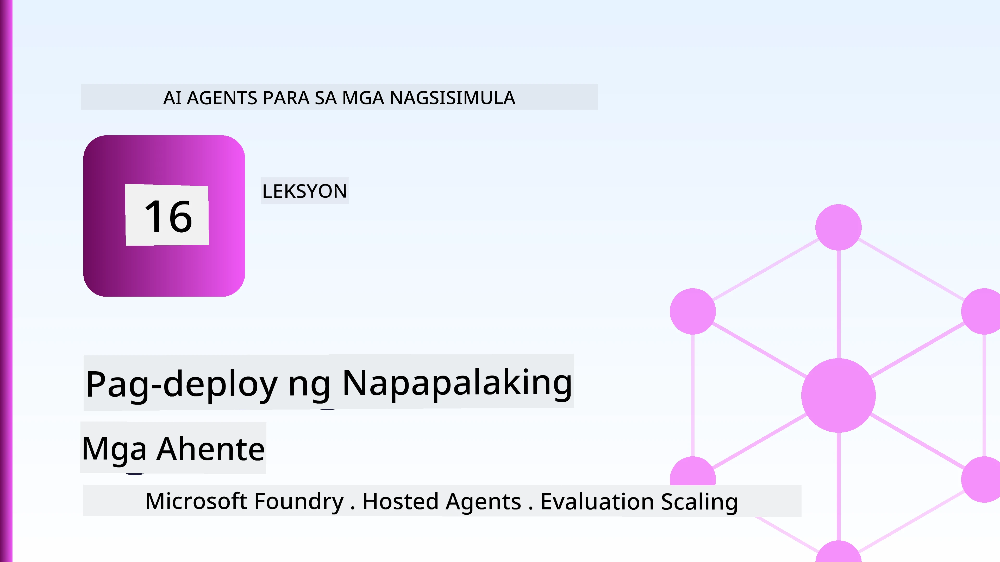
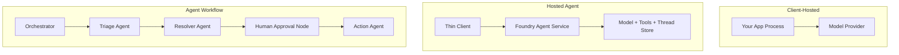
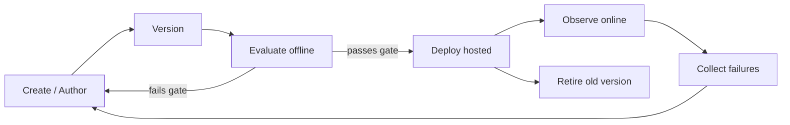
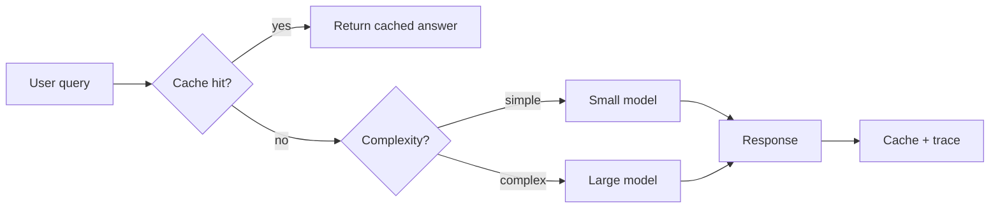
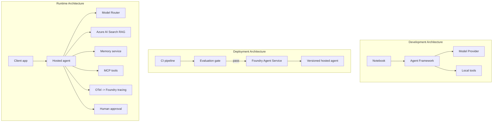

# Pag-deploy ng Scalable Agents gamit ang Microsoft Foundry



Hanggang sa puntong ito sa kurso ay nakagawa ka na ng mga agent na tumatakbo sa iyong laptop, sa loob ng notebook, na pinapagana ng `az login` at ilang environment variables. Iyan ang tamang paraan upang matuto. Hindi ito ang tamang paraan para patakbuhin ang isang agent na umaasa ang libu-libong mga customer sa gitna ng gabi.

Tungkol ang araling ito sa agwat sa pagitan ng "gumagana ito sa aking makina" at "gumagana ito nang maaasahan at abot-kaya sa produksyon." Pinupuno namin ang agwat na iyon gamit ang **Microsoft Foundry** at ang **Microsoft Foundry Agent Service**, at ginagawa namin ito sa pamamagitan ng paggawa ng isang tunay na customer support agent na may mga tools, retrieval, memory, evaluation, at monitoring.

## Panimula

Tatalakayin ng araling ito ang:

- Ang pagkakaiba sa pagitan ng isang **prototype agent** at isang **deployed agent**, at kung bakit ang paglipat ay karamihang tungkol sa lahat ng nasa paligid* ng modelo.
- **Deployment patterns** para sa mga agent: client-hosted, service-hosted (Hosted Agents), at workflow-orchestrated.
- Ang **agent lifecycle** sa Microsoft Foundry — gumawa, mag-berksyon, mag-deploy, mag-evaluate, mag-monitor, mag-retire.
- **Scaling strategies**: model routing, caching, concurrency, at stateless na disenyo.
- **Observability** gamit ang OpenTelemetry at Foundry tracing.
- **Cost optimisation** sa pamamagitan ng pagpili ng modelo, routing, at evaluation gates.
- **Enterprise considerations**: pamamahala, pag-apruba ng tao, at ligtas na pagpapatakbo ng MCP servers sa produksyon.

## Mga Layunin sa Pagkatuto

Pagkatapos makumpleto ang araling ito, malalaman mo kung paano:

- Pumili ng tamang deployment pattern para sa isang partikular na trabaho ng agent.
- Mag-deploy ng isang agent sa Microsoft Foundry Agent Service para ito ay ma-berksyon, mapamahalaan, at maging observable.
- Mag-instrument ng agent para sa tracing at mag-setup ng evaluation pipeline na tumatakbo bago ang bawat release.
- Mag-apply ng model routing at caching para mapanatiling kontrolado ang latency at gastos sa malaking sukat.
- Magdagdag ng human approval gate para sa mga high-risk na aksyon at isama ang MCP server sa ligtas na paraan sa produksyon.

## Mga Kinakailangan

Ipinapalagay ng araling ito na natapos mo na ang mga naunang aralin at komportable ka sa:

- Paggawa ng mga agent gamit ang [Microsoft Agent Framework](../14-microsoft-agent-framework/README.md) (Aralin 14).
- [Pag-gamit ng Tool](../04-tool-use/README.md) (Aralin 4) at [Agentic RAG](../05-agentic-rag/README.md) (Aralin 5).
- [Agent Memory](../13-agent-memory/README.md) (Aralin 13) at [Agentic Protocols / MCP](../11-agentic-protocols/README.md) (Aralin 11).
- [Observability at Pagsusuri](../10-ai-agents-production/README.md) (Aralin 10) — itinataguyod ng araling ito.

Kailangan mo rin ng:

- Isang **Azure subscription** at isang **Microsoft Foundry project** na may hindi bababa sa isang deployed na chat modelo.
- Ang **Azure CLI** na naka-authenticate (`az login`).
- Python 3.12+ at ang mga package sa repository [`requirements.txt`](../../../requirements.txt).

## Mula Prototype hanggang Produksyon: Ano ang Talagang Nagbabago

Ang isang prototype agent at isang production agent ay may parehong pangunahing loop — mag-isip, tumawag ng mga tool, tumugon. Ang nagbabago ay lahat ng nasa paligid ng loop na iyan. Ang modelo ay siguro 20% lang ng isang production agent; ang natitirang 80% ay ang operational skeleton.

| Alalahanin | Prototype | Produksyon |
| --- | --- | --- |
| **Pagho-host** | Tumatakbo sa iyong notebook | Tumatakbo bilang hosted service, may bersyon at inilalabas |
| **Identidad** | Ang iyong `az login` token | Managed identity na may naka-scoped na RBAC |
| **Estado** | In-memory, nawawala kapag nirestart | Externalised (thread store, memory service) |
| **Pagkabigo** | Nakikita mo ang traceback | May retries, fallbacks, dead-letter, alerts |
| **Gastos** | "Ilang sentimo lang" | Sinusubaybayan bawat request, niruruta, cached, may budget |
| **Kalidad** | Pinagmamasdan mo ang output | Awtomatikong sinusuri bago bawat release |
| **Tiwala** | Inaaprubahan mo ang bawat aksyon | Patakaran + human-in-the-loop para sa mga delikadong aksyon |

Tandaan ang talahanayan na ito. Bawat seksyon sa ibaba ay tumutugma sa isa sa mga row nito.

## Mga Pattern sa Pag-deploy ng Agent

May tatlong pattern na gagamitin mo, madalas sa kombinasyon.

### 1. Client-Hosted Agents

Ang agent object ay naninirahan sa loob ng *iyong* application process. Ang iyong code ang direktang tumatawag sa model provider; ang reasoning loop ay tumatakbo sa iyong serbisyo. Ito ang ginawa sa mga nakaraang aralin.

- **Gamitin ito kapag** kailangan mo ng buong kontrol sa loop, custom middleware, o ini-embed ang agent sa umiiral na backend.
- **Trade-off**: ikaw ang nag-aasikaso sa scaling, estado, at resiliency.

### 2. Hosted Agents (Foundry Agent Service)

Ang agent ay *na-register bilang isang resource* sa Microsoft Foundry. Ang Foundry ang nagho-host ng reasoning loop, nag-iimbak ng mga thread, nagpapatupad ng content safety at RBAC, at pinapakita ang agent sa Foundry portal. Ang iyong app ay nagiging manipis na client na lumilikha ng mga thread at nagbabasa ng mga tugon.

- **Gamitin ito kapag** gusto mo ng tibay, built-in na observability, pamamahala, at mas kaunting operational surface area.
- **Trade-off**: mas kaunting low-level control kapalit ng managed runtime.

### 3. Agent Workflows

Maraming agent (at mga tools) ang pinagsama-sama sa isang graph na may malinaw na control flow — sunod-sunod na hakbang, branching, mga node ng human approval, at mga matibay na checkpoint na maaaring mag-pause at mag-resume. Ito ang kakayahan ng Microsoft Agent Framework **Workflows** na ginagamit sa deployment scale.

- **Gamitin ito kapag** ang isang gawain ay sumasaklaw sa maraming espesyalisadong agent o nangangailangan ng approval step sa gitna.
- **Trade-off**: mas maraming gumagalaw na bahagi; kailangan ng orchestration-level observability.



## Ang Lifecycle ng Agent sa Microsoft Foundry

Ang pag-deploy ng agent ay hindi isang one-time `push`. Isa itong loop, at kapareho ito ng software release cycle dahil iyon nga ang katangian nito.



Ang pangunahing ideya, mula sa [Lesson 10](../10-ai-agents-production/README.md): **offline evaluation ay isang gate, hindi lang basta pag-iisip pagkatapos.** Hindi ilalabas ang bagong bersyon ng agent kung hindi nito natatawid ang iyong mga threshold sa evaluation. Ang online observability ay nagbabalik ng mga totoong failure sa iyong offline test set. Iyan ang buong loop.

## Mga Estratehiya sa Scaling

Ang pag-scale ng agent ay naiiba sa pag-scale ng stateless na web API, dahil bawat request ay maaaring mag-trigger ng maraming mahal na tawag sa modelo at tool. Apat na teknik ang nagpapasan ng karamihan sa workload.

**Stateless request handling.** Huwag mag-imbak ng estado ng bawat user sa memorya ng iyong proseso. I-save ang mga conversation thread sa Foundry thread store o memory service para kahit anong instance ay pwedeng mag-handle ng kahit anong request. Ito ang nagpapahintulot sa iyo na mag-scale nang pahalang — magdagdag ng instances, walang sticky sessions.

**Model routing.** Hindi lahat ng request ay kailangan ang pinaka-kakayahan (at pinakamahal) na modelo. I-route ang mga simpleng request — intent classification, maikling factual na sagot — sa isang maliit at mabilis na modelo, at ireserba ang malaking modelo para sa tunay na reasoning. Kaya ito ng Foundry's **Model Router** para sa iyo, o maaari kang gumawa ng magaan na classifier mismo. Gagawa ka ng DIY na bersyon sa lab.

**Response caching.** Maraming support queries ang halos magkasingkahulugan ("paano ako mag-reset ng password?"). I-cache ang mga sagot sa karaniwang tanong at ihain nang hindi tinatamaan ang modelo. Kahit katamtamang cache hit rate ay makabuluhang nagpapababa ng gastos at latency.

**Concurrency at backpressure.** May mga rate limit ang model providers. Limitahan ang concurrency mo, gumamit ng retries na may exponential backoff, at mag-fail nang maayos (ang nakapila na "ginagawa namin ito" na tugon ay mas mabuti kaysa sa 500).



## Observability sa Produksyon

Hindi mo mapapagana kung hindi mo ito nakikita. Gaya ng tinalakay sa Lesson 10, ang Microsoft Agent Framework ay naglalabas ng **OpenTelemetry** traces nang native — bawat tawag sa modelo, tool invocation, at orchestration step ay nagiging span. Sa produksyon, ini-export mo ang mga span sa Microsoft Foundry (o anumang OTel-compatible backend) para magawa mong:

- Subaybayan ang isang reklamo ng customer mula simula hanggang dulo sa bawat tawag sa modelo at tool.
- Bantayan ang p50/p95 latency at gastos bawat request sa paglipas ng panahon.
- Mag-alerta sa mga spike sa error-rate at hindi pangkaraniwang gastos bago pa ito mapansin ng iyong mga gumagamit (o ng iyong finance team).

```python
from agent_framework.observability import get_tracer

tracer = get_tracer()

with tracer.start_as_current_span("support_request") as span:
    span.set_attribute("customer.tier", "enterprise")
    span.set_attribute("routed.model", "gpt-5-nano")
    # agent execution is traced automatically inside this span
```

Ang mga attributes tulad ng `customer.tier` at `routed.model` ang nagiging daan upang ang isang pader ng mga trace ay maging mga sagot na tanong ("napupunta ba ang mga enterprise customer sa maliit na modelo na masyadong madalas?").

## Pag-optimize ng Gastos

Ang gastos sa mga production agent ay pinamumunuan ng mga token. Tatlong mga lever, ayon sa epekto:

1. **Tamang sukat ng modelo.** Ang maliit na modelo na pumapasa sa iyong evaluation gate ay halos palaging mas mura kaysa sa malaking modelo na pumasa rin. Gamitin ang evaluation upang *patunayan* na sapat ang maliit na modelo kaysa pumili agad sa pinakamalaki bilang pag-iingat.
2. **Route ayon sa kumplikasyon.** Gaya ng nabanggit — magbayad ng presyo ng malaking modelo lang para sa mga request na nangangailangan nito.
3. **Cache nang agresibo.** Ang pinakababang gastos na tawag sa modelo ay yung hindi mo na kailangang gawin.

Ang evaluation gates at kontrol ng gastos ay parehong disiplina na tinitingnan mula sa dalawang panig: sinasabi ng evaluation ang *quality floor*, at pinipilit ng routing at caching na mapanatili kang malapit sa *gastusin* ng floor na iyon.

## Mga Pagsasaalang-alang sa Enterprise Deployment

**Pamamahala.** Ang Hosted Agents ay namamana ang RBAC, content safety, at audit logging ng Foundry. Bigyan ang bawat agent ng managed identity na may pinakamababang pribilehiyo na kailangan nito — read-only access sa knowledge base, scoped access sa ticketing API, wala nang iba pa.

**Human-in-the-loop.** May ilang aksyon na sobrang delikado para i-automate ng tuluyan — mag-isyu ng refund, mag-delete ng account, mag-escalate sa legal team. Sinusuportahan ng Microsoft Agent Framework ang **approval-required** na mga tool: ang agent ang nagmumungkahi ng aksyon, nag-pause ang execution, ine-approve o nire-reject ng tao, at nagpapatuloy ang workflow. Nakita mo ang primitivo nito sa [Lesson 6](../06-building-trustworthy-agents/README.md); dito mo ito ide-deploy.

**MCP sa produksyon.** Pinapayagan ka ng [MCP](../11-agentic-protocols/README.md) na kumonsumo ang agent mo ng mga external tool sa pamamagitan ng standard interface. Sa produksyon, ituring ang bawat MCP server bilang hindi pinagkakatiwalaang hangganan: i-pin ang bersyon ng server, patakbuhin ito gamit ang scoped identity, i-validate ang mga output, at huwag mag-expose ng mga lihim dito. Ang MCP server ay isang dependency, at ang mga dependency ay pinapatch, ina-audit, at nililimitahan ang rate.



Ang tatlong diagram na iyon — development, deployment, runtime — ay iisang agent sa tatlong yugto ng buhay nito. Ang lab na susunod ay gagabay sa iyo sa paggawa nito.

## Hands-On Lab: Isang Production-Ready Customer Support Agent

Buksan ang [`code_samples/16-python-agent-framework.ipynb`](./code_samples/16-python-agent-framework.ipynb) at sundan hanggang dulo. Bubuuin mo ang isang **Contoso customer support agent** na may bawat isyu ng produksyon na konektado:

1. **Pagtawag sa tool** — tingnan ang status ng order at magbukas ng support ticket.
2. **RAG** — sagutin ang mga tanong tungkol sa polisiya mula sa knowledge base (Azure AI Search, na may in-memory fallback para tumakbo ang notebook kahit walang Search resource).
3. **Memorya** — tandaan ang customer sa bawat liko ng usapan.
4. **Model routing** — isang classifier sa kumplikasyon ang nagruruta ng bawat request sa maliit o malaking modelo.
5. **Response caching** — ang mga paulit-ulit na tanong ay sinasagot mula sa cache.
6. **Human approval** — ang mga refund na lampas sa threshold ay hihintayin ng pag-apruba ng tao.
7. **Evaluation pipeline** — isang maliit na offline test set ang nag-suscore sa agent at nagsisilbing release gate.
8. **Observability** — OpenTelemetry tracing sa bawat request.

### Gabay sa Pagsunod

Ang notebook ay inayos upang bawat isyu sa produksyon ay isang sariling seksyon na pwedeng patakbuhin. Ang puso nito ay ang routing-plus-caching request handler:

```python
async def handle_support_request(query: str, customer_id: str) -> str:
    # 1. Serve from cache when we can.
    cached = response_cache.get(normalize(query))
    if cached:
        return cached

    # 2. Route by complexity to control cost.
    model = "gpt-5-nano" if is_simple(query) else "gpt-5-mini"

    # 3. Run the agent inside a trace span for observability.
    with tracer.start_as_current_span("support_request") as span:
        span.set_attribute("routed.model", model)
        span.set_attribute("customer.id", customer_id)
        response = await support_agent.run(query, model=model)

    # 4. Cache and return.
    response_cache.set(normalize(query), response.text)
    return response.text
```

Ganito ang hitsura ng evaluation gate na nagbabantay sa release:

```python
async def evaluation_gate(agent, test_cases, threshold: float = 0.8) -> bool:
    passed = 0
    for case in test_cases:
        result = await agent.run(case["input"])
        if score_response(result.text, case["expected"]) >= 0.8:
            passed += 1
    pass_rate = passed / len(test_cases)
    print(f"Evaluation pass rate: {pass_rate:.0%} (gate: {threshold:.0%})")
    return pass_rate >= threshold  # only deploy if the gate passes
```

Basahin ang bawat linya — sinadya ng notebook na gawing maliit ang mga primitivo para walang nakatago sa likod ng tawag sa framework.

## Pag-validate ng Deployed Agent gamit ang Smoke Tests

Ang evaluation gate sa itaas ay tumatakbo *offline* laban sa iyong agent object. Kapag ang agent ay na-deploy bilang Hosted Agent, kailangan mo ng isa pa, mas mura pang tseke: **totoo bang sumasagot ang deployed endpoint?**

Ang matagumpay na pag-deploy ay nagpapatunay lang na tinanggap ng control plane ang definisyon — hindi nito pinapatunayang sumasagot ang agent. Ang nawawalang dependency, maling model routing, o expired na koneksyon ay maaaring mag-iwan ng green deployment na walang sagot. Nakakatawag-pansin ang **smoke test** nito sa loob ng ilang segundo, bawat deploy, nang hindi kailangang gastusin ang buong evaluation.

Ang repository na ito ay may kasamang handa-gamitin na smoke-test pipeline na binuo gamit ang [AI Smoke Test](https://github.com/marketplace/actions/ai-smoke-test) GitHub Action:

- **Catalog** — [`tests/lesson-16-smoke-tests.json`](../../../tests/lesson-16-smoke-tests.json) ay naglalaman ng mga prompt at assertion para sa Contoso support agent (batay na sagot sa polisiya, pagtingin ng order, pagpapanatili ng paksa, at multi-turn thread continuity). Ang mga catalog para sa mga agent sa ibang aralin ay kasama rin dito — tingnan ang [`tests/README.md`](../tests/README.md).
- **Workflow** — [`.github/workflows/smoke-test.yml`](../../../.github/workflows/smoke-test.yml) ay nagla-login gamit ang Azure OIDC at nag-POST ng bawat prompt sa Responses endpoint ng agent, at gagalaw ng failure sa trabaho kung may mismatch sa mga assertion.

```yaml
- name: Smoke-test hosted agent
  uses: JFolberth/ai-smoketest@v1
  with:
    project_endpoint: ${{ inputs.project_endpoint }}
    agent_name: ContosoSupportAgent
    tests_file: tests/lesson-16-smoke-tests.json
```

Patakbuhin ito mula sa **Actions** tab kapag na-deploy na ang iyong agent, na nagbibigay ng endpoint ng iyong Foundry project at pangalan ng agent. Ang federated identity ay kailangan ng **Azure AI User** role sa scope ng Foundry project. Isipin ang mga layer bilang isang pyramid: mga smoke test (maaabot at tumutugon ba?) ay tumatakbo sa bawat deploy, offline evaluation (maayos ba para ipadala?) ay tumatakbo bago ang promotion, at online evaluation (kumusta ito sa totoong mundo?) ay tumatakbo nang tuloy-tuloy.

## Knowledge Check

Subukan ang iyong pag-unawa bago lumipat sa assignment.

**1. Gaano kalaki ang bahagi ng isang production agent ang "model," at ano ang natitira?**

<details>
<summary>Answer</summary>

Ang model ay maliit na bahagi ng sistema — kadalasang sinasabi na mga 20%. Ang natitira ay ang operational skeleton: hosting at versioning, identity at RBAC, externalised state, failure handling, cost tracking, evaluation, at human-in-the-loop controls. Ang paglipat sa production ay karamihang tungkol sa pagbuo ng lahat *sa paligid* ng reasoning loop.
</details>

**2. Kailan mo pipiliin ang Hosted Agent kaysa sa client-hosted agent?**

<details>
<summary>Answer</summary>

Kapag gusto mo ng managed runtime na may built-in durability (mga thread na tumatagal at maaaring ipagpatuloy), observability, content safety, at RBAC, at handa kang isakripisyo ang ilang mababang-level na kontrol ng reasoning loop kapalit ng mas kaunting operational surface area. Mas maganda ang client-hosted kapag kailangan mo ng buong kontrol sa loop o inilalagay ang agent sa kasalukuyang backend.
</details>

**3. Bakit kailangang maging stateless ang scalable agent sa sariling process memory nito?**

<details>
<summary>Answer</summary>

Para kahit anong instance ay makakayanan ang kahit anong request, na siyang nagpapahintulot sa horizontal scaling nang walang sticky sessions. Ang per-user conversation state ay inilalagay sa thread store o memory service na external. Kung ang state ay nasa process memory, mawawala ito sa restart at hindi mo malayang maipamahagi ang load.
</details>

**4. Anong problema ang nilulutas ng model routing, at paano ito konektado sa evaluation?**

<details>
<summary>Answer</summary>

Pinapadala ng routing ang mga simpleng request sa maliit, murang, at mabilis na model at iniiwan ang malaking model para sa tunay na reasoning, na kumokontrol sa latency at gastusin. Konektado ito sa evaluation dahil ang evaluation ang nagpapatunay na sapat na ang maliit na model para sa isang klase ng mga request — ang routing nang walang evaluation ay paghula lamang.
</details>

**5. Ano ang "evaluation gate" at saan ito matatagpuan sa lifecycle?**

<details>
<summary>Answer</summary>

Ang evaluation gate ay nagpapatakbo ng offline test set laban sa bagong agent version at hinaharang ang deployment kung hindi pumasa sa threshold. Ito ay nasa pagitan ng "version" at "deploy" sa lifecycle, na ginagawang precondition ang kalidad para sa release sa halip na isang bagay na sinusuri pagkatapos maipadala.
</details>

**6. Bakit dapat ituring ang MCP server bilang hindi pinagkakatiwalaang boundary sa production?**

<details>
<summary>Answer</summary>

Dahil ito ay isang external dependency na tinatawagan ng iyong agent. Dapat i-pin ang version nito, patakbuhin ito gamit ang scoped identity, i-validate ang mga output, limitahan ang rate ng tawag dito, at huwag kailanman ibunyag ang mga sikreto dito — pareho ang disiplina sa anumang third-party dependency. Ang mga output nito ay pumapasok sa reasoning ng iyong agent, kaya ang hindi validated na tiwala ay panganib sa seguridad.
</details>

**7. Anong isang pagbabago ang karaniwang may pinakamalaking epekto sa gastos ng production agent, at bakit?**

<details>
<summary>Answer</summary>

Ang tamang pagsukat ng model — ang paggamit ng pinakamaliit na model na pumasa sa iyong evaluation gate. Ang gastos ay kinokontrol ng mga tokens, at ang mas maliit na model na nakakatugon sa kalidad ay halos palaging mas mura kaysa sa mas malaking isa. Ang caching at routing ay nagpapababa pa ng gastos, ngunit ang pagpili ng tamang base model ang may pinakamatinding pangunahing epekto.
</details>

**8. Ano ang papel ng mga span attribute tulad ng `customer.tier` at `routed.model` sa observability?**

<details>
<summary>Answer</summary>

Ginagawa nilang mga sagot na maibigay na mga tanong pang-negosyo ang mga raw traces. Kung walang mga attribute, mayroon kang pader ng mga spans; kasama ang mga ito, maaari mong tanungin "napapadalhan ba ng maliit na model nang madalas ang mga enterprise customer?" o "alin na model ang humahawak sa pinakamatagal naming mga request?" Ang mga attribute ang paraan ng pagsasaayos ng telemetry ayon sa mga dimensyon na mahalaga sa iyong operasyon.
</details>

## Assignment

Kuhanin ang customer support agent mula sa lab at patatagin ito para sa isang tiyak na senaryo: **isang subscription billing support agent para sa isang SaaS company.**

Ang iyong isusumite ay dapat:

1. **Palitan ang mga tools** ng mga may kinalaman sa billing: `get_subscription_status`, `get_invoice`, at `issue_credit` (ang mga credit na higit sa $50 ay nangangailangan ng pag-apruba ng tao).
2. **Magdagdag ng tatlong RAG na dokumento** na sumasaklaw sa refund policy, billing cycle, at cancellation policy ng kumpanya.
3. **Palawakin ang evaluation set** sa hindi bababa sa walong kaso, kabilang ang hindi bababa sa dalawang *dapat* mag-trigger ng human-approval path, at kumpirmahin na tama ang pagpasa o pagkabigo ng iyong evaluation gate.
4. **Magdagdag ng isang cost report**: pagkatapos patakbuhin ang sampung halo-halong query sa agent, ipakita kung ilan ang napunta sa maliit na model, ilan sa malaking model, at ilan ang nagmula sa cache.

Sumulat ng maikling talata (sa isang markdown cell) na nagpapaliwanag kung aling patakaran sa model-routing ang pinili mo at kung paano mo ito ivavalidate gamit ang totoong trapiko. Walang iisang tamang sagot — sinusuri ka kung paano magkakaugnay nang maayos ang mga concern sa production.

## Summary

Sa araling ito inilipat mo ang isang agent mula prototype papuntang production gamit ang Microsoft Foundry:

- Ang paglipat sa production ay karamihang tungkol sa **operational skeleton** sa paligid ng model — hosting, identity, estado, failure handling, gastusin, kalidad, at tiwala.
- Natutunan mo ang tatlong **deployment patterns** — client-hosted, Hosted Agents, at Agent Workflows — at kung kailan ito angkop.
- Tinahak mo ang **agent lifecycle**, kung saan ang offline **evaluation ay nagsisilbing release gate** at ang online observability ay nagtutulak ng mga failure pabalik sa test set.
- Nag-apply ka ng **scaling strategies** — stateless design, model routing, caching, at bounded concurrency — at inugnay ito sa **cost optimisation**.
- Inilagay mo ang **enterprise controls**: RBAC, human-in-the-loop approval, at production-safe na integrasyon ng MCP.
- Nagtayo ka ng **production-ready customer support agent** na nag-uugnay ng bawat isa sa mga concern na ito sa tumatakbong kodigo.

Ang susunod na aralin ay maglalakbay sa kabaligtaran: sa halip na palakihin ang mga agent sa cloud, dadalhin mo sila *ibaba* sa isang developer machine at patatakbuhin nang lokal nang buo.

## Additional Resources

- <a href="https://learn.microsoft.com/azure/ai-foundry/what-is-azure-ai-foundry" target="_blank">Dokumentasyon ng Microsoft Foundry</a>
- <a href="https://learn.microsoft.com/azure/ai-foundry/agents/overview" target="_blank">Pangkalahatang-ideya ng Microsoft Foundry Agent Service</a>
- <a href="https://learn.microsoft.com/en-us/agent-framework/overview/?wt.mc_id=youtube_26688_organicsocial_reactor&pivots=programming-language-python" target="_blank">Microsoft Agent Framework</a>
- <a href="https://learn.microsoft.com/en-us/azure/ai-foundry/openai/concepts/model-router" target="_blank">Model Router sa Microsoft Foundry</a>
- <a href="https://learn.microsoft.com/azure/search/search-what-is-azure-search" target="_blank">Azure AI Search</a>
- <a href="https://opentelemetry.io/" target="_blank">OpenTelemetry</a>
- <a href="https://github.com/marketplace/actions/ai-smoke-test" target="_blank">AI Smoke Test GitHub Action</a>
- <a href="https://modelcontextprotocol.io/" target="_blank">Model Context Protocol (MCP)</a>

## Nakaraang Aralin

[Pagbuo ng Computer Use Agents (CUA)](../15-browser-use/README.md)

## Susunod na Aralin

[Paglikha ng Lokal na AI Agents](../17-creating-local-ai-agents/README.md)

---

<!-- CO-OP TRANSLATOR DISCLAIMER START -->
**Pagtatanggi**:
Ang dokumentong ito ay isinalin gamit ang serbisyo ng AI translation na [Co-op Translator](https://github.com/Azure/co-op-translator). Bagama't nagsusumikap kami para sa katumpakan, pakatandaan na ang awtomatikong pagsasalin ay maaaring maglaman ng mga pagkakamali o hindi pagkakatugma. Ang orihinal na dokumento sa orihinal nitong wika ang dapat ituring na pangunahing sanggunian. Para sa mahahalagang impormasyon, inirerekomenda ang propesyonal na pagsasalin ng tao. Hindi kami mananagot sa anumang maling pagkakaintindi o maling interpretasyon na nagmula sa paggamit ng pagsasaling ito.
<!-- CO-OP TRANSLATOR DISCLAIMER END -->