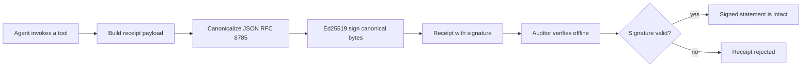
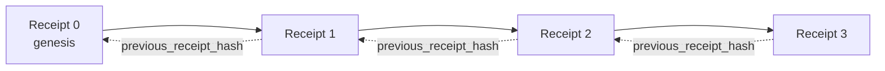

[Panoorin ang video ng aralin: Pag-secure ng mga AI Agents gamit ang Cryptographic Receipts](https://youtu.be/PLACEHOLDER_VIDEO_ID)

> _(Idadagdag ng Microsoft content team ang video ng aralin at thumbnail pagkatapos ng pag-merge, na naaayon sa pattern ng aralin 14 / 15.)_

# Pag-secure ng mga AI Agents gamit ang Cryptographic Receipts

## Panimula

Tatalakayin sa araling ito ang:

- Bakit mahalaga ang audit trails para sa mga AI agents sa pagsunod, pag-debug, at pagtitiwala.
- Ano ang cryptographic receipt at paano ito naiiba sa isang unsigned log line.
- Paano gumawa ng signed receipt para sa tawag ng tool ng isang agent gamit ang plain Python.
- Paano i-verify ang receipt offline at matuklasan ang pandaraya.
- Paano mag-chain ng mga receipts upang kapag may tinanggal o inayos na isa, masisira ang chain.
- Ano ang pinapatunayan ng mga receipts at ano ang hindi nito pinapatunayan.

## Mga Layunin ng Pagkatuto

Pagkatapos makumpleto ang araling ito, malalaman mo kung paano:

- Tukuyin ang mga failure modes na nagtutulak ng cryptographic provenance para sa mga gawain ng agent.
- Gumawa ng Ed25519-signed receipt sa isang canonical JSON payload.
- Mag-verify ng receipt nang independyente gamit lamang ang pampublikong susi ng naglagda.
- Matuklasan ang pandaraya sa pamamagitan ng muling pagpapatakbo ng verification sa binagong receipt.
- Bumuo ng hash-chained na sunod-sunod ng mga receipts at ipaliwanag kung bakit mahalaga ang chain.
- Kilalanin ang hangganan sa pagitan ng pinapatunayan ng mga receipts (attribution, integridad, pag-uugnay) at ng hindi nito pinapatunayan (katumpakan ng aksyon, katibayan ng polisiya).

## Ang Problema: Audit Trail ng Iyong Agent

Isipin mong nag-deploy ka ng AI agent para sa Contoso Travel. Binabasa ng agent ang mga kahilingan ng customer, tinatawagan ang flights API para maghanap ng mga opsyon, at nagbu-book ng mga upuan para sa customer. Noong nakaraang quarter, ang agent ay nagproseso ng 50,000 booking.

Dumating ngayon ang auditor. Nagtanong sila ng simpleng tanong: "Ipakita mo sa akin ang ginawa ng iyong agent."

Ibinigay mo ang iyong mga log file. Tiningnan ito ng auditor at nagtanong ng mas mahirap na tanong: "Paano ko malalaman na ang mga logs na ito ay hindi in-edit?"

Ito ang problema sa audit trail. Karamihan sa mga deployment ng agent ngayon ay umaasa sa:

- **Mga application logs**: sinusulat ng agent mismo, maaaring i-edit ng sinumang may access sa file system.
- **Mga cloud logging services**: may tamper-evident sa platform level ngunit kailangan ng auditor na magtiwala sa operator ng platform.
- **Mga database transaction logs**: angkop para sa mga pagbabago sa database ngunit hindi para sa mga arbitrary tool calls.

Wala sa mga ito ang makakasagot sa tanong ng auditor nang hindi kailangan ang tiwala mula sa sinuman (ikaw, ang iyong cloud provider, ang iyong database vendor). Para sa panloob na gamit, madalas ay katanggap-tanggap ang tiwalang iyon. Pero para sa mga regulated workloads (finance, healthcare, anumang sakop ng EU AI Act), hindi ito katanggap-tanggap.

Pinapaliit ng cryptographic receipts ang problemang ito sa pamamagitan ng paggawa ng isang signed statement na maaaring i-verify nang independyente. Kailangan pa rin ng auditor ng dahilan mula sa labas ng system para magtiwala sa signing key at sa component na gumawa ng pahayag. Ang naka-embed na susi ay nagpapatunay ng self-consistency, hindi ang pagkakakilanlan ng issuer o lugar ng pagpapatupad.


## Ano ang Cryptographic Receipt?

Ang receipt ay isang JSON object na nagrerekord ng ginawa ng isang agent, na may pirma gamit ang digital signature.



Ang isang minimal na receipt ay ganito ang itsura:

```json
{
  "type": "agent.tool_call.v1",
  "agent_id": "contoso-travel-bot",
  "tool_name": "lookup_flights",
  "tool_args_hash": "sha256:a3f9c1...",
  "result_hash": "sha256:7b2e1d...",
  "policy_id": "contoso-travel-policy-v3",
  "timestamp": "2026-04-25T14:30:00Z",
  "sequence": 47,
  "previous_receipt_hash": "sha256:9d4e6a...",
  "signature": {
    "alg": "EdDSA",
    "sig": "c5af83...",
    "public_key": "8f3b2c..."
  }
}
```

Tatlong katangian ang gumagawa ng trabaho:

1. **Ang pirma**. Pinipirmahan ang receipt ng gateway ng agent gamit ang isang Ed25519 private key. Sinumang may katumbas na public key ay maaaring mag-verify ng pirma offline. Kailangang i-pin ng relying party ang key o i-resolve mula sa isang trusted registry sa labas ng receipt. Ang pandaraya sa anumang signed field ay nagwawalang bisa sa pirma.

2. **Canonical encoding**. Bago pirmahan, ang receipt ay naseserialize gamit ang JSON Canonicalization Scheme (JCS, RFC 8785). Tinitiyak nito na ang dalawang implementasyon na gumagawa ng parehong lohikal na receipt ay gumagawa ng byte-identical na output. Kung wala ang canonicalization, magkaiba ang magiging signature ng mga JSON serializer para sa parehong nilalaman.

3. **Hash chaining**. Ang `previous_receipt_hash` field ay nag-uugnay ng bawat receipt sa naunang receipt. Ang pagtanggal o pag-ayos ng receipt ay sisira sa ipinakitang sequence. Ang pagtuklas ng truncation o signer-controlled rewrite ay nangangailangan din ng pinned na kasalukuyang chain head, independyenteng nasaksihang checkpoint, o authenticated na closed-population commitment.

Sama-sama, ang mga katangiang ito ay nagbibigay ng tatlong garantiya:

- **Atribusyon sa isang key**: pinirmahan ng key na ito ang nilalamang ito. Nangangailangan ng trusted key binding ang pagkakakilanlan ng organisasyon o tao.
- **Integridad**: hindi nabago ang nilalaman mula ng mapirmahan.
- **Pagkakasunod-sunod sa loob ng beripikadong sequence**: ang receipt na ito ay may link sa naunang receipt.

## Paggawa ng Receipt sa Python

Hindi mo kailangan ng espesyal na library para gumawa ng receipt. Malawak ang pagkakaroon ng cryptographic primitives at ilang dosenang linya lang ng Python ang lohika.

Ang hands-on na mga ehersisyo sa `code_samples/18-signed-receipts.ipynb` ay nagtuturo sa buong proseso. Ang source-controlled na `code_samples/18-signed-receipts.execution-receipt.json` ay nagrerekord ng eksaktong notebook hash, Python environment, bilang ng cell, at mga tseke mula sa pinakabagong malinis na pagpapatakbo nang hindi binabago ang mga na-save na output ng aralin. Ang pinaikling bersyon:

```python
import json
import hashlib
import base64
from nacl import signing
from jcs import canonicalize  # RFC 8785 canonical JSON

def b64url_nopad(data: bytes) -> str:
    return base64.urlsafe_b64encode(data).decode("ascii").rstrip("=")

def sha256_canonical(obj) -> str:
    """SHA-256 of a Python object's JCS-canonical JSON form."""
    return f"sha256:{hashlib.sha256(canonicalize(obj)).hexdigest()}"

# Generate or load a signing key (in production, store in a key vault)
signing_key = signing.SigningKey.generate()
verify_key = signing_key.verify_key
TRUSTED_PUBLIC_KEYS = {b64url_nopad(bytes(verify_key))}  # pinned out of band by the verifier

# Build the receipt payload (no signature yet)
tool_args = {"origin": "SYD", "destination": "LAX"}
tool_result = [{"flight": "QF11", "price": 1850, "stops": 0}]

payload = {
    "type": "agent.tool_call.v1",
    "agent_id": "contoso-travel-bot",
    "tool_name": "lookup_flights",
    "tool_args_hash": sha256_canonical(tool_args),
    "result_hash": sha256_canonical(tool_result),
    "policy_id": "contoso-travel-policy-v3",
    "timestamp": "2026-04-25T14:30:00Z",
    "sequence": 0,
    "previous_receipt_hash": None,
}

# Canonicalize and sign the JCS bytes directly. PureEdDSA hashes internally.
canonical_bytes = canonicalize(payload)
signature_bytes = signing_key.sign(canonical_bytes).signature

# Attach a structured signature object.
receipt = {
    **payload,
    "signature": {
        "alg": "EdDSA",
        "sig": b64url_nopad(signature_bytes),
        "public_key": b64url_nopad(bytes(verify_key)),
    },
}
```

Yan ang buong signing pipeline. Tinatalakay ng mga ehersisyo sa notebook ang bawat hakbang.

## Pag-verify ng Receipt at Pagtuklas ng Pandaraya

Ang verification ay ang kabaligtaran na operasyon:

```python
import base64
import hashlib
from nacl import signing
from nacl.exceptions import CryptoError
from jcs import canonicalize

def b64url_decode(s: str) -> bytes:
    padding = "=" * ((4 - len(s) % 4) % 4)
    return base64.b64decode(s + padding, altchars=b"-_", validate=True)

def verify_receipt(receipt: dict, trusted_public_keys: set[str]) -> bool:
    # The signature is a structured object: {"alg", "sig", "public_key"}.
    if not isinstance(receipt, dict):
        return False
    sig_obj = receipt.get("signature")
    if not isinstance(sig_obj, dict) or sig_obj.get("alg") != "EdDSA":
        return False
    try:
        # An inline key proves only self-consistency. Trust is configured out of band.
        public_key = sig_obj.get("public_key")
        signature = sig_obj.get("sig")
        if not isinstance(public_key, str) or not isinstance(signature, str):
            return False
        if public_key not in trusted_public_keys:
            return False
        payload = {k: v for k, v in receipt.items() if k != "signature"}
        canonical_bytes = canonicalize(payload)
        verify_key = signing.VerifyKey(b64url_decode(public_key))
        verify_key.verify(canonical_bytes, b64url_decode(signature))
        return True
    except (CryptoError, TypeError, ValueError, KeyError, OverflowError):
        return False
```

Tumatanggap ang function na ito ng isang receipt kasama ang pinned key set ng relying party at nagbabalik ng
`True` kapag valid ang pirma gamit ang tinanggap na key. Hindi kailangan ng
network call sa verification, ngunit ang pagtitiwala sa key ay isang panlabas na desisyon sa configuration.

Para makita ang pagtuklas ng pandaraya sa aksyon, tinuturo ng notebook ang:

1. Paggawa ng valid na receipt at pagtiyak na ito ay nade-verify.
2. Pagbabago ng isang byte sa `tool_args_hash` field.
3. Muling pagpapatakbo ng verification at pagkabigo nito.

Ito ang praktikal na demonstrasyon na ang mga receipts ay tamper-evident: anumang pagbabago, gaano man kaliit, ay sumisira sa pirma.

## Pag-chain ng Mga Receipts para sa Multi-Step Agents

Isang signed receipt ang nagpoprotekta sa isang aksyon. Ang isang chain ng mga receipts ay nagpoprotekta sa isang sunud-sunod na mga aksyon.



Ang bawat receipt ay nagrerekord ng hash ng naunang receipt. Para tahimik na alisin ang receipt 2, kailangang gawin ng umaatake ang isa sa mga sumusunod:

- Baguhin ang `previous_receipt_hash` field ng receipt 3 (sisira sa pirma ng receipt 3), O
- Gumawa ng bagong pirma sa binagong receipt 3 (kailangang ang private key ng agent).

Kung protektado ang private key at ang verifier ay may pinned na indipendienteng nasaksihang chain head, maaaring matuklasan ang mga atakeng ito. Ang paglalathala ng key sa bawat receipt ay hindi sapat: maaaring magpakita ang isang signer o umaatake ng ibang key, baguhin ang suffix, o paikliin ang chain maliban kung may panlabas na trust at completeness anchor ang relying party.


Tinatalakay ng notebook ang:

1. Pagtatayo ng chain ng tatlong receipts.
2. Pag-verify na ang bawat `previous_receipt_hash` ng receipt ay tugma sa aktwal na hash ng naunang receipt.
3. Pambabago sa isang receipt sa gitna at pagpapakita na nag-break ang chain sa eksaktong puntong iyon.

Ganito ka gumawa ng audit trail na maaaring i-verify ng panlabas na auditor sa ilalim ng kaniyang
sariling mga naka-pin na susi ng tagapag-isyu at mga checkpoint ng kadena, nang hindi pinagkakatiwalaan ang iyong nababagong tindahan ng log.

## Ano ang Pinapatunayan ng Mga Resibo (at Ano ang Hindi)

Ito ang pinakamahalagang bahagi ng araling ito. Malakas ang mga resibo ngunit may hangganan ang kanilang lakas.

**Pinapatunayan ng mga resibo ang tatlong bagay:**

1. **Pagkakakilanlan**: ang isang partikular na susi ay pumirma sa isang partikular na nilalaman.
2. **Integridad**: ang nilalaman ay hindi nagbago mula noong pinirmahan.
3. **Pagkakasunod-sunod sa loob ng isang ipinakitang, napatunayang pagkakasunod-sunod**: ang resibong ito ay konektado sa naunang iyon.

**Hindi pinapatunayan ng mga resibo ang:**

1. **Katatagan**: na ang aksyon ng ahente ay ang tamang aksyon. Maaaring pumirma ang resibo para sa maling sagot katulad ng sa tamang sagot nang malinis.
2. **Pagsunod sa patakaran**: na ang patakarang binanggit sa `policy_id` ay tunay na sinuri, o na ito ay papayagan ang aksyong ito kung susuriin. Itinatala ng resibo ang sinabing claim, hindi ang ipinatupad.
3. **Pagkakakilanlan lampas sa susi**: sinasabi ng resibo na "ang susing ito ang pumirma sa nilalamang ito." Hindi nito sinasabi na "ang taong ito ay nag-authorize nito." Nangangailangan ng hiwalay na identity infrastructure (isang direktoryo, isang rehistro ng pampublikong susi, atbp.) para iugnay ang susi sa tao o organisasyon.
4. **Katotohanan ng mga input**: kung ang ahente ay tumanggap ng manupiladong prompt at kumilos base rito, tapat na itinatala ng resibo ang aksyon. Ang mga resibo ay sumusunod sa validation ng input, hindi pamalit dito.
5. **Pagpapatupad o epekto sa totoong mundo**: ang resibo pagkatapos ng tawag ay nagtatala kung ano ang ipinahayag ng tagapag-isyu. Ang pagpapatunay ng pagpasok o pagsasaayos ng panlabas na epekto ay nangangailangan ng ebidensya mula sa totoong tagagawa o hangganan ng tagapagbigay.
6. **Kumpleto**: ang kawalan ng resibo ay maaaring mangahulugan na na-block, nilaktawan, nawala, o hindi na-instrumento. Ang kawalan ay nagiging ebidensya lamang sa loob ng isang awtentikadong saradong populasyon.
7. **Pinagkakatiwalaang oras**: ang pinirmahang timestamp ay nagpapatunay na dala ng pumirma ang halagang iyon, hindi na ito ay tama. Nangangailangan ang pinagkakatiwalaang oras ng hiwalay na awtoridad ng oras o naitalang checkpoint.

Mahalaga ang hangganan na ito sa dalawang dahilan:

- Sinasabi nito kung para saan kapaki-pakinabang ang mga resibo: upang gawing mahahayag at mahirap sirain ang kilos ng ahente, kahit sa mga hangganan ng organisasyon.
- Sinasabi nito kung anong karagdagang mga layer ang kailangan mo pa: pagsusuri ng input (Lesson 6), pagpapatupad ng patakaran (mabanggit nang kaunti sa ibaba), at imprastraktura ng pagkakakilanlan (hindi sakop sa araling ito).

Isang karaniwang pagkakamali ang ipalagay na "may mga resibo tayo" ay nangangahulugang "may kontrol tayo." Hindi iyon totoo. Ang mga resibo ay pundasyon. Ang pamamahala ay ang sistemang itinatayo mo sa ibabaw nito.

## Pag-uugnay ng Lagda ng Approver sa Eksaktong Aksyon

Karapat-dapat magkaroon ng sariling seksyon ang Item 3 sa itaas: nagsasabing "ang susing ito ay pumirma sa nilalamang ito" ang resibo ng aksyon, hindi "ang tao ay nag-authorize nito." Para sa mga aksyong may mataas na panganib (mga refund, pagtanggal, wire transfer), maaaring maglagda ang hiwalay na approver upang itali ang eksaktong aksyon. Ang pag-uugnay ng susi sa tao at pagsuri ng presensya ng tao ay nananatiling hiwalay na responsibilidad.

Ang kasunod na notebook `code_samples/human-authorization-receipts.ipynb` ay nagdaragdag ng ikalawang uri ng resibo, `human.approval.v1`, sa parehong hugis ng sobre tulad ng mga resibo ng aralin (isang typed payload na nilagdaan ng Ed25519 sa ibabaw ng canonical nitong mga byte sa JCS, kasama ang `signature` na bagay sa labas ng nilagdaang mga byte). Nilalagdaan ng susi ng approver ang **buong canonical na aksyon at ang digest nito**; nilalagdaan ng susi ng ahente ang claim na nagdadala ng **parehong digest ng aksyon** at isang `parent_approval_ref`, ang `receipt_hash` ng aprubal, ang parehong konbensiyon gaya ng `previous_receipt_hash` sa kadena na iyong ginawa sa itaas. Isang `verify_chain` ang sumasaklaw sa dalawang artifact sa ilalim ng **hiwalay na naka-pin na rehistro ng mga susi** (mga susi ng approver kumpara sa mga susi ng ahente), kaya ang landas ng code ay pinaghahatian ngunit ang mga awtoridad ay hindi kailanman pagsasamahin.

Ang katangian na ito, na maingat na sinabi: *ang naka-pin na susi ng approver ang pumirma sa eksaktong
aksyong ito, at ang susi ng ahente ay huli nang pumirma ng pahayag na may parehong digest ng aksyon.*
Mahalaga itong ebidensya, ngunit hindi ito sapat na patunay na naisakatuparan ang aksyon. Para
makontrol ang pagpapatupad, ang eksaktong aprubal ay kailangang itabi at magamit isang beses lamang sa
tunay na hangganan ng tagaganap; ang mga hindi kilalang resulta mula sa provider ay dapat manatiling hindi kilala sa halip na
paulit-ulit na subukang gawin. Sinusubukan ng mga fixture ng pagtanggi sa notebook ang layer ng chain ng resibo:

- panloloko, confused deputy, peke na mga susi sa alinmang panig, at hindi tamang input;
- **lipas na awtoridad**: isang lagda na patuloy na totoo, tumanggi pa rin dahil lumipat ang bersyon ng patakaran, ang susi ng approver ay na-rotate palabas sa naka-pin na rehistro, o nag-expire ang aprubal bago ang ibinigay na oras ng beripikasyon;
- **pagpapalit ng digest**: isang wastong pinirmahang resibo ng aksyon na tumutukoy sa *tunay* na aprubal na nag-uugnay sa *ibang* canonical na aksyon.

Bawat pagkabigo ay tumatanggi na may natatanging dahilan, kaya maaaring malaman ng isang auditor habang nagbabasa ng pagtanggi kung ang awtoridad ay lipas na o ang inaangking aksyon ay nagbago. Ang beripikasyon ay panumbas lamang na pagbabasa at maaaring ulitin: hindi nito kinokonsumo ang aprubal o tinatawag ang provider. Nangangailangan ang hiwalay na tagaganap ng matibay, atomic na proteksyon sa pag-uulit pati na ang mga tiyak na resulta ng tagumpay, kabiguan, at hindi tiyak. Ang resibo sa pag-apruba ng tao ay isang edukasyonal na komposisyon na inilarawan ng araling ito, hindi isang uri ng resibo na tinukoy ng `draft-farley-acta-signed-receipts`.

## Mga Sanggunian sa Produksyon

Ang Python code sa araling ito ay sinadyang minimal upang mabasa mo ang bawat linya at maunawaan nang eksakto ang nangyayari. Sa produksyon, may dalawang opsyon ka:

1. **Magtayo nang direkta sa mga kriptograpikong primitive.** Ang 50 linyang nakita mo sa itaas ay sapat para sa maraming gamit. Ang PyNaCl (Ed25519) at ang `jcs` na pakete (canonical JSON) ay mga maayos na pinamamahalaan at na-audit na mga library.

2. **Gumamit ng production receipt library.** Ilang open-source na proyekto ang nagpapatupad ng parehong pattern na may dagdag na mga tampok (pag-ikot ng susi, batch na beripikasyon, pamamahagi ng JWK Set, integrasyon sa mga policy engine):
   - Ang pipeline ng pag-lagda ay gumagamit ng JCS at mga konbensiyon sa saklaw ng lagda sa isang independiyenteng IETF Internet-Draft ([`draft-farley-acta-signed-receipts`](https://datatracker.ietf.org/doc/draft-farley-acta-signed-receipts/), rebisyon 02). Ang simpleng edukasyonal na resibo ng aralin ay naiiba sa `{payload, signature}` na sobre ng draft at hindi ipinapakita bilang isang alinsunod na implementasyon. Naglalathala ang draft ng nakaambag na suite para sa mga implementasyong nagtutok sa wire format nito ([agent-governance-testvectors](https://github.com/ScopeBlind/agent-governance-testvectors)).
   - Ang Microsoft Agent Governance Toolkit ay bumubuo ng mga resibo kasama ng mga desisyong batay sa Cedar policy; tingnan ang Tutorial 33 sa repositoryo para sa isang end-to-end na halimbawa.
   - Ang mga pakete na `protect-mcp` (npm) at `@veritasacta/verify` (npm) ay nagbibigay ng Node-based na implementasyon ng paglagda ng resibo at offline verification, na nilalayong balutan ang anomang MCP server ng tamper-evident audit trail, kabilang ang isang flow na pinipigilan para sa co-sign kung saan ang pinahintulutang aksyon ay naglalabas ng approval receipt na naka-ugnay sa digest ng aksyon (WebAuthn-backed sa desktop flow), ang parehong pattern ng approval receipt tulad ng notebook ng human-authorization sa itaas.
   - Ang **[nobulex](https://github.com/arian-gogani/nobulex)** Python SDK (`pip install nobulex`) ay nagbibigay ng parehong Ed25519 + JCS signing pattern sa Python na may LangChain at CrewAI na integrasyon, kabilang ang mga inilathalang cross-validation test vectors at isang compliance mapping na inambag sa pamamagitan ng [OWASP PR #2210](https://github.com/OWASP/CheatSheetSeries/pull/2210).
   - Ang **[EMILIA Protocol](https://github.com/emiliaprotocol/emilia-protocol)** ay nagbibigay ng karagdagang eksaktong-action enforcement layer: offline-verifiable approval receipts, pinned WebAuthn o quorum authority, one-time consumption sa executor boundary, at isang malinaw na indeterminate-outcome path. Ang mga framework adapters nito ay tinatrato ang isang resibo bilang kinakailangang ebidensya sa halip na patunay na naganap ang isang panlabas na epekto.

Ang desisyon sa pagitan ng paggawa ng sarili at paggamit ng library ay kahalintulad ng desisyon sa pagitan ng pagsusulat ng sariling JWT library at paggamit ng subok na isa: pareho ay makatwiran; ang library ay nakakatipid ng oras at nagpapababa ng audit surface; ang pagbuo mula sa simula ay nagpapatunay na naiintindihan mo ang bawat primitive. Itinuturo ng araling ito ang landas mula sa simula upang magkaroon ka ng pundasyon para sa alinmang pagpipilian.

## Pagsusuri ng Kaalaman

Subukan ang iyong pang-unawa bago lumipat sa praktikal na ehersisyo.

**1. Ang isang resibo ay pinirmahan gamit ang pribadong Ed25519 key ng ahente. Ang auditor ay may hawak lamang ng public key. Maaari bang i-verify ng auditor nang offline ang resibo?**

<details>
<summary>Sagot</summary>

Oo, ang cryptographic verification ay nangangailangan lamang ng public key at mga signed bytes. Ang
auditor ay kailangang makuha at i-pin pa rin ang tinanggap na public key nang hiwalay sa resibo.
Hindi na kailangan ng tawag sa network pagkatapos maitaguyod ang trust configuration na iyon.
</details>

**2. Binago ng attacker ang `policy_id` field ng isang resibo upang iangkin na ito ay pinamamahalaan ng mas maluwag na polisiya. Ang pirma ay ginawa sa orihinal na payload. Ano ang mangyayari sa panahon ng verification?**

<details>
<summary>Sagot</summary>

Nabigo ang verification. Ang pirma ay kinompyut sa canonical bytes ng orihinal na payload; ang pagbabago ng anumang field ay nagbabago sa mga bytes na iyon, na ginagawang hindi balido ang pirma. Kailangan ng attacker ng pribadong key upang makagawa ng bagong balidong pirma, na wala sila.
</details>

**3. Bakit naglalaman ang resibo ng `tool_args_hash` at `result_hash` sa halip na ang raw na mga argumento at resulta?**

<details>
<summary>Sagot</summary>

Dalawang dahilan. Una, maaaring kailanganing i-archive o ipadala ang resibo sa mga kapaligiran kung saan isang problema ang pagtagas ng raw na nilalaman (PII, data ng negosyo). Pinananatiling maliit ng pag-hash ang resibo at pribado ang nilalaman; tinitiyak ng auditor na tumutugma ang hash sa hiwalay na nakaimbak na kopya ng aktwal na nilalaman. Pangalawa, ang mga hash ay may tiyak na laki; ang resibo na may mga hash ay may hangganan ang laki anuman ang laki ng mga input at output.
</details>

**4. Ang `previous_receipt_hash` field ay nag-uugnay sa bawat resibo sa naunang resibo nito. Kung tahimik na tinanggal ng attacker ang isang resibo mula sa gitna ng chain, ano ang nagiging hindi balido?**

<details>
<summary>Sagot</summary>

Ang susunod na ipinakitang resibo ay hindi na nag-uugnay sa inaasahang naunang resibo, kaya't nabibigo ang verification
ng ipinakitang pagkakasunod-sunod mula sa puwang pataas. Kung kontrolado ng signer ang pribadong
key, maaari nitong muling isulat o paikliin ang suffix. Ang pagtuklas nito ay nangangailangan ng pinned current head,
external checkpoint, o authenticated population commitment.
</details>

**5. Malinis na naverify ang isang resibo. Pinatutunayan ba nito na ang aksyon ng ahente ay tama, maayos, o sumusunod sa polisiya?**

<details>
<summary>Sagot</summary>

Hindi. Sa ilalim ng pinned na key at konteksto ng chain, ang balidong resibo ay nagpapatunay ng attribution ng pirma,
integridad ng nilalaman, at link sa ipinakitang naunang resibo. HINDI nito pinapatunayan na ang
aksyon ay tama o naisakatuparan, na ang polisiya ay na-evaluate, na ang timestamp ay
mapagkakatiwalaan, o na kumpleto ang set ng mga tala. Ito ang pinakamahalagang hangganan sa aralin.
</details>

## Praktikal na Ehersisyo

Buksan ang `code_samples/18-signed-receipts.ipynb` at kumpletuhin ang apat na seksyon:

1. **Seksiyon 1**: Pirmahan ang iyong unang resibo at i-verify ito.
2. **Seksiyon 2**: Baguhin ang resibo at obserbahan ang kabiguan sa verification.
3. **Seksiyon 3**: Bumuo ng tatlong-resibo na chain at i-verify ang integridad ng chain.
4. **Seksiyon 4**: Ilapat ang pattern sa isang ahente na ginawa gamit ang Microsoft Agent Framework: i-wrap ang tool call sa receipt-signing, pagkatapos ay i-verify ang resibo nang independyente.

**Stretch challenge 1:** palawakin ang receipt schema sa karagdagang field na iyong pipiliin (halimbawa, isang request ID para sa tracing), i-update ang canonical signing logic upang isama ito, at tiyakin na ang resibo ay dumaraan pa rin sa verification. Pagkatapos baguhin ang field pagkatapos ng pag-sign at tiyakin na nabibigo ang verification. Pinipilit ka nitong maintindihan kung paano nakakaambag ang bawat byte ng canonical encoding sa pirma.

**Stretch challenge 2:** SHA-256 i-hash ang dalawang resibo mo nang magkasama (ipagsama ang kanilang canonical bytes sa isang deterministic na pagkakasunod) at ipaloob ang nagresultang digest bilang bagong field sa ikatlong resibo bago ito pirmahan. I-verify na lahat ng tatlong resibo ay dumaraan pa rin sa round-trip. Nakatayo ka lang ng one-step inclusion proof: sinumang may hawak ng ikatlong resibo ay maaaring patunayan na ang unang dalawang resibo ay umiiral noong pinirmahan ito, nang hindi kinakailangang ipakita ang kanilang nilalaman. Ito ang pattern na ginagamit ng selective-disclosure receipts sa malakihang gamit (Merkle commitments, RFC 6962).

## Konklusyon

Ang cryptographic receipts ay nagbibigay sa mga AI agent ng audit trail na:

- **Pwedeng i-verify nang independyente sa ilalim ng pinned na tiwala**: ang isang partido na may tinanggap na mga public key at signed bytes ay maaaring mag-verify nang walang dependency sa serbisyo.
- **Tamper-evident**: anumang pagbabago ay nagpapawalang-bisa sa pirma.
- **Portable**: ang resibo ay isang maliit na JSON file; maaari itong ma-archive, maipadala, at ma-verify kahit saan.
- **Naka-align sa mga pamantayan**: naka-base sa Ed25519 (RFC 8032), JCS (RFC 8785), at SHA-256, lahat ay malawakang ginagamit na mga primitive.

Hindi sila kapalit ng input validation, pagpapatupad ng polisiya, executor admission,
ebidensya ng resulta, mga kontrol sa pagiging kumpleto, o identity infrastructure. Sila ay pundasyon
para sa mga layer na iyon. Sa mga reguladong workflow o multi-organisasyon, ginagawa ng mga resibo na ang mga tiyak
na pahayag ng issuer ay maaaring suriin nang independyente sa ilalim ng sariling trust configuration ng auditor.

Ang pinakamahalagang takeaway: pinapatunayan ng mga resibo na isang partikular na susi ang pumirma sa partikular
na nilalaman. Ang dala nitong timestamp ay isang pahayag ng signer maliban kung hiwalay itong napatunayan sa oras. Ang
resibo ay hindi nagpapatunay na ang nilalaman nito ay totoo, na isinagawa ang isang aksyon, o na ang
set ng mga tala ay kumpleto. Huwag hayaang maghalo ang mga pagkakaibang iyon.

## Checklist para sa Produksyon

Kapag handa ka nang lumipat mula sa araling ito patungo sa pag-deploy ng mga receipt-signed na ahente sa totoong kapaligiran:

- [ ] **Ilagay ang signing key sa labas ng developer laptop.** Gumamit ng Azure Key Vault, AWS KMS, o hardware security module. Ang pribadong key na pinipirmahan ang iyong mga resibo ay hindi dapat manirahan sa source control o nakasulat nang plaintext sa mga application machine.
- [ ] **Itatag ang verifier key trust.** I-publish ang mga key sa pamamagitan ng JWK Set o registry, pagkatapos ay pahintulutan ang mga relying party na i-pin ang tinanggap na identidad ng issuer, key set, at patakaran sa rotation sa labas ng indibidwal na mga resibo. Ang isang inline key lamang ay hindi isang anchor ng tiwala.
- [ ] **I-anchor ang chain nang panlabas.** Paminsan-minsan isulat ang pinakabagong hash ng chain head sa isang transparency log (Sigstore Rekor, RFC 3161 timestamp authority, o isang pangalawang panloob na sistema) upang makumpirma ng panlabas na partido na "ang chain na ito ay umiiral noong panahong ito."
- [ ] **Mag-imbak ng mga resibo nang hindi nababago.** Ang append-only blob storage (Azure Storage na may immutability policies, AWS S3 Object Lock) ay pumipigil sa isang insider mula sa muling pagsusulat ng kasaysayan sa layer ng storage.
- [ ] **Magdesisyon ukol sa retention.** Maraming mga compliance regime ang nangangailangan ng multi-taong retention. Magplano para sa paglago ng resibo (bawat resibo ay humigit-kumulang 500 bytes; isang ahente na gumagawa ng 10K tawag bawat araw ay naglalabas ng humigit-kumulang 1.8 GB bawat taon).
- [ ] **Idokumento ang mga bagay na hindi nasasaklaw ng mga resibo.** Pinapatunayan ng mga resibo ang attribution, integridad, at pagkakasunod-sunod. Dapat ipaloob sa iyong runbook kung anong karagdagang kontrol (input validation, pagpapatupad ng polisiya, rate limiting, identity infrastructure) ang naghihilera kasama ng mga resibo sa iyong pamamalakad.

### May Karagdagang Mga Tanong Tungkol sa Pag-seguro ng AI Agents?

Sumali sa [Microsoft Foundry Discord](https://aka.ms/ai-agents/discord) upang makipagkita sa iba pang mga nag-aaral, dumalo sa mga office hours, at maipatanong ang iyong mga katanungan tungkol sa AI Agents.

## Lampas Sa Araling Ito

Tinatalakay ng araling ito ang single-receipt signing at hash-chained sequences. Ang parehong mga primitive ay bumubuo ng ilang mga mas advanced na pattern na maaaring iyong makaharap habang umuunlad ang iyong pamamalakad sa gobyerno:

- **Selective disclosure.** Kapag ang mga field ng resibo ay independyenteng nakatalaga (RFC 6962-style Merkle tree), maaari mong ibunyag ang mga partikular na field sa mga partikular na auditor at patunayan na hindi nagbago ang iba nang hindi inilalantad ang mga ito. Kapaki-pakinabang kapag ang parehong resibo ay kailangang tugunan ang parehong komprehensibong audit (na nais ng pagiging kumpleto) at mga regulasyon sa data-minimization tulad ng GDPR (na nais makita ng auditor ang kaunti lamang na kinakailangan).
- **Receipt revocation.** Kung ang signing key ay na-kompromiso, kailangan mo ng paraan upang markahan ang lahat ng resibo na pinirmahan ng key na iyon bilang hindi mapagkakatiwalaan mula sa isang punto ng oras pataas. Mga karaniwang pattern: mga panandaliang signing key kasama ang isang inilathalang listahan ng revocation, o isang transparency log na may mga entry sa revocation.
- **Bilateral / split-signature receipts.** Ang ilang mga implementasyon ay naghahati sa signed payload sa pre-execution (`authorization_*`) at post-execution (`result_*`) na mga bahagi na may independyenteng mga pirma, kapaki-pakinabang kapag ang desisyon sa awtorisasyon at ang naobserbahang resulta ay ginawa ng iba't ibang mga aktor o sa iba't ibang oras. Idinadagdag ito sa ibabaw ng format ng resibo na itinuturo sa araling ito.
- **Payload composition.** Isang resibo ang nagsisilbing selyo sa anumang bytes na inilagay mo sa `result_hash`. Ang mga totoong payload ay madalas na mas mayaman kaysa sa isang resulta ng tool call: ang pag-iisip bago ang desisyon (model prediction, mga opsyon na isinasaalang-alang, ebidensya at ang pagiging kumpleto nito, posture ng panganib, chain ng pananagutan, kinalabasan ng gate) ay maaaring lahat na nakapaloob sa payload, na sinelyuhan ng isang resibo. Pinananatiling minimal ang format ng resibo habang pinapalaya ang mga schema ng payload na umunlad depende sa domain.
- **Cross-implementation conformance.** Maraming independyenteng implementasyon ng parehong format ng resibo (Python, TypeScript, Rust, Go) ay nagka-cross-verify laban sa mga shared test vector. Kapag gumawa ka ng sarili mong implementasyon, ang pag-validate gamit ang mga inilathalang vector ay nagpapatunay ng wire compatibility.
- **Post-quantum migration.** Malawakang ginagamit ang Ed25519 sa ngayon ngunit hindi ito quantum-resistant. Ang isang `alg` label lamang ay hindi migration: isang profile ay dapat magtakda ng ML-DSA key encoding, canonical signed bytes, verification, patakaran ng relying-party, downgrade resistance, at mga semantics ng transition. Magplano at subukan ang dual-signature transition laban sa mga shared vector bago gumawa ng mga pahayag tungkol sa compatibility.

## Karagdagang Mga Sanggunian

- <a href="https://datatracker.ietf.org/doc/draft-farley-acta-signed-receipts/" target="_blank">IETF Internet-Draft: Signed Decision Receipts for Machine-to-Machine Access Control</a>
- <a href="https://learn.microsoft.com/azure/ai-studio/responsible-use-of-ai-overview" target="_blank">Pangkalahatang ideya ng Responsible AI (Azure AI)</a>
- <a href="https://datatracker.ietf.org/doc/html/rfc8032" target="_blank">RFC 8032: Edwards-Curve Digital Signature Algorithm (EdDSA)</a>
- <a href="https://datatracker.ietf.org/doc/html/rfc8785" target="_blank">RFC 8785: JSON Canonicalization Scheme (JCS)</a>
- <a href="https://datatracker.ietf.org/doc/html/rfc6962" target="_blank">RFC 6962: Certificate Transparency</a> (Merkle-tree na konstruksyon na ginagamit ng selective-disclosure receipts)
- <a href="https://github.com/microsoft/agent-governance-toolkit/blob/main/docs/tutorials/33-offline-verifiable-receipts.md" target="_blank">Microsoft Agent Governance Toolkit, Tutorial 33: Offline-Verifiable Decision Receipts</a>
- <a href="https://github.com/ScopeBlind/agent-governance-testvectors" target="_blank">Cross-implementation conformance test vectors</a> para sa format ng resibo na ginamit sa araling ito (Apache-2.0)
- <a href="https://pynacl.readthedocs.io/" target="_blank">Dokumentasyon ng PyNaCl</a> (Ed25519 sa Python)

## Nakaraang Aralin

[Paglikha ng Lokal na AI Agents](../17-creating-local-ai-agents/README.md)

---

<!-- CO-OP TRANSLATOR DISCLAIMER START -->
**Pagtatanggi**:
Ang dokumentong ito ay isinalin gamit ang serbisyo ng AI translation na [Co-op Translator](https://github.com/Azure/co-op-translator). Bagama't nagsusumikap kami para sa katumpakan, pakatandaan na ang awtomatikong pagsasalin ay maaaring maglaman ng mga pagkakamali o hindi pagkakatugma. Ang orihinal na dokumento sa orihinal nitong wika ang dapat ituring na pangunahing sanggunian. Para sa mahahalagang impormasyon, inirerekomenda ang propesyonal na pagsasalin ng tao. Hindi kami mananagot sa anumang maling pagkakaintindi o maling interpretasyon na nagmula sa paggamit ng pagsasaling ito.
<!-- CO-OP TRANSLATOR DISCLAIMER END -->