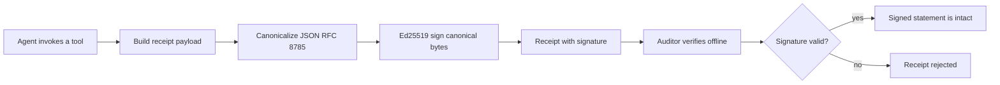
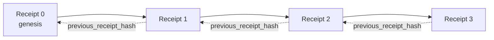

[Panoorin ang video ng aralin: Pag-secure ng AI Agents gamit ang Cryptographic Receipts](https://youtu.be/PLACEHOLDER_VIDEO_ID)

> _(Idadagdag ng Microsoft content team ang video ng aralin at thumbnail pagkatapos ng pagsasama, na tumutugma sa pattern ng aralin 14 / 15.)_

# Pag-secure ng AI Agents gamit ang Cryptographic Receipts

## Panimula

Saklawin ng araling ito ang:

- Bakit mahalaga ang audit trails para sa mga AI agent sa pagsunod, pag-debug, at pagtitiwala.
- Ano ang cryptographic receipt at paano ito naiiba sa isang unsigned log line.
- Paano gumawa ng signed receipt para sa tawag ng tool ng agent gamit ang plain Python.
- Paano i-verify ang receipt offline at tuklasin ang pagmanipula.
- Paano i-chain ang mga receipt upang ang pagtanggal o pagbabago ng isa ay makasira sa chain.
- Ano ang pinapatunayan ng mga receipt at ano ang malinaw nitong hindi pinapatunayan.

## Mga Layunin ng Pagkatuto

Pagkatapos makumpleto ang araling ito, malalaman mo kung paano:

- Tuklasin ang mga failure modes na nagtutulak ng cryptographic provenance para sa mga aksyon ng agent.
- Gumawa ng Ed25519-signed receipt sa isang canonical JSON payload.
- I-verify ang receipt nang independiyente gamit lamang ang public key ng signer.
- Tuklasin ang pagmanipula sa pamamagitan ng muling pagtakbo ng verification sa binagong receipt.
- Bumuo ng hash-chained na sunud-sunod na mga receipt at ipaliwanag kung bakit mahalaga ang chain.
- Kilalanin ang hangganan sa pagitan ng kung ano ang pinapatunayan ng mga receipt (atribusyon, integridad, pagkakasunod-sunod) at kung ano ang hindi nila pinapatunayan (katumpakan ng aksyon, katibayan ng polisiya).

## Ang Problema: Audit Trail ng Iyong Agent

Isipin na nag-deploy ka ng AI agent para sa Contoso Travel. Binabasa ng agent ang mga kahilingan ng customer, tumatawag sa flights API upang maghanap ng mga opsyon, at nagbubook ng mga upuan para sa customer. Noong nakaraang quarter, naproseso ng agent ang 50,000 bookings.

Ngayon ay dumating ang isang auditor. Nagtanong siya ng simpleng tanong: "Ipakita mo sa akin ang ginawa ng iyong agent."

Ibinigay mo ang iyong mga log file. Tiningnan ito ng auditor at nagtanong ng mas mahirap na tanong: "Paano ko malalaman na hindi na-edit ang mga log na ito?"

Ito ang problema sa audit trail. Karamihan sa mga deployment ng agent ngayon ay umaasa sa:

- **Application logs**: isinulat ng agent mismo, maaaring i-edit ng kahit sino na may access sa file system.
- **Cloud logging services**: tamper-evident sa antas ng platform ngunit kung pinagkakatiwalaan lamang ng auditor ang operator ng platform.
- **Database transaction logs**: angkop para sa mga pagbabago sa database ngunit hindi para sa anumang tawag ng tool.

Wala sa mga ito ang makakasagot sa tanong ng auditor nang hindi kinakailangang magtiwala ang auditor sa isang tao (ikaw, ang iyong cloud provider, ang vendor ng iyong database). Para sa panloob na gamit, madalas tanggap ang pagtitiwala na iyon. Para sa mga regulated workload (pananalapi, pangangalagang pangkalusugan, anumang sakop ng EU AI Act), hindi ito tinatanggap.

Nililimitahan ng cryptographic receipts ang problemang ito sa pamamagitan ng paggawa ng isang signed na pahayag na maaaring i-verify nang independiyente.
Kailangan pa rin ng auditor ng ibang paraan upang magtiwala sa signing key at
sa component na gumawa ng pahayag. Ang nakalakip na key ay nagpapatunay ng sariling pagkakapare-pareho,
hindi ng pagkakakilanlan ng issuer o ng lugar ng pagpapatupad.

## Ano ang Cryptographic Receipt?

Ang receipt ay isang JSON object na nagrerekord ng ginawa ng isang agent, na may digital signature.



Ang isang minimal na receipt ay ganito:

```json
{
  "type": "agent.tool_call.v1",
  "agent_id": "contoso-travel-bot",
  "tool_name": "lookup_flights",
  "tool_args_hash": "sha256:a3f9c1...",
  "result_hash": "sha256:7b2e1d...",
  "policy_id": "contoso-travel-policy-v3",
  "timestamp": "2026-04-25T14:30:00Z",
  "sequence": 47,
  "previous_receipt_hash": "sha256:9d4e6a...",
  "signature": {
    "alg": "EdDSA",
    "sig": "c5af83...",
    "public_key": "8f3b2c..."
  }
}
```

Tatlong katangian ang gumagana dito:

1. **Ang signature**. Nilagdaan ang receipt ng gateway ng agent gamit ang isang Ed25519 private key. Sinuman na may kaukulang public key ay maaaring i-verify ang signature offline. Kailangang i-pin ng isang party ang key na iyon o i-resolve ito mula sa isang trusted registry sa labas ng receipt. Ang pagmanipula sa anumang nilagdaang field ay nagpapawalang-bisa sa signature.

2. **Canonical encoding**. Bago pamagitan, ang receipt ay sine-serialize gamit ang JSON Canonicalization Scheme (JCS, RFC 8785). Tinitiyak nito na dalawang implementasyon na gumagawa ng parehong lohikal na receipt ay makakagawa ng byte-identical na output. Kung walang canonicalization, magkakaiba ang mga serializer ng JSON sa paglikha ng mga signature para sa parehong nilalaman.

3. **Hash chaining**. Ang `previous_receipt_hash` field ay nag-uugnay ng bawat receipt sa nauna nito. Ang pagtanggal o pagbabago ng isang receipt ay nagpapabasag sa ipinakitang sekwensya. Ang pagtuklas ng pag-truncate o pag-rewrite na kontrolado ng signer ay nangangailangan din ng naka-pin na current chain head, independiyenteng nasaksihang checkpoint, o authenticated closed-population commitment.

Sama-sama, ang mga katangiang ito ay nagbibigay ng tatlong garantiya:

- **Atribusyon sa isang key**: nilagdaan ng key na ito ang nilalamang ito. Ang organisasyonal o human identity ay nangangailangan ng trusted key binding.
- **Integridad**: hindi nagbago ang nilalaman mula noong nilagdaan.
- **Pagkakasunod-sunod sa loob ng na-verify na sekwensya**: ang receipt na ito ay naka-link sa naunang ito.

## Pagbuo ng Receipt sa Python

Hindi mo kailangan ng espesyal na library para gumawa ng receipt. Malawak ang pagkakaroon ng cryptographic primitives at ilang dosenang linya lang ng Python ang kinakailangan sa lohika.

Inilalahad ng mga hands-on na pagsasanay sa `code_samples/18-signed-receipts.ipynb` ang buong daloy. Itinatala ng source-controlled na `code_samples/18-signed-receipts.execution-receipt.json` ang eksaktong notebook hash, Python environment, bilang ng cell, at mga tseke mula sa pinakabagong malinis na pagtakbo nang hindi binabago ang mga na-save na output ng aralin. Ang buod:

```python
import json
import hashlib
import base64
from nacl import signing
from jcs import canonicalize  # RFC 8785 canonical JSON

def b64url_nopad(data: bytes) -> str:
    return base64.urlsafe_b64encode(data).decode("ascii").rstrip("=")

def sha256_canonical(obj) -> str:
    """SHA-256 of a Python object's JCS-canonical JSON form."""
    return f"sha256:{hashlib.sha256(canonicalize(obj)).hexdigest()}"

# Generate or load a signing key (in production, store in a key vault)
signing_key = signing.SigningKey.generate()
verify_key = signing_key.verify_key
TRUSTED_PUBLIC_KEYS = {b64url_nopad(bytes(verify_key))}  # pinned out of band by the verifier

# Build the receipt payload (no signature yet)
tool_args = {"origin": "SYD", "destination": "LAX"}
tool_result = [{"flight": "QF11", "price": 1850, "stops": 0}]

payload = {
    "type": "agent.tool_call.v1",
    "agent_id": "contoso-travel-bot",
    "tool_name": "lookup_flights",
    "tool_args_hash": sha256_canonical(tool_args),
    "result_hash": sha256_canonical(tool_result),
    "policy_id": "contoso-travel-policy-v3",
    "timestamp": "2026-04-25T14:30:00Z",
    "sequence": 0,
    "previous_receipt_hash": None,
}

# Canonicalize and sign the JCS bytes directly. PureEdDSA hashes internally.
canonical_bytes = canonicalize(payload)
signature_bytes = signing_key.sign(canonical_bytes).signature

# Attach a structured signature object.
receipt = {
    **payload,
    "signature": {
        "alg": "EdDSA",
        "sig": b64url_nopad(signature_bytes),
        "public_key": b64url_nopad(bytes(verify_key)),
    },
}
```

Iyan ang buong pipeline ng pag-sign. Ang mga pagsasanay sa notebook ay naglalakad sa bawat hakbang.

## Pag-verify ng Receipt at Pagtuklas ng Pagmanipula

Ang verification ay ang kabaligtaran na operasyon:

```python
import base64
import hashlib
from nacl import signing
from nacl.exceptions import CryptoError
from jcs import canonicalize

def b64url_decode(s: str) -> bytes:
    # Strict: Python's decoder skips characters outside the alphabet and also
    # accepts padding, the standard +/ alphabet and non-zero spare bits.
    # Re-encoding and comparing accepts only the one unpadded base64url form.
    padding = "=" * ((4 - len(s) % 4) % 4)
    data = base64.urlsafe_b64decode(s + padding)
    if base64.urlsafe_b64encode(data).decode("ascii").rstrip("=") != s:
        raise ValueError("not canonical unpadded base64url")
    return data

def verify_receipt(receipt: dict, trusted_public_key: str) -> bool:
    # trusted_public_key is the issuer's key, obtained from somewhere other
    # than this receipt. Never use receipt["signature"]["public_key"] here:
    # see "What Receipts Prove (and What They Do Not)" below.
    # Fails closed: anything malformed returns False instead of raising.
    if not isinstance(receipt, dict) or not isinstance(trusted_public_key, str):
        return False
    sig_obj = receipt.get("signature")
    if not isinstance(sig_obj, dict) or sig_obj.get("alg") != "EdDSA":
        return False
    sig_b64 = sig_obj.get("sig")
    if not isinstance(sig_b64, str):
        return False

    try:
        # Reconstruct the payload that was actually signed (everything except signature).
        payload = {k: v for k, v in receipt.items() if k != "signature"}
        canonical_bytes = canonicalize(payload)
        verify_key = signing.VerifyKey(b64url_decode(trusted_public_key))
        verify_key.verify(canonical_bytes, b64url_decode(sig_b64))
        return True
    except (CryptoError, TypeError, ValueError, KeyError, OverflowError):
        return False
    except Exception:
        # An undecodable key or signature, or a payload that cannot be
        # canonicalized: fail closed rather than raise.
        return False
```

Tinanggap ng function na ito ang isang receipt at ang public key ng issuer, at nagbabalik ng `True` kung ang signature ay wasto at `False` kung hindi, kabilang na kapag mali ang input. Walang network call at walang verification service: kapag hawak mo na ang key ng issuer, ang verification ay lubos na lokal at offline. Ang kailangan pa rin nito ay ang key na iyon, na nakuha mula sa ibang pinanggalingan maliban sa receipt mismo.

Para makita ang pagtuklas ng pagmanipula sa aksyon, ang notebook ay naglalakad sa:

1. Paglikha ng isang valid na receipt at pagkumpirma na ito ay na-verify.
2. Pagbabago ng isang byte ng `tool_args_hash` na field.
3. Muling pagpapatakbo ng verification at pagtingin na ito ay nabigo.
4. Pagmanipula muli, ngunit sa pagkakataong ito ay muling pag-sign gamit ang isang key na ginawa ng attacker at pag-embed ng key na iyon sa receipt.

Ang Hakbang 4 ang dapat talagang pag-ukulan ng pansin. Ang receipt na iyon ay internally consistent: ang signature nito ay tunay para sa mga nilalaman at para sa key na dala nito, kaya ito ay na-verify laban sa key sa loob nito. Nabibigo lamang ito kapag tiningnan laban sa totoong key ng issuer. Nahuhuli ng mga Hakbang 2 at 3 ang attacker na hindi nagkaroon ng sapat na sipag na muling pumirma; nahuhuli ang Hakbang 4 ang attacker na muling pumirma.

Ito ang praktikal na demonstrasyon na ang mga receipt ay tamper-evident: anumang pagbabago sa nilagdaang field ay nagpapabasag sa signature, basta i-verify mo laban sa key na hindi ibinigay ng attacker. Ang `signature` na object mismo ay nasa labas ng nilagdaang bytes, kaya't ang key na ginagamit mo sa verification ay kailangang manggaling sa ibang lugar maliban sa receipt.

## Pag-chain ng Mga Receipt para sa Multi-Step Agents

Ang isang solong signed receipt ay nagpoprotekta sa isang aksyon. Ang isang chain ng mga receipt ay nagpoprotekta sa isang sunud-sunod.



Ina-itala ng bawat receipt ang hash ng naunang receipt. Para tahimik na tanggalin ang receipt 2, kailangang gawin ng attacker ang alinman sa mga sumusunod:

- Baguhin ang `previous_receipt_hash` na field ng receipt 3 (binabasag ang signature ng receipt 3), O
- Pekein ang bagong signature sa binagong receipt 3 (kailangan ang private key ng agent).

Kung ang private key ay naka-imbak sa hardware key vault at ang mga verifier ay sinusuri ang bawat receipt laban sa public key ng issuer na nakuha nang independyente (isang inilathalang JWK Set o pinned config value), wala sa mga atakeng ito ang maaaring mangyari nang hindi natutuklasan. Hindi sapat ang paglalathala ng key sa loob ng bawat receipt: maaaring mag-resign ang attacker gamit ang sarili nilang key at ilagay iyon, na isang pamilyar na fixture `04_resigned_receipt.json`.

Ang notebook ay naglalakad sa:

1. Pagbuo ng chain ng tatlong receipt.
2. Pag-verify na ang `previous_receipt_hash` ng bawat receipt ay tumutugma sa aktwal na hash ng naunang receipt.
3. Pag-tamper sa isang receipt sa gitna at pagtukoy na nasira ang chain sa eksaktong puntong iyon.

Ganito ka gumagawa ng audit trail na kayang i-verify ng external na auditor sa ilalim ng sariling pinned issuer keys at chain checkpoints,
nang hindi kailangan umasa sa iyong pabago-bagong log store.

## Ano ang Pinapatunayan ng mga Receipt (at Ano ang Hindi)

Ito ang pinakamahalagang bahagi ng araling ito. Malakas ang mga receipt ngunit may hangganan ang kanilang kapangyarihan.

**Tatlong bagay ang pinapatunayan ng mga receipt:**

1. **Atribusyon**: isang partikular na key ang pumirma sa isang partikular na payload.
2. **Integridad**: hindi nagbago ang payload mula nang pirmahan.
3. **Pagkakasunod-sunod sa loob ng ipinakitang, na-verify na sekwensya**: ang receipt na ito ay naka-link sa naunang ito.

**Hindi pinapatunayan ng mga receipt:**

1. **Katumpakan**: na ang aksyon ng agent ay ang tamang aksyon. Maaaring pirmahan ang receipt para sa maling sagot nang kasing linaw ng para sa tamang sagot.
2. **Pagsunod sa polisiya**: na ang polisiya na tinukoy sa `policy_id` ay talagang na-evaluate, o na pahihintulutan nito ang aksyon kung ito ay tinsek. Ini-record ng receipt kung ano ang inangkin, hindi kung ano ang ipinatupad.
3. **Pagkakilanlan lampas sa key**: sinasabi ng receipt na "nilagdaan ng key na ito ang nilalamang ito." Hindi nito sinasabi na "ang taong ito ang nag-authorize." Ang pagkonekta ng key sa isang tao o organisasyon ay nangangailangan ng hiwalay na identity infrastructure (isang directory, isang public key registry, atbp.).
4. **Katotohanan ng inputs**: kung nakatanggap ang agent ng na-manipulang prompt at kumilos base dito, tapat na nire-record ng receipt ang aksyon. Ang mga receipt ay nasa proseso ng input validation, hindi kapalit nito.
5. **Pagpapatupad o totoong epekto sa mundo**: ang receipt pagkatapos ng tawag ay nire-record ang sinasabi ng issuer na nangyari. Ang pagpapatunay ng admission o pagkakasundo ng isang panlabas na epekto ay nangangailangan ng ebidensiya mula sa aktwal na tagapagpaganap o hangganan ng provider.
6. **Kumpletong katangian**: ang kawalan ng receipt ay maaaring mangahulugan ng na-block, ipinasok, nawala, o hindi naitala. Ang kawalan ay nagiging ebidensiya lamang sa loob ng isang authenticated closed population.
7. **Pinagkakatiwalaang oras**: ang isang signed timestamp ay nagpapatunay na ang signer ay nagdala ng halagang iyon, hindi na ang halaga ay tama. Nangangailangan ng hiwalay na time authority o nasaksihang checkpoint ang pinagkakatiwalaang oras.

**Ang key sa receipt ay hindi ang key na ginagamit mo sa pag-verify.** Ito ay sumusunod sa punto 3, at ito ang nag-iisang lugar kung saan kailangang baguhin ang iyong code sa halip na ang iyong pag-unawa. Ang `public_key` sa halimbawa sa itaas ay naroon upang gawing self-contained ang halimbawa. Hindi dapat magtiwala ang verifier dito. Maaaring kunin ng sinuman ang isang receipt, baguhin ito, pirmahan ito gamit ang key na kanilang ginawa, at isingit ang key na iyon; ang resulta ay perpektong naverify laban sa sarili nito. Iyan ay fixture `04_resigned_receipt.json` sa `sample_receipts/`, at kaya nagpapatanggap ang `verify_receipt` sa itaas ng key bilang argumento sa halip na basahin mula sa receipt. Kumuha ng key ng issuer nang independiyente, mula sa JWK Set sa Production Checklist sa ibaba o mula sa ibang naunang na-pin na anchor, at i-verify laban doon. Ang signature na na-verify gamit ang key na dumating sa parehong sobre ay nagpapatunay lamang na ang sobre ay self-consistent.

Mahalaga ang hangganang ito sa dalawang dahilan:

- Sinasabi nito kung para saan kapaki-pakinabang ang mga receipt: gawing ma-audit at tamper-evident ang ugali ng agent, kahit sa mga hangganan ng organisasyon.
- Sinasabi nito kung ano pang mga karagdagang layer ang kailangan mo: input validation (Lesson 6), pagpapatupad ng polisiya (bahagyang tinalakay sa ibaba), at identity infrastructure (hindi sakop ng araling ito).

Isang pangkaraniwang pagkakamali ang mag-assume na "mayroon tayong receipt" ay katumbas ng "tayo ay pinamamahalaan." Hindi ganoon. Ang mga receipt ay pundasyon. Ang pamamahala ay ang sistema na itinatayo mo sa ibabaw.

## Pag-bind ng Lagda ng Approver sa Eksaktong Aksyon

Karapat-dapat ang item 3 sa sarili nitong seksyon: sinasabi ng action receipt na "nilagdaan ng key na ito ang nilalamang ito," hindi kailanman "ang tao ay nag-authorize nito." Para sa mga aksyon na mataas ang panganib (refunds, pagtanggal, wire transfers), maaaring mag-bind ang hiwalay na lagda ng approver sa eksaktong aksyon. Ang pagkonekta ng key na iyon sa tao at pagtsek ng presensya ng tao ay nananatiling hiwalay na responsibilidad.

Idinagdag ng follow-on notebook na `code_samples/human-authorization-receipts.ipynb` ang pangalawang uri ng receipt, `human.approval.v1`, sa parehong hugis ng sobre tulad ng mga receipt ng aralin (isang typed payload na nilagdaan ng Ed25519 sa canonical JCS bytes nito, na may `signature` na object sa labas ng nilagdaang bytes). Nilagdaan ng approver key ang **buong canonical na aksyon at ang digest nito**; nilagdaan ng agent key ang isang pahayag na naglalaman ng **kaparehong action digest** at isang `parent_approval_ref`, ang `receipt_hash` ng approval, parehong convention tulad ng `previous_receipt_hash` sa chain na binuo mo sa itaas. Isang `verify_chain` ang naglalakad sa parehong artifact sa ilalim ng **hiwalay na pinned key registry** (approver keys laban sa agent keys), kaya shared ang code path ngunit hindi magkakapareho ang mga awtoridad.

Ang katangiang binibili nito, na maingat na ipinahayag: *nilagdaan ng pinned approver key ang eksaktong
aksyon na ito, at nilagdaan ng agent key kalaunan ang pahayag na nagdala ng parehong action digest.*
Kapaki-pakinabang iyon bilang ebidensiya, ngunit hindi ito katibayan na naipatupad ang aksyon. Upang
makontrol ang pagpapatupad, ang eksaktong pag-apruba ay kailangang nakareserba rin at nagamit nang isang beses sa
aktwal na executor boundary; ang hindi kilalang mga resulta ng provider ay kailangang manatiling hindi alam sa halip na
ipilitang ulitin nang walang uliran. Sinusubukan ng refusal fixtures ng notebook ang layer ng receipt-chain:

- pagmamanipula, nalito na deputy, peke na susi sa alinmang panig, at maling anyo ng input;
- **lipas na awtoridad**: isang pirma na nagpapatunay pa rin, tinanggihan pa rin dahil lumipat ang bersyon ng patakaran, ang susi ng tagapag-apruba ay inalis mula sa naka-pin na rehistro, o nag-expire ang pag-apruba bago ang ibinigay na oras ng beripikasyon;
- **palit ng digest**: isang wastong pinirmahang resibo ng aksyon na nakaturo sa *totoong* pag-apruba na nag-uugnay sa *ibang* canonical na aksyon.

Bawat kabiguan ay tumatanggi na may kakaibang dahilan, kaya ang isang tagasuri na nagbabasa ng pagtanggi ay maaaring malaman kung ang awtoridad ay lipas na o nagbago ang inaangking aksyon. Ang beripikasyon ay pang-basang lamang at paulit-ulit: hindi nito kinokonsumo ang pag-apruba o tinatawag ang isang provider. Isang hiwalay na tagapagpatupad ang nangangailangan ng matibay, atomic na proteksyon laban sa replay at hayagang tagumpay, kabiguan, at hindi tiyak na resulta. Ang resibo ng pag-apruba ng tao ay isang pang-edukasyong komposisyon na tinukoy ng araling ito, hindi isang uri ng resibo na tinukoy ng `draft-farley-acta-signed-receipts`.

## Mga Sanggunian sa Produksyon

Ang Python code sa araling ito ay sadyang minimal upang mabasa mo ang bawat linya at maintindihan kung ano mismo ang nangyayari. Sa produksyon, may dalawang opsyon ka:

1. **Magbuild nang diretso gamit ang cryptographic primitives.** Ang 50 linya na nakita mo sa itaas ay sapat para sa maraming use case. Ang PyNaCl (Ed25519) at ang `jcs` package (canonical JSON) ay mga maayos na maintained at na-audit na mga library.

2. **Gumamit ng production receipt library.** Ilang open-source na proyekto ang nagpapatupad ng parehong pattern na may dagdag na features (key rotation, batch verification, JWK Set distribution, integration with policy engines):
   - Ang signing pipeline ay gumagamit ng JCS at signature-scope conventions sa isang independiyenteng IETF Internet-Draft ([`draft-farley-acta-signed-receipts`](https://datatracker.ietf.org/doc/draft-farley-acta-signed-receipts/), rebisyon 02). Ang flat educational receipt ng araling ito ay nagkakaiba sa draft na `{payload, signature}` envelope at hindi inilahad bilang isang conformant na implementasyon. Naglalathala ang draft ng isang shared conformance suite ([agent-governance-testvectors](https://github.com/ScopeBlind/agent-governance-testvectors)) para sa mga implementasyong tumutugon sa wire format nito.
   - Ang Microsoft Agent Governance Toolkit ay nagkokompose ng mga resibo gamit ang Cedar-based na mga desisyon sa patakaran; tingnan ang Tutorial 33 sa repository na iyon para sa end-to-end na halimbawa.
   - Ang `protect-mcp` (npm) at `@veritasacta/verify` (npm) packages ay nagbibigay ng Node-based na implementasyon ng receipt signing at offline verification, na inilaan para balutin ang anumang MCP server ng isang tamper-evident audit trail, kabilang ang held-for-co-sign na daloy kung saan ang nahintuang aksyon ay naglalabas ng approval receipt na nakatali sa action digest (WebAuthn-backed sa desktop flow), ang parehong approval-receipt pattern gaya ng human-authorization notebook sa itaas.
   - Ang **[nobulex](https://github.com/arian-gogani/nobulex)** Python SDK (`pip install nobulex`) ay nagbibigay ng parehong Ed25519 + JCS signing na pattern sa Python na may LangChain at CrewAI integrasyon, kabilang ang na-publish na cross-validation test vectors at isang compliance mapping na naiambag sa pamamagitan ng [OWASP PR #2210](https://github.com/OWASP/CheatSheetSeries/pull/2210).
   - **[EMILIA Protocol](https://github.com/emiliaprotocol/emilia-protocol)** ay nagbibigay ng isang karagdagang eksaktong-action na enforcement layer: offline-verifiable approval receipts, pinned WebAuthn o quorum authority, one-time consumption sa executor boundary, at isang explicit na indeterminate-outcome path. Ang mga framework adapters nito ay tinitingnan ang isang receipt bilang kinakailangang ebidensya sa halip na patunay na may nangyaring external effect.

Ang desisyon sa pagitan ng paggawa ng sarili mong sistema at paggamit ng library ay parang desisyon sa pagitan ng pagsusulat ng sariling JWT library at paggamit ng nasubok na isa: parehong makatwiran; ang library ay nakakatipid ng oras at nagpapaliit ng audit surface; ang from-scratch na paraan ay pilitin kang maintindihan ang bawat primitive. Itinuturo ng araling ito ang from-scratch path upang magkaroon ka ng pundasyon para sa alinmang pagpipilian.

## Knowledge Check

Subukan ang iyong pagkaintindi bago lumipat sa practice exercise.

**1. Ang isang receipt ay nilagdaan gamit ang pribadong Ed25519 key ng agent. Ang auditor ay may hawak lamang ng public key. Maaari bang i-verify ng auditor ang receipt nang offline?**

<details>
<summary>Sagot</summary>

Oo, ang cryptographic verification ay nangangailangan lamang ng public key at signed bytes. Ang
auditor ay kailangan pa ring makuha at i-pin ang tatanggap na public key nang hiwalay sa receipt.
Hindi kailangan ng tawag sa network pagkatapos maitatag ang trust configuration na iyon.
</details>

**2. Isang attacker ang nag-modify ng `policy_id` field ng isang receipt upang ipahayag na ito ay pinamamahalaan ng mas maluwag na patakaran. Ang lagda ay ginawa sa orihinal na payload. Ano ang mangyayari sa pag-verify?**

<details>
<summary>Sagot</summary>

Mabibigo ang verification. Ang lagda ay ginawa sa canonical bytes ng orihinal na payload; ang pagbabago ng kahit anumang field ng payload ay nagbabago ng mga byte, kaya nagiging invalid ang lagda. Kailangan ng attacker ang pribadong key upang makagawa ng bagong valid na lagda, na wala sila.
</details>

**3. Bakit naglalaman ang receipt ng `tool_args_hash` at `result_hash` imbes na ang raw na mga argumento at resulta?**

<details>
<summary>Sagot</summary>

Dalawang dahilan. Una, maaaring kailangang i-archive o ipadala ang receipt sa mga kapaligiran kung saan problema ang pag-leak ng raw na nilalaman (PII, business data). Pinananatili ng pag-hash ang receipt na maliit at pribado ang nilalaman; kino-verify ng auditor na tugma ang hash sa hiwalay na nakaimbak na kopya ng totoong nilalaman. Pangalawa, may fixed size ang mga hash; isang receipt na may mga hash ay may limitadong laki kahit gaano kalaki ang inputs at outputs.
</details>

**4. Ang `previous_receipt_hash` field ay nag-uugnay ng bawat receipt sa nauna nito. Kung tahimik na burahin ng attacker ang isang receipt mula sa gitna ng chain, ano ang magiging invalid?**

<details>
<summary>Sagot</summary>

Lahat ng receipt na sumunod sa naburang isa. Ang kanilang `previous_receipt_hash` fields ay hindi na tumutugma sa aktwal na chain (dahil ang receipt na kanilang tinutukoy ay wala na, o ang chain ay ngayon ay tumutukoy sa ibang nauna). Para maitago ang pagbura, kailangan muling lagdaan ng attacker ang bawat mas huling receipt, na nangangailangan ng pribadong susi ng issuer. Ang muling paglagda gamit ang ibang susi ay mabibigo kapag tina-check laban sa susi ng issuer.
</details>

**5. Malinis ang verification ng isang receipt. Ipinapatunay ba nito na ang aksyon ng agent ay tama, wasto, o sumusunod sa patakaran?**

<details>
<summary>Sagot</summary>

Hindi. Sa ilalim ng pinned na susi at konteksto ng chain, isang valid na receipt ay nagpapatunay ng attribution ng lagda,
integridad ng nilalaman, at ugnayan sa ipinakitang nauna. HINDI nito pinatutunayan na ang
aksyon ay tama o naisakatuparan, na-evaluate ang patakaran, pinagkakatiwalaan ang timestamp,
o kumpleto ang set ng rekord. Ito ang pinakamahalagang hangganan sa aralin.
</details>

## Practice Exercise

Buksan ang `code_samples/18-signed-receipts.ipynb` at kumpletuhin ang apat na seksyon:

1. **Seksyon 1**: Lagdaan ang iyong unang receipt at i-verify ito.
2. **Seksyon 2**: Manipulahin ang receipt at tingnan ang pagkabigo ng verification.
3. **Seksyon 3**: Bumuo ng tatlong-receipt na chain at i-verify ang integridad ng chain.
4. **Seksyon 4**: Ilapat ang pattern sa isang agent na ginawa gamit ang Microsoft Agent Framework: balutin ang isang tool call sa receipt-signing, pagkatapos i-verify ang receipt nang independyente.

**Stretch challenge 1:** palawakin ang schema ng receipt gamit ang isa pang field na pinili mo (halimbawa, request ID para sa tracing), i-update ang canonical signing logic para isama ito, at tiyaking ang receipt ay nagro-round-trip pa rin sa verification. Pagkatapos ay baguhin ang field pagkatapos ng paglagda at tiyaking mabibigo ang verification. Pinipilitan kang maintindihan kung paano nakakatulong ang bawat byte ng canonical encoding sa lagda.

**Stretch challenge 2:** I-SHA-256 hash ang dalawang receipt mo nang magkasama (i-concatenate ang canonical bytes nila sa deterministic na order) at i-embed ang resulting digest bilang bagong field sa ikatlong receipt bago ito lagdaan. I-verify na ang tatlong receipt ay nagro-round-trip pa rin. Kakatayo mo lang ng isang one-step inclusion proof: sinuman na may hawak ng ikatlong receipt ay maipapakita na umiiral ang unang dalawang receipt noong panahon ng paglagda, nang hindi kailangang ilantad ang nilalaman nila. Ito ang pattern na ginagamit ng selective-disclosure receipts sa malakihang operasyon (Merkle commitments, RFC 6962).

## Konklusyon

Ang cryptographic receipts ay nagbibigay sa mga AI agent ng audit trail na:

- **Maaaring ma-verify nang independyente sa ilalim ng pinned trust**: isang partido na may tinanggap na public keys at signed bytes ay maaaring mag-verify nang walang dependency sa serbisyo.
- **Tamper-evident**: anumang pagbabago ay nagpapawalang-bisa sa lagda.
- **Portable**: ang receipt ay isang maliit na JSON file; maaaring i-archive, ipadala, at ma-verify ito kahit saan.
- **Naka-align sa mga standard**: ginawa gamit ang Ed25519 (RFC 8032), JCS (RFC 8785), at SHA-256, lahat ay malawakang ginagamit na mga primitive.

Hindi ito kapalit ng input validation, pagpapatupad ng patakaran, executor admission,
ebidensiya ng kinalabasan, completeness controls, o identity infrastructure. Ito ay pundasyon
para sa mga layer na iyon. Sa mga regulated o multi-organisasyong workflows, ang mga receipt ay nagiging specific
na pahayag ng issuer na maaaring suriin nang independyente sa ilalim ng trust configuration ng auditor.

Ang pinakamahalagang takeaway: ang mga receipt ay nagpapatunay na ang partikular na susi ang lumagda sa partikular na
nilalaman. Ang dala na timestamp ay isang signer assertion maliban kung ito ay hiwalay na na-time-attest. Ang
receipt ay hindi nagpapatunay na ang nilalaman ay totoo, na naisakatuparan ang isang aksyon, o na ang
rekord na set ay kumpleto. Mahigpit na panatilihin ang mga pagkakaibang ito.

## Production Checklist

Kapag handa ka nang magtapos sa araling ito patungo sa pag-deploy ng mga receipt-signed agents sa totoong kapaligiran:

- [ ] **Ilipat ang signing key mula sa developer laptop.** Gumamit ng Azure Key Vault, AWS KMS, o hardware security module. Ang pribadong susi na lumalagda ng iyong mga receipt ay hindi dapat kailanman manatili sa source control o plain text sa mga makina ng aplikasyon.
- [ ] **Itatag ang trust sa verifier key.** I-publish ang mga key sa pamamagitan ng JWK Set o registry, pagkatapos hayaang i-pin ng mga relying party ang tinanggap na identity ng issuer, set ng mga susi, at patakaran ng rotation sa labas ng mga indibidwal na receipt. Ang isang inline key lamang ay hindi trust anchor.
- [ ] **I-ankor ang chain sa labas.** Paminsan-minsan isulat ang pinakabagong chain head hash sa transparency log (Sigstore Rekor, RFC 3161 timestamp authority, o pangalawang internal na sistema) upang makumpirma ng panlabas na partido na "umiral ang chain na ito sa panahong ito."
- [ ] **I-imbak ang mga receipt nang immutably.** Ang append-only blob storage (Azure Storage na may immutability policies, AWS S3 Object Lock) ay pumipigil sa isang insider na baguhin ang kasaysayan sa storage layer.
- [ ] **Magdesisyon sa retention.** Maraming compliance regime ang nangangailangan ng multi-year retention. Magplano para sa paglago ng receipt (ang bawat receipt ay ~500 bytes; ang isang agent na gumagawa ng 10K calls kada araw ay nagpapalabas ng ~1.8 GB kada taon).
- [ ] **Idokumento kung ano ang hindi saklaw ng mga receipt.** Ang mga receipt ay nagpapatunay ng attribution, integridad, at pagkakasunod-sunod. Ang iyong runbook ay dapat malinaw na maglista ng karagdagang kontrol (input validation, pagpapatupad ng patakaran, rate limiting, identity infrastructure) na kasama ng mga receipt sa iyong governance posture.

### May Karagdagang Tanong tungkol sa Pag-secure ng AI Agents?

Sumali sa [Microsoft Foundry Discord](https://aka.ms/ai-agents/discord) upang makipagkita sa ibang mga nag-aaral, dumalo sa office hours, at makakuha ng sagot sa iyong mga tanong tungkol sa AI Agents.

## Higit pa sa Araling Ito

Saklaw ng araling ito ang single-receipt signing at hash-chained sequences. Ang parehong mga primitives ay bumubuo ng ilang mas advanced na mga pattern na maaari mong matugunan habang umuunlad ang iyong governance posture:

- **Selective disclosure.** Kapag ang mga field ng isang receipt ay independently committed (RFC 6962-style Merkle tree), maaari mong ibunyag ang partikular na mga field sa partikular na mga auditor at patunayan na hindi nagbago ang iba pa nang hindi inilalantad ang mga ito. Kapaki-pakinabang kapag ang parehong receipt ay kailangang sumunod sa parehong komprehensibong audit (na nais ng completeness) at mga regulasyon sa data-minimization tulad ng GDPR (na nais mabilang ng auditor ang pinakamaliit na kailangang makita).
- **Receipt revocation.** Kung ang isang signing key ay na-compromise, kailangan ng paraan upang markahan ang lahat ng receipt na nilagdaan gamit ang susi na iyon bilang hindi pinagkakatiwalaan mula sa isang partikular na oras pataas. Karaniwang pattern: short-lived signing keys plus isang nailathalang revocation list, o transparency log na may revocation entries.
- **Bilateral / split-signature receipts.** Ang ilang implementasyon ay naghahati ng signed payload sa pre-execution (`authorization_*`) at post-execution (`result_*`) na kalahati na may independyenteng mga lagda, kapaki-pakinabang kapag ang desisyon ng awtorisasyon at ang naobserbahang resulta ay ginawa ng magkaibang mga aktor o sa ibang mga oras. Ito ay nagbubuo nang additive sa format ng receipt na itinuturo sa araling ito.
- **Payload composition.** Ang isang receipt ay nagsiselyo ng anuman na bytes na inilagay mo sa `result_hash`. Ang mga totoong mundo na payload ay madalas na mas masagana kaysa sa isang solong resulta ng tool call: ang pre-decision reasoning (model prediction, mga opsyon na isinasaalang-alang, ebidensiya at ang completeness nito, risk posture, accountability chain, gate outcome) ay lahat maaaring manirahan sa loob ng payload, na sinelyuhan ng isang solong receipt. Pinananatiling minimal ang format ng receipt habang pinapayagan ang mga payload schema na umunlad ayon sa domain.
- **Cross-implementation conformance.** Maraming independyenteng implementasyon ng parehong format ng receipt (Python, TypeScript, Rust, Go) ay nagkakatsansahan laban sa mga shared test vector. Kung gagawa ka ng sariling implementasyon, ang pag-validate laban sa mga published vector ay nagpapatunay ng wire compatibility.
- **Post-quantum migration.** Ang Ed25519 ay malawakang ginagamit ngayon ngunit hindi ito quantum-resistant. Ang `alg` label lamang ay hindi migration: kailangang tukuyin ng profile ang ML-DSA key encoding, canonical signed bytes, verification, relying-party policy, downgrade resistance, at transition semantics. Magplano at subukan ang dual-signature transition laban sa mga shared vector bago gumawa ng mga pahayag tungkol sa compatibility.

## Karagdagang Mga Sanggunian

- <a href="https://datatracker.ietf.org/doc/draft-farley-acta-signed-receipts/" target="_blank">IETF Internet-Draft: Signed Decision Receipts for Machine-to-Machine Access Control</a>
- <a href="https://learn.microsoft.com/azure/ai-studio/responsible-use-of-ai-overview" target="_blank">Responsible AI overview (Azure AI)</a>
- <a href="https://datatracker.ietf.org/doc/html/rfc8032" target="_blank">RFC 8032: Edwards-Curve Digital Signature Algorithm (EdDSA)</a>
- <a href="https://datatracker.ietf.org/doc/html/rfc8785" target="_blank">RFC 8785: JSON Canonicalization Scheme (JCS)</a>
- <a href="https://datatracker.ietf.org/doc/html/rfc6962" target="_blank">RFC 6962: Certificate Transparency</a> (Merkle-tree construction na ginagamit ng selective-disclosure receipts)
- <a href="https://github.com/microsoft/agent-governance-toolkit/blob/main/docs/tutorials/33-offline-verifiable-receipts.md" target="_blank">Microsoft Agent Governance Toolkit, Tutorial 33: Offline-Verifiable Decision Receipts</a>
- <a href="https://github.com/ScopeBlind/agent-governance-testvectors" target="_blank">Cross-implementation conformance test vectors</a> para sa format ng receipt na ginamit sa araling ito (Apache-2.0)
- <a href="https://pynacl.readthedocs.io/" target="_blank">PyNaCl documentation</a> (Ed25519 sa Python)

## Nakaraang Aralin

[Paglikha ng mga Lokal na AI na Ahente](../17-creating-local-ai-agents/README.md)

---

<!-- CO-OP TRANSLATOR DISCLAIMER START -->
**Pagtatanggi**:
Ang dokumentong ito ay isinalin gamit ang serbisyo ng AI translation na [Co-op Translator](https://github.com/Azure/co-op-translator). Bagama't nagsusumikap kami para sa katumpakan, pakatandaan na ang awtomatikong pagsasalin ay maaaring maglaman ng mga pagkakamali o hindi pagkakatugma. Ang orihinal na dokumento sa orihinal nitong wika ang dapat ituring na pangunahing sanggunian. Para sa mahahalagang impormasyon, inirerekomenda ang propesyonal na pagsasalin ng tao. Hindi kami mananagot sa anumang maling pagkakaintindi o maling interpretasyon na nagmula sa paggamit ng pagsasaling ito.
<!-- CO-OP TRANSLATOR DISCLAIMER END -->