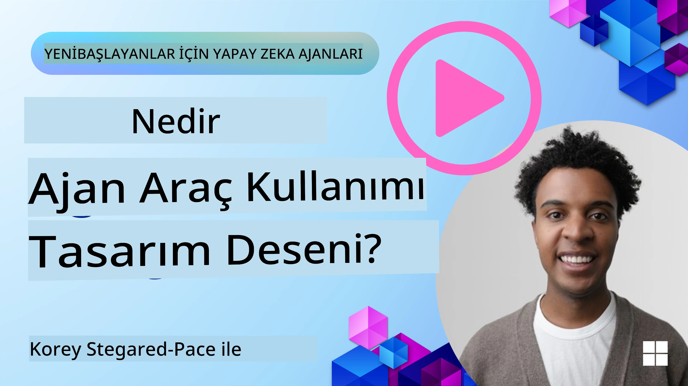
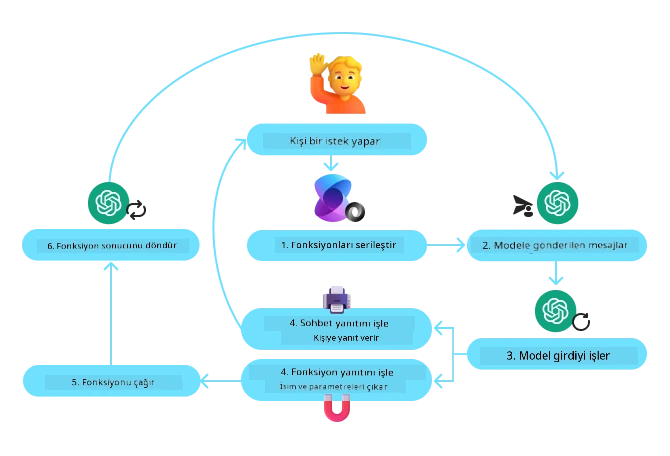
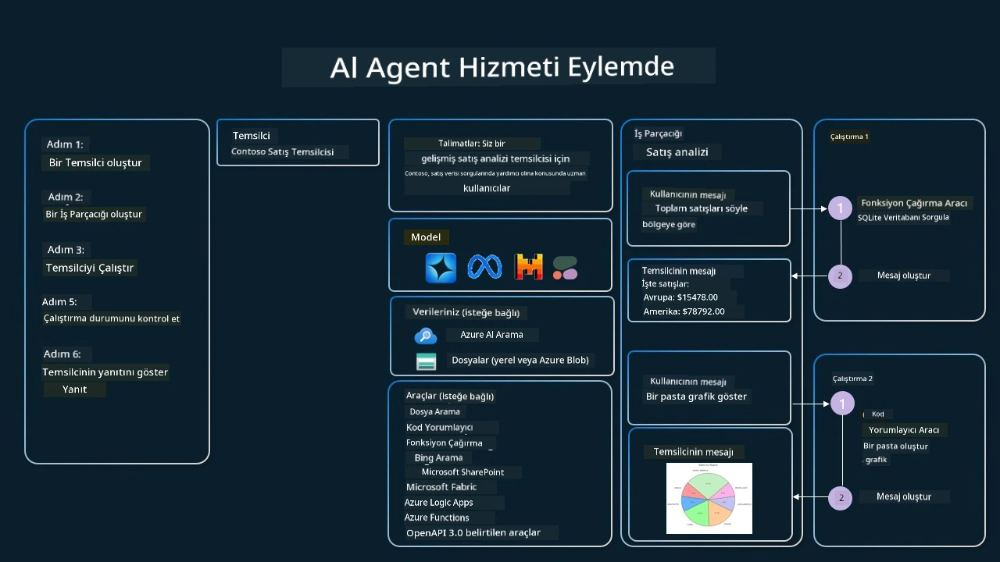

[](https://youtu.be/vieRiPRx-gI?si=cEZ8ApnT6Sus9rhn)

> _(Bu dersin videosunu görmek için yukarıdaki resme tıklayın)_

# Araç Kullanım Tasarım Deseni

Araçlar ilginçtir çünkü AI ajanlarına daha geniş bir yetenek yelpazesi sağlarlar. Ajanın yapabileceği sınırlı bir eylem seti yerine, bir araç ekleyerek ajan artık çok çeşitli eylemler gerçekleştirebilir. Bu bölümde, AI ajanlarının hedeflerine ulaşmak için belirli araçları nasıl kullanabileceğini açıklayan Araç Kullanım Tasarım Deseni'ne bakacağız.

## Giriş

Bu derste aşağıdaki soruları yanıtlamaya çalışıyoruz:

- Araç kullanım tasarım deseni nedir?
- Hangi kullanım durumlarına uygulanabilir?
- Tasarım desenini uygulamak için gerekli olan öğeler/yapı taşları nelerdir?
- Güvenilir AI ajanları oluşturmak için Araç Kullanım Tasarım Deseni kullanırken özel dikkate alınması gereken hususlar nelerdir?

## Öğrenme Hedefleri

Bu dersi tamamladıktan sonra şunları yapabileceksiniz:

- Araç Kullanım Tasarım Deseni'ni ve amacını tanımlayabilmek.
- Araç Kullanım Tasarım Deseni'nin uygulanabilir olduğu kullanım durumlarını tanımlayabilmek.
- Tasarım desenini uygulamak için gereken önemli öğeleri anlayabilmek.
- Bu tasarım desenini kullanan AI ajanlarında güvenilirliyi sağlamak için dikkate alınması gereken noktaları fark edebilmek.

## Araç Kullanım Tasarım Deseni Nedir?

**Araç Kullanım Tasarım Deseni**, LLM’lere belirli hedeflere ulaşmak için harici araçlarla etkileşim kurulmasını sağlayan bir yetenek kazandırmaya odaklanır. Araçlar, bir ajanın eylemler gerçekleştirmek için çalıştırabileceği koddur. Bir araç, hesap makinesi gibi basit bir fonksiyon olabileceği gibi, hisse senedi fiyatları sorgulama veya hava durumu tahmini gibi üçüncü taraf bir hizmete API çağrısı da olabilir. AI ajanları bağlamında araçlar, **model tarafından oluşturulan fonksiyon çağrılarına** yanıt olarak ajanlar tarafından çalıştırılmak üzere tasarlanmıştır.

## Hangi kullanım durumlarına uygulanabilir?

AI Ajanları, karmaşık görevleri tamamlamak, bilgi almak veya kararlar vermek için araçlardan yararlanabilir. Araç kullanım tasarım deseni, veritabanları, web servisleri veya kod yorumlayıcılar gibi dış sistemlerle dinamik etkileşim gerektiren senaryolarda sıklıkla kullanılır. Bu yetenek, aşağıdakiler dahil çeşitli kullanım durumları için faydalıdır:

- **Dinamik Bilgi Alma:** Ajanlar, güncel veri almak için dış API’ler veya veritabanlarına sorgu yapabilir (örneğin SQLite veritabanına veri analizi için sorgu, hisse senedi fiyatları veya hava durumu bilgisi alımı).
- **Kod Çalıştırma ve Yorumlama:** Ajanlar, matematik problemlerini çözmek, raporlar oluşturmak veya simülasyonlar yapmak için kod veya betikler çalıştırabilir.
- **İş Akışı Otomasyonu:** Görev zamanlayıcılar, e-posta hizmetleri veya veri boru hatlarını entegre ederek tekrarlayan veya çok adımlı iş akışlarının otomasyonu.
- **Müşteri Desteği:** Ajanlar CRM sistemleri, bilet platformları veya bilgi tabanlarıyla etkileşime geçerek kullanıcı sorgularını çözebilir.
- **İçerik Oluşturma ve Düzenleme:** Ajanlar, dilbilgisi denetleyiciler, metin özetleyiciler veya içerik güvenlik değerlendirmeleri gibi araçları kullanarak içerik oluşturma görevlerine yardımcı olabilir.

## Araç kullanım tasarım desenini uygulamak için gerekli öğeler/yapı taşları nelerdir?

Bu yapı taşları, AI ajanının çok çeşitli görevleri gerçekleştirmesine olanak tanır. Araç Kullanım Tasarım Deseni'ni uygulamak için gereken önemli öğelere bakalım:

- **Fonksiyon/Araç Şemaları**: Kullanılabilir araçların detaylı tanımları; fonksiyon adı, amacı, gerekli parametreler ve beklenen çıktılar dahil. Bu şemalar, LLM’nin hangi araçların mevcut olduğunu ve geçerli istekleri nasıl oluşturacağını anlamasını sağlar.

- **Fonksiyon Çalıştırma Mantığı**: Araçların kullanıcı niyetine ve konuşma bağlamına göre ne zaman ve nasıl çağrılacağını yönetir. Bu, planlayıcı modüller, yönlendirme mekanizmaları veya araç kullanımını dinamik olarak belirleyen koşullu akışları içerebilir.

- **Mesaj Yönetim Sistemi**: Kullanıcı girdileri, LLM yanıtları, araç çağrıları ve araç çıktıları arasındaki konuşma akışını yöneten bileşenler.

- **Araç Entegrasyon Çerçevesi**: Ajanı çeşitli araçlara bağlayan, bunlar basit fonksiyonlar veya karmaşık dış servisler olabilir.

- **Hata Yönetimi & Doğrulama**: Araç çalıştırmada başarısızlıkların ele alınması, parametrelerin doğrulanması ve beklenmeyen yanıtların yönetilmesi için mekanizmalar.

- **Durum Yönetimi**: Konuşma bağlamını, önceki araç etkileşimlerini ve kalıcı verileri izleyerek çok turlu etkileşimlerde tutarlılığı sağlar.

Sonraki adımda, Fonksiyon/Araç Çağrısını daha detaylı inceleyelim.
 
### Fonksiyon/Araç Çağırma

Fonksiyon çağırma, Büyük Dil Modelleri (LLM'ler) ile araçlar arasında etkileşim kurulmasını sağlayan birincil yoldur. Genellikle 'Fonksiyon' ve 'Araç' terimleri birbirinin yerine kullanılır çünkü 'fonksiyonlar' (yeniden kullanılabilir kod blokları), ajanların görevleri yerine getirmek için kullandığı 'araçlardır'. Bir fonksiyonun kodunun çağrılabilmesi için, bir LLM, kullanıcının isteğini fonksiyonun açıklaması ile karşılaştırmalıdır. Bunu yapmak için, mevcut tüm fonksiyonların açıklamalarını içeren bir şema LLM’ye gönderilir. LLM, göreve en uygun fonksiyonu seçer ve adını ve argümanlarını döner. Seçilen fonksiyon çağrılır, yanıtı LLM’ye gönderilir ve LLM bu bilgileri kullanarak kullanıcı isteğine yanıt verir.

Geliştiricilerin ajanlar için fonksiyon çağırma uygulayabilmesi için ihtiyaç duyulacaklar:

1. Fonksiyon çağrmayı destekleyen bir LLM modeli
2. Fonksiyon açıklamalarını içeren bir şema
3. Açıklanan her fonksiyon için kod

Örneğin, bir şehirdeki mevcut saati almak örneğini kullanalım:

1. **Fonksiyon çağırmayı destekleyen bir LLM başlatın:**

    Tüm modeller fonksiyon çağırmayı desteklemez, bu nedenle kullandığınız LLM'nin bunu desteklediğinden emin olun. <a href="https://learn.microsoft.com/azure/ai-services/openai/how-to/function-calling" target="_blank">Azure OpenAI</a>, fonksiyon çağırmayı destekler. OpenAI istemcisini Azure OpenAI **Responses API** (kararlı `/openai/v1/` uç noktası – `api_version` gerekmez) üzerinde başlatarak başlayabiliriz. 

    ```python
    # Initialize the OpenAI client for Azure OpenAI (Responses API, v1 endpoint)
    client = OpenAI(
        base_url=f"{os.environ['AZURE_OPENAI_ENDPOINT'].rstrip('/')}/openai/v1/",
        api_key=os.environ["AZURE_OPENAI_API_KEY"],
    )
    deployment_name = os.environ["AZURE_OPENAI_DEPLOYMENT"]
    ```

1. **Bir Fonksiyon Şeması Oluşturun**:

    Sonra, fonksiyon adı, fonksiyonun ne yaptığına dair açıklama ve fonksiyon parametrelerinin adları ile açıklamalarını içeren bir JSON şeması tanımlayacağız.
    Daha sonra bu şemayı daha önce oluşturulan istemciye, kullanıcının San Francisco'daki saati bulma isteğiyle birlikte ileteceğiz. Önemli olan, dönen şeyin **bir araç çağrısı** olmasıdır, sorunun nihai cevabı değildir. Daha önce belirtildiği gibi, LLM göreve seçtiği fonksiyonun adını ve ona aktarılacak argümanları döner.

    ```python
    # Function description for the model to read (Responses API flat tool format)
    tools = [
        {
            "type": "function",
            "name": "get_current_time",
            "description": "Get the current time in a given location",
            "parameters": {
                "type": "object",
                "properties": {
                    "location": {
                        "type": "string",
                        "description": "The city name, e.g. San Francisco",
                    },
                },
                "required": ["location"],
            },
        }
    ]
    ```
   
    ```python
  
    # Initial user message
    messages = [{"role": "user", "content": "What's the current time in San Francisco"}]

    # First API call: Ask the model to use the function
    response = client.responses.create(
        model=deployment_name,
        input=messages,
        tools=tools,
        tool_choice="auto",
        store=False,
    )

    # The Responses API returns tool calls as function_call items in response.output.
    # Append them to the conversation so the model has full context on the next turn.
    messages += response.output

    print("Model's response:")
    print(response.output)
  
    ```

    ```bash
    Model's response:
    [ResponseFunctionToolCall(arguments='{"location":"San Francisco"}', call_id='call_pOsKdUlqvdyttYB67MOj434b', name='get_current_time', type='function_call')]
    ```
  
1. **Görevi gerçekleştirmek için gereken fonksiyon kodu:**

    LLM, çalıştırılması gereken fonksiyonu seçtikten sonra, görevi gerçekleştirecek kodun uygulanması ve çalıştırılması gerekmektedir.
    Mevcut saati almak için Python'da kod yazabiliriz. Ayrıca, yanıt_mesajından fonksiyon adı ve argümanları çıkarmak için gerekli kodu da yazmamız gerekecek.

    ```python
      def get_current_time(location):
        """Get the current time for a given location"""
        print(f"get_current_time called with location: {location}")  
        location_lower = location.lower()
        
        for key, timezone in TIMEZONE_DATA.items():
            if key in location_lower:
                print(f"Timezone found for {key}")  
                current_time = datetime.now(ZoneInfo(timezone)).strftime("%I:%M %p")
                return json.dumps({
                    "location": location,
                    "current_time": current_time
                })
      
        print(f"No timezone data found for {location_lower}")  
        return json.dumps({"location": location, "current_time": "unknown"})
    ```

     ```python
    # Handle function calls
    tool_calls = [item for item in response.output if item.type == "function_call"]
    if tool_calls:
        for tool_call in tool_calls:
            if tool_call.name == "get_current_time":

                function_args = json.loads(tool_call.arguments)

                time_response = get_current_time(
                    location=function_args.get("location")
                )

                # Return the tool result as a function_call_output item
                messages.append({
                    "type": "function_call_output",
                    "call_id": tool_call.call_id,
                    "output": time_response,
                })
    else:
        print("No tool calls were made by the model.")

    # Second API call: Get the final response from the model
    final_response = client.responses.create(
        model=deployment_name,
        input=messages,
        tools=tools,
        store=False,
    )

    return final_response.output_text
     ```

     ```bash
      get_current_time called with location: San Francisco
      Timezone found for san francisco
      The current time in San Francisco is 09:24 AM.
     ```

Fonksiyon Çağırma, çoğu hatta tüm ajan araç kullanım tasarımının merkezindedir, ancak sıfırdan uygulamak bazen zor olabilir.
[Ders 2](../../../02-explore-agentic-frameworks) 'de öğrendiğimiz gibi, ajanik çerçeveler araç kullanımını uygulamak için önceden oluşturulmuş yapı taşları sağlar.
 
## Ajanik Çerçevelerle Araç Kullanım Örnekleri

Farklı ajanik çerçeveler kullanarak Araç Kullanım Tasarım Deseni'ni nasıl uygulayabileceğinize dair bazı örnekler:

### Microsoft Agent Framework

<a href="https://learn.microsoft.com/azure/ai-services/agents/overview" target="_blank">Microsoft Agent Framework</a>, AI ajanları oluşturmak için açık kaynaklı bir AI çerçevesidir. Fonksiyon çağırmayı kolaylaştırır; araçları Python fonksiyonları olarak, `@tool` dekoratörü ile tanımlamanıza izin verir. Çerçeve, model ile kodunuz arasındaki iletişimi yönetir. Ayrıca `FoundryChatClient` aracılığıyla Dosya Arama ve Kod Yorumlayıcı gibi önceden oluşturulmuş araçlara erişim sağlar.

Aşağıdaki diyagram, Microsoft Agent Framework ile fonksiyon çağırma sürecini göstermektedir:



Microsoft Agent Framework'de araçlar dekoratörlü fonksiyonlar olarak tanımlanır. Daha önce gördüğümüz `get_current_time` fonksiyonunu, `@tool` dekoratörü kullanarak bir araca dönüştürebiliriz. Çerçeve, fonksiyon ve parametrelerini otomatik olarak serileştirerek LLM'ye gönderilecek şemayı oluşturur.

```python
import os
from agent_framework import tool
from agent_framework.foundry import FoundryChatClient
from azure.identity import AzureCliCredential

@tool(approval_mode="never_require")
def get_current_time(location: str) -> str:
    """Get the current time for a given location"""
    ...

# Create the client
provider = FoundryChatClient(
    project_endpoint=os.environ["AZURE_AI_PROJECT_ENDPOINT"],
    model=os.environ["AZURE_AI_MODEL_DEPLOYMENT_NAME"],
    credential=AzureCliCredential(),
)

# Create an agent and run with the tool
agent = provider.as_agent(name="TimeAgent", instructions="Use available tools to answer questions.", tools=get_current_time)
response = await agent.run("What time is it?")
```

#### Bir MCP sunucusundan araçlar

Araçlar sadece kendi kodunuzdaki fonksiyonlar olmak zorunda değildir. Model Context Protocol (MCP, [Ders 11](../11-agentic-protocols/README.md) ’de ele alındı) ile konuşan bir sunucu, araçlarını ve şemalarını yayınlar ve çerçeve bunları dekoratörlü fonksiyonları serileştirdiği gibi yükleyebilir. `MCPStreamableHTTPTool` bu tür bir sunucuya HTTP üzerinden bağlanır, araç şemalarını okur ve bunları modelin önceden tanımlı yerel araçlarının yanına sunar.

Aşağıdaki örnek, <a href="https://keenable.ai" target="_blank">Keenable</a> tarafından barındırılan web arama sunucusunu kullanır. Hesapsız ve API anahtarsız ücretsizdir (istekler IP başına oran sınırlıdır), dolayısıyla gereken tek kimlik doğrulama bilgileri modelin kimlik bilgileridir. Her uzaktaki araçta olduğu gibi, modelin yazdığı sorgular o sunucuya gönderilir.

```python
from agent_framework import MCPStreamableHTTPTool

web_search = MCPStreamableHTTPTool(
    name="Keenable web search",
    url="https://api.keenable.ai/mcp",
)

# Connecting loads the server's tool schemas; the agent decides when to call them
async with web_search:
    agent = provider.as_agent(
        name="ResearchAgent",
        instructions="Use available tools to answer questions.",
        tools=[web_search],
    )
    response = await agent.run("What is new in the latest Python release?")
    print(response.text)
```

Sunucu, `search_web_pages` ve `fetch_page_content` olmak üzere iki araç yayınlar. Güncel bilgi gerektiğinde model `search_web_pages` çağırır, başlıkları, URL’leri ve metin parçalarını alır, ve cevaplarını onlardan yazar, yukarıdaki `get_current_time` örneğindeki döngü gibi.
  
### Microsoft Foundry Agent Service

<a href="https://learn.microsoft.com/azure/ai-services/agents/overview" target="_blank">Microsoft Foundry Agent Service</a>, geliştiricilerin temel hesaplama ve depolama kaynaklarını yönetmeye gerek kalmadan yüksek kaliteli, ölçeklenebilir ve genişletilebilir AI ajanları güvenle oluşturmasını, dağıtmasını ve büyütmesini sağlayan daha yeni bir ajanik çerçevedir. Kurumsal uygulamalar için özellikle kullanışlıdır çünkü tam yönetilen, kurumsal düzeyde güvenlik sunan bir hizmettir.

LLM API’yi doğrudan kullanmakla karşılaştırıldığında, Microsoft Foundry Agent Service bazı avantajlar sağlar, örneğin:

- Otomatik araç çağırma – araç çağrısını ayrıştırmaya, aracı çağırmaya ve yanıtı işlemeye gerek yok; tümü artık sunucu tarafında yapılır
- Güvenli yönetilen veri – kendi konuşma durumunuzu yönetmek yerine, tüm bilgilerinizi depolamak için thread’lere güvenebilirsiniz
- Hemen kullanıma hazır araçlar – Bing, Azure AI Search ve Azure Functions gibi veri kaynaklarınızla etkileşim için araçlar.

Microsoft Foundry Agent Service’deki araçlar iki kategoriye ayrılabilir:

1. Bilgi Araçları:
    - <a href="https://learn.microsoft.com/azure/ai-services/agents/how-to/tools/bing-grounding?tabs=python&pivots=overview" target="_blank">Bing Arama ile Temellendirme</a>
    - <a href="https://learn.microsoft.com/azure/ai-services/agents/how-to/tools/file-search?tabs=python&pivots=overview" target="_blank">Dosya Arama</a>
    - <a href="https://learn.microsoft.com/azure/ai-services/agents/how-to/tools/azure-ai-search?tabs=azurecli%2Cpython&pivots=overview-azure-ai-search" target="_blank">Azure AI Search</a>

2. Eylem Araçları:
    - <a href="https://learn.microsoft.com/azure/ai-services/agents/how-to/tools/function-calling?tabs=python&pivots=overview" target="_blank">Fonksiyon Çağırma</a>
    - <a href="https://learn.microsoft.com/azure/ai-services/agents/how-to/tools/code-interpreter?tabs=python&pivots=overview" target="_blank">Kod Yorumlayıcı</a>
    - <a href="https://learn.microsoft.com/azure/ai-services/agents/how-to/tools/openapi-spec?tabs=python&pivots=overview" target="_blank">OpenAPI tanımlı araçlar</a>
    - <a href="https://learn.microsoft.com/azure/ai-services/agents/how-to/tools/azure-functions?pivots=overview" target="_blank">Azure Functions</a>

Agent Service, bu araçları `toolset` olarak birlikte kullanmamıza olanak tanır. Ayrıca belirli bir konuşmanın geçmiş mesajlarını takip eden `threads` mekanizmasını kullanır.

Şirketiniz Contoso'da bir satış temsilcisi olduğunuzu hayal edin. Satış verilerinizle ilgili soruları yanıtlayabilen bir konuşma ajanı geliştirmek istiyorsunuz.

Aşağıdaki resim, Microsoft Foundry Agent Service’i kullanarak satış verilerinizi nasıl analiz edebileceğinizi gösterir:



Hizmetle herhangi bir aracı kullanmak için bir istemci oluşturabilir ve bir araç veya araç seti tanımlayabiliriz. Bunu pratikte uygulamak için aşağıdaki Python kodunu kullanabiliriz. LLM, araç setine bakarak, kullanıcının isteğine bağlı olarak kullanıcı tarafından oluşturulan fonksiyon olan `fetch_sales_data_using_sqlite_query` veya önceden oluşturulmuş Kod Yorumlayıcı’yı kullanmaya karar verebilir.

```python 
import os
from azure.ai.projects import AIProjectClient
from azure.identity import DefaultAzureCredential
from fetch_sales_data_functions import fetch_sales_data_using_sqlite_query # fetch_sales_data_using_sqlite_query function which can be found in a fetch_sales_data_functions.py file.
from azure.ai.projects.models import ToolSet, FunctionTool, CodeInterpreterTool

project_client = AIProjectClient.from_connection_string(
    credential=DefaultAzureCredential(),
    conn_str=os.environ["PROJECT_CONNECTION_STRING"],
)

# Initialize toolset
toolset = ToolSet()

# Initialize function calling agent with the fetch_sales_data_using_sqlite_query function and adding it to the toolset
fetch_data_function = FunctionTool(fetch_sales_data_using_sqlite_query)
toolset.add(fetch_data_function)

# Initialize Code Interpreter tool and adding it to the toolset. 
code_interpreter = CodeInterpreterTool()toolset.add(code_interpreter)

agent = project_client.agents.create_agent(
    model="gpt-5-mini", name="my-agent", instructions="You are helpful agent", 
    toolset=toolset
)
```

## Güvenilir AI ajanları oluşturmak için Araç Kullanım Tasarım Deseni kullanırken özel dikkate alınması gerekenler nelerdir?

LLM’ler tarafından dinamik oluşturulan SQL ile ilgili yaygın bir endişe güvenliktir; özellikle SQL enjeksiyonu riski veya veritabanını düşürmek ya da değiştirmek gibi kötü niyetli işlemler. Bu endişeler geçerli olmakla birlikte, veritabanı erişim izinlerini uygun şekilde yapılandırarak etkili şekilde azaltılabilir. Çoğu veritabanı için bu, veritabanının salt okunur olarak yapılandırılmasını içerir. PostgreSQL veya Azure SQL gibi veritabanı hizmetleri için uygulamaya salt okunur (SELECT) rolü atanmalıdır.

Uygulamanın güvenli bir ortamda çalıştırılması korumayı daha da artırır. Kurumsal senaryolarda, veriler genellikle operasyonel sistemlerden alınıp kullanıcı dostu şemaya sahip salt okunur bir veritabanı veya veri ambarına dönüştürülür. Bu yöntem, verilerin güvenli, performans ve erişilebilirlik için optimize edilmiş olmasını ve uygulamanın kısıtlı, salt okunur erişime sahip olmasını sağlar.

## Örnek Kodlar

- Python: [Agent Framework](./code_samples/04-python-agent-framework.ipynb)
- .NET: [Agent Framework](./code_samples/04-dotnet-agent-framework.md)

## Araç Kullanım Tasarım Deseni hakkında daha fazla sorunuz mu var?

Diğer öğrencilerle tanışmak, ofis saatlerine katılmak ve AI Ajanlarınızla ilgili sorularınıza yanıt almak için [Microsoft Foundry Discord](https://discord.com/invite/ATgtXmAS5D) ’a katılın.

## Ek Kaynaklar

- <a href="https://microsoft.github.io/build-your-first-agent-with-azure-ai-agent-service-workshop/" target="_blank">Azure AI Agents Service Atölyesi</a>
- <a href="https://github.com/Azure-Samples/contoso-creative-writer/tree/main/docs/workshop" target="_blank">Contoso Yaratıcı Yazar Çoklu Ajan Atölyesi</a>
- <a href="https://learn.microsoft.com/azure/ai-services/agents/overview" target="_blank">Microsoft Ajan Çerçevesi Genel Bakış</a>

## Bu Ajanı Duman Testi Yapma (İsteğe Bağlı)

[Ders 16](../16-deploying-scalable-agents/README.md)'da ajanları dağıtmayı öğrendikten sonra, bu dersin `TravelToolAgent`'sini [`tests/lesson-04-smoke-tests.json`](../../../tests/lesson-04-smoke-tests.json) ile duman testi yapabilirsiniz (hala araçlarını çağırıyor mu ve cevap veriyor mu?). Çalıştırma hakkında bilgi için [`tests/README.md`](../tests/README.md)'e bakın.

## Önceki Ders

[Ajansal Tasarım Desenlerini Anlamak](../03-agentic-design-patterns/README.md)

## Sonraki Ders

[Ajansal RAG](../05-agentic-rag/README.md)

---

<!-- CO-OP TRANSLATOR DISCLAIMER START -->
**Feragatname**:
Bu belge, AI çeviri hizmeti [Co-op Translator](https://github.com/Azure/co-op-translator) kullanılarak çevrilmiştir. Doğruluk için çaba sarf etsek de, otomatik çevirilerin hata veya yanlışlık içerebileceğini lütfen unutmayınız. Orijinal belge, kendi dilinde yetkili kaynak olarak kabul edilmelidir. Kritik bilgiler için profesyonel insan çevirisi önerilir. Bu çevirinin kullanımı sonucu ortaya çıkabilecek yanlış anlamalardan veya yanlış yorumlamalardan sorumlu değiliz.
<!-- CO-OP TRANSLATOR DISCLAIMER END -->