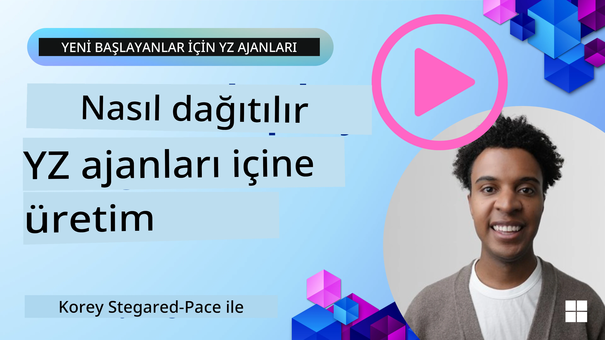

# Üretimde AI Ajanları: Gözlemlenebilirlik ve Değerlendirme

[](https://youtu.be/l4TP6IyJxmQ?si=reGOyeqjxFevyDq9)

AI ajanları deneysel prototiplerden gerçek dünya uygulamalarına geçerken, davranışlarını anlamak, performanslarını izlemek ve çıktıları sistematik olarak değerlendirmek önem kazanır.

## Öğrenme Hedefleri

Bu dersi tamamladıktan sonra nasıl yapacağınızı/bileceklerinizi anlayacaksınız:
- Ajan gözlemlenebilirliği ve değerlendirmesinin temel kavramları
- Ajanların performansını, maliyetlerini ve etkinliğini artırma teknikleri
- AI ajanlarınızı sistematik olarak neyi ve nasıl değerlendireceğiniz
- AI ajanlarını üretime dağıtırken maliyetleri nasıl kontrol edeceğiniz
- Microsoft Agent Framework ile inşa edilen ajanları nasıl enstrümanlayacağınız

Amaç, “kara kutu” ajanlarınızı şeffaf, yönetilebilir ve güvenilir sistemlere dönüştürmek için gereken bilgiyle donatmaktır.

_**Not:** Güvenli ve güvenilir AI Ajanları dağıtmak önemlidir. [Güvenilir AI Ajanları İnşası](../06-building-trustworthy-agents/README.md) dersine de göz atın._

## İzler ve Aralıklar

[Langfuse](https://langfuse.com/) veya [Microsoft Foundry](https://learn.microsoft.com/en-us/azure/ai-foundry/what-is-azure-ai-foundry) gibi gözlemlenebilirlik araçları genellikle ajan işlemlerini izler ve aralıklar olarak temsil eder.

- **İz** bir kullanıcı sorgusunu işleme gibi, tam bir ajan görevini baştan sona temsil eder.
- **Aralıklar** iz içindeki bireysel adımlardır (örneğin bir dil modelini çağırmak veya veri almak).


<!-- Görsel URL'si açıklama amaçlı saklanmıştır -->

Gözlemlenebilirlik olmadan, AI ajanı “kara kutu” gibi hissedilebilir - iç durumu ve muhakemesi opak olup sorun teşhisini veya performans optimizasyonunu zorlaştırır. Gözlemlenebilirlikle, ajanlar “cam kutular” haline gelir; bu şeffaflık güven oluşturmak ve doğru çalıştıklarından emin olmak için hayati öneme sahiptir.

## Üretim Ortamlarında Gözlemlenebilirliğin Önemi

AI ajanlarını üretim ortamlarına geçirmek, yeni zorluklar ve gereksinimler getirir. Gözlemlenebilirlik artık “olması iyi olur” değil, kritik bir yetenektir:

*   **Hata Ayıklama ve Kök Neden Analizi**: Bir ajan başarısız olduğunda veya beklenmeyen çıktı ürettiğinde, gözlemlenebilirlik araçları hatanın kaynağını belirlemek için gereken izleri sağlar. Bu, çoklu LLM çağrıları, araç etkileşimleri ve koşullu mantık içeren karmaşık ajanlarda özellikle önemlidir.
*   **Gecikme ve Maliyet Yönetimi**: AI ajanları sıklıkla token başı veya çağrı başı ücretlendirilen LLM'lere ve diğer dış API'lere dayanır. Gözlemlenebilirlik bu çağrıların hassas takibini sağlar, aşırı yavaş veya maliyetli işlemleri belirlemeye yardımcı olur. Böylece ekipler istemleri optimize edebilir, daha verimli modeller seçebilir veya işlem maliyetlerini yönetmek ve kullanıcı deneyimini iyileştirmek için iş akışlarını yeniden tasarlayabilir.
*   **Güven, Güvenlik ve Uyumluluk**: Birçok uygulamada, ajanların güvenli ve etik davranmasını sağlamak önemlidir. Gözlemlenebilirlik, ajan eylemleri ve kararlarının denetim kaydını sunar. Bu kayıtlar, istem enjeksiyonu, zararlı içerik üretimi veya kişisel tanımlayıcı bilgilerin (PII) yanlış kullanımı gibi sorunları tespit etmek ve azaltmak için kullanılabilir. Örneğin, bir ajanın belirli bir yanıtı veya aracı neden kullandığını anlamak için izler incelenebilir.
*   **Sürekli İyileştirme Döngüleri**: Gözlemlenebilirlik verileri yinelemeli geliştirme sürecinin temelidir. Ajanların gerçek dünyadaki performansını izleyerek, ekipler iyileştirme alanlarını belirleyebilir, modelleri ince ayar için veri toplayabilir ve değişikliklerin etkisini doğrulayabilir. Bu, çevrimiçi değerlendirmeden üretim içgörülerinin çevrimdışı deney ve iyileştirmeyi yönlendirdiği bir geri bildirim döngüsü oluşturur ve ajan performansını kademeli olarak artırır.

## Takip Edilmesi Gereken Temel MetriKler

Ajan davranışını izlemek ve anlamak için çeşitli metrikler ve sinyaller takip edilmelidir. Belirli metrikler ajanın amacına göre değişebilse de, bazıları evrensel olarak önemlidir.

Gözlemlenebilirlik araçlarının izlediği en yaygın metriklerden bazıları şunlardır:

**Gecikme:** Ajan ne kadar hızlı yanıt veriyor? Uzun bekleme süreleri kullanıcı deneyimini olumsuz etkiler. Görevler ve bireysel adımlar için gecikmeyi ajan işlemlerini izleyerek ölçmelisiniz. Örneğin, tüm model çağrıları için 20 saniye süren bir ajan, daha hızlı bir model kullanarak veya model çağrılarını paralel çalıştırarak hızlandırılabilir.

**Maliyetler:** Her ajan çalıştırma maliyeti nedir? AI ajanları, token başı ücretlendirilen LLM çağrılarına veya dış API'lere dayanır. Sık araç kullanımı veya çoklu istemler maliyeti hızla artırabilir. Örneğin, marjinal kalite artışı için bir ajanın bir LLM'yi beş kez çağırması durumunda, maliyetin haklı olup olmadığını değerlendirmeli veya çağrı sayısını azaltmayı ya da daha ucuz bir model kullanmayı düşünmelisiniz. Gerçek zamanlı izleme, beklenmedik maliyet artışlarını (örneğin fazla API döngüsü yaratan hatalar) tanımlamada da yardımcı olabilir.

**İstek Hataları:** Ajan kaç isteği başarısız yaptı? Bu, API hatalarını veya başarısız araç çağrılarını içerebilir. Üretimde bu hatalara karşı ajanınızın dayanıklılığını artırmak için geri dönüşler veya yeniden denemeler kurabilirsiniz. Örneğin, LLM sağlayıcı A kapalıysa, yedek olarak LLM sağlayıcı B'ye geçebilirsiniz.

**Kullanıcı Geri Bildirimi:** Doğrudan kullanıcı değerlendirmeleri değerli bilgiler sağlar. Bu, açık oylamalar (👍beğeni/👎beğenmeme, ⭐1-5 yıldız) veya metin yorumlarını içerebilir. Tutarlı olumsuz geri bildirimler, ajanın beklenildiği gibi çalışmadığını gösteren bir uyarıdır.

**Dolaylı Kullanıcı Geri Bildirimi:** Kullanıcı davranışları, açık oylama olmasa bile dolaylı geri bildirim sağlar. Bu, anlık soru tekrarı, tekrarlanan sorgular veya yeniden deneme düğmesine tıklama gibi davranışları içerebilir. Örneğin, kullanıcıların aynı soruyu sürekli sormasını görmek, ajanın beklenildiği gibi çalışmadığının işaretidir.

**Doğruluk:** Ajan ne sıklıkla doğru veya arzu edilen çıktılar üretiyor? Doğruluk tanımları değişebilir (örneğin, problem çözme doğruluğu, bilgi alma doğruluğu, kullanıcı memnuniyeti). İlk adım, ajanınız için başarının ne olduğunu tanımlamaktır. Doğruluğu otomatik kontroller, değerlendirme puanları veya görev tamamlama etiketleriyle takip edebilirsiniz. Örneğin, izleri “başarılı” veya “başarısız” olarak işaretlemek.

**Otomatik Değerlendirme Metrikleri:** Otomatik değerlendiriciler kurabilirsiniz. Örneğin, bir LLM kullanarak ajanın çıktısını faydalı, doğru veya değil olarak puanlayabilirsiniz. Ayrıca, çeşitli açık kaynak kütüphaneleri ajanın farklı yönlerini puanlamaya yardımcı olur. Örneğin, RAG ajanları için [RAGAS](https://docs.ragas.io/) veya zararlı dil ya da istem enjeksiyonu tespiti için [LLM Guard](https://github.com/protectai/llm-guard).

Pratikte, bu metriklerin birleşimi AI ajan sağlığının en iyi kapsamını sağlar. Bu bölümdeki [örnek not defterinde](./code_samples/10-expense_claim-demo.ipynb) bu metriklerin gerçek örneklerde nasıl göründüğünü göstereceğiz, ancak önce tipik bir değerlendirme iş akışını öğreneceğiz.

## Ajanınızı Enstrümanlayın

İzleme verisi toplamak için kodunuzu enstrümanlamanız gerekecek. Amaç, ajan kodunu izler ve metrikler gönderecek şekilde enstrümanlamak, böylece bir gözlemlenebilirlik platformu bunları yakalayıp işleyip görselleştirebilsin.

**OpenTelemetry (OTel):** [OpenTelemetry](https://opentelemetry.io/), LLM gözlemlenebilirliğinde endüstri standardı haline gelmiştir. Telemetri verisi oluşturma, toplama ve dışa aktarma için API'ler, SDK'lar ve araçlar sağlar.

Mevcut ajan çerçevelerini saran ve OpenTelemetry aralıklarını gözlemlenebilirlik aracına kolayca dışa aktarmayı sağlayan birçok enstrümantasyon kütüphanesi bulunmaktadır. Microsoft Agent Framework, OpenTelemetry ile yerel entegrasyona sahiptir. Aşağıda bir MAF ajanının enstrümanlanmasına örnek verilmiştir:

```python
from agent_framework.observability import get_tracer, get_meter

tracer = get_tracer()
meter = get_meter()

with tracer.start_as_current_span("agent_run"):
    # Agent execution is traced automatically
    pass
```

Bu bölümdeki [örnek not defteri](./code_samples/10-expense_claim-demo.ipynb), MAF ajanınızı nasıl enstrümanlayacağınızı gösterecek.

**Manuel Aralık Oluşturma:** Enstrümantasyon kütüphaneleri iyi bir temel sağlasa da, daha ayrıntılı veya özel bilgi gerekebileceği durumlar sıkça olur. Özel uygulama mantığı eklemek için aralıkları manuel oluşturabilirsiniz. Daha da önemlisi, otomatik veya manuel oluşturulan aralıkları özel özniteliklerle (diğer adıyla etiketler veya metadata) zenginleştirebilirsiniz. Bu öznitelikler, iş ile ilgili özel veriler, ara hesaplamalar veya hata ayıklama ve analiz için faydalı olabilecek herhangi bir bağlamı içerebilir; örn. `user_id`, `session_id`, veya `model_version`.

[Langfuse Python SDK](https://langfuse.com/docs/sdk/python/sdk-v3) ile izler ve aralıkları manuel oluşturma örneği:

```python
from langfuse import get_client
 
langfuse = get_client()
 
span = langfuse.start_span(name="my-span")
 
span.end()
```

## Ajan Değerlendirmesi

Gözlemlenebilirlik bize metrikler verir, ancak değerlendirme o verileri analiz etme (ve testler yapma) sürecidir; yani bir AI ajanın ne kadar iyi performans gösterdiğini ve nasıl geliştirilebileceğini belirlemektir. Başka bir deyişle, izler ve metrikleri aldıktan sonra, bunları ajanın değerlendirilmesi ve kararlar alınması için nasıl kullanırsınız?

Düzenli değerlendirme önemlidir çünkü AI ajanları genellikle belirli olmayan ve güncellemeler veya modellerin davranış değişiklikleri yoluyla evrimleşebilen sistemlerdir – değerlendirme olmadan “akıllı ajanınızın” işini iyi yapıp yapmadığını veya gerileyip gerilemediğini bilemezsiniz.

AI ajanları için iki değerlendirme kategorisi vardır: **çevrimiçi değerlendirme** ve **çevrimdışı değerlendirme**. İkisi de değerlidir ve birbirini tamamlar. Genellikle herhangi bir ajan dağıtmadan önce minimum gerekli adım olarak çevrimdışı değerlendirmeyle başlarız.

### Çevrimdışı Değerlendirme


Bu, ajanı canlı kullanıcı sorguları değil, genellikle test veri setleri kullanarak kontrollü bir ortamda değerlendirmeyi içerir. Beklenen çıktı veya doğru davranışı bildiğiniz küratörlü veri setlerini kullanarak ajanınızı bu veri setlerinde çalıştırırsınız.

Örneğin, matematik metin problemi çözme ajanı oluşturduysanız, cevapları bilinen 100 problemden oluşan bir [test veri setiniz](https://huggingface.co/datasets/openai/gsm8k) olabilir. Çevrimdışı değerlendirme, geliştirme sırasında (CI/CD iş akışlarının parçası olabilir) iyileştirmeleri kontrol etmek veya gerilemelere karşı koruma sağlamak için yapılır. Avantajı, **tekrar edilebilir olması ve gerçek doğrulara sahip olduğunuz için net doğruluk metrikleri alabilmenizdir**. Ayrıca kullanıcı sorgularını simüle edip ajan yanıtlarını ideal cevaplarla karşılaştırabilir veya yukarıda açıklanan otomatik metrikleri kullanabilirsiniz.

Çevrimdışı değerlendirmede temel zorluk, test veri setinizin kapsamlı ve güncel kalmasını sağlamaktır – ajan sabit bir test setinde iyi performans gösterebilir, ancak üretimde çok farklı sorgularla karşılaşabilir. Bu nedenle test setlerinizi yeni uç durumlar ve gerçek dünya senaryolarını yansıtan örneklerle güncel tutmalısınız. Küçük “duman testi” vakaları ile daha geniş performans metrikleri için daha büyük değerlendirme setlerinin karışımı faydalıdır: hızlı kontroller için küçük setler ve daha geniş kapsam için büyük setler.

### Çevrimiçi Değerlendirme


Canlı, gerçek dünya ortamında, yani üretimde gerçek kullanımlar sırasında ajanı değerlendirmeyi ifade eder. Çevrimiçi değerlendirme, ajanın gerçek kullanıcı etkileşimlerindeki performansını izlemeyi ve sonuçları sürekli analiz etmeyi içerir.

Örneğin, başarı oranlarını, kullanıcı memnuniyeti puanlarını veya canlı trafik üzerindeki diğer metrikleri takip edebilirsiniz. Çevrimiçi değerlendirmenin avantajı, **bir laboratuvar ortamında beklemediğiniz durumları yakalamasıdır** – zaman içinde modelin sürüklenmesini gözlemleyebilir (ajanın etkinliği girdi desenleri değiştikçe düşebilir) ve test verilerinizde olmayan beklenmedik sorguları veya durumları yakalayabilirsiniz. Ajanın gerçek ortamda nasıl davrandığını gerçekçe gösterir.

Çevrimiçi değerlendirme sıklıkla, daha önce tartışıldığı gibi, dolaylı ve açık kullanıcı geri bildirimlerini toplar ve ayrıca gölge testleri veya A/B testleri (yeni ajan sürümünün eskiye karşı paralel çalıştırılması) yapabilir. Zorluk ise canlı etkileşimler için güvenilir etiketler veya puanlar almak zor olabilir – kullanıcı geri bildirimi veya sonraki metriklere (örneğin kullanıcının sonucu tıklayıp tıklamadığı) dayanabilir.

### İkisini Birleştirmek

Çevrimiçi ve çevrimdışı değerlendirmeler karşıt değil; çok tamamlayıcıdır. Çevrimiçi izlemeden elde edilen içgörüler (örneğin ajanın kötü performans gösterdiği yeni kullanıcı sorgusu türleri), çevrimdışı test veri setlerinin geliştirilmesi ve çoğaltılması için kullanılabilir. Tam tersine, çevrimdışı testlerde iyi performans gösteren ajanlar daha emin olarak üretimde dağıtılıp çevrimiçi izlenebilir.

Aslında, birçok ekip şu döngüyü benimser:

_çevrimdışı değerlendir -> dağıt -> çevrimiçi izle -> yeni hata vakaları topla -> çevrimdışı veri setine ekle -> ajanı iyileştir -> tekrarla_.

## Yaygın Sorunlar

AI ajanlarını üretime dağıtırken çeşitli zorluklarla karşılaşabilirsiniz. İşte yaygın sorunlar ve olası çözümleri:

| **Sorun**    | **Olası Çözüm**   |
| ------------- | ------------------ |
| AI Ajanı görevleri tutarlı yapmıyor | - AI Ajanına verilen istemi iyileştirin; hedeflerde net olun.<br>- Görevleri alt görevlere bölmek ve bunları birden çok ajan tarafından yönetmek fayda sağlar mı kontrol edin. |
| AI Ajanı sürekli döngülere giriyor  | - Ajanın işlemi ne zaman durduracağını bilmesi için açık sonlandırma şartları belirleyin.<br>- Muhakeme ve planlama gerektiren karmaşık görevler için bu iş için uzmanlaşmış daha büyük bir model kullanın. |
| AI Ajanı araç çağrıları iyi performans göstermiyor   | - Aracın çıktısını ajan sisteminin dışından test edip doğrulayın.<br>- Tanımlı parametreleri, istemleri ve araç adlandırmalarını iyileştirin.  |
| Çok Ajanlı sistem tutarlı performans göstermiyor | - Her ajana verilen istemleri spesifik ve birbirinden farklı olacak şekilde yeniden düzenleyin.<br>- Doğru ajanı belirlemek için bir “yönlendirme” veya kontrol ajanı kullanarak hiyerarşik bir sistem oluşturun. |

Bu sorunların çoğu, yukarıda bahsedilen gözlemlenebilirlikle çok daha etkin şekilde tespit edilebilir. İzler ve metrikler, ajan iş akışında sorunların tam olarak nerede olduğunu belirler, böylece hata ayıklama ve optimizasyon çok daha verimli olur.

## Maliyet Yönetimi

AI ajanlarını üretime dağıtmanın maliyetlerini yönetmek için bazı stratejiler şunlardır:

**Daha Küçük Modellerin Kullanımı:** Küçük Dil Modelleri (SLM'ler) bazı ajan temelli kullanım durumlarında iyi performans gösterebilir ve maliyetleri önemli ölçüde düşürür. Daha önce bahsedildiği gibi, performansı daha büyük modellerle karşılaştırmak için bir değerlendirme sistemi kurmak, bir SLM'in kullanım durumunuzda ne kadar iyi performans göstereceğini anlamanın en iyi yoludur. Niyet sınıflandırması veya parametre çıkarımı gibi daha basit görevler için SLM'leri kullanmayı düşünün, karmaşık çıkarımlar için ise daha büyük modelleri ayırın.

**Bir Yönlendirici Model Kullanmak:** Benzer bir strateji, çeşitli modelleri ve boyutları kullanmaktır. Karmaşıklığa göre istekleri en uygun modellere yönlendirmek için bir LLM/SLM veya sunucusuz fonksiyon kullanabilirsiniz. Bu, maliyetlerin düşürülmesine yardımcı olurken aynı zamanda doğru görevlerde performansı garanti eder. Örneğin, basit sorguları daha küçük ve hızlı modellere yönlendirin ve pahalı büyük modelleri sadece karmaşık çıkarım görevleri için kullanın.

**Yanıtların Önbelleğe Alınması:** Yaygın istekleri ve görevleri belirlemek ve yanıtları ajan sisteminizden geçmeden önce sağlamak, benzer isteklerin hacmini azaltmanın iyi bir yoludur. Daha temel AI modelleri kullanarak bir isteğin önbelleğe alınmış isteklere ne kadar benzediğini belirleyen bir akış bile uygulayabilirsiniz. Bu strateji, sık sorulan sorular veya ortak iş akışları için maliyetleri önemli ölçüde azaltabilir.

## Pratikte nasıl çalıştığını görelim

[Bu bölümün örnek not defterinde](./code_samples/10-expense_claim-demo.ipynb), gözlemlenebilirlik araçlarını kullanarak ajanımızı nasıl izleyip değerlendirebileceğimize dair örnekler göreceğiz.


### Üretimde AI Ajanları hakkında Daha Fazla Sorunuz mu Var?

Diğer öğrenenlerle tanışmak, ofis saatlerine katılmak ve AI Ajanları ile ilgili sorularınızı cevaplamak için [Microsoft Foundry Discord](https://discord.com/invite/ATgtXmAS5D)'a katılın.

## Önceki Ders

[Metakognisyon Tasarım Deseni](../09-metacognition/README.md)

## Sonraki Ders

[Ajan Protokolleri](../11-agentic-protocols/README.md)

---

<!-- CO-OP TRANSLATOR DISCLAIMER START -->
**Feragatname**:
Bu belge, AI çeviri hizmeti [Co-op Translator](https://github.com/Azure/co-op-translator) kullanılarak çevrilmiştir. Doğruluk için çaba sarf etsek de, otomatik çevirilerin hata veya yanlışlık içerebileceğini lütfen unutmayınız. Orijinal belge, kendi dilinde yetkili kaynak olarak kabul edilmelidir. Kritik bilgiler için profesyonel insan çevirisi önerilir. Bu çevirinin kullanımı sonucu ortaya çıkabilecek yanlış anlamalardan veya yanlış yorumlamalardan sorumlu değiliz.
<!-- CO-OP TRANSLATOR DISCLAIMER END -->