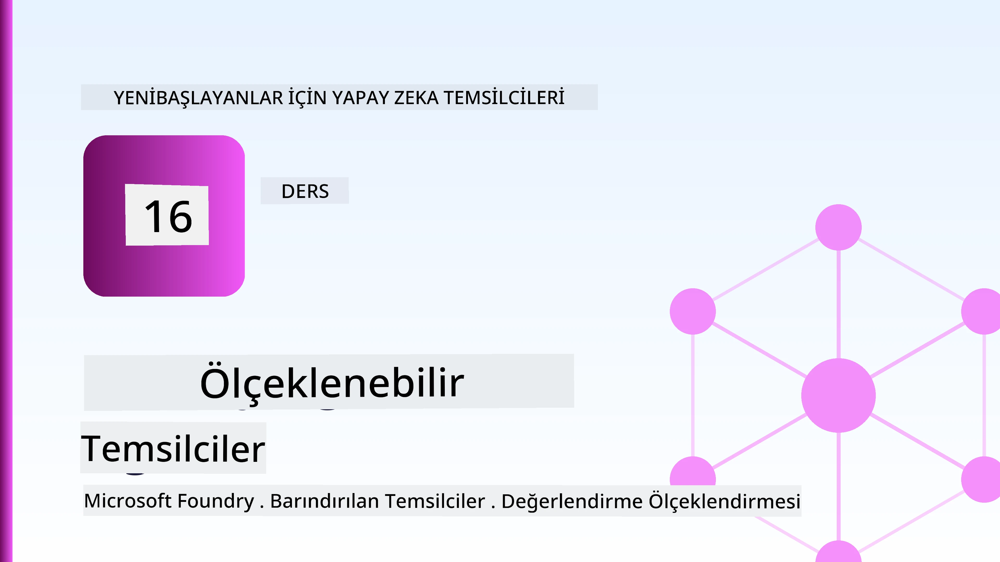
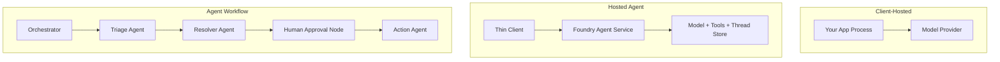
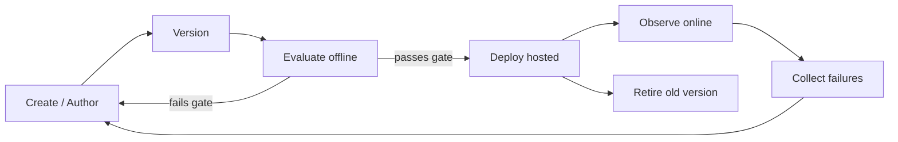
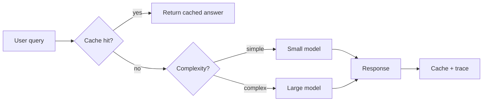
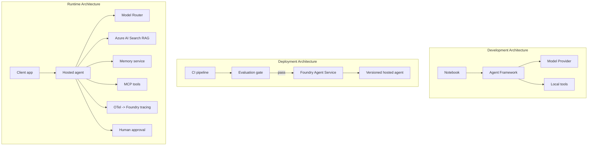

# Microsoft Foundry ile Ölçeklenebilir Ajanlar Dağıtmak



Bu noktaya kadar kursta, `az login` ve birkaç ortam değişkeni tarafından yönlendirilen, dizüstü bilgisayarınızda, bir not defteri içinde çalışan ajanlar oluşturdunuz. Bu, öğrenmek için tam olarak doğru yoldur. Ancak binlerce müşterinin 3 sabah saatinde bağımlı olduğu bir ajanı çalıştırmak için doğru yol değildir.

Bu ders, "kendi makinemde çalışıyor" ile "prodüksiyonda güvenilir ve uygun maliyetli şekilde çalışıyor" arasındaki boşluktan bahseder. Bu boşluğu **Microsoft Foundry** ve **Microsoft Foundry Agent Service** kullanarak kapatıyoruz ve araçlar, getirme, bellek, değerlendirme ve izleme özelliklerine sahip gerçek bir müşteri destek ajanı inşa ediyoruz.

## Giriş

Bu ders şunları kapsayacak:

- Bir **prototip ajan** ile bir **dağıtılmış ajan** arasındaki fark ve geçişin çoğunlukla modelin *çevresindekilerle* ilgili olması.
- Ajanlar için **dağıtım desenleri**: istemci barındırmalı, hizmet barındırmalı (Barındırılan Ajanlar) ve iş akışı düzenlemeli.
- Microsoft Foundry'de **ajan yaşam döngüsü** — oluşturma, sürüm verme, dağıtma, değerlendirme, gözlemleme, emekliye ayırma.
- **Ölçeklendirme stratejileri**: model yönlendirme, önbellekleme, eşzamanlılık ve durumsuz tasarım.
- OpenTelemetry ve Foundry izleme ile **gözlemlenebilirlik**.
- Model seçimi, yönlendirme ve değerlendirme kapıları ile **maliyet optimizasyonu**.
- Kurumsal ihtiyaçlar: yönetişim, insan onayı ve MCP sunucularının prodüksiyonda güvenli çalıştırılması.

## Öğrenme Hedefleri

Bu dersi tamamladıktan sonra şunları bileceksiniz:

- Belirli bir ajan iş yükü için doğru dağıtım modelini seçmek.
- Bir ajanı Microsoft Foundry Agent Service'e dağıtarak sürümlendirilmiş, yönetilen ve gözlemlenebilir hale getirmek.
- Bir ajanı izleme için donatmak ve her sürüm öncesi çalışan bir değerlendirme hattı kurmak.
- Ölçekte gecikme ve maliyeti kontrol altında tutmak için model yönlendirme ve önbellekleme uygulamak.
- Yüksek riskli işlemler için insan onay kapısı eklemek ve prodüksiyon ortamında MCP sunucusunu entegre etmek.

## Ön Gereksinimler

Bu dersin önceki derslerin tamamlandığını ve şu konularda rahat olduğunuzu varsayar:

- [Microsoft Agent Framework](../14-microsoft-agent-framework/README.md) ile ajan oluşturma (Ders 14).
- [Araç Kullanımı](../04-tool-use/README.md) (Ders 4) ve [Agentic RAG](../05-agentic-rag/README.md) (Ders 5).
- [Ajan Belleği](../13-agent-memory/README.md) (Ders 13) ve [Agentic Protokoller / MCP](../11-agentic-protocols/README.md) (Ders 11).
- [Gözlemlenebilirlik ve Değerlendirme](../10-ai-agents-production/README.md) (Ders 10) — bu ders doğrudan üzerine inşa edilmiştir.

Ayrıca ihtiyacınız olacak:

- En az bir dağıtılmış sohbet modeline sahip bir **Azure aboneliği** ve **Microsoft Foundry projesi**.
- Kimlik doğrulaması yapılmış **Azure CLI** (`az login`).
- Python 3.12+ ve depo içindeki paketler [`requirements.txt`](../../../requirements.txt).

## Prototipten Prodüksiyona: Gerçekten Neler Değişir

Bir prototip ajan ile prodüksiyon ajanı aynı temel döngüyü paylaşır — mantık yürütme, araç çağırma, yanıt verme. Değişen, o döngünün etrafında sarılı olan her şeydir. Model, prodüksiyon ajanının yaklaşık %20'sidir; kalan %80 ise operasyonel iskelettir.

| Konu | Prototip | Prodüksiyon |
| --- | --- | --- |
| **Barındırma** | Dizüstünüzde çalışır | Barındırılan bir hizmet olarak çalışır, sürümlenir ve dağıtılır |
| **Kimlik** | Kendi `az login` jetonunuz | Kapsamlı RBAC ile yönetilen kimlik |
| **Durum** | Bellekte, yeniden başlatmada kaybolur | Harici (thread deposu, bellek servisi) |
| **Hata** | Hata izlerini görürsünüz | Yeniden deneme, geri dönüşler, ölü mektup, uyarılar |
| **Maliyet** | "Birkaç sent" | İstek başına takip edilir, yönlendirilir, önbelleğe alınır, bütçelenir |
| **Kalite** | Çıktıyı gözle kontrol edersiniz | Her sürüm öncesi otomatik olarak değerlendirilir |
| **Güven** | Her işlemi onaylarsınız | Politika + riskli işlemler için insan aracı |

Bu tabloyu aklınızda tutun. Aşağıdaki her bölüm bunlardan birine karşılık gelir.

## Ajan Dağıtım Desenleri

Sık sık birlikte kullanacağınız üç desen vardır.

### 1. İstemci Barındırmalı Ajanlar

Ajan nesnesi *kendi* uygulama sürecinizin içindedir. Kodunuz model sağlayıcıyı doğrudan çağırır; mantık döngüsü servisinizde çalışır. Önceki tüm derslerde bu yöntem kullanıldı.

- **Ne zaman kullanılır**: Döngü üzerinde tam kontrol gerektiğinde, özel arakatmanlar varsa veya ajan mevcut bir arka uca gömülü ise.
- **Dezavantajı**: ölçeklendirme, durum ve dayanıklılığı kendiniz yönetirsiniz.

### 2. Barındırılan Ajanlar (Foundry Agent Service)

Ajan, Microsoft Foundry'de *bir kaynak olarak kayıtlıdır*. Foundry mantık döngüsünü barındırır, threadleri saklar, içerik güvenliğini ve RBAC'yi uygular, ajanı Foundry portalında görünür hale getirir. Uygulamanız, thread oluşturup yanıtları okuyan ince bir istemci olur.

- **Ne zaman kullanılır**: Dayanıklılık, yerleşik gözlemlenebilirlik, yönetişim ve daha az operasyonel yüzey istendiğinde.
- **Dezavantajı**: Yönetilen çalışma zamanı karşılığında daha az düşük seviyeli kontrol.

### 3. Ajan İş Akışları

Birden çok ajan (ve araç) açık kontrol akışıyla bir grafik halinde birleşir — sıralı adımlar, dallanma, insan onay düğümleri ve duraklatılabilen ve devam ettirilebilen dayanıklı kontrol noktaları. Bu, Microsoft Agent Framework'ün **İş Akışları** özelliğinin dağıtım ölçeğinde uygulamasıdır.

- **Ne zaman kullanılır**: Tek bir görev birkaç uzmanlaşmış ajanı kapsıyorsa veya ortasında bir onay adımı gerektiriyorsa.
- **Dezavantajı**: daha fazla hareketli parça; düzenleme seviyesinde gözlemlenebilirlik gerekir.



## Microsoft Foundry'de Ajan Yaşam Döngüsü

Bir ajan dağıtmak tek seferlik bir `push` değildir. Bir döngüdür ve yazılım sürüm döngüsü gibidir çünkü aslında odur.



Önemli fikir, [Ders 10](../10-ai-agents-production/README.md) dan alınmıştır: **çevrimdışı değerlendirme bir kapıdır, sonradan düşünülmez.** Yeni bir ajan sürümü değerlendirme eşiklerinizi geçmeden dağıtılmaz. Çevrimiçi gözlemlenebilirlik gerçek dünya hatalarını çevrimdışı test setinize geri besler. İşte tüm döngü budur.

## Ölçeklendirme Stratejileri

Bir ajanı ölçeklendirmek, durumsuz bir web API'sini ölçeklendirmekten farklıdır çünkü her istek birden çok pahalı model ve araç çağrısı tetikleyebilir. Yükün çoğunu taşıyan dört teknik vardır.

**Durumsuz istek işleme.** İşlem belleğinde kullanıcıya özel durum tutmayın. Konuşma threadlerini Foundry thread deposunda veya bir bellek servisi içinde saklayın, böylece herhangi bir örnek herhangi bir isteği işleyebilir. Bu yatay ölçeklendirmeyi mümkün kılar — örnek ekleyin, yapışkan oturumlara gerek yok.

**Model yönlendirme.** Her istek en yetenekli (ve en pahalı) modelinizi gerektirmez. Basit istekleri — niyet sınıflandırması, kısa gerçekçi cevaplar — küçük, hızlı bir modele yönlendirin ve büyük modeli gerçek mantık yürütme için ayırın. Foundry'nin **Model Router** bunu sizin için yapabilir veya hafif bir sınıflandırıcıyı kendiniz uygulayabilirsiniz. Labda bu DIY versiyonunu inşa edeceksiniz.

**Yanıt önbellekleme.** Birçok destek sorgusu neredeyse tekrarlanan sorulardır ("şifremi nasıl sıfırlarım?"). Yaygın soruların cevaplarını önbelleğe alın ve model çağrısı yapmadan servis edin. Orta derecede bir önbellek isabet oranı anlamlı olarak maliyet ve gecikmeyi düşürür.

**Eşzamanlılık ve geri basınç.** Model sağlayıcılar oran limitlerine sahiptir. Eşzamanlılığı sınırlandırın, üssel geri çekilme ile yeniden denemeler kullanın ve nazikçe başarısız olun (sıraya alınmış "üzerinde çalışıyoruz" yanıtı 500 hatasından iyidir).



## Prodüksiyonda Gözlemlenebilirlik

Göremediğinizi yönetemezsiniz. Ders 10'da anlatıldığı gibi, Microsoft Agent Framework **OpenTelemetry** izlerini doğal olarak yayımlar — her model çağrısı, araç çağrısı ve düzenleme adımı bir iz aralığı olur. Prodüksiyonda bu aralıkları Microsoft Foundry'e (ya da herhangi bir OTel uyumlu arka uca) aktarırsınız, böylece:

- Tek bir müşteri şikayetini model ve araç çağrıları boyunca uçtan uca izleyebilirsiniz.
- Zaman içinde p50/p95 gecikme ve istek başına maliyeti izleyebilirsiniz.
- Hata oranı artışları ve maliyet anomalileri için kullanıcılarınız (veya finans ekibiniz) fark etmeden önce uyarı alabilirsiniz.

```python
from agent_framework.observability import get_tracer

tracer = get_tracer()

with tracer.start_as_current_span("support_request") as span:
    span.set_attribute("customer.tier", "enterprise")
    span.set_attribute("routed.model", "gpt-5-nano")
    # agent execution is traced automatically inside this span
```

`customer.tier` ve `routed.model` gibi özellikler, iz duvarını cevap verilebilir sorulara dönüştürür ("kurumsal müşteriler küçük modele çok sık mı yönlendiriliyor?").

## Maliyet Optimizasyonu

Prodüksiyon ajanlarındaki maliyet en çok tokenlardan kaynaklanır. Etkiye göre sıralanmış üç kaldıraç:

1. **Modeli doğru boyutlandırın.** Değerlendirme kapısından geçen küçük bir model, genellikle geçen büyük bir modelden daha ucuzdur. Küçük modelin yeterince iyi olduğunu kanıtlamak için değerlendirmeyi kullanın, en büyük modeli varsayılan olarak seçmek yerine.
2. **Karmaşıklığa göre yönlendirme yapın.** Yukarıdaki gibi — büyük-model mantığı gerektiren isteklere yalnızca büyük model fiyatı ödeyin.
3. **Agresif önbellekleme yapın.** En ucuz model çağrısı, hiç yapmadığınız çağrıdır.

Değerlendirme kapıları ve maliyet kontrolü aynı disiplindir, iki farklı açıdan: değerlendirme size *kalite tabanını* söyler, yönlendirme ve önbellekleme sizi o tabanın *maliyetine* mümkün olduğunca yakın tutar.

## Kurumsal Dağıtım Dikkatleri

**Yönetişim.** Barındırılan Ajanlar Foundry'nin RBAC'sini, içerik güvenliğini ve denetim kayıtlarını devralır. Her ajan için en az ayrıcalığa sahip yönetilen bir kimlik verin — bilgi tabanına salt okuma erişimi, bilet API'sine kapsamlı erişim, başka bir şey değil.

**İnsan aracı.** Bazı işlemler doğrudan otomatikleştirilemeyecek kadar önemlidir — geri ödeme yapma, hesap silme, hukuk ekibine yükseltme gibi. Microsoft Agent Framework **onay gerektiren** araçları destekler: ajan işlemi önerir, yürütme duraklar, insan onaylar veya reddeder ve iş akışı devam eder. Bu temel yapıyı [Ders 6](../06-building-trustworthy-agents/README.md) 'da gördünüz; burada dağıtıyorsunuz.

**Prodüksiyonda MCP.** [MCP](../11-agentic-protocols/README.md), ajanınızın harici araçları standart bir arayüzle kullanmasını sağlar. Prodüksiyonda her MCP sunucusunu güvensiz bir sınır olarak ele alın: sunucu sürümünü sabitleyin, kapsamlı kimlikle çalıştırın, çıktılarını doğrulayın ve asla sırları ona açmayın. MCP sunucu bir bağımlılıktır; bağımlılıklar yamalanır, denetlenir ve oran sınırına tabi tutulur.



Bu üç diyagram — geliştirme, dağıtım, çalışma zamanı — ajanın yaşamının üç aşamasındaki aynı halidir. Ardından gelen lab size bunu inşa ettirir.

## Uygulamalı Lab: Prodüksiyona Hazır Bir Müşteri Destek Ajanı

[`code_samples/16-python-agent-framework.ipynb`](./code_samples/16-python-agent-framework.ipynb) dosyasını açın ve baştan sona ilerleyin. Her prodüksiyon konusu iç içe olan bir **Contoso müşteri destek ajanı** oluşturacaksınız:

1. **Araç çağırma** — sipariş durumu sorgulama ve destek ticketları açma.
2. **RAG** — bilgi tabanından politika sorularına cevap ver (Azure AI Search, dizüstü çalışması için önbelleklİ bir yedek ile, böylece Search kaynağı olmadan çalışır).
3. **Bellek** — konuşma turu boyunca müşteriyi hatırla.
4. **Model yönlendirme** — bir karmaşıklık sınıflandırıcısı her isteği küçük veya büyük modele gönderir.
5. **Yanıt önbellekleme** — tekrar eden sorular önbellekten servis edilir.
6. **İnsan onayı** — eşiğin üzerindeki geri ödemeler insan onayı bekler.
7. **Değerlendirme hattı** — küçük çevrimdışı test seti ajanı puanlar ve sürüm kapısı olarak görev yapar.
8. **Gözlemlenebilirlik** — her isteğin çevresinde OpenTelemetry izleme.

### Adım Adım

Dizüstü, her prodüksiyon konusu için kendi içinde çalıştırılabilir bölüm olacak şekilde düzenlenmiştir. Kalbi yönlendirme-artı-önbellekleme istek işlemcisidir:

```python
async def handle_support_request(query: str, customer_id: str) -> str:
    # 1. Serve from cache when we can.
    cached = response_cache.get(normalize(query))
    if cached:
        return cached

    # 2. Route by complexity to control cost.
    model = "gpt-5-nano" if is_simple(query) else "gpt-5-mini"

    # 3. Run the agent inside a trace span for observability.
    with tracer.start_as_current_span("support_request") as span:
        span.set_attribute("routed.model", model)
        span.set_attribute("customer.id", customer_id)
        response = await support_agent.run(query, model=model)

    # 4. Cache and return.
    response_cache.set(normalize(query), response.text)
    return response.text
```

Sürümü koruyan değerlendirme kapısı şöyle görünür:

```python
async def evaluation_gate(agent, test_cases, threshold: float = 0.8) -> bool:
    passed = 0
    for case in test_cases:
        result = await agent.run(case["input"])
        if score_response(result.text, case["expected"]) >= 0.8:
            passed += 1
    pass_rate = passed / len(test_cases)
    print(f"Evaluation pass rate: {pass_rate:.0%} (gate: {threshold:.0%})")
    return pass_rate >= threshold  # only deploy if the gate passes
```

Her satırı okuyun — dizüstü, hiçbir şeyin bir framework çağrısının arkasına saklanmaması için primitifleri kasıtlı olarak küçük tutar.

## Dağıtılmış Ajanı Duman Testleri ile Doğrulama

Yukarıdaki değerlendirme kapısı ajan nesnenize *çevrimdışı* çalışır. Bir Ajan Barındırılan Ajan olarak dağıtıldıktan sonra, bir tane daha, hatta daha ucuz bir kontrol gerekir: **dağıtılan uç nokta gerçekten cevap veriyor mu?**

"Başarıyla" dağıtmak sadece kontrol düzleminin tanımı kabul ettiğini kanıtlar — ajan yanıt verdiğini kanıtlamaz. Eksik bir bağımlılık, yanlış model yönlendirme veya süresi dolmuş bir bağlantı, hiçbir şey döndürmeyen yeşil bir dağıtıma yol açabilir. Bir **duman testi**, tam değerlendirme maliyetine katlanmadan saniyeler içinde, her dağıtımda bunu yakalar.

Bu depo, [AI Smoke Test](https://github.com/marketplace/actions/ai-smoke-test) GitHub Action üzerinde inşa edilmiş kullanıma hazır bir duman testi hattı sağlar:

- **Katalog** — [`tests/lesson-16-smoke-tests.json`](../../../tests/lesson-16-smoke-tests.json), Contoso destek ajanı için istemleri ve doğrulamaları içerir (temellendirilmiş politika cevapları, sipariş sorgulama, konu dışına çıkmama ve çok turlu thread sürekliliği). Diğer derslerin ajan katalogları onun yanındadır — bkz. [`tests/README.md`](../tests/README.md).
- **İş Akışı** — [`.github/workflows/smoke-test.yml`](../../../.github/workflows/smoke-test.yml) Azure OIDC ile giriş yapar ve her istemi ajanın Yanıtlar uç noktasına POST eder, herhangi bir doğrulama başarısızlığında işi başarısız sayar.

```yaml
- name: Smoke-test hosted agent
  uses: JFolberth/ai-smoketest@v1
  with:
    project_endpoint: ${{ inputs.project_endpoint }}
    agent_name: ContosoSupportAgent
    tests_file: tests/lesson-16-smoke-tests.json
```

Ajanınız dağıtıldıktan sonra **Actions** sekmesinden çalıştırın, Foundry proje uç noktanızı ve ajan adınızı sağlayarak. Federated identity, Foundry proje kapsamı için **Azure AI User** rolüne ihtiyaç duyar. Katmanları bir piramit olarak düşünün: her dağıtımdan sonra çalışan duman testleri (erişilebilir ve yanıt veriyor mu?), terfi öncesi çalışan çevrimdışı değerlendirme (gönderime uygun mu?) ve sürekli çalışan çevrimiçi değerlendirme (gerçek ortamda nasıl çalışıyor?).

## Bilgi Kontrolü

Ödeve geçmeden önce anlayışınızı test edin.

**1. Üretim ajanının yaklaşık ne kadarı "model"dir ve geri kalanı nedir?**

<details>
<summary>Cevap</summary>

Model, sistemin azınlığıdır — genellikle yaklaşık %20 olarak belirtilir. Geri kalanı operasyonel iskelettir: barındırma ve sürümleme, kimlik ve RBAC, dışa aktarılmış durum, hata yönetimi, maliyet takibi, değerlendirme ve insan etkileşimli kontroller. Üretime geçmek, çoğunlukla akıl yürütme döngüsünün *çevresinde* her şeyi inşa etmektir.
</details>

**2. Ne zaman bir Hosted Agent yerine istemci barındırılan ajan tercih edersiniz?**

<details>
<summary>Cevap</summary>

Yerleşik dayanıklılığa (kalıcı ve devam edebilen iş parçacıkları), gözlemlenebilirliğe, içerik güvenirliğine ve RBAC’a sahip yönetilen bir çalışma zamanı istiyorsanız ve akıl yürütme döngüsünün bazı düşük seviyeli kontrollerinden feragat edip daha az operasyonel yüzey alanı istiyorsanız Hosted Agent uygundur. Döngü üzerinde tam kontrole ihtiyacınız varsa veya ajanı mevcut bir backend'in içine gömüyorsanız istemci barındırılan tercih edilir.
</details>

**3. Ölçeklenebilir bir ajanın kendi işlem belleğinde durumsuz olması neden zorunludur?**

<details>
<summary>Cevap</summary>

Böylece herhangi bir örnek herhangi bir isteği işleyebilir, bu da yapışkan oturum olmadan yatay ölçeklenmeye izin verir. Kullanıcı başına konuşma durumu bir iş parçacığı deposuna veya bellek servisine dışa aktarılır. Durum işlem belleğinde olsaydı, yeniden başlatmada kaybolur ve yükü serbestçe dağıtamazsınız.
</details>

**4. Model yönlendirmesi hangi problemi çözer ve değerlendirme ile ilişkisi nedir?**

<details>
<summary>Cevap</summary>

Yönlendirme, basit istekleri küçük, ucuz ve hızlı modele gönderir ve büyük modeli gerçek akıl yürütme için ayırır; böylece gecikmeyi ve maliyeti kontrol eder. Değerlendirme ile ilişkili çünkü değerlendirme, küçük modelin belirli bir istek türü için yeterince iyi olduğunu *kanıtlar* — değerlendirme olmadan yönlendirme tahmin yürütmektir.
</details>

**5. "Değerlendirme geçidi" nedir ve yaşam döngüsünde nerededir?**

<details>
<summary>Cevap</summary>

Bir değerlendirme geçidi, yeni ajan sürümüne karşı çevrimdışı bir test seti çalıştırır ve geçiş oranı eşik değeri aşılmadan dağıtımı engeller. Yaşam döngüsünde "sürüm" ile "dağıtım" arasında yer alır, kaliteyi yayımdan sonra kontrol etmek yerine çıkış için önkoşul yapar.
</details>

**6. Üretimde bir MCP sunucusu neden güvenilmeyen bir sınır olarak değerlendirilmelidir?**

<details>
<summary>Cevap</summary>

Çünkü ajanınızın bağlandığı harici bir bağımlılıktır. Versiyonunu sabitlemeli, sınırlı kimlik ile çalıştırmalı, çıktılarını doğrulamalı, hız sınırı koymalı ve asla sırları ifşa etmemelisiniz — herhangi bir üçüncü taraf bağımlılığa uyguladığınız disiplindir bu. Çıktıları ajanınızın akıl yürütmesine akar, bu yüzden doğrulanmamış güvenlik riski oluşturur.
</details>

**7. Genellikle üretim ajanı maliyetine en büyük etkiyi yapan tek değişiklik nedir ve neden?**

<details>
<summary>Cevap</summary>

Modelin doğru boyutlandırılması — değerlendirme geçidini geçen en küçük modeli kullanmak. Maliyet, tokenlarla belirlenir ve kaliteyi karşılayan küçük bir model genellikle daha büyük bir modelden daha ucuzdur. Ön belleğe alma ve yönlendirme maliyeti daha da düşürür, ama doğru temel model seçimi en büyük birinci derece etkidir.
</details>

**8. `customer.tier` ve `routed.model` gibi span özniteliklerinin gözlemlenebilirlikte rolü nedir?**

<details>
<summary>Cevap</summary>

Ham izleri yanıtlanabilir iş sorularına dönüştürürler. Öznitelikler olmadan elinizde sadece span yığını vardır; onlarla "kurumsal müşteriler küçük modele çok sık yönlendiriliyor mu?" ya da "en yavaş isteklerimizi hangi model işliyor?" sorularını sorabilirsiniz. Öznitelikler, telemetrileri operasyonunuz için önemli boyutlara göre dilimlemenin yoludur.
</details>

## Ödev

Laboratuvardaki müşteri destek ajanını alın ve belirli bir senaryo için güçlendirin: **bir SaaS şirketi için abonelik faturalama destek ajanı.**

Teslimatınız şunları içermelidir:

1. **Araçları** faturalama ile ilgili olanlarla değiştirin: `get_subscription_status`, `get_invoice`, ve `issue_credit` (50$ üzeri kredi insan onayı gerektirir).
2. Şirketin iade politikası, faturalama döngüsü ve iptal politikası hakkında üç RAG belgesi **ekleyin**.
3. En az iki insan onay yolu tetikleyen en az sekiz vaka içeren **değerlendirme setini genişletin** ve değerlendirme geçidinizin doğru geçtiğini ya da geçmediğini doğrulayın.
4. Bir maliyet raporu **ekleyin**: ajana on karışık sorgu gönderdikten sonra, kaç tanesinin küçük modele, kaç tanesinin büyük modele, ve kaç tanesinin önbellekten verildiğini yazdırın.

Kısa bir paragraf (markdown hücresinde) yazarak hangi model yönlendirme kuralını seçtiğinizi ve gerçek trafikle nasıl doğrulayacağınızı açıklayın. Tek bir doğru cevap yoktur — değerlendirmeniz, üretimle ilgili endişelerin birlikte mantıklı bağlandığına dayalıdır.

## Özet

Bu derste Microsoft Foundry ile bir ajanı prototipten üretime taşıdınız:

- Üretime geçiş çoğunlukla modelin etrafındaki **operasyonel iskelet** hakkındadır — barındırma, kimlik, durum, hata yönetimi, maliyet, kalite ve güven.
- Üç **dağıtım kalıbını** öğrendiniz — istemci barındırılan, Hosted Agents ve Agent Workflows — ve her birinin ne zaman uygun olduğunu.
- **Ajan yaşam döngüsünde** çevrimdışı **değerlendirme bir yayımlama kapısı olarak işlev görür** ve çevrimiçi gözlemlenebilirlik hataları test setine geri besler.
- **Ölçeklendirme stratejileri** uyguladınız — durumsuz tasarım, model yönlendirme, önbellekleme ve sınırlandırılmış eşzamanlılık — ve bunları **maliyet optimizasyonuna** bağladınız.
- **Kurumsal kontrolleri** bağladınız: RBAC, insan arayüzü onayı ve üretim güvenli MCP entegrasyonu.
- Tüm bu endişeleri çalıştırılabilir koda bağlayan **üretim hazır müşteri destek ajanı** oluşturdunuz.

Bir sonraki ders zıt bir yolculuğu anlatır: ajanları buluta ölçeklendirmek yerine, onları *aşağı* indirip tamamen yerel olarak bir geliştirici makinesinde çalıştıracaksınız.

## Ek Kaynaklar

- <a href="https://learn.microsoft.com/azure/ai-foundry/what-is-azure-ai-foundry" target="_blank">Microsoft Foundry dokümantasyonu</a>
- <a href="https://learn.microsoft.com/azure/ai-foundry/agents/overview" target="_blank">Microsoft Foundry Ajan Servisi genel bakış</a>
- <a href="https://learn.microsoft.com/en-us/agent-framework/overview/?wt.mc_id=youtube_26688_organicsocial_reactor&pivots=programming-language-python" target="_blank">Microsoft Agent Framework</a>
- <a href="https://learn.microsoft.com/en-us/azure/ai-foundry/openai/concepts/model-router" target="_blank">Microsoft Foundry’de Model Yönlendirici</a>
- <a href="https://learn.microsoft.com/azure/search/search-what-is-azure-search" target="_blank">Azure AI Search</a>
- <a href="https://opentelemetry.io/" target="_blank">OpenTelemetry</a>
- <a href="https://github.com/marketplace/actions/ai-smoke-test" target="_blank">AI Smoke Test GitHub Action</a>
- <a href="https://modelcontextprotocol.io/" target="_blank">Model Context Protocol (MCP)</a>

## Önceki Ders

[Computer Use Agents (CUA) Oluşturma](../15-browser-use/README.md)

## Sonraki Ders

[Yerel AI Ajanları Oluşturma](../17-creating-local-ai-agents/README.md)

---

<!-- CO-OP TRANSLATOR DISCLAIMER START -->
**Feragatname**:
Bu belge, AI çeviri hizmeti [Co-op Translator](https://github.com/Azure/co-op-translator) kullanılarak çevrilmiştir. Doğruluk için çaba sarf etsek de, otomatik çevirilerin hata veya yanlışlık içerebileceğini lütfen unutmayınız. Orijinal belge, kendi dilinde yetkili kaynak olarak kabul edilmelidir. Kritik bilgiler için profesyonel insan çevirisi önerilir. Bu çevirinin kullanımı sonucu ortaya çıkabilecek yanlış anlamalardan veya yanlış yorumlamalardan sorumlu değiliz.
<!-- CO-OP TRANSLATOR DISCLAIMER END -->